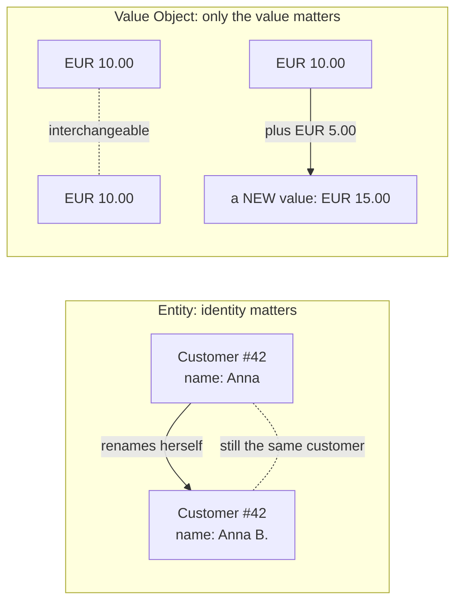
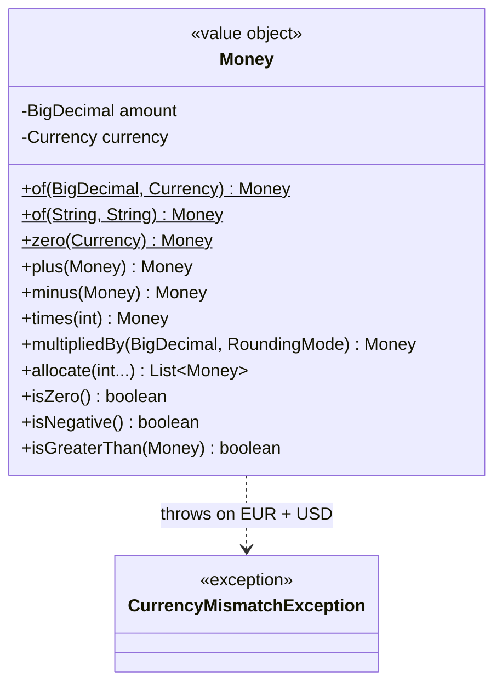
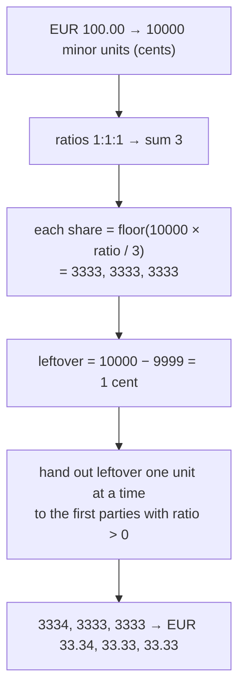

# Task 01 · Money: your first real Value Object

| Difficulty | Topics | Time box |
|---|---|---|
| 🟢 Easy | DDD Value Objects · Effective Java (immutability, static factories, equals/hashCode) · `BigDecimal` | 1.5–2 h |

> **Background reading:** *Effective Java* Items 1 (static factories), 10–11 (equals/hashCode), 17 (minimize mutability) · *Domain-Driven Design*, chapter 5 "Value Objects" · *Refactoring*, "Replace Primitive with Object"

---

## The situation

Welcome to the pricing team. Before I give you anything with business logic in it, I want you to build the type that every other piece of our code will rely on: `Money`.

Right now our checkout passes prices around as `double`. Last month that bit us: a customer was charged `€29.999999999` (shown as €30.00, booked as €29.99), and finance spent two days reconciling a 1-cent difference across 40,000 orders. In another place someone added a USD shipping fee to a EUR basket, and nothing stopped them because both were "just numbers".

This is the classic **Primitive Obsession** smell. The fix is not "be more careful". The fix is a type that makes these mistakes **impossible to write**.

This looks like an easy task, and it is one, but it's also the task where I'll be pickiest in code review. `Money` will be used in hundreds of places. A small sloppiness here (mutable state, a sneaky rounding, a broken `equals`) gets copied everywhere.

## The domain

A few words we use in the team (our *ubiquitous language*):

| Term | Meaning |
|---|---|
| **Amount** | The numeric value, e.g. `19.99`. Never a `double`. |
| **Currency** | ISO-4217 currency, e.g. `EUR`, `USD`, `JPY`. Java has `java.util.Currency` for this. |
| **Minor unit** | The smallest unit you can actually pay: the cent for EUR/USD (2 decimals). The yen (JPY) has **no** minor unit (0 decimals). `Currency.getDefaultFractionDigits()` tells you. |
| **Allocation** | Splitting an amount into parts by ratio, e.g. splitting a €100 voucher across 3 order lines. The parts must add up to **exactly** the original amount. |

### Why `Money` is a Value Object (and not an Entity)



* Two €10 bills are interchangeable. Nobody cares *which* €10 they get. So equality is defined by **value** (amount and currency).
* You never "change" €10 into €15. You compute a **new** value. So `Money` is **immutable**.
* A Value Object protects its own **invariants**. Invalid money (EUR 1.005, or `null` currency) must not be constructible.

### The model



## What I want from you

Implement [`Money`](../src/main/java/io/github/chris013/practice/task01/Money.java). The **public API is fixed** by the tests. Representation and internals are your call. You may turn the class into a `record`.

1. **Construction**
   * `Money.of(BigDecimal, Currency)`, `Money.of("19.99", "EUR")` and `Money.zero(Currency)`.
   * The amount is **normalized to the currency's minor unit**: `of("10", "EUR").amount()` is `10.00`. For JPY it's `500`, not `500.00`.
   * An amount that is **more precise** than the currency allows (`1.005 EUR`, `1.5 JPY`) is rejected with an `IllegalArgumentException`. **Do not round silently.** Silent rounding is how we lost the cent last month.
   * `null` is rejected with a `NullPointerException` that names the parameter.
2. **Equality**: `10`, `10.0` and `10.00` EUR are equal and have the same hash code. EUR 10 and USD 10 are not equal.
3. **`toString()`** prints `EUR 19.90`, `JPY 500`, `USD -3.00`. That's what shows up in logs, so it must be unambiguous.
4. **Arithmetic**: `plus`, `minus`, `times(int quantity)`, and `multipliedBy(BigDecimal factor, RoundingMode rounding)` for things like tax rates.
   * Negative results are allowed: refunds and credit notes exist.
   * Combining two currencies throws `CurrencyMismatchException` (already provided).
5. **Comparison**: `isZero()`, `isNegative()`, `isGreaterThan(Money)` (currency mismatch throws).
6. **Allocation**: `allocate(int... ratios)` splits the money by ratio **without losing or inventing a single minor unit**.
   * `EUR 100.00` allocated `1:1:1` gives `33.34, 33.33, 33.33`.
   * Leftover units go to the **first** parties with a non-zero ratio.
   * A party with ratio `0` gets exactly zero.
   * No ratios, negative ratios, or all-zero ratios are rejected with `IllegalArgumentException`.

### How allocation should work



Work in **minor units (integers)**, not in decimals. Integer arithmetic is exact, so the "sum of parts = whole" property becomes easy to guarantee.

## Constraints & non-goals

* No `double` or `float` anywhere, not even "temporarily".
* No currency conversion. EUR→USD is a separate concern (see Task 07).
* No formatting for humans (`€19,99` in a German locale). That's a presentation concern, so keep it out of the domain type.
* No external libraries (yes, I know about JavaMoney/Moneta. The point is to learn the design.)

## How I'd approach it

* **Start with the invariant, not the methods.** Write down the one sentence that must always be true for a `Money` instance. Once you have it, `equals`, `hashCode` and `toString` almost write themselves.
* **`BigDecimal.equals` is a trap:** `new BigDecimal("10.0").equals(new BigDecimal("10.00"))` is `false` because the scale differs. `compareTo` ignores scale. Think about how your invariant removes this trap completely.
* `BigDecimal.setScale(n, RoundingMode.UNNECESSARY)` throws if rounding would be needed. That's a useful tool for "reject, don't round".
* **Records** are a natural fit for value objects (they give you `equals`/`hashCode`/accessors), and a **compact constructor** is where you enforce invariants. Note that a record's canonical constructor is always public, so all validation and normalization *must* live there, not in `of`.
* Static factories (`of`, `zero`) read better than constructors at the call site (`Money.of("19.99", "EUR")`) and give you room to cache or validate later. *Effective Java* Item 1.
* Name the exception after the domain problem (`CurrencyMismatchException`), not after the technical one.

## Tests

Run: `mvn test -Dtest='**/task01/**'`

The spec is [`MoneyTest`](../src/test/java/io/github/chris013/practice/task01/MoneyTest.java). It covers creation, equality, arithmetic, comparison and allocation, including a parameterized test that checks the parts always add up to the original.

<details>
<summary>Show the tests</summary>

<!-- embed: src/test/java/io/github/chris013/practice/task01/MoneyTest.java -->
**[`MoneyTest.java`](../src/test/java/io/github/chris013/practice/task01/MoneyTest.java)**

```java
package io.github.chris013.practice.task01;

import static org.assertj.core.api.Assertions.assertThat;
import static org.assertj.core.api.Assertions.assertThatThrownBy;

import java.math.BigDecimal;
import java.math.RoundingMode;
import java.util.Currency;
import java.util.List;
import org.junit.jupiter.api.Nested;
import org.junit.jupiter.api.Test;
import org.junit.jupiter.params.ParameterizedTest;
import org.junit.jupiter.params.provider.CsvSource;

class MoneyTest {

    private static final Currency EUR = Currency.getInstance("EUR");

    @Nested
    class Creation {

        @Test
        void normalizes_the_amount_to_the_minor_unit_of_the_currency() {
            assertThat(Money.of("10", "EUR").amount()).isEqualTo(new BigDecimal("10.00"));
            assertThat(Money.of("10.5", "EUR").amount()).isEqualTo(new BigDecimal("10.50"));
        }

        @Test
        void knows_that_yen_has_no_minor_unit() {
            assertThat(Money.of("500", "JPY").amount()).isEqualTo(new BigDecimal("500"));
        }

        @Test
        void refuses_amounts_more_precise_than_the_currency_allows() {
            assertThatThrownBy(() -> Money.of("1.005", "EUR")).isInstanceOf(IllegalArgumentException.class);
            assertThatThrownBy(() -> Money.of("1.5", "JPY")).isInstanceOf(IllegalArgumentException.class);
        }

        @Test
        void refuses_null() {
            assertThatThrownBy(() -> Money.of(null, EUR)).isInstanceOf(NullPointerException.class);
            assertThatThrownBy(() -> Money.of(BigDecimal.ONE, null)).isInstanceOf(NullPointerException.class);
        }

        @Test
        void zero_is_zero_in_the_given_currency() {
            Money zero = Money.zero(EUR);

            assertThat(zero.isZero()).isTrue();
            assertThat(zero.currency()).isEqualTo(EUR);
            assertThat(zero).isEqualTo(Money.of("0.00", "EUR"));
        }
    }

    @Nested
    class Equality {

        @Test
        void is_based_on_value_not_on_notation() {
            Money a = Money.of("10", "EUR");
            Money b = Money.of(new BigDecimal("10.00"), EUR);

            assertThat(a).isEqualTo(b);
            assertThat(a).hasSameHashCodeAs(b);
        }

        @Test
        void takes_the_currency_into_account() {
            assertThat(Money.of("10", "EUR")).isNotEqualTo(Money.of("10", "USD"));
        }

        @Test
        void prints_currency_code_and_amount() {
            assertThat(Money.of("19.9", "EUR")).hasToString("EUR 19.90");
            assertThat(Money.of("500", "JPY")).hasToString("JPY 500");
            assertThat(Money.of("-3", "USD")).hasToString("USD -3.00");
        }
    }

    @Nested
    class Arithmetic {

        @Test
        void adds_and_subtracts() {
            Money ten = Money.of("10.00", "EUR");
            Money three = Money.of("3.50", "EUR");

            assertThat(ten.plus(three)).isEqualTo(Money.of("13.50", "EUR"));
            assertThat(ten.minus(three)).isEqualTo(Money.of("6.50", "EUR"));
        }

        @Test
        void may_become_negative_because_refunds_exist() {
            Money result = Money.of("1.00", "EUR").minus(Money.of("2.50", "EUR"));

            assertThat(result).isEqualTo(Money.of("-1.50", "EUR"));
            assertThat(result.isNegative()).isTrue();
        }

        @Test
        void never_mutates_the_operands() {
            Money ten = Money.of("10.00", "EUR");

            ten.plus(Money.of("5.00", "EUR"));

            assertThat(ten).isEqualTo(Money.of("10.00", "EUR"));
        }

        @Test
        void multiplies_by_a_quantity() {
            assertThat(Money.of("2.99", "EUR").times(3)).isEqualTo(Money.of("8.97", "EUR"));
        }

        @Test
        void multiplies_by_a_factor_with_explicit_rounding() {
            Money price = Money.of("9.99", "EUR");

            assertThat(price.multipliedBy(new BigDecimal("0.19"), RoundingMode.HALF_UP))
                    .isEqualTo(Money.of("1.90", "EUR"));
        }

        @Test
        void uses_exactly_the_rounding_mode_it_is_given() {
            Money quarter = Money.of("0.25", "EUR");
            BigDecimal half = new BigDecimal("0.5");

            assertThat(quarter.multipliedBy(half, RoundingMode.HALF_UP)).isEqualTo(Money.of("0.13", "EUR"));
            assertThat(quarter.multipliedBy(half, RoundingMode.HALF_EVEN)).isEqualTo(Money.of("0.12", "EUR"));
        }

        @Test
        void refuses_to_combine_different_currencies() {
            Money euros = Money.of("10", "EUR");
            Money dollars = Money.of("10", "USD");

            assertThatThrownBy(() -> euros.plus(dollars))
                    .isInstanceOf(CurrencyMismatchException.class)
                    .hasMessageContaining("EUR")
                    .hasMessageContaining("USD");
            assertThatThrownBy(() -> euros.minus(dollars)).isInstanceOf(CurrencyMismatchException.class);
        }
    }

    @Nested
    class Comparison {

        @Test
        void compares_amounts_of_the_same_currency() {
            assertThat(Money.of("10", "EUR").isGreaterThan(Money.of("9.99", "EUR"))).isTrue();
            assertThat(Money.of("10", "EUR").isGreaterThan(Money.of("10", "EUR"))).isFalse();
        }

        @Test
        void refuses_to_compare_different_currencies() {
            assertThatThrownBy(() -> Money.of("10", "EUR").isGreaterThan(Money.of("1", "USD")))
                    .isInstanceOf(CurrencyMismatchException.class);
        }
    }

    @Nested
    class Allocation {

        @Test
        void splits_evenly_when_possible() {
            assertThat(Money.of("90.00", "EUR").allocate(1, 1, 1))
                    .containsExactly(Money.of("30", "EUR"), Money.of("30", "EUR"), Money.of("30", "EUR"));
        }

        @Test
        void never_loses_a_cent() {
            assertThat(Money.of("100.00", "EUR").allocate(1, 1, 1))
                    .containsExactly(Money.of("33.34", "EUR"), Money.of("33.33", "EUR"), Money.of("33.33", "EUR"));
        }

        @Test
        void respects_ratios() {
            assertThat(Money.of("0.05", "EUR").allocate(3, 7))
                    .containsExactly(Money.of("0.02", "EUR"), Money.of("0.03", "EUR"));
        }

        @Test
        void works_in_currencies_without_minor_unit() {
            assertThat(Money.of("1000", "JPY").allocate(1, 1, 1))
                    .containsExactly(Money.of("334", "JPY"), Money.of("333", "JPY"), Money.of("333", "JPY"));
        }

        @Test
        void never_gives_anything_to_a_party_with_ratio_zero() {
            assertThat(Money.of("0.01", "EUR").allocate(0, 1, 1))
                    .containsExactly(Money.of("0.00", "EUR"), Money.of("0.01", "EUR"), Money.of("0.00", "EUR"));
        }

        @ParameterizedTest
        @CsvSource({"100.00", "0.01", "0.00", "-10.00", "1234567.89"})
        void parts_always_add_up_to_the_original(String amount) {
            Money original = Money.of(amount, "EUR");

            List<Money> parts = original.allocate(3, 5, 0, 11, 1);

            Money sum = parts.stream().reduce(Money.zero(EUR), Money::plus);
            assertThat(sum).isEqualTo(original);
        }

        @Test
        void refuses_meaningless_ratios() {
            Money money = Money.of("10", "EUR");

            assertThatThrownBy(money::allocate).isInstanceOf(IllegalArgumentException.class);
            assertThatThrownBy(() -> money.allocate(0, 0)).isInstanceOf(IllegalArgumentException.class);
            assertThatThrownBy(() -> money.allocate(1, -1)).isInstanceOf(IllegalArgumentException.class);
        }
    }
}
```
<!-- /embed -->

</details>

## Definition of done

- [ ] All tests green.
- [ ] `Money` is immutable: no setters, `final` fields (or a record), no method changes `this`.
- [ ] There is exactly **one** place that normalizes the scale and validates the input.
- [ ] No `double`, no silent rounding.
- [ ] Error messages tell the reader *what* was wrong *with which value* (`"1.005 has more decimal places than EUR allows (2)"`, not `"invalid amount"`).
- [ ] Javadoc on the type states the invariant in one or two sentences.

## Stretch goals

1. Add `Money.sum(Collection<Money>, Currency)` and think about why it needs the currency argument (hint: what is the sum of an empty list?).
2. Write a property-style test: for 1,000 random amounts and random ratio arrays, `allocate` always adds up to the original, and no two parts differ by more than one minor unit *relative to their ratio*.
3. Should `Money` implement `Comparable<Money>`? Write down your answer and the reasoning. (There is no single right answer, but there is a wrong one: "yes, by amount".)

---

## Reference solution

<details>
<summary>Spoiler: open only after you have made a serious attempt</summary>

### Key decisions

**1. A record whose compact constructor establishes the invariant.**
The invariant is *"the amount's scale is exactly the currency's minor-unit digits."* Because every path to a `Money`, including the public canonical constructor of the record, goes through the compact constructor, there is no way to get an un-normalized instance. That makes the record-generated `equals`/`hashCode` correct "for free": two instances with the same value now really do have identical `BigDecimal`s.

**2. `RoundingMode.UNNECESSARY` to reject instead of round.**
`setScale(2, UNNECESSARY)` turns `10` into `10.00` (no information lost) but throws for `1.005` (information would be lost). We translate the `ArithmeticException` into an `IllegalArgumentException` with a domain-meaningful message, and keep the original as the cause.

**3. Rounding is the caller's decision.**
`multipliedBy` takes a `RoundingMode` instead of picking one. Tax law, accounting and promotions round differently. If `Money` picked a mode, it would be hiding a business rule inside a technical type (*A Philosophy of Software Design*: pull complexity into the module only if the module can make the decision *correctly for everyone*).

**4. Allocation in minor units with `BigInteger`.**
`amount.unscaledValue()` *is* the amount in minor units, because the scale is fixed. Integer division gives shares that are too small by less than one unit each, so the leftover is always smaller than the number of non-zero ratios. Handing it out one unit at a time to non-zero-ratio parties guarantees the sum and never gives money to a party with ratio 0. Using the sign of the leftover makes it work for negative amounts too.

**5. What I deliberately did *not* do**
* No `Comparable`: "is EUR 10 greater than USD 5?" has no answer without an exchange rate, and `compareTo` must not throw for non-null arguments of the same type (it'd break `TreeSet`, `sort`, and so on).
* No `getAmount().doubleValue()` convenience methods. If someone needs a double, that's a design smell at their call site.
* No caching of common values. Premature, and records make it awkward anyway.

### Code

<!-- embed: solutions/src/main/java/io/github/chris013/practice/task01/Money.java -->
**[`Money.java`](../solutions/src/main/java/io/github/chris013/practice/task01/Money.java)**

```java
package io.github.chris013.practice.task01;

import java.math.BigDecimal;
import java.math.BigInteger;
import java.math.RoundingMode;
import java.util.ArrayList;
import java.util.Currency;
import java.util.List;
import java.util.Objects;
import java.util.stream.IntStream;

/**
 * An amount of money in a specific currency.
 *
 * <p>Immutable value object. The amount always has exactly as many decimal places as the currency's minor unit
 * (2 for EUR, 0 for JPY). That single invariant is what makes {@code equals}, {@code hashCode} and
 * {@code toString} behave by value: {@code 10}, {@code 10.0} and {@code 10.00} EUR are all the same money.
 */
public record Money(BigDecimal amount, Currency currency) {

    public Money {
        Objects.requireNonNull(amount, "amount");
        Objects.requireNonNull(currency, "currency");
        amount = scaledToMinorUnit(amount, currency);
    }

    public static Money of(BigDecimal amount, Currency currency) {
        return new Money(amount, currency);
    }

    public static Money of(String amount, String currencyCode) {
        return new Money(new BigDecimal(amount), Currency.getInstance(currencyCode));
    }

    public static Money zero(Currency currency) {
        return new Money(BigDecimal.ZERO, currency);
    }

    public Money plus(Money other) {
        requireSameCurrency(other);
        return new Money(amount.add(other.amount), currency);
    }

    public Money minus(Money other) {
        requireSameCurrency(other);
        return new Money(amount.subtract(other.amount), currency);
    }

    public Money times(int quantity) {
        return new Money(amount.multiply(BigDecimal.valueOf(quantity)), currency);
    }

    /** Multiplies by an arbitrary factor (a tax rate, a discount, ...). The caller decides how to round. */
    public Money multipliedBy(BigDecimal factor, RoundingMode rounding) {
        Objects.requireNonNull(factor, "factor");
        Objects.requireNonNull(rounding, "rounding");
        BigDecimal exact = amount.multiply(factor);
        return new Money(exact.setScale(amount.scale(), rounding), currency);
    }

    /**
     * Splits this amount into parts proportional to the given ratios without losing or creating a single minor unit.
     * Units that cannot be divided evenly go to the first parties with a non-zero ratio.
     *
     * <p>Example: EUR 100.00 allocated 1:1:1 is EUR 33.34, EUR 33.33, EUR 33.33.
     */
    public List<Money> allocate(int... ratios) {
        requireUsableRatios(ratios);
        BigInteger total = amount.unscaledValue();
        BigInteger ratioSum = BigInteger.valueOf(IntStream.of(ratios).asLongStream().sum());

        List<BigInteger> shares = new ArrayList<>(ratios.length);
        for (int ratio : ratios) {
            shares.add(total.multiply(BigInteger.valueOf(ratio)).divide(ratioSum));
        }

        BigInteger leftover = total.subtract(shares.stream().reduce(BigInteger.ZERO, BigInteger::add));
        BigInteger oneUnit = BigInteger.valueOf(leftover.signum());
        int unitsToHandOut = leftover.abs().intValueExact();
        for (int i = 0; unitsToHandOut > 0; i++) {
            if (ratios[i] > 0) {
                shares.set(i, shares.get(i).add(oneUnit));
                unitsToHandOut--;
            }
        }

        return shares.stream().map(this::inMinorUnits).toList();
    }

    public boolean isZero() {
        return amount.signum() == 0;
    }

    public boolean isNegative() {
        return amount.signum() < 0;
    }

    public boolean isGreaterThan(Money other) {
        requireSameCurrency(other);
        return amount.compareTo(other.amount) > 0;
    }

    @Override
    public String toString() {
        return currency.getCurrencyCode() + " " + amount.toPlainString();
    }

    private Money inMinorUnits(BigInteger units) {
        return new Money(new BigDecimal(units, amount.scale()), currency);
    }

    private void requireSameCurrency(Money other) {
        Objects.requireNonNull(other, "other");
        if (!currency.equals(other.currency)) {
            throw new CurrencyMismatchException(currency, other.currency);
        }
    }

    private static void requireUsableRatios(int[] ratios) {
        if (ratios.length == 0) {
            throw new IllegalArgumentException("At least one ratio is required");
        }
        if (IntStream.of(ratios).anyMatch(ratio -> ratio < 0)) {
            throw new IllegalArgumentException("Ratios must not be negative");
        }
        if (IntStream.of(ratios).allMatch(ratio -> ratio == 0)) {
            throw new IllegalArgumentException("At least one ratio must be positive");
        }
    }

    private static BigDecimal scaledToMinorUnit(BigDecimal amount, Currency currency) {
        int minorUnitDigits = currency.getDefaultFractionDigits();
        if (minorUnitDigits < 0) {
            throw new IllegalArgumentException("Not a currency you can pay with: " + currency);
        }
        try {
            return amount.setScale(minorUnitDigits, RoundingMode.UNNECESSARY);
        } catch (ArithmeticException tooPrecise) {
            throw new IllegalArgumentException(
                    "%s has more decimal places than %s allows (%d)"
                            .formatted(amount.toPlainString(), currency.getCurrencyCode(), minorUnitDigits),
                    tooPrecise);
        }
    }
}
```
<!-- /embed -->

### What I typically flag in first attempts

| Finding | Why it matters |
|---|---|
| `equals` uses `amount.equals(...)` without a normalized scale | `10.0 != 10.00`. Bugs in `HashSet`/`HashMap` keys that only appear with some inputs. |
| `equals` uses `compareTo` but `hashCode` uses `amount.hashCode()` | Breaks the equals/hashCode contract: equal objects, different hashes. |
| Validation in `of(...)` but not in the record constructor | `new Money(new BigDecimal("1.005"), EUR)` sneaks around it. |
| `setScale(2, HALF_UP)` in the constructor | Silent rounding: exactly the bug we're fixing. |
| Hard-coded scale `2` | JPY, BHD (3 decimals), ... |
| Allocation via `divide(..., HALF_UP)` per part | Parts don't add up. 100 / 3 → 33.33 × 3 = 99.99. |
| `throw new RuntimeException("error")` | Unhelpful type, unhelpful message. |

</details>
