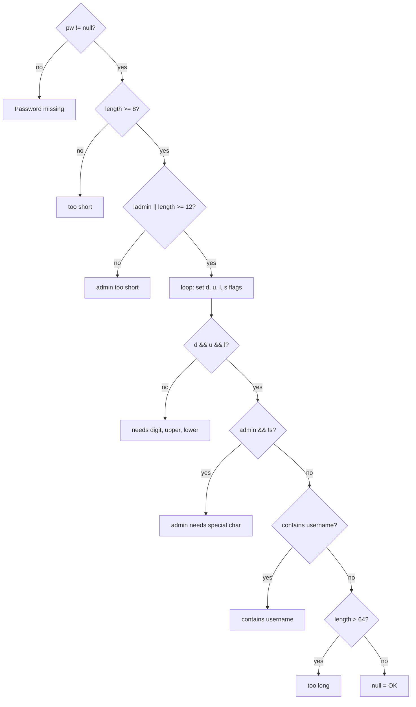
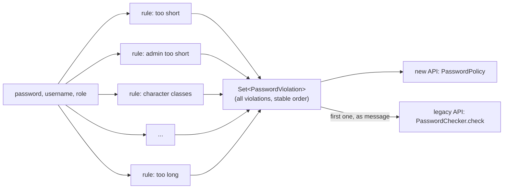

# Task 02 · Untangle the password checker

| Difficulty | Topics | Time box |
|---|---|---|
| 🟢 Easy | Refactoring (guard clauses, extract function, replace magic literal) · Clean code (naming, comments, flag arguments) · Characterization tests | 1.5–2 h |

> **Background reading:** *Refactoring* ch. 1–3 and the catalog entries "Replace Nested Conditional with Guard Clauses", "Extract Function", "Decompose Conditional", "Replace Magic Literal", "Remove Flag Argument" · *A Philosophy of Software Design* ch. 13 (comments that lie) · Michael Feathers, *Working Effectively with Legacy Code*, "characterization tests"

---

## The situation

Product wants the sign-up form to show **all** password problems at once ("too short, needs a digit, must not contain your username") instead of making people fix them one at a time. Reasonable request, small feature.

Then you open [`PasswordChecker`](../src/main/java/io/github/chris013/practice/task02/PasswordChecker.java) and see a pyramid of nested `if`s, one-letter variables, a comment that says "min 6" right above a check for 8, and a `boolean isAdmin` that changes half the rules. The code returns at the first problem it finds, and that early return is baked into the *structure* of the nesting. Bolting "collect all problems" onto that shape would produce something worse.

So this task has two parts, in this order:

1. **Refactor** `PasswordChecker` until it is obvious what the rules are. **No behaviour change.**
2. **Then** implement the new API `PasswordPolicy.violations(...)`. If part 1 went well, part 2 takes ten minutes.

This is Kent Beck's line: *"Make the change easy (warning: this may be hard), then make the easy change."*

## The domain

The rules, as product describes them:

| # | Rule | Applies to |
|---|---|---|
| 1 | A password must be given | everyone |
| 2 | At least 8 characters | everyone |
| 3 | At least 12 characters | admins |
| 4 | Contains a digit, an upper-case and a lower-case letter | everyone |
| 5 | Contains a special character (anything that is not a digit or letter, **whitespace counts**) | admins |
| 6 | Does not contain the username (case-insensitive) | everyone |
| 7 | At most 64 characters | everyone |

The legacy checker reports only the **first** violated rule, in exactly that order. The enum [`PasswordViolation`](../src/main/java/io/github/chris013/practice/task02/PasswordViolation.java) lists them in that order already.

### What the legacy code looks like as a flow

Look at where the error messages are: far away from the conditions that produce them, at the bottom of `else` branches. That is what makes nested conditionals so hard to read.

### Where we want to end up

Each rule is a single line: the condition next to the violation it produces. The legacy method becomes a thin adapter: "first violation's message, or `null`".

## What I want from you

### Part 1: refactor `PasswordChecker.check`

* [`PasswordCheckerCharacterizationTest`](../src/test/java/io/github/chris013/practice/task02/PasswordCheckerCharacterizationTest.java) is **green right now**. Run it after **every** small step. If it goes red, undo (`git checkout`/IDE local history) instead of debugging. Small steps are the whole point.
* Commit after each green step. Your git log should read like a list of refactorings: "Replace nested conditional with guard clauses", "Extract character class detection", ...
* **Keep the quirks.** The test documents one: an empty username (`""`) is "contained" in every password, so everything is rejected. That's a bug, but refactoring means *no behaviour change*. You fix bugs in a separate, deliberate commit with its own test change, never hidden inside a refactoring.
* Suggested sequence (you don't have to follow it, but don't take bigger steps than these):
  1. Replace the nested conditional with **guard clauses** (invert each `if`, return early). The pyramid collapses.
  2. **Rename** `pw`, `d`, `u`, `l`, `s`, `c`.
  3. **Replace magic literals** `8`, `12`, `64` with named constants. Delete the lying comment (*APOSD*: a wrong comment is worse than none).
  4. **Extract** the character-class loop into something with a name. "Split Loop" may help: one question per pass is fine for 64 characters.
  5. Now look at the shape: a sequence of *condition → message*. That is data. Can you make it a list?

### Part 2: implement `PasswordPolicy`

* `violations(password, username, role)` returns **every** violated rule, iterated in `PasswordViolation` declaration order.
* A `null` password yields exactly `{MISSING}`: no other rule can be evaluated meaningfully.
* `role` is required (`NullPointerException` otherwise). Note the signature takes a `Role` enum, not a `boolean`. *Remove Flag Argument*: `violations(pw, "anna", Role.ADMIN)` is readable at the call site; `check(pw, "anna", true)` is not.
* Finally make the old `PasswordChecker.check` **delegate** to `PasswordPolicy`, so there is only one implementation of the rules. Both test classes must be green.

## Constraints & non-goals

* Don't change the signature of `PasswordChecker.check`: other teams call it.
* Don't add a rules engine, annotations, config files or a `Rule` interface hierarchy with seven classes. The rules fit on one screen, so keep them there.
* Don't "fix" the empty-username quirk in this task (do it as stretch goal 1, in its own commit).

## How I'd approach it

* Read the characterization test *before* you touch the code. It's the best documentation the legacy code has.
* Guard clauses work for **validation** because the "happy path" is the last line. When every check is `if (bad) return error;`, the order of the `if`s *is* the rule priority, and you can see it at a glance.
* An `EnumSet` iterates in declaration order. That gives you the "stable order" requirement without sorting.
* A rule is a pair *(violation, predicate)*. A small private `record` plus a `List.of(...)` is often all the "pattern" you need. Ask yourself if a reader can see all seven rules on one screen.
* Watch the null password: if your rules are a list of predicates, where does the null check belong so that no predicate ever has to think about null?

## Tests

Run: `mvn test -Dtest='**/task02/**'`

* `PasswordCheckerCharacterizationTest`: green before and after part 1. The safety net.
* `PasswordPolicyTest`: red until part 2. The last test checks that old and new API agree.

Show the tests

<!-- embed: src/test/java/io/github/chris013/practice/task02/PasswordCheckerCharacterizationTest.java -->
<!-- /embed -->

<!-- embed: src/test/java/io/github/chris013/practice/task02/PasswordPolicyTest.java -->
<!-- /embed -->

## Definition of done

- [ ] Both test classes green, and the characterization test was green after **every** commit of part 1.
- [ ] No nesting deeper than one level in the rule logic.
- [ ] No magic numbers, no one-letter names (except maybe a lambda parameter), no lying comments.
- [ ] Each rule's condition and its violation are on the same line or adjacent lines.
- [ ] The rules exist exactly once; `PasswordChecker` delegates.
- [ ] The empty-username quirk is still there, and a comment says it is a *known quirk*, not intended behaviour.

## Stretch goals

1. **Fix the quirk properly.** First change the characterization test case (that's the spec change, and it should be its own commit with a message that explains *why*), then the code. Decide: is a blank username a programming error (`IllegalArgumentException`) or "rule doesn't apply"?
2. Product asks for "no more than 3 identical characters in a row". Add it. How many places did you have to touch? (Answer for a good design: the enum and one line in the rule list.)
3. The password `"Passwort1"` is in every breach list. How would you add a "not a known-breached password" rule that needs an external service, without making `PasswordPolicy` depend on HTTP? (Peek at Task 10 if you're curious.)

---

## Reference solution

Spoiler: open only after you have made a serious attempt

### Key decisions

**1. The rules are data.** After the guard-clause step, the method is seven `if (condition) return message;` lines. Seven lines of the same shape are a list, so `RULES` is a `List<Rule>` where `Rule` is a private record of *(violation, predicate)*. Reading the list top to bottom *is* reading the policy.

**2. A private `Candidate` record gives the predicates a vocabulary.** `candidate.isAdmin() && !candidate.hasSpecialCharacter()` reads like the business rule. The character classification lives in one tiny private enum, so "whitespace counts as special" is visible in exactly one place.

**3. Null is handled once, at the boundary.** `violations` returns `{MISSING}` before any rule runs, so no predicate ever checks for null. That's *A Philosophy of Software Design*'s "define errors out of existence" applied locally: inside the rule list, a null password simply can't happen.

**4. `EnumSet` for free ordering.** Collecting into `EnumSet.noneOf(PasswordViolation.class)` means "stable order" is guaranteed by the type, not by the order of the `RULES` list or a sort. (It also happens to be very fast and compact.)

**5. The legacy method became an adapter.** `check(...)` maps the boolean flag to a `Role` and takes the first violation's message. Old callers keep working; new callers get the better API. When all callers have migrated, delete `PasswordChecker`. This is the *expand-contract* (or "parallel change") approach to API evolution.

**6. What I did *not* do:** no `PasswordRule` interface with seven implementing classes. Seven classes of three lines each, spread across seven files, would scatter the policy. A strategy-per-class design starts to pay off when rules carry their own state or dependencies (like the breach-list check in stretch goal 3), not before.

### Code

<!-- embed: solutions/src/main/java/io/github/chris013/practice/task02/PasswordPolicy.java -->
<!-- /embed -->

<!-- embed: solutions/src/main/java/io/github/chris013/practice/task02/PasswordChecker.java -->
<!-- /embed -->

### What I typically flag in first attempts

| Finding | Why it matters |
|---|---|
| "Fixed" the empty-username bug during the refactoring | Mixing behaviour change into a refactoring makes both unreviewable. Separate commits. |
| One huge commit "refactor password checker" | Nobody can review it, and you couldn't bisect it. Small, named steps. |
| Kept the `boolean isAdmin` in the new API | Flag arguments hide meaning at the call site and invite a second and third flag. |
| Rules evaluated with a null password, each doing `password != null && ...` | Seven places to forget a null check instead of one. |
| Returned a `List<String>` of messages | Callers (the UI) need to *react* to specific violations, e.g. highlight a field. Messages are presentation; the enum is the domain. |
| Character class detection duplicated per rule with regexes | Different regexes classify characters differently (`\\W` vs. `Character.isLetter`): subtle behaviour change. |

