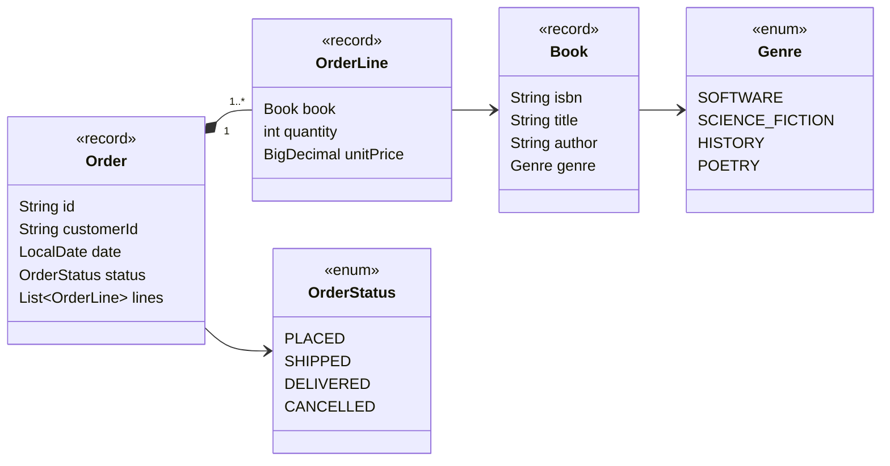
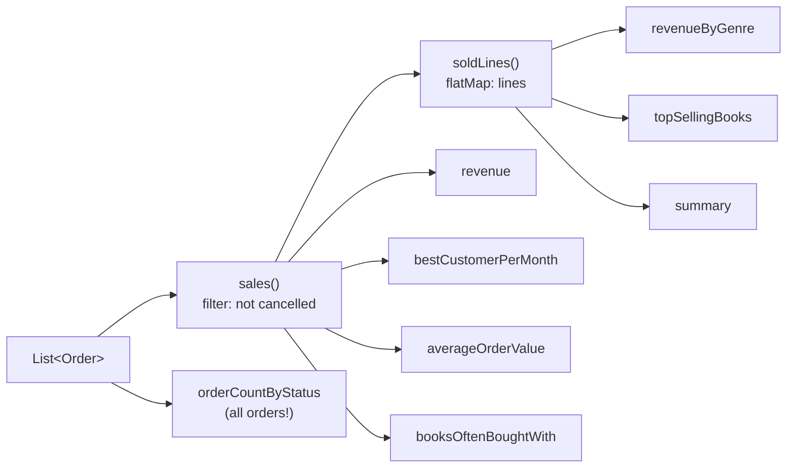

# Task 03 · The Monday sales report

| Difficulty | Topics | Time box |
|---|---|---|
| 🟡 Medium | Modern Java: Streams, Collectors (`groupingBy`, `teeing`, `toMap`, downstream collectors), `Comparator` composition, `Optional` · Records with behaviour | 2–3 h |

> **Background reading:** *Modern Java in Action* ch. 4–6 (streams, collectors) and ch. 11 (`Optional`) · *Effective Java* Items 45–48 (streams: use judiciously, prefer side-effect-free functions, return collections) · *Refactoring* "Move Function" / "Feature Envy"

---

## The situation

We run an online bookshop. Every Monday the sales team asks the same questions: how much did we sell, which genres are doing well, which books sell best, who are our best customers. Right now someone exports a CSV and does it in a spreadsheet. We want a `SalesReport` they can call.

The data model already exists and is small. What I care about in this task is **how your stream code reads**. I've seen plenty of "stream solutions" that are 25-line pipelines with nested lambdas, `forEach` writing into an outside `HashMap`, and `.get()` on every `Optional`. They work, but nobody can review them. I want pipelines that read like the question they answer.

## The domain



| Term | Meaning |
|---|---|
| **Sale** | An order that is **not cancelled**. `PLACED`, `SHIPPED` and `DELIVERED` all count as sales; we recognize revenue on placement. |
| **Line total** | `unitPrice × quantity`. The unit price is stored per line because prices change over time (see the discounted Effective Java in order `o6`). |
| **Order total** | Sum of its line totals. |
| **Copies sold** | Sum of quantities. Two copies of Dune on one line = 2 copies. |
| **Bought together** | Two different books on the same (non-cancelled) order. Counted **once per order**, no matter the quantities. |

### The data flow you'll build



Notice that almost everything starts from the same two "views": *sales* and *sold lines*. If your code doesn't have those two names somewhere, you're probably repeating the cancelled-filter eight times.

## What I want from you

Implement every method of [`SalesReport`](../src/main/java/io/github/chris013/practice/task03/SalesReport.java). The Javadoc of each method is the spec; the tests pin down the details.

| Method | Collector skills it trains |
|---|---|
| `revenue()` | `reduce` / `reducing` with `BigDecimal` |
| `revenueByGenre()` | `groupingBy` with a map factory and a downstream collector |
| `topSellingBooks(limit)` | `groupingBy` + `summingLong`, then sort entries with a composed `Comparator` |
| `bestCustomerPerMonth()` | Two-level grouping, `collectingAndThen`, a `TreeMap` for chronological order |
| `averageOrderValue()` | `teeing` (two collectors in one pass), `Optional` for "no data" |
| `orderCountByStatus()` | `EnumMap`, making absent keys present with `0` |
| `booksOftenBoughtWith(isbn)` | `flatMap`, `distinct`, counting co-occurrences |
| `summary()` | `teeing` into a record constructor |

Rules:

1. **Cancelled orders never count**, except in `orderCountByStatus`, which counts all orders.
2. **No `for` loops and no `forEach`** with side effects in `SalesReport`. Streams only. (In real life loops are fine. Here the point is to learn the collectors.)
3. **No mutable state outside a collector**: no `map.put(...)` inside a lambda, no `AtomicReference` tricks.
4. **Every pipeline should fit in ~6 lines.** If it's longer, extract a well-named private method or a reusable `Collector`.
5. Money stays `BigDecimal`. No `double`, no `mapToDouble(...).sum()`.
6. The report must not change if the caller modifies their list after construction.
7. You may add methods to the domain records (`Order`, `OrderLine`). In fact I'd like you to.

## Constraints & non-goals

* No performance tuning: we have thousands of orders, not billions. Readability wins.
* No parallel streams. (Stretch goal 3 asks *why not*.)
* Don't touch the tests or the fixture.

## How I'd approach it

* **Feature Envy check:** If you write `line.unitPrice().multiply(BigDecimal.valueOf(line.quantity()))` inside `SalesReport`, that computation is envious of `OrderLine`. Move it there as `OrderLine.total()`. Same for "is this order a sale?" Records can (and should) have behaviour.
* Write the two private "views" first: `sales()` and `soldLines()`. Return `Stream`s from them, not lists. Each call creates a fresh stream, so they're safe to reuse.
* Summing `BigDecimal` comes up in almost every method. A tiny generic helper like `sumOf(Function<? super T, BigDecimal>)` that returns a `Collector` removes a lot of noise. (Note the `? super T`: *Effective Java* Item 31, PECS.)
* `Comparator` has combinators: `Map.Entry.comparingByValue()`, `.reversed()`, `.thenComparing(...)`. Name your comparators: `MOST_FIRST_THEN_BY_TITLE` reads better than a lambda you have to decode.
* Watch out for type inference with `comparingByValue().reversed()`: Java can't infer the generic types through `.reversed()`. You'll need an explicit type witness: `Map.Entry.<Book, Long>comparingByValue().reversed()`.
* `Collectors.teeing(c1, c2, merger)` runs two collectors over the same elements and merges the results. Perfect for "average = sum / count" in one pass.
* `Optional` is for *return types* that may legitimately be empty. Don't take `Optional` as a parameter, and don't call `.get()`.
* `groupingBy(classifier, mapFactory, downstream)`: the `mapFactory` overload is how you get an `EnumMap` or `TreeMap`.

## Tests

Run: `mvn test -Dtest='**/task03/**'`

[`SalesReportTest`](../src/test/java/io/github/chris013/practice/task03/SalesReportTest.java) builds a fixture of seven orders. There's a table in a comment at the top so you can verify every expected number by hand. Please do that once for `revenueByGenre`, it's a good habit.

<details>
<summary>Show the tests</summary>

<!-- embed: src/test/java/io/github/chris013/practice/task03/SalesReportTest.java -->
**[`SalesReportTest.java`](../src/test/java/io/github/chris013/practice/task03/SalesReportTest.java)**

```java
package io.github.chris013.practice.task03;

import static io.github.chris013.practice.task03.Genre.HISTORY;
import static io.github.chris013.practice.task03.Genre.SCIENCE_FICTION;
import static io.github.chris013.practice.task03.Genre.SOFTWARE;
import static io.github.chris013.practice.task03.OrderStatus.CANCELLED;
import static io.github.chris013.practice.task03.OrderStatus.DELIVERED;
import static io.github.chris013.practice.task03.OrderStatus.PLACED;
import static io.github.chris013.practice.task03.OrderStatus.SHIPPED;
import static org.assertj.core.api.Assertions.assertThat;
import static org.assertj.core.api.Assertions.assertThatThrownBy;
import static org.assertj.core.api.Assertions.entry;

import java.math.BigDecimal;
import java.time.LocalDate;
import java.time.YearMonth;
import java.util.ArrayList;
import java.util.List;
import org.junit.jupiter.api.Nested;
import org.junit.jupiter.api.Test;

class SalesReportTest {

    static final Book DDD = new Book("978-0321125217", "Domain-Driven Design", "Eric Evans", SOFTWARE);
    static final Book EFFECTIVE_JAVA = new Book("978-0134685991", "Effective Java", "Joshua Bloch", SOFTWARE);
    static final Book DUNE = new Book("978-0441172719", "Dune", "Frank Herbert", SCIENCE_FICTION);
    static final Book FOUNDATION = new Book("978-0553293357", "Foundation", "Isaac Asimov", SCIENCE_FICTION);
    static final Book SAPIENS = new Book("978-0062316097", "Sapiens", "Yuval Noah Harari", HISTORY);

    /*
     * order  customer  date        status     lines                                   total
     * o1     anna      2026-01-05  DELIVERED  DDD 1x54.99, EJ 1x44.99                  99.98
     * o2     ben       2026-01-12  DELIVERED  Dune 2x9.99                              19.98
     * o3     ben       2026-01-20  CANCELLED  Sapiens 1x14.99, DDD 1x54.99            (69.98, never counts)
     * o4     carla     2026-02-02  SHIPPED    EJ 2x44.99, Dune 1x9.99                  99.97
     * o5     anna      2026-02-14  PLACED     Foundation 3x8.99                        26.97
     * o6     ben       2026-02-20  DELIVERED  EJ 1x39.99, Sapiens 1x14.99              54.98
     * o7     dave      2026-02-25  DELIVERED  EJ 1x44.99, Dune 1x9.99                  54.98
     */
    static final List<Order> ORDERS = List.of(
            order("o1", "anna", "2026-01-05", DELIVERED, line(DDD, 1, "54.99"), line(EFFECTIVE_JAVA, 1, "44.99")),
            order("o2", "ben", "2026-01-12", DELIVERED, line(DUNE, 2, "9.99")),
            order("o3", "ben", "2026-01-20", CANCELLED, line(SAPIENS, 1, "14.99"), line(DDD, 1, "54.99")),
            order("o4", "carla", "2026-02-02", SHIPPED, line(EFFECTIVE_JAVA, 2, "44.99"), line(DUNE, 1, "9.99")),
            order("o5", "anna", "2026-02-14", PLACED, line(FOUNDATION, 3, "8.99")),
            order("o6", "ben", "2026-02-20", DELIVERED, line(EFFECTIVE_JAVA, 1, "39.99"), line(SAPIENS, 1, "14.99")),
            order("o7", "dave", "2026-02-25", DELIVERED, line(EFFECTIVE_JAVA, 1, "44.99"), line(DUNE, 1, "9.99")));

    private final SalesReport report = new SalesReport(ORDERS);
    private final SalesReport emptyReport = new SalesReport(List.of());

    @Nested
    class Revenue {

        @Test
        void sums_all_orders_except_cancelled_ones() {
            assertThat(report.revenue()).isEqualByComparingTo("356.86");
        }

        @Test
        void is_zero_without_orders() {
            assertThat(emptyReport.revenue()).isEqualByComparingTo("0");
        }

        @Test
        void is_broken_down_by_genre() {
            assertThat(report.revenueByGenre())
                    .containsOnlyKeys(SOFTWARE, SCIENCE_FICTION, HISTORY)
                    .hasEntrySatisfying(SOFTWARE, revenue -> assertThat(revenue).isEqualByComparingTo("274.94"))
                    .hasEntrySatisfying(SCIENCE_FICTION, revenue -> assertThat(revenue).isEqualByComparingTo("66.93"))
                    .hasEntrySatisfying(HISTORY, revenue -> assertThat(revenue).isEqualByComparingTo("14.99"));
        }
    }

    @Nested
    class TopSellingBooks {

        @Test
        void ranks_books_by_copies_sold() {
            assertThat(report.topSellingBooks(3)).containsExactly(EFFECTIVE_JAVA, DUNE, FOUNDATION);
        }

        @Test
        void breaks_ties_by_title() {
            // DDD and Sapiens both sold 1 copy (the cancelled order doesn't count).
            assertThat(report.topSellingBooks(4)).containsExactly(EFFECTIVE_JAVA, DUNE, FOUNDATION, DDD);
        }

        @Test
        void returns_fewer_books_if_fewer_were_sold() {
            assertThat(report.topSellingBooks(100)).hasSize(5);
            assertThat(emptyReport.topSellingBooks(3)).isEmpty();
        }

        @Test
        void refuses_a_negative_limit() {
            assertThatThrownBy(() -> report.topSellingBooks(-1)).isInstanceOf(IllegalArgumentException.class);
        }
    }

    @Nested
    class BestCustomerPerMonth {

        @Test
        void finds_the_biggest_spender_of_each_month_in_chronological_order() {
            assertThat(report.bestCustomerPerMonth())
                    .containsExactly(entry(YearMonth.of(2026, 1), "anna"), entry(YearMonth.of(2026, 2), "carla"));
        }

        @Test
        void gives_ties_to_the_alphabetically_first_customer() {
            SalesReport tie = new SalesReport(List.of(
                    order("x1", "zoe", "2026-03-01", DELIVERED, line(DUNE, 1, "9.99")),
                    order("x2", "max", "2026-03-02", DELIVERED, line(DUNE, 1, "9.99"))));

            assertThat(tie.bestCustomerPerMonth()).containsExactly(entry(YearMonth.of(2026, 3), "max"));
        }
    }

    @Nested
    class AverageOrderValue {

        @Test
        void is_rounded_half_up_to_cents() {
            // 356.86 / 6 = 59.4766...
            assertThat(report.averageOrderValue()).hasValueSatisfying(
                    average -> assertThat(average).isEqualByComparingTo("59.48"));
        }

        @Test
        void is_empty_when_nothing_was_sold() {
            assertThat(emptyReport.averageOrderValue()).isEmpty();
        }
    }

    @Nested
    class OrderCountByStatus {

        @Test
        void counts_every_order_including_cancelled_ones() {
            assertThat(report.orderCountByStatus())
                    .containsExactly(entry(PLACED, 1L), entry(SHIPPED, 1L), entry(DELIVERED, 4L), entry(CANCELLED, 1L));
        }

        @Test
        void contains_every_status_even_without_orders() {
            assertThat(emptyReport.orderCountByStatus())
                    .containsExactly(entry(PLACED, 0L), entry(SHIPPED, 0L), entry(DELIVERED, 0L), entry(CANCELLED, 0L));
        }
    }

    @Nested
    class BooksOftenBoughtWith {

        @Test
        void ranks_by_number_of_shared_orders_then_title() {
            assertThat(report.booksOftenBoughtWith(EFFECTIVE_JAVA.isbn())).containsExactly(DUNE, DDD, SAPIENS);
        }

        @Test
        void ignores_cancelled_orders() {
            assertThat(report.booksOftenBoughtWith(DDD.isbn())).containsExactly(EFFECTIVE_JAVA);
        }

        @Test
        void is_empty_for_an_unknown_book() {
            assertThat(report.booksOftenBoughtWith("000-0000000000")).isEmpty();
        }
    }

    @Test
    void summarizes_revenue_and_copies_sold() {
        SalesSummary summary = report.summary();

        assertThat(summary.revenue()).isEqualByComparingTo("356.86");
        assertThat(summary.unitsSold()).isEqualTo(14);
    }

    @Test
    void is_not_affected_by_later_changes_to_the_input_list() {
        List<Order> orders = new ArrayList<>(ORDERS);
        SalesReport snapshot = new SalesReport(orders);

        orders.clear();

        assertThat(snapshot.revenue()).isEqualByComparingTo("356.86");
    }

    private static Order order(String id, String customer, String date, OrderStatus status, OrderLine... lines) {
        return new Order(id, customer, LocalDate.parse(date), status, List.of(lines));
    }

    private static OrderLine line(Book book, int quantity, String unitPrice) {
        return new OrderLine(book, quantity, new BigDecimal(unitPrice));
    }
}
```
<!-- /embed -->

</details>

## Definition of done

- [ ] All tests green.
- [ ] The "not cancelled" rule is written exactly once.
- [ ] No `for`, no side-effecting `forEach`, no `Optional.get()`, no `double`.
- [ ] Line and order totals are computed by the records, not by the report.
- [ ] Every public method body is short enough to read without scrolling, and helper names explain intent (`biggestSpender`, `ranked`, ...).

## Stretch goals

1. Add `revenueByAuthor()` returning a `Map<String, BigDecimal>` sorted by revenue descending. Which `Map` implementation preserves *insertion* order? How do you get the collector to use it?
2. Write `loyalCustomers(int minimumOrders)`: customers with at least *n* sales, sorted by revenue. Then compare your stream version with a plain `for` loop version. Which would you rather review? (There's no wrong answer, only reasons.)
3. Why would `orders.parallelStream()` almost certainly make this report *slower*? Think about the size of the data, the cost of splitting, and what `TreeMap`/`EnumMap` merging costs.

---

## Reference solution

<details>
<summary>Spoiler: open only after you have made a serious attempt</summary>

### Key decisions

**1. Behaviour moved to the data.** `OrderLine.total()`, `Order.total()`, `Order.countsAsSale()`, `Order.distinctBooks()` and `Order.contains(isbn)` live in the records. The report talks in business terms; the arithmetic sits next to the data it uses.

**2. Two views, used everywhere.** `sales()` and `soldLines()` are private methods returning fresh streams. The cancellation rule exists exactly once (in `Order.countsAsSale()`), and the report applies it exactly once (in `sales()`).

**3. One reusable collector.** `sumOf(...)` wraps `reducing(BigDecimal.ZERO, mapper, BigDecimal::add)`. It's used six times and turns `groupingBy(genre, reducing(ZERO, OrderLine::total, BigDecimal::add))` into `groupingBy(genre, sumOf(OrderLine::total))`.

**4. Named comparators.** `MOST_FIRST_THEN_BY_TITLE` is shared by `topSellingBooks` and `booksOftenBoughtWith`, because both answer "rank books by a count". The tie-breaker for customers ("alphabetically first wins") is expressed by `max` over *(revenue, reverse key order)*, which is easier to verify than a hand-written `compare`.

**5. The right map for each job.** `EnumMap` for genre/status (ordered by declaration, compact), `TreeMap` for months (chronological). The `orderCountByStatus` solution streams over *all statuses* and counts orders per status. That reads exactly like the requirement ("every status is present") and avoids a "group, then fill in the missing zeros" two-step.

**6. `teeing` for one-pass aggregates.** `averageOrderValue` and `summary` each compute two aggregates in a single pass, and the merger function decides what "no data" means (`Optional.empty()`).

### Code

<!-- embed: solutions/src/main/java/io/github/chris013/practice/task03/SalesReport.java -->
**[`SalesReport.java`](../solutions/src/main/java/io/github/chris013/practice/task03/SalesReport.java)**

```java
package io.github.chris013.practice.task03;

import static java.util.function.Function.identity;
import static java.util.stream.Collectors.collectingAndThen;
import static java.util.stream.Collectors.counting;
import static java.util.stream.Collectors.groupingBy;
import static java.util.stream.Collectors.reducing;
import static java.util.stream.Collectors.summingLong;
import static java.util.stream.Collectors.teeing;
import static java.util.stream.Collectors.toMap;

import java.math.BigDecimal;
import java.math.RoundingMode;
import java.time.YearMonth;
import java.util.Arrays;
import java.util.Comparator;
import java.util.EnumMap;
import java.util.List;
import java.util.Map;
import java.util.Optional;
import java.util.TreeMap;
import java.util.function.Function;
import java.util.stream.Collector;
import java.util.stream.Stream;

/** Answers the questions the sales team asks every Monday. Cancelled orders never count as sales. */
public final class SalesReport {

    /** Most first; ties broken alphabetically by title. */
    private static final Comparator<Map.Entry<Book, Long>> MOST_FIRST_THEN_BY_TITLE =
            Map.Entry.<Book, Long>comparingByValue().reversed().thenComparing(entry -> entry.getKey().title());

    private final List<Order> orders;

    public SalesReport(List<Order> orders) {
        this.orders = List.copyOf(orders);
    }

    public BigDecimal revenue() {
        return sales().collect(sumOf(Order::total));
    }

    public Map<Genre, BigDecimal> revenueByGenre() {
        return soldLines().collect(groupingBy(
                line -> line.book().genre(), () -> new EnumMap<>(Genre.class), sumOf(OrderLine::total)));
    }

    public List<Book> topSellingBooks(int limit) {
        if (limit < 0) {
            throw new IllegalArgumentException("limit must not be negative, was " + limit);
        }
        Map<Book, Long> copiesSold = soldLines().collect(groupingBy(OrderLine::book, summingLong(OrderLine::quantity)));
        return ranked(copiesSold).limit(limit).toList();
    }

    public Map<YearMonth, String> bestCustomerPerMonth() {
        return sales().collect(groupingBy(
                order -> YearMonth.from(order.date()),
                TreeMap::new,
                collectingAndThen(groupingBy(Order::customerId, sumOf(Order::total)), SalesReport::biggestSpender)));
    }

    public Optional<BigDecimal> averageOrderValue() {
        return sales().collect(teeing(
                sumOf(Order::total),
                counting(),
                (revenue, orderCount) -> orderCount == 0
                        ? Optional.empty()
                        : Optional.of(revenue.divide(BigDecimal.valueOf(orderCount), 2, RoundingMode.HALF_UP))));
    }

    public Map<OrderStatus, Long> orderCountByStatus() {
        return Arrays.stream(OrderStatus.values()).collect(toMap(
                identity(),
                status -> orders.stream().filter(order -> order.status() == status).count(),
                (first, second) -> first,
                () -> new EnumMap<>(OrderStatus.class)));
    }

    public List<Book> booksOftenBoughtWith(String isbn) {
        Map<Book, Long> sharedOrders = sales()
                .filter(order -> order.contains(isbn))
                .flatMap(Order::distinctBooks)
                .filter(book -> !book.isbn().equals(isbn))
                .collect(groupingBy(identity(), counting()));
        return ranked(sharedOrders).toList();
    }

    public SalesSummary summary() {
        return soldLines().collect(teeing(
                sumOf(OrderLine::total), summingLong(OrderLine::quantity), SalesSummary::new));
    }

    private Stream<Order> sales() {
        return orders.stream().filter(Order::countsAsSale);
    }

    private Stream<OrderLine> soldLines() {
        return sales().flatMap(order -> order.lines().stream());
    }

    private static Stream<Book> ranked(Map<Book, Long> counts) {
        return counts.entrySet().stream().sorted(MOST_FIRST_THEN_BY_TITLE).map(Map.Entry::getKey);
    }

    private static String biggestSpender(Map<String, BigDecimal> revenueByCustomer) {
        Comparator<Map.Entry<String, BigDecimal>> byRevenueThenAlphabeticallyFirst = Map.Entry
                .<String, BigDecimal>comparingByValue()
                .thenComparing(Map.Entry.comparingByKey(Comparator.reverseOrder()));
        return revenueByCustomer.entrySet().stream()
                .max(byRevenueThenAlphabeticallyFirst)
                .orElseThrow()
                .getKey();
    }

    private static <T> Collector<T, ?, BigDecimal> sumOf(Function<? super T, BigDecimal> amount) {
        return reducing(BigDecimal.ZERO, amount, BigDecimal::add);
    }
}
```
<!-- /embed -->

<!-- embed: solutions/src/main/java/io/github/chris013/practice/task03/Order.java -->
**[`Order.java`](../solutions/src/main/java/io/github/chris013/practice/task03/Order.java)**

```java
package io.github.chris013.practice.task03;

import java.math.BigDecimal;
import java.time.LocalDate;
import java.util.List;
import java.util.stream.Stream;

public record Order(String id, String customerId, LocalDate date, OrderStatus status, List<OrderLine> lines) {

    public Order {
        lines = List.copyOf(lines);
    }

    public boolean countsAsSale() {
        return status != OrderStatus.CANCELLED;
    }

    public BigDecimal total() {
        return lines.stream().map(OrderLine::total).reduce(BigDecimal.ZERO, BigDecimal::add);
    }

    /** Each book in this order once, even if it appears on several lines. */
    public Stream<Book> distinctBooks() {
        return lines.stream().map(OrderLine::book).distinct();
    }

    public boolean contains(String isbn) {
        return lines.stream().anyMatch(line -> line.book().isbn().equals(isbn));
    }
}
```
<!-- /embed -->

<!-- embed: solutions/src/main/java/io/github/chris013/practice/task03/OrderLine.java -->
**[`OrderLine.java`](../solutions/src/main/java/io/github/chris013/practice/task03/OrderLine.java)**

```java
package io.github.chris013.practice.task03;

import java.math.BigDecimal;

/** One line of an order: a book, how many copies, and the price per copy at the time of ordering. */
public record OrderLine(Book book, int quantity, BigDecimal unitPrice) {

    public BigDecimal total() {
        return unitPrice.multiply(BigDecimal.valueOf(quantity));
    }
}
```
<!-- /embed -->

### What I typically flag in first attempts

| Finding | Why it matters |
|---|---|
| `orders.stream().filter(o -> o.status() != CANCELLED)` in 7 methods | Duplicated business rule. The day "refunded" becomes a status, you'll miss one. |
| `map.forEach((k, v) -> result.put(...))` | Side effects in lambdas: harder to reason about, breaks with parallel streams. Use a collector. |
| `mapToDouble(BigDecimal::doubleValue).sum()` | Floating-point money. See Task 01. |
| `.sorted((a, b) -> b.getValue().compareTo(a.getValue()) != 0 ? ... : ...)` | Hand-rolled comparators hide bugs. Compose with `comparing`/`thenComparing`/`reversed`. |
| `revenueByGenre` returns `HashMap` and the test passes | It passes, but iteration order is random: the sales team's output changes run to run. Pick the map deliberately. |
| `averageOrderValue` streams twice (once for sum, once for count) | Correct, but `teeing` exists exactly for this. Also, two passes over a `Stream` *source* could see different data if it were live. |
| `Optional<BigDecimal> avg = ...; return avg.isPresent() ? Optional.of(avg.get()...)` | Use `map`, `filter`, `orElse`. `isPresent()`/`get()` is a null check in disguise. |

</details>
