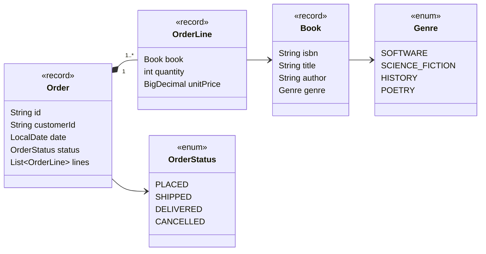
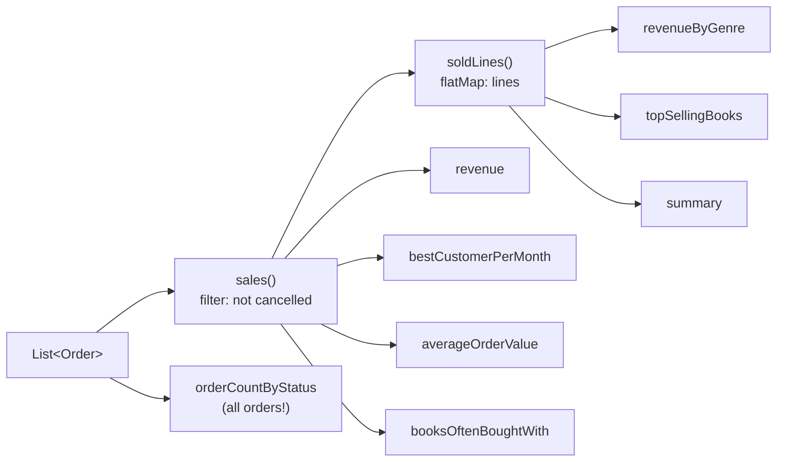

# Task 03 · The Monday sales report

| Difficulty | Topics | Time box |
|---|---|---|
| 🟡 Medium | Modern Java: Streams, Collectors (`groupingBy`, `teeing`, `toMap`, downstream collectors), `Comparator` composition, `Optional` · Records with behaviour | 2–3 h |

> **Background reading:** *Modern Java in Action* ch. 4–6 (streams, collectors) and ch. 11 (`Optional`) · *Effective Java* Items 45–48 (streams: use judiciously, prefer side-effect-free functions, return collections) · *Refactoring* "Move Function" / "Feature Envy"

---

## The situation

We run an online bookshop. Every Monday the sales team asks the same questions: how much did we sell, which genres are doing well, which books sell best, who are our best customers. Right now someone exports a CSV and does it in a spreadsheet. We want a `SalesReport` they can call.

The data model already exists and is small. What I care about in this task is **how your stream code reads**. I've seen plenty of "stream solutions" that are 25-line pipelines with nested lambdas, `forEach` writing into an outside `HashMap`, and `.get()` on every `Optional`. They work, but nobody can review them. I want pipelines that read like the question they answer.

## The domain

| Term | Meaning |
|---|---|
| **Sale** | An order that is **not cancelled**. `PLACED`, `SHIPPED` and `DELIVERED` all count as sales; we recognize revenue on placement. |
| **Line total** | `unitPrice × quantity`. The unit price is stored per line because prices change over time (see the discounted Effective Java in order `o6`). |
| **Order total** | Sum of its line totals. |
| **Copies sold** | Sum of quantities. Two copies of Dune on one line = 2 copies. |
| **Bought together** | Two different books on the same (non-cancelled) order. Counted **once per order**, no matter the quantities. |

### The data flow you'll build

Notice that almost everything starts from the same two "views": *sales* and *sold lines*. If your code doesn't have those two names somewhere, you're probably repeating the cancelled-filter eight times.

## What I want from you

Implement every method of [`SalesReport`](../src/main/java/io/github/chris013/practice/task03/SalesReport.java). The Javadoc of each method is the spec; the tests pin down the details.

| Method | Collector skills it trains |
|---|---|
| `revenue()` | `reduce` / `reducing` with `BigDecimal` |
| `revenueByGenre()` | `groupingBy` with a map factory and a downstream collector |
| `topSellingBooks(limit)` | `groupingBy` + `summingLong`, then sort entries with a composed `Comparator` |
| `bestCustomerPerMonth()` | Two-level grouping, `collectingAndThen`, a `TreeMap` for chronological order |
| `averageOrderValue()` | `teeing` (two collectors in one pass), `Optional` for "no data" |
| `orderCountByStatus()` | `EnumMap`, making absent keys present with `0` |
| `booksOftenBoughtWith(isbn)` | `flatMap`, `distinct`, counting co-occurrences |
| `summary()` | `teeing` into a record constructor |

Rules:

1. **Cancelled orders never count**, except in `orderCountByStatus`, which counts all orders.
2. **No `for` loops and no `forEach`** with side effects in `SalesReport`. Streams only. (In real life loops are fine. Here the point is to learn the collectors.)
3. **No mutable state outside a collector**: no `map.put(...)` inside a lambda, no `AtomicReference` tricks.
4. **Every pipeline should fit in ~6 lines.** If it's longer, extract a well-named private method or a reusable `Collector`.
5. Money stays `BigDecimal`. No `double`, no `mapToDouble(...).sum()`.
6. The report must not change if the caller modifies their list after construction.
7. You may add methods to the domain records (`Order`, `OrderLine`). In fact I'd like you to.

## Constraints & non-goals

* No performance tuning: we have thousands of orders, not billions. Readability wins.
* No parallel streams. (Stretch goal 3 asks *why not*.)
* Don't touch the tests or the fixture.

## How I'd approach it

* **Feature Envy check:** If you write `line.unitPrice().multiply(BigDecimal.valueOf(line.quantity()))` inside `SalesReport`, that computation is envious of `OrderLine`. Move it there as `OrderLine.total()`. Same for "is this order a sale?" Records can (and should) have behaviour.
* Write the two private "views" first: `sales()` and `soldLines()`. Return `Stream`s from them, not lists. Each call creates a fresh stream, so they're safe to reuse.
* Summing `BigDecimal` comes up in almost every method. A tiny generic helper like `sumOf(Function<? super T, BigDecimal>)` that returns a `Collector` removes a lot of noise. (Note the `? super T`: *Effective Java* Item 31, PECS.)
* `Comparator` has combinators: `Map.Entry.comparingByValue()`, `.reversed()`, `.thenComparing(...)`. Name your comparators: `MOST_FIRST_THEN_BY_TITLE` reads better than a lambda you have to decode.
* Watch out for type inference with `comparingByValue().reversed()`: Java can't infer the generic types through `.reversed()`. You'll need an explicit type witness: `Map.Entry.<Book, Long>comparingByValue().reversed()`.
* `Collectors.teeing(c1, c2, merger)` runs two collectors over the same elements and merges the results. Perfect for "average = sum / count" in one pass.
* `Optional` is for *return types* that may legitimately be empty. Don't take `Optional` as a parameter, and don't call `.get()`.
* `groupingBy(classifier, mapFactory, downstream)`: the `mapFactory` overload is how you get an `EnumMap` or `TreeMap`.

## Tests

Run: `mvn test -Dtest='**/task03/**'`

[`SalesReportTest`](../src/test/java/io/github/chris013/practice/task03/SalesReportTest.java) builds a fixture of seven orders. There's a table in a comment at the top so you can verify every expected number by hand. Please do that once for `revenueByGenre`, it's a good habit.

Show the tests

<!-- embed: src/test/java/io/github/chris013/practice/task03/SalesReportTest.java -->
<!-- /embed -->

## Definition of done

- [ ] All tests green.
- [ ] The "not cancelled" rule is written exactly once.
- [ ] No `for`, no side-effecting `forEach`, no `Optional.get()`, no `double`.
- [ ] Line and order totals are computed by the records, not by the report.
- [ ] Every public method body is short enough to read without scrolling, and helper names explain intent (`biggestSpender`, `ranked`, ...).

## Stretch goals

1. Add `revenueByAuthor()` returning a `Map<String, BigDecimal>` sorted by revenue descending. Which `Map` implementation preserves *insertion* order? How do you get the collector to use it?
2. Write `loyalCustomers(int minimumOrders)`: customers with at least *n* sales, sorted by revenue. Then compare your stream version with a plain `for` loop version. Which would you rather review? (There's no wrong answer, only reasons.)
3. Why would `orders.parallelStream()` almost certainly make this report *slower*? Think about the size of the data, the cost of splitting, and what `TreeMap`/`EnumMap` merging costs.

---

## Reference solution

Spoiler: open only after you have made a serious attempt

### Key decisions

**1. Behaviour moved to the data.** `OrderLine.total()`, `Order.total()`, `Order.countsAsSale()`, `Order.distinctBooks()` and `Order.contains(isbn)` live in the records. The report talks in business terms; the arithmetic sits next to the data it uses.

**2. Two views, used everywhere.** `sales()` and `soldLines()` are private methods returning fresh streams. The cancellation rule exists exactly once (in `Order.countsAsSale()`), and the report applies it exactly once (in `sales()`).

**3. One reusable collector.** `sumOf(...)` wraps `reducing(BigDecimal.ZERO, mapper, BigDecimal::add)`. It's used six times and turns `groupingBy(genre, reducing(ZERO, OrderLine::total, BigDecimal::add))` into `groupingBy(genre, sumOf(OrderLine::total))`.

**4. Named comparators.** `MOST_FIRST_THEN_BY_TITLE` is shared by `topSellingBooks` and `booksOftenBoughtWith`, because both answer "rank books by a count". The tie-breaker for customers ("alphabetically first wins") is expressed by `max` over *(revenue, reverse key order)*, which is easier to verify than a hand-written `compare`.

**5. The right map for each job.** `EnumMap` for genre/status (ordered by declaration, compact), `TreeMap` for months (chronological). The `orderCountByStatus` solution streams over *all statuses* and counts orders per status. That reads exactly like the requirement ("every status is present") and avoids a "group, then fill in the missing zeros" two-step.

**6. `teeing` for one-pass aggregates.** `averageOrderValue` and `summary` each compute two aggregates in a single pass, and the merger function decides what "no data" means (`Optional.empty()`).

### Code

<!-- embed: solutions/src/main/java/io/github/chris013/practice/task03/SalesReport.java -->
<!-- /embed -->

<!-- embed: solutions/src/main/java/io/github/chris013/practice/task03/Order.java -->
<!-- /embed -->

<!-- embed: solutions/src/main/java/io/github/chris013/practice/task03/OrderLine.java -->
<!-- /embed -->

### What I typically flag in first attempts

| Finding | Why it matters |
|---|---|
| `orders.stream().filter(o -> o.status() != CANCELLED)` in 7 methods | Duplicated business rule. The day "refunded" becomes a status, you'll miss one. |
| `map.forEach((k, v) -> result.put(...))` | Side effects in lambdas: harder to reason about, breaks with parallel streams. Use a collector. |
| `mapToDouble(BigDecimal::doubleValue).sum()` | Floating-point money. See Task 01. |
| `.sorted((a, b) -> b.getValue().compareTo(a.getValue()) != 0 ? ... : ...)` | Hand-rolled comparators hide bugs. Compose with `comparing`/`thenComparing`/`reversed`. |
| `revenueByGenre` returns `HashMap` and the test passes | It passes, but iteration order is random: the sales team's output changes run to run. Pick the map deliberately. |
| `averageOrderValue` streams twice (once for sum, once for count) | Correct, but `teeing` exists exactly for this. Also, two passes over a `Stream` *source* could see different data if it were live. |
| `Optional<BigDecimal> avg = ...; return avg.isPresent() ? Optional.of(avg.get()...)` | Use `map`, `filter`, `orElse`. `isPresent()`/`get()` is a null check in disguise. |

