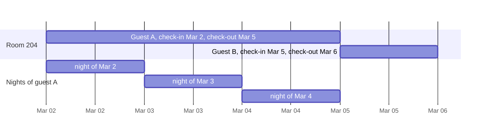
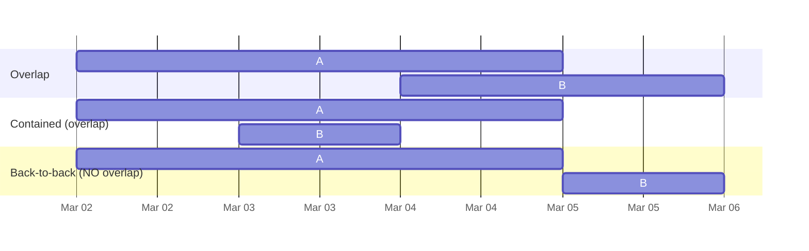

# Task 04 · Hotel stays and the half-open interval

| Difficulty | Topics | Time box |
|---|---|---|
| 🟢 Easy | Value Objects · Effective Java (immutability, `Comparable`, static factories) · `java.time` · *APOSD*: define errors out of existence | 1–1.5 h |

> **Background reading:** *Effective Java* Items 14 (`Comparable`), 17 (immutability), 50 (defensive copies) · *A Philosophy of Software Design* ch. 10 ("Define errors out of existence") · Dijkstra's note EWD831, "Why numbering should start at zero" (two pages, worth it)

---

## The situation

Our hotel booking system has a bug ticket that's been reopened three times: *"Room 204 shows as double-booked although guest A leaves on the 5th and guest B arrives on the 5th."* Every time someone fixes it, a different off-by-one appears somewhere else: the invoice charges for four nights instead of three, or the cleaning schedule skips a day.

The root cause: stays are passed around as two loose `LocalDate`s, and every piece of code interprets "the end date" differently. Some code treats it as the last night, some as the departure day. Every place that compares two stays re-implements the overlap logic with `<=` here and `<` there.

I want **one** type, `DateRange`, that settles the question once, and that makes the right answer the *only* answer.

## The domain

| Term | Meaning |
|---|---|
| **Check-in** | The day the guest arrives (afternoon). The guest sleeps in the hotel that night. |
| **Check-out** | The day the guest leaves (morning). The guest does **not** sleep in the hotel that night. |
| **Night** | Identified by the date it *starts* on. "The night of March 3rd" is the night from the 3rd to the 4th. |
| **Stay** | Check-in to check-out. At least one night. |
| **Overlap** | Two stays that need the same room on at least one night. |

### Half-open intervals

A stay from March 2nd to March 5th is the interval **[Mar 2, Mar 5)**: the check-in is included, the check-out excluded.



Why half-open? Because then everything falls into place on its own:

| Question | With `[checkIn, checkOut)` | With `[firstNight, lastNight]` (closed) |
|---|---|---|
| How many nights? | `checkOut − checkIn` | `lastNight − firstNight + 1` ← the classic off-by-one |
| Do back-to-back stays overlap? | No, naturally | You need a special case |
| Is a 0-night stay representable? | `checkIn == checkOut`, easy to reject | Needs `lastNight = firstNight − 1` |
| Concatenate two stays? | `[a, b) + [b, c) = [a, c)` | `[a, b] + [b+1, c]` |

This is what *A Philosophy of Software Design* calls **defining errors out of existence**: pick the representation so that the special cases (back-to-back, off-by-one) simply don't exist, instead of handling them with extra `if`s.

### Overlap, visualized



Two stays overlap if **each starts before the other ends**. That's one line with half-open intervals, with no special cases for "contains", "is contained", "same start", and so on. If your implementation has more than one boolean expression, step back.

## What I want from you

Implement [`DateRange`](../src/main/java/io/github/chris013/practice/task04/DateRange.java):

1. `of(checkIn, checkOut)` and `ofNights(checkIn, nights)`. Check-out must be **after** check-in, so a stay has at least one night (`IllegalArgumentException` otherwise, with a message that says which dates). `null` → `NullPointerException`.
2. Equality by value; `hashCode` consistent with it.
3. `nights()`.
4. `containsNightOf(date)`: does the guest sleep here during the night starting on `date`?
5. `overlaps(other)`: symmetric, true if the stays share at least one night. Back-to-back stays don't overlap.
6. `intersection(other)`: the shared nights as an `Optional<DateRange>`; empty if they don't overlap.
7. `nightsAsDates()`: a `Stream<LocalDate>` of every night, in order.
8. `Comparable`: chronological, by check-in, then by check-out.

## Constraints & non-goals

* `LocalDate` only. No `java.util.Date`, no `Calendar`, no time zones: a hotel night is a calendar concept.
* No mutable state, no setters, no "extend the stay" method that changes `this`. (You could add `extendedBy(int nights)` that returns a new range. That's a stretch goal.)
* No special handling of DST or leap years. `LocalDate` already handles them. The leap-year test is there to prove you didn't add your own date arithmetic.

## How I'd approach it

* **Records** fit perfectly: two fields, value semantics, a compact constructor for the invariant.
* `LocalDate` is immutable, so you need **no defensive copies** (*Effective Java* Item 50). Contrast that with a class holding a `java.util.Date`: there you'd have to copy on the way in *and* on the way out, or a caller could change your "immutable" object.
* `compareTo` must be **consistent with `equals`** (*Effective Java* Item 14): `a.compareTo(b) == 0` exactly when `a.equals(b)`. If you only compared check-in dates, two different stays with the same check-in would be "equal" to a `TreeSet`, and it would silently drop one of them. Build the comparator with `Comparator.comparing(...).thenComparing(...)` and keep it in a `static final` field.
* `LocalDate.datesUntil(end)` exists and is already half-open.
* `ChronoUnit.DAYS.between(a, b)` returns a `long`.
* For `intersection`: the shared part starts at the *later* check-in and ends at the *earlier* check-out. Reuse `overlaps` to decide whether there is one, so the overlap logic stays in one place.

## Tests

Run: `mvn test -Dtest='**/task04/**'`

[`DateRangeTest`](../src/test/java/io/github/chris013/practice/task04/DateRangeTest.java) covers creation, nights, overlap (including the bug from the ticket: back-to-back stays) and sorting.

<details>
<summary>Show the tests</summary>

<!-- embed: src/test/java/io/github/chris013/practice/task04/DateRangeTest.java -->
**[`DateRangeTest.java`](../src/test/java/io/github/chris013/practice/task04/DateRangeTest.java)**

```java
package io.github.chris013.practice.task04;

import static org.assertj.core.api.Assertions.assertThat;
import static org.assertj.core.api.Assertions.assertThatThrownBy;

import java.time.LocalDate;
import java.util.List;
import java.util.stream.Stream;
import org.junit.jupiter.api.Nested;
import org.junit.jupiter.api.Test;

class DateRangeTest {

    private static final LocalDate MAR_1 = LocalDate.of(2026, 3, 1);
    private static final LocalDate MAR_2 = LocalDate.of(2026, 3, 2);
    private static final LocalDate MAR_3 = LocalDate.of(2026, 3, 3);
    private static final LocalDate MAR_4 = LocalDate.of(2026, 3, 4);
    private static final LocalDate MAR_5 = LocalDate.of(2026, 3, 5);
    private static final LocalDate MAR_6 = LocalDate.of(2026, 3, 6);

    @Nested
    class Creation {

        @Test
        void counts_nights_not_days() {
            assertThat(DateRange.of(MAR_1, MAR_4).nights()).isEqualTo(3);
        }

        @Test
        void can_be_created_from_a_number_of_nights() {
            DateRange stay = DateRange.ofNights(MAR_1, 3);

            assertThat(stay.checkOut()).isEqualTo(MAR_4);
            assertThat(stay).isEqualTo(DateRange.of(MAR_1, MAR_4));
        }

        @Test
        void handles_leap_years() {
            assertThat(DateRange.ofNights(LocalDate.of(2028, 2, 28), 2).checkOut()).isEqualTo(LocalDate.of(2028, 3, 1));
        }

        @Test
        void needs_at_least_one_night() {
            assertThatThrownBy(() -> DateRange.of(MAR_1, MAR_1)).isInstanceOf(IllegalArgumentException.class);
            assertThatThrownBy(() -> DateRange.of(MAR_4, MAR_1)).isInstanceOf(IllegalArgumentException.class);
            assertThatThrownBy(() -> DateRange.ofNights(MAR_1, 0)).isInstanceOf(IllegalArgumentException.class);
            assertThatThrownBy(() -> DateRange.ofNights(MAR_1, -2)).isInstanceOf(IllegalArgumentException.class);
        }

        @Test
        void refuses_null() {
            assertThatThrownBy(() -> DateRange.of(null, MAR_1)).isInstanceOf(NullPointerException.class);
            assertThatThrownBy(() -> DateRange.of(MAR_1, null)).isInstanceOf(NullPointerException.class);
        }

        @Test
        void is_equal_by_value() {
            assertThat(DateRange.of(MAR_1, MAR_4))
                    .isEqualTo(DateRange.of(LocalDate.parse("2026-03-01"), LocalDate.parse("2026-03-04")))
                    .hasSameHashCodeAs(DateRange.of(MAR_1, MAR_4))
                    .isNotEqualTo(DateRange.of(MAR_1, MAR_5));
        }
    }

    @Nested
    class Nights {

        private final DateRange stay = DateRange.of(MAR_2, MAR_4);

        @Test
        void include_the_night_of_check_in() {
            assertThat(stay.containsNightOf(MAR_2)).isTrue();
        }

        @Test
        void include_the_last_night_before_check_out() {
            assertThat(stay.containsNightOf(MAR_3)).isTrue();
        }

        @Test
        void exclude_the_night_of_check_out() {
            assertThat(stay.containsNightOf(MAR_4)).isFalse();
        }

        @Test
        void exclude_the_night_before_check_in() {
            assertThat(stay.containsNightOf(MAR_1)).isFalse();
        }

        @Test
        void can_be_listed_as_dates() {
            assertThat(stay.nightsAsDates()).containsExactly(MAR_2, MAR_3);
        }
    }

    @Nested
    class Overlap {

        private final DateRange stay = DateRange.of(MAR_2, MAR_5);

        @Test
        void exists_when_stays_share_a_night() {
            assertThat(stay.overlaps(DateRange.of(MAR_4, MAR_6))).isTrue();
            assertThat(stay.overlaps(DateRange.of(MAR_1, MAR_3))).isTrue();
        }

        @Test
        void exists_when_one_stay_contains_the_other() {
            assertThat(stay.overlaps(DateRange.of(MAR_3, MAR_4))).isTrue();
            assertThat(DateRange.of(MAR_3, MAR_4).overlaps(stay)).isTrue();
            assertThat(stay.overlaps(stay)).isTrue();
        }

        @Test
        void does_not_exist_for_back_to_back_stays() {
            // The first guest checks out on the morning of Mar 5, the next one checks in that afternoon.
            assertThat(stay.overlaps(DateRange.of(MAR_5, MAR_6))).isFalse();
            assertThat(DateRange.of(MAR_5, MAR_6).overlaps(stay)).isFalse();
            assertThat(stay.overlaps(DateRange.of(MAR_1, MAR_2))).isFalse();
        }

        @Test
        void does_not_exist_for_separate_stays() {
            assertThat(DateRange.of(MAR_1, MAR_2).overlaps(DateRange.of(MAR_5, MAR_6))).isFalse();
        }

        @Test
        void has_an_intersection_of_the_shared_nights() {
            assertThat(stay.intersection(DateRange.of(MAR_4, MAR_6))).contains(DateRange.of(MAR_4, MAR_5));
            assertThat(stay.intersection(DateRange.of(MAR_3, MAR_4))).contains(DateRange.of(MAR_3, MAR_4));
        }

        @Test
        void has_no_intersection_for_back_to_back_stays() {
            assertThat(stay.intersection(DateRange.of(MAR_5, MAR_6))).isEmpty();
        }
    }

    @Test
    void sorts_chronologically_by_check_in_then_check_out() {
        DateRange early = DateRange.of(MAR_1, MAR_3);
        DateRange earlyButLonger = DateRange.of(MAR_1, MAR_5);
        DateRange late = DateRange.of(MAR_2, MAR_3);

        List<DateRange> sorted = Stream.of(late, earlyButLonger, early).sorted().toList();

        assertThat(sorted).containsExactly(early, earlyButLonger, late);
    }
}
```
<!-- /embed -->

</details>

## Definition of done

- [ ] All tests green.
- [ ] `overlaps` is a single boolean expression with no special cases.
- [ ] The "at least one night" invariant is enforced in exactly one place that every construction path goes through.
- [ ] `compareTo` is consistent with `equals`.
- [ ] The type's Javadoc says in one sentence that the range is half-open and what that means for check-out.

## Stretch goals

1. Add `extendedBy(int nights)` and `isAdjacentTo(DateRange other)` (B starts exactly when A ends). Then `mergedWith(DateRange other)` for overlapping or adjacent stays. What should merging two separate stays do?
2. A `RoomCalendar` that holds bookings for one room and refuses overlapping ones. What's the right data structure if you need "is this range free?" in better than O(n)? (Hint: `TreeMap.floorEntry`/`ceilingEntry`.)
3. Read the source of `java.time.LocalDate.datesUntil`. How does the JDK handle the "end before start" case? Do you agree?

---

## Reference solution

<details>
<summary>Spoiler: open only after you have made a serious attempt</summary>

### Key decisions

**1. Half-open, documented in the type's Javadoc.** The most important line of this task is a comment: it tells every future reader how to interpret `checkOut`. Each method then follows from the representation.

**2. A record with a compact constructor.** All construction paths (the public canonical constructor, `of`, `ofNights`) go through the compact constructor, so the invariant "at least one night" can't be bypassed. `ofNights` doesn't need its own validation for `nights <= 0`: `checkIn.plusDays(0)` is not after `checkIn`, so the constructor already rejects it with a precise message. One rule, one place.

**3. `overlaps` is one line.** `checkIn < other.checkOut && other.checkIn < checkOut`. Symmetric, covers containment and identical stays, and returns false for back-to-back stays because of the strict `<`.

**4. A `static final` comparator.** `CHRONOLOGICAL` is built once from `comparing`/`thenComparing`, and it includes both fields, so `compareTo` agrees with `equals`.

**5. Small, named helpers instead of clever expressions.** `later(a, b)` and `earlier(a, b)` make `intersection` read like its definition.

### Code

<!-- embed: solutions/src/main/java/io/github/chris013/practice/task04/DateRange.java -->
**[`DateRange.java`](../solutions/src/main/java/io/github/chris013/practice/task04/DateRange.java)**

```java
package io.github.chris013.practice.task04;

import java.time.LocalDate;
import java.time.temporal.ChronoUnit;
import java.util.Comparator;
import java.util.Objects;
import java.util.Optional;
import java.util.stream.Stream;

/**
 * A stay at our hotel: from the check-in date (inclusive) to the check-out date (exclusive), at least one night long.
 *
 * <p>The range is half-open, {@code [checkIn, checkOut)}, because that is how hotels think: the night of the
 * check-out date belongs to the next guest. As a consequence back-to-back stays never overlap, and the number of
 * nights is simply the distance between the two dates.
 */
public record DateRange(LocalDate checkIn, LocalDate checkOut) implements Comparable<DateRange> {

    private static final Comparator<DateRange> CHRONOLOGICAL =
            Comparator.comparing(DateRange::checkIn).thenComparing(DateRange::checkOut);

    public DateRange {
        Objects.requireNonNull(checkIn, "checkIn");
        Objects.requireNonNull(checkOut, "checkOut");
        if (!checkOut.isAfter(checkIn)) {
            throw new IllegalArgumentException(
                    "A stay needs at least one night, but check-out %s is not after check-in %s".formatted(checkOut, checkIn));
        }
    }

    public static DateRange of(LocalDate checkIn, LocalDate checkOut) {
        return new DateRange(checkIn, checkOut);
    }

    public static DateRange ofNights(LocalDate checkIn, int nights) {
        Objects.requireNonNull(checkIn, "checkIn");
        return new DateRange(checkIn, checkIn.plusDays(nights));
    }

    public long nights() {
        return ChronoUnit.DAYS.between(checkIn, checkOut);
    }

    public boolean containsNightOf(LocalDate date) {
        return !date.isBefore(checkIn) && date.isBefore(checkOut);
    }

    public boolean overlaps(DateRange other) {
        return checkIn.isBefore(other.checkOut) && other.checkIn.isBefore(checkOut);
    }

    public Optional<DateRange> intersection(DateRange other) {
        if (!overlaps(other)) {
            return Optional.empty();
        }
        return Optional.of(new DateRange(later(checkIn, other.checkIn), earlier(checkOut, other.checkOut)));
    }

    public Stream<LocalDate> nightsAsDates() {
        return checkIn.datesUntil(checkOut);
    }

    @Override
    public int compareTo(DateRange other) {
        return CHRONOLOGICAL.compare(this, other);
    }

    private static LocalDate later(LocalDate a, LocalDate b) {
        return a.isAfter(b) ? a : b;
    }

    private static LocalDate earlier(LocalDate a, LocalDate b) {
        return a.isBefore(b) ? a : b;
    }
}
```
<!-- /embed -->

### What I typically flag in first attempts

| Finding | Why it matters |
|---|---|
| `overlaps` with four cases (`contains`, `isContainedIn`, `startsInside`, `endsInside`) | More code, more chances for a `<=` bug, and still the same answer as the one-liner. |
| `<=` in `overlaps` | Back-to-back stays overlap: exactly the bug from the ticket. |
| `nights()` returns `between(checkIn, checkOut) + 1` | Mixed closed/half-open thinking. |
| `compareTo` only compares `checkIn` | Inconsistent with `equals`: `TreeSet` drops a booking. |
| `intersection` returns `null` when there's no overlap | `Optional` exists for exactly this case. |
| Validation in `of(...)` only | `new DateRange(mar5, mar1)` sneaks past it. |

</details>
