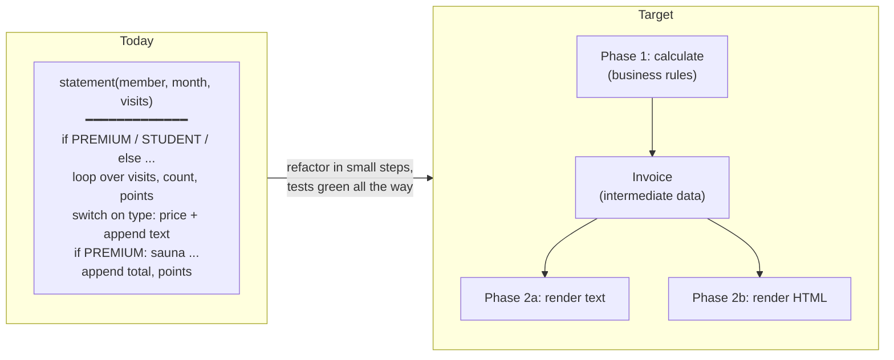
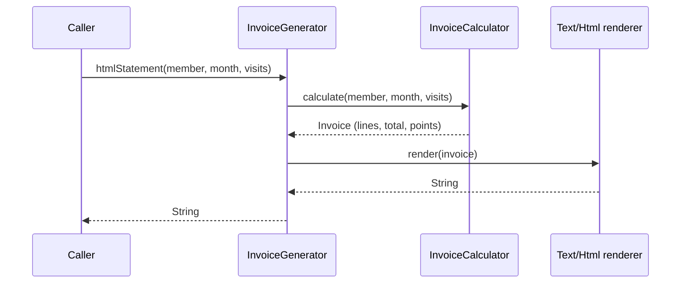

# Task 05 · The gym invoice: split phase, then add HTML

| Difficulty | Topics | Time box |
|---|---|---|
| 🟡 Medium | Refactoring (Split Phase, Extract Function, Replace Conditional with Polymorphism *or* with data, Replace Primitive with Object) · Separation of concerns | 2–3 h |

> **Background reading:** *Refactoring* ch. 1 (the whole worked example, read it again before you start), catalog entries "Split Phase", "Replace Temp with Query", "Replace Conditional with Polymorphism", "Replace Type Code with Subclasses" · *A Philosophy of Software Design* ch. 5 (information hiding) and ch. 9 ("Better together or better apart?")

---

## The situation

We run a chain of gyms. Every month each member gets an invoice by email. Now product wants the same invoice in the new **member portal**, as HTML.

The invoice logic lives in [`InvoiceGenerator.statement`](../src/main/java/io/github/chris013/practice/task05/InvoiceGenerator.java): one 60-line method that computes prices, counts visits, awards loyalty points *and* builds a string, all interleaved. The obvious way to add HTML is to copy the method and replace the string bits. Then we'd have two copies of the pricing rules, and the next price change will be applied to one of them only. I've seen it happen.

So again: **first make the change easy, then make the easy change.** If you've read *Refactoring* chapter 1, this task will feel familiar on purpose. The shape of the problem (calculation tangled with formatting, behaviour switching on a type code) is one of the most common shapes in real business code, and you should be able to untangle it in your sleep.

## The domain

| Term | Meaning |
|---|---|
| **Membership type** | `BASIC`, `PREMIUM` or `STUDENT` (a `String` in `Member`, because that's what the member database gives us). |
| **Visit** | One check-in, with a kind: `GYM` (free floor), `CLASS` (yoga, spinning, ...) or `SAUNA`. |
| **Billing month** | Only visits within the invoiced month count. |
| **Loyalty points** | Earned per class. Members with **more than 10 visits** of any kind in the month get a **regulars bonus** of 5 points. |

The price list:

| | Monthly fee | Per class | Included classes | Per sauna visit | Points per class |
|---|---|---|---|---|---|
| **BASIC** | 29.00 | 8.00 | 0 | 5.00 | 1 |
| **PREMIUM** | 59.00 | 4.00 *(beyond the included ones)* | 8 | 0.00 | 2 |
| **STUDENT** | 19.00 | 6.00 | 0 | 5.00 | 1 |

The plain-text invoice looks like this:

```text
Invoice for Anna Schmidt (PREMIUM) - 2026-03
  Membership fee x1: 59.00
  Classes (8 included) x10: 8.00
  Sauna x3: 0.00
Total: 67.00
Loyalty points earned: 25
```

### Current structure vs. target structure



The key move is **Split Phase**: phase 1 computes an intermediate data structure that contains *every number the output needs*. Phase 2 only formats. After the split, the renderer doesn't know what a membership type is, and the calculator doesn't know what a `<td>` is.



## What I want from you

### Part 1: refactor `statement`

* [`InvoiceStatementCharacterizationTest`](../src/test/java/io/github/chris013/practice/task05/InvoiceStatementCharacterizationTest.java) is green. It must stay green after every step. Commit after every green step.
* The public signature of `statement(...)` stays exactly as it is. `Member` and `Visit` stay as they are (they come from other teams).
* Get rid of `double` for money. (Is that a refactoring? It is if the output doesn't change. Prove it with the tests.)
* End state: one place that knows the price list, one place that computes an invoice, and a renderer that only formats.

### Part 2: implement `htmlStatement`

* Same invoice, as HTML (see [`HtmlInvoiceStatementTest`](../src/test/java/io/github/chris013/practice/task05/HtmlInvoiceStatementTest.java) for the exact markup).
* Member names come from user input. **Escape them.** A member called `Tom <Admin> & Jerry` must not break the portal (or worse).
* If your part 1 went well, part 2 is a new renderer and a one-line method.

## A design question I want you to think about

*Refactoring* teaches "Replace Conditional with Polymorphism": a `MembershipType` hierarchy with `BasicMembership`, `PremiumMembership`, `StudentMembership`, each overriding `chargeForClasses()` and so on. That's the textbook move when you see a `switch` on a type code.

But look at the price table above. Do the three types differ in **behaviour** or only in **numbers**? Before you create three subclasses, ask whether the variation is in the *rules* or in the *parameters of one rule*. Write your answer down in your PR description, with the reason. Both designs can be fine. Choosing one without thinking is not.

## Constraints & non-goals

* No templating engine, no HTML library. A `StringBuilder` is fine for 10 lines of markup.
* Don't change the text format, not even a space. Customers' email filters depend on it (really, this happens).
* The legacy code treats unknown membership types (say, `"GOLD"`) as `BASIC`. There's no test for it. Don't silently change that behaviour. Either keep it (and say so in a comment) or raise it as a question and make it a separate change.
* No `Locale`-dependent formatting: the legacy code uses `Locale.ROOT`, and the output must not change when a developer runs the tests on a German laptop.

## How I'd approach it

Roughly the sequence from *Refactoring* chapter 1:

1. **Extract Function** for each chunk: fee, counting visits, class charge, sauna charge, points. Use the tests after each one.
2. **Replace Temp with Query** where a local variable just holds a computed value. It makes the next step easier because the data flow becomes explicit.
3. **Split Phase**: introduce the intermediate data structure (e.g. a record `Invoice` with lines, total, points). First make `statement` build it and then render from it, *in the same class*. Only when that's green, move the calculation and rendering into their own classes.
4. Deal with the `membershipType` string: turn it into a type (enum or class hierarchy) as early as possible at the boundary, and never compare strings again.
5. Replace `double` with `BigDecimal`. Format with `setScale(2, ...)` and `toPlainString()`.
6. Now add `htmlStatement`.

Some traps:

* `String.format("%n")` is the **platform** line separator. On Windows that's `\r\n`. If the legacy code uses `"\n"`, you must too.
* `"%.2f"` without a locale prints `59,00` on a German JVM. Locale-independent formatting of `BigDecimal` avoids the question entirely.
* The "regulars bonus" condition is `count > 10`, and there's a test for exactly 10 vs. 11 visits. Name the constant so the boundary is obvious (`VISITS_NEEDED_FOR_BONUS = 11` with `>=`, or `MAX_VISITS_WITHOUT_BONUS = 10` with `>`; pick the one that reads like the business rule).

## Tests

Run: `mvn test -Dtest='**/task05/**'`

* `InvoiceStatementCharacterizationTest`: green before, during and after part 1.
* `HtmlInvoiceStatementTest`: red until part 2.
* `Visits` is a small test-data helper. Look at how it keeps the tests free of irrelevant dates.

<details>
<summary>Show the tests</summary>

<!-- embed: src/test/java/io/github/chris013/practice/task05/InvoiceStatementCharacterizationTest.java -->
<!-- /embed -->

<!-- embed: src/test/java/io/github/chris013/practice/task05/HtmlInvoiceStatementTest.java -->
<!-- /embed -->

</details>

## Definition of done

- [ ] Both test classes green; the characterization test was green after every commit.
- [ ] The price list exists exactly once, readable as a table.
- [ ] No string comparison of the membership type outside the one place that parses it.
- [ ] No `double`, no locale-dependent formatting, no `%n`.
- [ ] Renderers don't calculate anything (no `if` on membership type, no arithmetic except formatting).
- [ ] The calculator doesn't know anything about text or HTML.
- [ ] Member names are HTML-escaped.

## Stretch goals

1. Product wants a **CSV** export for accounting. How long does it take now? (It should be ~15 minutes.)
2. Price changes happen on the first of the month. Next month PREMIUM goes to 64.00, but invoices for *past* months must still use 59.00. How does your design change? (Hint: the price list becomes a function of the month. Where does that dependency enter?)
3. Write down the pros and cons of your enum-vs-subclasses decision. Then implement the *other* one in a branch and compare the diffs for "add a new membership type FAMILY with 2 included classes and 4.00 sauna visits".

---

## Reference solution

<details>
<summary>Spoiler: open only after you have made a serious attempt</summary>

### Key decisions

**1. Split Phase with an explicit intermediate model.** `InvoiceCalculator` produces an `Invoice` record: member, month, a list of `Line(item, quantity, amount)` and the loyalty points. The total is *derived* from the lines (`Invoice.total()`), so it can't disagree with them. Both renderers just walk the lines.

**2. The membership types are data, not subclasses.** The three types apply the *same* rules with *different numbers*: fee, price per class, included classes, sauna price, points per class. That's a table, so it became an enum with five fields, laid out like the price list. "Replace Conditional with Polymorphism" would have produced three classes with identical method bodies that differ only in constants. Polymorphism pays off when the *algorithm* differs (stretch goal 3 makes you feel this).

**3. The string becomes a type at the boundary.** `MembershipType.fromCode(member.membershipType())` is called once, at the start of the calculation. The legacy quirk (unknown → BASIC) is preserved and documented right there, so whoever fixes it later knows it's deliberate and where it lives.

**4. Small domain helpers with intention-revealing names.** `MonthlyUsage.of(month, visits)` answers "what did the member do this month?" in one place, and replaces the loop with counters. `chargeForClasses(int)` hides the "included classes" rule; the calculator doesn't know premium is special.

**5. Formatting is shared, and locale-free.** `amount(BigDecimal)` uses `setScale(2, UNNECESSARY).toPlainString()`. `UNNECESSARY` documents (and enforces) that all amounts are already in cents: if someone ever introduces a price like `4.995`, this throws instead of silently rounding.

**6. Package-private by default.** Only `InvoiceGenerator`, `Member` and `Visit` are public. The calculator, invoice model, enum and renderers are implementation details of the package. *APOSD*: the smaller the public surface, the deeper the module.

### Code

<!-- embed: solutions/src/main/java/io/github/chris013/practice/task05/InvoiceGenerator.java -->
<!-- /embed -->

<!-- embed: solutions/src/main/java/io/github/chris013/practice/task05/InvoiceCalculator.java -->
<!-- /embed -->

<!-- embed: solutions/src/main/java/io/github/chris013/practice/task05/MembershipType.java -->
<!-- /embed -->

<!-- embed: solutions/src/main/java/io/github/chris013/practice/task05/MonthlyUsage.java -->
<!-- /embed -->

<!-- embed: solutions/src/main/java/io/github/chris013/practice/task05/Invoice.java -->
<!-- /embed -->

<!-- embed: solutions/src/main/java/io/github/chris013/practice/task05/TextInvoiceRenderer.java -->
<!-- /embed -->

<!-- embed: solutions/src/main/java/io/github/chris013/practice/task05/HtmlInvoiceRenderer.java -->
<!-- /embed -->

### What I typically flag in first attempts

| Finding | Why it matters |
|---|---|
| `htmlStatement` is a copy of `statement` with different strings | The reason this task exists. Two copies of the price rules. |
| The renderer receives `Member` + `List<Visit>` and computes amounts itself | Not a real split: the renderer still knows the business rules. |
| `Invoice` stores `total` as a field next to the lines | Two sources of truth. Derive it. |
| Three subclasses whose methods differ only in constants | Polymorphism for data. More code, harder to see the price list. |
| `MembershipType.valueOf(member.membershipType())` | Throws on `"GOLD"`: an unannounced behaviour change hidden in a refactoring. |
| `String.format("%.2f", amount)` without a locale | Prints `59,00` on a German JVM. |
| No HTML escaping | XSS in the member portal, via the name field. |

</details>
