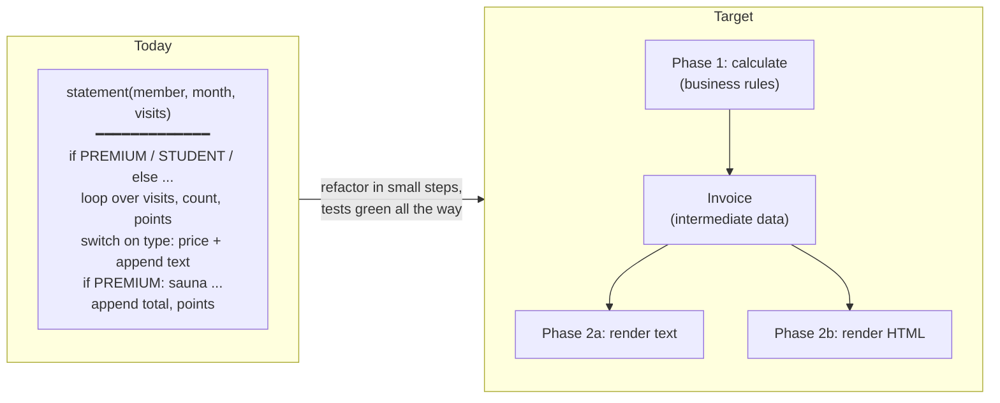
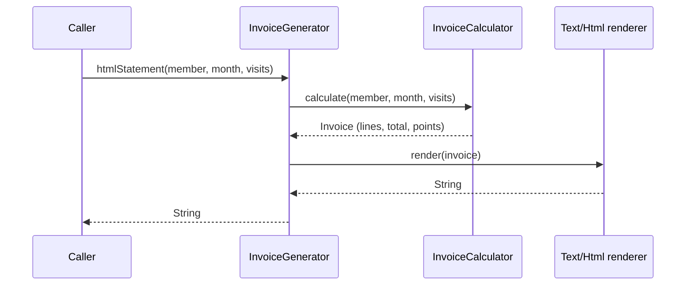

# Task 05 · The gym invoice: split phase, then add HTML

| Difficulty | Topics | Time box |
|---|---|---|
| 🟡 Medium | Refactoring (Split Phase, Extract Function, Replace Conditional with Polymorphism *or* with data, Replace Primitive with Object) · Separation of concerns | 2–3 h |

> **Background reading:** *Refactoring* ch. 1 (the whole worked example, read it again before you start), catalog entries "Split Phase", "Replace Temp with Query", "Replace Conditional with Polymorphism", "Replace Type Code with Subclasses" · *A Philosophy of Software Design* ch. 5 (information hiding) and ch. 9 ("Better together or better apart?")

---

## The situation

We run a chain of gyms. Every month each member gets an invoice by email. Now product wants the same invoice in the new **member portal**, as HTML.

The invoice logic lives in [`InvoiceGenerator.statement`](../src/main/java/io/github/chris013/practice/task05/InvoiceGenerator.java): one 60-line method that computes prices, counts visits, awards loyalty points *and* builds a string, all interleaved. The obvious way to add HTML is to copy the method and replace the string bits. Then we'd have two copies of the pricing rules, and the next price change will be applied to one of them only. I've seen it happen.

So again: **first make the change easy, then make the easy change.** If you've read *Refactoring* chapter 1, this task will feel familiar on purpose. The shape of the problem (calculation tangled with formatting, behaviour switching on a type code) is one of the most common shapes in real business code, and you should be able to untangle it in your sleep.

## The domain

| Term | Meaning |
|---|---|
| **Membership type** | `BASIC`, `PREMIUM` or `STUDENT` (a `String` in `Member`, because that's what the member database gives us). |
| **Visit** | One check-in, with a kind: `GYM` (free floor), `CLASS` (yoga, spinning, ...) or `SAUNA`. |
| **Billing month** | Only visits within the invoiced month count. |
| **Loyalty points** | Earned per class. Members with **more than 10 visits** of any kind in the month get a **regulars bonus** of 5 points. |

The price list:

| | Monthly fee | Per class | Included classes | Per sauna visit | Points per class |
|---|---|---|---|---|---|
| **BASIC** | 29.00 | 8.00 | 0 | 5.00 | 1 |
| **PREMIUM** | 59.00 | 4.00 *(beyond the included ones)* | 8 | 0.00 | 2 |
| **STUDENT** | 19.00 | 6.00 | 0 | 5.00 | 1 |

The plain-text invoice looks like this:

```text
Invoice for Anna Schmidt (PREMIUM) - 2026-03
  Membership fee x1: 59.00
  Classes (8 included) x10: 8.00
  Sauna x3: 0.00
Total: 67.00
Loyalty points earned: 25
```

### Current structure vs. target structure



The key move is **Split Phase**: phase 1 computes an intermediate data structure that contains *every number the output needs*. Phase 2 only formats. After the split, the renderer doesn't know what a membership type is, and the calculator doesn't know what a `<td>` is.



## What I want from you

### Part 1: refactor `statement`

* [`InvoiceStatementCharacterizationTest`](../src/test/java/io/github/chris013/practice/task05/InvoiceStatementCharacterizationTest.java) is green. It must stay green after every step. Commit after every green step.
* The public signature of `statement(...)` stays exactly as it is. `Member` and `Visit` stay as they are (they come from other teams).
* Get rid of `double` for money. (Is that a refactoring? It is if the output doesn't change. Prove it with the tests.)
* End state: one place that knows the price list, one place that computes an invoice, and a renderer that only formats.

### Part 2: implement `htmlStatement`

* Same invoice, as HTML (see [`HtmlInvoiceStatementTest`](../src/test/java/io/github/chris013/practice/task05/HtmlInvoiceStatementTest.java) for the exact markup).
* Member names come from user input. **Escape them.** A member called `Tom <Admin> & Jerry` must not break the portal (or worse).
* If your part 1 went well, part 2 is a new renderer and a one-line method.

## A design question I want you to think about

*Refactoring* teaches "Replace Conditional with Polymorphism": a `MembershipType` hierarchy with `BasicMembership`, `PremiumMembership`, `StudentMembership`, each overriding `chargeForClasses()` and so on. That's the textbook move when you see a `switch` on a type code.

But look at the price table above. Do the three types differ in **behaviour** or only in **numbers**? Before you create three subclasses, ask whether the variation is in the *rules* or in the *parameters of one rule*. Write your answer down in your PR description, with the reason. Both designs can be fine. Choosing one without thinking is not.

## Constraints & non-goals

* No templating engine, no HTML library. A `StringBuilder` is fine for 10 lines of markup.
* Don't change the text format, not even a space. Customers' email filters depend on it (really, this happens).
* The legacy code treats unknown membership types (say, `"GOLD"`) as `BASIC`. There's no test for it. Don't silently change that behaviour. Either keep it (and say so in a comment) or raise it as a question and make it a separate change.
* No `Locale`-dependent formatting: the legacy code uses `Locale.ROOT`, and the output must not change when a developer runs the tests on a German laptop.

## How I'd approach it

Roughly the sequence from *Refactoring* chapter 1:

1. **Extract Function** for each chunk: fee, counting visits, class charge, sauna charge, points. Use the tests after each one.
2. **Replace Temp with Query** where a local variable just holds a computed value. It makes the next step easier because the data flow becomes explicit.
3. **Split Phase**: introduce the intermediate data structure (e.g. a record `Invoice` with lines, total, points). First make `statement` build it and then render from it, *in the same class*. Only when that's green, move the calculation and rendering into their own classes.
4. Deal with the `membershipType` string: turn it into a type (enum or class hierarchy) as early as possible at the boundary, and never compare strings again.
5. Replace `double` with `BigDecimal`. Format with `setScale(2, ...)` and `toPlainString()`.
6. Now add `htmlStatement`.

Some traps:

* `String.format("%n")` is the **platform** line separator. On Windows that's `\r\n`. If the legacy code uses `"\n"`, you must too.
* `"%.2f"` without a locale prints `59,00` on a German JVM. Locale-independent formatting of `BigDecimal` avoids the question entirely.
* The "regulars bonus" condition is `count > 10`, and there's a test for exactly 10 vs. 11 visits. Name the constant so the boundary is obvious (`VISITS_NEEDED_FOR_BONUS = 11` with `>=`, or `MAX_VISITS_WITHOUT_BONUS = 10` with `>`; pick the one that reads like the business rule).

## Tests

Run: `mvn test -Dtest='**/task05/**'`

* `InvoiceStatementCharacterizationTest`: green before, during and after part 1.
* `HtmlInvoiceStatementTest`: red until part 2.
* `Visits` is a small test-data helper. Look at how it keeps the tests free of irrelevant dates.

<details>
<summary>Show the tests</summary>

<!-- embed: src/test/java/io/github/chris013/practice/task05/InvoiceStatementCharacterizationTest.java -->
**[`InvoiceStatementCharacterizationTest.java`](../src/test/java/io/github/chris013/practice/task05/InvoiceStatementCharacterizationTest.java)**

```java
package io.github.chris013.practice.task05;

import static io.github.chris013.practice.task05.Visits.MARCH;
import static io.github.chris013.practice.task05.Visits.concat;
import static io.github.chris013.practice.task05.Visits.visitOn;
import static io.github.chris013.practice.task05.Visits.visits;
import static org.assertj.core.api.Assertions.assertThat;

import java.util.List;
import org.junit.jupiter.api.Test;

/** Pins down the current plain-text statement. Green before you start, green after every refactoring step. */
class InvoiceStatementCharacterizationTest {

    private final InvoiceGenerator generator = new InvoiceGenerator();

    @Test
    void basic_member_pays_per_class_and_sauna_visit() {
        List<Visit> visits = concat(
                visits(3, 2, 1),
                List.of(visitOn("2026-02-28", "CLASS"), visitOn("2026-04-01", "SAUNA")));

        assertThat(generator.statement(new Member("Ben Weber", "BASIC"), MARCH, visits)).isEqualTo("""
                Invoice for Ben Weber (BASIC) - 2026-03
                  Membership fee x1: 29.00
                  Classes x3: 24.00
                  Sauna x2: 10.00
                Total: 63.00
                Loyalty points earned: 3
                """);
    }

    @Test
    void premium_member_gets_eight_classes_and_the_sauna_included_and_double_points() {
        assertThat(generator.statement(new Member("Anna Schmidt", "PREMIUM"), MARCH, visits(10, 3, 0))).isEqualTo("""
                Invoice for Anna Schmidt (PREMIUM) - 2026-03
                  Membership fee x1: 59.00
                  Classes (8 included) x10: 8.00
                  Sauna x3: 0.00
                Total: 67.00
                Loyalty points earned: 25
                """);
    }

    @Test
    void premium_member_pays_nothing_extra_within_the_included_classes() {
        assertThat(generator.statement(new Member("Anna Schmidt", "PREMIUM"), MARCH, visits(5, 0, 0))).isEqualTo("""
                Invoice for Anna Schmidt (PREMIUM) - 2026-03
                  Membership fee x1: 59.00
                  Classes (8 included) x5: 0.00
                  Sauna x0: 0.00
                Total: 59.00
                Loyalty points earned: 10
                """);
    }

    @Test
    void student_pays_a_lower_fee_and_class_price() {
        assertThat(generator.statement(new Member("Cem Yilmaz", "STUDENT"), MARCH, visits(4, 1, 6))).isEqualTo("""
                Invoice for Cem Yilmaz (STUDENT) - 2026-03
                  Membership fee x1: 19.00
                  Classes x4: 24.00
                  Sauna x1: 5.00
                Total: 48.00
                Loyalty points earned: 9
                """);
    }

    @Test
    void member_without_visits_pays_only_the_fee() {
        assertThat(generator.statement(new Member("Ben Weber", "BASIC"), MARCH, List.of())).isEqualTo("""
                Invoice for Ben Weber (BASIC) - 2026-03
                  Membership fee x1: 29.00
                  Classes x0: 0.00
                  Sauna x0: 0.00
                Total: 29.00
                Loyalty points earned: 0
                """);
    }

    @Test
    void regulars_bonus_needs_more_than_ten_visits() {
        Member ben = new Member("Ben Weber", "BASIC");

        assertThat(generator.statement(ben, MARCH, visits(0, 0, 10))).endsWith("Loyalty points earned: 0\n");
        assertThat(generator.statement(ben, MARCH, visits(0, 0, 11))).endsWith("Loyalty points earned: 5\n");
    }
}
```
<!-- /embed -->

<!-- embed: src/test/java/io/github/chris013/practice/task05/HtmlInvoiceStatementTest.java -->
**[`HtmlInvoiceStatementTest.java`](../src/test/java/io/github/chris013/practice/task05/HtmlInvoiceStatementTest.java)**

```java
package io.github.chris013.practice.task05;

import static io.github.chris013.practice.task05.Visits.MARCH;
import static io.github.chris013.practice.task05.Visits.visits;
import static org.assertj.core.api.Assertions.assertThat;

import org.junit.jupiter.api.Test;

/** The new feature. Red until part 2. */
class HtmlInvoiceStatementTest {

    private final InvoiceGenerator generator = new InvoiceGenerator();

    @Test
    void renders_the_same_invoice_as_html() {
        assertThat(generator.htmlStatement(new Member("Anna Schmidt", "PREMIUM"), MARCH, visits(10, 3, 0)))
                .isEqualTo("""
                        <h1>Invoice for Anna Schmidt (PREMIUM) - 2026-03</h1>
                        <table>
                          <tr><th>Item</th><th>Quantity</th><th>Amount</th></tr>
                          <tr><td>Membership fee</td><td>1</td><td>59.00</td></tr>
                          <tr><td>Classes (8 included)</td><td>10</td><td>8.00</td></tr>
                          <tr><td>Sauna</td><td>3</td><td>0.00</td></tr>
                        </table>
                        <p>Total: <strong>67.00</strong></p>
                        <p>Loyalty points earned: 25</p>
                        """);
    }

    @Test
    void renders_a_student_invoice() {
        assertThat(generator.htmlStatement(new Member("Cem Yilmaz", "STUDENT"), MARCH, visits(4, 1, 6)))
                .contains("<tr><td>Classes</td><td>4</td><td>24.00</td></tr>")
                .contains("<p>Total: <strong>48.00</strong></p>")
                .contains("<p>Loyalty points earned: 9</p>");
    }

    @Test
    void escapes_html_in_member_names() {
        assertThat(generator.htmlStatement(new Member("Tom <Admin> & Jerry", "BASIC"), MARCH, visits(0, 0, 0)))
                .startsWith("<h1>Invoice for Tom &lt;Admin&gt; &amp; Jerry (BASIC) - 2026-03</h1>");
    }
}
```
<!-- /embed -->

</details>

## Definition of done

- [ ] Both test classes green; the characterization test was green after every commit.
- [ ] The price list exists exactly once, readable as a table.
- [ ] No string comparison of the membership type outside the one place that parses it.
- [ ] No `double`, no locale-dependent formatting, no `%n`.
- [ ] Renderers don't calculate anything (no `if` on membership type, no arithmetic except formatting).
- [ ] The calculator doesn't know anything about text or HTML.
- [ ] Member names are HTML-escaped.

## Stretch goals

1. Product wants a **CSV** export for accounting. How long does it take now? (It should be ~15 minutes.)
2. Price changes happen on the first of the month. Next month PREMIUM goes to 64.00, but invoices for *past* months must still use 59.00. How does your design change? (Hint: the price list becomes a function of the month. Where does that dependency enter?)
3. Write down the pros and cons of your enum-vs-subclasses decision. Then implement the *other* one in a branch and compare the diffs for "add a new membership type FAMILY with 2 included classes and 4.00 sauna visits".

---

## Reference solution

<details>
<summary>Spoiler: open only after you have made a serious attempt</summary>

### Key decisions

**1. Split Phase with an explicit intermediate model.** `InvoiceCalculator` produces an `Invoice` record: member, month, a list of `Line(item, quantity, amount)` and the loyalty points. The total is *derived* from the lines (`Invoice.total()`), so it can't disagree with them. Both renderers just walk the lines.

**2. The membership types are data, not subclasses.** The three types apply the *same* rules with *different numbers*: fee, price per class, included classes, sauna price, points per class. That's a table, so it became an enum with five fields, laid out like the price list. "Replace Conditional with Polymorphism" would have produced three classes with identical method bodies that differ only in constants. Polymorphism pays off when the *algorithm* differs (stretch goal 3 makes you feel this).

**3. The string becomes a type at the boundary.** `MembershipType.fromCode(member.membershipType())` is called once, at the start of the calculation. The legacy quirk (unknown → BASIC) is preserved and documented right there, so whoever fixes it later knows it's deliberate and where it lives.

**4. Small domain helpers with intention-revealing names.** `MonthlyUsage.of(month, visits)` answers "what did the member do this month?" in one place, and replaces the loop with counters. `chargeForClasses(int)` hides the "included classes" rule; the calculator doesn't know premium is special.

**5. Formatting is shared, and locale-free.** `amount(BigDecimal)` uses `setScale(2, UNNECESSARY).toPlainString()`. `UNNECESSARY` documents (and enforces) that all amounts are already in cents: if someone ever introduces a price like `4.995`, this throws instead of silently rounding.

**6. Package-private by default.** Only `InvoiceGenerator`, `Member` and `Visit` are public. The calculator, invoice model, enum and renderers are implementation details of the package. *APOSD*: the smaller the public surface, the deeper the module.

### Code

<!-- embed: solutions/src/main/java/io/github/chris013/practice/task05/InvoiceGenerator.java -->
**[`InvoiceGenerator.java`](../solutions/src/main/java/io/github/chris013/practice/task05/InvoiceGenerator.java)**

```java
package io.github.chris013.practice.task05;

import java.time.YearMonth;
import java.util.List;

/** Creates the monthly invoice for a gym member: calculate once, render in the format the caller needs. */
public class InvoiceGenerator {

    private final InvoiceCalculator calculator = new InvoiceCalculator();
    private final TextInvoiceRenderer text = new TextInvoiceRenderer();
    private final HtmlInvoiceRenderer html = new HtmlInvoiceRenderer();

    public String statement(Member member, YearMonth month, List<Visit> visits) {
        return text.render(calculator.calculate(member, month, visits));
    }

    public String htmlStatement(Member member, YearMonth month, List<Visit> visits) {
        return html.render(calculator.calculate(member, month, visits));
    }
}
```
<!-- /embed -->

<!-- embed: solutions/src/main/java/io/github/chris013/practice/task05/InvoiceCalculator.java -->
**[`InvoiceCalculator.java`](../solutions/src/main/java/io/github/chris013/practice/task05/InvoiceCalculator.java)**

```java
package io.github.chris013.practice.task05;

import java.time.YearMonth;
import java.util.List;

/** Phase 1: turns visits into an {@link Invoice}. Knows the business rules, knows nothing about output formats. */
final class InvoiceCalculator {

    private static final int VISITS_NEEDED_FOR_REGULARS_BONUS = 11;
    private static final int REGULARS_BONUS_POINTS = 5;

    Invoice calculate(Member member, YearMonth month, List<Visit> visits) {
        MembershipType membership = MembershipType.fromCode(member.membershipType());
        MonthlyUsage usage = MonthlyUsage.of(month, visits);

        List<Invoice.Line> lines = List.of(
                new Invoice.Line("Membership fee", 1, membership.monthlyFee()),
                new Invoice.Line(membership.classesItemName(), usage.classes(), membership.chargeForClasses(usage.classes())),
                new Invoice.Line("Sauna", usage.saunaVisits(), membership.chargeForSaunaVisits(usage.saunaVisits())));

        return new Invoice(member, month, lines, loyaltyPoints(membership, usage));
    }

    private static int loyaltyPoints(MembershipType membership, MonthlyUsage usage) {
        int regularsBonus = usage.totalVisits() >= VISITS_NEEDED_FOR_REGULARS_BONUS ? REGULARS_BONUS_POINTS : 0;
        return membership.pointsForClasses(usage.classes()) + regularsBonus;
    }
}
```
<!-- /embed -->

<!-- embed: solutions/src/main/java/io/github/chris013/practice/task05/MembershipType.java -->
**[`MembershipType.java`](../solutions/src/main/java/io/github/chris013/practice/task05/MembershipType.java)**

```java
package io.github.chris013.practice.task05;

import java.math.BigDecimal;

/**
 * What each membership costs and earns. The three memberships differ only in their numbers, not in their rules,
 * so they are data, not subclasses.
 */
enum MembershipType {
    //      monthly fee         per class           included classes  per sauna visit     points per class
    BASIC(new BigDecimal("29.00"), new BigDecimal("8.00"), 0, new BigDecimal("5.00"), 1),
    PREMIUM(new BigDecimal("59.00"), new BigDecimal("4.00"), 8, new BigDecimal("0.00"), 2),
    STUDENT(new BigDecimal("19.00"), new BigDecimal("6.00"), 0, new BigDecimal("5.00"), 1);

    private final BigDecimal monthlyFee;
    private final BigDecimal pricePerClass;
    private final int includedClasses;
    private final BigDecimal pricePerSaunaVisit;
    private final int pointsPerClass;

    MembershipType(BigDecimal monthlyFee, BigDecimal pricePerClass, int includedClasses,
                   BigDecimal pricePerSaunaVisit, int pointsPerClass) {
        this.monthlyFee = monthlyFee;
        this.pricePerClass = pricePerClass;
        this.includedClasses = includedClasses;
        this.pricePerSaunaVisit = pricePerSaunaVisit;
        this.pointsPerClass = pointsPerClass;
    }

    /** Known quirk kept from the legacy code: unknown membership types are billed like BASIC. */
    static MembershipType fromCode(String code) {
        for (MembershipType type : values()) {
            if (type.name().equals(code)) {
                return type;
            }
        }
        return BASIC;
    }

    BigDecimal monthlyFee() {
        return monthlyFee;
    }

    BigDecimal chargeForClasses(int classes) {
        int billableClasses = Math.max(0, classes - includedClasses);
        return pricePerClass.multiply(BigDecimal.valueOf(billableClasses));
    }

    String classesItemName() {
        return includedClasses == 0 ? "Classes" : "Classes (%d included)".formatted(includedClasses);
    }

    BigDecimal chargeForSaunaVisits(int saunaVisits) {
        return pricePerSaunaVisit.multiply(BigDecimal.valueOf(saunaVisits));
    }

    int pointsForClasses(int classes) {
        return pointsPerClass * classes;
    }
}
```
<!-- /embed -->

<!-- embed: solutions/src/main/java/io/github/chris013/practice/task05/MonthlyUsage.java -->
**[`MonthlyUsage.java`](../solutions/src/main/java/io/github/chris013/practice/task05/MonthlyUsage.java)**

```java
package io.github.chris013.practice.task05;

import java.time.YearMonth;
import java.util.List;

/** What a member did at the gym in one month. */
record MonthlyUsage(int classes, int saunaVisits, int totalVisits) {

    static MonthlyUsage of(YearMonth month, List<Visit> visits) {
        List<Visit> inMonth = visits.stream().filter(visit -> YearMonth.from(visit.date()).equals(month)).toList();
        return new MonthlyUsage(count(inMonth, "CLASS"), count(inMonth, "SAUNA"), inMonth.size());
    }

    private static int count(List<Visit> visits, String kind) {
        return (int) visits.stream().filter(visit -> visit.kind().equals(kind)).count();
    }
}
```
<!-- /embed -->

<!-- embed: solutions/src/main/java/io/github/chris013/practice/task05/Invoice.java -->
**[`Invoice.java`](../solutions/src/main/java/io/github/chris013/practice/task05/Invoice.java)**

```java
package io.github.chris013.practice.task05;

import java.math.BigDecimal;
import java.time.YearMonth;
import java.util.List;

/** A calculated invoice: everything a renderer needs, and nothing it would have to compute. */
record Invoice(Member member, YearMonth month, List<Line> lines, int loyaltyPoints) {

    Invoice {
        lines = List.copyOf(lines);
    }

    BigDecimal total() {
        return lines.stream().map(Line::amount).reduce(BigDecimal.ZERO, BigDecimal::add);
    }

    String title() {
        return "Invoice for %s (%s) - %s".formatted(member.name(), member.membershipType(), month);
    }

    record Line(String item, int quantity, BigDecimal amount) {}
}
```
<!-- /embed -->

<!-- embed: solutions/src/main/java/io/github/chris013/practice/task05/TextInvoiceRenderer.java -->
**[`TextInvoiceRenderer.java`](../solutions/src/main/java/io/github/chris013/practice/task05/TextInvoiceRenderer.java)**

```java
package io.github.chris013.practice.task05;

import java.math.BigDecimal;
import java.math.RoundingMode;

/** Phase 2a: the plain-text invoice we email. */
final class TextInvoiceRenderer {

    String render(Invoice invoice) {
        StringBuilder text = new StringBuilder(invoice.title()).append('\n');
        for (Invoice.Line line : invoice.lines()) {
            text.append("  %s x%d: %s\n".formatted(line.item(), line.quantity(), amount(line.amount())));
        }
        text.append("Total: ").append(amount(invoice.total())).append('\n');
        text.append("Loyalty points earned: ").append(invoice.loyaltyPoints()).append('\n');
        return text.toString();
    }

    static String amount(BigDecimal amount) {
        return amount.setScale(2, RoundingMode.UNNECESSARY).toPlainString();
    }
}
```
<!-- /embed -->

<!-- embed: solutions/src/main/java/io/github/chris013/practice/task05/HtmlInvoiceRenderer.java -->
**[`HtmlInvoiceRenderer.java`](../solutions/src/main/java/io/github/chris013/practice/task05/HtmlInvoiceRenderer.java)**

```java
package io.github.chris013.practice.task05;

import static io.github.chris013.practice.task05.TextInvoiceRenderer.amount;

/** Phase 2b: the invoice in the member portal. */
final class HtmlInvoiceRenderer {

    String render(Invoice invoice) {
        StringBuilder html = new StringBuilder();
        html.append("<h1>").append(escape(invoice.title())).append("</h1>\n");
        html.append("<table>\n");
        html.append("  <tr><th>Item</th><th>Quantity</th><th>Amount</th></tr>\n");
        for (Invoice.Line line : invoice.lines()) {
            html.append("  <tr><td>%s</td><td>%d</td><td>%s</td></tr>\n"
                    .formatted(escape(line.item()), line.quantity(), amount(line.amount())));
        }
        html.append("</table>\n");
        html.append("<p>Total: <strong>").append(amount(invoice.total())).append("</strong></p>\n");
        html.append("<p>Loyalty points earned: ").append(invoice.loyaltyPoints()).append("</p>\n");
        return html.toString();
    }

    private static String escape(String text) {
        return text.replace("&", "&amp;").replace("<", "&lt;").replace(">", "&gt;").replace("\"", "&quot;");
    }
}
```
<!-- /embed -->

### What I typically flag in first attempts

| Finding | Why it matters |
|---|---|
| `htmlStatement` is a copy of `statement` with different strings | The reason this task exists. Two copies of the price rules. |
| The renderer receives `Member` + `List<Visit>` and computes amounts itself | Not a real split: the renderer still knows the business rules. |
| `Invoice` stores `total` as a field next to the lines | Two sources of truth. Derive it. |
| Three subclasses whose methods differ only in constants | Polymorphism for data. More code, harder to see the price list. |
| `MembershipType.valueOf(member.membershipType())` | Throws on `"GOLD"`: an unannounced behaviour change hidden in a refactoring. |
| `String.format("%.2f", amount)` without a locale | Prints `59,00` on a German JVM. |
| No HTML escaping | XSS in the member portal, via the name field. |

</details>
