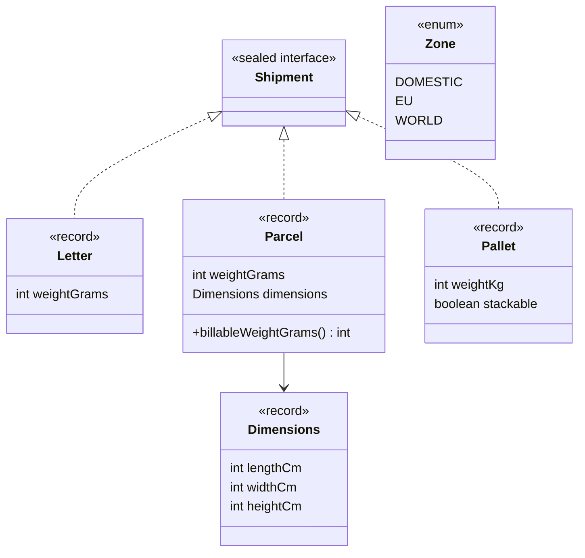
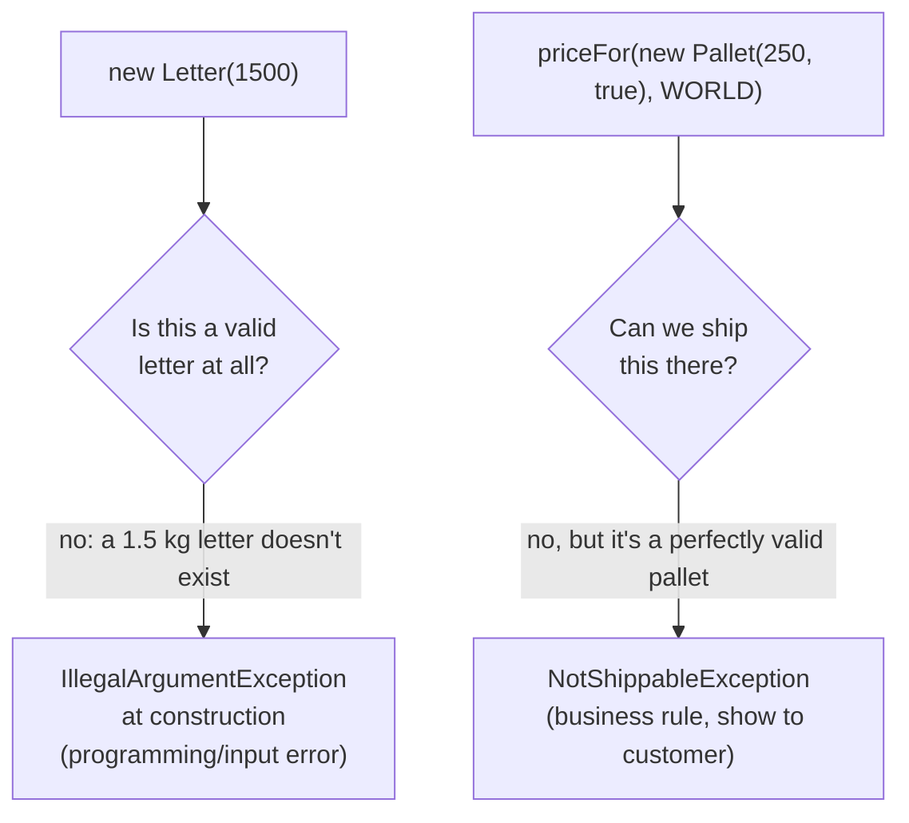
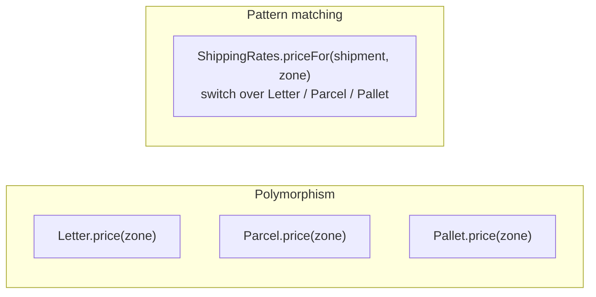

# Task 06 · Shipping rates with sealed types and pattern matching

| Difficulty | Topics | Time box |
|---|---|---|
| 🟡 Medium | Modern Java: sealed interfaces, records, record patterns, `switch` expressions with guards, exhaustiveness · The expression problem (pattern matching vs. polymorphism) · Value objects with invariants | 2–3 h |

> **Background reading:** JEP 409 (sealed classes), JEP 440 (record patterns), JEP 441 (pattern matching for `switch`) · *Effective Java* Item 23 ("Prefer class hierarchies to tagged classes") · Brian Goetz, "Data-Oriented Programming in Java" (InfoQ article, 2022)

---

## The situation

We're a small logistics company. Customers ship **letters**, **parcels** and **pallets** from our depot in Germany. Today the price calculation is a `Shipment` class with a `String type` field, nullable fields that only make sense for some types (`palletStackable` is `null` for letters), and a 200-line method full of `if ("PARCEL".equals(type))`. *Effective Java* calls that a **tagged class** (Item 23), and it says to replace it with a class hierarchy.

Since Java 17 we have a better tool for a hierarchy that is **closed** (we know every kind of shipment, and customers can't invent new ones): a **sealed interface** with **records**, and `switch` expressions that the compiler checks for **exhaustiveness**.

I want you to model the shipments and write the rate calculation. And I want you to understand *when* this style beats classic polymorphism, because that's a question you'll be asked in design reviews.

## The domain

### The price list (domestic prices)

**Letters**, 1 to 1000 g:

| Up to | 20 g | 500 g | 1000 g |
|---|---|---|---|
| Price | 0.95 | 1.60 | 2.75 |

**Parcels** are billed by **billable weight** = the larger of the actual weight and the **volumetric weight**. Volumetric weight: carriers treat 5000 cm³ as 1 kg, so a big box of pillows is billed like a heavy box. Round volumetric weight **up** to the next full gram.

| Up to (billable) | 2 kg | 5 kg | 10 kg | 31.5 kg | more |
|---|---|---|---|---|---|
| Price | 4.99 | 6.99 | 9.99 | 16.99 | not shippable |

**Pallets**, 1 to 1000 kg: 89.00 up to 300 kg, plus 12.00 for every **started** 100 kg above 300 kg (301 kg → 101.00; 400 kg → 101.00; 401 kg → 113.00). **Non-stackable** pallets cost 25 % more. Pallets ship to `DOMESTIC` and `EU` only.

**Zones** multiply the domestic price: `DOMESTIC` × 1.0, `EU` × 1.5, `WORLD` × 2.5. Round the final price **half-up to cents**.

**Transit days** (part 2):

| | DOMESTIC | EU | WORLD |
|---|---|---|---|
| Letter | 1 | 3 | 7 |
| Parcel | 2 | 4 | 8 |
| Pallet | 3 | 5 | not shippable |

### Invalid vs. not shippable

Two different kinds of "no", and the difference matters:

* A record's **compact constructor** guards what makes the value *meaningful*: a letter of 0 g or 1001 g is not a letter.
* A **business rule** decides what we *offer*: a 40 kg parcel is a valid parcel, we just don't carry it. That's a `NotShippableException` from the rate calculation, not a constructor failure.

## What I want from you

### Part 1: model and price

1. Add the invariants to [`Letter`](../src/main/java/io/github/chris013/practice/task06/Letter.java), [`Parcel`](../src/main/java/io/github/chris013/practice/task06/Parcel.java), [`Dimensions`](../src/main/java/io/github/chris013/practice/task06/Dimensions.java), [`Pallet`](../src/main/java/io/github/chris013/practice/task06/Pallet.java) (see the tests for exact limits). Error messages contain the offending value.
2. Add `Parcel.billableWeightGrams()`.
3. Implement `ShippingRates.priceFor(shipment, zone)`:
   * **One `switch` expression** over the sealed `Shipment`, **no `default` branch**.
   * Use at least one **record pattern** (`case Letter(int weightGrams) -> ...`) and one **guard** (`case Pallet p when ...`).
   * Prices are `BigDecimal` with scale 2.

### Part 2: transit days

4. Implement `transitDays(shipment, zone)`. Same style. This is the "add a new operation" half of the expression problem. Notice how little ceremony it needs.

## The design discussion I want you to have with yourself

There are two classic ways to add behaviour to a closed set of types:

| | Polymorphism (method per type) | Pattern matching (`switch` per operation) |
|---|---|---|
| Add a new **type** (e.g. `Envelope`) | Easy: one new class | Every `switch` must be updated, **but the compiler finds them all** (no `default`!) |
| Add a new **operation** (e.g. `transitDays`, `customsForm`, `co2Footprint`) | Touch every class | Easy: one new method with one `switch` |
| Where's the price list? | Spread over 3 classes | One class you can read top to bottom |
| Do the records depend on pricing? | Yes: data now knows business policy | No: records stay pure data |

Shipment *types* change once every few years. *Operations* on them (pricing, transit times, customs, CO₂ labels, insurance) get added all the time and are owned by different teams. That's why I'd lean towards pattern matching here, but write down your own reasoning.

**Why "no `default`" is the most important rule of this task:** with `default -> throw new IllegalStateException()`, adding `Envelope` compiles fine and blows up in production. Without `default`, adding `Envelope` to the `permits` clause turns every unhandled `switch` into a **compile error**. Exhaustiveness checking only protects you if you let it.

## Constraints & non-goals

* No `instanceof` chains and no `getClass()` comparisons.
* No pricing logic inside the records (they may have *derived properties* like billable weight; that's a fact about the parcel, not a policy of ours).
* Don't use primitive patterns in `switch` (`case int i when i <= 20`). They're still a preview feature in Java 25, and preview features don't belong in production code.
* No `double`.

## How I'd approach it

* Start with the records' compact constructors and the validation tests. Quick win.
* **Weight tiers are data.** Instead of `if (g <= 20) ... else if (g <= 500) ...`, think about a `NavigableMap<Integer, BigDecimal>` from "max weight" to price. `ceilingEntry(weight)` gives you the cheapest tier that fits, and `null` means "too heavy". The same helper then serves letters *and* parcels.
* Where does the zone factor go? If you multiply inside each `case`, you'll do it three times. Compute the domestic price in the `switch`, then apply the zone once.
* Pallets to `WORLD`: a guard `case Pallet p when zone == WORLD -> throw ...` reads exactly like the rule. Remember that cases are tested **top to bottom**, so the guarded case must come before the unguarded one. The compiler will tell you if you get it wrong ("dominated" case label).
* "Started 100 kg": `Math.ceilDiv(a, b)` exists since Java 18.
* A `switch` expression can be nested inside another one. For a 3×3 table like transit days, nested switches over the sealed type and the enum are both exhaustive, with no `default` anywhere.

## Tests

Run: `mvn test -Dtest='**/task06/**'`

[`ShippingRatesTest`](../src/test/java/io/github/chris013/practice/task06/ShippingRatesTest.java) uses parameterized tests for the tier boundaries. Look at how each boundary is tested on *both* sides (`20`/`21`, `2000`/`2001`). That's where off-by-one errors live.

Show the tests

<!-- embed: src/test/java/io/github/chris013/practice/task06/ShippingRatesTest.java -->
<!-- /embed -->

## Definition of done

- [ ] All tests green.
- [ ] No `default` branch in any `switch` over `Shipment` or `Zone`.
- [ ] At least one record pattern and one guarded pattern.
- [ ] Each price tier table exists once and reads like the price list above.
- [ ] Zone factor and rounding are applied in exactly one place.
- [ ] Invalid values fail at construction; un-shippable but valid shipments fail with `NotShippableException`.

## Stretch goals

1. Add a fourth shipment type `Envelope(boolean registered)`: flat 3.50, registered +2.50, transit like letters. Add it to `permits` **first** and let the compiler tell you what to do. Count the errors.
2. Replace `NotShippableException` with a sealed result type `Quote` = `Priced(BigDecimal)` | `NotShippable(String reason)`. How do callers change? Which version would you rather use in a REST controller? (Task 15 goes deep on this.)
3. Implement the same `priceFor` with classic polymorphism (an abstract `price(Zone)` method on each record) in a scratch branch. Then add `co2GramsFor(shipment, zone)`. Compare the diffs.

---

## Reference solution

Spoiler: open only after you have made a serious attempt

### Key decisions

**1. Records validate meaning, `ShippingRates` decides policy.** The 1–1000 g letter range and the 1–1000 kg pallet range are part of *what a letter/pallet is*, so they live in the compact constructors (with the limit as a named constant). The 31.5 kg parcel limit is part of *what we offer*, so it lives in the price table and produces `NotShippableException`.

**2. Price tiers as `NavigableMap`.** `LETTER_PRICES` and `PARCEL_PRICES` look like the price list, and a single `tierPrice(...)` helper with `ceilingEntry` handles both. "Too heavy" falls out naturally as "no tier found". The maps are unmodifiable, because a `static final` mutable map is a global variable.

**3. One `switch`, then one zone multiplication.** The `switch` computes the *domestic* price; zone factor and rounding happen once, afterwards. The zone factor lives in the `Zone` enum, the only place that knows what a zone means for prices.

**4. Record patterns where they help.** `case Letter(int weightGrams)` and `case Pallet(int weightKg, boolean stackable)` deconstruct the data the price needs. For `Parcel` I bind the whole record (`case Parcel parcel`), because the method needed is `billableWeightGrams()`, not a component. Use deconstruction when it makes the line clearer, not everywhere.

**5. Guard ordering.** `case Pallet pallet when zone == WORLD` comes before `case Pallet(...)`. Reversed, the compiler rejects the guarded case as dominated.

**6. Nested exhaustive switches for the transit table.** It's a 3×3 table, and nested `switch` expressions show it as a table. A new shipment type *or* a new zone is a compile error in both methods.

**7. Integer grams, `Math.ceilDiv`.** Volumetric weight is `ceilDiv(volume, 5)`: no `BigDecimal`, no `double`, and the rounding rule ("up to the next gram") is visible in the method name.

### Code

<!-- embed: solutions/src/main/java/io/github/chris013/practice/task06/ShippingRates.java -->
<!-- /embed -->

<!-- embed: solutions/src/main/java/io/github/chris013/practice/task06/Parcel.java -->
<!-- /embed -->

<!-- embed: solutions/src/main/java/io/github/chris013/practice/task06/Dimensions.java -->
<!-- /embed -->

<!-- embed: solutions/src/main/java/io/github/chris013/practice/task06/Letter.java -->
<!-- /embed -->

<!-- embed: solutions/src/main/java/io/github/chris013/practice/task06/Pallet.java -->
<!-- /embed -->

<!-- embed: solutions/src/main/java/io/github/chris013/practice/task06/Zone.java -->
<!-- /embed -->

### What I typically flag in first attempts

| Finding | Why it matters |
|---|---|
| `default -> throw new IllegalStateException("unknown shipment")` | Turns a compile-time guarantee into a runtime crash. |
| `if (shipment instanceof Letter l) ... else if ...` | Not exhaustive: nothing tells you when a type is missing. |
| Zone multiplication in each `case` | Three copies of the same rule, and three places to forget the rounding. |
| `weightGrams / 5000.0` | `double` sneaks in through the volumetric weight. |
| `(weightKg - 300) / 100 + 1` for "started 100 kg" | Wrong for exactly 400 kg (gives 2 steps instead of 1). `ceilDiv` says what it means. |
| `new Parcel(40_000, box)` throws in the constructor | A 40 kg parcel exists; we just don't ship it. Mixing "invalid" with "not offered" means the UI can't tell the customer *why*. |

