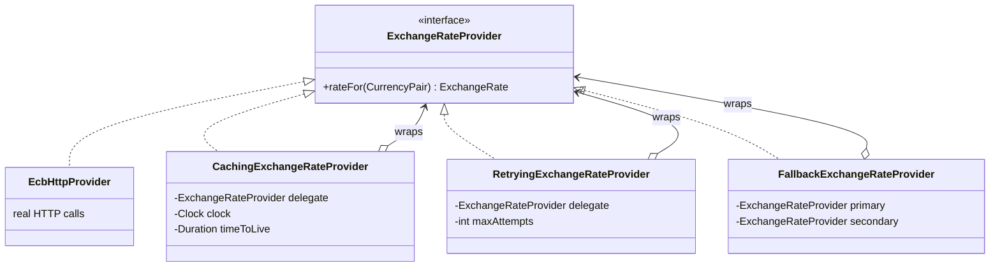
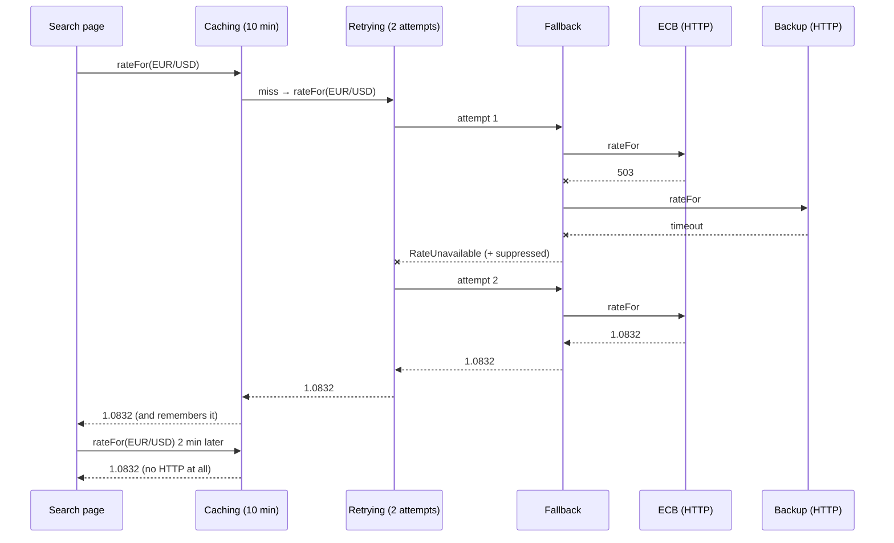

# Task 07 · Resilient exchange rates with decorators

| Difficulty | Topics | Time box |
|---|---|---|
| 🟡 Medium | Design patterns: Decorator (and a glimpse of Chain of Responsibility) · Composition over inheritance · Testing time with an injected `Clock` · Hand-written fakes · Exception design (suppressed exceptions) | 2–3 h |

> **Background reading:** *Effective Java* Item 18 ("Favor composition over inheritance"), Item 72–73 (standard exceptions, exception translation) · *Design Patterns* (GoF), "Decorator" · *A Philosophy of Software Design* ch. 7 ("Different layer, different abstraction", the section on decorators) · Martin Fowler, "Mocks Aren't Stubs"

---

## The situation

Our travel booking site shows prices in the visitor's currency. The rates come from the central bank's HTTP API, which is:

* **slow** (200–800 ms per call, and a search results page shows 50 prices),
* **flaky** (a few percent of calls fail with 503 and succeed a second later),
* **sometimes down** for an hour (maintenance), and we have a second, slightly less accurate backup provider.

Someone already started solving this by adding a `HashMap` and a `for` loop with `Thread.sleep` *into the HTTP client class*. That class is now 400 lines, impossible to test without a network, and the caching can't be turned off for the admin page that must always show live rates.

The [`ExchangeRateProvider`](../src/main/java/io/github/chris013/practice/task07/ExchangeRateProvider.java) interface has one method. That's the best possible starting point for the **Decorator** pattern: each concern (caching, retrying, fallback) becomes a small class that *implements* the interface and *wraps* another implementation. Then we compose them like Lego.

## The domain

| Term | Meaning |
|---|---|
| **Currency pair** | `EUR/USD`: how many USD you get for 1 EUR. Base and quote must differ. |
| **Exchange rate** | A pair plus a positive rate, e.g. `EUR/USD 1.0832`. |
| **Temporarily unavailable** | `RateUnavailableException`: timeout, 503, rate limit. **Trying again may help.** |
| **Not supported** | `IllegalArgumentException`: the provider doesn't know this pair. **Trying again will never help.** |
| **Time to live (TTL)** | How long a cached rate counts as fresh. For display prices, 10 minutes is fine. |

### The decorator structure

Every decorator **is an** `ExchangeRateProvider` and **has an** `ExchangeRateProvider`. Callers can't tell whether they talk to the raw HTTP client or to a stack of five decorators. That's the point.

### How a request travels through a composed stack

## What I want from you

Implement the three decorators. Constructor validation: `null` → `NullPointerException` naming the parameter; nonsense numbers → `IllegalArgumentException`.

1. **[`CachingExchangeRateProvider`](../src/main/java/io/github/chris013/practice/task07/CachingExchangeRateProvider.java)(delegate, clock, timeToLive)**
   * Caches per currency pair.
   * An entry fetched at time *t* is fresh while `now < t + ttl`. At exactly `t + ttl` it's expired.
   * **Failures are not cached.** If the delegate throws, the next call asks again.
   * `timeToLive` must be positive.
2. **[`RetryingExchangeRateProvider`](../src/main/java/io/github/chris013/practice/task07/RetryingExchangeRateProvider.java)(delegate, maxAttempts)**
   * Retries **only** `RateUnavailableException`. Anything else passes through immediately.
   * At most `maxAttempts` calls in total (`maxAttempts >= 1`).
   * If all attempts fail, throw the **first** failure with the others attached via `addSuppressed`. When this happens in production at 3 a.m., the on-call engineer wants to see *all* the failures, not just the last one.
3. **[`FallbackExchangeRateProvider`](../src/main/java/io/github/chris013/practice/task07/FallbackExchangeRateProvider.java)(primary, secondary)**
   * Use the primary. If it is temporarily unavailable, use the secondary.
   * If both fail, throw the secondary's failure with the primary's attached as suppressed.

The last test composes all three. Read it and convince yourself the expected call counts are right *before* you run it.

## Constraints & non-goals

* **No `Thread.sleep` and no `Instant.now()`/`System.currentTimeMillis()`** anywhere. Time comes from the injected `java.time.Clock`. That's what makes the cache testable in microseconds instead of minutes.
* No inheritance between the decorators (no `AbstractDelegatingProvider` base class with protected fields). Each one is a small final class.
* No mocking framework. The tests use a hand-written fake, and so should you if you add tests. (Task 22 discusses mocks vs. fakes in depth.)
* No backoff/jitter between retries in this task (stretch goal 2).
* No cache eviction or size limit (stretch goal 3).

## How I'd approach it

* Start with `Fallback`, then `Retrying`, then `Caching`. They get progressively more interesting.
* **Composition over inheritance** (*Effective Java* Item 18): you could try `class CachingEcbProvider extends EcbHttpProvider`. Now try caching the *backup* provider too, or retrying *without* caching. Inheritance fixes the combination at compile time. Decorators let you choose the combination at runtime, one line per concern.
* **Order matters.** `Caching(Retrying(x))` and `Retrying(Caching(x))` behave differently. Which one avoids retrying cache hits? Which one would cache a rate the retry finally got? Think it through and put the answer in your PR description.
* For the cache: store *when the entry expires* (or when it was fetched) next to the rate. A small private record `CachedRate(ExchangeRate rate, Instant expiresAt)` with a method `isFreshAt(Instant now)` keeps the time logic in one readable place.
* Take `clock.instant()` **once** per call and use that value everywhere in the call. Calling the clock twice in the same method is a classic source of flaky time-related bugs.
* If you reach for `ConcurrentHashMap.computeIfAbsent(pair, p -> delegate.rateFor(p))`: be careful. It would hold a lock on that part of the map **while doing a slow HTTP call**, and it doesn't handle expiry. A plain `get` then `put` is simpler and good enough. (Two threads might both fetch the same rate once; that's harmless here.)
* `Throwable.addSuppressed` isn't only for try-with-resources. It's the standard way to say "this happened, and these other things happened too".
* Look at [`MutableClock`](../src/test/java/io/github/chris013/practice/task07/MutableClock.java) and [`FakeExchangeRateProvider`](../src/test/java/io/github/chris013/practice/task07/FakeExchangeRateProvider.java). Small hand-written test doubles like these are often clearer than mock setups, and you can reuse them across many tests.

## Tests

Run: `mvn test -Dtest='**/task07/**'`

[`ExchangeRateDecoratorsTest`](../src/test/java/io/github/chris013/practice/task07/ExchangeRateDecoratorsTest.java) tests each decorator in isolation against the fake, then the composition.

Show the tests

<!-- embed: src/test/java/io/github/chris013/practice/task07/ExchangeRateDecoratorsTest.java -->
<!-- /embed -->

<!-- embed: src/test/java/io/github/chris013/practice/task07/FakeExchangeRateProvider.java -->
<!-- /embed -->

<!-- embed: src/test/java/io/github/chris013/practice/task07/MutableClock.java -->
<!-- /embed -->

## Definition of done

- [ ] All tests green, and the whole test class runs in well under a second.
- [ ] Each decorator is a small `final` class with one responsibility; no shared base class.
- [ ] No `Thread.sleep`, no `Instant.now()`.
- [ ] Only `RateUnavailableException` triggers a retry or fallback.
- [ ] No failure is swallowed: every exception is either thrown or attached as suppressed.
- [ ] Your PR description explains the order you'd compose the decorators in production, and why.

## Stretch goals

1. Write a `LoggingExchangeRateProvider` that logs slow calls (> 500 ms) using the injected `Clock`. Where in the stack does it go if you want to measure the *remote* latency? And if you want to measure the latency the *user* experiences?
2. Add exponential backoff to the retry (100 ms, 200 ms, 400 ms ...) **without** making the tests slow. Hint: inject a `Sleeper` functional interface (`void sleep(Duration)`) and pass a recording fake in tests.
3. The cache grows forever. Add a maximum size with least-recently-used eviction. (`LinkedHashMap` has a constructor flag and a `removeEldestEntry` hook that make this a ten-line job.) What happens to thread safety?
4. Build a tiny fluent builder: `Providers.of(ecb).withFallback(backup).retrying(2).cachedFor(Duration.ofMinutes(10), clock)`. Does the order of the method calls now match the order of the wrapping? Should it?

---

## Reference solution

Spoiler: open only after you have made a serious attempt

### Key decisions

**1. Three tiny final classes, each with one job.** Each decorator holds its delegate(s) in `private final` fields, validates in the constructor, and implements one method. There's no shared base class: it would save three lines of field declaration and cost a coupling that every decorator inherits forever.

**2. Caching: one clock reading, expiry stored with the value.** `now` is read once at the start of `rateFor`. The private record `CachedRate(rate, expiresAt)` with `isFreshAt(now)` makes the boundary rule ("fresh while `now < expiresAt`") readable and puts it in one place. Failures are never cached simply because the `put` comes after a successful delegate call. No special code needed.

**3. Retrying: classify exceptions by type, keep every failure.** Only `RateUnavailableException` is caught. Everything else propagates on the first attempt, without any extra code. The first failure becomes the thrown exception and later ones are attached with `addSuppressed`, which stack traces print automatically.

**4. Fallback: the same idea for two sources.** If both fail, the secondary's exception is thrown (it's the "latest news") and the primary's is attached.

**5. Composition order for production:** `Caching(Retrying(Fallback(ecb, backup)))`.
* Caching outermost: a cache hit costs no retry logic and no HTTP at all.
* Retry around fallback: one "attempt" means "try both sources". If you put retry *inside* (`Fallback(Retrying(ecb), backup)`), a dead ECB costs *n* timeouts before the backup is even asked.
* The cache only ever sees successful results, so it never caches a failure, no matter how deep the failure happened.

### Code

<!-- embed: solutions/src/main/java/io/github/chris013/practice/task07/CachingExchangeRateProvider.java -->
<!-- /embed -->

<!-- embed: solutions/src/main/java/io/github/chris013/practice/task07/RetryingExchangeRateProvider.java -->
<!-- /embed -->

<!-- embed: solutions/src/main/java/io/github/chris013/practice/task07/FallbackExchangeRateProvider.java -->
<!-- /embed -->

### What I typically flag in first attempts

| Finding | Why it matters |
|---|---|
| `catch (Exception e)` in retry | Retries programming errors and "unsupported pair" pointlessly; can even retry `InterruptedException` wrappers. |
| Throwing a new exception that only says "all attempts failed" | The actual causes are lost. Attach them as cause/suppressed. |
| `Instant.now()` inside the cache | Untestable without sleeping; tests become slow and flaky. |
| `clock.instant()` called twice (once to check, once to store) | Subtle: the two readings can differ. |
| Caching `null` or the exception | The next caller gets a stale failure for 10 minutes. |
| `computeIfAbsent` with the HTTP call inside | Blocks other threads on the same map bin during slow I/O; doesn't handle expiry. |
| An abstract base class `DelegatingProvider` with a `protected` delegate | Inheritance for code reuse of one field. Fragile base class for no gain. |

