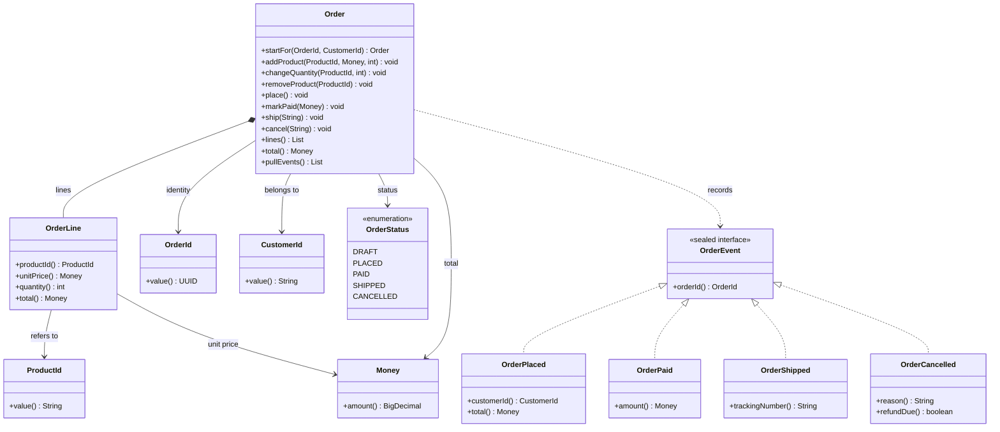
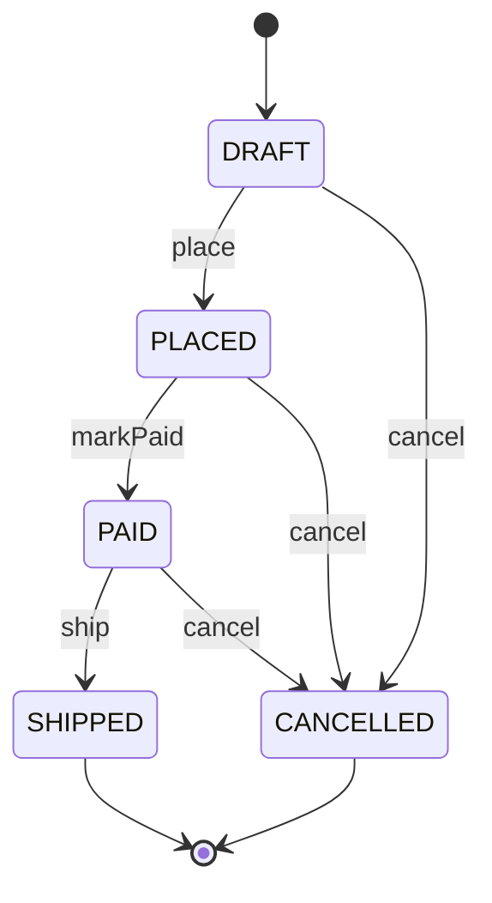
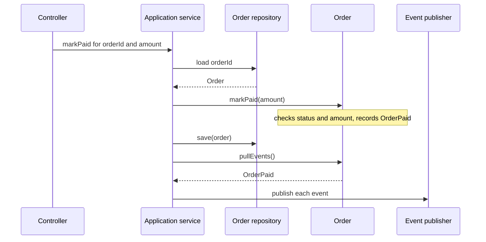

# Task 08 · The order aggregate: invariants, state and domain events

| Difficulty | Topics | Time box |
|---|---|---|
| 🔴 Hard | DDD aggregates and aggregate roots · Protecting invariants and encapsulation · Typed IDs and value objects · A state machine inside an entity · Domain events (record, then pull) · Defensive copies | 3–4 h |

> **Background reading:** Eric Evans, *Domain-Driven Design*, ch. 6 "The Life Cycle of a Domain Object" (aggregates) · Vaughn Vernon, *Implementing Domain-Driven Design*, ch. 8 (Domain Events) and ch. 10 (Aggregates), and his essay series "Effective Aggregate Design" · *Effective Java* Item 15 (minimize the accessibility of classes and members), Item 17 (minimize mutability), Item 50 (make defensive copies when needed), Item 72 (favor the standard exceptions)

---

## The situation

We run "Bean There", a webshop for coffee beans. Today an `Order` is an anemic JavaBean with public setters. The services do things like `order.setStatus(SHIPPED)` and `order.getLines().add(...)`, and every service has to remember the rules. They often forget.

Three real incidents from the last quarter:

* **An order was shipped before it was paid.** One service forgot the check that the order is paid before it ships. The warehouse sent the coffee, and we had to chase the money.
* **A customer got coffee they never paid for.** A controller added a line to an order that was already paid. It worked because `getLines()` returned the internal `List`, and the controller simply called `add` on it. Nobody noticed the order had changed status.
* **An order of €3.00 was placed.** Our minimum order value is €15.00. The check lived in only one of our three controllers. The other two accepted anything.

All three bugs have the same root cause: the rules are spread over many callers, and the object itself does not protect them. The fix is to make `Order` an **aggregate root**. It is the only door into the aggregate, it guards its own **invariants**, and nobody outside can put it into an invalid state. Services ask the order to do something; they do not reach in and change its fields.

## The domain

| Term | Meaning |
|---|---|
| **Aggregate** | A cluster of objects that change together and are treated as one unit for consistency. |
| **Aggregate root** | The one object of the aggregate that outsiders may hold on to and call. Here: `Order`. `OrderLine` is only reachable through it. |
| **Invariant** | A rule that is true after every public method returns. Example: an order that has been placed has at least one line and a total of at least €15.00. |
| **Entity vs value object** | An entity has an identity (`OrderId`) and can change over time. A value object has no identity and is defined by its values (`Money`, `OrderLine`). Value objects are immutable. |
| **Typed ID** | A wrapper around a raw value, such as `OrderId(UUID)` or `CustomerId(String)`. The compiler stops you from passing a customer id where an order id is expected. |
| **Domain event** | A fact about the past, named in the language of the business: `OrderPaid`, `OrderShipped`. Other parts of the system react to it. |
| **Minimum order value** | €15.00. A placed order must have a total of at least this amount. |
| **Draft** | An order that the customer is still building. Nobody outside knows about it yet, and it can change freely. |

### The shape of the aggregate



Notice the arrows. `Order` owns its `OrderLine`s, and nothing else points at a line. `Order` refers to `CustomerId` and to products only by id. Products are a different aggregate, and we do not want to load the whole product catalogue just to place an order.

### The life cycle



The only way from one status to the next is through a method on `Order`. Each method checks that the current status allows it, and each successful method changes the status and records an event where the business cares.

Which event does each transition record?

| Transition | Event recorded |
|---|---|
| `place` | `OrderPlaced(orderId, customerId, total)` |
| `markPaid` | `OrderPaid(orderId, amount)` |
| `ship` | `OrderShipped(orderId, trackingNumber)` |
| `cancel` from PLACED | `OrderCancelled(orderId, reason, refundDue=false)` |
| `cancel` from PAID | `OrderCancelled(orderId, reason, refundDue=true)` |
| `cancel` of a DRAFT | no event. Nobody outside knows the draft exists. |
| `cancel` of an already cancelled order | no-op. No state change, no event. |

### Recording events, then pulling them

The aggregate does not publish events. It only remembers them. The application service saves the order and then takes the events out and publishes them. That keeps the domain free of infrastructure: no event bus, no static listeners, no threads.



The order of the last three steps matters. If we published before saving and the save failed, customers would get a "payment received" email although the database still says the order is unpaid. Save first, then publish. The reverse failure (saved, but the publish fails) loses the event; production systems close that gap with a transactional outbox, which writes the events into the same database transaction and publishes them afterwards.

## What I want from you

Make [`Order`](../src/main/java/io/github/chris013/practice/task08/Order.java) an aggregate root that enforces every rule below. You may add private helpers. Do not change the given types, except [`OrderLine`](../src/main/java/io/github/chris013/practice/task08/OrderLine.java), which is yours to complete.

1. **`startFor(id, customer)`** creates a new, empty draft with status `DRAFT`. It records no events.
2. **`addProduct(product, unitPrice, quantity)`**
   * Adds a line. If the product is already on the order, the quantities are merged into one line. Each product appears on at most one line.
   * The same product at a different unit price is an `IllegalArgumentException`.
   * The quantity of every line must be 1 to 99, **including after merging**. Going over 99 is an `IllegalArgumentException`, and the order does not change.
   * Only allowed in `DRAFT`.
3. **`changeQuantity(product, newQuantity)`**
   * Sets the quantity of a product that is already on the order. `0` removes the line.
   * A product that is not on the order is an `IllegalArgumentException`.
   * Only allowed in `DRAFT`.
4. **`removeProduct(product)`** removes a line. A product that is not on the order is an `IllegalArgumentException`. Only allowed in `DRAFT`.
5. **`lines()`** returns an **unmodifiable copy** of the lines, in insertion order. Calling `add` or `clear` on the result throws `UnsupportedOperationException`.
6. **`total()`** is the sum of all line totals. It is computed, not stored. An empty order has a total of `Money.ZERO`.
7. **`place()`**
   * Only allowed in `DRAFT`, otherwise an `IllegalStateException`.
   * The order needs at least one line, otherwise an `IllegalStateException`.
   * The total needs to be at least €15.00, otherwise an `IllegalStateException`. The message must contain `15.00`.
   * On success: status `PLACED`, and an `OrderPlaced` event with the order id, the customer id and the total.
8. **Lines are frozen after `place()`.** `addProduct`, `changeQuantity` and `removeProduct` throw `IllegalStateException`, and the total stays the same.
9. **`markPaid(amount)`**
   * Only allowed in `PLACED`, otherwise an `IllegalStateException`.
   * The amount must equal the total exactly, otherwise an `IllegalArgumentException`. In that case nothing changes and no event is recorded.
   * On success: status `PAID`, and an `OrderPaid` event with the order id and the amount.
10. **`ship(trackingNumber)`**
    * Only allowed in `PAID`, otherwise an `IllegalStateException`. An order that is not paid never ships.
    * A `null` or blank tracking number is an `IllegalArgumentException`.
    * On success: status `SHIPPED`, and an `OrderShipped` event.
11. **`cancel(reason)`**
    * Allowed from `DRAFT`, `PLACED` and `PAID`.
    * From `PLACED`: status `CANCELLED`, and an `OrderCancelled` event with `refundDue = false`.
    * From `PAID`: status `CANCELLED`, and an `OrderCancelled` event with `refundDue = true`.
    * From `DRAFT`: status `CANCELLED`, and **no event**.
    * From `CANCELLED`: a **no-op**. No state change and no event.
    * From `SHIPPED`: an `IllegalStateException`. The status stays `SHIPPED`.
12. **`pullEvents()`** returns the events recorded since the last call, oldest first, and forgets them. A second call returns an empty list.

**Why `IllegalArgumentException` and `IllegalStateException`?** Use the convention from *Effective Java* Item 72. An `IllegalArgumentException` means the *argument of this call* is bad: a quantity of 100, a tracking number that is blank, a wrong amount. The same call might work with a different argument. An `IllegalStateException` means the argument might be fine, but the *order is in the wrong state* for this call: you cannot add a product to a paid order. Keep this distinction in your code and in your tests, because callers and monitoring treat the two differently.

## Constraints & non-goals

* **No setters.** No public method changes a field directly. The only way to change an order is a behaviour method, such as `markPaid`, that checks the rules first.
* **No persistence.** The aggregate does not know about databases, ORMs or repositories. Loading and saving are the job of a repository, which is out of scope here.
* **No event publishing from inside the aggregate.** `Order` records events. It never calls a publisher, a listener or a static event bus.
* **No inheritance.** `Order` and `OrderLine` are `final` and have no subclasses.
* **No changes to the given types**, except `OrderLine` and `Order`.

## How I'd approach it

* **Write the state machine first.** Before you write any arithmetic, write the status transitions. Put every "is this allowed in this status?" check through one private helper, such as `requireStatus(DRAFT, "add products")`. When a rule changes, you change one line. When someone reads the code, they see the rule once.
* **Keep the lines in a `LinkedHashMap` keyed by `ProductId`.** The key gives you "one line per product" for free. The linked map keeps insertion order, which is what `lines()` must return. A `List` would make "find the line for this product" a loop, and you would have to remember to check for duplicates yourself.
* **Let `OrderLine` guard its own quantity.** A value object that can be built with a quantity of 0 is a value object that will eventually be built with a quantity of 0. Put the range check in the `OrderLine` constructor. Then every way of creating or changing a line, including the merge in `addProduct`, goes through the same check. This is what prevents the bug "validated on add, forgot after merging".
* **Compute the total instead of storing it.** A field `total` has to be updated by every method that changes a line, and one forgotten update makes it drift. A method that sums the lines cannot drift. The sums are small, so the cost does not matter.
* **Copy on the way out.** `lines()` returns `List.copyOf(...)`. Your `Order` keeps the real map, and nobody else can reach it. This is the fix for the "customer got coffee they never paid for" incident. The controller that called `getLines().add(...)` now gets an `UnsupportedOperationException` in its own code, and the order is not changed.
* **Why `pullEvents` copies and then clears.** Never hand out the internal `events` list. If you return it and then clear it, the caller's list is emptied under their feet. If you return it without clearing, the caller holds a live view that changes with the next event. So copy first: the immutable copy is what you give away. Then clear: that is what makes "pulled once" true. Do it in the other order and the copy is empty.
* **Why typed IDs?** `OrderId` and `CustomerId` are both strings or UUIDs under the hood. Without the wrapper, `new Order(customerId, orderId)` compiles and fails at 3 a.m. in production. With the wrapper, the compiler refuses. A few lines of code buy you a class of bugs that you can never hit.
* **Why we don't validate in the controller.** The controller is one of three callers. If the rule lives there, two callers do not have it. Validation in the aggregate applies to every caller, present and future, including the batch job nobody remembers writing.
* **Aggregate boundary: refer to other aggregates by id.** `Order` holds a `ProductId` and a `CustomerId`, never a `Product` or a `Customer` object. A reference to a whole other aggregate pulls its whole object graph into every transaction and makes it impossible to say which aggregate owns what.
* **One transaction per aggregate.** A single `Order` is loaded, changed and saved in one transaction, and its events are published after that transaction commits. If you find yourself wanting one transaction that changes an order *and* a warehouse stock level, that is a sign that you have two aggregates and an event between them.
* **Test the rules, not the getters.** The interesting tests are the ones where a rule is broken and the order must stay as it was. A test that asserts "nothing changed" after a rejected call is worth more than three tests for `id()`.

## Tests

Run: `mvn test -Dtest='**/task08/**'`

[`OrderTest`](../src/test/java/io/github/chris013/practice/task08/OrderTest.java) has 29 tests in six nested groups: draft, placing, paying, shipping, cancelling and events. Read the nested names first; they read as the rules of the business.

<details>
<summary>Show the tests</summary>

<!-- embed: src/test/java/io/github/chris013/practice/task08/OrderTest.java -->
**[`OrderTest.java`](../src/test/java/io/github/chris013/practice/task08/OrderTest.java)**

```java
package io.github.chris013.practice.task08;

import static io.github.chris013.practice.task08.Money.euros;
import static org.assertj.core.api.Assertions.assertThat;
import static org.assertj.core.api.Assertions.assertThatThrownBy;

import io.github.chris013.practice.task08.OrderEvent.OrderCancelled;
import io.github.chris013.practice.task08.OrderEvent.OrderPaid;
import io.github.chris013.practice.task08.OrderEvent.OrderPlaced;
import io.github.chris013.practice.task08.OrderEvent.OrderShipped;
import org.junit.jupiter.api.Nested;
import org.junit.jupiter.api.Test;

class OrderTest {

    private static final ProductId ETHIOPIA = new ProductId("ETHIOPIA-YIRGACHEFFE-250G");
    private static final ProductId BRAZIL = new ProductId("BRAZIL-CERRADO-1KG");
    private static final CustomerId ANNA = new CustomerId("anna");

    private final OrderId id = OrderId.random();
    private final Order order = Order.startFor(id, ANNA);

    /** 2 x 8.50 + 1 x 21.00 = 38.00 */
    private Order placedOrder() {
        order.addProduct(ETHIOPIA, euros("8.50"), 2);
        order.addProduct(BRAZIL, euros("21.00"), 1);
        order.place();
        order.pullEvents();
        return order;
    }

    private Order paidOrder() {
        placedOrder().markPaid(euros("38.00"));
        order.pullEvents();
        return order;
    }

    @Nested
    class Draft {

        @Test
        void starts_empty_and_without_events() {
            assertThat(order.id()).isEqualTo(id);
            assertThat(order.customerId()).isEqualTo(ANNA);
            assertThat(order.status()).isEqualTo(OrderStatus.DRAFT);
            assertThat(order.lines()).isEmpty();
            assertThat(order.total()).isEqualTo(Money.ZERO);
            assertThat(order.pullEvents()).isEmpty();
        }

        @Test
        void adds_products_and_sums_the_total() {
            order.addProduct(ETHIOPIA, euros("8.50"), 2);
            order.addProduct(BRAZIL, euros("21.00"), 1);

            assertThat(order.lines()).containsExactly(
                    new OrderLine(ETHIOPIA, euros("8.50"), 2), new OrderLine(BRAZIL, euros("21.00"), 1));
            assertThat(order.total()).isEqualTo(euros("38.00"));
        }

        @Test
        void merges_the_same_product_into_one_line() {
            order.addProduct(ETHIOPIA, euros("8.50"), 2);
            order.addProduct(ETHIOPIA, euros("8.50"), 3);

            assertThat(order.lines()).containsExactly(new OrderLine(ETHIOPIA, euros("8.50"), 5));
        }

        @Test
        void refuses_the_same_product_at_a_different_price() {
            order.addProduct(ETHIOPIA, euros("8.50"), 2);

            assertThatThrownBy(() -> order.addProduct(ETHIOPIA, euros("7.90"), 1))
                    .isInstanceOf(IllegalArgumentException.class);
            assertThat(order.lines()).containsExactly(new OrderLine(ETHIOPIA, euros("8.50"), 2));
        }

        @Test
        void allows_1_to_99_items_per_product() {
            assertThatThrownBy(() -> order.addProduct(ETHIOPIA, euros("8.50"), 0))
                    .isInstanceOf(IllegalArgumentException.class);
            assertThatThrownBy(() -> order.addProduct(ETHIOPIA, euros("8.50"), 100))
                    .isInstanceOf(IllegalArgumentException.class);

            order.addProduct(ETHIOPIA, euros("8.50"), 60);
            assertThatThrownBy(() -> order.addProduct(ETHIOPIA, euros("8.50"), 40))
                    .isInstanceOf(IllegalArgumentException.class);
            assertThat(order.lines()).containsExactly(new OrderLine(ETHIOPIA, euros("8.50"), 60));
        }

        @Test
        void changes_quantities() {
            order.addProduct(ETHIOPIA, euros("8.50"), 2);

            order.changeQuantity(ETHIOPIA, 4);

            assertThat(order.lines()).containsExactly(new OrderLine(ETHIOPIA, euros("8.50"), 4));
        }

        @Test
        void removes_a_product_when_its_quantity_becomes_zero() {
            order.addProduct(ETHIOPIA, euros("8.50"), 2);

            order.changeQuantity(ETHIOPIA, 0);

            assertThat(order.lines()).isEmpty();
        }

        @Test
        void removes_products() {
            order.addProduct(ETHIOPIA, euros("8.50"), 2);
            order.addProduct(BRAZIL, euros("21.00"), 1);

            order.removeProduct(ETHIOPIA);

            assertThat(order.lines()).extracting(OrderLine::productId).containsExactly(BRAZIL);
        }

        @Test
        void cannot_change_or_remove_a_product_that_is_not_on_the_order() {
            assertThatThrownBy(() -> order.changeQuantity(BRAZIL, 2)).isInstanceOf(IllegalArgumentException.class);
            assertThatThrownBy(() -> order.removeProduct(BRAZIL)).isInstanceOf(IllegalArgumentException.class);
        }

        @Test
        void does_not_let_anyone_modify_its_lines_from_outside() {
            order.addProduct(ETHIOPIA, euros("8.50"), 2);

            assertThatThrownBy(() -> order.lines().clear()).isInstanceOf(UnsupportedOperationException.class);
        }
    }

    @Nested
    class Placing {

        @Test
        void announces_the_order_with_its_total() {
            order.addProduct(ETHIOPIA, euros("8.50"), 2);

            order.place();

            assertThat(order.status()).isEqualTo(OrderStatus.PLACED);
            assertThat(order.pullEvents()).containsExactly(new OrderPlaced(id, ANNA, euros("17.00")));
        }

        @Test
        void needs_at_least_one_product() {
            assertThatThrownBy(order::place).isInstanceOf(IllegalStateException.class);
            assertThat(order.status()).isEqualTo(OrderStatus.DRAFT);
        }

        @Test
        void needs_the_minimum_order_value_of_15_euros() {
            order.addProduct(ETHIOPIA, euros("14.99"), 1);
            assertThatThrownBy(order::place).isInstanceOf(IllegalStateException.class).hasMessageContaining("15.00");

            order.changeQuantity(ETHIOPIA, 0);
            order.addProduct(BRAZIL, euros("15.00"), 1);
            order.place();
            assertThat(order.status()).isEqualTo(OrderStatus.PLACED);
        }

        @Test
        void freezes_the_lines() {
            placedOrder();

            assertThatThrownBy(() -> order.addProduct(ETHIOPIA, euros("8.50"), 1)).isInstanceOf(IllegalStateException.class);
            assertThatThrownBy(() -> order.changeQuantity(ETHIOPIA, 1)).isInstanceOf(IllegalStateException.class);
            assertThatThrownBy(() -> order.removeProduct(ETHIOPIA)).isInstanceOf(IllegalStateException.class);
            assertThat(order.total()).isEqualTo(euros("38.00"));
        }

        @Test
        void happens_only_once() {
            placedOrder();

            assertThatThrownBy(order::place).isInstanceOf(IllegalStateException.class);
            assertThat(order.pullEvents()).isEmpty();
        }
    }

    @Nested
    class Paying {

        @Test
        void requires_exactly_the_order_total() {
            placedOrder();

            order.markPaid(euros("38.00"));

            assertThat(order.status()).isEqualTo(OrderStatus.PAID);
            assertThat(order.pullEvents()).containsExactly(new OrderPaid(id, euros("38.00")));
        }

        @Test
        void rejects_a_wrong_amount_without_changing_anything() {
            placedOrder();

            assertThatThrownBy(() -> order.markPaid(euros("37.99"))).isInstanceOf(IllegalArgumentException.class);
            assertThat(order.status()).isEqualTo(OrderStatus.PLACED);
            assertThat(order.pullEvents()).isEmpty();
        }

        @Test
        void is_only_possible_for_placed_orders() {
            order.addProduct(BRAZIL, euros("21.00"), 1);

            assertThatThrownBy(() -> order.markPaid(euros("21.00"))).isInstanceOf(IllegalStateException.class);
        }
    }

    @Nested
    class Shipping {

        @Test
        void ships_paid_orders_with_a_tracking_number() {
            paidOrder();

            order.ship("DHL-123456");

            assertThat(order.status()).isEqualTo(OrderStatus.SHIPPED);
            assertThat(order.pullEvents()).containsExactly(new OrderShipped(id, "DHL-123456"));
        }

        @Test
        void never_ships_unpaid_orders() {
            placedOrder();

            assertThatThrownBy(() -> order.ship("DHL-123456")).isInstanceOf(IllegalStateException.class);
        }

        @Test
        void needs_a_tracking_number() {
            paidOrder();

            assertThatThrownBy(() -> order.ship(" ")).isInstanceOf(IllegalArgumentException.class);
            assertThat(order.status()).isEqualTo(OrderStatus.PAID);
        }
    }

    @Nested
    class Cancelling {

        @Test
        void a_draft_quietly_because_nobody_else_knows_about_it() {
            order.addProduct(ETHIOPIA, euros("8.50"), 2);

            order.cancel("changed my mind");

            assertThat(order.status()).isEqualTo(OrderStatus.CANCELLED);
            assertThat(order.pullEvents()).isEmpty();
        }

        @Test
        void a_placed_order_without_refund() {
            placedOrder();

            order.cancel("out of stock");

            assertThat(order.pullEvents()).containsExactly(new OrderCancelled(id, "out of stock", false));
        }

        @Test
        void a_paid_order_with_refund() {
            paidOrder();

            order.cancel("out of stock");

            assertThat(order.pullEvents()).containsExactly(new OrderCancelled(id, "out of stock", true));
        }

        @Test
        void is_impossible_once_shipped() {
            paidOrder();
            order.ship("DHL-123456");

            assertThatThrownBy(() -> order.cancel("too late")).isInstanceOf(IllegalStateException.class);
            assertThat(order.status()).isEqualTo(OrderStatus.SHIPPED);
        }

        @Test
        void twice_is_harmless() {
            placedOrder();
            order.cancel("out of stock");
            order.pullEvents();

            order.cancel("out of stock");

            assertThat(order.status()).isEqualTo(OrderStatus.CANCELLED);
            assertThat(order.pullEvents()).isEmpty();
        }

        @Test
        void ends_the_life_of_the_order() {
            placedOrder();
            order.cancel("out of stock");

            assertThatThrownBy(() -> order.markPaid(euros("38.00"))).isInstanceOf(IllegalStateException.class);
            assertThatThrownBy(() -> order.ship("DHL-1")).isInstanceOf(IllegalStateException.class);
        }
    }

    @Nested
    class Events {

        @Test
        void are_recorded_in_the_order_they_happened() {
            order.addProduct(BRAZIL, euros("21.00"), 1);
            order.place();
            order.markPaid(euros("21.00"));
            order.ship("DHL-42");

            assertThat(order.pullEvents()).containsExactly(
                    new OrderPlaced(id, ANNA, euros("21.00")),
                    new OrderPaid(id, euros("21.00")),
                    new OrderShipped(id, "DHL-42"));
        }

        @Test
        void are_handed_out_only_once() {
            placedOrder();
            order.markPaid(euros("38.00"));

            assertThat(order.pullEvents()).hasSize(1);
            assertThat(order.pullEvents()).isEmpty();
        }
    }
}
```
<!-- /embed -->

</details>

## Definition of done

- [ ] All 29 tests in `OrderTest` are green.
- [ ] `Order` has no public constructor, no setters and no method that returns an internal mutable collection.
- [ ] Every status change goes through a single status check helper.
- [ ] `OrderLine` validates its own quantity, and the merge path in `addProduct` cannot bypass that check.
- [ ] `total()` is computed from the lines. There is no stored total field.
- [ ] A rejected call leaves the order exactly as it was, including its events.
- [ ] No class in the aggregate refers to a publisher, a repository or a static event bus.

## Stretch goals

1. **Optimistic locking.** Add a `version` number to `Order`. Two services that load the same draft and both place it should not both succeed silently. Decide where the version is checked: in the aggregate, in the repository, or both. Explain your choice in your PR description.
2. **A `reconstitute(...)` factory.** Loading an order from the database must not re-run the business rules and must not record `OrderPlaced` again. Write a second factory for it. Explain in one paragraph why it must be separate from `startFor`, not just a flag on it.
3. **Results instead of exceptions.** Business rule violations are expected outcomes, not bugs. Try a sealed result type, such as `PlaceResult` with `Placed` and `TooSmall` variants, and compare the call sites with the exception version. This is the subject of task 15.
4. **Event sourcing.** Rebuild an `Order` from its events: add `apply(OrderEvent)` and make every behaviour method call `apply` for the event it records. What does `pullEvents` become in this design, and why is `cancel` twice a no-op even more important there?

---

## Reference solution

<details>
<summary>Spoiler: open only after you have made a serious attempt</summary>

### Key decisions

**1. A status enum with one guard helper, not type-state.** `OrderStatus` is an enum, and `requireStatus(required, action)` is the only place that decides whether a call is allowed. The alternative is a type-state design with a class per status, where the compiler forbids `ship()` on a placed order. That is stronger, but it makes persistence and the public API much heavier. It is worth it when the state machine is complicated; task 12 explores that trade-off.

**2. `LinkedHashMap<ProductId, OrderLine>` for the lines.** The map enforces "one line per product" and gives a fast lookup for `changeQuantity` and `removeProduct`. The linked part keeps the insertion order that `lines()` promises. The rejected alternative was a `List<OrderLine>` with a search on every add.

**3. `OrderLine` is an immutable record that guards its quantity.** The range check lives in the compact constructor, so the merge path cannot skip it. Changing the quantity creates a new line through the package-private `withQuantity`. The line is never mutated, so a copy of it held elsewhere can never change under you.

**4. The total is computed.** `total()` folds over the lines with `Money.ZERO` as the start value. There is no field to keep in sync. The rejected alternative was a `total` field updated by each mutator, which is exactly the kind of field that drifts.

**5. Events are a list, and `pullEvents` copies, then clears.** `events` is an `ArrayList` that only the aggregate writes to. `pullEvents` returns `List.copyOf(events)` and then clears the internal list. The caller gets an immutable snapshot, and the aggregate is ready for the next batch.

**6. `CANCELLABLE` is an `EnumSet` of the three cancellable states.** The set states the rule in one place: `DRAFT`, `PLACED` and `PAID`. `SHIPPED` and `CANCELLED` are not in it. The check after the no-op branch throws an `IllegalStateException` for everything else.

**7. A draft cancellation records no event.** Nobody outside the system knows the draft exists, so no other part of the system needs to react. Recording an `OrderCancelled` event here would make the event stream lie about what the business did.

**8. Cancelling twice is a no-op.** Retries happen: a network call times out, the client sends the cancel again. The second call must succeed without a second event and without an error, otherwise a retry turns a harmless timeout into a failure. This is idempotency, and it is why `CANCELLED` returns early rather than throwing.

### Code

<!-- embed: solutions/src/main/java/io/github/chris013/practice/task08/Order.java -->
**[`Order.java`](../solutions/src/main/java/io/github/chris013/practice/task08/Order.java)**

```java
package io.github.chris013.practice.task08;

import static io.github.chris013.practice.task08.OrderStatus.CANCELLED;
import static io.github.chris013.practice.task08.OrderStatus.DRAFT;
import static io.github.chris013.practice.task08.OrderStatus.PAID;
import static io.github.chris013.practice.task08.OrderStatus.PLACED;
import static io.github.chris013.practice.task08.OrderStatus.SHIPPED;

import io.github.chris013.practice.task08.OrderEvent.OrderCancelled;
import io.github.chris013.practice.task08.OrderEvent.OrderPaid;
import io.github.chris013.practice.task08.OrderEvent.OrderPlaced;
import io.github.chris013.practice.task08.OrderEvent.OrderShipped;
import java.util.ArrayList;
import java.util.EnumSet;
import java.util.LinkedHashMap;
import java.util.List;
import java.util.Map;
import java.util.Objects;
import java.util.Set;

/**
 * An order in our coffee webshop, and the root of its aggregate.
 *
 * <p>Invariants, true after every public method returns:
 * <ul>
 *   <li>lines change only while the order is a {@link OrderStatus#DRAFT draft};</li>
 *   <li>each product appears on at most one line, with 1 to 99 items;</li>
 *   <li>an order that has left DRAFT through {@code place()} has at least one line and a total of at least
 *       {@link #MINIMUM_ORDER_VALUE};</li>
 *   <li>the status only moves along DRAFT → PLACED → PAID → SHIPPED, or to CANCELLED before shipping.</li>
 * </ul>
 */
public final class Order {

    static final Money MINIMUM_ORDER_VALUE = Money.euros("15.00");
    private static final Set<OrderStatus> CANCELLABLE = EnumSet.of(DRAFT, PLACED, PAID);

    private final OrderId id;
    private final CustomerId customerId;
    private final Map<ProductId, OrderLine> lines = new LinkedHashMap<>();
    private final List<OrderEvent> events = new ArrayList<>();
    private OrderStatus status = DRAFT;

    private Order(OrderId id, CustomerId customerId) {
        this.id = Objects.requireNonNull(id, "id");
        this.customerId = Objects.requireNonNull(customerId, "customerId");
    }

    public static Order startFor(OrderId id, CustomerId customer) {
        return new Order(id, customer);
    }

    public void addProduct(ProductId product, Money unitPrice, int quantity) {
        requireStatus(DRAFT, "add products");
        OrderLine existing = lines.get(product);
        if (existing == null) {
            lines.put(product, new OrderLine(product, unitPrice, quantity));
            return;
        }
        if (!existing.unitPrice().equals(unitPrice)) {
            throw new IllegalArgumentException("%s is already on the order at %s, not %s"
                    .formatted(product.value(), existing.unitPrice(), unitPrice));
        }
        lines.put(product, existing.withQuantity(existing.quantity() + quantity));
    }

    public void changeQuantity(ProductId product, int newQuantity) {
        requireStatus(DRAFT, "change quantities");
        OrderLine line = existingLine(product);
        if (newQuantity == 0) {
            lines.remove(product);
        } else {
            lines.put(product, line.withQuantity(newQuantity));
        }
    }

    public void removeProduct(ProductId product) {
        requireStatus(DRAFT, "remove products");
        existingLine(product);
        lines.remove(product);
    }

    public void place() {
        requireStatus(DRAFT, "place it");
        if (lines.isEmpty()) {
            throw new IllegalStateException("Cannot place an empty order");
        }
        if (total().isLessThan(MINIMUM_ORDER_VALUE)) {
            throw new IllegalStateException(
                    "The minimum order value is %s, this order is %s".formatted(MINIMUM_ORDER_VALUE, total()));
        }
        status = PLACED;
        events.add(new OrderPlaced(id, customerId, total()));
    }

    public void markPaid(Money amount) {
        requireStatus(PLACED, "mark it paid");
        if (!amount.equals(total())) {
            throw new IllegalArgumentException("Order %s costs %s, but %s was paid".formatted(id.value(), total(), amount));
        }
        status = PAID;
        events.add(new OrderPaid(id, amount));
    }

    public void ship(String trackingNumber) {
        requireStatus(PAID, "ship it");
        if (trackingNumber == null || trackingNumber.isBlank()) {
            throw new IllegalArgumentException("A shipment needs a tracking number");
        }
        status = SHIPPED;
        events.add(new OrderShipped(id, trackingNumber));
    }

    public void cancel(String reason) {
        if (status == CANCELLED) {
            return;
        }
        if (!CANCELLABLE.contains(status)) {
            throw new IllegalStateException("Order %s is %s and can no longer be cancelled".formatted(id.value(), status));
        }
        OrderStatus previous = status;
        status = CANCELLED;
        if (previous != DRAFT) {
            events.add(new OrderCancelled(id, reason, previous == PAID));
        }
    }

    public OrderId id() {
        return id;
    }

    public CustomerId customerId() {
        return customerId;
    }

    public OrderStatus status() {
        return status;
    }

    public List<OrderLine> lines() {
        return List.copyOf(lines.values());
    }

    public Money total() {
        return lines.values().stream().map(OrderLine::total).reduce(Money.ZERO, Money::plus);
    }

    public List<OrderEvent> pullEvents() {
        List<OrderEvent> recorded = List.copyOf(events);
        events.clear();
        return recorded;
    }

    private OrderLine existingLine(ProductId product) {
        OrderLine line = lines.get(product);
        if (line == null) {
            throw new IllegalArgumentException("%s is not on order %s".formatted(product.value(), id.value()));
        }
        return line;
    }

    private void requireStatus(OrderStatus required, String action) {
        if (status != required) {
            throw new IllegalStateException(
                    "Cannot %s: order %s is %s, must be %s".formatted(action, id.value(), status, required));
        }
    }
}
```
<!-- /embed -->

<!-- embed: solutions/src/main/java/io/github/chris013/practice/task08/OrderLine.java -->
**[`OrderLine.java`](../solutions/src/main/java/io/github/chris013/practice/task08/OrderLine.java)**

```java
package io.github.chris013.practice.task08;

import java.util.Objects;

/** One product on an order. Part of the {@link Order} aggregate. */
public record OrderLine(ProductId productId, Money unitPrice, int quantity) {

    static final int MAX_QUANTITY = 99;

    public OrderLine {
        Objects.requireNonNull(productId, "productId");
        Objects.requireNonNull(unitPrice, "unitPrice");
        if (quantity < 1 || quantity > MAX_QUANTITY) {
            throw new IllegalArgumentException(
                    "Quantity of %s must be 1 to %d, was %d".formatted(productId.value(), MAX_QUANTITY, quantity));
        }
    }

    public Money total() {
        return unitPrice.times(quantity);
    }

    OrderLine withQuantity(int newQuantity) {
        return new OrderLine(productId, unitPrice, newQuantity);
    }
}
```
<!-- /embed -->

### What I typically flag in first attempts

| Finding | Why it matters |
|---|---|
| A getter that returns the internal list, even as `Collections.unmodifiableList` on a live view | The caller can still see changes made later, and the list is one line away from being mutated. Return a copy. |
| Status checks in the services instead of the aggregate | The rule is repeated in every caller, and the next caller forgets it. This is the root cause of the shipped-before-paid incident. |
| Publishing events from inside the aggregate | The domain now depends on infrastructure and can publish before the save has succeeded. Record, then pull. |
| A stored `total` field that is updated by each mutator | It drifts as soon as one mutator forgets. Compute it from the lines. |
| Validating the quantity only in `addProduct`, not after merging | Two adds of 60 each pass the check and produce a line of 120. Put the check in `OrderLine`. |
| `IllegalArgumentException` and `IllegalStateException` used interchangeably | Callers and monitoring cannot tell "bad input" from "wrong moment". Follow the rule in *Effective Java* Item 72. |
| Recording an `OrderCancelled` event for a draft | The event says the business cancelled an order that customers never placed. Draft cancellations stay silent. |
| `equals` on `Order` comparing all fields | An entity's identity does not change when its state changes. With all-field `equals`, two copies of the same order with different lines count as different orders, and the `hashCode` changes after every mutation, so the order gets lost inside a `HashSet` or as a `HashMap` key. Compare by `OrderId`, or keep the default identity equality. |

</details>
