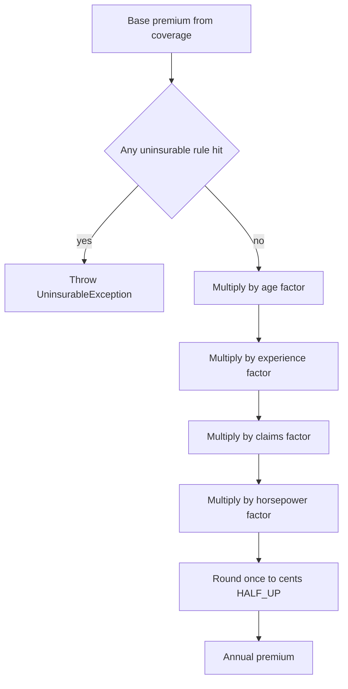

# Task 09 · Test data builders and the bug nobody saw

| Difficulty | Topics | Time box |
|---|---|---|
| 🟡 Medium | Testing craft: test data builders · one behaviour per test · boundary-value analysis · parameterized tests · finding bugs with tests · readable tests as documentation | 2–3 h |

> **Background reading:** Nat Pryce and Steve Freeman, *Growing Object-Oriented Software, Guided by Tests*, ch. 22 "Constructing Complex Test Data" · Gerard Meszaros, *xUnit Test Patterns*, the test smell "Obscure Test" · Nat Pryce, "Test Data Builders: an alternative to the Object Mother pattern" (2007, natpryce.com) · Vladimir Khorikov, *Unit Testing Principles, Practices, and Patterns*, ch. 3 "The anatomy of a unit test" · *Effective Java*, Item 2 "Consider a builder when faced with many constructor parameters"

---

## The situation

Our car insurance team is about to change the pricing rules. A discount for electric cars is coming, and the actuaries want to review the age rules as well. All the pricing logic sits in one class, `PremiumCalculator`. Nobody wants to touch it, because its test is hard to read: three long methods, positional constructor calls, magic dates, and `assertEquals` lines where you cannot tell which rule a number belongs to.

Last week a customer complained. A 24-year-old got a quote without the young-driver surcharge. The actuaries checked the portfolio and say young drivers are being mispriced. The test suite is green, and that is the real problem: a green run tells us nothing about the rules.

Before the pricing changes, we need tests that describe the rules precisely. You will build test data builders, rewrite the legacy test into small specifications, test every boundary, and then find and fix the bug.

## The domain

| Term | Meaning |
|---|---|
| **Annual premium** (Jahresprämie) | What the customer pays per year for one policy, in EUR, rounded to cents. |
| **Coverage** (Deckungsart) | The type of cover: `LIABILITY` (Haftpflicht), `PARTIAL` (Teilkasko), `FULL` (Vollkasko). |
| **Base premium** | The starting amount per coverage: 300.00, 420.00 and 600.00 EUR. |
| **Factor** | A multiplier a risk feature adds, such as × 1.50. Factors multiply; they do not add. |
| **Policy start** | The day the policy begins. Age and driving experience are measured on this day, not on today's date. |
| **Full years** | Complete years between two dates. Two years and eleven months is two full years. |
| **Uninsurable** | `UninsurableException`: we refuse to quote at all. It is a refusal, not a price. |

### The pricing rules

| Rule | When | Effect |
|---|---|---|
| Age | under 18 | uninsurable |
| Age | 18 to 24 | × 1.50 |
| Age | 25 to 69 | × 1.00 |
| Age | 70 or more | × 1.20 |
| Experience | fewer than 3 full years licensed | × 1.30 |
| Experience | 3 or more full years licensed | × 1.00 |
| Claims in last 5 years | 0 / 1 / 2 | × 1.00 / × 1.20 / × 1.50 |
| Claims in last 5 years | 3 or more | uninsurable |
| Horsepower | up to 150 | × 1.00 |
| Horsepower | 151 to 200 | × 1.20 |
| Horsepower | above 200 | × 1.40 |
| Full cover | `FULL` and vehicle worth above 100,000 EUR | uninsurable (exactly 100,000 is fine) |

### How a premium is calculated



The rules are all multiplicative, so the order of the factors does not change the result. The rounding is different: it happens once, at the end.

## What I want from you

1. **Write test data builders with neutral defaults.** Create a policyholder builder and a vehicle builder in `src/test/java/io/github/chris013/practice/task09/`. Name them as you like; the reference uses `PolicyholderBuilder` (`aPolicyholder()`) and `VehicleBuilder` (`aVehicle()`). The defaults must describe a driver and a car that trigger **no** rule. A test then mentions only the property it is about, for example `aPolicyholder().withClaims(2)`. Each builder needs a `build()` method.

2. **Rewrite the legacy test into focused tests.** The file [`LegacyPremiumCalculatorTest`](../src/test/java/io/github/chris013/practice/task09/LegacyPremiumCalculatorTest.java) is green today. Keep it only as a reference while you work. Write a new `PremiumCalculatorTest` (any name you like, see the name clash note below). Group tests in `@Nested` classes, one class per rule. One test checks one behaviour. Test names must read as specifications, for example `fewer_than_three_full_years_costs_thirty_percent_more`.

3. **Test every boundary of every rule.** At least these: 17/18 and 24/25 and 69/70 years of age, 2/3 full years licensed, 150/151 and 200/201 hp, 100,000/100,001 EUR, and 2/3 claims. For dates, test the day before and the day of each boundary. Use `@ParameterizedTest` with `@CsvSource` where a table reads better than a method per row. Every rule in the table above must have at least one test.

4. **When a boundary test fails, decide who is wrong.** Either the test describes the rule wrongly, or the code breaks the rule. Find out which one, and write down in your PR description why you think so. Fix the side that is wrong. Never change an expected value only to make a test pass.

5. **Keep the rules that are not in question.** Only the bug may change behaviour. The e-car discount is not part of this task.

6. **Delete the legacy test** once your tests cover everything it checks and every rule in the table above.

## Constraints & non-goals

* Builders and test data live in `src/test`. Do not add builders or test-only methods to `src/main`.
* Use JUnit Jupiter and AssertJ. No mocks are needed; the calculator has no collaborators.
* No random data, no `LocalDate.now()`, no `Thread.sleep`. Every date is fixed.
* Test only the public method `annualPremium`. Do not test private helpers, and do not make anything public just for a test.
* The whole test run must finish in well under 5 seconds.

**Name clash warning.** The reference tests live in `solutions/src/test/java/io/github/chris013/practice/task09/`, and they run with `mvn -Psolutions`. Under `-Psolutions` both test folders are on the test path. If your classes have the same names as the reference ones (`PolicyholderBuilder`, `VehicleBuilder`, `TestDates`, `PremiumCalculatorTest`), the build fails with duplicate classes. Before you run `-Psolutions`, rename or delete your own test classes with those names.

## How I'd approach it

* **Read the legacy test first.** For each assertion, write down which rule it checks. Some assertions will check two rules at once, and some will check nothing you can name. That is your to-do list.
* **Builders first.** Choose defaults that trigger no factor: an adult driver with a long licence, no claims, an ordinary car. Then each test says only what it is about. This is the main idea of this task: **a test should only mention what it is about.** If a default triggers a rule, every test that uses it is also testing that rule, and a failure shows up in a test that looks unrelated.
* **Why builders and not an Object Mother?** An Object Mother is a factory with named methods, such as `youngDriverWithOneClaim()` or `seniorInAnExpensiveCar()`. It works for two or three cases. With eight rules, each with its own boundaries, you need a new method for every combination, and the names get longer every time. A builder composes: each method sets one property, and any combination is a chain of calls. Nat Pryce's 2007 article makes the same point.
* **Pick one policy start date for all tests**, as a constant. Never use today's date, because the test would then pass or fail depending on the day it runs.
* **Write the expected premium by hand**, as base times factors. Put the arithmetic in a comment when the number is not obvious, for example `// 300.00 x 1.50`. Do not paste the output of the code into the test without checking it yourself.
* **Boundaries first.** For each rule, list the boundary values, then their neighbours. A table with `@CsvSource` makes the boundary easy to see. Add a comment to each row that explains why the row matters.
* **When a test fails, stop and think.** Do not touch the assertion yet. Read the rule in the table above. Is the test right? Then the code is wrong: fix the code. Is the code right? Then the test has a wrong expectation: fix the test and say why. Both answers are possible, and you should write down which one applies.
* **Avoid asserting the full premium everywhere.** If every test checks a full premium, then every test breaks when any factor changes. Assert the full premium when the rule is about the premium, and otherwise use a neutral driver so that the premium shows only the factor you are testing.
* **Check your expectations against the rules, not against the code.** A test that passes is not automatically a correct test. The legacy test is green, and it still does not tell us the rules.

## Tests

Run: `mvn test -Dtest='**/task09/**'`

The starter has one test class, [`LegacyPremiumCalculatorTest`](../src/test/java/io/github/chris013/practice/task09/LegacyPremiumCalculatorTest.java). It passes. Your job is to make sure that a green run means the rules are right. Replace it with a suite that describes each rule, and then delete it.

<details>
<summary>Show the tests</summary>

<!-- embed: src/test/java/io/github/chris013/practice/task09/LegacyPremiumCalculatorTest.java -->
**[`LegacyPremiumCalculatorTest.java`](../src/test/java/io/github/chris013/practice/task09/LegacyPremiumCalculatorTest.java)**

```java
package io.github.chris013.practice.task09;

import static org.junit.jupiter.api.Assertions.assertEquals;
import static org.junit.jupiter.api.Assertions.assertThrows;

import java.math.BigDecimal;
import java.time.LocalDate;
import org.junit.jupiter.api.Test;

// Written in 2019 by someone who has since left. Nobody knows what test1 was meant to cover.
class LegacyPremiumCalculatorTest {

    PremiumCalculator calc = new PremiumCalculator();

    @Test
    void test1() {
        LocalDate start = LocalDate.of(2026, 3, 1);
        Policyholder p = new Policyholder(LocalDate.of(1980, 1, 1), LocalDate.of(2000, 1, 1), 0, "10115");
        Vehicle v = new Vehicle("VW Golf", 110, 25000, 2022);
        assertEquals(new BigDecimal("300.00"), calc.annualPremium(p, v, Coverage.LIABILITY, start));
        assertEquals(new BigDecimal("420.00"), calc.annualPremium(p, v, Coverage.PARTIAL, start));
        assertEquals(new BigDecimal("600.00"), calc.annualPremium(p, v, Coverage.FULL, start));

        // young driver, one claim, two years licensed
        Policyholder p2 = new Policyholder(LocalDate.of(2005, 1, 1), LocalDate.of(2024, 1, 1), 1, "10115");
        assertEquals(new BigDecimal("702.00"), calc.annualPremium(p2, v, Coverage.LIABILITY, start));
    }

    @Test
    void testPremium() {
        LocalDate start = LocalDate.of(2026, 3, 1);
        Policyholder p = new Policyholder(LocalDate.of(1980, 1, 1), LocalDate.of(2000, 1, 1), 0, "10115");
        Vehicle fast = new Vehicle("BMW M3", 300, 60000, 2020);
        assertEquals(new BigDecimal("420.00"), calc.annualPremium(p, fast, Coverage.LIABILITY, start));
        assertEquals(new BigDecimal("840.00"), calc.annualPremium(p, fast, Coverage.FULL, start));

        // senior driver
        Policyholder old = new Policyholder(LocalDate.of(1950, 1, 1), LocalDate.of(1970, 1, 1), 0, "80331");
        Vehicle golf = new Vehicle("VW Golf", 110, 25000, 2022);
        assertEquals(new BigDecimal("360.00"), calc.annualPremium(old, golf, Coverage.LIABILITY, start));
    }

    @Test
    void testUninsurable() {
        LocalDate start = LocalDate.of(2026, 3, 1);
        Vehicle v = new Vehicle("VW Golf", 110, 25000, 2022);
        Policyholder kid = new Policyholder(LocalDate.of(2010, 1, 1), LocalDate.of(2020, 1, 1), 0, "10115");
        assertThrows(UninsurableException.class, () -> calc.annualPremium(kid, v, Coverage.LIABILITY, start));
        Policyholder crashy = new Policyholder(LocalDate.of(1980, 1, 1), LocalDate.of(2000, 1, 1), 3, "10115");
        assertThrows(UninsurableException.class, () -> calc.annualPremium(crashy, v, Coverage.LIABILITY, start));
        Vehicle expensive = new Vehicle("Porsche", 150, 120000, 2024);
        Policyholder p = new Policyholder(LocalDate.of(1980, 1, 1), LocalDate.of(2000, 1, 1), 0, "10115");
        assertThrows(UninsurableException.class, () -> calc.annualPremium(p, expensive, Coverage.FULL, start));
    }
}
```
<!-- /embed -->

</details>

## Definition of done

- [ ] Builders exist with neutral defaults, and a builder default triggers no rule.
- [ ] Every rule in the table above has its own `@Nested` group or its own test.
- [ ] Every boundary listed in "What I want from you" has a test on both sides, using dates on both sides of the boundary where dates matter.
- [ ] A bug was found by a test, the code was fixed, and your PR description says why the test was right and the code was wrong.
- [ ] No test checks a private method, uses random data or calls `LocalDate.now()`.
- [ ] The legacy test is deleted, and `mvn test -Dtest='**/task09/**'` is green.
- [ ] No duplicate class names between your tests and the reference tests (see the name clash warning).

## Stretch goals

1. Write one test that proves a neutral driver pays exactly the base premium for every coverage type. If it is hard to write, what does that say about your defaults?
2. The rounding rule says "to cents, HALF_UP, once at the end". Find a combination of today's factors that produces a fraction of a cent, and check what the reference test expects for it. Then argue in a short comment what would change if we rounded after every factor instead, and decide whether the e-car discount needs a rounding test of its own.
3. Make the builders immutable: each method returns a new builder instead of changing the old one. What does that cost in code, and what does it buy you in a test that reuses a half-built builder?
4. The `PremiumCalculator` has no tests for `UninsurableException` messages. Should a test check the message text? Argue both sides and write your decision down.

---

## Reference solution

<details>
<summary>Spoiler: open only after you have made a serious attempt</summary>

### Key decisions

**1. Neutral defaults, and a test only mentions what it is about.** The default policyholder is 40 years old, licensed for 20 years, with no claims. The default car is 110 hp and worth 25,000 EUR. None of these triggers a rule, so `aPolicyholder().build()` with `LIABILITY` costs exactly 300.00. A test that changes one property shows the effect of that property alone. The alternative, a default with some risk in it, makes every test silently depend on that risk. Rejected: an Object Mother with named factory methods such as `youngDriver()`. It cannot combine properties without a new method for each combination.

**2. Ages are relative to one policy start date.** `aged(30)` sets the birth date to `POLICY_START.minusYears(30)`, so the test says "a 30-year-old" and not a calendar date. `TestDates.POLICY_START` is one fixed date, 1 March 2026, that every test shares. Rejected: `LocalDate.now()`, which makes results depend on the day the tests run, and raw dates in every test, which hide the age the test is about behind a calendar. `aged(n)` always puts the birthday on the policy start, so it cannot reveal a bug about where in the year the birthday falls; the day-before boundary rows therefore use `bornOn` on purpose.

**3. One rule per `@Nested` class.** The class names are the rule names (`Age`, `DrivingExperience`, `Claims`, `Horsepower`, `VehicleValue`); `BasePremium` and `FactorsCombined` hold the cross-cutting checks. The reader can see the specification without reading the tests. A flat list of tests would hide which rule each test belongs to.

**4. Boundary tables, on both sides of the boundary.** Each row says why it matters, and a failing row names the boundary. For ages, the table rows use `aged` on the boundary, and the day-before rows use a `bornOn` one day before the boundary. Rejected: birth dates that are always 1 January. Those are the dates that make the age test easy to write, and they hide the bug below.

**5. The bug, and why the January 1st data hid it.** The legacy code computes age as `policyStart.getYear() - holder.birthDate().getYear()`. That subtracts calendar years and ignores whether the birthday has already happened. A driver born on 15 September 2001 is 24 on 1 March 2026, but the code says 25. The same mistake makes a 17-year-old born in September count as 18, and a 69-year-old count as 70. Every legacy test used birth dates of 1 January, and for those two methods always agree, so no test could see the difference. Experience was already computed with `Period.between`, which is correct, and that is why the two checks in the same method disagreed.

**6. The one-line fix.** `Period.between(holder.birthDate(), policyStart).getYears()` counts complete years, the same rule the experience check uses. Rejected: subtracting by hand (`year - birthYear - (beforeBirthday ? 1 : 0)`), which is more code and easy to get wrong near month ends. `ChronoUnit.YEARS.between` gives the same answer; `Period` reads better next to the experience check.

**7. Round once, at the end.** Today's factors can already produce a fraction of a cent. A 75-year-old with two years' licence, one claim and a 160 hp car on partial cover pays 420.00 × 1.20 × 1.30 × 1.20 × 1.20 = 943.488, and the reference test pins that to 943.49 with HALF_UP. Rounding once at the end keeps the result independent of the order of the factors. Rounding after each step can give different cents depending on the order, and the risk grows as more factors arrive. A future e-car discount of × 0.975 is an example of such a factor.

### Code

<!-- embed: solutions/src/main/java/io/github/chris013/practice/task09/PremiumCalculator.java -->
**[`PremiumCalculator.java`](../solutions/src/main/java/io/github/chris013/practice/task09/PremiumCalculator.java)**

```java
package io.github.chris013.practice.task09;

import java.math.BigDecimal;
import java.math.RoundingMode;
import java.time.LocalDate;
import java.time.Period;
import java.util.Objects;

/**
 * Calculates the annual car insurance premium.
 *
 * <p>Start with the base premium of the coverage, multiply in every risk factor, and round
 * to cents once at the very end.
 */
public final class PremiumCalculator {

    public BigDecimal annualPremium(Policyholder holder, Vehicle vehicle, Coverage coverage, LocalDate policyStart) {
        Objects.requireNonNull(holder, "holder");
        Objects.requireNonNull(vehicle, "vehicle");
        Objects.requireNonNull(coverage, "coverage");
        Objects.requireNonNull(policyStart, "policyStart");

        BigDecimal premium = coverage.basePremium();

        // age on the day the policy starts
        int age = Period.between(holder.birthDate(), policyStart).getYears();
        if (age < 18) {
            throw new UninsurableException("Drivers must be 18 or older, this one is " + age);
        }
        // young drivers
        if (age <= 24) {
            premium = premium.multiply(new BigDecimal("1.50"));
        } else if (age >= 70) {
            // senior drivers
            premium = premium.multiply(new BigDecimal("1.20"));
        }

        // inexperienced drivers: fewer than three full years with a licence
        int experience = Period.between(holder.licensedSince(), policyStart).getYears();
        if (experience < 3) {
            premium = premium.multiply(new BigDecimal("1.30"));
        }

        // claims in the last five years
        int claims = holder.claimsInLastFiveYears();
        if (claims >= 3) {
            throw new UninsurableException("Three or more claims in five years");
        } else if (claims == 2) {
            premium = premium.multiply(new BigDecimal("1.50"));
        } else if (claims == 1) {
            premium = premium.multiply(new BigDecimal("1.20"));
        }

        // power
        if (vehicle.horsepower() > 200) {
            premium = premium.multiply(new BigDecimal("1.40"));
        } else if (vehicle.horsepower() > 150) {
            premium = premium.multiply(new BigDecimal("1.20"));
        }

        if (coverage == Coverage.FULL && vehicle.valueEuros() > 100_000) {
            throw new UninsurableException("Full cover is not offered for cars worth more than 100000 EUR");
        }

        return premium.setScale(2, RoundingMode.HALF_UP);
    }
}
```
<!-- /embed -->

<!-- embed: solutions/src/test/java/io/github/chris013/practice/task09/PolicyholderBuilder.java -->
**[`PolicyholderBuilder.java`](../solutions/src/test/java/io/github/chris013/practice/task09/PolicyholderBuilder.java)**

```java
package io.github.chris013.practice.task09;

import static io.github.chris013.practice.task09.TestDates.POLICY_START;

import java.time.LocalDate;

/**
 * Builds a {@link Policyholder} for tests.
 *
 * <p>The defaults describe a boring driver: 40 years old, licensed for 20 years, no claims. None
 * of the pricing rules applies to this driver, so a test that does not mention a property gets
 * the base premium. A test should only mention what it is about.
 *
 * <p>Ages are relative to {@link TestDates#POLICY_START}, so {@code aged(30)} is a 30-year-old on
 * the day the policy starts.
 */
final class PolicyholderBuilder {

    private LocalDate birthDate = POLICY_START.minusYears(40);
    private LocalDate licensedSince = POLICY_START.minusYears(20);
    private int claimsInLastFiveYears = 0;
    private String postcode = "10115";

    private PolicyholderBuilder() {
    }

    static PolicyholderBuilder aPolicyholder() {
        return new PolicyholderBuilder();
    }

    /** The driver is this many years old on the policy start. */
    PolicyholderBuilder aged(int years) {
        return bornOn(POLICY_START.minusYears(years));
    }

    PolicyholderBuilder bornOn(LocalDate birthDate) {
        this.birthDate = birthDate;
        return this;
    }

    /** The driver has held a licence for this many full years on the policy start. */
    PolicyholderBuilder licensedForYears(int years) {
        return licensedOn(POLICY_START.minusYears(years));
    }

    PolicyholderBuilder licensedOn(LocalDate licensedSince) {
        this.licensedSince = licensedSince;
        return this;
    }

    PolicyholderBuilder withClaims(int claimsInLastFiveYears) {
        this.claimsInLastFiveYears = claimsInLastFiveYears;
        return this;
    }

    Policyholder build() {
        return new Policyholder(birthDate, licensedSince, claimsInLastFiveYears, postcode);
    }
}
```
<!-- /embed -->

<!-- embed: solutions/src/test/java/io/github/chris013/practice/task09/VehicleBuilder.java -->
**[`VehicleBuilder.java`](../solutions/src/test/java/io/github/chris013/practice/task09/VehicleBuilder.java)**

```java
package io.github.chris013.practice.task09;

/**
 * Builds a {@link Vehicle} for tests.
 *
 * <p>The defaults are a mid-range family car: 110 hp, worth 25,000 EUR. It triggers no
 * horsepower rule and no value rule.
 */
final class VehicleBuilder {

    private String model = "VW Golf";
    private int horsepower = 110;
    private int valueEuros = 25_000;
    private int yearBuilt = 2022;

    private VehicleBuilder() {
    }

    static VehicleBuilder aVehicle() {
        return new VehicleBuilder();
    }

    VehicleBuilder withHorsepower(int horsepower) {
        this.horsepower = horsepower;
        return this;
    }

    VehicleBuilder worth(int valueEuros) {
        this.valueEuros = valueEuros;
        return this;
    }

    Vehicle build() {
        return new Vehicle(model, horsepower, valueEuros, yearBuilt);
    }
}
```
<!-- /embed -->

<!-- embed: solutions/src/test/java/io/github/chris013/practice/task09/TestDates.java -->
**[`TestDates.java`](../solutions/src/test/java/io/github/chris013/practice/task09/TestDates.java)**

```java
package io.github.chris013.practice.task09;

import java.time.LocalDate;

/** Fixed dates shared by all tests. Never use {@code LocalDate.now()} in a test. */
final class TestDates {

    /**
     * The policy start used by every test unless it says otherwise. The builder defaults are
     * computed from this date, so a test can say "aged 40" without a calendar date.
     */
    static final LocalDate POLICY_START = LocalDate.of(2026, 3, 1);

    private TestDates() {
    }
}
```
<!-- /embed -->

<!-- embed: solutions/src/test/java/io/github/chris013/practice/task09/PremiumCalculatorTest.java -->
**[`PremiumCalculatorTest.java`](../solutions/src/test/java/io/github/chris013/practice/task09/PremiumCalculatorTest.java)**

```java
package io.github.chris013.practice.task09;

import static io.github.chris013.practice.task09.PolicyholderBuilder.aPolicyholder;
import static io.github.chris013.practice.task09.TestDates.POLICY_START;
import static io.github.chris013.practice.task09.VehicleBuilder.aVehicle;
import static org.assertj.core.api.Assertions.assertThat;
import static org.assertj.core.api.Assertions.assertThatThrownBy;

import java.math.BigDecimal;
import java.time.LocalDate;
import org.junit.jupiter.api.Nested;
import org.junit.jupiter.api.Test;
import org.junit.jupiter.params.ParameterizedTest;
import org.junit.jupiter.params.provider.CsvSource;
import org.junit.jupiter.params.provider.ValueSource;

/**
 * Specifications for {@link PremiumCalculator}. Every premium is the base premium of
 * {@link Coverage#LIABILITY} (300.00) times the factors of the rule under test.
 */
class PremiumCalculatorTest {

    private final PremiumCalculator calculator = new PremiumCalculator();

    private BigDecimal quote(Policyholder holder, Vehicle vehicle, Coverage coverage) {
        return calculator.annualPremium(holder, vehicle, coverage, POLICY_START);
    }

    private BigDecimal liabilityQuote(Policyholder holder) {
        return quote(holder, aVehicle().build(), Coverage.LIABILITY);
    }

    @Nested
    class BasePremium {

        @ParameterizedTest
        @CsvSource({"LIABILITY, 300.00", "PARTIAL, 420.00", "FULL, 600.00"})
        void depends_only_on_the_coverage_for_a_neutral_driver(Coverage coverage, String expected) {
            BigDecimal premium = quote(aPolicyholder().build(), aVehicle().build(), coverage);

            assertThat(premium).isEqualTo(new BigDecimal(expected));
        }

        @Test
        void the_premium_has_exactly_two_decimal_places() {
            BigDecimal premium = liabilityQuote(aPolicyholder().build());

            assertThat(premium.scale()).isEqualTo(2);
        }
    }

    @Nested
    class Age {

        @Test
        void drivers_under_18_are_uninsurable() {
            // 17 today, and 17 until the birthday tomorrow
            Policyholder holder = aPolicyholder().bornOn(POLICY_START.minusYears(18).plusDays(1)).build();

            assertThatThrownBy(() -> liabilityQuote(holder))
                    .isInstanceOf(UninsurableException.class);
        }

        @ParameterizedTest
        @ValueSource(ints = {16, 17})
        void drivers_aged_16_or_17_are_uninsurable(int age) {
            assertThatThrownBy(() -> liabilityQuote(aPolicyholder().aged(age).licensedForYears(0).build()))
                    .isInstanceOf(UninsurableException.class);
        }

        @ParameterizedTest(name = "aged {0} pays {1}")
        @CsvSource({
            "18, 450.00", // insurable from the 18th birthday: young-driver factor
            "24, 450.00", // last year with the young-driver factor
            "25, 300.00", // the young-driver factor is gone on the 25th birthday
            "69, 300.00", // last year before the senior factor
            "70, 360.00"  // senior factor from the 70th birthday
        })
        void the_age_factor_follows_the_age_bands(int age, String expected) {
            BigDecimal premium = liabilityQuote(aPolicyholder().aged(age).build());

            assertThat(premium).isEqualTo(new BigDecimal(expected));
        }

        @Test
        void the_young_driver_factor_still_applies_the_day_before_the_25th_birthday() {
            // Born the day after 25 years before the policy start: 24 today, 25 tomorrow.
            Policyholder holder = aPolicyholder().bornOn(POLICY_START.minusYears(25).plusDays(1)).build();

            assertThat(liabilityQuote(holder)).isEqualTo(new BigDecimal("450.00")); // 300.00 x 1.50
        }

        @Test
        void the_senior_factor_does_not_apply_the_day_before_the_70th_birthday() {
            // Born the day after 70 years before the policy start: 69 today, 70 tomorrow.
            Policyholder holder = aPolicyholder().bornOn(POLICY_START.minusYears(70).plusDays(1)).build();

            assertThat(liabilityQuote(holder)).isEqualTo(new BigDecimal("300.00"));
        }

        @Test
        void young_driver_factor_applies_until_the_25th_birthday_not_until_new_year() {
            // Born in September: 24 on 1 March 2026, 25 only from September 2026.
            BigDecimal premium = liabilityQuote(aPolicyholder().bornOn(LocalDate.of(2001, 9, 15)).build());

            assertThat(premium).isEqualTo(new BigDecimal("450.00")); // 300.00 x 1.50
        }

        @Test
        void the_age_is_measured_on_the_policy_start_date() {
            LocalDate birthDate = LocalDate.of(2001, 3, 1);

            BigDecimal beforeBirthday = calculator.annualPremium(
                    aPolicyholder().bornOn(birthDate).build(), aVehicle().build(), Coverage.LIABILITY,
                    LocalDate.of(2026, 2, 28));
            BigDecimal onBirthday = calculator.annualPremium(
                    aPolicyholder().bornOn(birthDate).build(), aVehicle().build(), Coverage.LIABILITY,
                    LocalDate.of(2026, 3, 1));

            assertThat(beforeBirthday).isEqualTo(new BigDecimal("450.00")); // still 24
            assertThat(onBirthday).isEqualTo(new BigDecimal("300.00"));     // 25
        }
    }

    @Nested
    class DrivingExperience {

        @ParameterizedTest(name = "licensed for {0} years pays {1}")
        @CsvSource({"2, 390.00", "3, 300.00"})
        void fewer_than_three_full_years_costs_thirty_percent_more(int years, String expected) {
            BigDecimal premium = liabilityQuote(aPolicyholder().licensedForYears(years).build());

            assertThat(premium).isEqualTo(new BigDecimal(expected));
        }

        @ParameterizedTest(name = "licensed since {0} pays {1}")
        @CsvSource({
            "2023-03-02, 390.00", // 2 years and 11 months: still only 2 full years
            "2023-03-01, 300.00"  // exactly 3 years
        })
        void only_complete_years_count(String licensedSince, String expected) {
            BigDecimal premium = liabilityQuote(aPolicyholder().licensedOn(LocalDate.parse(licensedSince)).build());

            assertThat(premium).isEqualTo(new BigDecimal(expected));
        }
    }

    @Nested
    class Claims {

        @ParameterizedTest(name = "{0} claims pays {1}")
        @CsvSource({"0, 300.00", "1, 360.00", "2, 450.00"})
        void each_claim_adds_a_surcharge_up_to_two_claims(int claims, String expected) {
            BigDecimal premium = liabilityQuote(aPolicyholder().withClaims(claims).build());

            assertThat(premium).isEqualTo(new BigDecimal(expected));
        }

        @ParameterizedTest
        @ValueSource(ints = {3, 4, 10})
        void three_or_more_claims_are_uninsurable(int claims) {
            assertThatThrownBy(() -> liabilityQuote(aPolicyholder().withClaims(claims).build()))
                    .isInstanceOf(UninsurableException.class);
        }
    }

    @Nested
    class Horsepower {

        @ParameterizedTest(name = "{0} hp pays {1}")
        @CsvSource({
            "150, 300.00", // up to 150: no factor
            "151, 360.00", // 151 to 200: x 1.20
            "200, 360.00",
            "201, 420.00"  // above 200: x 1.40
        })
        void the_factor_steps_at_150_and_200_horsepower(int horsepower, String expected) {
            BigDecimal premium = quote(aPolicyholder().build(), aVehicle().withHorsepower(horsepower).build(),
                    Coverage.LIABILITY);

            assertThat(premium).isEqualTo(new BigDecimal(expected));
        }
    }

    @Nested
    class VehicleValue {

        @Test
        void full_cover_is_allowed_for_a_car_worth_exactly_100000_euros() {
            BigDecimal premium = quote(aPolicyholder().build(), aVehicle().worth(100_000).build(), Coverage.FULL);

            assertThat(premium).isEqualTo(new BigDecimal("600.00"));
        }

        @Test
        void full_cover_is_uninsurable_for_a_car_worth_more_than_100000_euros() {
            assertThatThrownBy(() -> quote(aPolicyholder().build(), aVehicle().worth(100_001).build(), Coverage.FULL))
                    .isInstanceOf(UninsurableException.class);
        }

        @ParameterizedTest
        @CsvSource({"LIABILITY, 300.00", "PARTIAL, 420.00"})
        void the_value_limit_only_applies_to_full_cover(Coverage coverage, String expected) {
            BigDecimal premium = quote(aPolicyholder().build(), aVehicle().worth(100_001).build(), coverage);

            assertThat(premium).isEqualTo(new BigDecimal(expected));
        }
    }

    @Nested
    class FactorsCombined {

        @Test
        void factors_multiply_together() {
            // 1.50 (age 24) x 1.30 (two years licensed) x 1.20 (one claim) x 1.40 (201 hp)
            Policyholder holder = aPolicyholder()
                    .aged(24)
                    .licensedForYears(2)
                    .withClaims(1)
                    .build();

            BigDecimal premium = quote(holder, aVehicle().withHorsepower(201).build(), Coverage.LIABILITY);

            assertThat(premium).isEqualTo(new BigDecimal("982.80")); // 300.00 x 3.276
        }

        @Test
        void the_premium_is_rounded_to_cents_half_up() {
            // 420.00 x 1.20 (age 75) x 1.30 (two years licensed) x 1.20 (one claim) x 1.20 (160 hp)
            // = 943.488, which rounds to 943.49. Rounding down would give 943.48.
            Policyholder holder = aPolicyholder().aged(75).licensedForYears(2).withClaims(1).build();

            BigDecimal premium = quote(holder, aVehicle().withHorsepower(160).build(), Coverage.PARTIAL);

            assertThat(premium).isEqualTo(new BigDecimal("943.49"));
        }
    }
}
```
<!-- /embed -->

### What I typically flag in first attempts

| Finding | Why it matters |
|---|---|
| Builder defaults that trigger a rule (a 17-year-old, three claims, a 160 hp car) | Every test that uses the default is also testing that rule. A failure shows up in a test that looks unrelated, and the test stops being about one thing. |
| The full premium asserted in every test | Any change to any factor breaks every test. Assert the premium where the rule is about the premium; otherwise, let a neutral driver isolate the factor. |
| Birthdays always on 1 January | This hides every bug that depends on the day within the year. The age rule has to be tested with birthdays on both sides of the policy start. |
| Extracting a helper such as `ageOn(...)` and making it visible just to test it | The tests break on every refactoring, while the actuaries care only about the public premium. |
| Random test data, or `LocalDate.now()` | A failure you cannot reproduce is worse than no test. Use fixed dates and named values. |
| Changing an expected value to match the code's output | This is how a bug gets written into the test suite. Decide first which side is right, and write down why. |
| Copy-pasted test bodies with small differences | Each copy can drift. The one copy that differs from the others is usually the one that matters, and nobody notices it. |

</details>
