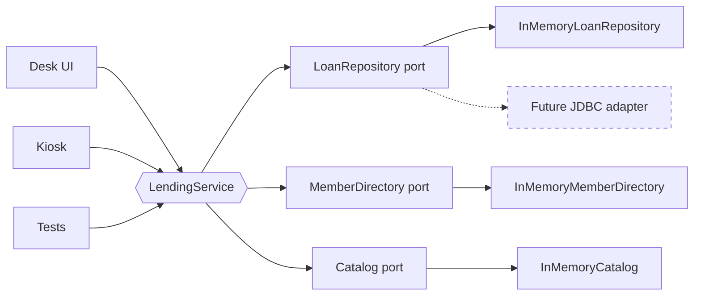
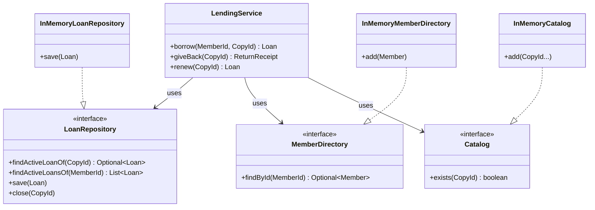
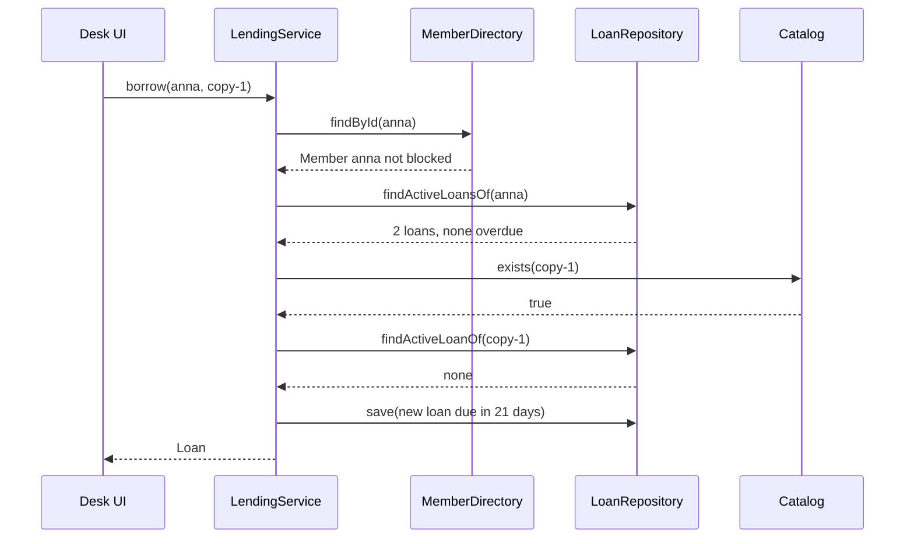

# Task 10 · Library lending with ports and adapters

| Difficulty | Topics | Time box |
|---|---|---|
| 🟡 Medium | Hexagonal architecture (ports and adapters) · Application services vs. domain logic · The dependency rule · In-memory adapters as test doubles · Injected `Clock` | 3 h |

> **Background reading:** Alistair Cockburn, "Hexagonal Architecture" (2005 article, the original "ports and adapters" idea) · Tom Hombergs, *Get Your Hands Dirty on Clean Architecture* (2nd ed.), ch. 2–5 · Robert C. Martin, *Clean Architecture*, ch. 22 "The Clean Architecture" (the dependency rule) · Eric Evans, *Domain-Driven Design*, ch. 4 "Isolating the Domain"

---

## The situation

The city library runs its lending desk on one Java web application. The SQL and the lending rules are mixed together in one Servlet. That works, but now three things are coming at once:

* a **self-service kiosk** in the library hall,
* a **mobile app** for members,
* and the IT department wants to **replace the database next year**.

All three must follow the same lending rules: 21 days, one renewal, a late fee of EUR 0.50 per day up to EUR 10.00, and at most five loans per member. If we copy the rules into each front end, they will drift apart within a year. If we keep them in the Servlet, nobody can test them without a running database.

So the rules move to the middle of the system, behind **ports**. A port is an interface that the rules need, written in the rules' language. The database, the kiosk and the desk are **adapters** that plug into those ports from the outside. The rules then run and are tested with plain in-memory objects, in milliseconds, without any database.

## The domain

| Term | Meaning |
|---|---|
| **Member** | A library card holder. A **blocked** member may not borrow anything. |
| **Copy** | One physical book on the shelf, identified by its barcode (`CopyId`). The catalog is about copies, not titles. |
| **Loan** | One copy on loan to one member: the borrow date, the due date and the number of renewals. |
| **Due date** | Borrow date plus 21 days. A renewal adds 21 more days to the due date. |
| **Overdue** | The day is *after* the due date. On the due date itself the loan is still fine. |
| **Late fee** | EUR 0.50 for each day after the due date, capped at EUR 10.00. |
| **Refusal** | A rule said no. It is reported with a `RefusalReason`, for example `HAS_OVERDUE_LOANS`. |

### The hexagon



The left side is the **driving** side: things that *call* the application. The right side is the **driven** side: things the application *calls*. The application sits in the middle and does not know which of them are present.

### The ports and adapters



### How a borrow travels through the hexagon



## What I want from you

Put the lending rules behind the ports, and make the three in-memory adapters work. The starter gives you the domain types, the ports and the exception types. Your job is the behaviour.

1. **The loan's own rules** belong to [`Loan`](../src/main/java/io/github/chris013/practice/task10/domain/Loan.java). Implement its four behaviour methods:
   * `start(copyId, memberId, today)`: due 21 days after `today`, zero renewals.
   * `isOverdueOn(day)`: `true` only when `day` is after the due date.
   * `lateFeeOn(returnedOn)`: `0.00` when on time or early. Otherwise EUR 0.50 per day late, capped at EUR 10.00. The result has scale 2 (`new BigDecimal("0.00")` has scale 2, a plain `0` does not).
   * `renewedOn(today)`: adds 21 days to the due date and counts the renewal. Allowed once per loan and never when overdue on `today`. Otherwise throw `IllegalStateException`. The record is immutable, so this returns a new loan.
2. **`borrow(memberId, copyId)`** in [`LendingService`](../src/main/java/io/github/chris013/practice/task10/application/LendingService.java) checks, in this order, and throws `LendingRefusedException` with the first reason that applies:
   1. the member exists (`UNKNOWN_MEMBER`),
   2. the member is not blocked (`MEMBER_BLOCKED`),
   3. no loan of the member is overdue today (`HAS_OVERDUE_LOANS`),
   4. the member has fewer than five active loans (`LOAN_LIMIT_REACHED`),
   5. the copy exists in the catalog (`UNKNOWN_COPY`),
   6. the copy is not on loan (`COPY_ALREADY_ON_LOAN`).

   If everything passes, it saves the new loan and returns it. A refused borrow saves nothing.
3. **`giveBack(copyId)`** throws `COPY_NOT_ON_LOAN` when the copy has no active loan. Otherwise it computes the late fee for today, closes the loan and returns a `ReturnReceipt` with the loan, today's date and the fee.
4. **`renew(copyId)`** throws `COPY_NOT_ON_LOAN` when the copy has no active loan. If the domain refuses the renewal, the service throws `LendingRefusedException(RENEWAL_NOT_ALLOWED)`. Otherwise it saves the renewed loan and returns it. Translating the domain's `IllegalStateException` is your decision. Check [`LendingRefusedException`](../src/main/java/io/github/chris013/practice/task10/domain/LendingRefusedException.java) for what you can construct.
5. **"Today"** is always `LocalDate.now(clock)`, where the clock is the one passed to the service's constructor. Read it once per operation.
6. **The ports** ([`LoanRepository`](../src/main/java/io/github/chris013/practice/task10/application/LoanRepository.java), [`MemberDirectory`](../src/main/java/io/github/chris013/practice/task10/application/MemberDirectory.java), [`Catalog`](../src/main/java/io/github/chris013/practice/task10/application/Catalog.java)) are given. Do not change them. They are the contract that the database adapter will later implement.
7. **The in-memory adapters** are real adapters, not only test code. The demo app uses them too.
   * [`InMemoryLoanRepository`](../src/main/java/io/github/chris013/practice/task10/adapter/inmemory/InMemoryLoanRepository.java): `save` replaces the active loan of that copy. `close` ends it. Closing a copy that has no loan does nothing.
   * [`InMemoryMemberDirectory`](../src/main/java/io/github/chris013/practice/task10/adapter/inmemory/InMemoryMemberDirectory.java): `add` stores a member. Adding a member with an existing id replaces it, which is how a test blocks someone.
   * [`InMemoryCatalog`](../src/main/java/io/github/chris013/practice/task10/adapter/inmemory/InMemoryCatalog.java): `add` registers copies, `exists` checks them.
8. Every null argument throws `NullPointerException` naming the parameter. Blank ids throw `IllegalArgumentException`.

## Constraints & non-goals

* **The domain imports nothing from `application` or `adapter`.** The application imports nothing from `adapter`. A test named `ArchitectureTest` enforces this, so do not try to work around it.
* **No database, no SQL, no HTTP** anywhere in this task. The in-memory adapters are enough.
* **No `LocalDate.now()` without a clock**, and no `LocalDate.now()` inside `Loan`. `Loan.start` receives the date as an argument.
* **No mocking framework.** The tests use the in-memory adapters and a small `MutableClock`.
* **Reservations, fines paid, several copies per title and money handling beyond the fee** are out of scope. Those belong in the stretch goals.

## How I'd approach it

* **Start with `Loan`.** Its four methods are pure functions of dates. You can make `LoanTest` green without touching the service. Writing the domain first is the fastest way to see what the service must add on top.
* **Ask of every rule: which data does it need?** A late fee needs only the loan's due date and the return date, so it belongs to `Loan`. "Member has five loans" needs the member's loans from the repository and the limit, so it belongs to the service. Putting the rule in the wrong place is the most common mistake in this task.
* **Do not put the rules in the ports.** The ports are *questions the application asks*: "give me the active loans of this member". They say nothing about how the answer is stored.
* **Why the order of checks matters.** A blocked member with overdue loans should hear "blocked", because that is the more fundamental problem. Your tests will pin the order. Read them before you write the `if` chain.
* **Why `renewedOn` throws.** A renewal is refused by an exception in the domain, not by a boolean. A caller that forgets to check a boolean would extend a loan that must not be extended. The service turns the exception into the refusal type the outside world understands. Think about what that translation loses. Look at the constructors of `LendingRefusedException` and at exception chaining (*Effective Java* Item 73).
* **Money.** Use `BigDecimal`. The fee is `0.50` times a whole number of days. Pick a rounding policy explicitly. Here nothing needs rounding, so `setScale(2, RoundingMode.UNNECESSARY)` is a good check that you did not produce a fraction of a cent by accident.
* **Time boundaries.** "Overdue" starts *after* the due date. Test the due date itself, and the day after it. Off-by-one errors live exactly there.
* **Test doubles.** Look at how `LendingServiceTest` builds the service from the in-memory adapters. It needs no mock setup, and each test reads like a short story. That is the reason to prefer real in-memory adapters over mocks here: the test checks the *behaviour* (the loan was saved, the copy is free again), not the *calls* on a mock.
* **Time travel.** `MutableClock` moves forward with `advanceBy`. `Clock.fixed` is fine for a single moment. Use the mutable one when a test needs "21 days later".

## Tests

Run: `mvn test -Dtest='**/task10/**'`

* [`LoanTest`](../src/test/java/io/github/chris013/practice/task10/LoanTest.java): the due date, the overdue boundary, the fee table with its cap, and the renewal rules.
* [`LendingServiceTest`](../src/test/java/io/github/chris013/practice/task10/LendingServiceTest.java): every refusal reason, the order of the checks, and the happy paths for borrow, return and renew.
* [`ArchitectureTest`](../src/test/java/io/github/chris013/practice/task10/ArchitectureTest.java): the dependency rule, checked by reflection over the compiled classes. It passes on the starter too, because it checks structure, not behaviour.
* [`InMemoryLoanRepositoryTest`](../src/test/java/io/github/chris013/practice/task10/InMemoryLoanRepositoryTest.java): closing a copy ends its loan, and closing a copy without a loan does nothing.

<details>
<summary>Show the tests</summary>

<!-- embed: src/test/java/io/github/chris013/practice/task10/ArchitectureTest.java -->
**[`ArchitectureTest.java`](../src/test/java/io/github/chris013/practice/task10/ArchitectureTest.java)**

```java
package io.github.chris013.practice.task10;

import static org.assertj.core.api.Assertions.assertThat;
import static org.assertj.core.api.Assertions.fail;

import java.lang.reflect.Constructor;
import java.lang.reflect.Field;
import java.lang.reflect.GenericArrayType;
import java.lang.reflect.Method;
import java.lang.reflect.ParameterizedType;
import java.lang.reflect.Type;
import java.lang.reflect.WildcardType;
import java.net.URL;
import java.nio.file.Files;
import java.nio.file.Path;
import java.util.ArrayList;
import java.util.Collections;
import java.util.Enumeration;
import java.util.LinkedHashSet;
import java.util.List;
import java.util.Set;
import org.junit.jupiter.api.Test;

/**
 * Guards the dependency rule with plain reflection, so nobody can quietly make the domain depend on the database
 * or the application depend on an adapter. It checks declarations only (superclass, interfaces, fields, constructor
 * and method signatures). That catches the mistakes people actually make. It does not look inside method bodies.
 */
class ArchitectureTest {

    private static final String BASE = "io.github.chris013.practice.task10";
    private static final String DOMAIN = BASE + ".domain";
    private static final String APPLICATION = BASE + ".application";
    private static final String ADAPTER = BASE + ".adapter";
    private static final String IN_MEMORY = ADAPTER + ".inmemory";

    @Test
    void the_domain_does_not_depend_on_the_application_or_the_adapters() throws Exception {
        assertNoDependency(DOMAIN, APPLICATION);
        assertNoDependency(DOMAIN, ADAPTER);
    }

    @Test
    void the_application_does_not_depend_on_the_adapters() throws Exception {
        assertNoDependency(APPLICATION, ADAPTER);
    }

    @Test
    void every_checked_layer_contains_classes() throws Exception {
        // Without this, a wrong package name would make every rule above pass without checking anything.
        for (String pkg : List.of(DOMAIN, APPLICATION, IN_MEMORY)) {
            assertThat(classesIn(pkg)).as("classes in %s; without them the rules check nothing", pkg).isNotEmpty();
        }
    }

    private static void assertNoDependency(String fromPackage, String forbiddenPackage) throws Exception {
        for (Class<?> from : classesIn(fromPackage)) {
            for (Class<?> used : referencedTypesOf(from)) {
                String usedPackage = used.getPackageName();
                if (usedPackage.equals(forbiddenPackage) || usedPackage.startsWith(forbiddenPackage + ".")) {
                    fail("%s must not depend on %s, but it uses %s", from.getName(), forbiddenPackage, used.getName());
                }
            }
        }
    }

    /** All classes compiled into the given package, from every classpath root (main and test output). */
    private static List<Class<?>> classesIn(String pkg) throws Exception {
        ClassLoader loader = ArchitectureTest.class.getClassLoader();
        String path = pkg.replace('.', '/');
        List<Class<?>> classes = new ArrayList<>();
        Enumeration<URL> roots = loader.getResources(path);
        while (roots.hasMoreElements()) {
            URL root = roots.nextElement();
            if (!"file".equals(root.getProtocol())) {
                fail("expected compiled classes on disk, found %s", root);
            }
            try (var files = Files.list(Path.of(root.toURI()))) {
                for (Path file : files.toList()) {
                    String fileName = file.getFileName().toString();
                    if (fileName.endsWith(".class")) {
                        String className = fileName.substring(0, fileName.length() - ".class".length());
                        classes.add(Class.forName(pkg + "." + className, false, loader));
                    }
                }
            }
        }
        return classes;
    }

    /** Every type that appears in the declarations of the given class, including generic arguments. */
    private static Set<Class<?>> referencedTypesOf(Class<?> type) {
        Set<Class<?>> used = new LinkedHashSet<>();
        collect(type.getGenericSuperclass(), used);
        for (Type implemented : type.getGenericInterfaces()) {
            collect(implemented, used);
        }
        for (Field field : type.getDeclaredFields()) {
            collect(field.getGenericType(), used);
        }
        for (Constructor<?> constructor : type.getDeclaredConstructors()) {
            collectAll(constructor.getGenericParameterTypes(), used);
        }
        for (Method method : type.getDeclaredMethods()) {
            collect(method.getGenericReturnType(), used);
            collectAll(method.getGenericParameterTypes(), used);
        }
        return Collections.unmodifiableSet(used);
    }

    private static void collectAll(Type[] types, Set<Class<?>> out) {
        for (Type type : types) {
            collect(type, out);
        }
    }

    private static void collect(Type type, Set<Class<?>> out) {
        if (type == null) {
            return;
        }
        if (type instanceof Class<?> clazz) {
            if (clazz.isArray()) {
                collect(clazz.getComponentType(), out);
            } else {
                out.add(clazz);
            }
        } else if (type instanceof ParameterizedType parameterized) {
            collect(parameterized.getRawType(), out);
            collectAll(parameterized.getActualTypeArguments(), out);
        } else if (type instanceof GenericArrayType array) {
            collect(array.getGenericComponentType(), out);
        } else if (type instanceof WildcardType wildcard) {
            collectAll(wildcard.getUpperBounds(), out);
            collectAll(wildcard.getLowerBounds(), out);
        }
    }
}
```
<!-- /embed -->

<!-- embed: src/test/java/io/github/chris013/practice/task10/LoanTest.java -->
**[`LoanTest.java`](../src/test/java/io/github/chris013/practice/task10/LoanTest.java)**

```java
package io.github.chris013.practice.task10;

import static org.assertj.core.api.Assertions.assertThat;
import static org.assertj.core.api.Assertions.assertThatThrownBy;

import io.github.chris013.practice.task10.domain.CopyId;
import io.github.chris013.practice.task10.domain.Loan;
import io.github.chris013.practice.task10.domain.MemberId;
import java.math.BigDecimal;
import java.time.LocalDate;
import org.junit.jupiter.api.Nested;
import org.junit.jupiter.api.Test;
import org.junit.jupiter.params.ParameterizedTest;
import org.junit.jupiter.params.provider.CsvSource;

class LoanTest {

    private static final CopyId COPY = new CopyId("copy-1");
    private static final MemberId ANNA = new MemberId("anna");
    private static final LocalDate MARCH_1 = LocalDate.of(2026, 3, 1);
    /** 1 March + 21 days */
    private static final LocalDate MARCH_22 = LocalDate.of(2026, 3, 22);

    private final Loan loan = Loan.start(COPY, ANNA, MARCH_1);

    @Nested
    class Starting {

        @Test
        void is_due_three_weeks_after_today_with_no_renewals() {
            assertThat(loan.copyId()).isEqualTo(COPY);
            assertThat(loan.memberId()).isEqualTo(ANNA);
            assertThat(loan.borrowedOn()).isEqualTo(MARCH_1);
            assertThat(loan.dueOn()).isEqualTo(MARCH_22);
            assertThat(loan.renewals()).isZero();
        }
    }

    @Nested
    class Overdue {

        @ParameterizedTest
        @CsvSource({"-1, false", "0, false", "1, true", "30, true"})
        void starts_only_after_the_due_day(int dayOffset, boolean overdue) {
            assertThat(loan.isOverdueOn(MARCH_22.plusDays(dayOffset))).isEqualTo(overdue);
        }
    }

    @Nested
    class LateFee {

        @ParameterizedTest
        @CsvSource({
            "-3, 0.00",
            "0, 0.00",
            "1, 0.50",
            "2, 1.00",
            "3, 1.50",
            "19, 9.50",
            "20, 10.00",
            "21, 10.00",
            "90, 10.00"
        })
        void is_fifty_cents_per_day_late_capped_at_ten_euros(int daysLate, String fee) {
            // The fee is compared with equals, so the scale (2) is checked as well.
            assertThat(loan.lateFeeOn(MARCH_22.plusDays(daysLate))).isEqualTo(new BigDecimal(fee));
        }
    }

    @Nested
    class Renewing {

        @Test
        void moves_the_due_date_three_weeks_later_and_counts_the_renewal() {
            Loan renewed = loan.renewedOn(MARCH_1.plusDays(5));

            assertThat(renewed.dueOn()).isEqualTo(LocalDate.of(2026, 4, 12)); // 22 March + 21 days
            assertThat(renewed.renewals()).isEqualTo(1);
            assertThat(renewed.borrowedOn()).isEqualTo(MARCH_1);
        }

        @Test
        void is_allowed_on_the_due_day_itself() {
            assertThat(loan.renewedOn(MARCH_22).renewals()).isEqualTo(1);
        }

        @Test
        void is_allowed_only_once() {
            Loan renewed = loan.renewedOn(MARCH_1);

            assertThatThrownBy(() -> renewed.renewedOn(MARCH_1)).isInstanceOf(IllegalStateException.class);
        }

        @Test
        void is_refused_when_the_loan_is_overdue() {
            assertThatThrownBy(() -> loan.renewedOn(MARCH_22.plusDays(1)))
                    .isInstanceOf(IllegalStateException.class);
        }
    }
}
```
<!-- /embed -->

<!-- embed: src/test/java/io/github/chris013/practice/task10/LendingServiceTest.java -->
**[`LendingServiceTest.java`](../src/test/java/io/github/chris013/practice/task10/LendingServiceTest.java)**

```java
package io.github.chris013.practice.task10;

import static org.assertj.core.api.Assertions.assertThat;
import static org.assertj.core.api.Assertions.assertThatThrownBy;
import static org.assertj.core.api.Assertions.catchThrowableOfType;

import io.github.chris013.practice.task10.adapter.inmemory.InMemoryCatalog;
import io.github.chris013.practice.task10.adapter.inmemory.InMemoryLoanRepository;
import io.github.chris013.practice.task10.adapter.inmemory.InMemoryMemberDirectory;
import io.github.chris013.practice.task10.application.LendingService;
import io.github.chris013.practice.task10.domain.CopyId;
import io.github.chris013.practice.task10.domain.LendingRefusedException;
import io.github.chris013.practice.task10.domain.Loan;
import io.github.chris013.practice.task10.domain.Member;
import io.github.chris013.practice.task10.domain.MemberId;
import io.github.chris013.practice.task10.domain.RefusalReason;
import java.math.BigDecimal;
import java.time.Clock;
import java.time.Duration;
import java.time.LocalDate;
import java.time.ZoneOffset;
import java.util.List;
import org.assertj.core.api.ThrowableAssert.ThrowingCallable;
import org.junit.jupiter.api.Nested;
import org.junit.jupiter.api.Test;

class LendingServiceTest {

    private static final LocalDate MARCH_1 = LocalDate.of(2026, 3, 1);
    private static final LocalDate APRIL_12 = LocalDate.of(2026, 4, 12);

    private static final MemberId ANNA = new MemberId("anna");
    private static final MemberId BEN = new MemberId("ben");
    private static final MemberId CAROL = new MemberId("carol");
    private static final CopyId C1 = new CopyId("copy-1");
    private static final CopyId C2 = new CopyId("copy-2");
    private static final CopyId C3 = new CopyId("copy-3");
    private static final CopyId C4 = new CopyId("copy-4");
    private static final CopyId C5 = new CopyId("copy-5");
    private static final CopyId C6 = new CopyId("copy-6");
    private static final CopyId UNKNOWN = new CopyId("no-such-copy");

    private final MutableClock clock = new MutableClock(MARCH_1.atStartOfDay(ZoneOffset.UTC).toInstant());
    private final InMemoryLoanRepository loans = new InMemoryLoanRepository();
    private final InMemoryMemberDirectory members = new InMemoryMemberDirectory();
    private final InMemoryCatalog catalog = new InMemoryCatalog();
    private final LendingService lending = new LendingService(loans, members, catalog, clock);

    LendingServiceTest() {
        members.add(new Member(ANNA, false));
        members.add(new Member(BEN, true));
        members.add(new Member(CAROL, false));
        catalog.add(C1, C2, C3, C4, C5, C6);
    }

    /** Runs the call and returns the refusal reason; fails the test if the call does not refuse. */
    private static RefusalReason refusalOf(ThrowingCallable call) {
        LendingRefusedException refusal = catchThrowableOfType(LendingRefusedException.class, call);
        assertThat(refusal).as("expected a LendingRefusedException").isNotNull();
        return refusal.reason();
    }

    private void advanceDays(long days) {
        clock.advanceBy(Duration.ofDays(days));
    }

    @Nested
    class Construction {

        @Test
        void rejects_missing_collaborators() {
            assertThatThrownBy(() -> new LendingService(null, members, catalog, clock))
                    .isInstanceOf(NullPointerException.class);
            assertThatThrownBy(() -> new LendingService(loans, null, catalog, clock))
                    .isInstanceOf(NullPointerException.class);
            assertThatThrownBy(() -> new LendingService(loans, members, null, clock))
                    .isInstanceOf(NullPointerException.class);
            assertThatThrownBy(() -> new LendingService(loans, members, catalog, null))
                    .isInstanceOf(NullPointerException.class);
        }

        @Test
        void takes_today_from_the_injected_clock() {
            Clock fixed = Clock.fixed(MARCH_1.atStartOfDay(ZoneOffset.UTC).toInstant(), ZoneOffset.UTC);
            LendingService service = new LendingService(loans, members, catalog, fixed);

            assertThat(service.borrow(ANNA, C1).borrowedOn()).isEqualTo(MARCH_1);
        }
    }

    @Nested
    class Borrowing {

        @Test
        void records_a_loan_due_three_weeks_later() {
            Loan loan = lending.borrow(ANNA, C1);

            assertThat(loan.borrowedOn()).isEqualTo(MARCH_1);
            assertThat(loan.dueOn()).isEqualTo(LocalDate.of(2026, 3, 22));
            assertThat(loans.findActiveLoanOf(C1)).contains(loan);
        }

        @Test
        void refuses_an_unknown_member() {
            assertThat(refusalOf(() -> lending.borrow(new MemberId("zoe"), C1)))
                    .isEqualTo(RefusalReason.UNKNOWN_MEMBER);
        }

        @Test
        void refuses_a_blocked_member() {
            assertThat(refusalOf(() -> lending.borrow(BEN, C1))).isEqualTo(RefusalReason.MEMBER_BLOCKED);
        }

        @Test
        void refuses_while_the_member_has_an_overdue_loan() {
            lending.borrow(ANNA, C1);
            advanceDays(22); // due on 22 March, today is 23 March

            assertThat(refusalOf(() -> lending.borrow(ANNA, C2))).isEqualTo(RefusalReason.HAS_OVERDUE_LOANS);
        }

        @Test
        void allows_borrowing_on_the_due_day_of_another_loan() {
            lending.borrow(ANNA, C1);
            advanceDays(21); // 22 March, the due day itself is not overdue

            assertThat(lending.borrow(ANNA, C2).copyId()).isEqualTo(C2);
        }

        @Test
        void counts_only_the_members_own_loans_towards_the_limit() {
            for (CopyId copy : List.of(C1, C2, C3, C4, C5)) {
                lending.borrow(CAROL, copy);
            }

            assertThat(lending.borrow(ANNA, C6).memberId()).isEqualTo(ANNA);
        }

        @Test
        void ignores_overdue_loans_of_other_members() {
            lending.borrow(CAROL, C1);
            advanceDays(22); // Carol's loan is overdue, Anna's borrowing is not affected

            assertThat(lending.borrow(ANNA, C2).memberId()).isEqualTo(ANNA);
        }

        @Test
        void allows_five_loans_but_refuses_a_sixth() {
            for (CopyId copy : List.of(C1, C2, C3, C4, C5)) {
                lending.borrow(ANNA, copy);
            }

            assertThat(refusalOf(() -> lending.borrow(ANNA, C6))).isEqualTo(RefusalReason.LOAN_LIMIT_REACHED);
        }

        @Test
        void refuses_an_unknown_copy_and_saves_nothing() {
            assertThat(refusalOf(() -> lending.borrow(ANNA, UNKNOWN))).isEqualTo(RefusalReason.UNKNOWN_COPY);
            assertThat(loans.findActiveLoansOf(ANNA)).isEmpty();
        }

        @Test
        void refuses_a_copy_that_is_already_on_loan() {
            lending.borrow(ANNA, C1);

            assertThat(refusalOf(() -> lending.borrow(CAROL, C1))).isEqualTo(RefusalReason.COPY_ALREADY_ON_LOAN);
            assertThat(loans.findActiveLoanOf(C1).orElseThrow().memberId()).isEqualTo(ANNA);
        }

        @Test
        void checks_the_member_before_the_copy() {
            assertThat(refusalOf(() -> lending.borrow(new MemberId("zoe"), UNKNOWN)))
                    .isEqualTo(RefusalReason.UNKNOWN_MEMBER);
        }

        @Test
        void reports_a_blocked_member_before_overdue_loans() {
            lending.borrow(ANNA, C1);
            advanceDays(22);
            members.add(new Member(ANNA, true));

            assertThat(refusalOf(() -> lending.borrow(ANNA, C2))).isEqualTo(RefusalReason.MEMBER_BLOCKED);
        }

        @Test
        void reports_overdue_loans_before_the_loan_limit() {
            for (CopyId copy : List.of(C1, C2, C3, C4, C5)) {
                lending.borrow(ANNA, copy);
            }
            advanceDays(22);

            assertThat(refusalOf(() -> lending.borrow(ANNA, C6))).isEqualTo(RefusalReason.HAS_OVERDUE_LOANS);
        }

        @Test
        void reports_the_loan_limit_before_an_unknown_copy() {
            for (CopyId copy : List.of(C1, C2, C3, C4, C5)) {
                lending.borrow(ANNA, copy);
            }

            assertThat(refusalOf(() -> lending.borrow(ANNA, UNKNOWN))).isEqualTo(RefusalReason.LOAN_LIMIT_REACHED);
        }
    }

    @Nested
    class GivingBack {

        @Test
        void refuses_a_copy_that_is_not_on_loan() {
            assertThat(refusalOf(() -> lending.giveBack(C1))).isEqualTo(RefusalReason.COPY_NOT_ON_LOAN);
        }

        @Test
        void closes_the_loan_without_a_fee_when_returned_on_time() {
            Loan loan = lending.borrow(ANNA, C1);
            advanceDays(21); // returned on the due day

            var receipt = lending.giveBack(C1);

            assertThat(receipt.loan()).isEqualTo(loan);
            assertThat(receipt.lateFee()).isEqualTo(new BigDecimal("0.00"));
            assertThat(receipt.returnedOn()).isEqualTo(LocalDate.of(2026, 3, 22));
            assertThat(loans.findActiveLoanOf(C1)).isEmpty();
        }

        @Test
        void charges_fifty_cents_per_day_late() {
            lending.borrow(ANNA, C1);
            advanceDays(24); // three days after the due date

            assertThat(lending.giveBack(C1).lateFee()).isEqualTo(new BigDecimal("1.50"));
        }

        @Test
        void refuses_a_second_return_of_the_same_copy() {
            lending.borrow(ANNA, C1);
            lending.giveBack(C1);

            assertThat(refusalOf(() -> lending.giveBack(C1))).isEqualTo(RefusalReason.COPY_NOT_ON_LOAN);
        }

        @Test
        void frees_the_copy_for_the_next_member() {
            lending.borrow(ANNA, C1);
            lending.giveBack(C1);

            assertThat(lending.borrow(CAROL, C1).memberId()).isEqualTo(CAROL);
        }
    }

    @Nested
    class Renewing {

        @Test
        void refuses_a_copy_that_is_not_on_loan() {
            assertThat(refusalOf(() -> lending.renew(C1))).isEqualTo(RefusalReason.COPY_NOT_ON_LOAN);
        }

        @Test
        void extends_the_due_date_and_saves_the_renewed_loan() {
            lending.borrow(ANNA, C1);
            advanceDays(5);

            Loan renewed = lending.renew(C1);

            assertThat(renewed.dueOn()).isEqualTo(APRIL_12);
            assertThat(renewed.renewals()).isEqualTo(1);
            assertThat(loans.findActiveLoanOf(C1)).contains(renewed);
        }

        @Test
        void allows_a_renewal_on_the_due_day() {
            lending.borrow(ANNA, C1);
            advanceDays(21);

            assertThat(lending.renew(C1).renewals()).isEqualTo(1);
        }

        @Test
        void refuses_a_second_renewal() {
            lending.borrow(ANNA, C1);
            lending.renew(C1);

            assertThat(refusalOf(() -> lending.renew(C1))).isEqualTo(RefusalReason.RENEWAL_NOT_ALLOWED);
        }

        @Test
        void refuses_to_renew_an_overdue_loan() {
            lending.borrow(ANNA, C1);
            advanceDays(22);

            assertThat(refusalOf(() -> lending.renew(C1))).isEqualTo(RefusalReason.RENEWAL_NOT_ALLOWED);
        }

        @Test
        void keeps_the_domain_exception_as_the_cause_of_a_refused_renewal() {
            lending.borrow(ANNA, C1);
            advanceDays(22);

            assertThatThrownBy(() -> lending.renew(C1))
                    .isInstanceOfSatisfying(LendingRefusedException.class,
                            r -> assertThat(r.reason()).isEqualTo(RefusalReason.RENEWAL_NOT_ALLOWED))
                    .hasCauseInstanceOf(IllegalStateException.class);
        }
    }
}
```
<!-- /embed -->

<!-- embed: src/test/java/io/github/chris013/practice/task10/InMemoryLoanRepositoryTest.java -->
**[`InMemoryLoanRepositoryTest.java`](../src/test/java/io/github/chris013/practice/task10/InMemoryLoanRepositoryTest.java)**

```java
package io.github.chris013.practice.task10;

import static org.assertj.core.api.Assertions.assertThat;

import io.github.chris013.practice.task10.adapter.inmemory.InMemoryLoanRepository;
import io.github.chris013.practice.task10.domain.CopyId;
import io.github.chris013.practice.task10.domain.Loan;
import io.github.chris013.practice.task10.domain.MemberId;
import java.time.LocalDate;
import org.junit.jupiter.api.Test;

class InMemoryLoanRepositoryTest {

    private static final CopyId C1 = new CopyId("copy-1");
    private static final MemberId ANNA = new MemberId("anna");

    private final InMemoryLoanRepository loans = new InMemoryLoanRepository();

    @Test
    void closing_a_copy_without_a_loan_does_nothing() {
        loans.close(C1);

        assertThat(loans.findActiveLoanOf(C1)).isEmpty();
    }

    @Test
    void closing_a_copy_removes_its_active_loan() {
        Loan loan = Loan.start(C1, ANNA, LocalDate.of(2026, 3, 1));
        loans.save(loan);

        loans.close(C1);

        assertThat(loans.findActiveLoanOf(C1)).isEmpty();
    }
}
```
<!-- /embed -->

<!-- embed: src/test/java/io/github/chris013/practice/task10/MutableClock.java -->
**[`MutableClock.java`](../src/test/java/io/github/chris013/practice/task10/MutableClock.java)**

```java
package io.github.chris013.practice.task10;

import java.time.Clock;
import java.time.Duration;
import java.time.Instant;
import java.time.ZoneId;
import java.time.ZoneOffset;

/** A clock that only moves when the test says so. Lending days are computed in UTC. */
final class MutableClock extends Clock {

    private Instant now;

    MutableClock(Instant start) {
        this.now = start;
    }

    void advanceBy(Duration duration) {
        now = now.plus(duration);
    }

    @Override
    public Instant instant() {
        return now;
    }

    @Override
    public ZoneId getZone() {
        return ZoneOffset.UTC;
    }

    @Override
    public Clock withZone(ZoneId zone) {
        throw new UnsupportedOperationException("Not needed in these tests");
    }
}
```
<!-- /embed -->

</details>

## Definition of done

- [ ] `mvn test -Dtest='**/task10/**'` runs in well under a second, and all tests are green.
- [ ] `ArchitectureTest` is green, and you can explain what it would catch if someone imported an adapter into `Loan`.
- [ ] `Loan` contains the fee and renewal rules. `LendingService` contains no fee arithmetic and no date arithmetic.
- [ ] Every refusal reason is produced by a test, and the order of the borrow checks is pinned by a test.
- [ ] No `LocalDate.now()` without the injected clock, no `null` returned from a method, no `Thread.sleep`.
- [ ] Your PR description says where you put the renewal translation and why.

## Stretch goals

1. Write a JDBC or file-based `LoanRepository`. Keep `LendingServiceTest` unchanged: it should still run against the in-memory adapter. Only the adapter changes, and that is the point of the exercise.
2. Write a tiny command-line driving adapter, `java Desk borrow anna copy-1`, that calls the service and prints the refusal reason. Notice that the CLI knows the `RefusalReason` enum but nothing about the database.
3. Add reservations: a member can reserve a copy that is on loan, and gets it first when it is returned. Where does the queue live, in `Loan`, in a new aggregate, or in a port? Argue for your choice.
4. The late-fee policy depends on the member type (students pay less, staff pay nothing). Make the fee a strategy that the service receives, not something `Loan` decides. What does `Loan.lateFeeOn` become?

---

## Reference solution

<details>
<summary>Spoiler: open only after you have made a serious attempt</summary>

### Key decisions

**1. The fee and renewal rules live in `Loan`, because they need only the loan's own dates.** `lateFeeOn` and `renewedOn` take the dates they need as arguments. They do not look up a member, a repository or a clock. The rejected alternative was a `LendingPolicy` class that receives the loan and returns the fee. That adds a second place to read for one formula, and nothing about it is more testable than a method on the record.

**2. The service only orchestrates.** `LendingService` loads data through the ports, checks what needs more than one object (member, all their loans, the catalog), asks `Loan` to change itself and saves the result. The rejected alternative was a service that computes fees and dates itself, which is the old Servlet again with different class names.

**3. Today is read from the injected clock, once per operation.** `LocalDate.now(clock)` appears only in the service. The domain receives `today` as a parameter. This keeps the domain free of "what time is it" and lets a test pick any day. The rejected alternative was `LocalDate.now()` inside `Loan`, which makes the overdue boundary untestable without changing the system date.

**4. The ports are named and shaped by what the application needs.** `LoanRepository` asks "active loan of this copy" and "active loans of this member". It does not expose SQL concepts such as rows, joins or a `LoanDao` with `selectByMemberIdAndStatus`. When the IT department swaps the database, the port does not change, and the port was never shaped by the old schema.

**5. The domain refusal becomes a service refusal, with the original kept as the cause.** `Loan.renewedOn` throws `IllegalStateException` because it is a violated precondition of the domain. The service converts it to `LendingRefusedException(RENEWAL_NOT_ALLOWED)`, which is the language the desk and the kiosk speak. It also keeps the original exception as the cause, so the stack trace still shows why (exception chaining, *Effective Java* Item 73). The rejected alternative was checking the same conditions again in the service, which duplicates the rule.

**6. The in-memory adapters are real code, and tests use them instead of mocks.** The test asks "after borrowing, is the copy on loan?" and reads the answer from the repository. A mock would test "was `save` called with an argument that matches this pattern?", which breaks whenever the implementation changes its internal steps. The in-memory adapters also run in the demo app, so they cannot quietly drift from the contract.

**7. `ArchitectureTest` checks declarations, not behaviour.** It reads superclasses, interfaces, fields, and constructor and method signatures by reflection. It is dependency-free, which fits the rest of the project. Its limit: a method body can still call an adapter, and reflection does not see that. A stricter check would read bytecode, which is what ArchUnit does. For a project this size, the declaration check catches the mistakes that actually happen.

### Code

<!-- embed: solutions/src/main/java/io/github/chris013/practice/task10/domain/Loan.java -->
**[`Loan.java`](../solutions/src/main/java/io/github/chris013/practice/task10/domain/Loan.java)**

```java
package io.github.chris013.practice.task10.domain;

import java.math.BigDecimal;
import java.math.RoundingMode;
import java.time.LocalDate;
import java.time.temporal.ChronoUnit;
import java.util.Objects;

/**
 * One copy on loan to one member. Immutable: renewing returns a new loan instead of changing this one.
 *
 * <p>The fee and renewal rules live here, next to the data they depend on. They need no database, no clock and no
 * service: just the dates of this loan. That is what makes them trivial to test.
 */
public record Loan(CopyId copyId, MemberId memberId, LocalDate borrowedOn, LocalDate dueOn, int renewals) {

    static final int LOAN_PERIOD_DAYS = 21;
    static final int MAX_RENEWALS = 1;
    static final BigDecimal FEE_PER_LATE_DAY = new BigDecimal("0.50");
    static final BigDecimal MAX_LATE_FEE = new BigDecimal("10.00");
    private static final BigDecimal NO_FEE = new BigDecimal("0.00");

    public Loan {
        Objects.requireNonNull(copyId, "copyId");
        Objects.requireNonNull(memberId, "memberId");
        Objects.requireNonNull(borrowedOn, "borrowedOn");
        Objects.requireNonNull(dueOn, "dueOn");
        if (renewals < 0) {
            throw new IllegalArgumentException("renewals must not be negative, was " + renewals);
        }
    }

    /**
     * A new loan starting on {@code today}. The date is passed in rather than read from a clock, so the domain
     * never needs to know what time it is.
     */
    public static Loan start(CopyId copyId, MemberId memberId, LocalDate today) {
        Objects.requireNonNull(today, "today");
        return new Loan(copyId, memberId, today, today.plusDays(LOAN_PERIOD_DAYS), 0);
    }

    /** True only on days after the due date. On the due date itself the loan is still fine. */
    public boolean isOverdueOn(LocalDate day) {
        Objects.requireNonNull(day, "day");
        return day.isAfter(dueOn);
    }

    /**
     * One fee per calendar day after the due date: a return one day late costs EUR 0.50. The cap stops a forgotten
     * book from costing the member more than it is worth.
     */
    public BigDecimal lateFeeOn(LocalDate returnedOn) {
        Objects.requireNonNull(returnedOn, "returnedOn");
        if (!returnedOn.isAfter(dueOn)) {
            return NO_FEE;
        }
        long lateDays = ChronoUnit.DAYS.between(dueOn, returnedOn);
        BigDecimal fee = FEE_PER_LATE_DAY.multiply(BigDecimal.valueOf(lateDays));
        return fee.min(MAX_LATE_FEE).setScale(2, RoundingMode.UNNECESSARY);
    }

    /**
     * Renewing is refused by throwing rather than by returning a flag: a caller that forgets to check the flag
     * would silently extend a loan that must not be extended.
     */
    public Loan renewedOn(LocalDate today) {
        Objects.requireNonNull(today, "today");
        if (renewals >= MAX_RENEWALS) {
            throw new IllegalStateException("copy " + copyId.value() + " was already renewed");
        }
        if (isOverdueOn(today)) {
            throw new IllegalStateException("copy " + copyId.value() + " is overdue and cannot be renewed");
        }
        return new Loan(copyId, memberId, borrowedOn, dueOn.plusDays(LOAN_PERIOD_DAYS), renewals + 1);
    }
}
```
<!-- /embed -->

<!-- embed: solutions/src/main/java/io/github/chris013/practice/task10/application/LendingService.java -->
**[`LendingService.java`](../solutions/src/main/java/io/github/chris013/practice/task10/application/LendingService.java)**

```java
package io.github.chris013.practice.task10.application;

import io.github.chris013.practice.task10.domain.CopyId;
import io.github.chris013.practice.task10.domain.LendingRefusedException;
import io.github.chris013.practice.task10.domain.Loan;
import io.github.chris013.practice.task10.domain.Member;
import io.github.chris013.practice.task10.domain.MemberId;
import io.github.chris013.practice.task10.domain.RefusalReason;
import io.github.chris013.practice.task10.domain.ReturnReceipt;
import java.math.BigDecimal;
import java.time.Clock;
import java.time.LocalDate;
import java.util.List;
import java.util.Objects;

/**
 * The use cases of the lending desk. It orchestrates: it loads, checks the rules, asks the domain to change, and
 * saves. It holds no SQL and no HTTP, only the ports it was given.
 *
 * <p>Rules that concern one loan belong to {@link Loan}. Rules that need several loans, a member or the catalog
 * belong here.
 */
public final class LendingService {

    /** Maximum number of loans one member may hold at the same time. */
    static final int LOAN_LIMIT = 5;

    private final LoanRepository loans;
    private final MemberDirectory members;
    private final Catalog catalog;
    private final Clock clock;

    public LendingService(LoanRepository loans, MemberDirectory members, Catalog catalog, Clock clock) {
        this.loans = Objects.requireNonNull(loans, "loans");
        this.members = Objects.requireNonNull(members, "members");
        this.catalog = Objects.requireNonNull(catalog, "catalog");
        this.clock = Objects.requireNonNull(clock, "clock");
    }

    /**
     * The order of the checks is part of the contract. The member is checked first, so a blocked member with
     * overdue loans is told "blocked", the more fundamental reason.
     */
    public Loan borrow(MemberId memberId, CopyId copyId) {
        Objects.requireNonNull(memberId, "memberId");
        Objects.requireNonNull(copyId, "copyId");
        LocalDate today = LocalDate.now(clock);

        Member member = members.findById(memberId).orElseThrow(() -> refuse(RefusalReason.UNKNOWN_MEMBER));
        if (member.blocked()) {
            throw refuse(RefusalReason.MEMBER_BLOCKED);
        }

        List<Loan> active = loans.findActiveLoansOf(memberId);
        if (active.stream().anyMatch(loan -> loan.isOverdueOn(today))) {
            throw refuse(RefusalReason.HAS_OVERDUE_LOANS);
        }
        if (active.size() >= LOAN_LIMIT) {
            throw refuse(RefusalReason.LOAN_LIMIT_REACHED);
        }

        if (!catalog.exists(copyId)) {
            throw refuse(RefusalReason.UNKNOWN_COPY);
        }
        if (loans.findActiveLoanOf(copyId).isPresent()) {
            throw refuse(RefusalReason.COPY_ALREADY_ON_LOAN);
        }

        Loan loan = Loan.start(copyId, memberId, today);
        loans.save(loan);
        return loan;
    }

    public ReturnReceipt giveBack(CopyId copyId) {
        Objects.requireNonNull(copyId, "copyId");
        Loan loan = loans.findActiveLoanOf(copyId).orElseThrow(() -> refuse(RefusalReason.COPY_NOT_ON_LOAN));
        LocalDate today = LocalDate.now(clock);

        BigDecimal lateFee = loan.lateFeeOn(today);
        loans.close(copyId);
        return new ReturnReceipt(loan, today, lateFee);
    }

    /**
     * The domain refuses renewals with an IllegalStateException. The service translates that into the refusal
     * type the desk, kiosk and app understand. The original exception is kept as the cause, so the stack trace
     * still shows why the domain refused.
     */
    public Loan renew(CopyId copyId) {
        Objects.requireNonNull(copyId, "copyId");
        Loan loan = loans.findActiveLoanOf(copyId).orElseThrow(() -> refuse(RefusalReason.COPY_NOT_ON_LOAN));

        Loan renewed;
        try {
            renewed = loan.renewedOn(LocalDate.now(clock));
        } catch (IllegalStateException rejected) {
            throw new LendingRefusedException(RefusalReason.RENEWAL_NOT_ALLOWED, rejected);
        }
        loans.save(renewed);
        return renewed;
    }

    private static LendingRefusedException refuse(RefusalReason reason) {
        return new LendingRefusedException(reason);
    }
}
```
<!-- /embed -->

<!-- embed: solutions/src/main/java/io/github/chris013/practice/task10/adapter/inmemory/InMemoryLoanRepository.java -->
**[`InMemoryLoanRepository.java`](../solutions/src/main/java/io/github/chris013/practice/task10/adapter/inmemory/InMemoryLoanRepository.java)**

```java
package io.github.chris013.practice.task10.adapter.inmemory;

import io.github.chris013.practice.task10.application.LoanRepository;
import io.github.chris013.practice.task10.domain.CopyId;
import io.github.chris013.practice.task10.domain.Loan;
import io.github.chris013.practice.task10.domain.MemberId;
import java.util.List;
import java.util.Map;
import java.util.Objects;
import java.util.Optional;
import java.util.concurrent.ConcurrentHashMap;

/**
 * Keeps active loans in memory. A real adapter for a demo app and a test double for the tests. Data lives only as
 * long as this object does.
 */
public final class InMemoryLoanRepository implements LoanRepository {

    private final Map<CopyId, Loan> activeByCopy = new ConcurrentHashMap<>();

    @Override
    public Optional<Loan> findActiveLoanOf(CopyId copyId) {
        Objects.requireNonNull(copyId, "copyId");
        return Optional.ofNullable(activeByCopy.get(copyId));
    }

    @Override
    public List<Loan> findActiveLoansOf(MemberId memberId) {
        Objects.requireNonNull(memberId, "memberId");
        return activeByCopy.values().stream()
                .filter(loan -> loan.memberId().equals(memberId))
                .toList();
    }

    @Override
    public void save(Loan loan) {
        Objects.requireNonNull(loan, "loan");
        activeByCopy.put(loan.copyId(), loan);
    }

    @Override
    public void close(CopyId copyId) {
        Objects.requireNonNull(copyId, "copyId");
        activeByCopy.remove(copyId);
    }
}
```
<!-- /embed -->

### What I typically flag in first attempts

| Finding | Why it matters |
|---|---|
| The fee or the overdue check sits in the service, with `ChronoUnit.DAYS.between` in the service | The rule belongs to the loan. Now it is tested through the whole service, and it will be copied when a second use case needs it. |
| A repository interface named after the database, such as `LoanDao` with `selectOverdueByMemberId` | The port takes the shape of the current schema. The next database forces a rewrite of the port and all its callers. Name it for what the application asks. |
| `LocalDate.now()` in `Loan` or in the service | The overdue and fee tests now depend on the real date, or they stop being deterministic. Inject the clock. |
| `findActiveLoanOf` returns `null` for "no loan" | Every caller must remember the null check, and one forgotten check is a `NullPointerException` in production. Return `Optional`. |
| Adapters in the `application` package, or ports in `adapter` | The dependency arrows point the wrong way. The ports belong to the application, and the adapters depend on them. |
| One giant `LendingException` with a message string, no reason enum | Callers must parse strings to decide what to tell the member. The kiosk and the desk need a value they can switch on. |
| `borrow` with the checks in a different order than the contract | The member sees the wrong refusal. Overdue loans are reported before the member is blocked, and nobody tests it. |

</details>
