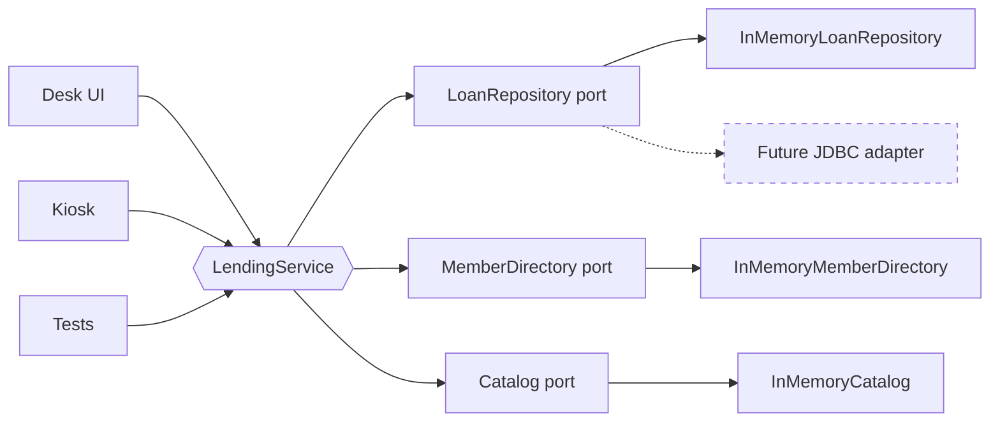
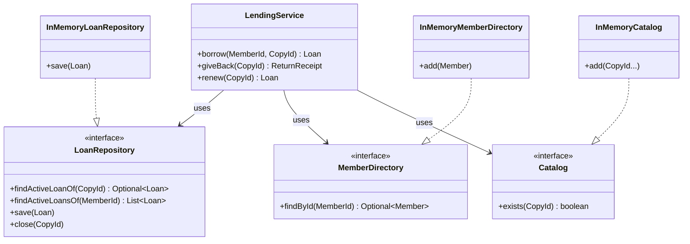
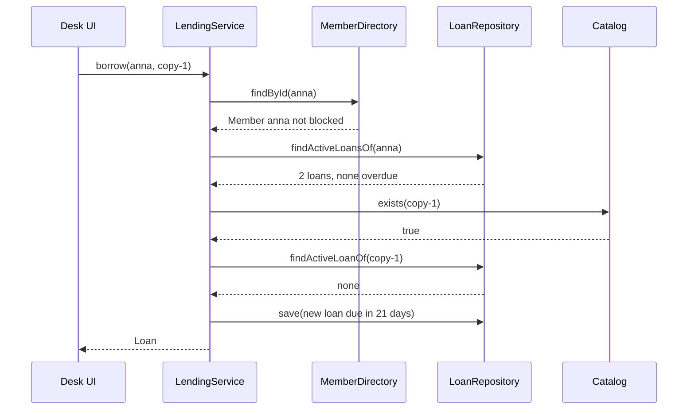

# Task 10 · Library lending with ports and adapters

| Difficulty | Topics | Time box |
|---|---|---|
| 🟡 Medium | Hexagonal architecture (ports and adapters) · Application services vs. domain logic · The dependency rule · In-memory adapters as test doubles · Injected `Clock` | 3 h |

> **Background reading:** Alistair Cockburn, "Hexagonal Architecture" (2005 article, the original "ports and adapters" idea) · Tom Hombergs, *Get Your Hands Dirty on Clean Architecture* (2nd ed.), ch. 2–5 · Robert C. Martin, *Clean Architecture*, ch. 22 "The Clean Architecture" (the dependency rule) · Eric Evans, *Domain-Driven Design*, ch. 4 "Isolating the Domain"

---

## The situation

The city library runs its lending desk on one Java web application. The SQL and the lending rules are mixed together in one Servlet. That works, but now three things are coming at once:

* a **self-service kiosk** in the library hall,
* a **mobile app** for members,
* and the IT department wants to **replace the database next year**.

All three must follow the same lending rules: 21 days, one renewal, a late fee of EUR 0.50 per day up to EUR 10.00, and at most five loans per member. If we copy the rules into each front end, they will drift apart within a year. If we keep them in the Servlet, nobody can test them without a running database.

So the rules move to the middle of the system, behind **ports**. A port is an interface that the rules need, written in the rules' language. The database, the kiosk and the desk are **adapters** that plug into those ports from the outside. The rules then run and are tested with plain in-memory objects, in milliseconds, without any database.

## The domain

| Term | Meaning |
|---|---|
| **Member** | A library card holder. A **blocked** member may not borrow anything. |
| **Copy** | One physical book on the shelf, identified by its barcode (`CopyId`). The catalog is about copies, not titles. |
| **Loan** | One copy on loan to one member: the borrow date, the due date and the number of renewals. |
| **Due date** | Borrow date plus 21 days. A renewal adds 21 more days to the due date. |
| **Overdue** | The day is *after* the due date. On the due date itself the loan is still fine. |
| **Late fee** | EUR 0.50 for each day after the due date, capped at EUR 10.00. |
| **Refusal** | A rule said no. It is reported with a `RefusalReason`, for example `HAS_OVERDUE_LOANS`. |

### The hexagon

The left side is the **driving** side: things that *call* the application. The right side is the **driven** side: things the application *calls*. The application sits in the middle and does not know which of them are present.

### The ports and adapters

### How a borrow travels through the hexagon

## What I want from you

Put the lending rules behind the ports, and make the three in-memory adapters work. The starter gives you the domain types, the ports and the exception types. Your job is the behaviour.

1. **The loan's own rules** belong to [`Loan`](../src/main/java/io/github/chris013/practice/task10/domain/Loan.java). Implement its four behaviour methods:
   * `start(copyId, memberId, today)`: due 21 days after `today`, zero renewals.
   * `isOverdueOn(day)`: `true` only when `day` is after the due date.
   * `lateFeeOn(returnedOn)`: `0.00` when on time or early. Otherwise EUR 0.50 per day late, capped at EUR 10.00. The result has scale 2 (`new BigDecimal("0.00")` has scale 2, a plain `0` does not).
   * `renewedOn(today)`: adds 21 days to the due date and counts the renewal. Allowed once per loan and never when overdue on `today`. Otherwise throw `IllegalStateException`. The record is immutable, so this returns a new loan.
2. **`borrow(memberId, copyId)`** in [`LendingService`](../src/main/java/io/github/chris013/practice/task10/application/LendingService.java) checks, in this order, and throws `LendingRefusedException` with the first reason that applies:
   1. the member exists (`UNKNOWN_MEMBER`),
   2. the member is not blocked (`MEMBER_BLOCKED`),
   3. no loan of the member is overdue today (`HAS_OVERDUE_LOANS`),
   4. the member has fewer than five active loans (`LOAN_LIMIT_REACHED`),
   5. the copy exists in the catalog (`UNKNOWN_COPY`),
   6. the copy is not on loan (`COPY_ALREADY_ON_LOAN`).

   If everything passes, it saves the new loan and returns it. A refused borrow saves nothing.
3. **`giveBack(copyId)`** throws `COPY_NOT_ON_LOAN` when the copy has no active loan. Otherwise it computes the late fee for today, closes the loan and returns a `ReturnReceipt` with the loan, today's date and the fee.
4. **`renew(copyId)`** throws `COPY_NOT_ON_LOAN` when the copy has no active loan. If the domain refuses the renewal, the service throws `LendingRefusedException(RENEWAL_NOT_ALLOWED)`. Otherwise it saves the renewed loan and returns it. Translating the domain's `IllegalStateException` is your decision. Check [`LendingRefusedException`](../src/main/java/io/github/chris013/practice/task10/domain/LendingRefusedException.java) for what you can construct.
5. **"Today"** is always `LocalDate.now(clock)`, where the clock is the one passed to the service's constructor. Read it once per operation.
6. **The ports** ([`LoanRepository`](../src/main/java/io/github/chris013/practice/task10/application/LoanRepository.java), [`MemberDirectory`](../src/main/java/io/github/chris013/practice/task10/application/MemberDirectory.java), [`Catalog`](../src/main/java/io/github/chris013/practice/task10/application/Catalog.java)) are given. Do not change them. They are the contract that the database adapter will later implement.
7. **The in-memory adapters** are real adapters, not only test code. The demo app uses them too.
   * [`InMemoryLoanRepository`](../src/main/java/io/github/chris013/practice/task10/adapter/inmemory/InMemoryLoanRepository.java): `save` replaces the active loan of that copy. `close` ends it. Closing a copy that has no loan does nothing.
   * [`InMemoryMemberDirectory`](../src/main/java/io/github/chris013/practice/task10/adapter/inmemory/InMemoryMemberDirectory.java): `add` stores a member. Adding a member with an existing id replaces it, which is how a test blocks someone.
   * [`InMemoryCatalog`](../src/main/java/io/github/chris013/practice/task10/adapter/inmemory/InMemoryCatalog.java): `add` registers copies, `exists` checks them.
8. Every null argument throws `NullPointerException` naming the parameter. Blank ids throw `IllegalArgumentException`.

## Constraints & non-goals

* **The domain imports nothing from `application` or `adapter`.** The application imports nothing from `adapter`. A test named `ArchitectureTest` enforces this, so do not try to work around it.
* **No database, no SQL, no HTTP** anywhere in this task. The in-memory adapters are enough.
* **No `LocalDate.now()` without a clock**, and no `LocalDate.now()` inside `Loan`. `Loan.start` receives the date as an argument.
* **No mocking framework.** The tests use the in-memory adapters and a small `MutableClock`.
* **Reservations, fines paid, several copies per title and money handling beyond the fee** are out of scope. Those belong in the stretch goals.

## How I'd approach it

* **Start with `Loan`.** Its four methods are pure functions of dates. You can make `LoanTest` green without touching the service. Writing the domain first is the fastest way to see what the service must add on top.
* **Ask of every rule: which data does it need?** A late fee needs only the loan's due date and the return date, so it belongs to `Loan`. "Member has five loans" needs the member's loans from the repository and the limit, so it belongs to the service. Putting the rule in the wrong place is the most common mistake in this task.
* **Do not put the rules in the ports.** The ports are *questions the application asks*: "give me the active loans of this member". They say nothing about how the answer is stored.
* **Why the order of checks matters.** A blocked member with overdue loans should hear "blocked", because that is the more fundamental problem. Your tests will pin the order. Read them before you write the `if` chain.
* **Why `renewedOn` throws.** A renewal is refused by an exception in the domain, not by a boolean. A caller that forgets to check a boolean would extend a loan that must not be extended. The service turns the exception into the refusal type the outside world understands. Think about what that translation loses, and whether you can keep the original exception attached, with the original kept as the cause (exception chaining, *Effective Java* Item 73).
* **Money.** Use `BigDecimal`. The fee is `0.50` times a whole number of days. Pick a rounding policy explicitly. Here nothing needs rounding, so `setScale(2, RoundingMode.UNNECESSARY)` is a good check that you did not produce a fraction of a cent by accident.
* **Time boundaries.** "Overdue" starts *after* the due date. Test the due date itself, and the day after it. Off-by-one errors live exactly there.
* **Test doubles.** Look at how `LendingServiceTest` builds the service from the in-memory adapters. It needs no mock setup, and each test reads like a short story. That is the reason to prefer real in-memory adapters over mocks here: the test checks the *behaviour* (the loan was saved, the copy is free again), not the *calls* on a mock.
* **Time travel.** `MutableClock` moves forward with `advanceBy`. `Clock.fixed` is fine for a single moment. Use the mutable one when a test needs "21 days later".

## Tests

Run: `mvn test -Dtest='**/task10/**'`

* [`LoanTest`](../src/test/java/io/github/chris013/practice/task10/LoanTest.java): the due date, the overdue boundary, the fee table with its cap, and the renewal rules.
* [`LendingServiceTest`](../src/test/java/io/github/chris013/practice/task10/LendingServiceTest.java): every refusal reason, the order of the checks, and the happy paths for borrow, return and renew.
* [`ArchitectureTest`](../src/test/java/io/github/chris013/practice/task10/ArchitectureTest.java): the dependency rule, checked by reflection over the compiled classes. It passes on the starter too, because it checks structure, not behaviour.

Show the tests

<!-- embed: src/test/java/io/github/chris013/practice/task10/ArchitectureTest.java -->
<!-- /embed -->

<!-- embed: src/test/java/io/github/chris013/practice/task10/LoanTest.java -->
<!-- /embed -->

<!-- embed: src/test/java/io/github/chris013/practice/task10/LendingServiceTest.java -->
<!-- /embed -->

<!-- embed: src/test/java/io/github/chris013/practice/task10/MutableClock.java -->
<!-- /embed -->

## Definition of done

- [ ] `mvn test -Dtest='**/task10/**'` runs in well under a second, and all tests are green.
- [ ] `ArchitectureTest` is green, and you can explain what it would catch if someone imported an adapter into `Loan`.
- [ ] `Loan` contains the fee and renewal rules. `LendingService` contains no fee arithmetic and no date arithmetic.
- [ ] Every refusal reason is produced by a test, and the order of the borrow checks is pinned by a test.
- [ ] No `LocalDate.now()` without the injected clock, no `null` returned from a method, no `Thread.sleep`.
- [ ] Your PR description says where you put the renewal translation and why.

## Stretch goals

1. Write a JDBC or file-based `LoanRepository`. Keep `LendingServiceTest` unchanged: it should still run against the in-memory adapter. Only the adapter changes, and that is the point of the exercise.
2. Write a tiny command-line driving adapter, `java Desk borrow anna copy-1`, that calls the service and prints the refusal reason. Notice that the CLI knows the `RefusalReason` enum but nothing about the database.
3. Add reservations: a member can reserve a copy that is on loan, and gets it first when it is returned. Where does the queue live, in `Loan`, in a new aggregate, or in a port? Argue for your choice.
4. The late-fee policy depends on the member type (students pay less, staff pay nothing). Make the fee a strategy that the service receives, not something `Loan` decides. What does `Loan.lateFeeOn` become?

---

## Reference solution

Spoiler: open only after you have made a serious attempt

### Key decisions

**1. The fee and renewal rules live in `Loan`, because they need only the loan's own dates.** `lateFeeOn` and `renewedOn` take the dates they need as arguments. They do not look up a member, a repository or a clock. The rejected alternative was a `LendingPolicy` class that receives the loan and returns the fee. That adds a second place to read for one formula, and nothing about it is more testable than a method on the record.

**2. The service only orchestrates.** `LendingService` loads data through the ports, checks what needs more than one object (member, all their loans, the catalog), asks `Loan` to change itself and saves the result. The rejected alternative was a service that computes fees and dates itself, which is the old Servlet again with different class names.

**3. Today is read from the injected clock, once per operation.** `LocalDate.now(clock)` appears only in the service. The domain receives `today` as a parameter. This keeps the domain free of "what time is it" and lets a test pick any day. The rejected alternative was `LocalDate.now()` inside `Loan`, which makes the overdue boundary untestable without changing the system date.

**4. The ports are named and shaped by what the application needs.** `LoanRepository` asks "active loan of this copy" and "active loans of this member". It does not expose SQL concepts such as rows, joins or a `LoanDao` with `selectByMemberIdAndStatus`. When the IT department swaps the database, the port does not change, and the port was never shaped by the old schema.

**5. The domain refusal becomes a service refusal, with the original kept as the cause.** `Loan.renewedOn` throws `IllegalStateException` because it is a violated precondition of the domain. The service converts it to `LendingRefusedException(RENEWAL_NOT_ALLOWED)`, which is the language the desk and the kiosk speak. It also keeps the original exception as the cause, so the stack trace still shows why (exception chaining, *Effective Java* Item 73). The rejected alternative was checking the same conditions again in the service, which duplicates the rule.

**6. The in-memory adapters are real code, and tests use them instead of mocks.** The test asks "after borrowing, is the copy on loan?" and reads the answer from the repository. A mock would test "was `save` called with an argument that matches this pattern?", which breaks whenever the implementation changes its internal steps. The in-memory adapters also run in the demo app, so they cannot quietly drift from the contract.

**7. `ArchitectureTest` checks declarations, not behaviour.** It reads superclasses, interfaces, fields, and constructor and method signatures by reflection. It is dependency-free, which fits the rest of the project. Its limit: a method body can still call an adapter, and reflection does not see that. A stricter check would read bytecode, which is what ArchUnit does. For a project this size, the declaration check catches the mistakes that actually happen.

### Code

<!-- embed: solutions/src/main/java/io/github/chris013/practice/task10/domain/Loan.java -->
<!-- /embed -->

<!-- embed: solutions/src/main/java/io/github/chris013/practice/task10/application/LendingService.java -->
<!-- /embed -->

<!-- embed: solutions/src/main/java/io/github/chris013/practice/task10/adapter/inmemory/InMemoryLoanRepository.java -->
<!-- /embed -->

### What I typically flag in first attempts

| Finding | Why it matters |
|---|---|
| The fee or the overdue check sits in the service, with `ChronoUnit.DAYS.between` in the service | The rule belongs to the loan. Now it is tested through the whole service, and it will be copied when a second use case needs it. |
| A repository interface named after the database, such as `LoanDao` with `selectOverdueByMemberId` | The port takes the shape of the current schema. The next database forces a rewrite of the port and all its callers. Name it for what the application asks. |
| `LocalDate.now()` in `Loan` or in the service | The overdue and fee tests now depend on the real date, or they stop being deterministic. Inject the clock. |
| `findActiveLoanOf` returns `null` for "no loan" | Every caller must remember the null check, and one forgotten check is a `NullPointerException` in production. Return `Optional`. |
| Adapters in the `application` package, or ports in `adapter` | The dependency arrows point the wrong way. The ports belong to the application, and the adapters depend on them. |
| One giant `LendingException` with a message string, no reason enum | Callers must parse strings to decide what to tell the member. The kiosk and the desk need a value they can switch on. |
| `borrow` with the checks in a different order than the contract | The member sees the wrong refusal. Overdue loans are reported before the member is blocked, and nobody tests it. |

