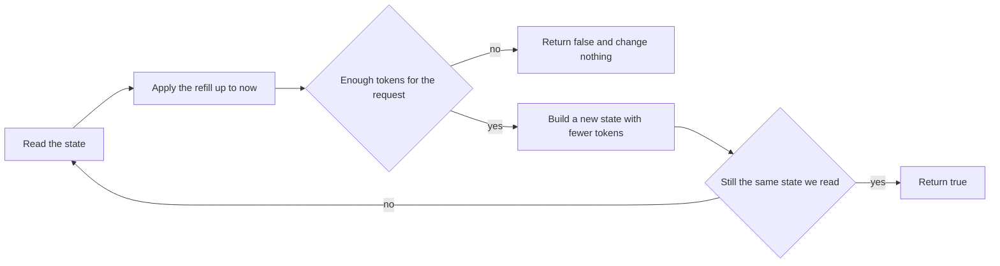
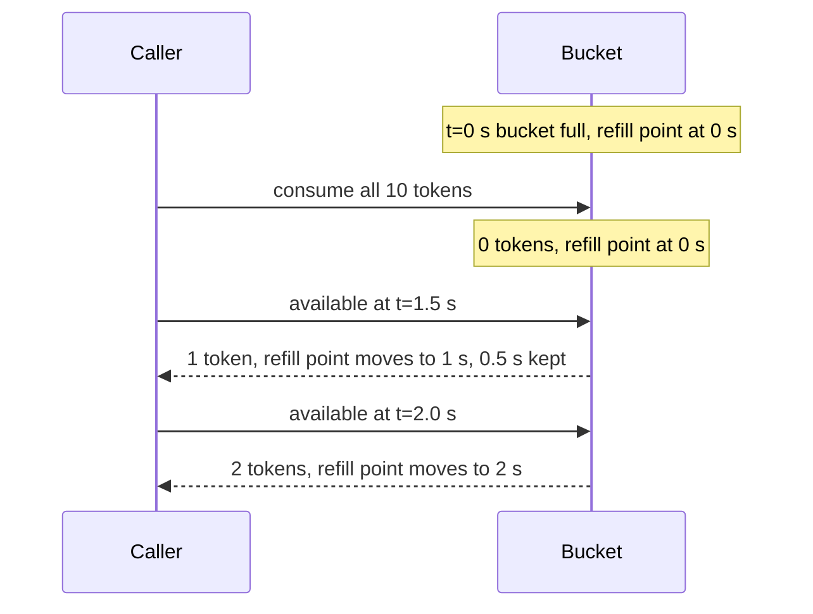
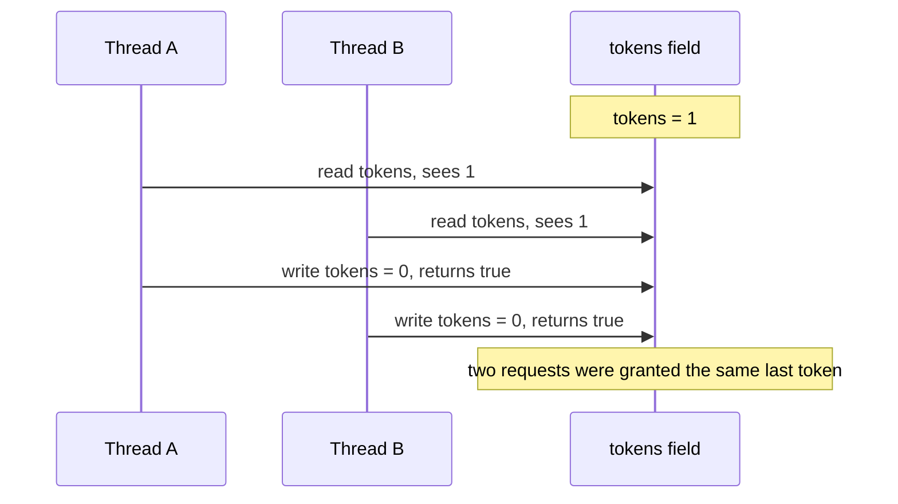

# Task 11 · A thread-safe token bucket rate limiter

| Difficulty | Topics | Time box |
|---|---|---|
| 🔴 Hard | Concurrency: atomicity, check-then-act, locks vs lock-free CAS with `AtomicReference` and immutable state · Testing time with an injected `InstantSource` · Stress-testing with virtual threads · `ConcurrentHashMap.computeIfAbsent` | 3–4 h |

> **Background reading:** Brian Goetz et al., *Java Concurrency in Practice*, ch. 2 (thread safety, atomicity), ch. 3 (sharing and immutability), ch. 15 (atomic variables and nonblocking synchronization) · *Effective Java* Items 78 ("Synchronize access to shared mutable data"), 79 ("Avoid excessive synchronization"), 81 ("Prefer concurrency utilities to `wait` and `notify`") · JEP 444 (virtual threads) · Javadoc of `java.time.InstantSource` (Java 17)

---

## The situation

Our public REST API for parcel tracking is hammered by a few large clients. Some of them poll every 50 ms, which is 20 requests per second from one API key, and that is too much for our tracking database. We need a **rate limit per API key**: a client may make bursts of up to 100 requests, and the allowance refills at 10 requests per second.

Each incoming request is handled on its own virtual thread, so many threads ask for tokens at the same time. A limiter that is correct with one thread and wrong with twenty is worse than no limiter, because it gives a false sense of safety. The limiter must also be testable without sleeping: a test that waits 100 seconds to check a refill is a test nobody runs.

The usual answer is the **token bucket**. Picture a bucket that holds up to `capacity` tokens. A request takes one token. Tokens drop back into the bucket at a steady rate. An empty bucket means "try again later".

## The domain

| Term | Meaning |
|---|---|
| **Capacity** | The most tokens a bucket can hold. This is the largest burst a client can send at once. |
| **Refill** | `refillTokens` new tokens every full `refillPeriod`. A period that has not finished yet adds nothing. |
| **Consume** | Take tokens for a request. Either all of the requested tokens are taken, or none are. |
| **Refill point** | The moment up to which whole refill periods have been counted. Time after it is "not yet counted". |
| **Key** | Who the limit applies to, here an API key. Each key has its own bucket. |

### The flow of one request



The refill comes first, every time. The check and the take must then happen **as one step**. The loop back from `F` to `A` is what makes "as one step" true without a lock. Section 4 below explains it.

### How interval refill keeps the remainder

Refill happens in whole periods only. If a period is not finished, its time is not lost: the refill point stays where it was, and the next call counts from there.



At `t=2.0 s` we have two full periods since the refill point at 0 s, so two tokens. The 0.5 s that was left over at `t=1.5 s` was not thrown away. It counted towards the second period.

### The check-then-act race

Here is the bug we must not write. A bucket has one token, and two threads ask for it at the same time.



Each thread did the right thing on its own. The check (`tokens >= 1`) and the act (`tokens--`) are separate steps, and another thread can run between them. That is a **lost update**. The fix is not "make the check faster". The check and the act must be one atomic step.

## What I want from you

You build two classes: [`TokenBucket`](../src/main/java/io/github/chris013/practice/task11/TokenBucket.java) and [`RateLimiter`](../src/main/java/io/github/chris013/practice/task11/RateLimiter.java). Constructor validation: `null` throws `NullPointerException` with the parameter name, and bad numbers throw `IllegalArgumentException`.

1. **[`TokenBucket`](../src/main/java/io/github/chris013/practice/task11/TokenBucket.java)`(capacity, refillTokens, refillPeriod, time)`**
   * `capacity` and `refillTokens` are at least 1. `refillPeriod` is positive. `time` is an `InstantSource`, and it is never null.
   * A new bucket starts **full**.
2. **`boolean tryConsume()`** is the same as `tryConsume(1)`.
3. **`boolean tryConsume(long tokens)`**
   * `tokens` must be between 1 and `capacity`, both included. Otherwise: `IllegalArgumentException`.
   * If there are enough tokens after the refill, take them and return `true`.
   * If there are not enough, take **nothing** and return `false`. A request never gets half of its tokens.
4. **`long availableTokens()`** returns the number of tokens after the refill up to the current instant. It does not take any token.
5. **Refill rule.** Every full `refillPeriod` that has passed since the refill point adds `refillTokens`, capped at `capacity`. The refill point moves forward by **whole periods only**. The part of a period that is still running is kept.
6. **Full-bucket rule.** When the bucket is full, the refill point is the current instant. So after you spend from a full bucket, the next refill comes exactly one full period later. A bucket that was refilled to full counts the same way.
7. **Time going backwards.** If `time` returns an instant before the refill point, no tokens are added or removed. Time that went backwards is treated as zero elapsed time.
8. **[`RateLimiter`](../src/main/java/io/github/chris013/practice/task11/RateLimiter.java)`(capacity, refillTokens, refillPeriod, time)`** uses the same settings for every key. The same validation applies.
9. **`boolean tryAcquire(K key)`** takes one token from the key's bucket. It creates the bucket the first time the key is seen. **Exactly one bucket is created per key**, even when thousands of threads ask for a new key at the same moment.
10. **`long availableTokens(K key)`** returns the tokens left for that key. A key that has never been seen has a full bucket (`capacity`). Asking does not create its bucket.
11. **Thread safety.** Any method may be called from any number of threads at once. No call may lose a token or give out more tokens than the bucket holds.

## Constraints & non-goals

* **No `Thread.sleep`** anywhere in the tests, and no `System.currentTimeMillis()`, `System.nanoTime()` or `Instant.now()` in the main code. Time comes from the injected `InstantSource`.
* **Integers only.** No `double` for tokens. Floating point drifts, and a limiter that slowly gives out too many tokens is a bug you find in production.
* **No external libraries**: no Guava, no Bucket4j. Write the bucket yourself. Compare with them in the stretch goals.
* **No waiting inside `TokenBucket`.** `tryConsume` answers yes or no straight away. A blocking `acquire()` is a stretch goal.
* **No eviction.** Buckets are never removed. That is fine for this task (stretch goal 2 covers it).

## How I'd approach it

* **Write the arithmetic first, without any concurrency.** Get the single-threaded tests green with a plain `long` field and an `Instant` field. You will see that the refill rule is about 10 lines, and most of the difficulty is in the edge cases: the remainder, the full bucket, and the clock going backwards.
* **Make the state one immutable object.** Put the token count and the refill point into one small `record`. Each change creates a new record. Nothing is ever edited in place. This is *Java Concurrency in Practice* ch. 3: an immutable object is always safe to share, so the only thing to make thread-safe is the single reference that points to the current one.
* **Think about what can go wrong with `volatile`.** You could write `private volatile long tokens` and then `if (tokens >= n) tokens -= n`. Make a list of the interleavings that break it. Then ask what `volatile` guarantees (visibility: a thread sees the latest value that was written) and what it does not guarantee (that the read and the write happen as one step). Those two are different properties, and this task is mostly about the second one.
* **Choose the tool for the atomic step.** You have two good options, and both are correct:
  * a **lock** (`synchronized` or a `ReentrantLock`), where the check and the act are inside the same block, or
  * a **compare-and-set loop** on an `AtomicReference<State>`: read the current state, compute the next one, and publish it only if nobody else changed it in the meantime; otherwise start again.
  Write the one you find simpler first. Then write the other one. The Key decisions section compares them. Do not decide before you have tried both.
* **Read the clock deliberately.** Decide when `time.instant()` is called. Calling it twice inside one attempt can give you two different instants, and then your check and your refill disagree. Put the answer in your PR description.
* **Check the refill arithmetic before you write it.** How many whole periods have passed? Can `periods * refillTokens` overflow? Can you avoid it by asking how many periods are needed to fill the bucket?
* **For the map in `RateLimiter`:** do not write `if (!map.containsKey(k)) map.put(k, new TokenBucket(...))`. Two threads can both pass the check. Look at `ConcurrentHashMap.computeIfAbsent`, and think about what happens when the factory is slow or when it throws.
* **Read the tests before you start.** They tell you exactly which numbers matter. The concurrency test is the one that will tell you whether your atomicity argument was right. Run it five times, not once.

## Tests

Run: `mvn test -Dtest='**/task11/**'`

* [`TokenBucketTest`](../src/test/java/io/github/chris013/practice/task11/TokenBucketTest.java): the single-threaded rules, one `@Nested` group per rule.
* [`TokenBucketConcurrencyTest`](../src/test/java/io/github/chris013/practice/task11/TokenBucketConcurrencyTest.java): 50,000 attempts from virtual threads, released together by a gate, against a frozen clock. Exactly `capacity` of them must succeed. It runs 5 times.
* [`RateLimiterTest`](../src/test/java/io/github/chris013/practice/task11/RateLimiterTest.java): separate keys, lazy creation, and 10,000 threads that ask for the same new key at once.

The time is always controlled by [`MutableInstantSource`](../src/test/java/io/github/chris013/practice/task11/MutableInstantSource.java). No test waits for real time.

<details>
<summary>Show the tests</summary>

<!-- embed: src/test/java/io/github/chris013/practice/task11/MutableInstantSource.java -->
**[`MutableInstantSource.java`](../src/test/java/io/github/chris013/practice/task11/MutableInstantSource.java)**

```java
package io.github.chris013.practice.task11;

import java.time.Duration;
import java.time.Instant;
import java.time.InstantSource;
import java.util.Objects;

/** An {@link InstantSource} that only moves when the test says so. Safe to read from many threads. */
final class MutableInstantSource implements InstantSource {

    private volatile Instant now;

    MutableInstantSource(Instant start) {
        this.now = Objects.requireNonNull(start, "start");
    }

    void set(Instant instant) {
        now = instant;
    }

    void advance(Duration duration) {
        now = now.plus(duration);
    }

    @Override
    public Instant instant() {
        return now;
    }
}
```
<!-- /embed -->

<!-- embed: src/test/java/io/github/chris013/practice/task11/TokenBucketTest.java -->
**[`TokenBucketTest.java`](../src/test/java/io/github/chris013/practice/task11/TokenBucketTest.java)**

```java
package io.github.chris013.practice.task11;

import static org.assertj.core.api.Assertions.assertThat;
import static org.assertj.core.api.Assertions.assertThatThrownBy;

import java.time.Duration;
import java.time.Instant;
import org.junit.jupiter.api.Nested;
import org.junit.jupiter.api.Test;
import org.junit.jupiter.params.ParameterizedTest;
import org.junit.jupiter.params.provider.CsvSource;

class TokenBucketTest {

    private static final Instant START = Instant.parse("2026-01-01T12:00:00Z");
    private static final Duration PERIOD = Duration.ofSeconds(1);

    private final MutableInstantSource time = new MutableInstantSource(START);

    private TokenBucket bucket(long capacity, long refillTokens) {
        return new TokenBucket(capacity, refillTokens, PERIOD, time);
    }

    @Nested
    class Consuming {

        @Test
        void starts_full() {
            assertThat(bucket(5, 1).availableTokens()).isEqualTo(5);
        }

        @Test
        void gives_out_one_token_per_call_until_empty() {
            TokenBucket bucket = bucket(3, 1);

            assertThat(bucket.tryConsume()).isTrue();
            assertThat(bucket.tryConsume()).isTrue();
            assertThat(bucket.tryConsume()).isTrue();
            assertThat(bucket.tryConsume()).isFalse();
            assertThat(bucket.availableTokens()).isZero();
        }

        @Test
        void consumes_several_tokens_at_once() {
            TokenBucket bucket = bucket(10, 1);

            assertThat(bucket.tryConsume(4)).isTrue();
            assertThat(bucket.availableTokens()).isEqualTo(6);
            assertThat(bucket.tryConsume(6)).isTrue();
            assertThat(bucket.availableTokens()).isZero();
        }

        @Test
        void refuses_without_taking_any_token_when_there_are_not_enough() {
            TokenBucket bucket = bucket(5, 1);
            assertThat(bucket.tryConsume(3)).isTrue();

            assertThat(bucket.tryConsume(3)).isFalse();
            assertThat(bucket.availableTokens()).isEqualTo(2);
            assertThat(bucket.tryConsume(2)).isTrue();
        }

        @ParameterizedTest
        @CsvSource({"0", "-1", "6"})
        void rejects_a_token_count_outside_1_to_capacity_and_takes_nothing(long tokens) {
            TokenBucket bucket = bucket(5, 1);

            assertThatThrownBy(() -> bucket.tryConsume(tokens)).isInstanceOf(IllegalArgumentException.class);
            assertThat(bucket.availableTokens()).isEqualTo(5);
        }
    }

    @Nested
    class Refilling {

        @Test
        void adds_refill_tokens_once_each_full_period() {
            TokenBucket bucket = bucket(10, 2);
            assertThat(bucket.tryConsume(10)).isTrue();

            time.advance(Duration.ofMillis(999));
            assertThat(bucket.availableTokens()).isZero();

            time.advance(Duration.ofMillis(1));
            assertThat(bucket.availableTokens()).isEqualTo(2);
        }

        @Test
        void adds_all_the_periods_that_elapsed_at_once() {
            TokenBucket bucket = bucket(10, 2);
            bucket.tryConsume(10);

            time.advance(PERIOD.multipliedBy(3));

            assertThat(bucket.availableTokens()).isEqualTo(6);
        }

        @Test
        void never_goes_above_capacity() {
            TokenBucket bucket = bucket(5, 2);
            bucket.tryConsume(5);

            time.advance(PERIOD.multipliedBy(100));

            assertThat(bucket.availableTokens()).isEqualTo(5);
        }

        @Test
        void caps_the_refill_when_one_period_would_overshoot_the_capacity() {
            TokenBucket bucket = bucket(5, 2);
            bucket.tryConsume(1); // 4 left

            time.advance(PERIOD);

            assertThat(bucket.availableTokens()).isEqualTo(5); // 4 + 2 would be 6
        }

        @Test
        void keeps_the_part_of_a_period_that_has_not_finished_yet() {
            TokenBucket bucket = bucket(10, 1);
            bucket.tryConsume(10);

            time.advance(Duration.ofMillis(1500));
            assertThat(bucket.availableTokens()).isEqualTo(1);

            // 1.5 periods, then 0.5 more: two whole periods have passed, so two refills.
            time.advance(Duration.ofMillis(500));
            assertThat(bucket.availableTokens()).isEqualTo(2);
        }

        @Test
        void a_full_bucket_restarts_its_clock_so_the_next_token_comes_one_full_period_after_spending() {
            TokenBucket bucket = bucket(5, 1);
            time.advance(PERIOD.multipliedBy(10)); // ten periods of waiting cannot store more than 5 tokens

            assertThat(bucket.tryConsume(5)).isTrue();

            time.advance(Duration.ofMillis(999));
            assertThat(bucket.availableTokens()).isZero();
            time.advance(Duration.ofMillis(1));
            assertThat(bucket.availableTokens()).isEqualTo(1);
        }

        @Test
        void a_bucket_that_is_refilled_to_full_restarts_its_clock_at_that_moment() {
            TokenBucket bucket = bucket(5, 1);
            bucket.tryConsume(1); // 4 left, refill clock still at START

            time.advance(Duration.ofMillis(1500));
            assertThat(bucket.availableTokens()).isEqualTo(5); // full at 1.5 s

            assertThat(bucket.tryConsume(5)).isTrue(); // empty now, clock restarts at 1.5 s
            time.advance(Duration.ofMillis(999));
            assertThat(bucket.availableTokens()).isZero();
            time.advance(Duration.ofMillis(1));
            assertThat(bucket.availableTokens()).isEqualTo(1);
        }

        @Test
        void a_tiny_period_and_a_long_gap_fill_the_bucket_without_an_exception() {
            TokenBucket bucket = new TokenBucket(5, 1, Duration.ofNanos(1), time);
            assertThat(bucket.tryConsume(5)).isTrue();

            // About 1.3e19 nanoseconds, more than a long can count (about 9.2e18). The bucket must still be full.
            time.advance(Duration.ofDays(400 * 365L));

            assertThat(bucket.availableTokens()).isEqualTo(5);
        }
    }

    @Nested
    class TimeGoingBackwards {

        @Test
        void neither_adds_nor_removes_tokens() {
            TokenBucket bucket = bucket(5, 1);
            bucket.tryConsume(2); // 3 left

            time.set(START.minus(Duration.ofHours(1)));
            assertThat(bucket.availableTokens()).isEqualTo(3);

            time.set(START.plus(PERIOD));
            assertThat(bucket.availableTokens()).isEqualTo(4);
        }
    }

    @Nested
    class Validation {

        @ParameterizedTest
        @CsvSource({"0,1,PT1S", "-3,1,PT1S", "5,0,PT1S", "5,-1,PT1S", "5,1,PT0S", "5,1,-PT1S"})
        void rejects_invalid_parameters(long capacity, long refillTokens, String refillPeriod) {
            assertThatThrownBy(() -> new TokenBucket(capacity, refillTokens, Duration.parse(refillPeriod), time))
                    .isInstanceOf(IllegalArgumentException.class);
        }

        @Test
        void rejects_null_arguments_and_names_them() {
            assertThatThrownBy(() -> new TokenBucket(5, 1, null, time))
                    .isInstanceOf(NullPointerException.class)
                    .hasMessage("refillPeriod");
            assertThatThrownBy(() -> new TokenBucket(5, 1, PERIOD, null))
                    .isInstanceOf(NullPointerException.class)
                    .hasMessage("time");
        }

        @Test
        void accepts_the_smallest_valid_settings() {
            TokenBucket bucket = new TokenBucket(1, 1, Duration.ofNanos(1), time);

            assertThat(bucket.tryConsume()).isTrue();
            assertThat(bucket.tryConsume()).isFalse();
        }
    }
}
```
<!-- /embed -->

<!-- embed: src/test/java/io/github/chris013/practice/task11/TokenBucketConcurrencyTest.java -->
**[`TokenBucketConcurrencyTest.java`](../src/test/java/io/github/chris013/practice/task11/TokenBucketConcurrencyTest.java)**

```java
package io.github.chris013.practice.task11;

import static org.assertj.core.api.Assertions.assertThat;

import java.time.Duration;
import java.time.Instant;
import java.util.concurrent.CountDownLatch;
import java.util.concurrent.ExecutorService;
import java.util.concurrent.Executors;
import java.util.concurrent.atomic.AtomicInteger;
import org.junit.jupiter.api.RepeatedTest;

/**
 * Time is frozen, so the only thing that can change the result is the race between threads. Each attempt is
 * started by a shared gate, so all of them hit the bucket at the same moment.
 */
class TokenBucketConcurrencyTest {

    private static final int CAPACITY = 1_000;
    private static final int ATTEMPTS = 50_000;

    private final MutableInstantSource time = new MutableInstantSource(Instant.parse("2026-01-01T12:00:00Z"));

    @RepeatedTest(5)
    void exactly_capacity_requests_succeed_when_virtual_threads_race_for_the_tokens() {
        TokenBucket bucket = new TokenBucket(CAPACITY, 1, Duration.ofSeconds(1), time);
        AtomicInteger granted = new AtomicInteger();
        CountDownLatch startGate = new CountDownLatch(1);

        // close() waits until every task has finished.
        try (ExecutorService executor = Executors.newVirtualThreadPerTaskExecutor()) {
            for (int i = 0; i < ATTEMPTS; i++) {
                executor.execute(() -> {
                    awaitQuietly(startGate);
                    if (bucket.tryConsume()) {
                        granted.incrementAndGet();
                    }
                });
            }
            startGate.countDown();
        }

        assertThat(granted).hasValue(CAPACITY);
        assertThat(bucket.availableTokens()).isZero();
    }

    private static void awaitQuietly(CountDownLatch latch) {
        try {
            latch.await();
        } catch (InterruptedException e) {
            Thread.currentThread().interrupt();
            throw new IllegalStateException("interrupted while waiting for the start gate", e);
        }
    }
}
```
<!-- /embed -->

<!-- embed: src/test/java/io/github/chris013/practice/task11/RateLimiterTest.java -->
**[`RateLimiterTest.java`](../src/test/java/io/github/chris013/practice/task11/RateLimiterTest.java)**

```java
package io.github.chris013.practice.task11;

import static org.assertj.core.api.Assertions.assertThat;
import static org.assertj.core.api.Assertions.assertThatThrownBy;

import java.time.Duration;
import java.time.Instant;
import java.util.concurrent.CountDownLatch;
import java.util.concurrent.ExecutorService;
import java.util.concurrent.Executors;
import java.util.concurrent.atomic.AtomicInteger;
import org.junit.jupiter.api.Nested;
import org.junit.jupiter.api.Test;

class RateLimiterTest {

    private static final Instant START = Instant.parse("2026-01-01T12:00:00Z");
    private static final Duration PERIOD = Duration.ofSeconds(1);

    private final MutableInstantSource time = new MutableInstantSource(START);

    @Test
    void each_key_gets_its_own_bucket() {
        RateLimiter<String> limiter = new RateLimiter<>(2, 1, PERIOD, time);

        assertThat(limiter.tryAcquire("alice")).isTrue();
        assertThat(limiter.tryAcquire("alice")).isTrue();
        assertThat(limiter.tryAcquire("alice")).isFalse();

        assertThat(limiter.tryAcquire("bob")).isTrue();
        assertThat(limiter.availableTokens("alice")).isZero();
        assertThat(limiter.availableTokens("bob")).isEqualTo(1);
    }

    @Test
    void a_key_we_have_never_seen_has_full_capacity() {
        RateLimiter<String> limiter = new RateLimiter<>(7, 1, PERIOD, time);

        assertThat(limiter.availableTokens("nobody")).isEqualTo(7);
    }

    @Test
    void each_key_refills_on_its_own_schedule() {
        RateLimiter<String> limiter = new RateLimiter<>(1, 1, PERIOD, time);
        limiter.tryAcquire("alice"); // alice's clock starts at 0 s

        time.advance(Duration.ofMillis(500));
        limiter.tryAcquire("bob"); // bob's clock starts at 0.5 s

        time.advance(Duration.ofMillis(500)); // now 1 s
        assertThat(limiter.availableTokens("alice")).isEqualTo(1);
        assertThat(limiter.availableTokens("bob")).isZero();
    }

    @Test
    void rejects_null_keys() {
        RateLimiter<String> limiter = new RateLimiter<>(1, 1, PERIOD, time);

        assertThatThrownBy(() -> limiter.tryAcquire(null))
                .isInstanceOf(NullPointerException.class)
                .hasMessage("key");
    }

    @Test
    void rejects_invalid_limits_when_it_is_built() {
        assertThatThrownBy(() -> new RateLimiter<String>(0, 1, PERIOD, time))
                .isInstanceOf(IllegalArgumentException.class);
        assertThatThrownBy(() -> new RateLimiter<String>(1, 1, Duration.ZERO, time))
                .isInstanceOf(IllegalArgumentException.class);
    }

    @Nested
    class Concurrency {

        @Test
        void ten_thousand_first_requests_for_one_new_key_create_exactly_one_bucket() {
            int capacity = 100;
            RateLimiter<String> limiter = new RateLimiter<>(capacity, 10, PERIOD, time);
            AtomicInteger granted = new AtomicInteger();
            CountDownLatch startGate = new CountDownLatch(1);

            try (ExecutorService executor = Executors.newVirtualThreadPerTaskExecutor()) {
                for (int i = 0; i < 10_000; i++) {
                    executor.execute(() -> {
                        awaitQuietly(startGate);
                        if (limiter.tryAcquire("parcel-api-key")) {
                            granted.incrementAndGet();
                        }
                    });
                }
                startGate.countDown();
            }

            // If two buckets had been created for the key, each would hand out its own 100 tokens.
            assertThat(granted).hasValue(capacity);
            assertThat(limiter.availableTokens("parcel-api-key")).isZero();
        }

        private static void awaitQuietly(CountDownLatch latch) {
            try {
                latch.await();
            } catch (InterruptedException e) {
                Thread.currentThread().interrupt();
                throw new IllegalStateException("interrupted while waiting for the start gate", e);
            }
        }
    }
}
```
<!-- /embed -->

</details>

## Definition of done

- [ ] All task 11 tests are green, and the whole test run takes well under 3 seconds.
- [ ] The concurrency tests pass on five repeated runs in a row.
- [ ] No `Thread.sleep`, no `System.nanoTime()`, no `Instant.now()` in `src/main`.
- [ ] No `double` anywhere: tokens and refill arithmetic are integers.
- [ ] `tryConsume` never takes a partial amount.
- [ ] The state is an immutable object. Nothing shared is modified in place.
- [ ] Your PR description says which atomicity mechanism you chose (lock or CAS), why, and when the clock is read.

## Stretch goals

1. Make `tryConsume` tell the caller how long to wait: `Optional<Duration> retryAfter`, or a small sealed type `Granted` / `Refused(Duration retryAfter)`. The HTTP `Retry-After` header needs that number. How do you compute it exactly, given the remainder rule?
2. Evict idle buckets. Each key that goes quiet keeps a bucket in memory forever. Remove a bucket once it has been full for a full period. Which operation is safe to race with `tryAcquire`, and which is not?
3. Add a blocking `acquire(K key)` that waits until a token is available. Inject the waiting as well, for example a small `Sleeper` interface, or a `Condition`/`LockSupport.park` that the test wakes up after moving the fake time. In production, sleeping or parking on a virtual thread is cheap. Test it without real waiting: the test should show the call is blocked until the fake time moves, and then returns.
4. Read the source or the documentation of Guava's `RateLimiter` and Bucket4j. Both are real libraries. Which algorithm does each use: a token bucket, or a leaky bucket? Which one allows bursts? In what cases would you rather use a library than your own 100 lines?

---

## Reference solution

<details>
<summary>Spoiler: open only after you have made a serious attempt</summary>

### Key decisions

**1. One immutable `State` record, one `AtomicReference`.** The token count and the refill point always change together, so they live in one `private record State(long tokens, Instant refilledAt)`. The only mutable thing in the bucket is the reference to the current `State`. Every change creates a new record and publishes it with `compareAndSet`. The rejected alternative was two fields, `tokens` and `refilledAt`, each `volatile`. Then a thread can read a new `tokens` with an old `refilledAt`, and the two values never belong to the same moment.

**2. Compare-and-set loop instead of a lock.** `tryConsume` reads the state, computes what the state would be after the refill, checks the tokens, builds the next state, and calls `compareAndSet(current, next)`. If another thread changed the state in the meantime, the call fails and the loop starts again from the new state. Nothing blocks. The rejected alternative was `synchronized` on the whole method. It is equally correct, and simpler to read, and it is the right choice in many codebases. The trade-off is discussed below.

**3. The refill is a pure function of the state and the instant.** `refreshed(current, now)` returns a new state and never writes to anything. `tryConsume` and `availableTokens` both call it. A refused request therefore changes nothing, which is why "no partial consumption" is free: the refused path simply does not call `compareAndSet`.

**4. The clock is read once per attempt, outside the loop.** On a retry the same `now` is used again. This is safe because the refill logic treats any `now` before the refill point as "no time passed". If thread B has already stored a state with a later refill point, thread A's older reading does not add or remove anything. Reading the clock inside the loop would make the retries depend on timing noise and would make the reasoning harder, not easier.

**5. ABA is harmless here.** The ABA problem is when a value changes from A to B and back to A, so a CAS that compares values wrongly succeeds. `compareAndSet` compares references, and every `State` is a fresh object that is never stored twice. A state that another thread has replaced can never come back as the same reference. Even if `State` objects were reused, for example a shared `State.EMPTY`, ABA would be harmless here: the next state depends only on the current tokens and refill point, and an immutable `State` that is the same reference has the same values. ABA is a real bug only when the CAS'd reference stands for more than its value, for example a node in a lock-free stack whose `next` field was changed in the meantime.

**6. Integer arithmetic only, with the overflow cases handled before multiplying.** `periods` is `elapsed / refillPeriod`, which is a `long`. Dividing a `Duration` by a tiny period can produce a quotient that does not fit in a `long`, and `dividedBy` then throws `ArithmeticException`. The code catches that and uses `Long.MAX_VALUE` as the period count, because a count that large fills any bucket. Before multiplying `periods * refillTokens`, the code checks whether `periods` is already enough to fill the bucket, using `Math.ceilDiv(missing, refillTokens)`. If it is, the result is a full bucket and no multiplication happens. Otherwise `periods` is below the number needed to fill the bucket, and the product is below `missing`, which cannot overflow.

**7. `RateLimiter` uses `computeIfAbsent`, and the factory is cheap.** The factory only creates an object and reads the clock, so holding the map's bin lock for that long is fine. A `get` followed by `put` would let two threads create two buckets for one key. One bucket would then be overwritten, and its tokens with it. The rule that makes this work is: **the factory must not block and must not call back into the map.**

**8. `synchronized` versus CAS.** Here is the lock-based version, as an equally valid alternative:

```java
private final Object lock = new Object();   // guards tokens and refilledAt
private long tokens;
private Instant refilledAt;

// checkTokens and refillLocked: the same validation and refill rule as in the CAS version, without the AtomicReference
public boolean tryConsume(long tokens) {
    checkTokens(tokens);
    synchronized (lock) {
        refillLocked(time.instant());
        if (this.tokens < tokens) {
            return false;
        }
        this.tokens -= tokens;
        return true;
    }
}
```

Both versions are correct. The difference:

* **Simplicity.** The lock version reads like the rules. The CAS version needs the reader to know why the loop is correct. For a team, the lock is often the better default.
* **Blocking.** The lock version makes threads wait for each other. With virtual threads this is cheap, and since JDK 24 (JEP 491) a virtual thread waiting for a `synchronized` monitor no longer pins its carrier thread. Before JDK 24 a waiting virtual thread could hold a carrier, so a burst of waiting threads could starve the pool.
* **Contention.** Under heavy contention the CAS loop wastes work: each failed `compareAndSet` throws away a computed state and starts again. The lock makes threads queue instead. For one hot key with thousands of requests per second, a benchmark is the only way to know which wins. For this task, both are fine.
* **Scope.** A lock on `this` is visible to any caller who can get a reference to the bucket, so use a private lock object if you go that way (*Effective Java* Item 82). The CAS version has no lock to leak.

### Code

<!-- embed: solutions/src/main/java/io/github/chris013/practice/task11/TokenBucket.java -->
**[`TokenBucket.java`](../solutions/src/main/java/io/github/chris013/practice/task11/TokenBucket.java)**

```java
package io.github.chris013.practice.task11;

import java.time.Duration;
import java.time.Instant;
import java.time.InstantSource;
import java.util.Objects;
import java.util.concurrent.atomic.AtomicReference;

/**
 * A token bucket: holds up to {@code capacity} tokens and gets {@code refillTokens} back every full
 * {@code refillPeriod}. A request takes its tokens from the bucket or is refused.
 *
 * <p>The refill is done in whole periods and in integers only. The refill clock only moves forward by whole
 * periods, so the part of a period that has not finished yet is kept for the next call and no time is lost.
 *
 * <p>Thread safety: all state lives in one immutable {@link State} object held by an {@link AtomicReference}.
 * {@link #tryConsume(long)} is a compare-and-set loop, so it never blocks and never loses an update.
 */
public final class TokenBucket {

    private final long capacity;
    private final long refillTokens;
    private final Duration refillPeriod;
    private final InstantSource time;
    private final AtomicReference<State> state;

    /**
     * Creates a bucket that starts full.
     *
     * @throws IllegalArgumentException if {@code capacity} or {@code refillTokens} is below 1, or {@code refillPeriod}
     *     is not positive
     * @throws NullPointerException if {@code refillPeriod} or {@code time} is null
     */
    public TokenBucket(long capacity, long refillTokens, Duration refillPeriod, InstantSource time) {
        if (capacity < 1) {
            throw new IllegalArgumentException("capacity must be at least 1, was " + capacity);
        }
        if (refillTokens < 1) {
            throw new IllegalArgumentException("refillTokens must be at least 1, was " + refillTokens);
        }
        Objects.requireNonNull(refillPeriod, "refillPeriod");
        if (refillPeriod.isZero() || refillPeriod.isNegative()) {
            throw new IllegalArgumentException("refillPeriod must be positive, was " + refillPeriod);
        }
        this.capacity = capacity;
        this.refillTokens = refillTokens;
        this.refillPeriod = refillPeriod;
        this.time = Objects.requireNonNull(time, "time");
        this.state = new AtomicReference<>(new State(capacity, time.instant()));
    }

    /** Takes one token if there is one. Same as {@code tryConsume(1)}. */
    public boolean tryConsume() {
        return tryConsume(1);
    }

    /**
     * Takes {@code tokens} tokens if there are that many after the refill. Otherwise takes nothing and returns false.
     *
     * @throws IllegalArgumentException if {@code tokens} is below 1 or above the capacity
     */
    public boolean tryConsume(long tokens) {
        if (tokens < 1 || tokens > capacity) {
            throw new IllegalArgumentException("tokens must be between 1 and " + capacity + ", was " + tokens);
        }
        // Read the clock once per attempt. On a retry we reuse this instant: the state we see may have been
        // refilled by another thread with a later reading, and refreshed() treats that as "no time passed".
        Instant now = time.instant();
        while (true) {
            State current = state.get();
            State refreshed = refreshed(current, now);
            if (refreshed.tokens() < tokens) {
                return false; // refused: nothing is written, so nothing is taken
            }
            State next = new State(refreshed.tokens() - tokens, refreshed.refilledAt());
            // compareAndSet succeeds only if no other thread changed the state since we read it. If one did, we
            // start again from the new state.
            if (state.compareAndSet(current, next)) {
                return true;
            }
        }
    }

    /** The number of tokens available right now, after applying the refill up to the current instant. */
    public long availableTokens() {
        return refreshed(state.get(), time.instant()).tokens();
    }

    /**
     * Returns the state as it would be at {@code now}, with the refill applied. Never changes {@code current}.
     */
    private State refreshed(State current, Instant now) {
        if (now.isBefore(current.refilledAt())) {
            // The clock went backwards. Treat it as zero time elapsed so tokens are neither added nor removed.
            return current;
        }
        if (current.tokens() >= capacity) {
            // A full bucket has nothing to refill. Its refill clock starts now, so that after spending from it the
            // next refill comes one full period later.
            return new State(capacity, now);
        }
        long periods;
        try {
            periods = Duration.between(current.refilledAt(), now).dividedBy(refillPeriod);
        } catch (ArithmeticException tooManyToCount) {
            periods = Long.MAX_VALUE; // any such number fills the bucket
        }
        if (periods == 0) {
            return current;
        }
        long missing = capacity - current.tokens();
        if (periods >= Math.ceilDiv(missing, refillTokens)) {
            // Enough periods passed to fill the bucket. It is full now, so the refill clock starts now.
            return new State(capacity, now);
        }
        // Fewer periods than needed to fill the bucket: no overflow is possible, and the refill clock moves forward
        // by whole periods only. The part of the current period that is still running is kept.
        return new State(
                current.tokens() + periods * refillTokens,
                current.refilledAt().plus(refillPeriod.multipliedBy(periods)));
    }

    /**
     * An immutable snapshot of the bucket.
     *
     * @param tokens     tokens in the bucket as of {@code refilledAt}
     * @param refilledAt the point up to which whole refill periods have been counted
     */
    private record State(long tokens, Instant refilledAt) {
    }
}
```
<!-- /embed -->

<!-- embed: solutions/src/main/java/io/github/chris013/practice/task11/RateLimiter.java -->
**[`RateLimiter.java`](../solutions/src/main/java/io/github/chris013/practice/task11/RateLimiter.java)**

```java
package io.github.chris013.practice.task11;

import java.time.Duration;
import java.time.InstantSource;
import java.util.Map;
import java.util.Objects;
import java.util.concurrent.ConcurrentHashMap;
import java.util.function.Supplier;

/**
 * One {@link TokenBucket} per key, for example one per API key. A bucket is created the first time its key is seen.
 *
 * <p>Buckets are never removed. That is fine for a few thousand API keys. For more, see the stretch goals.
 */
public final class RateLimiter<K> {

    private final long capacity;
    private final Supplier<TokenBucket> newBucket;
    private final Map<K, TokenBucket> buckets = new ConcurrentHashMap<>();

    /**
     * Every key gets a bucket with these settings.
     *
     * @throws IllegalArgumentException if {@code capacity} or {@code refillTokens} is below 1, or {@code refillPeriod}
     *     is not positive
     * @throws NullPointerException if {@code refillPeriod} or {@code time} is null
     */
    public RateLimiter(long capacity, long refillTokens, Duration refillPeriod, InstantSource time) {
        this.capacity = capacity;
        this.newBucket = () -> new TokenBucket(capacity, refillTokens, refillPeriod, time);
        // Build one bucket now, so bad arguments fail at construction and not on the first request.
        newBucket.get();
    }

    /**
     * Takes one token from the bucket of {@code key}, creating that bucket if this is the key's first request.
     */
    public boolean tryAcquire(K key) {
        Objects.requireNonNull(key, "key");
        // computeIfAbsent runs the factory at most once per key, even under contention. A get-then-put would let two
        // threads each create a bucket, and one of them would then be thrown away together with its tokens.
        return buckets.computeIfAbsent(key, k -> newBucket.get()).tryConsume();
    }

    /** Tokens left for {@code key}. A key we have never seen has a full bucket, and asking does not create one. */
    public long availableTokens(K key) {
        TokenBucket bucket = buckets.get(Objects.requireNonNull(key, "key"));
        return bucket == null ? capacity : bucket.availableTokens();
    }
}
```
<!-- /embed -->

### What I typically flag in first attempts

| Finding | Why it matters |
|---|---|
| `double tokens` with `tokens += elapsedSeconds * rate` | Rounding drifts. Over a day the limiter gives out a measurable number of extra tokens, and the error depends on how often it is called. |
| `Instant.now()` or `System.nanoTime()` inside the bucket | Untestable without `Thread.sleep`. Tests become slow and flaky, and the refill rule is never checked at its boundaries. |
| Reading the clock twice in one attempt (once to check, once to refill) | The two readings can differ. The check and the refill then disagree about the time, and tokens appear or vanish in rare races. |
| `synchronized (this)` or `public synchronized` on the bucket | Anyone who holds the bucket can lock it. Use a private lock object, or no lock at all. |
| `volatile long tokens` with `if (tokens >= n) tokens -= n` | `volatile` gives visibility, not atomicity. Two threads can both pass the check and both take the last token. |
| `containsKey` then `put` in `RateLimiter` | Two threads create two buckets for one key. One is overwritten, and the tokens it handed out are no longer counted. Use `computeIfAbsent`. |
| Refill that keeps only `now` as the new refill point | The remainder of a partly finished period is lost. Two calls 1.5 periods and 0.5 periods apart give one refill instead of two. |
| `tryConsume(5)` that takes 3 tokens and returns false | A rejected request still spent tokens, so a client can be refused and still reduce its own allowance. |

</details>
