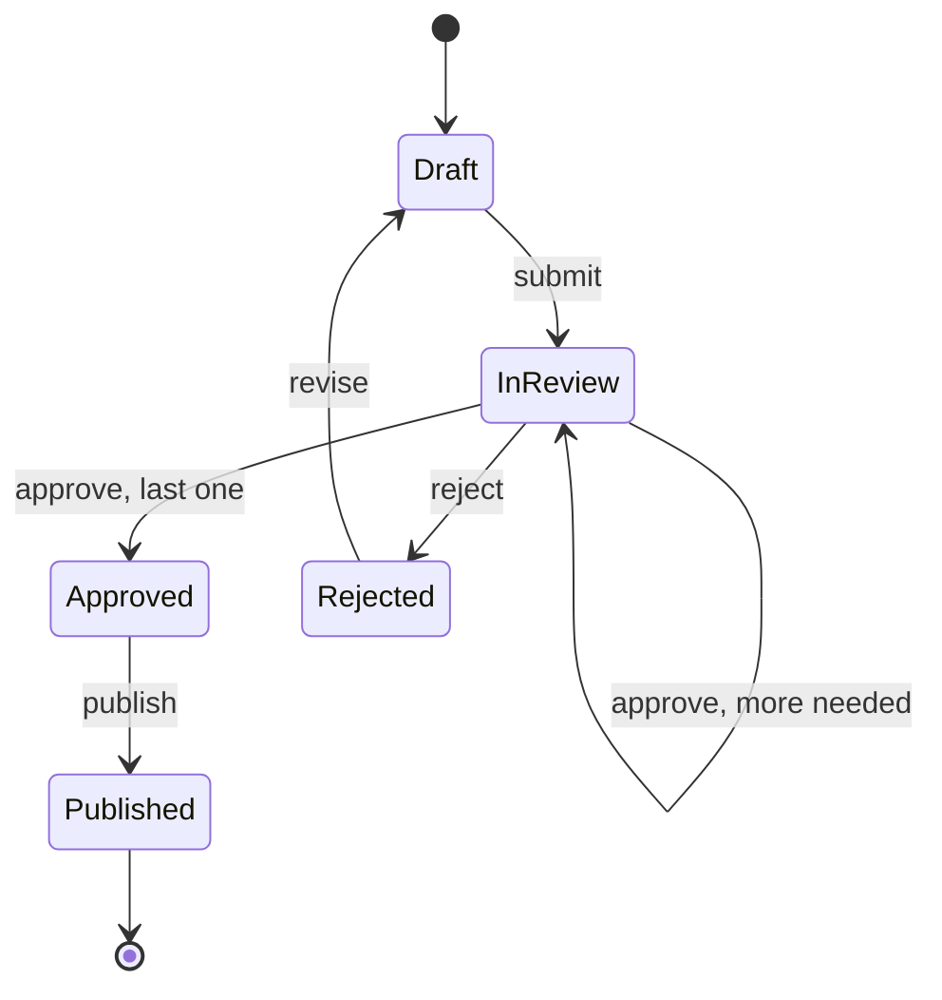
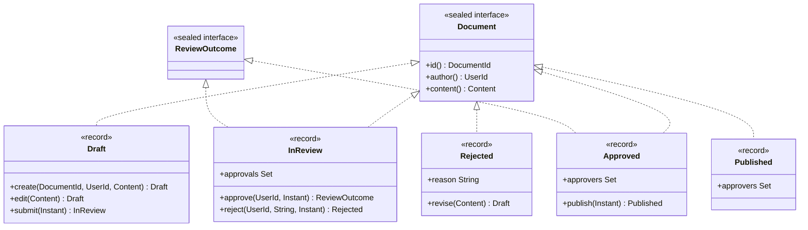

# Task 12 · Document approval with type-state

| Difficulty | Topics | Time box |
|---|---|---|
| 🟡 Medium | Making illegal states unrepresentable · Type-state pattern with sealed interfaces and records · Immutable state transitions · Exhaustive switch with record patterns · Comparing with the enum-status approach of task 08 | 2–3 h |

> **Background reading:** Yaron Minsky, "Effective ML" talk and his phrase "make illegal states unrepresentable" · Scott Wlaschin, *Domain Modeling Made Functional*, ch. 6 ("Integrity and Consistency in the Domain") and ch. 8 · JEP 409 (sealed classes), JEP 440 (record patterns), JEP 441 (pattern matching for switch) · *Effective Java* Item 17 ("Minimize mutability")

---

## The situation

Our internal policy tool holds HR and compliance documents. Authors draft a document, submit it, reviewers approve or reject it, and an approved document is published to everyone it applies to.

An audit found three problems:

* **Published documents without any approval.** A status field said `PUBLISHED`, but nothing checked that an approval existed.
* **Authors approving their own documents.** Nothing stopped the author from being one of the approvers.
* **A confidential document published with one approval.** Confidential documents need two approvals. The rule lived in a `if` in one service class, and a second code path skipped it.

The old model was one `Document` class with a `status` field and three nullable fields: `approvedBy`, `rejectionReason` and `publishedAt`. Any combination of them was possible, so the bugs were possible too.

This time we model **each state as its own type**. A draft is a `Draft`, a document in review is an `InReview`, and so on. The operation `publish` exists only on `Approved`. Calling it on a draft is not a runtime error that a test has to catch. It is a compile error.

## The domain

| Term | Meaning |
|---|---|
| **Document** | A policy text with an id, an author and content. Its state is one of five types. |
| **Content** | Title, body and a classification. Title and body are not blank. |
| **Classification** | `PUBLIC` needs 1 approval, `CONFIDENTIAL` needs 2. |
| **Approval** | A reviewer says the document is fine. A reviewer can approve only once. |
| **Four-eyes principle** | The author never approves or rejects their own document. |
| **Rejection** | A reviewer sends the document back with a reason. The author can revise it into a new draft. |

### The workflow



The only way from `Draft` to `Published` goes through `InReview` and `Approved`. The transitions are methods, and each method exists only on the type where it is legal.

### The sealed hierarchy



`InReview` implements both `Document` and `ReviewOutcome`. `approve` does not return an `InReview` in every case: it returns a `ReviewOutcome`, which is either "still in review" or "approved". That return type is how the caller learns the result of a review step.

## What I want from you

Implement the transitions and the status line. The starter gives you the ids, `Classification`, `Content`, the two sealed interfaces and the five state records. The records' transition methods and compact constructors are skeletons.

1. **Drafts** ([`Draft`](../src/main/java/io/github/chris013/practice/task12/Draft.java))
   * `Draft.create(id, author, content)` returns a draft. Null arguments throw `NullPointerException` that names the parameter.
   * `edit(newContent)` returns a new draft with the new content and the same id and author. The original is not changed.
   * `submit(at)` returns an `InReview` with `submittedAt = at` and no approvals.
2. **Reviews** ([`InReview`](../src/main/java/io/github/chris013/practice/task12/InReview.java))
   * `approvals` is copied with `Set.copyOf`, so it is unmodifiable and independent of the set the caller passed in.
   * `approve(reviewer, at)`: the author as reviewer throws `IllegalArgumentException` (message contains `four-eyes`).
   * `approve` by a reviewer who already approved throws `IllegalArgumentException`.
   * `approve` returns a new `InReview` with the reviewer added while `approvals.size()` is less than `content.classification().requiredApprovals()`.
   * When the required number is reached, `approve` returns an `Approved` with `approvedAt = at` and the same approvers.
   * `reject(reviewer, reason, at)` returns a [`Rejected`](../src/main/java/io/github/chris013/practice/task12/Rejected.java). The author as reviewer throws `IllegalArgumentException` (message contains `four-eyes`). A blank reason throws `IllegalArgumentException`.
3. **Approved documents** ([`Approved`](../src/main/java/io/github/chris013/practice/task12/Approved.java))
   * The approvers are copied with `Set.copyOf`. Zero approvers throws `IllegalArgumentException`.
   * `publish(at)` returns a [`Published`](../src/main/java/io/github/chris013/practice/task12/Published.java) with the same approvers and `publishedAt = at`.
4. **Rejected documents** ([`Rejected`](../src/main/java/io/github/chris013/practice/task12/Rejected.java))
   * The constructor enforces the rules that `reject` relies on: the reviewer is not the author (`four-eyes`), and the reason is not blank. A `Rejected` that breaks them cannot exist.
   * `revise(newContent)` returns a `Draft` with the new content and the same id and author. All earlier approvals are gone.
5. **Published documents** ([`Published`](../src/main/java/io/github/chris013/practice/task12/Published.java))
   * The approvers are copied with `Set.copyOf`. Zero approvers throws `IllegalArgumentException`.
   * `Published` has no transition methods. A published document is final.
6. **Status line** ([`StatusLine`](../src/main/java/io/github/chris013/practice/task12/StatusLine.java))
   * `StatusLine.of(document)` returns exactly one of these lines:
     * `Draft`: `Draft: <title>`
     * `InReview`: `In review: <title> (<n> of <required> approvals)`
     * `Approved`: `Approved: <title> by <approvers>`, with the approver ids sorted alphabetically and joined by `, `
     * `Rejected`: `Rejected: <title> by <reviewer>: <reason>`
     * `Published`: `Published: <title> on <yyyy-MM-dd>`, with the date in UTC
   * Use one `switch` over `Document` with record patterns and **no `default`**.

## Constraints & non-goals

* **All records are immutable.** No setters, no mutable collections inside them, and every transition returns a new object.
* **No `Instant.now()` anywhere.** The time of each transition is a parameter, so the workflow is deterministic.
* **No `null`** in any component. Use `Objects.requireNonNull(x, "x")`.
* **No status enum.** The type *is* the state. A status enum next to the types would be a second source of truth (see the flag table at the end).
* No persistence, no database mapping, no withdrawal from review in this task. These are stretch goals.
* No mocking framework. The tests use the real types.

## How I'd approach it

* **Write the state records first, then the transitions.** The compact constructors hold the rules that must always be true: non-null components, and the approver sets copied and non-empty. Once they are in place, the transition methods are short.
* **Put the four-eyes rule where it can be broken.** `approve` is the place where a reviewer is added, so its check goes there. A `Rejected` can also be built directly, so the same check belongs in its constructor. Ask yourself which rules a caller must not be able to skip.
* **The approval that completes the set changes the type.** Count the approvals after adding the reviewer. Below the threshold, return a new `InReview`. At the threshold, return an `Approved`. Do not add a boolean flag to `InReview` for this.
* **How a caller handles `ReviewOutcome`.** The caller of `approve` must deal with both cases, and a `switch` makes the compiler check that:

  ```java
  switch (outcome) {
      case InReview stillOpen -> notifyNextReviewer(stillOpen);
      case Approved approved -> notifyAuthorAndPublish(approved);
  }
  ```

  Because `ReviewOutcome` is sealed, the switch needs no `default`. If you add a third outcome later, every caller fails to compile.
* **Status line: one switch, record patterns, no default.** Use `_` for components you do not need. Keep the switch small: each branch builds one string and does nothing else.
* **Sorting and dates.** Sort the approver ids as strings with `sorted()`. For the publication date, convert the `Instant` to a date in UTC. Do not use the default time zone, because the server's time zone must not change the text.
* **Exception messages.** Name the rule in the message ("four-eyes principle", "already approved"). A message like "invalid argument" makes the audit log useless.

### Why the compiler error is the test

There is no test for "publish on a draft". It does not compile. This is the point of the exercise. Here is what `javac` says for `Draft.create(...).publish(...)`:

```
error: cannot find symbol
        draft.publish(Instant.parse("2026-03-04T08:00:00Z"));
             ^
  symbol:   method publish(Instant)
  location: variable draft of type Draft
```

The bug that cost us a published document without approval cannot be written in code any more. A test would only catch it after someone wrote the bad line and ran the tests. The compiler catches it while you type.

## Tests

Run: `mvn test -Dtest='**/task12/**'`

* [`DocumentWorkflowTest`](../src/test/java/io/github/chris013/practice/task12/DocumentWorkflowTest.java) covers each state, the approval rules for public and confidential documents, the four-eyes rule, duplicate approvals, rejection, revision, publication, and immutability.
* [`StatusLineTest`](../src/test/java/io/github/chris013/practice/task12/StatusLineTest.java) checks one line per state, plus the sorting of approvers and the UTC date.

<details>
<summary>Show the tests</summary>

<!-- embed: src/test/java/io/github/chris013/practice/task12/DocumentWorkflowTest.java -->
<!-- /embed -->

<!-- embed: src/test/java/io/github/chris013/practice/task12/StatusLineTest.java -->
<!-- /embed -->

</details>

## Definition of done

- [ ] All tests green. The whole task runs in well under a second.
- [ ] No state has a method that is illegal in that state. `Published` has no transitions.
- [ ] No `Instant.now()`, and no `null` in any record component.
- [ ] Every set in a record is copied with `Set.copyOf` and cannot be changed from outside.
- [ ] Four-eyes and blank-reason rules hold for every way of creating a `Rejected`.
- [ ] `StatusLine` uses one exhaustive switch without `default`.
- [ ] You can explain in one sentence why `publish` on a `Draft` is a compile error and not a runtime check.

## Stretch goals

1. **Persistence.** Map each state to one flat row (`DocumentRow` with a `status` column and nullable columns for the state-specific fields). Write a mapper with a `switch` from row to document and back. How do you load a row whose status is unknown? Throw, or quarantine the row? Argue for one.
2. **Withdraw from review.** The author should be able to take a document out of review. Which types get a `withdraw` method, and which must not? Where does the answer come from in the workflow diagram?
3. **A history of transitions.** Add a `History` that records each transition as an event (`Submitted`, `Approved`, `Rejected`, ...). Should `History` be part of the document record, or a separate value next to it? What happens to the four-eyes rule if the history is replayed?
4. **A generic transition.** Write `record Transition<From, To>` or a small functional interface, and see whether it makes the code clearer or only more abstract. Hint: Java's type erasure and the sealed hierarchy make a fully generic workflow engine hard to write well.

---

## Reference solution

<details>
<summary>Spoiler: open only after you have made a serious attempt</summary>

### Key decisions

**1. Each state is a record that implements `Document`, and the transitions live on the type they start from.** `Draft` has `submit` and `edit`. `Approved` has `publish`. `Published` has nothing. An operation that is illegal in a state is not on that state's type. The alternative, one `Document` class with a `status` enum and a method that throws `IllegalStateException` for the wrong status, is what the audit found broken: the check is a runtime rule that someone can forget.

**2. The rules that must always hold go into the compact constructors.** `Approved` and `Published` reject an empty approver set. `Rejected` rejects a reviewer who is the author and a blank reason. Because the transition methods call these constructors, a rule in the constructor also holds for code that builds the record directly. The alternative, checking inside each transition method only, leaves a hole whenever a second code path creates the record.

**3. `approve` returns `ReviewOutcome`, and the type changes at the threshold.** `InReview.approve` counts the set after adding the reviewer. Below the required number it returns a new `InReview`. At the threshold it returns an `Approved`. The alternative, a boolean `isApproved` flag on `InReview`, would let an `InReview` with enough approvals exist, which is the illegal state we are trying to remove.

**4. Immutable sets, copied at the boundary.** `Set.copyOf` in each compact constructor means the caller cannot change the approvals through the reference it still holds. The alternative, storing the set as passed, lets a caller change the approvals of a review it does not own. (`approve` builds a new `HashSet`, adds the reviewer and passes it on. The constructor copies it again, which is cheap and keeps the rule in one place.)

**5. One exhaustive switch in `StatusLine`, no `default`.** With `default`, a new state would compile and print a wrong line. Without it, the compiler points at `StatusLine` the moment a state is added. The alternative, `instanceof` checks in a chain, gives no such help.

### Code

<!-- embed: solutions/src/main/java/io/github/chris013/practice/task12/InReview.java -->
<!-- /embed -->

<!-- embed: solutions/src/main/java/io/github/chris013/practice/task12/Rejected.java -->
<!-- /embed -->

<!-- embed: solutions/src/main/java/io/github/chris013/practice/task12/StatusLine.java -->
<!-- /embed -->

### Enum status + runtime checks (task 08) vs. type-state

| Question | Enum status + runtime checks (task 08) | Type-state (this task) |
|---|---|---|
| Illegal operation | Compiles. Fails at runtime with `IllegalStateException`. | Does not compile. |
| Missing field in a state | Nullable field, checked by hand. | Field exists only on the state that has it. |
| Number of types | One class plus an enum. | One type per state plus a sealed interface. |
| Adding a new state | Add the enum value. Every `switch` without `default` warns, but a `default` hides it. | Add a record. Every exhaustive switch fails to compile until it is handled. |
| Persistence and ORMs | Easy: one table, one `status` column. | Harder: you map to one flat row and back with a switch (stretch goal 1). |
| Loading from storage | Trivial. Every row has the same type. | You must decide what to do with an unknown status. |
| Caller knows the state statically | Works, but the caller still has to check. | The caller's code only compiles for the states it can handle. |

**When to choose which.** Choose **type-state** when the workflow runs inside one use case, and the code knows the state at each step: "take this draft, submit it, return the review". Choose **enum + guards** when objects are loaded generically from storage (a list page, a search, a batch job), and the code cannot know the state at compile time. In practice a hybrid is common: an enum column in the database, a mapper from the row to the type-state records, and the type-state rules in the domain code.

### What I typically flag in first attempts

| Finding | Why it matters |
|---|---|
| One record with nullable `approvedBy`, `rejectionReason`, `publishedAt` | The illegal combinations are representable again. This is the old model with a new name. |
| `Set` fields stored as passed in | The caller keeps a reference and changes the approvals of a document it does not own. |
| A `status` enum next to the types | Two sources of truth. They will disagree after the first bug. |
| `instanceof` chains in `StatusLine` instead of one switch | The compiler cannot check that every state is handled. |
| `default` branch in the switch | Kills exhaustiveness checking: a new state compiles and prints the wrong text. |
| `Instant.now()` inside `approve` or `publish` | Tests become time-dependent, and the audit trail depends on when the code runs, not on when the approval happened. |

</details>
