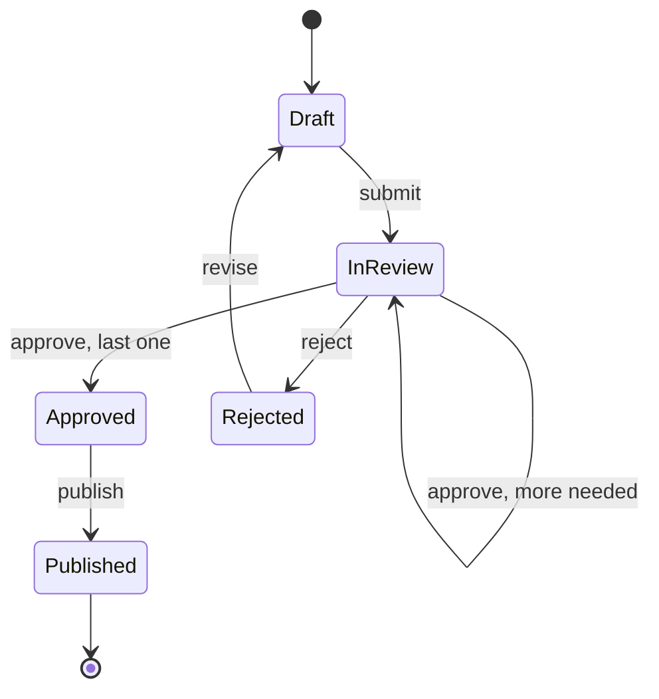

# Task 12 · Document approval with type-state

| Difficulty | Topics | Time box |
|---|---|---|
| 🟡 Medium | Making illegal states unrepresentable · Type-state pattern with sealed interfaces and records · Immutable state transitions · Exhaustive switch with record patterns · Comparing with the enum-status approach of task 08 | 2–3 h |

> **Background reading:** Yaron Minsky, "Effective ML" talk and his phrase "make illegal states unrepresentable" · Scott Wlaschin, *Domain Modeling Made Functional*, ch. 6 ("Integrity and Consistency in the Domain") and ch. 8 · JEP 409 (sealed classes), JEP 440 (record patterns), JEP 441 (pattern matching for switch) · *Effective Java* Item 17 ("Minimize mutability")

---

## The situation

Our internal policy tool holds HR and compliance documents. Authors draft a document, submit it, reviewers approve or reject it, and an approved document is published to everyone it applies to.

An audit found three problems:

* **Published documents without any approval.** A status field said `PUBLISHED`, but nothing checked that an approval existed.
* **Authors approving their own documents.** Nothing stopped the author from being one of the approvers.
* **A confidential document published with one approval.** Confidential documents need two approvals. The rule lived in a `if` in one service class, and a second code path skipped it.

The old model was one `Document` class with a `status` field and three nullable fields: `approvedBy`, `rejectionReason` and `publishedAt`. Any combination of them was possible, so the bugs were possible too.

This time we model **each state as its own type**. A draft is a `Draft`, a document in review is an `InReview`, and so on. The operation `publish` exists only on `Approved`. Calling it on a draft is not a runtime error that a test has to catch. It is a compile error.

## The domain

| Term | Meaning |
|---|---|
| **Document** | A policy text with an id, an author and content. Its state is one of five types. |
| **Content** | Title, body and a classification. Title and body are not blank. |
| **Classification** | `PUBLIC` needs 1 approval, `CONFIDENTIAL` needs 2. |
| **Approval** | A reviewer says the document is fine. A reviewer can approve only once. |
| **Four-eyes principle** | The author never approves or rejects their own document. |
| **Rejection** | A reviewer sends the document back with a reason. The author can revise it into a new draft. |

### The workflow



The only way from `Draft` to `Published` goes through `InReview` and `Approved`. The transitions are methods, and each method exists only on the type where it is legal.

### The sealed hierarchy


`InReview` implements both `Document` and `ReviewOutcome`. `approve` does not return an `InReview` in every case: it returns a `ReviewOutcome`, which is either "still in review" or "approved". That return type is how the caller learns the result of a review step.

## What I want from you

Implement the transitions and the status line. The starter gives you the ids, `Classification`, `Content`, the two sealed interfaces and the five state records. The records' transition methods and compact constructors are skeletons.

1. **Drafts** ([`Draft`](../src/main/java/io/github/chris013/practice/task12/Draft.java))
   * `Draft.create(id, author, content)` returns a draft. Null arguments throw `NullPointerException` that names the parameter.
   * `edit(newContent)` returns a new draft with the new content and the same id and author. The original is not changed.
   * `submit(at)` returns an `InReview` with `submittedAt = at` and no approvals.
2. **Reviews** ([`InReview`](../src/main/java/io/github/chris013/practice/task12/InReview.java))
   * `approvals` is copied with `Set.copyOf`, so it is unmodifiable and independent of the set the caller passed in.
   * The constructor rejects a review whose approvals contain the author (`four-eyes`), and a review that already has `content.classification().requiredApprovals()` approvals or more. Such a review would be an `Approved` document, so it must not exist.
   * `approve(reviewer, at)`: the author as reviewer throws `IllegalArgumentException` (message contains `four-eyes`).
   * `approve` by a reviewer who already approved throws `IllegalArgumentException`.
   * `approve` returns a new `InReview` with the reviewer added while the number of approvals *including this one* is less than `content.classification().requiredApprovals()`; otherwise an `Approved`.
   * When the required number is reached, `approve` returns an `Approved` with `approvedAt = at` and the same approvers.
   * `reject(reviewer, reason, at)` returns a [`Rejected`](../src/main/java/io/github/chris013/practice/task12/Rejected.java). The author as reviewer throws `IllegalArgumentException` (message contains `four-eyes`). A blank reason throws `IllegalArgumentException`.
3. **Approved documents** ([`Approved`](../src/main/java/io/github/chris013/practice/task12/Approved.java))
   * The approvers are copied with `Set.copyOf`.
   * The constructor rejects an author among the approvers (`four-eyes`), and fewer approvers than `content.classification().requiredApprovals()`. A confidential document with one approver cannot be built.
   * `publish(at)` returns a [`Published`](../src/main/java/io/github/chris013/practice/task12/Published.java) with the same approvers and `publishedAt = at`.
4. **Rejected documents** ([`Rejected`](../src/main/java/io/github/chris013/practice/task12/Rejected.java))
   * The constructor enforces the rules that `reject` relies on: the reviewer is not the author (`four-eyes`), and the reason is not blank. A `Rejected` that breaks them cannot exist.
   * `revise(newContent)` returns a `Draft` with the new content and the same id and author. All earlier approvals are gone.
5. **Published documents** ([`Published`](../src/main/java/io/github/chris013/practice/task12/Published.java))
   * The approvers are copied with `Set.copyOf`.
   * The constructor applies the same two rules as `Approved`: no author among the approvers (`four-eyes`), and enough approvers for the classification. Otherwise `IllegalArgumentException`.
   * `Published` has no transition methods. A published document is final.
6. **Status line** ([`StatusLine`](../src/main/java/io/github/chris013/practice/task12/StatusLine.java))
   * `StatusLine.of(document)` returns exactly one of these lines:
     * `Draft`: `Draft: <title>`
     * `InReview`: `In review: <title> (<n> of <required> approvals)`
     * `Approved`: `Approved: <title> by <approvers>`, with the approver ids sorted alphabetically and joined by `, `
     * `Rejected`: `Rejected: <title> by <reviewer>: <reason>`
     * `Published`: `Published: <title> on <yyyy-MM-dd>`, with the date in UTC
   * Use one `switch` over `Document` with record patterns and **no `default`**.

## Constraints & non-goals

* **All records are immutable.** No setters, no mutable collections inside them, and every transition returns a new object.
* **No `Instant.now()` anywhere.** The time of each transition is a parameter, so the workflow is deterministic.
* **No `null`** in any component. Use `Objects.requireNonNull(x, "x")`.
* **No status enum.** The type *is* the state. A status enum next to the types would be a second source of truth (see the flag table at the end).
* No persistence, no database mapping, no withdrawal from review in this task. These are stretch goals.
* No mocking framework. The tests use the real types.

## How I'd approach it

* **Write the state records first, then the transitions.** The compact constructors hold the rules that must always be true: non-null components, the approver sets copied, and the four-eyes and approval-count rules checked. Once they are in place, the transition methods are short.
* **Put each rule where it cannot be skipped.** The four-eyes rule is checked in `approve`, so the caller gets a clear error at the moment of the mistake. Every record can also be built directly with its constructor, so the same rule belongs in the compact constructors of `InReview`, `Approved`, `Published` and `Rejected`. Ask yourself which rules a caller must not be able to skip.
* **The approval that completes the set changes the type.** Count the approvals after adding the reviewer. Below the threshold, return a new `InReview`. At the threshold, return an `Approved`. Do not add a boolean flag to `InReview` for this.
* **How a caller handles `ReviewOutcome`.** The caller of `approve` must deal with both cases, and a `switch` makes the compiler check that:

  ```java
  switch (outcome) {
      case InReview stillOpen -> notifyNextReviewer(stillOpen);
      case Approved approved -> notifyAuthorAndPublish(approved);
  }
  ```

  Because `ReviewOutcome` is sealed, the switch needs no `default`. If you add a third outcome later, every caller fails to compile.
* **Status line: one switch, record patterns, no default.** Use `_` for components you do not need. Keep the switch small: each branch builds one string and does nothing else.
* **Sorting and dates.** Sort the approver ids as strings with `sorted()`. For the publication date, convert the `Instant` to a date in UTC. Do not use the default time zone, because the server's time zone must not change the text.
* **Exception messages.** Name the rule in the message ("four-eyes principle", "already approved"). A message like "invalid argument" makes the audit log useless.

### Why the compiler error is the test

There is no test for "publish on a draft". It does not compile. This is the point of the exercise. Here is what `javac` says for `draft.publish(...)` where `draft` is a `Draft`:

```
error: cannot find symbol
        draft.publish(Instant.parse("2026-03-04T08:00:00Z"));
             ^
  symbol:   method publish(Instant)
  location: variable draft of type Draft
```

The bug that cost us a published document without approval cannot be written in code any more. A test would only catch it after someone wrote the bad line and ran the tests. The compiler catches it while you type.

### Type-state or enum status?

The task 08 approach keeps one class with a status enum and checks each transition at runtime. Here is how the two compare:

| Question | Enum status + runtime checks (task 08) | Type-state (this task) |
|---|---|---|
| Illegal operation | Compiles. Fails at runtime with `IllegalStateException`. | Does not compile. |
| Missing field in a state | Nullable field, checked by hand. | Field exists only on the state that has it. |
| Number of types | One class plus an enum. | One type per state plus a sealed interface. |
| Adding a new state | Add the enum value. Switch expressions without `default` fail to compile, but switch statements and if-guards in methods like `publish()` are not checked. | Add a record. Every exhaustive switch fails to compile until it is handled, and the new state has only the methods you give it. |
| Persistence and ORMs | Easy: one table, one `status` column. | Harder: you map to one flat row and back with a switch (stretch goal 1). |
| Loading from storage | Trivial. Every row has the same type. | You must decide what to do with an unknown status. |
| Caller knows the state statically | Works, but the caller still has to check. | The caller's code only compiles for the states it can handle. |

**When to choose which.** Choose **type-state** when the workflow runs inside one use case, and the code knows the state at each step: "take this draft, submit it, return the review". Choose **enum + guards** when objects are loaded generically from storage (a list page, a search, a batch job), and the code cannot know the state at compile time. In practice a hybrid is common: an enum column in the database, a mapper from the row to the type-state records, and the type-state rules in the domain code.

## Tests

Run: `mvn test -Dtest='**/task12/**'`

* [`DocumentWorkflowTest`](../src/test/java/io/github/chris013/practice/task12/DocumentWorkflowTest.java) covers each state, the approval rules for public and confidential documents, the four-eyes rule, duplicate approvals, rejection, revision, publication, and immutability.
* [`StatusLineTest`](../src/test/java/io/github/chris013/practice/task12/StatusLineTest.java) checks one line per state, plus the sorting of approvers and the UTC date.

<details>
<summary>Show the tests</summary>

<!-- embed: src/test/java/io/github/chris013/practice/task12/DocumentWorkflowTest.java -->
**[`DocumentWorkflowTest.java`](../src/test/java/io/github/chris013/practice/task12/DocumentWorkflowTest.java)**

```java
package io.github.chris013.practice.task12;

import static org.assertj.core.api.Assertions.assertThat;
import static org.assertj.core.api.Assertions.assertThatThrownBy;

import java.time.Instant;
import java.util.HashSet;
import java.util.Set;
import org.junit.jupiter.api.Nested;
import org.junit.jupiter.api.Test;
import org.junit.jupiter.params.ParameterizedTest;
import org.junit.jupiter.params.provider.ValueSource;

class DocumentWorkflowTest {

    private static final DocumentId ID = new DocumentId("POL-042");
    private static final UserId ANNA = new UserId("anna");
    private static final UserId BEN = new UserId("ben");
    private static final UserId CARA = new UserId("cara");
    private static final Content PUBLIC_POLICY =
            new Content("Travel policy", "Book economy class.", Classification.PUBLIC);
    private static final Content CONFIDENTIAL_POLICY =
            new Content("Severance terms", "For HR only.", Classification.CONFIDENTIAL);
    private static final Instant SUBMITTED = Instant.parse("2026-03-02T09:00:00Z");
    private static final Instant REVIEWED = Instant.parse("2026-03-03T10:00:00Z");
    private static final Instant PUBLISHED = Instant.parse("2026-03-04T08:00:00Z");

    private static Draft draft(Content content) {
        return Draft.create(ID, ANNA, content);
    }

    private static InReview submitted(Content content) {
        return draft(content).submit(SUBMITTED);
    }

    private static Approved approvedPublic() {
        return (Approved) submitted(PUBLIC_POLICY).approve(BEN, REVIEWED);
    }

    private static InReview confidentialWithBensApproval() {
        return (InReview) submitted(CONFIDENTIAL_POLICY).approve(BEN, REVIEWED);
    }

    @Nested
    class Drafting {

        @Test
        void create_keeps_the_id_author_and_content() {
            Draft draft = draft(PUBLIC_POLICY);

            assertThat(draft.id()).isEqualTo(ID);
            assertThat(draft.author()).isEqualTo(ANNA);
            assertThat(draft.content()).isEqualTo(PUBLIC_POLICY);
        }

        @Test
        void edit_replaces_the_content_and_keeps_the_id_and_author() {
            Draft edited = draft(PUBLIC_POLICY).edit(CONFIDENTIAL_POLICY);

            assertThat(edited.content()).isEqualTo(CONFIDENTIAL_POLICY);
            assertThat(edited.id()).isEqualTo(ID);
            assertThat(edited.author()).isEqualTo(ANNA);
        }

        @Test
        void rejects_a_missing_author() {
            assertThatThrownBy(() -> Draft.create(ID, null, PUBLIC_POLICY))
                    .isInstanceOf(NullPointerException.class)
                    .hasMessageContaining("author");
        }
    }

    @Nested
    class Content_rules {

        @ParameterizedTest
        @ValueSource(strings = {"", "   "})
        void reject_a_blank_title(String title) {
            assertThatThrownBy(() -> new Content(title, "Some body", Classification.PUBLIC))
                    .isInstanceOf(IllegalArgumentException.class);
        }

        @ParameterizedTest
        @ValueSource(strings = {"", "   "})
        void reject_a_blank_body(String body) {
            assertThatThrownBy(() -> new Content("Title", body, Classification.PUBLIC))
                    .isInstanceOf(IllegalArgumentException.class);
        }
    }

    @Nested
    class Submitting {

        @Test
        void moves_the_draft_to_review_with_no_approvals() {
            InReview review = draft(PUBLIC_POLICY).submit(SUBMITTED);

            assertThat(review.submittedAt()).isEqualTo(SUBMITTED);
            assertThat(review.approvals()).isEmpty();
            assertThat(review.content()).isEqualTo(PUBLIC_POLICY);
        }
    }

    @Nested
    class Approving_a_public_document {

        @Test
        void one_approval_is_enough_and_the_document_becomes_approved() {
            ReviewOutcome outcome = submitted(PUBLIC_POLICY).approve(BEN, REVIEWED);

            assertThat(outcome).isInstanceOf(Approved.class);
            Approved approved = (Approved) outcome;
            assertThat(approved.approvers()).containsExactly(BEN);
            assertThat(approved.approvedAt()).isEqualTo(REVIEWED);
        }
    }

    @Nested
    class Approving_a_confidential_document {

        @Test
        void one_approval_keeps_it_in_review() {
            ReviewOutcome outcome = submitted(CONFIDENTIAL_POLICY).approve(BEN, REVIEWED);

            assertThat(outcome).isInstanceOf(InReview.class);
            assertThat(((InReview) outcome).approvals()).containsExactly(BEN);
        }

        @Test
        void a_second_approval_from_another_reviewer_approves_it() {
            ReviewOutcome outcome = confidentialWithBensApproval().approve(CARA, REVIEWED);

            assertThat(outcome).isInstanceOf(Approved.class);
            assertThat(((Approved) outcome).approvers()).containsExactlyInAnyOrder(BEN, CARA);
        }
    }

    @Nested
    class Four_eyes_principle {

        @Test
        void the_author_cannot_approve_their_own_document() {
            assertThatThrownBy(() -> submitted(PUBLIC_POLICY).approve(ANNA, REVIEWED))
                    .isInstanceOf(IllegalArgumentException.class)
                    .hasMessageContaining("four-eyes");
        }

        @Test
        void the_author_cannot_approve_a_confidential_document_after_another_approval() {
            assertThatThrownBy(() -> confidentialWithBensApproval().approve(ANNA, REVIEWED))
                    .isInstanceOf(IllegalArgumentException.class)
                    .hasMessageContaining("four-eyes");
        }

        @Test
        void the_author_cannot_reject_their_own_document() {
            assertThatThrownBy(() -> submitted(PUBLIC_POLICY).reject(ANNA, "Wrong year", REVIEWED))
                    .isInstanceOf(IllegalArgumentException.class)
                    .hasMessageContaining("four-eyes");
        }
    }

    @Nested
    class Duplicate_approvals {

        @Test
        void the_same_reviewer_cannot_approve_a_confidential_document_twice() {
            assertThatThrownBy(() -> confidentialWithBensApproval().approve(BEN, REVIEWED))
                    .isInstanceOf(IllegalArgumentException.class)
                    .hasMessageContaining("ben");
        }
    }

    @Nested
    class Rejecting {

        @Test
        void records_the_reviewer_the_reason_and_the_time() {
            Rejected rejected = submitted(PUBLIC_POLICY).reject(BEN, "Missing the effective date", REVIEWED);

            assertThat(rejected.reviewer()).isEqualTo(BEN);
            assertThat(rejected.reason()).isEqualTo("Missing the effective date");
            assertThat(rejected.rejectedAt()).isEqualTo(REVIEWED);
            assertThat(rejected.content()).isEqualTo(PUBLIC_POLICY);
        }

        @ParameterizedTest
        @ValueSource(strings = {"", "   "})
        void a_blank_reason_is_rejected(String reason) {
            assertThatThrownBy(() -> submitted(PUBLIC_POLICY).reject(BEN, reason, REVIEWED))
                    .isInstanceOf(IllegalArgumentException.class);
        }
    }

    @Nested
    class Revising {

        @Test
        void returns_a_draft_with_the_new_content_and_the_same_id_and_author() {
            Rejected rejected = submitted(CONFIDENTIAL_POLICY).reject(BEN, "Too vague", REVIEWED);

            Draft revised = rejected.revise(PUBLIC_POLICY);

            assertThat(revised.id()).isEqualTo(ID);
            assertThat(revised.author()).isEqualTo(ANNA);
            assertThat(revised.content()).isEqualTo(PUBLIC_POLICY);
        }

        @Test
        void a_revised_document_starts_its_next_review_with_no_old_approvals() {
            Draft revised = submitted(PUBLIC_POLICY).reject(BEN, "Too vague", REVIEWED).revise(PUBLIC_POLICY);

            assertThat(revised.submit(SUBMITTED).approvals()).isEmpty();
        }
    }

    @Nested
    class Publishing {

        @Test
        void an_approved_document_can_be_published_with_its_approvers() {
            Published published = approvedPublic().publish(PUBLISHED);

            assertThat(published.approvers()).containsExactly(BEN);
            assertThat(published.publishedAt()).isEqualTo(PUBLISHED);
            assertThat(published.content()).isEqualTo(PUBLIC_POLICY);
        }
    }

    @Nested
    class Invariants {

        @Test
        void an_approved_document_needs_at_least_one_approver() {
            assertThatThrownBy(() -> new Approved(ID, ANNA, PUBLIC_POLICY, Set.of(), REVIEWED))
                    .isInstanceOf(IllegalArgumentException.class);
        }

        @Test
        void a_published_document_needs_at_least_one_approver() {
            assertThatThrownBy(() -> new Published(ID, ANNA, PUBLIC_POLICY, Set.of(), PUBLISHED))
                    .isInstanceOf(IllegalArgumentException.class);
        }

        @Test
        void a_review_needs_its_approvals_set() {
            assertThatThrownBy(() -> new InReview(ID, ANNA, PUBLIC_POLICY, SUBMITTED, null))
                    .isInstanceOf(NullPointerException.class)
                    .hasMessageContaining("approvals");
        }

        @Test
        void an_approved_document_cannot_be_approved_by_its_author() {
            assertThatThrownBy(() -> new Approved(ID, ANNA, PUBLIC_POLICY, Set.of(ANNA), REVIEWED))
                    .isInstanceOf(IllegalArgumentException.class)
                    .hasMessageContaining("four-eyes");
        }

        @Test
        void a_published_document_cannot_be_approved_by_its_author() {
            assertThatThrownBy(() -> new Published(ID, ANNA, PUBLIC_POLICY, Set.of(ANNA), PUBLISHED))
                    .isInstanceOf(IllegalArgumentException.class)
                    .hasMessageContaining("four-eyes");
        }

        @Test
        void a_review_cannot_list_its_author_as_an_approver() {
            assertThatThrownBy(() -> new InReview(ID, ANNA, CONFIDENTIAL_POLICY, SUBMITTED, Set.of(ANNA)))
                    .isInstanceOf(IllegalArgumentException.class)
                    .hasMessageContaining("four-eyes");
        }

        @Test
        void a_confidential_approved_document_needs_two_approvers() {
            assertThatThrownBy(() -> new Approved(ID, ANNA, CONFIDENTIAL_POLICY, Set.of(BEN), REVIEWED))
                    .isInstanceOf(IllegalArgumentException.class);
        }

        @Test
        void a_confidential_published_document_needs_two_approvers() {
            assertThatThrownBy(() -> new Published(ID, ANNA, CONFIDENTIAL_POLICY, Set.of(BEN), PUBLISHED))
                    .isInstanceOf(IllegalArgumentException.class);
        }

        @Test
        void a_review_that_already_has_enough_approvals_cannot_be_built() {
            assertThatThrownBy(() -> new InReview(ID, ANNA, PUBLIC_POLICY, SUBMITTED, Set.of(BEN)))
                    .isInstanceOf(IllegalArgumentException.class);
        }

        @Test
        void a_rejection_by_the_author_cannot_be_built_directly() {
            assertThatThrownBy(() -> new Rejected(ID, ANNA, PUBLIC_POLICY, ANNA, "Wrong year", REVIEWED))
                    .isInstanceOf(IllegalArgumentException.class)
                    .hasMessageContaining("four-eyes");
        }

        @Test
        void a_rejection_without_a_reason_cannot_be_built_directly() {
            assertThatThrownBy(() -> new Rejected(ID, ANNA, PUBLIC_POLICY, BEN, " ", REVIEWED))
                    .isInstanceOf(IllegalArgumentException.class);
        }
    }

    @Nested
    class Immutability {

        @Test
        void approving_does_not_change_the_review_it_started_from() {
            InReview review = submitted(CONFIDENTIAL_POLICY);

            review.approve(BEN, REVIEWED);

            assertThat(review.approvals()).isEmpty();
        }

        @Test
        void editing_does_not_change_the_original_draft() {
            Draft draft = draft(PUBLIC_POLICY);

            draft.edit(CONFIDENTIAL_POLICY);

            assertThat(draft.content()).isEqualTo(PUBLIC_POLICY);
        }

        @Test
        void publishing_does_not_change_the_approved_document() {
            Approved approved = approvedPublic();

            approved.publish(PUBLISHED);

            assertThat(approved.approvers()).containsExactly(BEN);
        }

        @Test
        void the_approvers_of_a_review_cannot_be_changed_from_outside() {
            Set<UserId> approvers = new HashSet<>(Set.of(BEN));
            InReview review = new InReview(ID, ANNA, CONFIDENTIAL_POLICY, SUBMITTED, approvers);

            approvers.add(CARA);

            assertThat(review.approvals()).containsExactly(BEN);
        }

        @Test
        void the_approvers_of_an_approved_document_are_unmodifiable() {
            Set<UserId> approvers = approvedPublic().approvers();

            assertThatThrownBy(() -> approvers.add(CARA)).isInstanceOf(UnsupportedOperationException.class);
        }

        @Test
        void the_approvers_of_a_published_document_are_unmodifiable() {
            Set<UserId> approvers = approvedPublic().publish(PUBLISHED).approvers();

            assertThatThrownBy(() -> approvers.remove(BEN)).isInstanceOf(UnsupportedOperationException.class);
        }

        @Test
        void the_approvals_of_a_review_are_unmodifiable() {
            Set<UserId> approvals = confidentialWithBensApproval().approvals();

            assertThatThrownBy(() -> approvals.add(CARA)).isInstanceOf(UnsupportedOperationException.class);
        }
    }
}
```
<!-- /embed -->

<!-- embed: src/test/java/io/github/chris013/practice/task12/StatusLineTest.java -->
**[`StatusLineTest.java`](../src/test/java/io/github/chris013/practice/task12/StatusLineTest.java)**

```java
package io.github.chris013.practice.task12;

import static org.assertj.core.api.Assertions.assertThat;
import static org.junit.jupiter.params.provider.Arguments.arguments;

import java.time.Instant;
import java.util.Set;
import java.util.stream.Stream;
import org.junit.jupiter.api.Nested;
import org.junit.jupiter.api.Test;
import org.junit.jupiter.params.ParameterizedTest;
import org.junit.jupiter.params.provider.Arguments;
import org.junit.jupiter.params.provider.MethodSource;

class StatusLineTest {

    private static final DocumentId ID = new DocumentId("POL-042");
    private static final UserId ANNA = new UserId("anna");
    private static final UserId BEN = new UserId("ben");
    private static final UserId CARA = new UserId("cara");
    private static final Content PUBLIC_POLICY =
            new Content("Travel policy", "Book economy class.", Classification.PUBLIC);
    private static final Content CONFIDENTIAL_POLICY =
            new Content("Severance terms", "For HR only.", Classification.CONFIDENTIAL);
    private static final Instant SUBMITTED = Instant.parse("2026-03-02T09:00:00Z");
    private static final Instant REVIEWED = Instant.parse("2026-03-03T10:00:00Z");

    static Stream<Arguments> one_line_per_state() {
        Draft draft = Draft.create(ID, ANNA, PUBLIC_POLICY);
        InReview emptyReview = draft.submit(SUBMITTED);
        InReview confidentialWithOneApproval = (InReview) draft.edit(CONFIDENTIAL_POLICY)
                .submit(SUBMITTED)
                .approve(BEN, REVIEWED);
        Approved approved = (Approved) emptyReview.approve(BEN, REVIEWED);
        Rejected rejected = emptyReview.reject(BEN, "Wrong year", REVIEWED);
        Published published = approved.publish(Instant.parse("2026-03-04T23:30:00Z"));
        return Stream.of(
                arguments(draft, "Draft: Travel policy"),
                arguments(emptyReview, "In review: Travel policy (0 of 1 approvals)"),
                arguments(confidentialWithOneApproval, "In review: Severance terms (1 of 2 approvals)"),
                arguments(approved, "Approved: Travel policy by ben"),
                arguments(rejected, "Rejected: Travel policy by ben: Wrong year"),
                arguments(published, "Published: Travel policy on 2026-03-04"));
    }

    @ParameterizedTest(name = "{1}")
    @MethodSource
    void one_line_per_state(Document document, String expected) {
        assertThat(StatusLine.of(document)).isEqualTo(expected);
    }

    @Nested
    class Details {

        @Test
        void approvers_are_listed_in_alphabetical_order_whatever_the_insertion_order() {
            Approved approved = new Approved(ID, ANNA, CONFIDENTIAL_POLICY, Set.of(CARA, BEN), REVIEWED);

            assertThat(StatusLine.of(approved)).isEqualTo("Approved: Severance terms by ben, cara");
        }

        @Test
        void the_publication_date_is_the_utc_date_not_the_local_one() {
            // 23:30 UTC is already the next day in Berlin, but the line must show the UTC date.
            Published published = new Published(ID, ANNA, PUBLIC_POLICY, Set.of(BEN),
                    Instant.parse("2026-03-04T23:30:00Z"));

            assertThat(StatusLine.of(published)).isEqualTo("Published: Travel policy on 2026-03-04");
        }

        @Test
        void a_review_counts_the_approvals_it_has_against_the_classification() {
            InReview review = new InReview(ID, ANNA, CONFIDENTIAL_POLICY, SUBMITTED, Set.of(BEN));

            assertThat(StatusLine.of(review)).isEqualTo("In review: Severance terms (1 of 2 approvals)");
        }
    }
}
```
<!-- /embed -->

</details>

## Definition of done

- [ ] All tests green. The whole task runs in well under a second.
- [ ] No state has a method that is illegal in that state. `Published` has no transitions.
- [ ] No `Instant.now()`, and no `null` in any record component.
- [ ] Every set in a record is copied with `Set.copyOf` and cannot be changed from outside.
- [ ] Four-eyes and blank-reason rules hold for every way of creating a `Rejected`.
- [ ] `StatusLine` uses one exhaustive switch without `default`.
- [ ] You can explain in one sentence why `publish` on a `Draft` is a compile error and not a runtime check.

## Stretch goals

1. **Persistence.** Map each state to one flat row (`DocumentRow` with a `status` column and nullable columns for the state-specific fields). Write a mapper with a `switch` from row to document and back. How do you load a row whose status is unknown? Throw, or quarantine the row? Argue for one.
2. **Withdraw from review.** The author should be able to take a document out of review. Which types get a `withdraw` method, and which must not? Where does the answer come from in the workflow diagram?
3. **A history of transitions.** Add a `History` that records each transition as an event (`Submitted`, `Approved`, `Rejected`, ...). Should `History` be part of the document record, or a separate value next to it? What happens to the four-eyes rule if the history is replayed?
4. **A generic transition.** Write `record Transition<From, To>` or a small functional interface, and see whether it makes the code clearer or only more abstract. Hint: Java's type erasure and the sealed hierarchy make a fully generic workflow engine hard to write well.

---

## Reference solution

<details>
<summary>Spoiler: open only after you have made a serious attempt</summary>

### Key decisions

**1. Each state is a record that implements `Document`, and the transitions live on the type they start from.** `Draft` has `submit` and `edit`. `Approved` has `publish`. `Published` has nothing. An operation that is illegal in a state is not on that state's type. The alternative, one `Document` class with a `status` enum and a method that throws `IllegalStateException` for the wrong status, is what the audit found broken: the check is a runtime rule that someone can forget.

**2. The rules that must always hold go into the compact constructors.** `Approved` and `Published` reject an author among the approvers and fewer approvers than the classification requires, so a confidential document with one approval cannot be built. `InReview` rejects an author among its approvals and a set that already has enough approvals. `Rejected` rejects a reviewer who is the author and a blank reason. The rules for approvers live in one package-private helper, `Approvals`, so `Approved` and `Published` cannot drift apart. Because the transition methods call these constructors, a rule in the constructor also holds for code that builds the record directly. The alternative, checking inside each transition method only, leaves a hole whenever a second code path creates the record.

**3. `approve` returns `ReviewOutcome`, and the type changes at the threshold.** `InReview.approve` counts the set after adding the reviewer. Below the required number it returns a new `InReview`. At the threshold it returns an `Approved`. The alternative, a boolean `isApproved` flag on `InReview`, would let an `InReview` with enough approvals exist, which is the illegal state we are trying to remove.

**4. Immutable sets, copied at the boundary.** `Set.copyOf` in each compact constructor means the caller cannot change the approvals through the reference it still holds. The alternative, storing the set as passed, lets a caller change the approvals of a review it does not own. (`approve` builds a new `HashSet`, adds the reviewer and passes it on. The constructor copies it again, which is cheap and keeps the rule in one place.)

**5. One exhaustive switch in `StatusLine`, no `default`.** With `default`, a new state would compile and print a wrong line. Without it, the compiler points at `StatusLine` the moment a state is added. The alternative, `instanceof` checks in a chain, gives no such help.

### Code

<!-- embed: solutions/src/main/java/io/github/chris013/practice/task12/Approvals.java -->
**[`Approvals.java`](../solutions/src/main/java/io/github/chris013/practice/task12/Approvals.java)**

```java
package io.github.chris013.practice.task12;

import java.util.Set;

/**
 * The approval rules that {@link Approved} and {@link Published} share. Package-private: the rules are enforced in
 * the constructors, and callers never need this class.
 */
final class Approvals {

    private Approvals() {}

    /**
     * Checks the approvers of a document that has been approved or published. The author cannot be one of them,
     * and there must be as many approvers as the classification requires.
     *
     * @throws IllegalArgumentException if the author is an approver or there are too few approvers
     */
    static void checkApprovers(UserId author, Content content, Set<UserId> approvers) {
        if (approvers.contains(author)) {
            throw new IllegalArgumentException("The author cannot approve their own document (four-eyes principle)");
        }
        int required = content.classification().requiredApprovals();
        if (approvers.size() < required) {
            throw new IllegalArgumentException(
                    "A %s document needs %d approvals".formatted(content.classification(), required));
        }
    }
}
```
<!-- /embed -->

<!-- embed: solutions/src/main/java/io/github/chris013/practice/task12/Approved.java -->
**[`Approved.java`](../solutions/src/main/java/io/github/chris013/practice/task12/Approved.java)**

```java
package io.github.chris013.practice.task12;

import java.time.Instant;
import java.util.Objects;
import java.util.Set;

/**
 * A document with all its required approvals. The constructor enforces the approval rules, so an approved document
 * cannot have its author among the approvers, and it cannot have fewer approvers than its classification requires.
 */
public record Approved(DocumentId id, UserId author, Content content, Set<UserId> approvers, Instant approvedAt)
        implements Document, ReviewOutcome {

    public Approved {
        Objects.requireNonNull(id, "id");
        Objects.requireNonNull(author, "author");
        Objects.requireNonNull(content, "content");
        Objects.requireNonNull(approvers, "approvers");
        Objects.requireNonNull(approvedAt, "approvedAt");
        approvers = Set.copyOf(approvers);
        Approvals.checkApprovers(author, content, approvers);
    }

    public Published publish(Instant at) {
        Objects.requireNonNull(at, "at");
        return new Published(id, author, content, approvers, at);
    }
}
```
<!-- /embed -->

<!-- embed: solutions/src/main/java/io/github/chris013/practice/task12/InReview.java -->
**[`InReview.java`](../solutions/src/main/java/io/github/chris013/practice/task12/InReview.java)**

```java
package io.github.chris013.practice.task12;

import java.time.Instant;
import java.util.HashSet;
import java.util.Objects;
import java.util.Set;

/**
 * A document waiting for approvals. The approvals are copied and unmodifiable, so a caller that keeps a reference
 * to the set it passed in cannot change this review afterwards.
 */
public record InReview(DocumentId id, UserId author, Content content, Instant submittedAt, Set<UserId> approvals)
        implements Document, ReviewOutcome {

    public InReview {
        Objects.requireNonNull(id, "id");
        Objects.requireNonNull(author, "author");
        Objects.requireNonNull(content, "content");
        Objects.requireNonNull(submittedAt, "submittedAt");
        Objects.requireNonNull(approvals, "approvals");
        approvals = Set.copyOf(approvals);
        if (approvals.contains(author)) {
            throw new IllegalArgumentException("The author cannot approve their own document (four-eyes principle)");
        }
        if (approvals.size() >= content.classification().requiredApprovals()) {
            throw new IllegalArgumentException("A review with all required approvals is an Approved document");
        }
    }

    /**
     * Adds one approval. Returns {@link InReview} while more approvals are needed, and {@link Approved} once
     * the classification's required number is reached. The approval that completes the set is the moment the
     * document changes state, so the type changes too.
     *
     * @throws IllegalArgumentException if the reviewer is the author (four-eyes principle) or has already approved
     */
    public ReviewOutcome approve(UserId reviewer, Instant at) {
        Objects.requireNonNull(reviewer, "reviewer");
        Objects.requireNonNull(at, "at");
        if (reviewer.equals(author)) {
            throw new IllegalArgumentException("The author cannot approve their own document (four-eyes principle)");
        }
        if (approvals.contains(reviewer)) {
            throw new IllegalArgumentException(reviewer.value() + " has already approved this document");
        }
        Set<UserId> updated = new HashSet<>(approvals);
        updated.add(reviewer);
        if (updated.size() < content.classification().requiredApprovals()) {
            return new InReview(id, author, content, submittedAt, updated);
        }
        return new Approved(id, author, content, updated, at);
    }

    /**
     * Rejects the document. The four-eyes rule and the reason check live in {@link Rejected}, so they hold for
     * every way of creating a rejection.
     *
     * @throws IllegalArgumentException if the reviewer is the author or the reason is blank
     */
    public Rejected reject(UserId reviewer, String reason, Instant at) {
        return new Rejected(id, author, content, reviewer, reason, at);
    }
}
```
<!-- /embed -->

<!-- embed: solutions/src/main/java/io/github/chris013/practice/task12/Rejected.java -->
**[`Rejected.java`](../solutions/src/main/java/io/github/chris013/practice/task12/Rejected.java)**

```java
package io.github.chris013.practice.task12;

import java.time.Instant;
import java.util.Objects;

/**
 * A review that ended with a rejection. The four-eyes rule and the reason check are in the constructor, so a
 * rejection that breaks them cannot exist.
 */
public record Rejected(
        DocumentId id, UserId author, Content content, UserId reviewer, String reason, Instant rejectedAt)
        implements Document {

    public Rejected {
        Objects.requireNonNull(id, "id");
        Objects.requireNonNull(author, "author");
        Objects.requireNonNull(content, "content");
        Objects.requireNonNull(reviewer, "reviewer");
        Objects.requireNonNull(reason, "reason");
        Objects.requireNonNull(rejectedAt, "rejectedAt");
        if (reviewer.equals(author)) {
            throw new IllegalArgumentException("The author cannot reject their own document (four-eyes principle)");
        }
        if (reason.isBlank()) {
            throw new IllegalArgumentException("A rejection needs a reason");
        }
    }

    /** Returns a new draft with the revised content. All earlier approvals are gone. */
    public Draft revise(Content newContent) {
        return new Draft(id, author, newContent);
    }
}
```
<!-- /embed -->

<!-- embed: solutions/src/main/java/io/github/chris013/practice/task12/StatusLine.java -->
**[`StatusLine.java`](../solutions/src/main/java/io/github/chris013/practice/task12/StatusLine.java)**

```java
package io.github.chris013.practice.task12;

import java.time.Instant;
import java.time.ZoneOffset;
import java.util.Objects;
import java.util.Set;
import java.util.stream.Collectors;

/** A one-line summary of a document, for the list page of the policy tool. */
public final class StatusLine {

    private StatusLine() {}

    /**
     * Returns the summary line. One exhaustive switch with record patterns and no {@code default}: when a new
     * state is added, this method stops compiling until it is handled.
     */
    public static String of(Document document) {
        Objects.requireNonNull(document, "document");
        return switch (document) {
            case Draft(_, _, Content content) -> "Draft: " + content.title();
            case InReview(_, _, Content content, _, Set<UserId> approvals) -> "In review: %s (%d of %d approvals)"
                    .formatted(content.title(), approvals.size(), content.classification().requiredApprovals());
            case Approved(_, _, Content content, Set<UserId> approvers, _) ->
                    "Approved: %s by %s".formatted(content.title(), namesSorted(approvers));
            case Rejected(_, _, Content content, UserId reviewer, String reason, _) ->
                    "Rejected: %s by %s: %s".formatted(content.title(), reviewer.value(), reason);
            case Published(_, _, Content content, _, Instant publishedAt) ->
                    "Published: %s on %s".formatted(content.title(), publishedAt.atZone(ZoneOffset.UTC).toLocalDate());
        };
    }

    private static String namesSorted(Set<UserId> users) {
        return users.stream().map(UserId::value).sorted().collect(Collectors.joining(", "));
    }
}
```
<!-- /embed -->

### What I typically flag in first attempts

| Finding | Why it matters |
|---|---|
| One record with nullable `approvedBy`, `rejectionReason`, `publishedAt` | The illegal combinations are representable again. This is the old model with a new name. |
| `Set` fields stored as passed in | The caller keeps a reference and changes the approvals of a document it does not own. |
| A `status` enum next to the types | Two sources of truth. They will disagree after the first bug. |
| `instanceof` chains in `StatusLine` instead of one switch | The compiler cannot check that every state is handled. |
| `default` branch in the switch | Kills exhaustiveness checking: a new state compiles and prints the wrong text. |
| `Instant.now()` inside `approve` or `publish` | Tests become time-dependent, and the audit trail depends on when the code runs, not on when the approval happened. |

</details>
