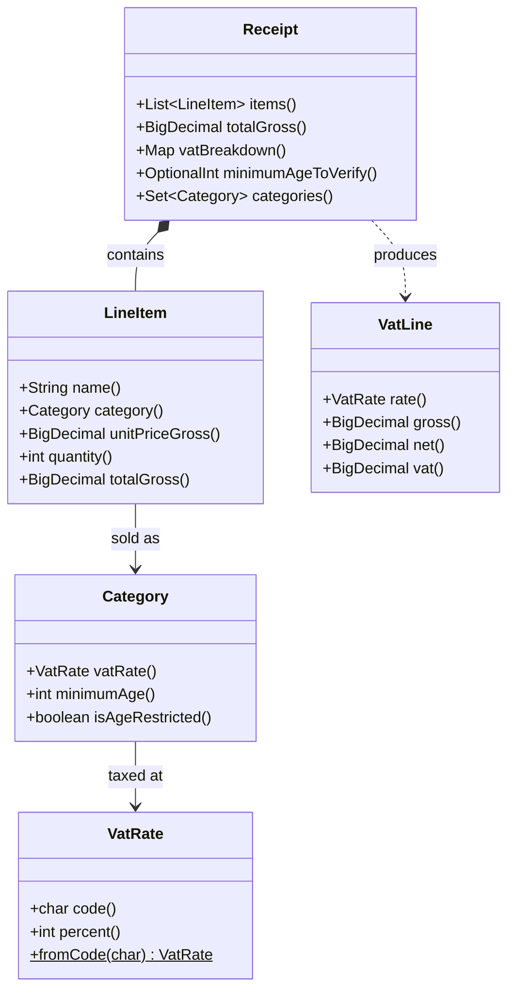

# Task 13 · A supermarket receipt with smart enums

| Difficulty | Topics | Time box |
|---|---|---|
| 🟢 Easy | Enums with fields and behaviour · EnumMap and EnumSet · Never use `ordinal()` · Grouping with streams into an EnumMap · Rounding money per group, not per line | 1–2 h |

> **Background reading:** *Effective Java* Items 34 ("Use enums instead of int constants"), 35 ("Use instance fields instead of ordinals"), 36 ("Use `EnumSet` instead of bit fields"), 37 ("Use `EnumMap` instead of ordinal indexing") · *Modern Java in Action* ch. 6 (collecting data with streams: grouping, and the `groupingBy` overload that takes a map factory)

---

## The situation

Our till software runs in a German supermarket chain. Two rules shape the receipt.

**First, shelf prices are gross.** The price on the shelf already includes VAT. The till must split it back out, because German law requires the receipt to show a VAT breakdown per rate: the net amount, the VAT and the gross amount for the 19 % rate and for the 7 % rate. The printed receipt labels the rates with the letters **A** (19 %) and **B** (7 %).

**Second, some products need an ID check.** Beer and wine need the cashier to check that the customer is 16 or older. Spirits and tobacco need 18. If the basket contains both, the cashier must check for 18.

Today, the categories and the VAT rates are `public static final int` constants, and a `switch` over them is written in six places. When the VAT on restaurant food changed, someone updated five of the six switches. Nothing failed at compile time, and the receipt printed the wrong VAT until someone found it.

That is the problem this task fixes. The category and the VAT rate are **one concept**, so they belong in one place: an enum that carries its own data. Then the compiler and the code structure make it hard to forget a place. The rest of the code asks the category what its rate is, and it never has to `switch` on the category.

## The domain

| Term | Meaning |
|---|---|
| **Gross price** | The shelf price. It includes VAT. This is what the customer pays. |
| **Net price** | The gross price without VAT. |
| **VAT rate** | Standard (19 %, code `A`) or reduced (7 %, code `B`). |
| **Category** | What a product is for the till: bakery, beer and wine, and so on. A category fixes the VAT rate and the minimum age. |
| **Minimum age** | The age the cashier must verify before selling. `0` means no check. |
| **Rate group** | All line items that have the same VAT rate. The VAT is computed per group, not per line. |

Categories and their rules (this table is the contract, and the tests check it):

| Category | VAT rate | Minimum age |
|---|---|---|
| `FRUIT_AND_VEGETABLES`, `BAKERY`, `DAIRY`, `BOOKS` | REDUCED (B, 7 %) | none |
| `SOFT_DRINKS`, `HOUSEHOLD` | STANDARD (A, 19 %) | none |
| `BEER_AND_WINE` | STANDARD (A, 19 %) | 16 |
| `SPIRITS`, `TOBACCO` | STANDARD (A, 19 %) | 18 |

### The class structure



Read the arrows as "knows about". The receipt knows its items. An item knows its category. A category knows its VAT rate. Nothing points back up, and nothing needs a `switch` to walk down this chain.

### What the printed receipt looks like

This is the output we want for a small basket. The VAT table at the bottom is the breakdown from the `Receipt` class.

```
SUPERMARKET 0412                       2026-11-09 14:32
------------------------------------------------------
Bananas 1 kg                                    1.99 B
Milk 1 l, 2 x 1.09                              2.18 B
Beer 0.5 l, 6 x 0.89                            5.34 A
Dish soap                                       1.79 A
------------------------------------------------------
SUM                                            11.30 EUR
AGE CHECK                                       16+

RATE   VAT     NET       VAT AMOUNT     GROSS
A      19 %    5.99      1.14           7.13
B       7 %    3.90      0.27           4.17
```

Notice that the `B` rows add up to 4.17 (1.99 + 2.18), and the `A` rows to 7.13 (5.34 + 1.79). The VAT is worked out once for each rate (each row of the VAT table), not for each product line.

---

## What I want from you

Implement the enums, the record and the receipt class so that the tests pass.

1. **[`VatRate`](../src/main/java/io/github/chris013/practice/task13/VatRate.java)**
   * `STANDARD` has code `'A'` and 19 percent. `REDUCED` has code `'B'` and 7 percent.
   * `code()` returns the printed letter. `percent()` returns the rate as an `int`.
   * `fromCode(char)` finds the rate for a code. Codes are case-sensitive, as printed.
   * An unknown code throws `IllegalArgumentException`. The message names the code, for example `Unknown VAT code 'C'`.

2. **[`Category`](../src/main/java/io/github/chris013/practice/task13/Category.java)**
   * `vatRate()` and `minimumAge()` return the values in the table above. The constants are given; do not change them.
   * `isAgeRestricted()` is `true` exactly when the minimum age is greater than `0`.

3. **[`LineItem`](../src/main/java/io/github/chris013/practice/task13/LineItem.java)** (a record)
   * `name` must not be `null` (`NullPointerException`) and must not be blank (`IllegalArgumentException`).
   * `category` must not be `null`.
   * `unitPriceGross` must not be `null`, must not be negative, and must have **scale at most 2**. A price such as `1.005` is rejected with `IllegalArgumentException`. Do not round it: a till must never change a price it was given. A price of `0.00` is valid.
   * Store the price with scale 2, so `1.1` becomes `1.10`.
   * `quantity` must be at least 1.
   * `totalGross()` is the unit price times the quantity, with scale 2. For example, `1.09` x 2 is `2.18`.

4. **[`Receipt`](../src/main/java/io/github/chris013/practice/task13/Receipt.java)**
   * `Receipt.of(List)` copies the list. A `null` list or a `null` item throws `NullPointerException`. An empty list is allowed.
   * `items()` returns the items in scan order. The returned list cannot be changed.
   * `totalGross()` is the sum of all line totals, with scale 2. An empty receipt has total `0.00`.

5. **`vatBreakdown()`** returns a `Map<VatRate, VatLine>`:
   * It has one row per rate that occurs on the receipt, and no row for a rate that does not occur.
   * The rows are in enum order: `STANDARD` (A) before `REDUCED` (B), whatever the scan order. Use an `EnumMap`.
   * The map cannot be changed.
   * For each rate, first add up the gross of all its items. Then compute the VAT **once**: `vat = gross x percent / (100 + percent)`, rounded `HALF_UP` to 2 decimals. Then `net = gross - vat`.
   * Worked examples (these are in the tests):
     * A soft drink at 10.00 gross: `10.00 x 19 / 119 = 1.5966`, so VAT `1.60` and net `8.40`.
     * Three soft drinks at 0.10 each: the rate group is `0.30`, and `0.30 x 19 / 119 = 0.0479`, so VAT `0.05` and net `0.25`. Rounding each line first would give `0.02` three times, which is `0.06`. That is wrong for the tax office, so do not do it.

6. **`minimumAgeToVerify()`** returns the highest minimum age of the items, as an `OptionalInt`. It is empty when no item has a minimum age above `0`. For beer and tobacco together it is `18`.

7. **`categories()`** returns the set of categories on the receipt, each once, in enum order. The set cannot be changed.

## Constraints & non-goals

* **No `ordinal()` anywhere in your code.** The ordinal is the position in the source file. Reordering the constants would silently change your results. Use the fields.
* **No `switch` on `Category` or `VatRate`** in `Receipt` or in new code. If you feel you need one, the rule belongs on the constant. Adding a category must not require touching any switch.
* **No `double` or `float`** for money. Use `BigDecimal`.
* **No rounding per line.** Round once per rate group.
* **No date-dependent rates** in this task. That is stretch goal 1.
* **No printing and no persistence.** The receipt is an in-memory value.

## How I'd approach it

### Why not int constants and ordinal()?

The four Effective Java items below are the reason for the design. Each one is a small "before" and "after". Read the "before" and ask what goes wrong when someone changes the code next year.

**Item 34: use enums instead of int constants.** An `int` accepts any value, and the compiler cannot tell a VAT rate from a count.

```java
// Before: any int is allowed, and nothing says what the numbers mean
public static final int STANDARD = 0;
public static final int REDUCED = 1;
int percent = category == BOOKS ? 7 : 19;

// After: a closed type, and the data sits on the constant
VatRate.REDUCED.percent();   // 7
```

**Item 35: use instance fields instead of ordinals.** `ordinal()` is the position of the constant in the source. It is not a value you own. If someone adds a constant in the middle, every array index and every number you stored moves.

```java
// Before: the array index depends on the declaration order
String[] labels = {"Standard", "Reduced"};
String label = labels[rate.ordinal()];

// After: the data is a field of the constant
VatRate.REDUCED.code();   // 'B'
```

**Item 36: use `EnumSet` instead of bit fields.** Bit flags are unreadable and easy to combine wrongly. An `EnumSet` is type-safe, prints nicely and is just as fast.

```java
// Before: a bit per category, and the arithmetic is the documentation
static final int BEER = 1 << 0;
static final int TOBACCO = 1 << 1;
int restricted = BEER | TOBACCO;

// After
EnumSet<Category> categories = EnumSet.of(Category.BEER_AND_WINE, Category.TOBACCO);
```

**Item 37: use `EnumMap` instead of ordinal indexing.** Indexing an array by `ordinal()` works until someone reorders the enum, and it is hard to read.

```java
// Before: the array slot is the ordinal
BigDecimal[] gross = new BigDecimal[VatRate.values().length];
gross[rate.ordinal()] = gross[rate.ordinal()].add(amount);

// After: the map knows the key, and iterates in declaration order
Map<VatRate, BigDecimal> gross = new EnumMap<>(VatRate.class);
gross.merge(rate, amount, BigDecimal::add);
```

### The order I'd work in

1. Start with `VatRate` and `Category`. They are pure data with a few accessors, and their tests tell you when you are done.
2. Then `LineItem`. Do the validation in the compact constructor, and write `totalGross()` last.
3. Then `Receipt`: `of`, `items`, `totalGross`, `minimumAgeToVerify`, `categories`. Finish with `vatBreakdown`, which is the hardest part.

### Things that will bite you

* **Group first, then compute the VAT.** The three-argument `Collectors.groupingBy` takes a map factory as its second argument. `EnumMap` needs the key class, so the factory is `() -> new EnumMap<>(VatRate.class)`, not `EnumMap::new`. Use a `Collectors.reducing` as the downstream collector. Then turn each group into a `VatLine` in a separate step.
* **Pick the starting value of a sum carefully.** `BigDecimal.ZERO` has scale 0. An empty receipt would then print `0` instead of `0.00`, and an `equals` comparison would fail.
* **`BigDecimal.equals` depends on scale**, and `compareTo` does not. Money in this task always has scale 2, so `equals` is a fair test. Keep it that way.
* **`divide` needs a scale and a rounding mode.** Without them, a non-terminating result like `1/119` throws `ArithmeticException`.

## Tests

Run: `mvn test -Dtest='**/task13/**'`

Four test classes cover the contract:

* [`VatRateTest`](../src/test/java/io/github/chris013/practice/task13/VatRateTest.java): the codes, the percentages and `fromCode`.
* [`CategoryTest`](../src/test/java/io/github/chris013/practice/task13/CategoryTest.java): every category against the table, and the age-restricted flag.
* [`LineItemTest`](../src/test/java/io/github/chris013/practice/task13/LineItemTest.java): the validation rules, the scale and the line total.
* [`ReceiptTest`](../src/test/java/io/github/chris013/practice/task13/ReceiptTest.java): totals, the VAT breakdown with both rates, the rounding example, the enum order, the age check, the categories and the defensive copy.

<details>
<summary>Show the tests</summary>

<!-- embed: src/test/java/io/github/chris013/practice/task13/VatRateTest.java -->
**[`VatRateTest.java`](../src/test/java/io/github/chris013/practice/task13/VatRateTest.java)**

```java
package io.github.chris013.practice.task13;

import static org.assertj.core.api.Assertions.assertThat;
import static org.assertj.core.api.Assertions.assertThatThrownBy;

import org.junit.jupiter.api.Nested;
import org.junit.jupiter.api.Test;
import org.junit.jupiter.params.ParameterizedTest;
import org.junit.jupiter.params.provider.CsvSource;

class VatRateTest {

    @Nested
    class Values {

        @Test
        void the_standard_rate_is_code_A_at_19_percent() {
            assertThat(VatRate.STANDARD.code()).isEqualTo('A');
            assertThat(VatRate.STANDARD.percent()).isEqualTo(19);
        }

        @Test
        void the_reduced_rate_is_code_B_at_7_percent() {
            assertThat(VatRate.REDUCED.code()).isEqualTo('B');
            assertThat(VatRate.REDUCED.percent()).isEqualTo(7);
        }
    }

    @Nested
    class FromCode {

        @ParameterizedTest
        @CsvSource({"A, STANDARD", "B, REDUCED"})
        void finds_the_rate_for_a_printed_code(char code, VatRate expected) {
            assertThat(VatRate.fromCode(code)).isSameAs(expected);
        }

        @Test
        void round_trips_every_rate_through_its_code() {
            for (VatRate rate : VatRate.values()) {
                assertThat(VatRate.fromCode(rate.code())).isSameAs(rate);
            }
        }

        @Test
        void rejects_an_unknown_code_and_names_it() {
            assertThatThrownBy(() -> VatRate.fromCode('C'))
                    .isInstanceOf(IllegalArgumentException.class)
                    .hasMessageContaining("'C'");
        }

        @Test
        void codes_are_case_sensitive_as_printed() {
            assertThatThrownBy(() -> VatRate.fromCode('a')).isInstanceOf(IllegalArgumentException.class);
        }
    }
}
```
<!-- /embed -->

<!-- embed: src/test/java/io/github/chris013/practice/task13/CategoryTest.java -->
**[`CategoryTest.java`](../src/test/java/io/github/chris013/practice/task13/CategoryTest.java)**

```java
package io.github.chris013.practice.task13;

import static org.assertj.core.api.Assertions.assertThat;

import org.junit.jupiter.api.Nested;
import org.junit.jupiter.params.ParameterizedTest;
import org.junit.jupiter.params.provider.CsvSource;

class CategoryTest {

    @Nested
    class VatAndAge {

        @ParameterizedTest
        @CsvSource({
            "FRUIT_AND_VEGETABLES, REDUCED, 0, false",
            "BAKERY, REDUCED, 0, false",
            "DAIRY, REDUCED, 0, false",
            "BOOKS, REDUCED, 0, false",
            "SOFT_DRINKS, STANDARD, 0, false",
            "BEER_AND_WINE, STANDARD, 16, true",
            "SPIRITS, STANDARD, 18, true",
            "TOBACCO, STANDARD, 18, true",
            "HOUSEHOLD, STANDARD, 0, false"
        })
        void has_the_vat_rate_minimum_age_and_restriction_from_the_table(
                Category category, VatRate rate, int minimumAge, boolean ageRestricted) {
            assertThat(category.vatRate()).isSameAs(rate);
            assertThat(category.minimumAge()).isEqualTo(minimumAge);
            assertThat(category.isAgeRestricted()).isEqualTo(ageRestricted);
        }
    }
}
```
<!-- /embed -->

<!-- embed: src/test/java/io/github/chris013/practice/task13/LineItemTest.java -->
**[`LineItemTest.java`](../src/test/java/io/github/chris013/practice/task13/LineItemTest.java)**

```java
package io.github.chris013.practice.task13;

import static org.assertj.core.api.Assertions.assertThat;
import static org.assertj.core.api.Assertions.assertThatThrownBy;

import java.math.BigDecimal;
import org.junit.jupiter.api.Nested;
import org.junit.jupiter.api.Test;

class LineItemTest {

    private static LineItem item(String price, int quantity) {
        return new LineItem("Milk", Category.DAIRY, new BigDecimal(price), quantity);
    }

    @Nested
    class Price {

        @Test
        void normalizes_the_price_to_two_decimal_places() {
            assertThat(item("1.1", 1).unitPriceGross()).isEqualTo(new BigDecimal("1.10"));
            assertThat(item("3", 1).unitPriceGross()).isEqualTo(new BigDecimal("3.00"));
        }

        @Test
        void accepts_a_price_of_zero() {
            assertThat(item("0.00", 1).unitPriceGross()).isEqualTo(new BigDecimal("0.00"));
        }

        @Test
        void rejects_a_negative_price() {
            assertThatThrownBy(() -> item("-0.01", 1)).isInstanceOf(IllegalArgumentException.class);
        }

        @Test
        void rejects_more_than_two_decimal_places_instead_of_rounding() {
            assertThatThrownBy(() -> item("1.005", 1)).isInstanceOf(IllegalArgumentException.class);
        }

        @Test
        void rejects_a_missing_price() {
            assertThatThrownBy(() -> new LineItem("Milk", Category.DAIRY, null, 1))
                    .isInstanceOf(NullPointerException.class)
                    .hasMessageContaining("unitPriceGross");
        }
    }

    @Nested
    class Quantity {

        @Test
        void accepts_a_quantity_of_one() {
            assertThat(item("1.09", 1).quantity()).isEqualTo(1);
        }

        @Test
        void rejects_a_quantity_of_zero() {
            assertThatThrownBy(() -> item("1.09", 0)).isInstanceOf(IllegalArgumentException.class);
        }

        @Test
        void rejects_a_negative_quantity() {
            assertThatThrownBy(() -> item("1.09", -2)).isInstanceOf(IllegalArgumentException.class);
        }
    }

    @Nested
    class Name {

        @Test
        void rejects_a_blank_name() {
            assertThatThrownBy(() -> new LineItem("  ", Category.DAIRY, new BigDecimal("1.09"), 1))
                    .isInstanceOf(IllegalArgumentException.class);
        }

        @Test
        void rejects_a_missing_name() {
            assertThatThrownBy(() -> new LineItem(null, Category.DAIRY, new BigDecimal("1.09"), 1))
                    .isInstanceOf(NullPointerException.class)
                    .hasMessageContaining("name");
        }

        @Test
        void rejects_a_missing_category() {
            assertThatThrownBy(() -> new LineItem("Milk", null, new BigDecimal("1.09"), 1))
                    .isInstanceOf(NullPointerException.class)
                    .hasMessageContaining("category");
        }
    }

    @Nested
    class Total {

        @Test
        void is_the_unit_price_times_the_quantity_with_scale_two() {
            // 1.09 x 2 = 2.18
            assertThat(item("1.09", 2).totalGross()).isEqualTo(new BigDecimal("2.18"));
        }
    }
}
```
<!-- /embed -->

<!-- embed: src/test/java/io/github/chris013/practice/task13/ReceiptTest.java -->
**[`ReceiptTest.java`](../src/test/java/io/github/chris013/practice/task13/ReceiptTest.java)**

```java
package io.github.chris013.practice.task13;

import static org.assertj.core.api.Assertions.assertThat;
import static org.assertj.core.api.Assertions.assertThatThrownBy;

import java.math.BigDecimal;
import java.util.ArrayList;
import java.util.Arrays;
import java.util.List;
import java.util.Map;
import java.util.OptionalInt;
import org.junit.jupiter.api.Nested;
import org.junit.jupiter.api.Test;

class ReceiptTest {

    private static LineItem item(String name, Category category, String price, int quantity) {
        return new LineItem(name, category, new BigDecimal(price), quantity);
    }

    private static BigDecimal amount(String value) {
        return new BigDecimal(value);
    }

    /** The receipt from the task text: 1.99 + 2 x 1.09 (reduced) and 6 x 0.89 + 1.79 (standard). */
    private static Receipt sampleReceipt() {
        return Receipt.of(List.of(
                item("Bananas", Category.FRUIT_AND_VEGETABLES, "1.99", 1),
                item("Milk", Category.DAIRY, "1.09", 2),
                item("Beer", Category.BEER_AND_WINE, "0.89", 6),
                item("Dish soap", Category.HOUSEHOLD, "1.79", 1)));
    }

    @Nested
    class Totals {

        @Test
        void adds_up_the_line_totals_with_scale_two() {
            assertThat(sampleReceipt().totalGross()).isEqualTo(amount("11.30"));
        }

        @Test
        void an_empty_receipt_has_zero_totals_and_nothing_to_show() {
            Receipt empty = Receipt.of(List.of());

            assertThat(empty.totalGross()).isEqualTo(amount("0.00"));
            assertThat(empty.vatBreakdown()).isEmpty();
            assertThat(empty.minimumAgeToVerify()).isEqualTo(OptionalInt.empty());
            assertThat(empty.categories()).isEmpty();
        }
    }

    @Nested
    class VatBreakdown {

        @Test
        void shows_one_row_per_rate_with_gross_net_and_vat() {
            Map<VatRate, VatLine> breakdown = sampleReceipt().vatBreakdown();

            // Reduced: 4.17 gross, 4.17 x 7 / 107 = 0.2728 -> 0.27 VAT
            assertThat(breakdown.get(VatRate.REDUCED))
                    .isEqualTo(new VatLine(VatRate.REDUCED, amount("4.17"), amount("3.90"), amount("0.27")));
            // Standard: 7.13 gross, 7.13 x 19 / 119 = 1.1384 -> 1.14 VAT
            assertThat(breakdown.get(VatRate.STANDARD))
                    .isEqualTo(new VatLine(VatRate.STANDARD, amount("7.13"), amount("5.99"), amount("1.14")));
        }

        @Test
        void the_rows_add_up_to_the_receipt_total() {
            BigDecimal sum = sampleReceipt().vatBreakdown().values().stream()
                    .map(VatLine::gross)
                    .reduce(BigDecimal.ZERO, BigDecimal::add);

            assertThat(sum).isEqualByComparingTo(sampleReceipt().totalGross());
        }

        @Test
        void computes_the_vat_out_of_a_gross_price() {
            // 10.00 x 19 / 119 = 1.5966 -> 1.60, so the net is 8.40
            Receipt receipt = Receipt.of(List.of(item("Cola", Category.SOFT_DRINKS, "10.00", 1)));

            assertThat(receipt.vatBreakdown().get(VatRate.STANDARD))
                    .isEqualTo(new VatLine(VatRate.STANDARD, amount("10.00"), amount("8.40"), amount("1.60")));
        }

        @Test
        void rounds_the_vat_once_per_rate_not_once_per_line() {
            // Three lines of 0.10 at 19 percent.
            // Per line: 0.10 x 19 / 119 = 0.0160 -> 0.02 each, 0.06 in total. That is wrong.
            // Per rate: 0.30 x 19 / 119 = 0.0479 -> 0.05. That is the rule.
            Receipt receipt = Receipt.of(List.of(
                    item("Sparkling water", Category.SOFT_DRINKS, "0.10", 1),
                    item("Lemonade", Category.SOFT_DRINKS, "0.10", 1),
                    item("Tonic", Category.SOFT_DRINKS, "0.10", 1)));

            assertThat(receipt.vatBreakdown().get(VatRate.STANDARD))
                    .isEqualTo(new VatLine(VatRate.STANDARD, amount("0.30"), amount("0.25"), amount("0.05")));
        }

        @Test
        void has_only_the_rates_that_occur_on_the_receipt() {
            Receipt milkOnly = Receipt.of(List.of(item("Milk", Category.DAIRY, "1.09", 2)));

            // 2.18 x 7 / 107 = 0.1426 -> 0.14, net 2.04
            assertThat(milkOnly.vatBreakdown()).containsOnlyKeys(VatRate.REDUCED);
            assertThat(milkOnly.vatBreakdown().get(VatRate.REDUCED))
                    .isEqualTo(new VatLine(VatRate.REDUCED, amount("2.18"), amount("2.04"), amount("0.14")));
        }

        @Test
        void lists_the_rates_in_enum_order_whatever_the_scan_order() {
            // Reduced item scanned first, but STANDARD (A) comes first in the breakdown.
            Receipt receipt = Receipt.of(List.of(
                    item("Bread", Category.BAKERY, "2.00", 1),
                    item("Beer", Category.BEER_AND_WINE, "1.00", 1)));

            assertThat(receipt.vatBreakdown().keySet()).containsExactly(VatRate.STANDARD, VatRate.REDUCED);
        }

        @Test
        void the_breakdown_cannot_be_changed() {
            Map<VatRate, VatLine> breakdown = sampleReceipt().vatBreakdown();

            assertThatThrownBy(breakdown::clear).isInstanceOf(UnsupportedOperationException.class);
        }
    }

    @Nested
    class AgeCheck {

        @Test
        void needs_no_check_when_nothing_is_restricted() {
            Receipt receipt = Receipt.of(List.of(
                    item("Bread", Category.BAKERY, "2.00", 1),
                    item("Cola", Category.SOFT_DRINKS, "1.20", 2)));

            assertThat(receipt.minimumAgeToVerify()).isEqualTo(OptionalInt.empty());
        }

        @Test
        void needs_sixteen_for_beer_and_wine() {
            Receipt receipt = Receipt.of(List.of(
                    item("Milk", Category.DAIRY, "1.09", 1),
                    item("Beer", Category.BEER_AND_WINE, "0.89", 6)));

            assertThat(receipt.minimumAgeToVerify()).isEqualTo(OptionalInt.of(16));
        }

        @Test
        void needs_eighteen_when_beer_and_tobacco_are_mixed() {
            Receipt receipt = Receipt.of(List.of(
                    item("Beer", Category.BEER_AND_WINE, "0.89", 6),
                    item("Tobacco", Category.TOBACCO, "7.50", 1)));

            assertThat(receipt.minimumAgeToVerify()).isEqualTo(OptionalInt.of(18));
        }
    }

    @Nested
    class Categories {

        @Test
        void lists_each_category_once_in_enum_order() {
            Receipt receipt = Receipt.of(List.of(
                    item("Beer", Category.BEER_AND_WINE, "0.89", 1),
                    item("Yoghurt", Category.DAIRY, "0.49", 1),
                    item("Cheese", Category.DAIRY, "2.99", 1)));

            assertThat(receipt.categories()).containsExactly(Category.DAIRY, Category.BEER_AND_WINE);
        }

        @Test
        void the_categories_cannot_be_changed() {
            assertThat(sampleReceipt().categories()).hasSize(4);
            assertThatThrownBy(() -> sampleReceipt().categories().clear())
                    .isInstanceOf(UnsupportedOperationException.class);
        }
    }

    @Nested
    class DefensiveCopy {

        @Test
        void a_later_change_to_the_callers_list_does_not_change_the_receipt() {
            List<LineItem> scanned = new ArrayList<>();
            scanned.add(item("Milk", Category.DAIRY, "1.09", 1));
            Receipt receipt = Receipt.of(scanned);

            scanned.add(item("Beer", Category.BEER_AND_WINE, "0.89", 1));

            assertThat(receipt.items()).hasSize(1);
            assertThat(receipt.totalGross()).isEqualTo(amount("1.09"));
        }

        @Test
        void the_items_cannot_be_changed_through_the_receipt() {
            Receipt receipt = sampleReceipt();

            assertThat(receipt.items()).hasSize(4);
            assertThatThrownBy(() -> receipt.items().clear()).isInstanceOf(UnsupportedOperationException.class);
        }

        @Test
        void rejects_a_missing_list_and_a_missing_item() {
            assertThatThrownBy(() -> Receipt.of(null)).isInstanceOf(NullPointerException.class);
            assertThatThrownBy(() -> Receipt.of(Arrays.asList(item("Milk", Category.DAIRY, "1.09", 1), null)))
                    .isInstanceOf(NullPointerException.class);
        }
    }
}
```
<!-- /embed -->

</details>

## Definition of done

- [ ] All tests green, and the whole task runs in well under a second.
- [ ] No `ordinal()` and no `switch` on `Category` or `VatRate` anywhere in your code.
- [ ] VAT is computed once per rate group, with `HALF_UP` to 2 decimals.
- [ ] `vatBreakdown()` is an `EnumMap` in enum order and cannot be changed from outside.
- [ ] Money is `BigDecimal` with scale 2. No `double`.
- [ ] Your PR description says what happens when someone adds a new category, and which files change.

## Stretch goals

1. **A VAT rate that depends on the date.** In Germany, from 1 July to 31 December 2020, the standard rate was 16 % and the reduced rate 5 %. A restaurant meal sold in September 2020 gets the reduced rate of 5 %, and the same meal sold in January 2021 gets 7 %. How does the enum design change? Consider a `VatSchedule` that maps a date to a rate, and what is still a constant. Write down your answer before you write code.
2. **Print the receipt.** Write a `ReceiptPrinter` that produces the text from the sample above. Decide where the formatting belongs. It should not be in `Receipt`. Test it with an exact expected string, and think about alignment of the decimal points.
3. **Use `EnumSet` for the rules.** Add a method that returns all categories that are *not* age-restricted, and one that returns all categories from `DAIRY` to `SPIRITS`. Try `EnumSet.complementOf` and `EnumSet.range`. Which one is clearer to read than a hand-written list?
4. **Store the code, not the ordinal.** Imagine the receipt is saved to a database. Write the code that stores the VAT rate, and the code that reads it back. What breaks if you store `ordinal()`, and what changes if the constants are reordered later?

---

## Reference solution

<details>
<summary>Spoiler: open only after you have made a serious attempt</summary>

### Key decisions

**1. Every rule about a category lives on the constant.** `Category` holds its `VatRate` and its `minimumAge` as fields, set in the constructor. The rest of the code calls `category.vatRate()`. Adding a category is one line. The rejected alternative was a `switch` in a helper method, which is how the original bug happened.

**2. VAT is computed once per rate group, from the group's gross sum.** The gross of each rate is summed first, then one division produces the VAT. The rejected alternative is rounding each line's VAT and adding the results. That gives `0.06` in the three-line example, instead of `0.05`. The tax office expects the per-rate figure, so the code must produce it.

**3. The VAT formula is `gross x p / (100 + p)`.** The price already includes VAT, so the VAT part is the fraction `p / (100 + p)` of the gross. Multiplying by `p / 100` would compute VAT on a net price. The division uses scale 2 and `HALF_UP`, as the contract in this task says. The rounding rule is part of the spec, not a detail to pick freely.

**4. `LineItem` rejects a price with more than two decimals instead of rounding it.** A till that quietly rounds `1.005` to `1.01` has changed the customer's price. Rejecting it makes the bug visible at the point where the data enters. Storing the price with scale 2 means every amount on the receipt prints the same way.

**5. The breakdown is an `EnumMap`, built by `groupingBy` with a map factory.** A `HashMap` would print the rows in an arbitrary order, and the order would change between JVM runs. `groupingBy` with `() -> new EnumMap<>(VatRate.class)` keeps the enum order and needs no extra loop. The result is wrapped in `Collections.unmodifiableMap`, because the receipt is a value and callers must not change it.

**6. `minimumAgeToVerify` returns `OptionalInt`, not `0`.** Both work for this API. `0` is simpler for a caller that only compares ages: `if (age >= receipt.minimumAgeToVerify().orElse(0))`. `OptionalInt.empty()` says in the type that there is no age check, so a caller cannot read `0` as a real age. I went with `OptionalInt` because the type makes "no age check" visible at the call site, and a reader cannot mistake it for an age of zero. The filter `age > 0` before `max()` is what makes an unrestricted receipt empty.

**7. `categories()` returns a `Set`, not an `EnumSet`.** The implementation is an `EnumSet`, which is fast and ordered. The public type is `Set`, so callers do not depend on it. `EnumSet` has no unmodifiable form, so the set is wrapped in `Collections.unmodifiableSet`.

**8. `Receipt.of` copies the list with `List.copyOf`.** The copy means a later change to the caller's list does not change the receipt. `List.copyOf` also rejects `null` items, so the receipt never holds a `null` line.

### Code

<!-- embed: solutions/src/main/java/io/github/chris013/practice/task13/VatRate.java -->
**[`VatRate.java`](../solutions/src/main/java/io/github/chris013/practice/task13/VatRate.java)**

```java
package io.github.chris013.practice.task13;

/**
 * The two German VAT rates a supermarket receipt can show. The codes {@code A} and {@code B} are what the
 * printed receipt says next to each line.
 *
 * <p>Task 13: read {@code tasks/13-receipt-enums.md} first.
 */
public enum VatRate {

    STANDARD('A', 19),
    REDUCED('B', 7);

    private final char code;
    private final int percent;

    VatRate(char code, int percent) {
        this.code = code;
        this.percent = percent;
    }

    /** The one-letter code printed on the receipt. */
    public char code() {
        return code;
    }

    /** The rate in percent, for example {@code 19} for {@link #STANDARD}. */
    public int percent() {
        return percent;
    }

    /**
     * Finds the rate for a printed code. Codes are case-sensitive, exactly as printed.
     *
     * <p>A loop over {@link #values()} is plenty for two constants. A static {@code Map} would be the next
     * step if the list ever grew into the hundreds.
     *
     * @throws IllegalArgumentException if no rate has this code
     */
    public static VatRate fromCode(char code) {
        for (VatRate rate : values()) {
            if (rate.code == code) {
                return rate;
            }
        }
        throw new IllegalArgumentException("Unknown VAT code '" + code + "'");
    }
}
```
<!-- /embed -->

<!-- embed: solutions/src/main/java/io/github/chris013/practice/task13/Category.java -->
**[`Category.java`](../solutions/src/main/java/io/github/chris013/practice/task13/Category.java)**

```java
package io.github.chris013.practice.task13;

/**
 * What a product is, for the till. Each category knows its own VAT rate and minimum age, so the rest of the code
 * never needs a {@code switch} on the category. Adding a category is one line here and nothing else.
 */
public enum Category {

    FRUIT_AND_VEGETABLES(VatRate.REDUCED, 0),
    BAKERY(VatRate.REDUCED, 0),
    DAIRY(VatRate.REDUCED, 0),
    BOOKS(VatRate.REDUCED, 0),
    SOFT_DRINKS(VatRate.STANDARD, 0),
    BEER_AND_WINE(VatRate.STANDARD, 16),
    SPIRITS(VatRate.STANDARD, 18),
    TOBACCO(VatRate.STANDARD, 18),
    HOUSEHOLD(VatRate.STANDARD, 0);

    private final VatRate vatRate;
    private final int minimumAge;

    Category(VatRate vatRate, int minimumAge) {
        this.vatRate = vatRate;
        this.minimumAge = minimumAge;
    }

    /** The VAT rate that applies to products in this category. */
    public VatRate vatRate() {
        return vatRate;
    }

    /** The age the cashier must verify, or {@code 0} when no check is needed. */
    public int minimumAge() {
        return minimumAge;
    }

    /** {@code true} when the till must ask for ID before selling this category. */
    public boolean isAgeRestricted() {
        return minimumAge > 0;
    }
}
```
<!-- /embed -->

<!-- embed: solutions/src/main/java/io/github/chris013/practice/task13/LineItem.java -->
**[`LineItem.java`](../solutions/src/main/java/io/github/chris013/practice/task13/LineItem.java)**

```java
package io.github.chris013.practice.task13;

import java.math.BigDecimal;
import java.util.Objects;

/**
 * One scanned product, with the number of items bought.
 *
 * <p>Prices are gross: they include VAT, as the shelf price does. The price is stored with scale 2, so
 * {@code 1.1} becomes {@code 1.10} and always prints as money.
 */
public record LineItem(String name, Category category, BigDecimal unitPriceGross, int quantity) {

    public LineItem {
        Objects.requireNonNull(name, "name");
        Objects.requireNonNull(category, "category");
        Objects.requireNonNull(unitPriceGross, "unitPriceGross");
        if (name.isBlank()) {
            throw new IllegalArgumentException("name must not be blank");
        }
        if (unitPriceGross.signum() < 0) {
            throw new IllegalArgumentException("price must not be negative, was " + unitPriceGross);
        }
        // Reject instead of rounding: a till must never silently change a price it was given.
        if (unitPriceGross.scale() > 2) {
            throw new IllegalArgumentException("price has more than two decimal places: " + unitPriceGross);
        }
        if (quantity < 1) {
            throw new IllegalArgumentException("quantity must be at least 1, was " + quantity);
        }
        unitPriceGross = unitPriceGross.setScale(2);
    }

    /** The gross price of all items on this line: unit price times quantity. */
    public BigDecimal totalGross() {
        return unitPriceGross.multiply(BigDecimal.valueOf(quantity));
    }
}
```
<!-- /embed -->

<!-- embed: solutions/src/main/java/io/github/chris013/practice/task13/Receipt.java -->
**[`Receipt.java`](../solutions/src/main/java/io/github/chris013/practice/task13/Receipt.java)**

```java
package io.github.chris013.practice.task13;

import java.math.BigDecimal;
import java.math.RoundingMode;
import java.util.Collections;
import java.util.EnumMap;
import java.util.EnumSet;
import java.util.List;
import java.util.Map;
import java.util.Objects;
import java.util.OptionalInt;
import java.util.Set;
import java.util.stream.Collectors;

/**
 * The items of one shopping trip, with the totals the receipt has to print.
 *
 * <p>Task 13: read {@code tasks/13-receipt-enums.md} first.
 */
public final class Receipt {

    private static final BigDecimal ZERO = new BigDecimal("0.00");

    private final List<LineItem> items;

    private Receipt(List<LineItem> items) {
        this.items = items;
    }

    /**
     * Creates a receipt. The list is copied, so later changes to the caller's list do not affect the receipt.
     * An empty receipt is allowed: its totals are zero and it has no breakdown rows.
     */
    public static Receipt of(List<LineItem> items) {
        Objects.requireNonNull(items, "items");
        return new Receipt(List.copyOf(items));
    }

    /** The items, in the order they were scanned. The returned list cannot be changed. */
    public List<LineItem> items() {
        return items;
    }

    /** The sum of all line totals, with scale 2. The start value has scale 2 so an empty receipt prints 0.00. */
    public BigDecimal totalGross() {
        return items.stream().map(LineItem::totalGross).reduce(ZERO, BigDecimal::add);
    }

    /**
     * One {@link VatLine} per rate that occurs on the receipt, in enum order ({@code A} before {@code B}).
     *
     * <p>VAT is computed per rate on the sum of the gross amounts of that rate, rounded once. This is the method
     * the tax office expects on the receipt. Rounding each line on its own adds up to a different amount.
     */
    public Map<VatRate, VatLine> vatBreakdown() {
        Map<VatRate, BigDecimal> grossByRate = items.stream()
                .collect(Collectors.groupingBy(
                        item -> item.category().vatRate(),
                        () -> new EnumMap<>(VatRate.class),
                        Collectors.reducing(ZERO, LineItem::totalGross, BigDecimal::add)));

        Map<VatRate, VatLine> breakdown = new EnumMap<>(VatRate.class);
        for (Map.Entry<VatRate, BigDecimal> entry : grossByRate.entrySet()) {
            breakdown.put(entry.getKey(), vatLine(entry.getKey(), entry.getValue()));
        }
        return Collections.unmodifiableMap(breakdown);
    }

    /**
     * Splits a gross amount into net and VAT. The VAT part of a gross price is {@code gross x p / (100 + p)}, not
     * {@code gross x p / 100}, because the VAT is included in the price.
     */
    private static VatLine vatLine(VatRate rate, BigDecimal gross) {
        int percent = rate.percent();
        BigDecimal vat = gross.multiply(BigDecimal.valueOf(percent))
                .divide(BigDecimal.valueOf(100L + percent), 2, RoundingMode.HALF_UP);
        return new VatLine(rate, gross, gross.subtract(vat), vat);
    }

    /**
     * The highest minimum age of any item, or empty when no item is age-restricted. Items with age {@code 0}
     * are filtered out first, so an unrestricted receipt gives empty, not {@code 0}.
     */
    public OptionalInt minimumAgeToVerify() {
        return items.stream()
                .mapToInt(item -> item.category().minimumAge())
                .filter(age -> age > 0)
                .max();
    }

    /** The categories on the receipt, in enum order. The returned set cannot be changed. */
    public Set<Category> categories() {
        EnumSet<Category> categories = EnumSet.noneOf(Category.class);
        for (LineItem item : items) {
            categories.add(item.category());
        }
        return Collections.unmodifiableSet(categories);
    }
}
```
<!-- /embed -->

### What I typically flag in first attempts

| Finding | Why it matters |
|---|---|
| `ordinal()` used as an array index, or stored in a file or database | Reordering the constants silently changes every stored value and every array slot. Use `code()` or the name. |
| A `switch` over `Category` in `Receipt` to find the VAT rate | The rate is data on the constant. A new category or a changed rate then needs edits in several places, which is exactly how the restaurant-food bug happened. |
| Rounding each line's VAT and adding the results | Gives `0.06` instead of `0.05` in the three-line example. The tax office expects the per-rate figure. |
| `double` or `float` for prices and VAT | Binary floating point cannot represent `0.10` exactly, so sums drift. Use `BigDecimal`. |
| `HashMap` instead of `EnumMap` | The iteration order is arbitrary, so the receipt can print rate B before rate A. `EnumMap` follows the declaration order and is faster. |
| `EnumMap::new` as the map factory | It does not compile: `EnumMap` needs the key class. Write `() -> new EnumMap<>(VatRate.class)`. |
| `Collectors.groupingBy` without a map factory | It returns a `HashMap`, so the order problem comes back without any warning. |
| Returning `0` for "no age check" without saying so | `0` and `OptionalInt.empty()` both work here. The bug is leaving the meaning unclear, so a caller treats `0` as a real age. |
| `BigDecimal.ZERO` as the start value of the sum | It has scale 0, so an empty receipt prints `0`, not `0.00`. |

</details>
