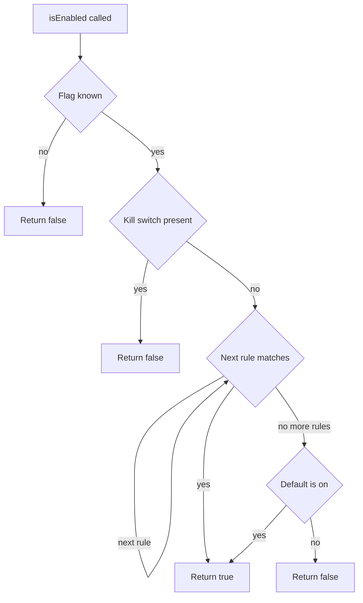
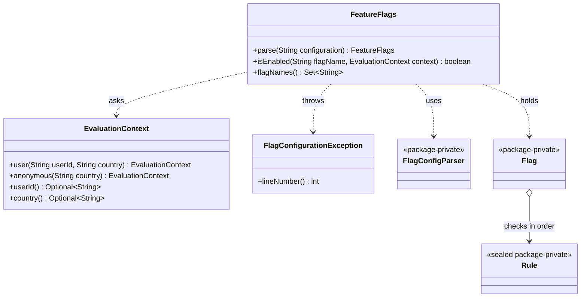
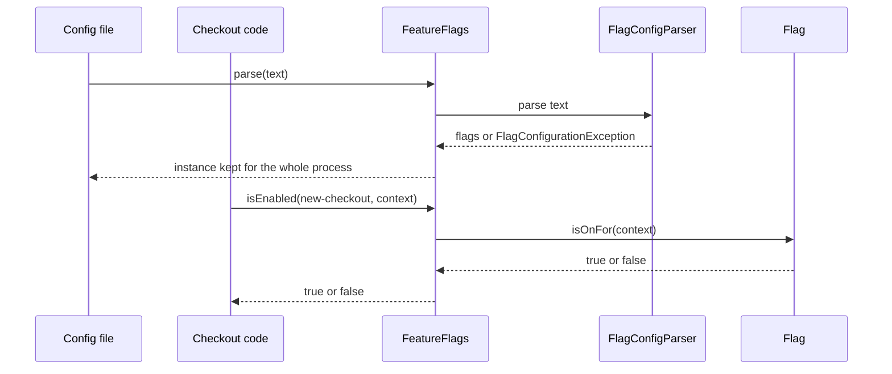

# Task 14 · A feature flag evaluator as a deep module

| Difficulty | Topics | Time box |
|---|---|---|
| 🔴 Hard | APOSD deep modules and information hiding · Define errors out of existence · Pull complexity downwards · A small line-based parser with good error messages · Deterministic percentage rollouts by hashing · Sealed rule types behind a tiny public API | 3–4 h |

> **Background reading:** John Ousterhout, *A Philosophy of Software Design* (2nd ed.): ch. 4 "Modules Should Be Deep", ch. 5 "Information Hiding (and Leakage)", ch. 8 "Pull Complexity Downwards", ch. 10 "Define Errors Out Of Existence" · Martin Fowler and Pete Hodgson, "Feature Toggles (aka Feature Flags)", martinfowler.com, 2017 · *Effective Java* Item 15 "Minimize mutability" and Item 23 "Prefer class hierarchies to tagged classes" · JEP 409 "Sealed Classes" · JEP 395 "Records"

---

## The situation

The webshop wants to ship a new checkout in four steps: first to staff, then to customers in Germany and Austria, then to 25 percent of all users, and always with a kill switch that turns the feature off for everyone in one edit.

A previous attempt got this working, but it exposed 14 public classes: `RuleFactory`, `RuleVisitor`, `FlagRepositoryManager`, and so on. Every caller of the feature had to understand how rules are built, how they are visited, and how a percentage is computed. Nobody wanted to know any of that. Callers want to ask one question:

> Is this flag on for this user?

That is the design problem. The module must be **deep**: a very small interface in front of a lot of hidden work (parsing, rule evaluation, hashing, error reporting). Ousterhout's measure is simple. The value of a module is the functionality it hides, and the cost is the complexity of its interface. The previous attempt had a lot of interface for little hidden work. We want the opposite.

## The domain

| Term | Meaning |
|---|---|
| **Flag** | A named switch, for example `new-checkout`. Its name is lowercase words joined by hyphens. |
| **Configuration** | Plain text that lists all flags, their rules and their defaults. It is read once and then used for every request. |
| **Rule** | One condition that turns a flag on: a list of users, a list of countries, or a percentage of users. |
| **Default** | What the flag does when no rule matches: `on` or `off`. Absent means `off`. |
| **Kill switch** | The word `off` on its own line in a flag. It turns the flag off for everyone, whatever the other lines say. |
| **Bucket** | A number from 0 to 99 that is fixed for one flag and one user. A user is on at 25 percent when their bucket is below 25. |
| **Evaluation context** | Who is asking: a user id, a country, or both, or an anonymous visitor with a country. |

### How the module answers one question

The order matters. The kill switch is checked before any rule, so a rule can never turn on a flag that was switched off. Rules are checked top to bottom. Only when none of them matches does the default apply.

Because every rule can only turn a flag on, the order of the rules never changes the answer. It only decides which line is responsible (useful for stretch goal 3) and lets evaluation stop early. The order that does matter is kill switch first, default last.

### Shallow versus deep

The previous attempt had a shape like this one. Each box is a public class that a caller could in principle touch:

```mermaid
classDiagram
    class RuleFactory {
        +create(String line) Rule
    }
    class RuleVisitor {
        +visitUser(UserRule rule) boolean
        +visitPercent(PercentRule rule) boolean
    }
    class FlagRepositoryManager {
        +load(String text) void
        +reload() void
    }
    class FlagDefinition
    class FlagParser
    class ConfigLineReader
    class UserRule
    class CountryRule
    class PercentRule
    class PercentageHasher
    class RuleEvaluator
    class FlagRegistry
    class EvaluationContext
    class EvaluationResult
```

The new design has three public types. Everything else is package-private, and a caller cannot see it:

Count the public names in each design. Before: 14 classes, every one of them something a caller might need to understand. After: 3 types and 8 public methods in total. The second design does not do less. It does the same work, but the work is hidden.

### What a caller sees

The caller never sees `FlagConfigParser`, `Flag` or any rule. The parse step happens once at start-up or on reload. The check happens on every request, so it must be cheap and must not throw.

## What I want from you

Implement the module in the package `io.github.chris013.practice.task14`. Only three types are public. Everything else is yours to design.

1. **[`FeatureFlags`](../src/main/java/io/github/chris013/practice/task14/FeatureFlags.java)**
   * `static FeatureFlags parse(String configuration)` reads the whole text. It throws `FlagConfigurationException` when the text is invalid. `null` throws `NullPointerException`.
   * `boolean isEnabled(String flagName, EvaluationContext context)` answers the question. Both arguments must not be `null`.
   * `Set<String> flagNames()` returns the names of all flags in the configuration.
   * The instance is immutable.
2. **[`EvaluationContext`](../src/main/java/io/github/chris013/practice/task14/EvaluationContext.java)** is a `final` class, not a record.
   * `static EvaluationContext user(String userId, String country)`: the user id must not be `null` (`NullPointerException`) and must not be blank (`IllegalArgumentException`). The country may be `null` when it is unknown.
   * `static EvaluationContext anonymous(String country)`: the country may be `null`.
   * `Optional<String> userId()` is empty for an anonymous visitor.
   * `Optional<String> country()` is empty when the country is unknown.
3. **[`FlagConfigurationException`](../src/main/java/io/github/chris013/practice/task14/FlagConfigurationException.java)** extends `RuntimeException`.
   * `int lineNumber()` returns the 1-based line where the problem was found.
   * The message starts with `line <n>: ` and then says what is wrong, for example `line 3: percent must be between 0 and 100 but was 120`.
4. **The file format.**
   * `#` starts a comment. A comment is a line whose first non-blank character is `#`. Blank lines are ignored.
   * `flag <name>` starts a flag and is **not** indented. The name matches `[a-z0-9]+(-[a-z0-9]+)*`. A duplicate name is an error.
   * Every other line that belongs to a flag is **indented** by at least one space or tab.
   * A non-indented line that is neither `flag ...`, a comment nor blank is an error.
   * An indented line before the first flag is an error.
5. **The rules, all inside one flag.**
   * `users <id>, <id>, ...` is on when the context has one of these user ids. Matching is exact and case-sensitive. An anonymous visitor never matches.
   * `countries <CC>, ...` takes two uppercase letters per country, otherwise it is an error. It is on when the context's country is in the list. Anonymous visitors can match by country.
   * `percent <n>` takes a whole number from 0 to 100. The user is on when their **bucket** is below `n`. The bucket is `Math.floorMod((flagName + ":" + userId).hashCode(), 100)`. Anonymous visitors never match.
   * `default on` or `default off`: what applies when no rule matched. At most one `default` line per flag. Without it the default is off.
   * `off` alone on a line is the **kill switch**. The flag is off for everyone, wherever the line appears in the block. `off` takes no value.
   * An empty list (`users`, `countries`) and an empty entry (`users alice,,bob`) are errors.
6. **Evaluation order.** A flag is evaluated like this: if the kill switch is present, the answer is `false`. Otherwise the rules are tried top to bottom, and the first one that matches makes the answer `true`. If none matches, the default applies. Because every rule can only turn a flag on, the order of the rules never changes the answer. It only decides which line is responsible (useful for stretch goal 3) and lets evaluation stop early. The order that does matter is kill switch first, default last.
7. **Unknown flags.** `isEnabled` with a flag name that is not in the configuration returns `false`. It never throws.
8. **Errors.** Each of these is a `FlagConfigurationException` with the right line number and a message that names the problem:
   * an unknown keyword, for example `line 7: unknown keyword 'percentage'`;
   * a rule before any flag;
   * an invalid or duplicate flag name, or a `flag` line without a name;
   * a percentage that is not a whole number, or is outside 0 to 100;
   * a country code that is not two uppercase letters;
   * a `default` value other than `on` or `off`, or a second `default` line for the same flag;
   * an empty list or an empty list entry;
   * `off` with a value.

   Parsing stops at the first error. The line number is the line where the error was detected.

## Constraints & non-goals

* **Only three public types.** No public `Rule`, no public parser "for testing", no public factory for rules. Tests use the public API only, and that is a rule, not a suggestion.
* **No regular expression for the whole grammar.** A regular expression for each line type is fine. One regex that matches a whole configuration is not, because nobody can read it or give a good error message from it.
* **No `Random`.** A user who is on at 25 percent must stay on. A random number changes on every call, so users would flip between variants on every page load.
* **No reading files, no reloading, no clocks.** `parse` takes a `String`. Where the text comes from is the caller's problem, and the module should not know.
* **No mutable state after `parse`.** The instance is shared by all request threads. It must never change after it is built.
* **No third-party libraries** in the main code. Plain Java 25.

## How I'd approach it

* **Write the public API first, as a caller would use it.** Write a short example for each use: a parse at start-up, a check in a controller, a test. Only then write the internals. If an internal type is needed by the API, you have a leak.
* **Split each line by its first word.** `line.strip().split("\\s+", 2)` gives you the keyword and the rest. Then a `switch` on the keyword says what the line means, and the error for an unknown keyword is one line. Compare that with one regex that tries to match every line type at once.
* **Keep the line number in one place.** Every error goes through one helper that knows the current line. If you pass the line number as a parameter to twenty methods, you will forget one.
* **Decide what a blank line and a comment are before you write the loop.** Is `  # note` inside a flag a comment or an error? The spec says a comment is a line whose first non-blank character is `#`. Follow it, and test it.
* **Hashing: think about the sign.** `hashCode()` can be negative, and `%` keeps the sign of the left operand. `Math.floorMod` does not. Also think about why we hash the flag name too: with only the user id, every rollout would pick the same users first. Two flags at 25 percent would be the same 25 percent of people.
* **Stability across JVMs.** The Java API documentation of `String.hashCode()` gives the exact formula, so the same string has the same hash on every JVM and every release. That is why the bucket can be part of the contract.
* **Anonymous visitors.** An anonymous visitor has no id, so no stable bucket. Think about what a percentage rollout would do to such a visitor if we gave them a random bucket on every request. Then decide what the rule should do.
* **The unknown-flag decision.** Returning `false` is a design choice (see the key decisions in the spoiler). Write down in your PR description when it would be wrong to make this choice, and what you would do instead for those flags.
* **Sealed rules.** `sealed interface Rule permits ...` with records is a good fit: the set of rule kinds is closed, and a `switch` over it is checked by the compiler. Decide where the behaviour lives: a `matches` method on each record, or one `switch` in the evaluator. Either is fine. Be able to say why you chose the one you chose.
* **Immutability.** `Map.copyOf`, `List.copyOf`, `Set.copyOf` and records make this easy. A class with a `private` constructor and no setters is enough.
* **Tests through the public API only.** If a test needs to reach a package-private class, that is a signal that the test is checking an implementation detail. Test the behaviour the caller sees: the answer, the line number, the message.

## Tests

Run: `mvn test -Dtest='**/task14/**'`

[`FeatureFlagsTest`](../src/test/java/io/github/chris013/practice/task14/FeatureFlagsTest.java) covers the rules of the public API, grouped by topic: parsing, users, countries, percentages, defaults, the kill switch, rule order, unknown flags and evaluation contexts. The percentage tests use 10,000 simulated users. They check the share, that the same user gets the same answer every time, and that a user who is on at 25 percent is still on at 50 percent.

[`FlagConfigurationErrorsTest`](../src/test/java/io/github/chris013/practice/task14/FlagConfigurationErrorsTest.java) is a table of invalid configurations. Each row gives the line number and a fragment of the expected message.

The starter fails all of these tests, because every method throws `UnsupportedOperationException`. That is expected.

Show the tests

<!-- embed: src/test/java/io/github/chris013/practice/task14/FeatureFlagsTest.java -->
<!-- /embed -->

<!-- embed: src/test/java/io/github/chris013/practice/task14/FlagConfigurationErrorsTest.java -->
<!-- /embed -->

## Definition of done

- [ ] All tests green, and the whole test class runs in well under a second.
- [ ] `FeatureFlags`, `EvaluationContext` and `FlagConfigurationException` are the only public types in the package.
- [ ] Every error message starts with `line <n>: ` and the line number is the line where the problem is.
- [ ] Percentages use `Math.floorMod` on the hash of the flag name and the user id. No `Random`.
- [ ] The kill switch wins over every rule and over the default, wherever it is written.
- [ ] `FeatureFlags` is immutable after `parse`.
- [ ] Your PR description says when returning `false` for an unknown flag would be a mistake, and what you would do for such a flag.

## Stretch goals

1. **Atomic reload.** Keep the current `FeatureFlags` in an `AtomicReference<FeatureFlags>`. Parse the new text first, and swap only if the parse succeeds. Why is a failed reload better than a half-loaded one?
2. **Variants for A/B tests.** Add `variant <name>` that returns a string such as `control` or `treatment`, with `isEnabled` as a shortcut for "is not control". Does a second kind of answer make the public API deeper or shallower?
3. **An `explain` method for support staff.** `explain(flagName, context)` returns which line decided the answer. It is very useful, and it needs the parser to keep more information. Does it make the module shallower? What would you hide to keep it deep?
4. **Groups.** Add `groups beta-testers` that matches the users in a named group loaded from a second configuration section. Where does the group membership live, and who owns the list?

---

## Reference solution

Spoiler: open only after you have made a serious attempt

### Key decisions

**1. Three public types, everything else package-private.** `FeatureFlags`, `EvaluationContext` and `FlagConfigurationException` are the whole public surface. The parser, the flags, the rules and the bucketing are package-private. The rejected alternative was to make `Rule` public "so that tests can construct rules". That would have made every rule a public promise, and it would have forced tests to test internals. The public API is what the webshop needs, and the tests only use that.

**2. `EvaluationContext` is a final class with two named factories.** A record `EvaluationContext(String userId, String country)` would have a canonical constructor that accepts `null` and blank strings, and it would tempt callers to write `new EvaluationContext(null, null)`. Two factories say exactly what the situation is: a known user, or an anonymous visitor. Nulls are stored in one private constructor and never reach a caller. The accessors return `Optional`, so the caller must decide what "unknown" means at the point of use.

**3. Unknown flags return `false`.** This is the define-errors-out-of-existence move from APOSD ch. 10. A caller who asks about a flag that is not in the configuration does not have to handle an exception: it gets the answer "off", which is the safe answer for a feature. It is safe here because `false` always selects the old, proven code path: whether the flag was removed, not yet added, or misspelled, the worst case is that a new feature stays hidden.
It would not be safe when the default answer must not be silent. For a flag that guards a payment path or a data migration, a typo in the name would quietly send everybody down the old path with no alarm. For such flags, the caller should check `flagNames()` at start-up, or the team should test that the flag names exist. The alternative, throwing `FlagNotFoundException`, pushes a try/catch into every caller, which is exactly the complexity this module is meant to hide.

**4. The parser keeps the line number, and only one helper creates errors.** Every error is built by `error(detail)`, which reads the current line number from the parser state. That makes it impossible to report an error with the wrong number, and it means the parser does not need to pass a line number around. We stop at the first error, because a person fixing a file usually fixes one problem at a time, and a clear first error is easier to act on than a list that might cascade. Collecting all errors is a fine stretch goal, but it costs more code.

**5. Split by keyword, not one big regex.** Each line is split into a keyword and an argument. A `switch` on the keyword handles each line type. This gives one readable branch per keyword, and an unknown keyword is a single `default` branch. A single regex would be shorter and would give terrible messages: "no match at line 7" tells the reader nothing.

**6. Bucket by flag name and user id together, with `floorMod`.** Hashing only the user id would make every rollout pick the same users first, so a feature at 25 percent would always be the same quarter of the customer base as every other feature. Hashing the flag name decorrelates them. `Math.floorMod` avoids the negative bucket that `%` would produce for a negative hash. The rejected alternative was `Random`: users would flip between variants on every page load. Another rejected alternative was `Objects.hash(flagName, userId)`. It works, but it hides the formula behind a helper whose details the reader must look up, and the explicit string makes the contract visible.

**7. Anonymous visitors never match a percentage.** An anonymous visitor has no id, so there is nothing stable to hash. Giving them a random bucket on each request would flip them in and out of the feature between two page loads, which is worse than leaving them out. The right fix is to give anonymous visitors a stable id (for example a cookie) and pass it as a user. That is a decision for the caller, and the module keeps its promise of stable answers.

**8. Sealed `Rule` with a method on each record, and only the rule that needs the flag name gets it.** Each rule record implements `matches(context)`. The behaviour is next to the data it uses. Only `PercentRule` needs the flag name, because its bucket depends on it, so only `PercentRule` carries the name. The rejected alternative was to pass the flag name to every rule. `UserRule` and `CountryRule` would then receive a value they never use, and every future rule would inherit that parameter. That is information leakage in the APOSD sense (ch. 5): a part of the module knows a detail it does not need. `sealed` does not add much at runtime today: the methods do the work. It does mean that a future `switch` over rule kinds, for example an `explain` method, is checked by the compiler when a new kind is added. The alternative, one large `switch` in the evaluator, would have worked too. It would have kept the records as plain data, which is a fair choice, and we would move to it if the rules started to need different context.

**9. `FeatureFlags` is immutable and shared.** `parse` builds the whole map and never changes it. `flagNames` returns an unmodifiable view of the names, in the order they are written in the configuration. Reads need no locks and every request thread can share one instance. This is *Effective Java* Item 15 in practice. Reloads create a new instance (see stretch goal 1) instead of mutating the one in use.

### Code

<!-- embed: solutions/src/main/java/io/github/chris013/practice/task14/FeatureFlags.java -->
<!-- /embed -->

<!-- embed: solutions/src/main/java/io/github/chris013/practice/task14/EvaluationContext.java -->
<!-- /embed -->

<!-- embed: solutions/src/main/java/io/github/chris013/practice/task14/FlagConfigParser.java -->
<!-- /embed -->

<!-- embed: solutions/src/main/java/io/github/chris013/practice/task14/Flag.java -->
<!-- /embed -->

<!-- embed: solutions/src/main/java/io/github/chris013/practice/task14/Rule.java -->
<!-- /embed -->

<!-- embed: solutions/src/main/java/io/github/chris013/practice/task14/PercentRule.java -->
<!-- /embed -->

### What I typically flag in first attempts

| Finding | Why it matters |
|---|---|
| `public` rule classes "for testing" | Every public class is a promise. The tests should go through `FeatureFlags`, and the rules can then change freely. |
| `Random` for percentages | Users flip between variants on every request. The user sees a different checkout after a reload. |
| `hashCode() % 100` | A negative hash gives a negative bucket, so the users with negative hashes are never on. Use `Math.floorMod`. |
| Hashing only the user id | Every rollout selects the same users first. Two features at 25 percent are the same 25 percent of customers. |
| Error messages without a line number, or a line number from the wrong line | The person fixing the file has to search the whole text. An error at the wrong line sends them to the wrong place. |
| One regex for the whole grammar | Unreadable, hard to extend, and it cannot say what is wrong. Split lines by keyword. |
| `isEnabled` throwing for an unknown flag | Every caller now needs a try/catch, and a request that checks a flag that was just removed fails with a 500. |
| A `FeatureFlags` with setters or a `reload` that mutates it | Shared across threads, a half-updated instance can answer a request. Build a new instance and swap it. |
| Tests that reach into `FlagConfigParser` or `Flag` | The tests now break on every refactoring of the internals, which is the cost the deep module was supposed to remove. |

