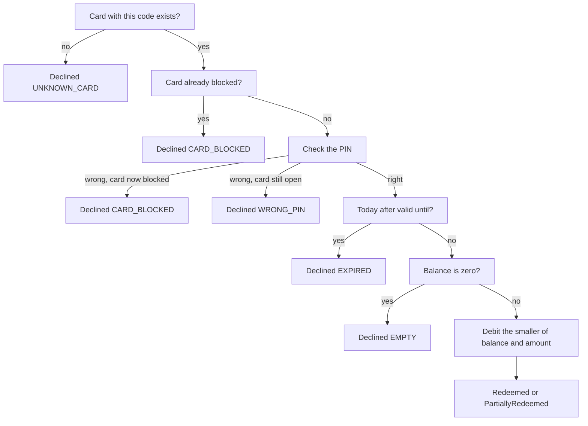
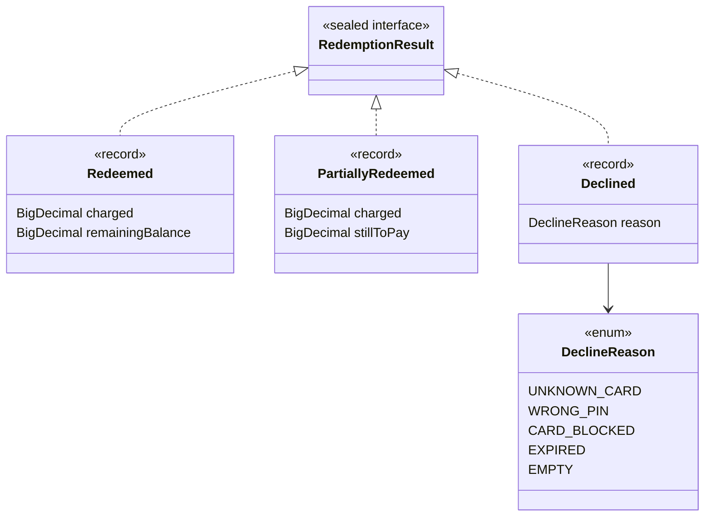

# Task 15 · Gift card redemption: results, not exceptions

| Difficulty | Topics | Time box |
|---|---|---|
| 🟡 Medium | Error handling design: expected business outcomes as a sealed result type vs. exceptions for programming errors · Exhaustive `switch` over results · An entity with a small security rule (PIN attempts) · Value object with format validation | 2–3 h |

> **Background reading:** *Effective Java* Item 69 ("Use exceptions only for exceptional conditions"), Item 70 ("Use checked exceptions for recoverable conditions and runtime exceptions for programming errors"), Item 71 ("Avoid unnecessary use of checked exceptions"), Item 72 ("Favor the use of standard exceptions") · Scott Wlaschin, ["Railway Oriented Programming"](https://fsharpforfunandprofit.com/rop/) (fsharpforfunandprofit.com) · *A Philosophy of Software Design*, ch. 10 ("Define errors out of existence")

---

## The situation

The checkout terminals in our book stores accept gift cards. The old `GiftCardService.redeem` declares five checked exceptions: `CardNotFoundException`, `WrongPinException`, `CardBlockedException`, `CardExpiredException` and `EmptyCardException`. Every caller wraps the call in a `try` with five `catch` blocks. Two callers forgot one of them, so the cashier sees "Unknown error" for a perfectly ordinary situation. A third caller catches `Exception`, and that swallowed a `NullPointerException` for months, because a bug and a declined card looked the same.

The root problem is this: **a declined gift card is not exceptional at a till.** It happens every hour. An exception says "something unexpected went wrong". A wrong PIN is not unexpected. It is one of the normal answers the till can get.

So we model the outcomes as **data**. The service returns a `RedemptionResult`. The compiler then tells us about every caller that does not handle a result.

## The domain

| Term | Meaning |
|---|---|
| **Gift card code** | `XXXX-XXXX-XXXX`, letters A–Z and digits. It is printed on the card. |
| **PIN** | Exactly 4 digits. Three wrong PINs in a row block the card. |
| **Blocked** | The card can no longer be used, not even with the right PIN. The service desk unblocks it. |
| **Balance** | Money on the card, in EUR, with 2 decimals. |
| **Valid until** | The last day the card can be used. It is valid *on* that day. |
| **Redemption** | Paying an amount with the card at the till. |

The decision order of `GiftCardService.redeem` is part of the contract:



The result hierarchy is small and closed:



## What I want from you

Implement the classes below. The starter contains skeletons (`UnsupportedOperationException` bodies) and some complete given files.

1. **[`GiftCardCode`](../src/main/java/io/github/chris013/practice/task15/GiftCardCode.java)(value)** is a record.
   * The constructor trims and upper-cases the input first. `" abcd-1234-efgh "` becomes `ABCD-1234-EFGH`.
   * The format after that is `XXXX-XXXX-XXXX` with `A`–`Z` and `0`–`9` only.
   * A wrong format or a blank value throws `IllegalArgumentException`. `null` throws `NullPointerException`.
2. **[`GiftCard`](../src/main/java/io/github/chris013/practice/task15/GiftCard.java)** is a mutable entity. Its identity is its code.
   * `GiftCard(code, pin, balance, validUntil)`: the PIN must be exactly 4 ASCII digits, else `IllegalArgumentException`. The balance must not be negative and must have at most 2 decimals. Store it with scale 2.
   * `code()`, `balance()`, `validUntil()`, `isBlocked()`.
   * `boolean checkPin(String attempt)`:
     * A right PIN returns `true` and resets the counter of consecutive wrong attempts.
     * A wrong PIN returns `false` and increments the counter. The **third** consecutive wrong PIN blocks the card.
     * A blocked card returns `false` for every attempt, including the right PIN. Its counter no longer changes.
   * `void debit(BigDecimal amount)`: takes the amount off the balance. Zero, negative, more than 2 decimals, or more than the balance are `IllegalArgumentException`. A failed debit leaves the balance unchanged.
3. **[`GiftCardRepository`](../src/main/java/io/github/chris013/practice/task15/GiftCardRepository.java)** and **[`InMemoryGiftCardRepository`](../src/main/java/io/github/chris013/practice/task15/InMemoryGiftCardRepository.java)** are given. Use them as they are.
4. **[`RedemptionResult`](../src/main/java/io/github/chris013/practice/task15/RedemptionResult.java)** is a sealed interface with three records:
   * [`Redeemed`](../src/main/java/io/github/chris013/practice/task15/Redeemed.java)`(charged, remainingBalance)`: the card covered the full amount.
   * [`PartiallyRedeemed`](../src/main/java/io/github/chris013/practice/task15/PartiallyRedeemed.java)`(charged, stillToPay)`: the card had less than the amount. It is now empty.
   * [`Declined`](../src/main/java/io/github/chris013/practice/task15/Declined.java)`(reason)`: nothing was charged.
   * [`DeclineReason`](../src/main/java/io/github/chris013/practice/task15/DeclineReason.java) is given: `UNKNOWN_CARD`, `WRONG_PIN`, `CARD_BLOCKED`, `EXPIRED`, `EMPTY`.
5. **[`GiftCardService`](../src/main/java/io/github/chris013/practice/task15/GiftCardService.java)`(repository, clock)`**: `RedemptionResult redeem(GiftCardCode code, String pin, BigDecimal amount)`.
   * `null` for any argument throws `NullPointerException`.
   * An amount that is zero, negative, or has more than 2 decimals throws `IllegalArgumentException`. `12.500` is accepted, because its third decimal is zero. `12.505` is rejected.
   * The checks run in **this order**, and the first match wins:
     1. no card with this code: `Declined(UNKNOWN_CARD)`;
     2. card already blocked: `Declined(CARD_BLOCKED)`, without checking the PIN;
     3. wrong PIN: `Declined(WRONG_PIN)`. **The attempt that blocks the card returns `Declined(CARD_BLOCKED)` instead**;
     4. today is after `validUntil`: `Declined(EXPIRED)`. The card is valid *on* `validUntil`;
     5. balance is zero: `Declined(EMPTY)`;
     6. otherwise debit the smaller of balance and amount. If the card covered the full amount, return `Redeemed(amount, balance after)`. If not, return `PartiallyRedeemed(balance before, amount minus that)`.
   * Save the card with the repository whenever its state changed: after the PIN check (the counter changed) and after a debit.
   * Use the injected `Clock` for "today". Never `LocalDate.now()` without a clock.
   * Every amount in a result has scale 2.
6. **[`CashierMessages`](../src/main/java/io/github/chris013/practice/task15/CashierMessages.java)** has one static method `String forResult(RedemptionResult result)`.
   * The switch is **exhaustive and has no `default` branch**.
   * Amounts are shown with 2 decimals, so `12.5` is printed as `12.50`.

   The texts are exact:

| Result | Text |
|---|---|
| `Redeemed` | `Paid 12.50 EUR with gift card. Remaining balance: 7.50 EUR.` |
| `PartiallyRedeemed` | `Gift card covered 5.00 EUR. Please collect 7.50 EUR.` |
| `UNKNOWN_CARD` | `Gift card not found. Please check the code.` |
| `WRONG_PIN` | `Wrong PIN. Please try again.` |
| `CARD_BLOCKED` | `Gift card blocked after too many wrong PINs. Refer the customer to the service desk.` |
| `EXPIRED` | `Gift card expired.` |
| `EMPTY` | `Gift card has no balance left.` |

## Constraints & non-goals

* **No exceptions for business outcomes.** A wrong PIN, an expired card and an empty card are `Declined`, never a thrown exception.
* **No `default` branch** in any switch over `RedemptionResult` or `DeclineReason`.
* `BigDecimal` for money. Compare amounts with `compareTo`, never with `equals`, because `12.5` and `12.50` are different to `equals`.
* No `double`, no `Optional` in the return type of `redeem`, no `boolean` plus a "last error" field.
* No database and no framework. The in-memory repository is enough.
* Do not put the PIN or the card code into an exception message or into a result. Messages end up in logs.
* The PIN is stored as given in this task. Hashing it is a stretch goal.

## How I'd approach it

**Start with the types, then the service.** The three records and the enum are the contract. Once they compile, the tests tell you what the service must do. Write `GiftCardCode` and `GiftCard` first, because the service depends on them.

**Results or exceptions? Use this table in design reviews.** Ask: *is the caller supposed to decide what to do next, based on this situation, as a normal part of the flow?* If yes, it is a result. If the situation is a bug or a broken system, it is an exception.

| Situation | Mechanism | Why |
|---|---|---|
| `amount` is `null` | `NullPointerException` | Programming error. The caller broke the contract. |
| `amount` is negative or zero | `IllegalArgumentException` | Contract violation. The UI should have stopped it. |
| Card code has the wrong format | `IllegalArgumentException` | Input validation. The till validates before it calls us. |
| Unknown card | `Declined(UNKNOWN_CARD)` | Expected business outcome. The cashier asks again. |
| Wrong PIN | `Declined(WRONG_PIN)` | Expected business outcome, and it happens every hour. |
| Card blocked | `Declined(CARD_BLOCKED)` | Expected business outcome with a defined next step. |
| Card expired | `Declined(EXPIRED)` | Expected business outcome. |
| Card empty | `Declined(EMPTY)` | Expected business outcome. |
| Database is down | Unchecked exception from the repository | Infrastructure failure. The till cannot decide anything useful, so it shows a technical error. |

**Why exhaustiveness and no `default` matter.** Suppose someone adds `CARD_NOT_ACTIVATED` to `DeclineReason`. With no `default`, `CashierMessages` stops compiling. The developer must write the message, and the build tells them where. With `default -> "Unknown error"`, it compiles, and the cashier sees "Unknown error" in production. That is the exact bug from the situation section. Exhaustiveness only protects you if you let it.

**What the caller looks like, before and after.** Before, every caller had to know all five exceptions:

```java
// before
try {
    service.redeem(code, pin, amount);
    screen.show("Paid ...");
} catch (CardNotFoundException e) { screen.show("Gift card not found..."); }
  catch (WrongPinException e)     { screen.show("Wrong PIN..."); }
  catch (CardBlockedException e)  { ... }
  catch (CardExpiredException e)  { ... }
  catch (EmptyCardException e)    { ... }
```

After, the caller passes the result to one function:

```java
// after
screen.show(CashierMessages.forResult(service.redeem(code, pin, amount)));
```

The switch inside `CashierMessages` is the single place where the compiler checks that every outcome is handled.

**Why not `Optional`, `boolean` or a `getLastError()` method?**
* `Optional<Redeemed>` says "it worked or it didn't", and loses the reason. The caller cannot tell a wrong PIN from an unknown card.
* A `boolean` has the same problem, and a `getLastError()` method is worse: the error is hidden state that another call can overwrite, and nothing forces the caller to look at it.

**Why not a generic `Result<T, E>`?** You can write one in Java: a sealed interface with two records. It is a good tool for long pipelines of steps that all fail in the same way. Here the outcomes are the domain itself. Named records such as `Redeemed(charged, remainingBalance)` carry different data for each outcome, and a `Declined` carries a reason from a closed list. With a generic `Either<Redeemed, Declined>` the type names disappear, and the code reads worse at every use. Use the generic version when the vocabulary is generic. Use named results when the vocabulary is the business.

**Save state on every path that changes it.** Two things are easy to forget. First, a wrong PIN changes the counter, so the card must be saved, or the third attempt is never counted across requests. Second, the right PIN on a card that is then found expired still resets the counter, so that save must happen too. Save right after the PIN check, before you decide the outcome.

**Check order is a design decision.** Some examples:
* Blocked before PIN: a blocked card must not even tell the thief whether the PIN is right.
* PIN before expiry: a wrong PIN on an expired card still counts as a failed attempt.
* Expiry before balance: an expired card with 0.00 is `EXPIRED`, because that is the more useful message.

**Debit only after every check passes.** If you debit first and check expiry afterwards, a bug in the expiry branch takes money from the customer and then declines the payment.

**Use `compareTo` and scale 2.** The amount in the request can have trailing zeros (`12.500`), and the balance has scale 2. Normalise the amount once, at the start of `redeem`, and then compare with `compareTo`.

**Read the tests before you start.** `GiftCardServiceTest` has a nested `CheckOrder` group. Each test there names one ordering rule. Read those names first: they are the rules.

## Tests

Run: `mvn test -Dtest='**/task15/**'`

Test files:
* [`GiftCardCodeTest`](../src/test/java/io/github/chris013/practice/task15/GiftCardCodeTest.java): format, normalisation, rejections.
* [`GiftCardTest`](../src/test/java/io/github/chris013/practice/task15/GiftCardTest.java): construction, PIN attempts, debit.
* [`GiftCardServiceTest`](../src/test/java/io/github/chris013/practice/task15/GiftCardServiceTest.java): every outcome, check order, expiry boundary, saves and programming errors. It uses a fixed `Clock`.
* [`CashierMessagesTest`](../src/test/java/io/github/chris013/practice/task15/CashierMessagesTest.java): every message, exact text.
* [`CountingGiftCardRepository`](../src/test/java/io/github/chris013/practice/task15/CountingGiftCardRepository.java) is a small fake that counts saves and remembers the balance written by the last save. The in-memory repository keeps the same object, so a test cannot see a missing save without counting it.

<details>
<summary>Show the tests</summary>

<!-- embed: src/test/java/io/github/chris013/practice/task15/GiftCardServiceTest.java -->
**[`GiftCardServiceTest.java`](../src/test/java/io/github/chris013/practice/task15/GiftCardServiceTest.java)**

```java
package io.github.chris013.practice.task15;

import static org.assertj.core.api.Assertions.assertThat;
import static org.assertj.core.api.Assertions.assertThatThrownBy;

import java.math.BigDecimal;
import java.time.Clock;
import java.time.Instant;
import java.time.LocalDate;
import java.time.ZoneOffset;
import org.junit.jupiter.api.Nested;
import org.junit.jupiter.api.Test;
import org.junit.jupiter.params.ParameterizedTest;
import org.junit.jupiter.params.provider.ValueSource;

class GiftCardServiceTest {

    private static final GiftCardCode CODE = new GiftCardCode("ABCD-1234-EFGH");
    private static final String PIN = "4711";
    private static final String WRONG_PIN = "1234";
    private static final LocalDate TODAY = LocalDate.of(2026, 3, 1);
    private static final Instant NOON_TODAY = Instant.parse("2026-03-01T12:00:00Z");

    private final CountingGiftCardRepository repository = new CountingGiftCardRepository();

    private GiftCardService serviceAt(Instant now) {
        return new GiftCardService(repository, Clock.fixed(now, ZoneOffset.UTC));
    }

    private GiftCardService service() {
        return serviceAt(NOON_TODAY);
    }

    private GiftCard giveCard(String balance, LocalDate validUntil) {
        GiftCard card = new GiftCard(CODE, PIN, new BigDecimal(balance), validUntil);
        repository.seed(card);
        return card;
    }

    private GiftCard giveValidCard(String balance) {
        return giveCard(balance, TODAY.plusMonths(6));
    }

    private BigDecimal balanceOnCard() {
        return repository.findByCode(CODE).orElseThrow().balance();
    }

    @Nested
    class Outcomes {

        @Test
        void redeems_the_full_amount_when_the_card_covers_it() {
            giveValidCard("20.00");

            RedemptionResult result = service().redeem(CODE, PIN, new BigDecimal("12.50"));

            assertThat(result).isEqualTo(new Redeemed(new BigDecimal("12.50"), new BigDecimal("7.50")));
            assertThat(balanceOnCard()).isEqualByComparingTo("7.50");
        }

        @Test
        void redeems_an_exact_balance_and_leaves_zero() {
            giveValidCard("20.00");

            RedemptionResult result = service().redeem(CODE, PIN, new BigDecimal("20.00"));

            assertThat(result).isEqualTo(new Redeemed(new BigDecimal("20.00"), new BigDecimal("0.00")));
        }

        @Test
        void partially_redeems_and_empties_the_card_when_the_balance_is_too_small() {
            giveValidCard("5.00");

            RedemptionResult result = service().redeem(CODE, PIN, new BigDecimal("12.50"));

            assertThat(result).isEqualTo(new PartiallyRedeemed(new BigDecimal("5.00"), new BigDecimal("7.50")));
            assertThat(balanceOnCard()).isEqualByComparingTo("0.00");
        }

        @Test
        void declines_an_unknown_card() {
            RedemptionResult result = service().redeem(CODE, PIN, BigDecimal.ONE);

            assertThat(result).isEqualTo(new Declined(DeclineReason.UNKNOWN_CARD));
        }

        @Test
        void declines_a_wrong_pin_and_leaves_the_balance_alone() {
            giveValidCard("20.00");

            RedemptionResult result = service().redeem(CODE, WRONG_PIN, BigDecimal.ONE);

            assertThat(result).isEqualTo(new Declined(DeclineReason.WRONG_PIN));
            assertThat(balanceOnCard()).isEqualByComparingTo("20.00");
        }

        @Test
        void reports_the_third_wrong_pin_as_a_blocked_card() {
            giveValidCard("20.00");
            GiftCardService service = service();

            assertThat(service.redeem(CODE, WRONG_PIN, BigDecimal.ONE)).isEqualTo(new Declined(DeclineReason.WRONG_PIN));
            assertThat(service.redeem(CODE, WRONG_PIN, BigDecimal.ONE)).isEqualTo(new Declined(DeclineReason.WRONG_PIN));
            assertThat(service.redeem(CODE, WRONG_PIN, BigDecimal.ONE)).isEqualTo(new Declined(DeclineReason.CARD_BLOCKED));
        }

        @Test
        void a_blocked_card_stays_blocked_even_with_the_right_pin() {
            giveValidCard("20.00");
            GiftCardService service = service();
            service.redeem(CODE, WRONG_PIN, BigDecimal.ONE);
            service.redeem(CODE, WRONG_PIN, BigDecimal.ONE);
            service.redeem(CODE, WRONG_PIN, BigDecimal.ONE);

            RedemptionResult result = service.redeem(CODE, PIN, BigDecimal.ONE);

            assertThat(result).isEqualTo(new Declined(DeclineReason.CARD_BLOCKED));
            assertThat(balanceOnCard()).isEqualByComparingTo("20.00");
        }

        @Test
        void declines_an_expired_card_without_charging_it() {
            giveCard("20.00", TODAY.minusDays(1));

            RedemptionResult result = service().redeem(CODE, PIN, BigDecimal.ONE);

            assertThat(result).isEqualTo(new Declined(DeclineReason.EXPIRED));
            assertThat(balanceOnCard()).isEqualByComparingTo("20.00");
        }

        @Test
        void declines_an_empty_card() {
            giveValidCard("0.00");

            RedemptionResult result = service().redeem(CODE, PIN, BigDecimal.ONE);

            assertThat(result).isEqualTo(new Declined(DeclineReason.EMPTY));
        }
    }

    @Nested
    class ExpiryBoundary {

        @Test
        void a_card_is_valid_on_its_last_day_until_midnight() {
            giveCard("20.00", TODAY);

            RedemptionResult result = serviceAt(Instant.parse("2026-03-01T23:59:59Z")).redeem(CODE, PIN, BigDecimal.ONE);

            assertThat(result).isEqualTo(new Redeemed(new BigDecimal("1.00"), new BigDecimal("19.00")));
        }

        @Test
        void a_card_has_expired_the_day_after_its_last_day() {
            giveCard("20.00", TODAY);

            RedemptionResult result = serviceAt(Instant.parse("2026-03-02T00:00:00Z")).redeem(CODE, PIN, BigDecimal.ONE);

            assertThat(result).isEqualTo(new Declined(DeclineReason.EXPIRED));
        }
    }

    @Nested
    class CheckOrder {

        @Test
        void a_wrong_pin_is_reported_before_expiry_and_still_counts() {
            giveCard("20.00", TODAY.minusDays(1));
            GiftCardService service = service();

            assertThat(service.redeem(CODE, WRONG_PIN, BigDecimal.ONE)).isEqualTo(new Declined(DeclineReason.WRONG_PIN));
            assertThat(repository.saveCount()).isEqualTo(1);

            service.redeem(CODE, WRONG_PIN, BigDecimal.ONE);
            assertThat(service.redeem(CODE, WRONG_PIN, BigDecimal.ONE)).isEqualTo(new Declined(DeclineReason.CARD_BLOCKED));
        }

        @Test
        void a_right_pin_on_an_expired_card_resets_the_counter_and_is_saved() {
            giveCard("20.00", TODAY.minusDays(1));
            GiftCardService service = service();
            service.redeem(CODE, WRONG_PIN, BigDecimal.ONE);
            service.redeem(CODE, WRONG_PIN, BigDecimal.ONE);

            assertThat(service.redeem(CODE, PIN, BigDecimal.ONE)).isEqualTo(new Declined(DeclineReason.EXPIRED));
            assertThat(repository.saveCount()).isEqualTo(3);

            assertThat(service.redeem(CODE, WRONG_PIN, BigDecimal.ONE)).isEqualTo(new Declined(DeclineReason.WRONG_PIN));
            assertThat(service.redeem(CODE, WRONG_PIN, BigDecimal.ONE)).isEqualTo(new Declined(DeclineReason.WRONG_PIN));
        }

        @Test
        void expiry_is_reported_before_an_empty_balance() {
            giveCard("0.00", TODAY.minusDays(1));

            RedemptionResult result = service().redeem(CODE, PIN, BigDecimal.ONE);

            assertThat(result).isEqualTo(new Declined(DeclineReason.EXPIRED));
        }

        @Test
        void an_unknown_card_is_reported_before_anything_else() {
            RedemptionResult result = service().redeem(CODE, WRONG_PIN, BigDecimal.ONE);

            assertThat(result).isEqualTo(new Declined(DeclineReason.UNKNOWN_CARD));
        }
    }

    @Nested
    class Persistence {

        @Test
        void saves_the_card_after_a_wrong_pin() {
            giveValidCard("20.00");

            service().redeem(CODE, WRONG_PIN, BigDecimal.ONE);

            assertThat(repository.saveCount()).isEqualTo(1);
        }

        @Test
        void saves_the_card_after_a_debit() {
            giveValidCard("20.00");

            service().redeem(CODE, PIN, BigDecimal.ONE);

            assertThat(repository.saveCount()).isPositive();
            assertThat(repository.lastSavedBalance()).isEqualByComparingTo("19.00");
            assertThat(balanceOnCard()).isEqualByComparingTo("19.00");
        }

        @Test
        void does_not_save_anything_for_an_unknown_card() {
            service().redeem(CODE, PIN, BigDecimal.ONE);

            assertThat(repository.saveCount()).isZero();
        }
    }

    @Nested
    class Amounts {

        @Test
        void accepts_trailing_zeros_in_the_amount() {
            giveValidCard("20.00");

            RedemptionResult result = service().redeem(CODE, PIN, new BigDecimal("12.500"));

            assertThat(result).isEqualTo(new Redeemed(new BigDecimal("12.50"), new BigDecimal("7.50")));
        }

        @ParameterizedTest
        @ValueSource(strings = {"0", "0.00", "-1.00"})
        void rejects_zero_and_negative_amounts(String amount) {
            giveValidCard("20.00");

            assertThatThrownBy(() -> service().redeem(CODE, PIN, new BigDecimal(amount)))
                    .isInstanceOf(IllegalArgumentException.class);
            assertThat(balanceOnCard()).isEqualByComparingTo("20.00");
        }

        @Test
        void rejects_an_amount_with_more_than_two_decimals() {
            giveValidCard("20.00");

            assertThatThrownBy(() -> service().redeem(CODE, PIN, new BigDecimal("12.505")))
                    .isInstanceOf(IllegalArgumentException.class);
            assertThat(balanceOnCard()).isEqualByComparingTo("20.00");
        }

        @Test
        void rejects_null_arguments_with_a_null_pointer_exception() {
            giveValidCard("20.00");
            GiftCardService service = service();

            assertThatThrownBy(() -> service.redeem(null, PIN, BigDecimal.ONE)).isInstanceOf(NullPointerException.class);
            assertThatThrownBy(() -> service.redeem(CODE, null, BigDecimal.ONE)).isInstanceOf(NullPointerException.class);
            assertThatThrownBy(() -> service.redeem(CODE, PIN, null)).isInstanceOf(NullPointerException.class);
        }
    }
}
```
<!-- /embed -->

<!-- embed: src/test/java/io/github/chris013/practice/task15/GiftCardTest.java -->
**[`GiftCardTest.java`](../src/test/java/io/github/chris013/practice/task15/GiftCardTest.java)**

```java
package io.github.chris013.practice.task15;

import static org.assertj.core.api.Assertions.assertThat;
import static org.assertj.core.api.Assertions.assertThatThrownBy;

import java.math.BigDecimal;
import java.time.LocalDate;
import org.junit.jupiter.api.Nested;
import org.junit.jupiter.api.Test;
import org.junit.jupiter.params.ParameterizedTest;
import org.junit.jupiter.params.provider.ValueSource;

class GiftCardTest {

    private static final String PIN = "4711";
    private static final String WRONG_PIN = "1234";

    private static GiftCard card(String balance) {
        return new GiftCard(new GiftCardCode("ABCD-1234-EFGH"), PIN, new BigDecimal(balance), LocalDate.of(2026, 12, 31));
    }

    @Nested
    class Construction {

        @ParameterizedTest
        @ValueSource(strings = {"", "123", "12345", "12a4", " 4711"})
        void rejects_a_pin_that_is_not_exactly_four_digits(String pin) {
            assertThatThrownBy(() -> new GiftCard(new GiftCardCode("ABCD-1234-EFGH"), pin, BigDecimal.TEN, LocalDate.of(2026, 12, 31)))
                    .isInstanceOf(IllegalArgumentException.class);
        }

        @Test
        void rejects_a_negative_balance() {
            assertThatThrownBy(() -> card("-0.01"))
                    .isInstanceOf(IllegalArgumentException.class);
        }

        @Test
        void rejects_a_balance_with_more_than_two_decimals() {
            assertThatThrownBy(() -> card("10.005"))
                    .isInstanceOf(IllegalArgumentException.class);
        }

        @Test
        void accepts_a_zero_balance_and_keeps_two_decimals() {
            GiftCard card = card("0");

            assertThat(card.balance()).isEqualByComparingTo("0.00");
            assertThat(card.balance().scale()).isEqualTo(2);
        }

        @Test
        void rejects_nulls() {
            assertThatThrownBy(() -> new GiftCard(null, PIN, BigDecimal.TEN, LocalDate.of(2026, 12, 31)))
                    .isInstanceOf(NullPointerException.class);
            assertThatThrownBy(() -> new GiftCard(new GiftCardCode("ABCD-1234-EFGH"), null, BigDecimal.TEN, LocalDate.of(2026, 12, 31)))
                    .isInstanceOf(NullPointerException.class);
            assertThatThrownBy(() -> new GiftCard(new GiftCardCode("ABCD-1234-EFGH"), PIN, null, LocalDate.of(2026, 12, 31)))
                    .isInstanceOf(NullPointerException.class);
            assertThatThrownBy(() -> new GiftCard(new GiftCardCode("ABCD-1234-EFGH"), PIN, BigDecimal.TEN, null))
                    .isInstanceOf(NullPointerException.class);
        }
    }

    @Nested
    class PinAttempts {

        @Test
        void accepts_the_right_pin() {
            GiftCard card = card("10.00");

            assertThat(card.checkPin(PIN)).isTrue();
            assertThat(card.isBlocked()).isFalse();
        }

        @Test
        void rejects_a_wrong_pin() {
            GiftCard card = card("10.00");

            assertThat(card.checkPin(WRONG_PIN)).isFalse();
            assertThat(card.isBlocked()).isFalse();
        }

        @Test
        void blocks_the_card_on_the_third_consecutive_wrong_pin() {
            GiftCard card = card("10.00");

            card.checkPin(WRONG_PIN);
            card.checkPin(WRONG_PIN);
            assertThat(card.isBlocked()).isFalse();

            assertThat(card.checkPin(WRONG_PIN)).isFalse();
            assertThat(card.isBlocked()).isTrue();
        }

        @Test
        void a_right_pin_resets_the_counter_of_wrong_attempts() {
            GiftCard card = card("10.00");

            card.checkPin(WRONG_PIN);
            card.checkPin(WRONG_PIN);
            card.checkPin(PIN);
            card.checkPin(WRONG_PIN);
            card.checkPin(WRONG_PIN);

            assertThat(card.isBlocked()).isFalse();
            card.checkPin(WRONG_PIN);
            assertThat(card.isBlocked()).isTrue();
        }

        @Test
        void a_blocked_card_rejects_even_the_right_pin_and_stays_blocked() {
            GiftCard card = card("10.00");
            card.checkPin(WRONG_PIN);
            card.checkPin(WRONG_PIN);
            card.checkPin(WRONG_PIN);

            assertThat(card.checkPin(PIN)).isFalse();
            assertThat(card.isBlocked()).isTrue();
        }
    }

    @Nested
    class Debit {

        @Test
        void takes_the_amount_off_the_balance() {
            GiftCard card = card("10.00");

            card.debit(new BigDecimal("2.50"));

            assertThat(card.balance()).isEqualByComparingTo("7.50");
        }

        @Test
        void allows_debiting_the_whole_balance() {
            GiftCard card = card("10.00");

            card.debit(new BigDecimal("10.00"));

            assertThat(card.balance()).isEqualByComparingTo("0.00");
        }

        @ParameterizedTest
        @ValueSource(strings = {"0", "0.00", "-1.00"})
        void rejects_zero_and_negative_amounts(String amount) {
            GiftCard card = card("10.00");

            assertThatThrownBy(() -> card.debit(new BigDecimal(amount)))
                    .isInstanceOf(IllegalArgumentException.class);
            assertThat(card.balance()).isEqualByComparingTo("10.00");
        }

        @Test
        void rejects_an_amount_above_the_balance_and_keeps_the_balance() {
            GiftCard card = card("10.00");

            assertThatThrownBy(() -> card.debit(new BigDecimal("10.01")))
                    .isInstanceOf(IllegalArgumentException.class);
            assertThat(card.balance()).isEqualByComparingTo("10.00");
        }

        @Test
        void rejects_an_amount_with_more_than_two_decimals() {
            GiftCard card = card("10.00");

            assertThatThrownBy(() -> card.debit(new BigDecimal("1.005")))
                    .isInstanceOf(IllegalArgumentException.class);
            assertThat(card.balance()).isEqualByComparingTo("10.00");
        }
    }
}
```
<!-- /embed -->

<!-- embed: src/test/java/io/github/chris013/practice/task15/GiftCardCodeTest.java -->
**[`GiftCardCodeTest.java`](../src/test/java/io/github/chris013/practice/task15/GiftCardCodeTest.java)**

```java
package io.github.chris013.practice.task15;

import static org.assertj.core.api.Assertions.assertThat;
import static org.assertj.core.api.Assertions.assertThatThrownBy;

import org.junit.jupiter.api.Nested;
import org.junit.jupiter.api.Test;
import org.junit.jupiter.params.ParameterizedTest;
import org.junit.jupiter.params.provider.CsvSource;
import org.junit.jupiter.params.provider.ValueSource;

class GiftCardCodeTest {

    @Nested
    class Format {

        @Test
        void accepts_the_printed_format() {
            assertThat(new GiftCardCode("ABCD-1234-EFGH").value()).isEqualTo("ABCD-1234-EFGH");
        }

        @ParameterizedTest
        @CsvSource({
            "abcd-1234-efgh, ABCD-1234-EFGH",
            "a1b2-c3d4-e5f6, A1B2-C3D4-E5F6",
            "0000-ZZZZ-9999, 0000-ZZZZ-9999"
        })
        void upper_cases_the_code(String input, String expected) {
            assertThat(new GiftCardCode(input).value()).isEqualTo(expected);
        }

        @Test
        void trims_surrounding_whitespace_before_checking_the_format() {
            assertThat(new GiftCardCode(" abcd-1234-efgh ").value()).isEqualTo("ABCD-1234-EFGH");
        }

        @Test
        void equal_codes_after_normalisation_are_equal() {
            assertThat(new GiftCardCode("abcd-1234-efgh")).isEqualTo(new GiftCardCode("ABCD-1234-EFGH"));
        }

        @ParameterizedTest
        @ValueSource(strings = {
            "",
            "   ",
            "ABCD1234EFGH",
            "ABCD-1234-EFG",
            "ABCD-1234-EFGHI",
            "ABCD-12-EFGH",
            "ABCD_1234_EFGH",
            "ABCD-1234-EFGé",
            "ABCD-1234-EFGH-"
        })
        void rejects_a_wrong_format_with_an_illegal_argument(String value) {
            assertThatThrownBy(() -> new GiftCardCode(value))
                    .isInstanceOf(IllegalArgumentException.class);
        }

        @Test
        void rejects_null() {
            assertThatThrownBy(() -> new GiftCardCode(null))
                    .isInstanceOf(NullPointerException.class);
        }
    }
}
```
<!-- /embed -->

<!-- embed: src/test/java/io/github/chris013/practice/task15/CashierMessagesTest.java -->
**[`CashierMessagesTest.java`](../src/test/java/io/github/chris013/practice/task15/CashierMessagesTest.java)**

```java
package io.github.chris013.practice.task15;

import static org.assertj.core.api.Assertions.assertThat;

import java.math.BigDecimal;
import org.junit.jupiter.api.Nested;
import org.junit.jupiter.api.Test;
import org.junit.jupiter.params.ParameterizedTest;
import org.junit.jupiter.params.provider.EnumSource;

class CashierMessagesTest {

    @Nested
    class Redemptions {

        @Test
        void full_redemption_shows_the_charge_and_the_remaining_balance() {
            RedemptionResult result = new Redeemed(new BigDecimal("12.50"), new BigDecimal("7.50"));

            assertThat(CashierMessages.forResult(result))
                    .isEqualTo("Paid 12.50 EUR with gift card. Remaining balance: 7.50 EUR.");
        }

        @Test
        void partial_redemption_tells_the_cashier_what_to_collect() {
            RedemptionResult result = new PartiallyRedeemed(new BigDecimal("5.00"), new BigDecimal("7.50"));

            assertThat(CashierMessages.forResult(result))
                    .isEqualTo("Gift card covered 5.00 EUR. Please collect 7.50 EUR.");
        }

        @Test
        void amounts_always_show_two_decimals() {
            RedemptionResult result = new Redeemed(new BigDecimal("12.5"), new BigDecimal("7"));

            assertThat(CashierMessages.forResult(result))
                    .isEqualTo("Paid 12.50 EUR with gift card. Remaining balance: 7.00 EUR.");
        }
    }

    @Nested
    class Declines {

        @Test
        void unknown_card() {
            assertThat(message(DeclineReason.UNKNOWN_CARD)).isEqualTo("Gift card not found. Please check the code.");
        }

        @Test
        void wrong_pin() {
            assertThat(message(DeclineReason.WRONG_PIN)).isEqualTo("Wrong PIN. Please try again.");
        }

        @Test
        void blocked_card() {
            assertThat(message(DeclineReason.CARD_BLOCKED))
                    .isEqualTo("Gift card blocked after too many wrong PINs. Refer the customer to the service desk.");
        }

        @Test
        void expired_card() {
            assertThat(message(DeclineReason.EXPIRED)).isEqualTo("Gift card expired.");
        }

        @Test
        void empty_card() {
            assertThat(message(DeclineReason.EMPTY)).isEqualTo("Gift card has no balance left.");
        }

        @ParameterizedTest
        @EnumSource(DeclineReason.class)
        void every_decline_reason_has_a_message_for_the_cashier(DeclineReason reason) {
            assertThat(message(reason)).isNotBlank();
        }

        private String message(DeclineReason reason) {
            return CashierMessages.forResult(new Declined(reason));
        }
    }
}
```
<!-- /embed -->

<!-- embed: src/test/java/io/github/chris013/practice/task15/CountingGiftCardRepository.java -->
**[`CountingGiftCardRepository.java`](../src/test/java/io/github/chris013/practice/task15/CountingGiftCardRepository.java)**

```java
package io.github.chris013.practice.task15;

import java.math.BigDecimal;
import java.util.Optional;

/**
 * Wraps the in-memory repository and counts the saves, so tests can check when the service persists a card.
 * It also remembers the balance at the last save, so a test can check that the debit was saved.
 */
final class CountingGiftCardRepository implements GiftCardRepository {

    private final InMemoryGiftCardRepository delegate = new InMemoryGiftCardRepository();
    private int saves;
    private BigDecimal lastSavedBalance;

    /** Puts a card in place without counting it, as if it had been stored before the test started. */
    void seed(GiftCard card) {
        delegate.save(card);
    }

    @Override
    public Optional<GiftCard> findByCode(GiftCardCode code) {
        return delegate.findByCode(code);
    }

    @Override
    public void save(GiftCard card) {
        saves++;
        lastSavedBalance = card.balance();
        delegate.save(card);
    }

    int saveCount() {
        return saves;
    }

    /** The balance that was written by the most recent save, or {@code null} if nothing was saved yet. */
    BigDecimal lastSavedBalance() {
        return lastSavedBalance;
    }
}
```
<!-- /embed -->

</details>

## Definition of done

- [ ] All task 15 tests green, and the whole test run takes well under a second.
- [ ] `CashierMessages` has no `default` branch, and adding a `DeclineReason` constant makes it fail to compile.
- [ ] A wrong PIN on the third attempt returns `CARD_BLOCKED`, and the card stays blocked even with the right PIN.
- [ ] The card is valid on its `validUntil` date and expired the day after.
- [ ] Amounts are compared with `compareTo`, and every amount in a result has scale 2.
- [ ] No business outcome is thrown as an exception.
- [ ] The PIN and the card code never appear in an exception message.
- [ ] Your PR description explains which outcomes you chose to model as results, and which as exceptions, and why.

## Stretch goals

1. Add a new reason `CARD_NOT_ACTIVATED` for cards that were sold but not yet activated at the till. Let the compiler show you every place that needs a message. Then decide: should the service check it before the PIN, or after? Explain your answer in the PR.
2. Make the PIN check constant-time and store a hash of the PIN instead of the PIN itself. Hint: `MessageDigest.isEqual` compares two byte arrays in constant time. A salt makes the hash harder to crack. Think about what changes in the tests.
3. A till can send the same redemption twice when the network is slow. Add an `Idempotency-Key` to the request: the second request with the same key returns the first result and charges nothing. Where does the stored result live, and how long do you keep it?
4. Return the `RedemptionResult` from a REST endpoint. Map each record to an HTTP status: is `Declined(WRONG_PIN)` a `200` with a body, or a `4xx`? Defend your choice, because API clients treat the two very differently.

---

## Reference solution

<details>
<summary>Spoiler: open only after you have made a serious attempt</summary>

### Key decisions

**1. A sealed result with three records, and a closed enum for the reasons.** Each outcome carries exactly the data it needs. `Redeemed` has two amounts, `Declined` has a reason. The alternative was a single `Redemption` class with nullable fields, which is the tagged class from task 06 again.

**2. Business outcomes are results; bad arguments are exceptions.** `GiftCardCode` and `redeem` throw for `null`, wrong formats and non-positive amounts, because the till should never send them. A wrong PIN is not a bad argument, so it is a `Declined`. The rule is the one in the table in "How I'd approach it".

**3. The PIN rule lives in `GiftCard`, not in the service.** `checkPin` owns the counter and the blocked flag, so the rule "third wrong attempt blocks" exists in one place and is tested without a repository. The service only decides which result to show. The alternative was a counter field in the service, which would be lost on the next request.

**4. The blocking attempt is reported as `CARD_BLOCKED`.** The service checks `isBlocked()` after the PIN check. The cashier sees "refer the customer" on the attempt that blocked the card, not one attempt later. That was the point of the rule.

**5. Save after every PIN attempt.** A wrong PIN changes the counter, and a right PIN may reset it. Both must reach storage before the outcome is decided, otherwise the counter can be reset by a crash or lost between requests.

**6. Scale normalisation in one place.** `GiftCard.requireCents` rejects more than 2 decimals and returns scale 2. The service calls it on the amount, and the entity calls it on the balance and on every debit. `equals` on `BigDecimal` would make `12.5` and `12.50` different, so every comparison uses `compareTo`.

**7. An exhaustive nested switch for the reasons.** `CashierMessages` uses `case Declined(DeclineReason reason)` and then a switch over the enum. The alternative, `case Declined(var reason) when reason == WRONG_PIN -> …` once for each reason, reads well. But the compiler ignores guarded cases when it checks exhaustiveness, so you still need a final unguarded `case Declined d ->`. That is a `default` in disguise: a new reason falls into it silently. A nested switch over the enum keeps the compiler on your side.

**8. Messages never echo the secret.** The PIN and the code are not in any exception message. Logs and monitoring tools collect messages, and a PIN in a log line is a leak.

### Code

<!-- embed: solutions/src/main/java/io/github/chris013/practice/task15/GiftCardService.java -->
**[`GiftCardService.java`](../solutions/src/main/java/io/github/chris013/practice/task15/GiftCardService.java)**

```java
package io.github.chris013.practice.task15;

import static io.github.chris013.practice.task15.DeclineReason.CARD_BLOCKED;
import static io.github.chris013.practice.task15.DeclineReason.EMPTY;
import static io.github.chris013.practice.task15.DeclineReason.EXPIRED;
import static io.github.chris013.practice.task15.DeclineReason.UNKNOWN_CARD;
import static io.github.chris013.practice.task15.DeclineReason.WRONG_PIN;

import java.math.BigDecimal;
import java.time.Clock;
import java.time.LocalDate;
import java.util.Objects;
import java.util.Optional;

/**
 * Redeems gift cards at the till.
 *
 * <p>The checks run in a fixed order, and the order is part of the behaviour: a wrong PIN is counted even on an
 * expired card, and an expired card is reported as expired even when its balance is zero.
 */
public final class GiftCardService {

    private final GiftCardRepository repository;
    private final Clock clock;

    public GiftCardService(GiftCardRepository repository, Clock clock) {
        this.repository = Objects.requireNonNull(repository, "repository");
        this.clock = Objects.requireNonNull(clock, "clock");
    }

    /**
     * Tries to pay {@code amount} with the card.
     *
     * <p>Business outcomes (unknown card, wrong PIN, blocked, expired, empty) are returned as a {@link RedemptionResult}.
     *
     * @throws NullPointerException     if an argument is null
     * @throws IllegalArgumentException if the amount is zero, negative or has more than 2 decimals
     */
    public RedemptionResult redeem(GiftCardCode code, String pin, BigDecimal amount) {
        Objects.requireNonNull(code, "code");
        Objects.requireNonNull(pin, "pin");
        Objects.requireNonNull(amount, "amount");
        if (amount.signum() <= 0) {
            throw new IllegalArgumentException("A redemption must be positive, got " + amount.toPlainString());
        }
        BigDecimal requested = GiftCard.requireCents(amount, "amount");

        Optional<GiftCard> found = repository.findByCode(code);
        if (found.isEmpty()) {
            return new Declined(UNKNOWN_CARD);
        }
        GiftCard card = found.get();
        if (card.isBlocked()) {
            return new Declined(CARD_BLOCKED);
        }

        boolean pinAccepted = card.checkPin(pin);
        // Save after every PIN attempt: the counter changed (or was reset), and a lost counter lets a thief keep guessing.
        repository.save(card);
        if (!pinAccepted) {
            // The attempt that blocks the card is reported as CARD_BLOCKED, so the cashier knows to refer the customer.
            return new Declined(card.isBlocked() ? CARD_BLOCKED : WRONG_PIN);
        }

        // Valid on the last day itself: expired only once today is after validUntil.
        if (LocalDate.now(clock).isAfter(card.validUntil())) {
            return new Declined(EXPIRED);
        }
        if (card.balance().signum() == 0) {
            return new Declined(EMPTY);
        }

        BigDecimal charged = card.balance().min(requested);
        card.debit(charged);
        repository.save(card);

        if (charged.compareTo(requested) == 0) {
            return new Redeemed(charged, card.balance());
        }
        return new PartiallyRedeemed(charged, requested.subtract(charged));
    }
}
```
<!-- /embed -->

<!-- embed: solutions/src/main/java/io/github/chris013/practice/task15/GiftCard.java -->
**[`GiftCard.java`](../solutions/src/main/java/io/github/chris013/practice/task15/GiftCard.java)**

```java
package io.github.chris013.practice.task15;

import java.math.BigDecimal;
import java.time.LocalDate;
import java.util.Objects;
import java.util.regex.Pattern;

/**
 * A prepaid gift card. Mutable on purpose: the balance and the PIN counter change with every redemption.
 * Identity is the {@link GiftCardCode}.
 *
 * <p>The PIN is stored as given. Hashing it is a stretch goal of task 15.
 */
public final class GiftCard {

    static final int MAX_CONSECUTIVE_WRONG_PINS = 3;
    private static final Pattern PIN_FORMAT = Pattern.compile("\\d{4}");

    private final GiftCardCode code;
    private final String pin;
    private final LocalDate validUntil;
    private BigDecimal balance;
    private int consecutiveWrongPins;
    private boolean blocked;

    public GiftCard(GiftCardCode code, String pin, BigDecimal balance, LocalDate validUntil) {
        this.code = Objects.requireNonNull(code, "code");
        Objects.requireNonNull(pin, "pin");
        if (!PIN_FORMAT.matcher(pin).matches()) {
            // Never put the PIN itself into a message: messages end up in logs.
            throw new IllegalArgumentException("A PIN has exactly 4 digits");
        }
        this.pin = pin;
        Objects.requireNonNull(balance, "balance");
        if (balance.signum() < 0) {
            throw new IllegalArgumentException("A gift card balance cannot be negative, got " + balance.toPlainString());
        }
        this.balance = requireCents(balance, "balance");
        this.validUntil = Objects.requireNonNull(validUntil, "validUntil");
    }

    public GiftCardCode code() {
        return code;
    }

    public BigDecimal balance() {
        return balance;
    }

    public LocalDate validUntil() {
        return validUntil;
    }

    public boolean isBlocked() {
        return blocked;
    }

    /**
     * Checks a PIN attempt. A right PIN resets the counter of consecutive wrong attempts. A wrong PIN increments it,
     * and the third consecutive wrong PIN blocks the card. A blocked card always returns {@code false}, and its
     * counter no longer changes.
     */
    public boolean checkPin(String attempt) {
        Objects.requireNonNull(attempt, "attempt");
        if (blocked) {
            return false;
        }
        if (pin.equals(attempt)) {
            consecutiveWrongPins = 0;
            return true;
        }
        consecutiveWrongPins++;
        if (consecutiveWrongPins >= MAX_CONSECUTIVE_WRONG_PINS) {
            blocked = true;
        }
        return false;
    }

    /**
     * Takes {@code amount} off the balance.
     *
     * @throws IllegalArgumentException if the amount is zero, negative, has more than 2 decimals or exceeds the balance
     */
    public void debit(BigDecimal amount) {
        BigDecimal cents = requireCents(amount, "amount");
        if (cents.signum() <= 0) {
            throw new IllegalArgumentException("A debit must be positive, got " + cents.toPlainString());
        }
        if (cents.compareTo(balance) > 0) {
            throw new IllegalArgumentException(
                    "Cannot debit %s from a balance of %s".formatted(cents.toPlainString(), balance.toPlainString()));
        }
        balance = balance.subtract(cents);
    }

    /**
     * Returns {@code value} with scale 2. Rejects values that have more than 2 significant decimals, so that
     * {@code 12.5} and {@code 12.500} are accepted and {@code 12.505} is not. Comparing with {@code equals} would
     * make {@code 12.5} and {@code 12.50} different, so we normalise the scale once, here.
     */
    static BigDecimal requireCents(BigDecimal value, String name) {
        Objects.requireNonNull(value, name);
        if (value.stripTrailingZeros().scale() > 2) {
            throw new IllegalArgumentException(name + " has at most 2 decimals, got " + value.toPlainString());
        }
        return value.setScale(2);
    }
}
```
<!-- /embed -->

<!-- embed: solutions/src/main/java/io/github/chris013/practice/task15/GiftCardCode.java -->
**[`GiftCardCode.java`](../solutions/src/main/java/io/github/chris013/practice/task15/GiftCardCode.java)**

```java
package io.github.chris013.practice.task15;

import java.util.Locale;
import java.util.Objects;
import java.util.regex.Pattern;

/**
 * The printed code on a gift card, e.g. {@code ABCD-1234-EFGH}.
 *
 * <p>The constructor trims and upper-cases the input first, so {@code " abcd-1234-efgh "} is the same code as
 * {@code ABCD-1234-EFGH}. Invalid formats are a programming error, not a business outcome: the till validates
 * the format before it calls the service. The message does not echo the code, because a code is a secret too.
 */
public record GiftCardCode(String value) {

    private static final Pattern FORMAT = Pattern.compile("[A-Z0-9]{4}-[A-Z0-9]{4}-[A-Z0-9]{4}");

    public GiftCardCode {
        Objects.requireNonNull(value, "value");
        value = value.trim().toUpperCase(Locale.ROOT);
        if (!FORMAT.matcher(value).matches()) {
            throw new IllegalArgumentException("A gift card code looks like XXXX-XXXX-XXXX with letters A-Z and digits 0-9");
        }
    }
}
```
<!-- /embed -->

<!-- embed: solutions/src/main/java/io/github/chris013/practice/task15/CashierMessages.java -->
**[`CashierMessages.java`](../solutions/src/main/java/io/github/chris013/practice/task15/CashierMessages.java)**

```java
package io.github.chris013.practice.task15;

import java.math.BigDecimal;
import java.math.RoundingMode;

/**
 * The text the cashier's screen shows for each outcome. Task 15: read {@code tasks/15-gift-card-results.md} first.
 *
 * <p>The switch is exhaustive and has no {@code default}. Adding a result type or a {@link DeclineReason} is a
 * compile error here, so nobody can ship a till that shows "Unknown error" for a new case.
 */
public final class CashierMessages {

    private CashierMessages() {}

    /** One exhaustive switch over the result type. There is deliberately no {@code default} branch. */
    public static String forResult(RedemptionResult result) {
        return switch (result) {
            case Redeemed(BigDecimal charged, BigDecimal remainingBalance) ->
                    "Paid %s EUR with gift card. Remaining balance: %s EUR.".formatted(euros(charged), euros(remainingBalance));
            case PartiallyRedeemed(BigDecimal charged, BigDecimal stillToPay) ->
                    "Gift card covered %s EUR. Please collect %s EUR.".formatted(euros(charged), euros(stillToPay));
            case Declined(DeclineReason reason) -> forDecline(reason);
        };
    }

    /** A nested switch over the enum. It is exhaustive too, so a new reason is a compile error here as well. */
    private static String forDecline(DeclineReason reason) {
        return switch (reason) {
            case UNKNOWN_CARD -> "Gift card not found. Please check the code.";
            case WRONG_PIN -> "Wrong PIN. Please try again.";
            case CARD_BLOCKED -> "Gift card blocked after too many wrong PINs. Refer the customer to the service desk.";
            case EXPIRED -> "Gift card expired.";
            case EMPTY -> "Gift card has no balance left.";
        };
    }

    private static String euros(BigDecimal amount) {
        return amount.setScale(2, RoundingMode.HALF_UP).toPlainString();
    }
}
```
<!-- /embed -->

### What I typically flag in first attempts

| Finding | Why it matters |
|---|---|
| `default -> "Unknown error"` in the cashier switch | The compiler can no longer tell you about a new reason. This is the bug from the situation section, again. |
| A `WRONG_PIN` exception, caught in the service | A normal outcome is modelled as an exception. Every caller must remember to catch it. |
| `redeem` returns `Declined` but the debit happened before the expiry check | Money is taken from a card that is then declined. Debit only after every check passes. |
| The wrong-PIN counter is not saved when the PIN is wrong | The next request starts counting from zero, so the card is never blocked. |
| `balance.equals(amount)` to choose `Redeemed` or `PartiallyRedeemed` | `12.5` and `12.50` are not `equals`. Compare with `compareTo`. |
| `catch (Exception e)` around `redeem` | It also catches `NullPointerException` and other bugs, and shows them as a declined card. This is the bug from the situation section. Catch nothing here, and let programming errors reach the global error handler. |
| `"Wrong PIN " + pin` in an exception message | The PIN ends up in the logs. Never put secrets in messages. |
| `Optional<RedemptionResult>` or a `boolean` plus `getLastError()` | The reason is lost, or it lives in hidden state that can be overwritten. |

</details>
