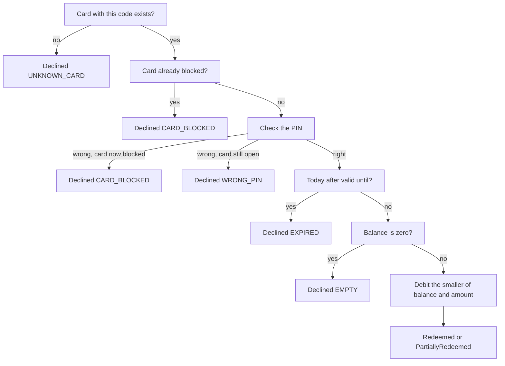
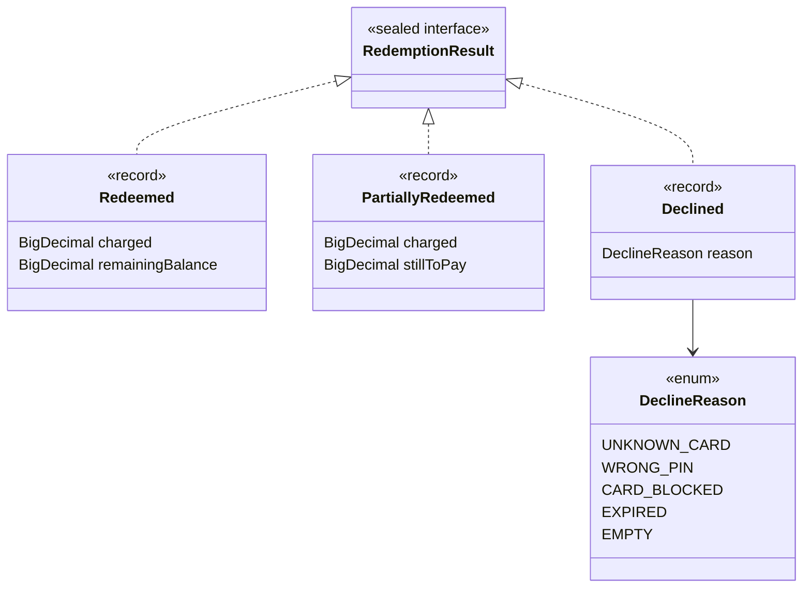

# Task 15 · Gift card redemption: results, not exceptions

| Difficulty | Topics | Time box |
|---|---|---|
| 🟡 Medium | Error handling design: expected business outcomes as a sealed result type vs. exceptions for programming errors · Exhaustive `switch` over results · An entity with a small security rule (PIN attempts) · Value object with format validation | 2–3 h |

> **Background reading:** *Effective Java* Item 69 ("Use exceptions only for exceptional conditions"), Item 70 ("Use checked exceptions for recoverable conditions and runtime exceptions for programming errors"), Item 71 ("Avoid unnecessary use of checked exceptions"), Item 72 ("Favor the use of standard exceptions") · Scott Wlaschin, ["Railway Oriented Programming"](https://fsharpforfunandprofit.com/rop/) (fsharpforfunandprofit.com) · *A Philosophy of Software Design*, ch. 10 ("Define errors out of existence")

---

## The situation

The checkout terminals in our book stores accept gift cards. The old `GiftCardService.redeem` declares five checked exceptions: `CardNotFoundException`, `WrongPinException`, `CardBlockedException`, `CardExpiredException` and `EmptyCardException`. Every caller wraps the call in a `try` with five `catch` blocks. Two callers forgot one of them, so the cashier sees "Unknown error" for a perfectly ordinary situation. A third caller catches `Exception`, and that swallowed a `NullPointerException` for months, because a bug and a declined card looked the same.

The root problem is this: **a declined gift card is not exceptional at a till.** It happens every hour. An exception says "something unexpected went wrong". A wrong PIN is not unexpected. It is one of the normal answers the till can get.

So we model the outcomes as **data**. The service returns a `RedemptionResult`. The compiler then tells us about every caller that does not handle a result.

## The domain

| Term | Meaning |
|---|---|
| **Gift card code** | `XXXX-XXXX-XXXX`, letters A–Z and digits. It is printed on the card. |
| **PIN** | Exactly 4 digits. Three wrong PINs in a row block the card. |
| **Blocked** | The card can no longer be used, not even with the right PIN. The service desk unblocks it. |
| **Balance** | Money on the card, in EUR, with 2 decimals. |
| **Valid until** | The last day the card can be used. It is valid *on* that day. |
| **Redemption** | Paying an amount with the card at the till. |

The decision order of `GiftCardService.redeem` is part of the contract:

The result hierarchy is small and closed:

## What I want from you

Implement the classes below. The starter contains skeletons (`UnsupportedOperationException` bodies) and some complete given files.

1. **[`GiftCardCode`](../src/main/java/io/github/chris013/practice/task15/GiftCardCode.java)(value)** is a record.
   * The constructor trims and upper-cases the input first. `" abcd-1234-efgh "` becomes `ABCD-1234-EFGH`.
   * The format after that is `XXXX-XXXX-XXXX` with `A`–`Z` and `0`–`9` only.
   * A wrong format or a blank value throws `IllegalArgumentException`. `null` throws `NullPointerException`.
2. **[`GiftCard`](../src/main/java/io/github/chris013/practice/task15/GiftCard.java)** is a mutable entity. Its identity is its code.
   * `GiftCard(code, pin, balance, validUntil)`: the PIN must be exactly 4 ASCII digits, else `IllegalArgumentException`. The balance must not be negative and must have at most 2 decimals. Store it with scale 2.
   * `code()`, `balance()`, `validUntil()`, `isBlocked()`.
   * `boolean checkPin(String attempt)`:
     * A right PIN returns `true` and resets the counter of consecutive wrong attempts.
     * A wrong PIN returns `false` and increments the counter. The **third** consecutive wrong PIN blocks the card.
     * A blocked card returns `false` for every attempt, including the right PIN. Its counter no longer changes.
   * `void debit(BigDecimal amount)`: takes the amount off the balance. Zero, negative, more than 2 decimals, or more than the balance are `IllegalArgumentException`. A failed debit leaves the balance unchanged.
3. **[`GiftCardRepository`](../src/main/java/io/github/chris013/practice/task15/GiftCardRepository.java)** and **[`InMemoryGiftCardRepository`](../src/main/java/io/github/chris013/practice/task15/InMemoryGiftCardRepository.java)** are given. Use them as they are.
4. **[`RedemptionResult`](../src/main/java/io/github/chris013/practice/task15/RedemptionResult.java)** is a sealed interface with three records:
   * [`Redeemed`](../src/main/java/io/github/chris013/practice/task15/Redeemed.java)`(charged, remainingBalance)`: the card covered the full amount.
   * [`PartiallyRedeemed`](../src/main/java/io/github/chris013/practice/task15/PartiallyRedeemed.java)`(charged, stillToPay)`: the card had less than the amount. It is now empty.
   * [`Declined`](../src/main/java/io/github/chris013/practice/task15/Declined.java)`(reason)`: nothing was charged.
   * [`DeclineReason`](../src/main/java/io/github/chris013/practice/task15/DeclineReason.java) is given: `UNKNOWN_CARD`, `WRONG_PIN`, `CARD_BLOCKED`, `EXPIRED`, `EMPTY`.
5. **[`GiftCardService`](../src/main/java/io/github/chris013/practice/task15/GiftCardService.java)`(repository, clock)`**: `RedemptionResult redeem(GiftCardCode code, String pin, BigDecimal amount)`.
   * `null` for any argument throws `NullPointerException`.
   * An amount that is zero, negative, or has more than 2 decimals throws `IllegalArgumentException`. `12.500` is accepted, because its third decimal is zero. `12.505` is rejected.
   * The checks run in **this order**, and the first match wins:
     1. no card with this code: `Declined(UNKNOWN_CARD)`;
     2. card already blocked: `Declined(CARD_BLOCKED)`, without checking the PIN;
     3. wrong PIN: `Declined(WRONG_PIN)`. **The attempt that blocks the card returns `Declined(CARD_BLOCKED)` instead**;
     4. today is after `validUntil`: `Declined(EXPIRED)`. The card is valid *on* `validUntil`;
     5. balance is zero: `Declined(EMPTY)`;
     6. otherwise debit the smaller of balance and amount. If the card covered the full amount, return `Redeemed(amount, balance after)`. If not, return `PartiallyRedeemed(balance before, amount minus that)`.
   * Save the card with the repository whenever its state changed: after the PIN check (the counter changed) and after a debit.
   * Use the injected `Clock` for "today". Never `LocalDate.now()` without a clock.
   * Every amount in a result has scale 2.
6. **[`CashierMessages`](../src/main/java/io/github/chris013/practice/task15/CashierMessages.java)** has one static method `String forResult(RedemptionResult result)`. The texts are exact:

| Result | Text |
|---|---|
| `Redeemed` | `Paid 12.50 EUR with gift card. Remaining balance: 7.50 EUR.` |
| `PartiallyRedeemed` | `Gift card covered 5.00 EUR. Please collect 7.50 EUR.` |
| `UNKNOWN_CARD` | `Gift card not found. Please check the code.` |
| `WRONG_PIN` | `Wrong PIN. Please try again.` |
| `CARD_BLOCKED` | `Gift card blocked after too many wrong PINs. Refer the customer to the service desk.` |
| `EXPIRED` | `Gift card expired.` |
| `EMPTY` | `Gift card has no balance left.` |

   * The switch is **exhaustive and has no `default` branch**.
   * Amounts are shown with 2 decimals, so `12.5` is printed as `12.50`.

## Constraints & non-goals

* **No exceptions for business outcomes.** A wrong PIN, an expired card and an empty card are `Declined`, never a thrown exception.
* **No `default` branch** in any switch over `RedemptionResult` or `DeclineReason`.
* `BigDecimal` for money. Compare amounts with `compareTo`, never with `equals`, because `12.5` and `12.50` are different to `equals`.
* No `double`, no `Optional` in the return type of `redeem`, no `boolean` plus a "last error" field.
* No database and no framework. The in-memory repository is enough.
* Do not put the PIN or the card code into an exception message or into a result. Messages end up in logs.
* The PIN is stored as given in this task. Hashing it is a stretch goal.

## How I'd approach it

**Start with the types, then the service.** The three records and the enum are the contract. Once they compile, the tests tell you what the service must do. Write `GiftCardCode` and `GiftCard` first, because the service depends on them.

**Results or exceptions? Use this table in design reviews.** Ask: *is the caller supposed to decide what to do next, based on this situation, as a normal part of the flow?* If yes, it is a result. If the situation is a bug or a broken system, it is an exception.

| Situation | Mechanism | Why |
|---|---|---|
| `amount` is `null` | `NullPointerException` | Programming error. The caller broke the contract. |
| `amount` is negative or zero | `IllegalArgumentException` | Contract violation. The UI should have stopped it. |
| Card code has the wrong format | `IllegalArgumentException` | Input validation. The till validates before it calls us. |
| Unknown card | `Declined(UNKNOWN_CARD)` | Expected business outcome. The cashier asks again. |
| Wrong PIN | `Declined(WRONG_PIN)` | Expected business outcome, and it happens every hour. |
| Card blocked | `Declined(CARD_BLOCKED)` | Expected business outcome with a defined next step. |
| Card expired | `Declined(EXPIRED)` | Expected business outcome. |
| Card empty | `Declined(EMPTY)` | Expected business outcome. |
| Database is down | Unchecked exception from the repository | Infrastructure failure. The till cannot decide anything useful, so it shows a technical error. |

**Why exhaustiveness and no `default` matter.** Suppose someone adds `CARD_NOT_ACTIVATED` to `DeclineReason`. With no `default`, `CashierMessages` stops compiling. The developer must write the message, and the build tells them where. With `default -> "Unknown error"`, it compiles, and the cashier sees "Unknown error" in production. That is the exact bug from the situation section. Exhaustiveness only protects you if you let it.

**Why not `Optional`, `boolean` or a `getLastError()` method?**
* `Optional<Redeemed>` says "it worked or it didn't", and loses the reason. The caller cannot tell a wrong PIN from an unknown card.
* A `boolean` has the same problem, and a `getLastError()` method is worse: the error is hidden state that another call can overwrite, and nothing forces the caller to look at it.

**Why not a generic `Result<T, E>`?** You can write one in Java: a sealed interface with two records. It is a good tool for long pipelines of steps that all fail in the same way. Here the outcomes are the domain itself. Named records such as `Redeemed(charged, remainingBalance)` carry different data for each outcome, and a `Declined` carries a reason from a closed list. With a generic `Either<Redeemed, Declined>` the type names disappear, and the code reads worse at every use. Use the generic version when the vocabulary is generic. Use named results when the vocabulary is the business.

**Save state on every path that changes it.** Two things are easy to forget. First, a wrong PIN changes the counter, so the card must be saved, or the third attempt is never counted across requests. Second, the right PIN on a card that is then found expired still resets the counter, so that save must happen too. Save right after the PIN check, before you decide the outcome.

**Check order is a design decision.** Some examples:
* Blocked before PIN: a blocked card must not even tell the thief whether the PIN is right.
* PIN before expiry: a wrong PIN on an expired card still counts as a failed attempt.
* Expiry before balance: an expired card with 0.00 is `EXPIRED`, because that is the more useful message.

**Debit only after every check passes.** If you debit first and check expiry afterwards, a bug in the expiry branch takes money from the customer and then declines the payment.

**Use `compareTo` and scale 2.** The amount in the request can have trailing zeros (`12.500`), and the balance has scale 2. Normalise the amount once, at the start of `redeem`, and then compare with `compareTo`.

**Read the tests before you start.** `GiftCardServiceTest` has a nested `CheckOrder` group. Each test there names one ordering rule. Read those names first: they are the rules.

## Tests

Run: `mvn test -Dtest='**/task15/**'`

Test files:
* [`GiftCardCodeTest`](../src/test/java/io/github/chris013/practice/task15/GiftCardCodeTest.java): format, normalisation, rejections.
* [`GiftCardTest`](../src/test/java/io/github/chris013/practice/task15/GiftCardTest.java): construction, PIN attempts, debit.
* [`GiftCardServiceTest`](../src/test/java/io/github/chris013/practice/task15/GiftCardServiceTest.java): every outcome, check order, expiry boundary, saves and programming errors. It uses a fixed `Clock`.
* [`CashierMessagesTest`](../src/test/java/io/github/chris013/practice/task15/CashierMessagesTest.java): every message, exact text.
* [`CountingGiftCardRepository`](../src/test/java/io/github/chris013/practice/task15/CountingGiftCardRepository.java) is a small fake that counts saves. The in-memory repository keeps the same object, so a test cannot see a missing save without counting it.

Show the tests

<!-- embed: src/test/java/io/github/chris013/practice/task15/GiftCardServiceTest.java -->
<!-- /embed -->

<!-- embed: src/test/java/io/github/chris013/practice/task15/GiftCardTest.java -->
<!-- /embed -->

<!-- embed: src/test/java/io/github/chris013/practice/task15/GiftCardCodeTest.java -->
<!-- /embed -->

<!-- embed: src/test/java/io/github/chris013/practice/task15/CashierMessagesTest.java -->
<!-- /embed -->

<!-- embed: src/test/java/io/github/chris013/practice/task15/CountingGiftCardRepository.java -->
<!-- /embed -->

## Definition of done

- [ ] All task 15 tests green, and the whole test run takes well under a second.
- [ ] `CashierMessages` has no `default` branch, and adding a `DeclineReason` constant makes it fail to compile.
- [ ] A wrong PIN on the third attempt returns `CARD_BLOCKED`, and the card stays blocked even with the right PIN.
- [ ] The card is valid on its `validUntil` date and expired the day after.
- [ ] Amounts are compared with `compareTo`, and every amount in a result has scale 2.
- [ ] No business outcome is thrown as an exception.
- [ ] The PIN and the card code never appear in an exception message.
- [ ] Your PR description explains which outcomes you chose to model as results, and which as exceptions, and why.

## Stretch goals

1. Add a new reason `CARD_NOT_ACTIVATED` for cards that were sold but not yet activated at the till. Let the compiler show you every place that needs a message. Then decide: should the service check it before the PIN, or after? Explain your answer in the PR.
2. Make the PIN check constant-time and store a hash of the PIN instead of the PIN itself. Hint: `MessageDigest.isEqual` compares two byte arrays in constant time. A salt makes the hash harder to crack. Think about what changes in the tests.
3. A till can send the same redemption twice when the network is slow. Add an `Idempotency-Key` to the request: the second request with the same key returns the first result and charges nothing. Where does the stored result live, and how long do you keep it?
4. Return the `RedemptionResult` from a REST endpoint. Map each record to an HTTP status: is `Declined(WRONG_PIN)` a `200` with a body, or a `4xx`? Defend your choice, because API clients treat the two very differently.

---

## Reference solution

Spoiler: open only after you have made a serious attempt

### Key decisions

**1. A sealed result with three records, and a closed enum for the reasons.** Each outcome carries exactly the data it needs. `Redeemed` has two amounts, `Declined` has a reason. The alternative was a single `Redemption` class with nullable fields, which is the tagged class from task 06 again.

**2. Business outcomes are results; bad arguments are exceptions.** `GiftCardCode` and `redeem` throw for `null`, wrong formats and non-positive amounts, because the till should never send them. A wrong PIN is not a bad argument, so it is a `Declined`. The rule is the one in the table in "How I'd approach it".

**3. The PIN rule lives in `GiftCard`, not in the service.** `checkPin` owns the counter and the blocked flag, so the rule "third wrong attempt blocks" exists in one place and is tested without a repository. The service only decides which result to show. The alternative was a counter field in the service, which would be lost on the next request.

**4. The blocking attempt is reported as `CARD_BLOCKED`.** The service checks `isBlocked()` after the PIN check. The cashier sees "refer the customer" on the attempt that blocked the card, not one attempt later. That was the point of the rule.

**5. Save after every PIN attempt.** A wrong PIN changes the counter, and a right PIN may reset it. Both must reach storage before the outcome is decided, otherwise the counter can be reset by a crash or lost between requests.

**6. Scale normalisation in one place.** `GiftCard.requireCents` rejects more than 2 decimals and returns scale 2. The service calls it on the amount, and the entity calls it on the balance and on every debit. `equals` on `BigDecimal` would make `12.5` and `12.50` different, so every comparison uses `compareTo`.

**7. An exhaustive nested switch for the reasons.** `CashierMessages` uses `case Declined(DeclineReason reason)` and then a switch over the enum. The alternative `case Declined(var reason) when reason == WRONG_PIN` is shorter, but it stops being exhaustive as soon as you write the second guard. A plain switch over the enum is checked by the compiler.

**8. Messages never echo the secret.** The PIN and the code are not in any exception message. Logs and monitoring tools collect messages, and a PIN in a log line is a leak.

### Code

<!-- embed: solutions/src/main/java/io/github/chris013/practice/task15/GiftCardService.java -->
<!-- /embed -->

<!-- embed: solutions/src/main/java/io/github/chris013/practice/task15/GiftCard.java -->
<!-- /embed -->

<!-- embed: solutions/src/main/java/io/github/chris013/practice/task15/GiftCardCode.java -->
<!-- /embed -->

<!-- embed: solutions/src/main/java/io/github/chris013/practice/task15/CashierMessages.java -->
<!-- /embed -->

### What I typically flag in first attempts

| Finding | Why it matters |
|---|---|
| `default -> "Unknown error"` in the cashier switch | The compiler can no longer tell you about a new reason. This is the bug from the situation section, again. |
| A `WRONG_PIN` exception, caught in the service | A normal outcome is modelled as an exception. Every caller must remember to catch it. |
| `redeem` returns `Declined` but the debit happened before the expiry check | Money is taken from a card that is then declined. Debit only after every check passes. |
| The wrong-PIN counter is not saved when the PIN is wrong | The next request starts counting from zero, so the card is never blocked. |
| `balance.equals(amount)` to choose `Redeemed` or `PartiallyRedeemed` | `12.5` and `12.50` are not `equals`. Compare with `compareTo`. |
| `"Wrong PIN " + pin` in an exception message | The PIN ends up in the logs. Never put secrets in messages. |
| `Optional<RedemptionResult>` or a `boolean` plus `getLastError()` | The reason is lost, or it lives in hidden state that can be overwritten. |

