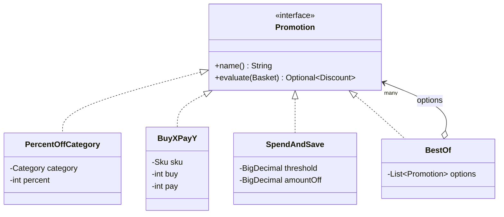
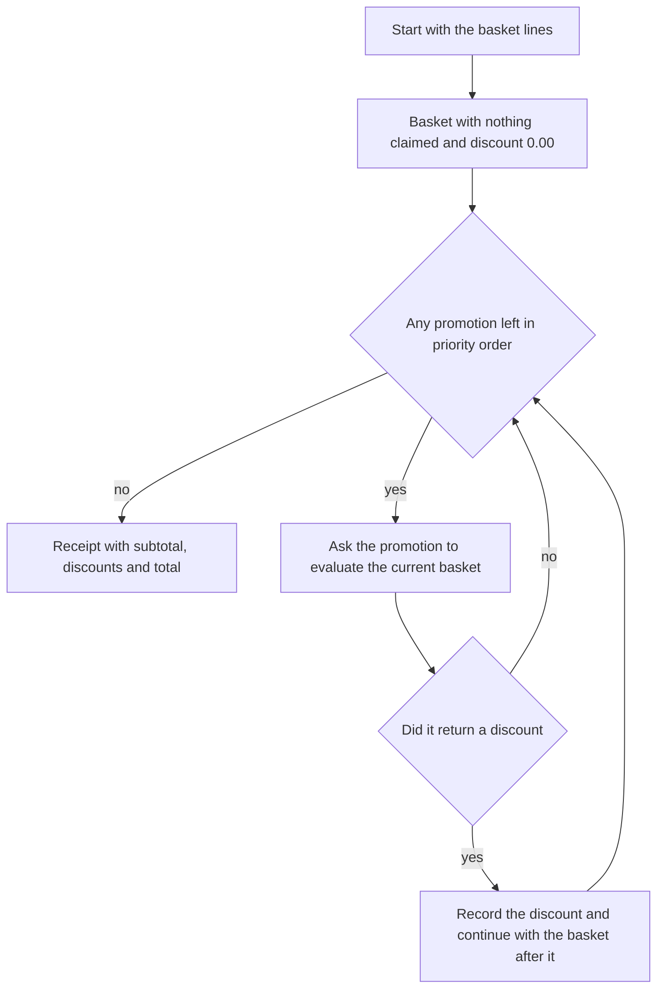

# Task 16 · A promotion engine with Strategy and Composite

| Difficulty | Topics | Time box |
|---|---|---|
| 🔴 Hard | Strategy and Composite patterns · Open/closed principle in practice (open interface vs. sealed hierarchy, contrast with task 06) · Immutable pipeline state · `BigDecimal` money calculations with rounding · Designing for rules that marketing keeps changing | 3–4 h |

> **Background reading:** GoF *Design Patterns*, "Strategy" and "Composite" · *Effective Java* Item 42 ("Prefer lambdas to anonymous classes") and Item 43 ("Prefer method references to lambdas") · Robert C. Martin, "The Open-Closed Principle" (*C++ Report*, 1996; reprinted in *Agile Software Development: Principles, Patterns, and Practices*) · *Refactoring* (2nd ed.), "Replace Conditional with Polymorphism" · Task 06 in this repo, for the contrast with sealed types

---

## The situation

Our online grocery shop launches a new promotion almost every week. Marketing wants "3 for 2 on pasta", "10% off bakery", "5 EUR off from 50 EUR", and "the better of two offers" when two campaigns overlap. Today every new promotion means a new `if` inside `PriceCalculator`. That class is 600 lines long, and every change needs a deploy.

Soon marketing will configure promotions themselves, from a file. So we want three things:

* **Promotions as small objects** that can be combined, one class per kind of rule.
* **An engine** that applies them in a clear order, with clear rules for conflicts. A product must not be discounted twice.
* **A receipt** that explains what happened. When a customer asks "why didn't I get 10% on pasta?", support must be able to answer from the data, not from the code.

I want you to build the model and the engine. Then I want you to understand *why* the design has an open interface where task 06 used a sealed one. That question comes up in every design review.

## The domain

| Term | Meaning |
|---|---|
| **Basket line** | One product on the basket, with a unit price and a quantity. Its total is price times quantity. |
| **Claim** | A discount *uses up* a product (its SKU). Later line-level promotions must leave that product alone. |
| **Line-level promotion** | Looks at specific products: a category or one SKU. It claims those products. |
| **Basket-level promotion** | Looks only at the total ("5 off from 50"). It claims nothing. |
| **Discount** | What one promotion took off: its name, a positive amount, and the SKUs it claimed. |
| **Receipt** | The subtotal, the discounts that applied in order, and the total the customer pays. |

### The promotion strategies

`PercentOffCategory`, `BuyXPayY` and `SpendAndSave` are the strategies: each one is an interchangeable algorithm behind the same interface. `BestOf` is the composite: it *is a* `Promotion`, and it *has* `Promotion`s. Because it is a `Promotion` too, a `BestOf` can contain another `BestOf`, and the engine does not need to know the difference.

### The pipeline

### One basket, step by step

Here is the grocery run the tests use. Six lines, subtotal 20.64.

| Line | Price times quantity | Line total | Promotion that claimed it | Discount |
|---|---|---|---|---|
| Pasta | 1.49 × 3 | 4.47 | 3 for 2 on pasta | 1.49 |
| Sourdough | 2.40 × 1 | 2.40 | 10% off bakery | 0.33 (both bakery lines together) |
| Rolls | 0.89 × 1 | 0.89 | 10% off bakery | (shared with sourdough) |
| Orange juice | 1.99 × 2 | 3.98 | Drinks deal, which picked Juice 2 for 1 | 1.99 |
| Butter | 3.20 × 2 | 6.40 | nobody | 0.00 |
| Dish soap | 2.50 × 1 | 2.50 | nobody | 0.00 |
| **Subtotal** | | **20.64** | | |

The engine applies the promotions in this order:

| Step | Promotion | Does it apply? | Discount | Basket total after |
|---|---|---|---|---|
| 1 | 3 for 2 on pasta | Yes: one full group of three, so one free pasta | 1.49 | 19.15 |
| 2 | 10% off bakery | Yes: 3.29 × 10% = 0.329, rounded half up to 0.33 | 0.33 | 18.82 |
| 3 | Drinks deal (best of two) | 20% off drinks is 0.80; Juice 2 for 1 is 1.99, so it wins | 1.99 | 16.83 |
| 4 | 5 off from 16 | Yes: 16.83 is at least 16.00 | 5.00 | 11.83 |

The customer pays **11.83**. The table uses 16.00 as the threshold, not 20.00, because with 20.00 in the last position the basket-level promotion would never apply and the example would show nothing.

Now replace step 4 with "5 off from 20". In the last position it sees 16.83, which is below 20.00, so it does not apply and the customer pays **16.83**. Put the same "5 off from 20" in the first position instead: it sees the full 20.64, applies, and the line promotions still apply after it, so the customer pays **11.83**. The same promotions in a different order give a different receipt. That is the rule the engine must make visible.

## What I want from you

Implement the promotions, the `Basket` and the `PromotionEngine`. Some types are given, complete, in the starter:
[`Sku`](../src/main/java/io/github/chris013/practice/task16/Sku.java),
[`Category`](../src/main/java/io/github/chris013/practice/task16/Category.java),
[`BasketLine`](../src/main/java/io/github/chris013/practice/task16/BasketLine.java),
[`Discount`](../src/main/java/io/github/chris013/practice/task16/Discount.java),
[`Receipt`](../src/main/java/io/github/chris013/practice/task16/Receipt.java),
[`Promotion`](../src/main/java/io/github/chris013/practice/task16/Promotion.java) and the package-private helper
[`Cents`](../src/main/java/io/github/chris013/practice/task16/Cents.java), which holds the money rules.
Read their validation before you start: it sets the money rules for everything else.

1. **[`Basket`](../src/main/java/io/github/chris013/practice/task16/Basket.java)** is an immutable record with `lines`, `claimedSkus` and `discountSoFar`.
   * `Basket.of(lines)` starts with nothing claimed and a discount of 0.00. A `null` list is a `NullPointerException`.
   * `subtotal()` is the sum of all line totals. An empty basket has the subtotal `0.00`, with two decimals.
   * `total()` is `subtotal()` minus `discountSoFar`.
   * `unclaimedLines()` returns the lines whose SKU is not in `claimedSkus`.
   * `after(discount)` returns a **new** basket: the discount amount is added to `discountSoFar`, and the discount's SKUs are added to `claimedSkus`. The original basket does not change.
   * The basket copies its collections, so changing the list you passed in does not change the basket.
2. **[`PercentOffCategory`](../src/main/java/io/github/chris013/practice/task16/PercentOffCategory.java)(name, category, percent)** takes a percentage off every unclaimed line in one category.
   * `percent` must be from 1 to 100 (both inclusive), otherwise `IllegalArgumentException`.
   * The amount is the sum of the eligible lines times `percent / 100`, rounded **once**, `HALF_UP`, to two decimals. Example: 10% of 0.05 is 0.005, which becomes 0.01.
   * It claims the SKUs of the lines it discounted.
   * If there are no eligible lines, or the rounded amount is 0.00, it returns empty. Nothing is claimed.
3. **[`BuyXPayY`](../src/main/java/io/github/chris013/practice/task16/BuyXPayY.java)(name, sku, buy, pay)** gives free units on one product, for example "buy 3, pay for 2".
   * It needs `buy > pay >= 1`, otherwise `IllegalArgumentException`.
   * It only applies if that SKU's line is still unclaimed.
   * Free units = `(quantity / buy) × (buy − pay)`. Only full groups count: 5 units with "3 for 2" give one free unit, not two.
   * The amount is the free units times the line's unit price. It claims that SKU.
   * No full group, or an amount of 0.00: it returns empty.
4. **[`SpendAndSave`](../src/main/java/io/github/chris013/practice/task16/SpendAndSave.java)(name, threshold, amountOff)** is a basket-level promotion.
   * If `basket.total()` is at least `threshold`, the discount is `min(amountOff, basket.total())`. Exactly equal to the threshold counts as reaching it.
   * It claims no SKUs.
   * `threshold` must not be negative, and `amountOff` must be positive. Both must have at most two decimals.
   * If the discount would be 0.00, it returns empty.
5. **[`BestOf`](../src/main/java/io/github/chris013/practice/task16/BestOf.java)(name, options)** is the composite.
   * It evaluates **every** option against the **same** basket and returns the discount with the highest amount.
   * On a tie, the option that comes first in the list wins.
   * It returns the winning `Discount` unchanged. The receipt therefore names the promotion that was really applied ("Juice 2 for 1"), not the wrapper's name. For nested composites, that is the innermost winner.
   * If no option applies, it returns empty. An empty list of options is an `IllegalArgumentException`.
   * A `BestOf` can contain another `BestOf`.
6. **[`PromotionEngine`](../src/main/java/io/github/chris013/practice/task16/PromotionEngine.java)(promotionsInPriorityOrder)** prices a basket.
   * Start with `Basket.of(lines)`. For each promotion in order, evaluate it on the **current** basket. If it returns a discount, record it and continue with `basket.after(discount)`.
   * The receipt's subtotal is the basket subtotal. Its total is the subtotal minus the sum of all discounts, and it is **never below 0.00**.
   * An empty basket gives subtotal `0.00`, no discounts and total `0.00`.
   * The engine must not look at the type of a promotion. No `instanceof`, no `switch` on the kind.
7. Every money value is a `BigDecimal` with exactly two decimals. Never a `double`. Never a `float`.

## Constraints & non-goals

* **No JSON, no config files, no database.** The promotions are created in code, in tests. Loading them is stretch goal 5.
* **Do not make `Promotion` sealed.** It must stay open, so that marketing can add a kind of promotion without touching the engine or the other promotions. The contrast is the point of this task.
* **Promotions must not change the basket** they are given. They look and return a `Discount`. They do not mutate anything.
* **The engine knows nothing about specific promotions.** It only calls `evaluate`.
* **No time.** Validity windows (when a promotion is active) are stretch goal 2.
* **No mocking framework.** The tests use real promotions and one small anonymous class for a custom promotion.

## How I'd approach it

* **Start with `Basket`.** It is a small, immutable value, and everything else depends on it. Write `after` as "return a new record", and check in your test that the original is unchanged. If that test is hard to write, the design is wrong.
* **Then the three line/basket promotions.** Each one is a few lines once the arithmetic is right. Do the arithmetic on paper first, for the worked example. Then write the test with the exact cents.
* **Then `BestOf`.** Compare amounts with `compareTo`, not with `equals` and not with `double`. The loop has one rule that is easy to get wrong: a tie goes to the first option, so only replace the best when the new amount is **strictly** greater.
* **Then the engine.** It should be a loop with about ten lines. If it grows, something belongs in a promotion or in `Basket`.

### Strategy versus a sealed hierarchy

Task 06 used a sealed interface with records and a `switch`. That was the right choice there: the set of shipment types is closed, and the operation "calculate the price" is what grows. A `switch` over a closed set makes that operation easy to add, and the compiler tells you every place that must change when a shipment type is added.

Here it is the other way round. Marketing adds **kinds of promotion** every week, and the operation "evaluate against a basket" is the one thing every promotion does. With a sealed hierarchy, every new promotion kind would mean editing the sealed list and every `switch` that matches on it. With an open interface, a new promotion is a new class. No existing code changes. The engine does not even recompile.

This is the **Open/Closed Principle** in practice. The price is that the compiler cannot list all promotions for you. You accept that, because the set is open by design.

### Why an immutable basket

If a promotion could change the basket, the order of promotions would matter in ways nobody can see from reading the code. Each promotion would have to know what the earlier ones did. With an immutable `Basket`, a promotion gets a value and returns a value. The engine holds the only "current" basket, and it changes it in exactly one place. When you read the engine, the state is always `Basket` at a known step. That is much easier to test, and it makes the receipt explainable.

### Lambdas, and why `Promotion` is not one yet

A promotion is almost a functional interface: it has one interesting method, `evaluate`. But it also has `name()`, and the name goes on the receipt. So it has two abstract methods and a lambda alone is not enough. That is why the four strategies are classes.

Effective Java Item 42 says to prefer lambdas to anonymous classes for simple behaviour. The same idea applies to a one-off campaign: "free delivery day" needs a name and some logic, but no state and no special type. A factory such as `Promotion.of(name, fn)` would let you write that in one line. Try it in stretch goal 4, and notice what the name costs you.

### Money rules

* Compute with `BigDecimal`. Make sure every amount has scale 2 before it goes into a `Discount`.
* For a percentage, multiply first and divide last: `sum.multiply(percent).divide(100, 2, HALF_UP)`. Round **once**, on the category total, not on each line.
* A discount of 0.00 is not a discount. `Discount` refuses it, so return empty instead.
* Never let the total go below zero. Discounts are computed from the basket, so they should never exceed it, but the receipt should not trust that. Clamp it.

### Claims

The rule is simple to state and easy to break. A line-level promotion looks only at `unclaimedLines()`. When it applies, its discount claims the SKUs it used. A `BuyXPayY` on pasta does not apply if a `PercentOffCategory` on pasta already claimed the pasta line. The reverse is true too: whichever runs first wins. That is why the priority order is part of the business rules, and why the receipt must show the order.

### Pitfalls

* **Floats for money.** `double` cannot represent most decimal cents exactly. `0.1 + 0.2` is `0.30000000000000004` in Java. Use `BigDecimal` and check the scale.
* **Rounding per unit.** Rounding each unit of a percentage discount gives a different total from rounding the category once. Pick one rule and test it with a case where the two differ.
* **Mutable baskets.** A promotion that sets a field on the basket makes the result depend on call order in a hidden way.
* **`instanceof` in the engine.** The moment the engine asks "is this a `BuyXPayY`?", every new promotion means a change in the engine. Keep the engine ignorant.
* **`BestOf` that applies all options.** A composite that stacks every option is not "the better of two offers". It must choose one.
* **Claims that are ignored.** If a later promotion can still use a product that an earlier one claimed, the customer gets the discount twice.
* **Negative totals.** A promotion that returns a large discount must not produce a negative amount on the receipt.

## Tests

Run: `mvn test -Dtest='**/task16/**'`

* [`BasketTest`](../src/test/java/io/github/chris013/practice/task16/BasketTest.java): totals, claims, immutability, and the validation of the given types.
* [`PromotionsTest`](../src/test/java/io/github/chris013/practice/task16/PromotionsTest.java): one `@Nested` group per promotion, with the boundaries.
* [`BestOfTest`](../src/test/java/io/github/chris013/practice/task16/BestOfTest.java): the highest discount, ties, names, nested composites and empty results.
* [`PromotionEngineTest`](../src/test/java/io/github/chris013/practice/task16/PromotionEngineTest.java): the worked example to the cent, claims, order, empty baskets and the zero floor.

Several of these tests check types that are already complete, so they pass on the starter. The rest fail until you implement the skeletons.

Show the tests

<!-- embed: src/test/java/io/github/chris013/practice/task16/Lines.java -->
<!-- /embed -->

<!-- embed: src/test/java/io/github/chris013/practice/task16/BasketTest.java -->
<!-- /embed -->

<!-- embed: src/test/java/io/github/chris013/practice/task16/PromotionsTest.java -->
<!-- /embed -->

<!-- embed: src/test/java/io/github/chris013/practice/task16/BestOfTest.java -->
<!-- /embed -->

<!-- embed: src/test/java/io/github/chris013/practice/task16/PromotionEngineTest.java -->
<!-- /embed -->

## Definition of done

- [ ] All tests green, and the whole task runs in well under a second.
- [ ] Every money value has exactly two decimals, and no `double` or `float` appears anywhere.
- [ ] `Basket` is immutable: `after` returns a new basket and leaves the old one unchanged.
- [ ] A claimed SKU is never discounted again by a line-level promotion.
- [ ] `BestOf` evaluates every option on the same basket and returns exactly one discount.
- [ ] `PromotionEngine` has no `instanceof` and no `switch` on promotion types.
- [ ] `Promotion` is still an open interface.
- [ ] Your PR description explains which order you would put the promotions in for the grocery shop, and why.

## Stretch goals

1. **An `AllOf` composite.** It applies all of its options in sequence, each one seeing the basket after the previous ones, and returns one discount with the total amount and the union of the claimed SKUs. How would its name look on the receipt? Is one discount still the right model?
2. **Validity windows.** Write a decorator (see task 07) that wraps any `Promotion` and only evaluates it between a start and an end instant. Take the time from an injected `Clock`, read once per evaluation. Where does it sit in the stack: inside or outside a `BestOf`?
3. **Answer "why didn't I get 10% on pasta?".** Today `evaluate` returns empty and the reason is lost. Design a result type with two outcomes: applied with a `Discount`, or not applied with a reason. Should that be a sealed interface, as in task 06? Why is this a closed set when `Promotion` is open?
4. **A factory for one-off campaigns.** Add `static Promotion of(String name, Function<Basket, Optional<Discount>> rule)`. Use it for a campaign that happens once. What does the name cost you, and does the lambda make the promotion easier to test?
5. **Load promotions from JSON.** Map a `"type"` field to a factory, not to a `switch` in the engine. Validate everything when you load the file, so that a bad campaign fails at startup and never at the checkout. Which of the rules in this task are checked at load time, and which only at pricing time?

---

## Reference solution

Spoiler: open only after you have made a serious attempt

### Key decisions

**1. `Promotion` stays an open interface.** The engine and the `BestOf` composite depend only on `name()` and `evaluate`. A new kind of promotion is a new class, and nothing that exists has to change. The alternative, a sealed interface with a `switch` in the engine, would make each new promotion a change in several places. Task 06 chose sealed types because its set was closed. Here the set is open and the operation is fixed, which is the reverse situation.

**2. `Basket` is an immutable record, and `after` returns a new one.** The engine holds the only "current" basket and reassigns it in one place. The alternative was a mutable basket that promotions write to. That makes the result depend on hidden call order, and it makes the receipt impossible to explain step by step.

**3. The claims live in the basket, not in the promotions.** Each promotion reads `claimedSkus` and `unclaimedLines`. A promotion does not need to know about the others. The alternative, each promotion keeping its own list of "already used" products, would make the order rules spread over the whole code base.

**4. `BestOf` returns the winning `Discount` unchanged.** The receipt says what was applied, so the customer and support see "Juice 2 for 1", not "Drinks deal". The rejected alternative was to rebuild the discount with the wrapper's name, which hides the reason. Ties are resolved by a strict `>`, so the first option keeps the win.

**5. Round once, on the sum, with `HALF_UP`.** `PercentOffCategory` adds the eligible lines first and then multiplies and divides once. The rejected alternative was rounding each line, which can differ by a cent from what the customer sees on the category total. A promotion that would give 0.00 returns empty, because `Discount` refuses a zero amount and "no discount" is the honest answer.

**6. The engine clamps the total, and does nothing else clever.** The loop is simple, and the zero floor is applied only at the end, on the receipt. The alternative of clamping in every promotion would spread the rule and still miss a buggy promotion that returns a huge discount.

### Code

<!-- embed: solutions/src/main/java/io/github/chris013/practice/task16/Basket.java -->
<!-- /embed -->

<!-- embed: solutions/src/main/java/io/github/chris013/practice/task16/PercentOffCategory.java -->
<!-- /embed -->

<!-- embed: solutions/src/main/java/io/github/chris013/practice/task16/BuyXPayY.java -->
<!-- /embed -->

<!-- embed: solutions/src/main/java/io/github/chris013/practice/task16/SpendAndSave.java -->
<!-- /embed -->

<!-- embed: solutions/src/main/java/io/github/chris013/practice/task16/BestOf.java -->
<!-- /embed -->

<!-- embed: solutions/src/main/java/io/github/chris013/practice/task16/PromotionEngine.java -->
<!-- /embed -->

### What I typically flag in first attempts

| Finding | Why it matters |
|---|---|
| `double` or `float` for prices or percentages | Binary floating point cannot hold decimal cents exactly. The receipt is wrong by a cent now and then, and nobody can say why. |
| Rounding each unit or each line, not the category total | The customer sees a different discount from the one on the category. Pick one rule, state it and test a case where it matters. |
| A promotion that changes the basket or a list in it | The result depends on call order, and the receipt can no longer explain itself. |
| `instanceof BuyXPayY` in the engine | Every new promotion now changes the engine. The point of the strategy was to avoid that. |
| `BestOf` that applies every option | "The better of two offers" stops being a choice. The customer gets both offers, or the code gets very hard to reason about. |
| Claims ignored, or claims checked only in the engine | A later promotion can use a product an earlier one has already used up. The customer gets the discount twice. |
| No zero floor, or the floor in the wrong place | A large discount makes the receipt total negative. Clamp the receipt total, and remember that a zero discount is not a discount at all. |

