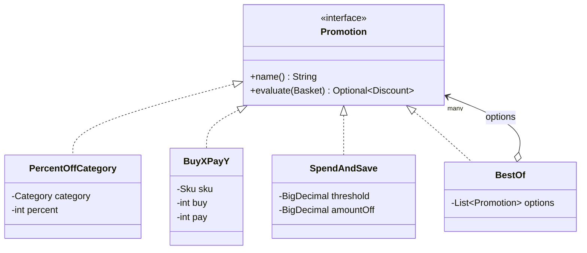
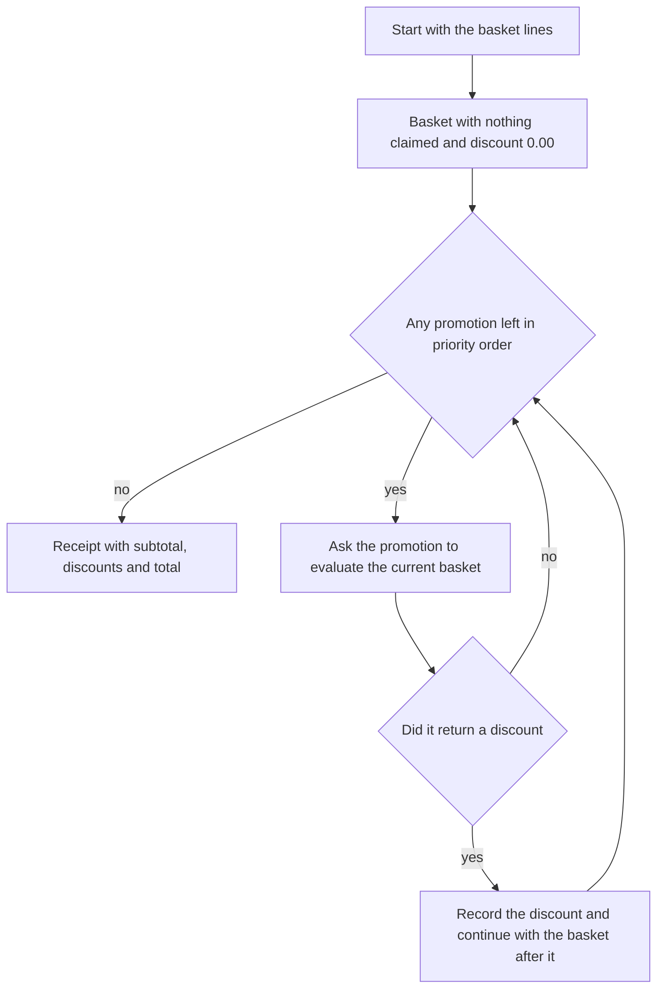

# Task 16 · A promotion engine with Strategy and Composite

| Difficulty | Topics | Time box |
|---|---|---|
| 🔴 Hard | Strategy and Composite patterns · Open/closed principle in practice (open interface vs. sealed hierarchy, contrast with task 06) · Immutable pipeline state · `BigDecimal` money calculations with rounding · Designing for rules that marketing keeps changing | 3–4 h |

> **Background reading:** GoF *Design Patterns*, "Strategy" and "Composite" · *Effective Java* Item 42 ("Prefer lambdas to anonymous classes") and Item 43 ("Prefer method references to lambdas") · Robert C. Martin, "The Open-Closed Principle" (*C++ Report*, 1996; reprinted in *Agile Software Development: Principles, Patterns, and Practices*) · *Refactoring* (2nd ed.), "Replace Conditional with Polymorphism" · Task 06 in this repo, for the contrast with sealed types

---

## The situation

Our online grocery shop launches a new promotion almost every week. Marketing wants "3 for 2 on pasta", "10% off bakery", "5 EUR off from 50 EUR", and "the better of two offers" when two campaigns overlap. Today every new promotion means a new `if` inside `PriceCalculator`. That class is 600 lines long, and every change needs a deploy.

Soon marketing will configure promotions themselves, from a file. So we want three things:

* **Promotions as small objects** that can be combined, one class per kind of rule.
* **An engine** that applies them in a clear order, with clear rules for conflicts. A product must not be discounted twice.
* **A receipt** that explains what happened. When a customer asks "why didn't I get 10% on pasta?", support must be able to answer from the data, not from the code.

I want you to build the model and the engine. Then I want you to understand *why* the design has an open interface where task 06 used a sealed one. That question comes up in every design review.

## The domain

| Term | Meaning |
|---|---|
| **Basket line** | One product on the basket, with a unit price and a quantity. Its total is price times quantity. |
| **Claim** | A discount *uses up* a product (its SKU). Later line-level promotions must leave that product alone. |
| **Line-level promotion** | Looks at specific products: a category or one SKU. It claims those products. |
| **Basket-level promotion** | Looks only at the total ("5 off from 50"). It claims nothing. |
| **Discount** | What one promotion took off: its name, a positive amount, and the SKUs it claimed. |
| **Receipt** | The subtotal, the discounts that applied in order, and the total the customer pays. |

### The promotion strategies



`PercentOffCategory`, `BuyXPayY` and `SpendAndSave` are the strategies: each one is an interchangeable algorithm behind the same interface. `BestOf` is the composite: it *is a* `Promotion`, and it *has* `Promotion`s. Because it is a `Promotion` too, a `BestOf` can contain another `BestOf`, and the engine does not need to know the difference.

### The pipeline



### One basket, step by step

Here is the grocery run the tests use. Six lines, subtotal 20.64.

| Line | Price times quantity | Line total | Promotion that claimed it | Discount |
|---|---|---|---|---|
| Pasta | 1.49 × 3 | 4.47 | 3 for 2 on pasta | 1.49 |
| Sourdough | 2.40 × 1 | 2.40 | 10% off bakery | 0.33 (both bakery lines together) |
| Rolls | 0.89 × 1 | 0.89 | 10% off bakery | (shared with sourdough) |
| Orange juice | 1.99 × 2 | 3.98 | Drinks deal, which picked Juice 2 for 1 | 1.99 |
| Butter | 3.20 × 2 | 6.40 | nobody | 0.00 |
| Dish soap | 2.50 × 1 | 2.50 | nobody | 0.00 |
| **Subtotal** | | **20.64** | | |

The engine applies the promotions in this order:

| Step | Promotion | Does it apply? | Discount | Basket total after |
|---|---|---|---|---|
| 1 | 3 for 2 on pasta | Yes: one full group of three, so one free pasta | 1.49 | 19.15 |
| 2 | 10% off bakery | Yes: 3.29 × 10% = 0.329, rounded half up to 0.33 | 0.33 | 18.82 |
| 3 | Drinks deal (best of two) | 20% off drinks is 0.80; Juice 2 for 1 is 1.99, so it wins | 1.99 | 16.83 |
| 4 | 5 off from 16 | Yes: 16.83 is at least 16.00 | 5.00 | 11.83 |

The customer pays **11.83**. The table uses 16.00 as the threshold, not 20.00, because with 20.00 in the last position the basket-level promotion would not apply to this basket and the example would show nothing.

Now replace step 4 with "5 off from 20". In the last position it sees 16.83, which is below 20.00, so it does not apply and the customer pays **16.83**. Put the same "5 off from 20" in the first position instead: it sees the full 20.64, applies, and the line promotions still apply after it, so the customer pays **11.83**. The same promotions in a different order give a different receipt. That is the rule the engine must make visible.

## What I want from you

Implement the promotions, the `Basket` and the `PromotionEngine`. Some types are given, complete, in the starter:
[`Sku`](../src/main/java/io/github/chris013/practice/task16/Sku.java),
[`Category`](../src/main/java/io/github/chris013/practice/task16/Category.java),
[`BasketLine`](../src/main/java/io/github/chris013/practice/task16/BasketLine.java),
[`Discount`](../src/main/java/io/github/chris013/practice/task16/Discount.java),
[`Receipt`](../src/main/java/io/github/chris013/practice/task16/Receipt.java),
[`Promotion`](../src/main/java/io/github/chris013/practice/task16/Promotion.java) and the package-private helper
[`Cents`](../src/main/java/io/github/chris013/practice/task16/Cents.java), which holds the money rules.
Read their validation before you start: it sets the money rules for everything else.

1. **[`Basket`](../src/main/java/io/github/chris013/practice/task16/Basket.java)** is an immutable record with `lines`, `claimedSkus` and `discountSoFar`.
   * `Basket.of(lines)` starts with nothing claimed and a discount of 0.00. A `null` list is a `NullPointerException`.
   * `subtotal()` is the sum of all line totals. An empty basket has the subtotal `0.00`, with two decimals.
   * `total()` is `subtotal()` minus `discountSoFar`.
   * `unclaimedLines()` returns the lines whose SKU is not in `claimedSkus`.
   * `after(discount)` returns a **new** basket: the discount amount is added to `discountSoFar`, and the discount's SKUs are added to `claimedSkus`. The original basket does not change.
   * The basket copies its collections, so changing the list you passed in does not change the basket.
2. **[`PercentOffCategory`](../src/main/java/io/github/chris013/practice/task16/PercentOffCategory.java)(name, category, percent)** takes a percentage off every unclaimed line in one category.
   * `percent` must be from 1 to 100 (both inclusive), otherwise `IllegalArgumentException`.
   * The amount is the sum of the eligible lines times `percent / 100`, rounded **once**, `HALF_UP`, to two decimals. Example: 10% of 0.05 is 0.005, which becomes 0.01.
   * It claims the SKUs of the lines it discounted.
   * If there are no eligible lines, or the rounded amount is 0.00, it returns empty. Nothing is claimed.
3. **[`BuyXPayY`](../src/main/java/io/github/chris013/practice/task16/BuyXPayY.java)(name, sku, buy, pay)** gives free units on one product, for example "buy 3, pay for 2".
   * It needs `buy > pay >= 1`, otherwise `IllegalArgumentException`.
   * It only applies if that SKU's line is still unclaimed.
   * Free units = `(quantity / buy) × (buy − pay)`. Only full groups count: 5 units with "3 for 2" give one free unit, not two.
   * The amount is the free units times the line's unit price. It claims that SKU.
   * No full group, or an amount of 0.00: it returns empty.
4. **[`SpendAndSave`](../src/main/java/io/github/chris013/practice/task16/SpendAndSave.java)(name, threshold, amountOff)** is a basket-level promotion.
   * If `basket.total()` is at least `threshold`, the discount is `min(amountOff, basket.total())`. Exactly equal to the threshold counts as reaching it.
   * It claims no SKUs.
   * `threshold` must not be negative, and `amountOff` must be positive. Both must have at most two decimals.
   * If the discount would be 0.00, it returns empty.
5. **[`BestOf`](../src/main/java/io/github/chris013/practice/task16/BestOf.java)(name, options)** is the composite.
   * It evaluates **every** option against the **same** basket and returns the discount with the highest amount.
   * On a tie, the option that comes first in the list wins.
   * It returns the winning `Discount` unchanged. The receipt therefore names the promotion that was really applied ("Juice 2 for 1"), not the wrapper's name. For nested composites, that is the innermost winner.
   * If no option applies, it returns empty. An empty list of options is an `IllegalArgumentException`.
   * A `BestOf` can contain another `BestOf`.
6. **[`PromotionEngine`](../src/main/java/io/github/chris013/practice/task16/PromotionEngine.java)(promotionsInPriorityOrder)** prices a basket.
   * Start with `Basket.of(lines)`. For each promotion in order, evaluate it on the **current** basket. If it returns a discount, record it and continue with `basket.after(discount)`.
   * The receipt's subtotal is the basket subtotal. Its total is the subtotal minus the sum of all discounts, and it is **never below 0.00**.
   * An empty basket gives subtotal `0.00`, no discounts and total `0.00`.
   * The engine must not look at the type of a promotion. No `instanceof`, no `switch` on the kind.
7. Every money value is a `BigDecimal` with exactly two decimals. Never a `double`. Never a `float`.

## Constraints & non-goals

* **No JSON, no config files, no database.** The promotions are created in code, in tests. Loading them is stretch goal 5.
* **Do not make `Promotion` sealed.** It must stay open, so that marketing can add a kind of promotion without touching the engine or the other promotions. The contrast is the point of this task.
* **Promotions must not change the basket** they are given. They look and return a `Discount`. They do not mutate anything.
* **The engine knows nothing about specific promotions.** It only calls `evaluate`.
* **No time.** Validity windows (when a promotion is active) are stretch goal 2.
* **No mocking framework.** The tests use real promotions and one small anonymous class for a custom promotion.

## How I'd approach it

* **Start with `Basket`.** It is a small, immutable value, and everything else depends on it. Write `after` as "return a new record", and check in your test that the original is unchanged. If that test is hard to write, the design is wrong.
* **Then the three line/basket promotions.** Each one is a few lines once the arithmetic is right. Do the arithmetic on paper first, for the worked example. Then write the test with the exact cents.
* **Then `BestOf`.** Compare amounts with `compareTo`, not with `equals` and not with `double`. The loop has one rule that is easy to get wrong: a tie goes to the first option, so only replace the best when the new amount is **strictly** greater.
* **Then the engine.** It should be a loop with about ten lines. If it grows, something belongs in a promotion or in `Basket`.

### Strategy versus a sealed hierarchy

Task 06 used a sealed interface with records and a `switch`. That was the right choice there: the set of shipment types is closed, and the operation "calculate the price" is what grows. A `switch` over a closed set makes that operation easy to add, and the compiler tells you every place that must change when a shipment type is added.

Here it is the other way round. Marketing adds **kinds of promotion** every week, and the operation "evaluate against a basket" is the one thing every promotion does. With a sealed hierarchy, every new promotion kind would mean editing the sealed list and every `switch` that matches on it. With an open interface, a new promotion is a new class. No existing code changes. The engine does not even recompile.

This is the **Open/Closed Principle** in practice. The price is that the compiler cannot list all promotions for you. You accept that, because the set is open by design.

### Why an immutable basket

If a promotion could change the basket, the order of promotions would matter in ways nobody can see from reading the code. Each promotion would have to know what the earlier ones did. With an immutable `Basket`, a promotion gets a value and returns a value. The engine holds the only "current" basket, and it changes it in exactly one place. When you read the engine, the state is always `Basket` at a known step. That is much easier to test, and it makes the receipt explainable.

### Lambdas, and why `Promotion` is not one yet

A promotion is almost a functional interface: it has one interesting method, `evaluate`. But it also has `name()`, and the name goes on the receipt. So it has two abstract methods and a lambda alone is not enough. That is why the four strategies are classes.

Effective Java Item 42 says to prefer lambdas to anonymous classes for simple behaviour. The same idea applies to a one-off campaign: "free delivery day" needs a name and some logic, but no state and no special type. A factory such as `Promotion.of(name, fn)` would let you write that in one line. Try it in stretch goal 4, and notice what the name costs you.

### Money rules

* Compute with `BigDecimal`. Make sure every amount has scale 2 before it goes into a `Discount`.
* For a percentage, multiply first and divide last: `sum.multiply(percent).divide(100, 2, HALF_UP)`. Round **once**, on the category total, not on each line.
* A discount of 0.00 is not a discount. `Discount` refuses it, so return empty instead.
* Never let the total go below zero. Discounts are computed from the basket, so they should never exceed it, but the receipt should not trust that. Clamp it.

### Claims

The rule is simple to state and easy to break. A line-level promotion looks only at `unclaimedLines()`. When it applies, its discount claims the SKUs it used. A `BuyXPayY` on pasta does not apply if a `PercentOffCategory` on pasta already claimed the pasta line. The reverse is true too: whichever runs first wins. That is why the priority order is part of the business rules, and why the receipt must show the order.

### Pitfalls

* **Floats for money.** `double` cannot represent most decimal cents exactly. `0.1 + 0.2` is `0.30000000000000004` in Java. Use `BigDecimal` and check the scale.
* **Rounding per unit.** Rounding each unit of a percentage discount gives a different total from rounding the category once. Pick one rule and test it with a case where the two differ.
* **Mutable baskets.** A promotion that sets a field on the basket makes the result depend on call order in a hidden way.
* **`instanceof` in the engine.** The moment the engine asks "is this a `BuyXPayY`?", every new promotion means a change in the engine. Keep the engine ignorant.
* **`BestOf` that applies all options.** A composite that stacks every option is not "the better of two offers". It must choose one.
* **Claims that are ignored.** If a later promotion can still use a product that an earlier one claimed, the customer gets the discount twice.
* **Negative totals.** A promotion that returns a large discount must not produce a negative amount on the receipt.

## Tests

Run: `mvn test -Dtest='**/task16/**'`

* [`BasketTest`](../src/test/java/io/github/chris013/practice/task16/BasketTest.java): totals, claims, immutability, and the validation of the given types.
* [`PromotionsTest`](../src/test/java/io/github/chris013/practice/task16/PromotionsTest.java): one `@Nested` group per promotion, with the boundaries.
* [`BestOfTest`](../src/test/java/io/github/chris013/practice/task16/BestOfTest.java): the highest discount, ties, names, nested composites and empty results.
* [`PromotionEngineTest`](../src/test/java/io/github/chris013/practice/task16/PromotionEngineTest.java): the worked example to the cent, claims, order, empty baskets and the zero floor.

Several of these tests check types that are already complete, so they pass on the starter. The rest fail until you implement the skeletons.

<details>
<summary>Show the tests</summary>

<!-- embed: src/test/java/io/github/chris013/practice/task16/Lines.java -->
**[`Lines.java`](../src/test/java/io/github/chris013/practice/task16/Lines.java)**

```java
package io.github.chris013.practice.task16;

import java.math.BigDecimal;
import java.util.List;

/** Test helper: builds basket lines in one line each, plus the grocery run used in the worked example. */
final class Lines {

    static final Sku PASTA = new Sku("PASTA-500G");
    static final Sku SOURDOUGH = new Sku("BAKERY-SOURDOUGH");
    static final Sku ROLLS = new Sku("BAKERY-ROLLS");
    static final Sku JUICE = new Sku("DRINKS-ORANGE-1L");
    static final Sku BUTTER = new Sku("DAIRY-BUTTER");
    static final Sku SOAP = new Sku("HOUSE-SOAP");

    private Lines() {
    }

    static BasketLine line(Sku sku, Category category, String unitPrice, int quantity) {
        return new BasketLine(sku, sku.value(), category, new BigDecimal(unitPrice), quantity);
    }

    /** Six lines with a subtotal of 20.64. */
    static List<BasketLine> groceryRun() {
        return List.of(
                line(PASTA, Category.PASTA, "1.49", 3),
                line(SOURDOUGH, Category.BAKERY, "2.40", 1),
                line(ROLLS, Category.BAKERY, "0.89", 1),
                line(JUICE, Category.DRINKS, "1.99", 2),
                line(BUTTER, Category.DAIRY, "3.20", 2),
                line(SOAP, Category.HOUSEHOLD, "2.50", 1));
    }
}
```
<!-- /embed -->

<!-- embed: src/test/java/io/github/chris013/practice/task16/BasketTest.java -->
**[`BasketTest.java`](../src/test/java/io/github/chris013/practice/task16/BasketTest.java)**

```java
package io.github.chris013.practice.task16;

import static io.github.chris013.practice.task16.Lines.BUTTER;
import static io.github.chris013.practice.task16.Lines.JUICE;
import static io.github.chris013.practice.task16.Lines.PASTA;
import static io.github.chris013.practice.task16.Lines.ROLLS;
import static io.github.chris013.practice.task16.Lines.SOURDOUGH;
import static io.github.chris013.practice.task16.Lines.groceryRun;
import static io.github.chris013.practice.task16.Lines.line;
import static org.assertj.core.api.Assertions.assertThat;
import static org.assertj.core.api.Assertions.assertThatThrownBy;

import java.math.BigDecimal;
import java.util.ArrayList;
import java.util.List;
import java.util.Set;
import org.junit.jupiter.api.Nested;
import org.junit.jupiter.api.Test;
import org.junit.jupiter.params.ParameterizedTest;
import org.junit.jupiter.params.provider.CsvSource;

class BasketTest {

    @Nested
    class Totals {

        @Test
        void subtotal_adds_up_every_line() {
            assertThat(Basket.of(groceryRun()).subtotal()).isEqualTo("20.64");
        }

        @Test
        void total_equals_the_subtotal_when_nothing_is_discounted() {
            assertThat(Basket.of(groceryRun()).total()).isEqualTo("20.64");
        }

        @Test
        void an_empty_basket_has_a_subtotal_with_two_decimals() {
            assertThat(Basket.of(List.of()).subtotal()).isEqualTo("0.00");
            assertThat(Basket.of(List.of()).total()).isEqualTo("0.00");
        }
    }

    @Nested
    class Claims {

        @Test
        void unclaimed_lines_are_all_lines_at_the_start() {
            assertThat(Basket.of(groceryRun()).unclaimedLines()).hasSize(6);
        }

        @Test
        void after_adds_the_discount_to_the_total_and_claims_its_skus() {
            Discount discount = new Discount("Earlier", new BigDecimal("1.49"), Set.of(PASTA));

            Basket basket = Basket.of(groceryRun()).after(discount);

            assertThat(basket.total()).isEqualTo("19.15");
            assertThat(basket.unclaimedLines()).extracting(BasketLine::sku)
                    .doesNotContain(PASTA)
                    .hasSize(5);
        }

        @Test
        void after_does_not_change_the_original_basket() {
            Basket original = Basket.of(groceryRun());

            original.after(new Discount("Earlier", new BigDecimal("1.49"), Set.of(PASTA)));

            assertThat(original.total()).isEqualTo("20.64");
            assertThat(original.unclaimedLines()).hasSize(6);
        }

        @Test
        void later_changes_to_the_input_list_do_not_reach_the_basket() {
            List<BasketLine> input = new ArrayList<>(groceryRun());
            Basket basket = Basket.of(input);

            input.clear();

            assertThat(basket.lines()).hasSize(6);
            assertThat(basket.subtotal()).isEqualTo("20.64");
        }

        @Test
        void rejects_a_missing_list_of_lines() {
            assertThatThrownBy(() -> Basket.of(null)).isInstanceOf(NullPointerException.class);
        }

        @Test
        void after_rejects_a_missing_discount() {
            assertThatThrownBy(() -> Basket.of(groceryRun()).after(null))
                    .isInstanceOf(NullPointerException.class);
        }
    }

    @Nested
    class BasketLines {

        @Test
        void normalizes_the_unit_price_to_two_decimals() {
            BasketLine bread = new BasketLine(SOURDOUGH, "Sourdough", Category.BAKERY, new BigDecimal("2.4"), 1);

            assertThat(bread.unitPrice()).isEqualTo("2.40");
        }

        @Test
        void multiplies_unit_price_by_quantity() {
            assertThat(line(PASTA, Category.PASTA, "1.49", 3).total()).isEqualTo("4.47");
        }

        @ParameterizedTest
        @CsvSource({"1.499, 1", "-0.01, 1", "2.40, 0"})
        void rejects_a_price_with_three_decimals_a_negative_price_or_a_quantity_below_one(String price, int quantity) {
            assertThatThrownBy(() -> line(ROLLS, Category.BAKERY, price, quantity))
                    .isInstanceOf(IllegalArgumentException.class);
        }
    }

    @Nested
    class Discounts {

        @Test
        void normalizes_the_amount_to_two_decimals() {
            assertThat(new Discount("Five off", new BigDecimal("5"), Set.of()).amount()).isEqualTo("5.00");
        }

        @ParameterizedTest
        @CsvSource({"0.00", "-1.00"})
        void rejects_an_amount_that_is_not_positive(String amount) {
            assertThatThrownBy(() -> new Discount("Nothing", new BigDecimal(amount), Set.of()))
                    .isInstanceOf(IllegalArgumentException.class);
        }

        @Test
        void rejects_an_amount_with_more_than_two_decimals() {
            assertThatThrownBy(() -> new Discount("Too precise", new BigDecimal("0.333"), Set.of()))
                    .isInstanceOf(IllegalArgumentException.class);
        }

        @Test
        void lists_the_claimed_skus_it_was_created_with() {
            Discount discount = new Discount("Juice", new BigDecimal("1.99"), Set.of(JUICE));

            assertThat(discount.claimedSkus()).containsExactly(JUICE);
            assertThat(discount.claimedSkus()).doesNotContain(BUTTER);
        }
    }
}
```
<!-- /embed -->

<!-- embed: src/test/java/io/github/chris013/practice/task16/PromotionsTest.java -->
**[`PromotionsTest.java`](../src/test/java/io/github/chris013/practice/task16/PromotionsTest.java)**

```java
package io.github.chris013.practice.task16;

import static io.github.chris013.practice.task16.Lines.BUTTER;
import static io.github.chris013.practice.task16.Lines.PASTA;
import static io.github.chris013.practice.task16.Lines.ROLLS;
import static io.github.chris013.practice.task16.Lines.SOURDOUGH;
import static io.github.chris013.practice.task16.Lines.groceryRun;
import static io.github.chris013.practice.task16.Lines.line;
import static org.assertj.core.api.Assertions.assertThat;
import static org.assertj.core.api.Assertions.assertThatCode;
import static org.assertj.core.api.Assertions.assertThatThrownBy;

import java.math.BigDecimal;
import java.util.List;
import java.util.Optional;
import java.util.Set;
import org.junit.jupiter.api.Nested;
import org.junit.jupiter.api.Test;
import org.junit.jupiter.params.ParameterizedTest;
import org.junit.jupiter.params.provider.CsvSource;
import org.junit.jupiter.params.provider.ValueSource;

class PromotionsTest {

    @Nested
    class PercentOffCategoryRules {

        @Test
        void takes_the_percentage_of_every_unclaimed_line_in_the_category() {
            Optional<Discount> discount = new PercentOffCategory("10% off bakery", Category.BAKERY, 10)
                    .evaluate(Basket.of(groceryRun()));

            assertThat(discount).hasValueSatisfying(d -> {
                assertThat(d.promotionName()).isEqualTo("10% off bakery");
                assertThat(d.amount()).isEqualTo("0.33");
                assertThat(d.claimedSkus()).containsExactlyInAnyOrder(SOURDOUGH, ROLLS);
            });
        }

        // Rounded once, half up: 0.05 x 10 / 100 = 0.005 becomes 0.01, 2.45 x 50 / 100 = 1.225 becomes 1.23.
        @ParameterizedTest
        @CsvSource({"1.00, 33, 0.33", "0.05, 10, 0.01", "2.45, 50, 1.23"})
        void rounds_the_discount_half_up_to_cents(String unitPrice, int percent, String expected) {
            Basket basket = Basket.of(List.of(line(SOURDOUGH, Category.BAKERY, unitPrice, 1)));

            Optional<Discount> discount = new PercentOffCategory("Off", Category.BAKERY, percent).evaluate(basket);

            assertThat(discount).hasValueSatisfying(d -> assertThat(d.amount()).isEqualTo(expected));
        }

        @Test
        void ignores_lines_from_other_categories() {
            Optional<Discount> discount = new PercentOffCategory("20% off dairy", Category.DAIRY, 20)
                    .evaluate(Basket.of(List.of(line(PASTA, Category.PASTA, "1.49", 3))));

            assertThat(discount).isEmpty();
        }

        @Test
        void gives_nothing_when_the_discount_rounds_to_zero() {
            // 0.04 / 100 * 10 = 0.004, which is 0.00 to the cent.
            Basket basket = Basket.of(List.of(line(SOURDOUGH, Category.BAKERY, "0.04", 1)));

            assertThat(new PercentOffCategory("Off", Category.BAKERY, 10).evaluate(basket)).isEmpty();
        }

        @Test
        void skips_lines_whose_sku_is_already_claimed() {
            Basket basket = Basket.of(groceryRun())
                    .after(new Discount("Earlier", new BigDecimal("2.40"), Set.of(SOURDOUGH)));

            Optional<Discount> discount = new PercentOffCategory("10% off bakery", Category.BAKERY, 10)
                    .evaluate(basket);

            // Only the rolls are left: 0.89 / 100 * 10 = 0.089, which is 0.09.
            assertThat(discount).hasValueSatisfying(d -> {
                assertThat(d.amount()).isEqualTo("0.09");
                assertThat(d.claimedSkus()).containsExactly(ROLLS);
            });
        }

        @Test
        void rounds_once_on_the_category_total_not_per_line() {
            // 0.10 x 10% = 0.01 once; per line it would be 0.005 -> 0.01 twice = 0.02.
            Basket basket = Basket.of(List.of(
                    line(SOURDOUGH, Category.BAKERY, "0.05", 1),
                    line(ROLLS, Category.BAKERY, "0.05", 1)));

            assertThat(new PercentOffCategory("Off", Category.BAKERY, 10).evaluate(basket))
                    .hasValueSatisfying(d -> assertThat(d.amount()).isEqualTo("0.01"));
        }

        @Test
        void rounds_once_on_the_line_total_not_per_unit() {
            // 0.15 x 10% = 0.015 -> 0.02; per unit it would be 0.005 -> 0.01 three times = 0.03.
            Basket basket = Basket.of(List.of(line(SOURDOUGH, Category.BAKERY, "0.05", 3)));

            assertThat(new PercentOffCategory("Off", Category.BAKERY, 10).evaluate(basket))
                    .hasValueSatisfying(d -> assertThat(d.amount()).isEqualTo("0.02"));
        }

        @ParameterizedTest
        @ValueSource(ints = {1, 100})
        void accepts_the_percentage_limits(int percent) {
            assertThatCode(() -> new PercentOffCategory("Off", Category.BAKERY, percent))
                    .doesNotThrowAnyException();
        }

        @ParameterizedTest
        @ValueSource(ints = {0, 101})
        void rejects_a_percentage_outside_one_to_one_hundred(int percent) {
            assertThatThrownBy(() -> new PercentOffCategory("Off", Category.BAKERY, percent))
                    .isInstanceOf(IllegalArgumentException.class);
        }
    }

    @Nested
    class BuyXPayYRules {

        private final BuyXPayY threeForTwo = new BuyXPayY("3 for 2 on pasta", PASTA, 3, 2);

        @Test
        void gives_one_free_unit_for_a_full_group_and_claims_the_sku() {
            assertThat(threeForTwo.evaluate(Basket.of(groceryRun()))).hasValueSatisfying(d -> {
                assertThat(d.promotionName()).isEqualTo("3 for 2 on pasta");
                assertThat(d.amount()).isEqualTo("1.49");
                assertThat(d.claimedSkus()).containsExactly(PASTA);
            });
        }

        @ParameterizedTest
        @CsvSource({"3, 1.49", "5, 1.49", "6, 2.98", "7, 2.98"})
        void gives_one_free_unit_per_full_group(int quantity, String expected) {
            Basket basket = Basket.of(List.of(line(PASTA, Category.PASTA, "1.49", quantity)));

            assertThat(threeForTwo.evaluate(basket)).hasValueSatisfying(d -> assertThat(d.amount()).isEqualTo(expected));
        }

        @ParameterizedTest
        @ValueSource(ints = {1, 2})
        void gives_nothing_until_a_full_group_is_in_the_basket(int quantity) {
            Basket basket = Basket.of(List.of(line(PASTA, Category.PASTA, "1.49", quantity)));

            assertThat(threeForTwo.evaluate(basket)).isEmpty();
        }

        @Test
        void ignores_other_skus() {
            assertThat(threeForTwo.evaluate(Basket.of(List.of(line(BUTTER, Category.DAIRY, "3.20", 6)))))
                    .isEmpty();
        }

        @Test
        void gives_nothing_when_the_sku_is_already_claimed() {
            Basket basket = Basket.of(groceryRun())
                    .after(new Discount("Earlier", new BigDecimal("0.45"), Set.of(PASTA)));

            assertThat(threeForTwo.evaluate(basket)).isEmpty();
        }

        @Test
        void gives_nothing_when_the_unit_price_is_zero() {
            Basket basket = Basket.of(List.of(line(PASTA, Category.PASTA, "0.00", 3)));
            assertThat(threeForTwo.evaluate(basket)).isEmpty();
        }

        @ParameterizedTest
        @CsvSource({"2, 2", "3, 0", "2, 3"})
        void rejects_a_deal_where_buy_is_not_more_than_pay_or_pay_is_below_one(int buy, int pay) {
            assertThatThrownBy(() -> new BuyXPayY("Bad deal", PASTA, buy, pay))
                    .isInstanceOf(IllegalArgumentException.class);
        }
    }

    @Nested
    class SpendAndSaveRules {

        @Test
        void takes_the_amount_off_when_the_total_reaches_the_threshold() {
            // The threshold equals the total exactly: that counts as reaching it.
            assertThat(new SpendAndSave("5 off from 20.64", new BigDecimal("20.64"), new BigDecimal("5.00"))
                    .evaluate(Basket.of(groceryRun())))
                    .hasValueSatisfying(d -> {
                        assertThat(d.amount()).isEqualTo("5.00");
                        assertThat(d.claimedSkus()).isEmpty();
                    });
        }

        @Test
        void does_nothing_just_below_the_threshold() {
            assertThat(new SpendAndSave("5 off from 20.65", new BigDecimal("20.65"), new BigDecimal("5.00"))
                    .evaluate(Basket.of(groceryRun()))).isEmpty();
        }

        @Test
        void never_takes_more_than_the_total() {
            assertThat(new SpendAndSave("50 off", BigDecimal.ZERO, new BigDecimal("50.00"))
                    .evaluate(Basket.of(groceryRun())))
                    .hasValueSatisfying(d -> assertThat(d.amount()).isEqualTo("20.64"));
        }

        @Test
        void sees_the_total_after_earlier_discounts() {
            Basket afterDiscounts = Basket.of(groceryRun())
                    .after(new Discount("Earlier", new BigDecimal("3.81"), Set.of()));
            SpendAndSave fiveOffFrom20 = new SpendAndSave("5 off from 20", new BigDecimal("20.00"), new BigDecimal("5.00"));

            // 20.64 - 3.81 = 16.83, which is below 20.00.
            assertThat(fiveOffFrom20.evaluate(afterDiscounts)).isEmpty();
            assertThat(new SpendAndSave("5 off from 16.83", new BigDecimal("16.83"), new BigDecimal("5.00"))
                    .evaluate(afterDiscounts)).hasValueSatisfying(d -> assertThat(d.amount()).isEqualTo("5.00"));
        }

        @Test
        void gives_nothing_when_the_discount_would_be_zero() {
            // The threshold is reached by an empty basket (0.00 >= 0.00), but min(5.00, 0.00) is 0.00: not a discount.
            assertThat(new SpendAndSave("Free", BigDecimal.ZERO, new BigDecimal("5.00")).evaluate(Basket.of(List.of())))
                    .isEmpty();
        }

        @ParameterizedTest
        @CsvSource({"20.00, 0.00", "-1.00, 5.00", "20.00, 5.001", "20.001, 5.00"})
        void rejects_a_negative_threshold_a_non_positive_amount_or_more_than_two_decimals(String threshold, String amountOff) {
            assertThatThrownBy(() -> new SpendAndSave("Bad", new BigDecimal(threshold), new BigDecimal(amountOff)))
                    .isInstanceOf(IllegalArgumentException.class);
        }
    }
}
```
<!-- /embed -->

<!-- embed: src/test/java/io/github/chris013/practice/task16/BestOfTest.java -->
**[`BestOfTest.java`](../src/test/java/io/github/chris013/practice/task16/BestOfTest.java)**

```java
package io.github.chris013.practice.task16;

import static io.github.chris013.practice.task16.Lines.BUTTER;
import static io.github.chris013.practice.task16.Lines.JUICE;
import static io.github.chris013.practice.task16.Lines.PASTA;
import static io.github.chris013.practice.task16.Lines.groceryRun;
import static org.assertj.core.api.Assertions.assertThat;
import static org.assertj.core.api.Assertions.assertThatThrownBy;

import java.util.List;
import org.junit.jupiter.api.Nested;
import org.junit.jupiter.api.Test;

class BestOfTest {

    private final Basket basket = Basket.of(groceryRun());

    private final Promotion bakeryTenPercent = new PercentOffCategory("10% off bakery", Category.BAKERY, 10);
    private final Promotion drinksTwentyPercent = new PercentOffCategory("20% off drinks", Category.DRINKS, 20);
    private final Promotion juiceTwoForOne = new BuyXPayY("Juice 2 for 1", JUICE, 2, 1);

    @Nested
    class Choosing {

        @Test
        void picks_the_option_with_the_highest_discount() {
            // Juice 2 for 1 gives 1.99; 20% off drinks gives 0.80.
            BestOf drinksDeal = new BestOf("Drinks deal", List.of(drinksTwentyPercent, juiceTwoForOne));

            assertThat(drinksDeal.evaluate(basket)).hasValueSatisfying(d -> assertThat(d.amount()).isEqualTo("1.99"));
        }

        @Test
        void keeps_the_name_of_the_winning_option_not_the_wrapper() {
            BestOf drinksDeal = new BestOf("Drinks deal", List.of(drinksTwentyPercent, juiceTwoForOne));

            assertThat(drinksDeal.evaluate(basket)).hasValueSatisfying(d -> {
                assertThat(d.promotionName()).isEqualTo("Juice 2 for 1");
                assertThat(d.claimedSkus()).containsExactly(JUICE);
            });
        }

        @Test
        void on_a_tie_the_option_listed_first_wins() {
            Promotion first = new PercentOffCategory("First", Category.BAKERY, 10);
            Promotion second = new PercentOffCategory("Second", Category.BAKERY, 10);

            assertThat(new BestOf("Tie", List.of(first, second)).evaluate(basket))
                    .hasValueSatisfying(d -> assertThat(d.promotionName()).isEqualTo("First"));
            assertThat(new BestOf("Tie", List.of(second, first)).evaluate(basket))
                    .hasValueSatisfying(d -> assertThat(d.promotionName()).isEqualTo("Second"));
        }

        @Test
        void gives_nothing_when_no_option_applies() {
            BestOf pastaOnly = new BestOf("Pasta only",
                    List.of(new BuyXPayY("3 for 2 on pasta", PASTA, 3, 2)));

            assertThat(pastaOnly.evaluate(Basket.of(List.of()))).isEmpty();
        }

        @Test
        void skips_options_that_do_not_apply_and_picks_among_the_rest() {
            // Two butter make no full group of 3, so that option is empty; only the bakery offer is left.
            BestOf deal = new BestOf("Deal", List.of(new BuyXPayY("3 for 2 on butter", BUTTER, 3, 2), bakeryTenPercent));

            assertThat(deal.evaluate(basket)).hasValueSatisfying(d -> {
                assertThat(d.promotionName()).isEqualTo("10% off bakery");
                assertThat(d.amount()).isEqualTo("0.33");
            });
        }
    }

    @Nested
    class Composition {

        @Test
        void a_best_of_can_contain_another_best_of() {
            BestOf innerDrinks = new BestOf("Drinks deal", List.of(drinksTwentyPercent, juiceTwoForOne));
            // Pasta 3 for 2 gives 1.49 and the inner drinks deal gives 1.99, so the inner winner competes as one option.
            BestOf outer = new BestOf("Best of all", List.of(
                    new BuyXPayY("3 for 2 on pasta", PASTA, 3, 2), innerDrinks));

            assertThat(outer.evaluate(basket)).hasValueSatisfying(d -> {
                assertThat(d.promotionName()).isEqualTo("Juice 2 for 1");
                assertThat(d.amount()).isEqualTo("1.99");
            });
        }

        @Test
        void an_inner_winner_can_lose_to_a_later_option_of_the_outer_best_of() {
            BestOf innerDrinks = new BestOf("Drinks deal", List.of(drinksTwentyPercent, juiceTwoForOne));
            BestOf outer = new BestOf("Best of all", List.of(innerDrinks, bakeryTenPercent,
                    new PercentOffCategory("50% off pasta", Category.PASTA, 50)));

            // 50% off pasta is 4.47 / 2 = 2.235, which rounds to 2.24 and beats the juice deal.
            assertThat(outer.evaluate(basket)).hasValueSatisfying(d -> {
                assertThat(d.promotionName()).isEqualTo("50% off pasta");
                assertThat(d.amount()).isEqualTo("2.24");
            });
        }

        @Test
        void rejects_an_empty_list_of_options() {
            assertThatThrownBy(() -> new BestOf("Nothing", List.of()))
                    .isInstanceOf(IllegalArgumentException.class);
        }
    }
}
```
<!-- /embed -->

<!-- embed: src/test/java/io/github/chris013/practice/task16/PromotionEngineTest.java -->
**[`PromotionEngineTest.java`](../src/test/java/io/github/chris013/practice/task16/PromotionEngineTest.java)**

```java
package io.github.chris013.practice.task16;

import static io.github.chris013.practice.task16.Lines.PASTA;
import static io.github.chris013.practice.task16.Lines.groceryRun;
import static org.assertj.core.api.Assertions.assertThat;
import static org.assertj.core.api.Assertions.assertThatThrownBy;

import java.math.BigDecimal;
import java.util.List;
import java.util.Optional;
import java.util.Set;
import org.junit.jupiter.api.Nested;
import org.junit.jupiter.api.Test;

class PromotionEngineTest {

    private final Promotion pastaThreeForTwo = new BuyXPayY("3 for 2 on pasta", PASTA, 3, 2);
    private final Promotion bakeryTenPercent = new PercentOffCategory("10% off bakery", Category.BAKERY, 10);
    private final Promotion drinksDeal = new BestOf("Drinks deal", List.of(
            new PercentOffCategory("20% off drinks", Category.DRINKS, 20),
            new BuyXPayY("Juice 2 for 1", Lines.JUICE, 2, 1)));
    private final Promotion fiveOffFromSixteen =
            new SpendAndSave("5 off from 16", new BigDecimal("16.00"), new BigDecimal("5.00"));
    private final Promotion fiveOffFromTwenty =
            new SpendAndSave("5 off from 20", new BigDecimal("20.00"), new BigDecimal("5.00"));

    /** A promotion that always takes the same amount off, with no claims. Written as a class, not a lambda. */
    private static Promotion fixedDiscount(String name, String amount) {
        return new Promotion() {
            @Override
            public String name() {
                return name;
            }

            @Override
            public Optional<Discount> evaluate(Basket basket) {
                return Optional.of(new Discount(name, new BigDecimal(amount), Set.of()));
            }
        };
    }

    @Nested
    class WorkedExample {

        // Subtotal 20.64. Line-level promotions first, then the basket-level one sees 16.83 and still applies.
        private final PromotionEngine engine = new PromotionEngine(
                List.of(pastaThreeForTwo, bakeryTenPercent, drinksDeal, fiveOffFromSixteen));

        @Test
        void gives_the_exact_subtotal_discounts_and_total() {
            Receipt receipt = engine.price(groceryRun());

            assertThat(receipt.subtotal()).isEqualTo("20.64");
            assertThat(receipt.discounts()).extracting(Discount::promotionName)
                    .containsExactly("3 for 2 on pasta", "10% off bakery", "Juice 2 for 1", "5 off from 16");
            assertThat(receipt.discounts()).extracting(Discount::amount)
                    .containsExactly(new BigDecimal("1.49"), new BigDecimal("0.33"), new BigDecimal("1.99"),
                            new BigDecimal("5.00"));
            // 20.64 - (1.49 + 0.33 + 1.99 + 5.00) = 20.64 - 8.81
            assertThat(receipt.total()).isEqualTo("11.83");
        }
    }

    @Nested
    class Claims {

        @Test
        void a_claimed_sku_is_not_discounted_twice() {
            PromotionEngine engine = new PromotionEngine(List.of(pastaThreeForTwo,
                    new PercentOffCategory("50% off pasta", Category.PASTA, 50)));

            Receipt receipt = engine.price(groceryRun());

            assertThat(receipt.discounts()).extracting(Discount::promotionName).containsExactly("3 for 2 on pasta");
            assertThat(receipt.total()).isEqualTo("19.15");
        }

        @Test
        void an_earlier_line_promotion_hides_the_sku_from_a_later_one() {
            PromotionEngine engine = new PromotionEngine(List.of(
                    new PercentOffCategory("10% off pasta", Category.PASTA, 10), pastaThreeForTwo));

            Receipt receipt = engine.price(groceryRun());

            // 10% of 4.47 is 0.447, which rounds to 0.45; the 3-for-2 finds its SKU already claimed.
            assertThat(receipt.discounts()).extracting(Discount::promotionName).containsExactly("10% off pasta");
            assertThat(receipt.total()).isEqualTo("20.19");
        }
    }

    @Nested
    class Order {

        @Test
        void a_basket_level_promotion_placed_first_sees_the_full_subtotal() {
            PromotionEngine engine = new PromotionEngine(List.of(fiveOffFromTwenty,
                    pastaThreeForTwo, bakeryTenPercent, drinksDeal));

            Receipt receipt = engine.price(groceryRun());

            // 20.64 is at least 20.00, so the 5.00 applies first. The line promotions still apply afterwards.
            assertThat(receipt.discounts()).extracting(Discount::promotionName).startsWith("5 off from 20");
            assertThat(receipt.total()).isEqualTo("11.83");
        }

        @Test
        void a_basket_level_promotion_placed_last_sees_only_the_discounted_total() {
            PromotionEngine engine = new PromotionEngine(List.of(
                    pastaThreeForTwo, bakeryTenPercent, drinksDeal, fiveOffFromTwenty));

            Receipt receipt = engine.price(groceryRun());

            // After 3.81 of line discounts the basket is 16.83, below 20.00, so the 5.00 does not apply.
            assertThat(receipt.discounts()).hasSize(3);
            assertThat(receipt.total()).isEqualTo("16.83");
        }
    }

    @Nested
    class EdgeCases {

        @Test
        void an_empty_basket_has_zero_subtotal_and_no_discounts() {
            PromotionEngine engine = new PromotionEngine(List.of(pastaThreeForTwo, bakeryTenPercent,
                    drinksDeal, fiveOffFromSixteen));

            Receipt receipt = engine.price(List.of());

            assertThat(receipt.subtotal()).isEqualTo("0.00");
            assertThat(receipt.discounts()).isEmpty();
            assertThat(receipt.total()).isEqualTo("0.00");
        }

        @Test
        void no_promotions_means_the_total_is_the_subtotal() {
            Receipt receipt = new PromotionEngine(List.of()).price(groceryRun());

            assertThat(receipt.discounts()).isEmpty();
            assertThat(receipt.total()).isEqualTo("20.64");
        }

        @Test
        void the_total_never_goes_below_zero() {
            PromotionEngine engine = new PromotionEngine(List.of(fixedDiscount("Too generous", "100.00")));

            Receipt receipt = engine.price(groceryRun());

            assertThat(receipt.subtotal()).isEqualTo("20.64");
            assertThat(receipt.discounts()).hasSize(1);
            assertThat(receipt.total()).isEqualTo("0.00");
        }

        @Test
        void rejects_a_missing_list_of_promotions() {
            assertThatThrownBy(() -> new PromotionEngine(null)).isInstanceOf(NullPointerException.class);
        }

        @Test
        void rejects_a_missing_list_of_lines() {
            assertThatThrownBy(() -> new PromotionEngine(List.of()).price(null))
                    .isInstanceOf(NullPointerException.class);
        }
    }
}
```
<!-- /embed -->

</details>

## Definition of done

- [ ] All tests green, and the whole task runs in well under a second.
- [ ] Every money value has exactly two decimals, and no `double` or `float` appears anywhere.
- [ ] `Basket` is immutable: `after` returns a new basket and leaves the old one unchanged.
- [ ] A claimed SKU is never discounted again by a line-level promotion.
- [ ] `BestOf` evaluates every option on the same basket and returns exactly one discount.
- [ ] `PromotionEngine` has no `instanceof` and no `switch` on promotion types.
- [ ] `Promotion` is still an open interface.
- [ ] Your PR description explains which order you would put the promotions in for the grocery shop, and why.

## Stretch goals

1. **An `AllOf` composite.** It applies all of its options in sequence, each one seeing the basket after the previous ones, and returns one discount with the total amount and the union of the claimed SKUs. How would its name look on the receipt? Is one discount still the right model?
2. **Validity windows.** Write a decorator (see task 07) that wraps any `Promotion` and only evaluates it between a start and an end instant. Take the time from an injected `Clock`, read once per evaluation. Where does it sit in the stack: inside or outside a `BestOf`?
3. **Answer "why didn't I get 10% on pasta?".** Today `evaluate` returns empty and the reason is lost. Design a result type with two outcomes: applied with a `Discount`, or not applied with a reason. Should that be a sealed interface, as in task 06? Why is this a closed set when `Promotion` is open?
4. **A factory for one-off campaigns.** Add `static Promotion of(String name, Function<Basket, Optional<Discount>> rule)`. Use it for a campaign that happens once. What does the name cost you, and does the lambda make the promotion easier to test?
5. **Load promotions from JSON.** Map a `"type"` field to a factory, not to a `switch` in the engine. Validate everything when you load the file, so that a bad campaign fails at startup and never at the checkout. Which of the rules in this task are checked at load time, and which only at pricing time?

---

## Reference solution

<details>
<summary>Spoiler: open only after you have made a serious attempt</summary>

### Key decisions

**1. `Promotion` stays an open interface.** The engine and the `BestOf` composite depend only on `name()` and `evaluate`. A new kind of promotion is a new class, and nothing that exists has to change. The alternative, a sealed interface with a `switch` in the engine, would make each new promotion a change in several places. Task 06 chose sealed types because its set was closed. Here the set is open and the operation is fixed, which is the reverse situation.

**2. `Basket` is an immutable record, and `after` returns a new one.** The engine holds the only "current" basket and reassigns it in one place. The alternative was a mutable basket that promotions write to. That makes the result depend on hidden call order, and it makes the receipt impossible to explain step by step.

**3. The claims live in the basket, not in the promotions.** Each promotion reads `claimedSkus` and `unclaimedLines`. A promotion does not need to know about the others. The alternative, each promotion keeping its own list of "already used" products, would make the order rules spread over the whole code base.

**4. `BestOf` returns the winning `Discount` unchanged.** The receipt says what was applied, so the customer and support see "Juice 2 for 1", not "Drinks deal". The rejected alternative was to rebuild the discount with the wrapper's name, which hides the reason. Ties are resolved by a strict `>`, so the first option keeps the win.

**5. Round once, on the sum, with `HALF_UP`.** `PercentOffCategory` adds the eligible lines first and then multiplies and divides once. The rejected alternative was rounding each line, which can differ by a cent from what the customer sees on the category total. A promotion that would give 0.00 returns empty, because `Discount` refuses a zero amount and "no discount" is the honest answer.

**6. The engine clamps the total, and does nothing else clever.** The loop is simple, and the zero floor is applied only at the end, on the receipt. The alternative of clamping in every promotion would spread the rule and still miss a buggy promotion that returns a huge discount.

### Code

<!-- embed: solutions/src/main/java/io/github/chris013/practice/task16/Basket.java -->
**[`Basket.java`](../solutions/src/main/java/io/github/chris013/practice/task16/Basket.java)**

```java
package io.github.chris013.practice.task16;

import java.math.BigDecimal;
import java.util.List;
import java.util.Objects;
import java.util.Set;
import java.util.stream.Collectors;
import java.util.stream.Stream;

/**
 * The state that flows through the {@link PromotionEngine}: the lines, the SKUs already used up by discounts,
 * and the discount so far.
 *
 * <p>Immutable. {@link #after(Discount)} returns a new basket and never changes this one. That is what makes the
 * pipeline easy to reason about: a promotion cannot change the basket under the feet of the promotions after it.
 */
public record Basket(List<BasketLine> lines, Set<Sku> claimedSkus, BigDecimal discountSoFar) {

    public Basket {
        lines = List.copyOf(Objects.requireNonNull(lines, "lines"));
        claimedSkus = Set.copyOf(Objects.requireNonNull(claimedSkus, "claimedSkus"));
        discountSoFar = Cents.of(discountSoFar, "discountSoFar");
        if (discountSoFar.signum() < 0) {
            throw new IllegalArgumentException("discountSoFar cannot be negative, was " + discountSoFar);
        }
    }

    /** A basket with no discounts and nothing claimed. */
    public static Basket of(List<BasketLine> lines) {
        return new Basket(lines, Set.of(), Cents.ZERO);
    }

    /** The price of all lines before any discount. An empty basket has a subtotal of 0.00. */
    public BigDecimal subtotal() {
        return lines.stream().map(BasketLine::total).reduce(Cents.ZERO, BigDecimal::add);
    }

    /** The subtotal minus the discounts applied so far. */
    public BigDecimal total() {
        return subtotal().subtract(discountSoFar);
    }

    /** The lines whose SKU is not claimed yet. Line-level promotions only look at these. */
    public List<BasketLine> unclaimedLines() {
        return lines.stream().filter(line -> !claimedSkus.contains(line.sku())).toList();
    }

    /** A new basket with the discount's amount added and its SKUs claimed. */
    public Basket after(Discount discount) {
        Objects.requireNonNull(discount, "discount");
        Set<Sku> claimed = Stream.concat(claimedSkus.stream(), discount.claimedSkus().stream())
                .collect(Collectors.toUnmodifiableSet());
        return new Basket(lines, claimed, discountSoFar.add(discount.amount()));
    }
}
```
<!-- /embed -->

<!-- embed: solutions/src/main/java/io/github/chris013/practice/task16/PercentOffCategory.java -->
**[`PercentOffCategory.java`](../solutions/src/main/java/io/github/chris013/practice/task16/PercentOffCategory.java)**

```java
package io.github.chris013.practice.task16;

import java.math.BigDecimal;
import java.math.RoundingMode;
import java.util.List;
import java.util.Objects;
import java.util.Optional;
import java.util.Set;
import java.util.stream.Collectors;

/**
 * Takes a percentage off every unclaimed line in one category, for example "10% off bakery".
 *
 * <p>The amount is computed once, on the sum of the category, and rounded once. Rounding each line separately
 * can end up a cent away from what the customer would expect for the whole category.
 */
public final class PercentOffCategory implements Promotion {

    private static final BigDecimal HUNDRED = BigDecimal.valueOf(100);

    private final String name;
    private final Category category;
    private final int percent;

    public PercentOffCategory(String name, Category category, int percent) {
        this.name = Objects.requireNonNull(name, "name");
        this.category = Objects.requireNonNull(category, "category");
        if (percent < 1 || percent > 100) {
            throw new IllegalArgumentException("percent must be from 1 to 100, was " + percent);
        }
        this.percent = percent;
    }

    @Override
    public String name() {
        return name;
    }

    @Override
    public Optional<Discount> evaluate(Basket basket) {
        List<BasketLine> matching = basket.unclaimedLines().stream()
                .filter(line -> line.category() == category)
                .toList();
        if (matching.isEmpty()) {
            return Optional.empty();
        }
        BigDecimal eligible = matching.stream().map(BasketLine::total).reduce(Cents.ZERO, BigDecimal::add);
        BigDecimal amount = eligible.multiply(BigDecimal.valueOf(percent)).divide(HUNDRED, 2, RoundingMode.HALF_UP);
        // A discount of zero is not a discount: Discount refuses it, and nothing is claimed.
        if (amount.signum() == 0) {
            return Optional.empty();
        }
        Set<Sku> claimed = matching.stream().map(BasketLine::sku).collect(Collectors.toUnmodifiableSet());
        return Optional.of(new Discount(name, amount, claimed));
    }
}
```
<!-- /embed -->

<!-- embed: solutions/src/main/java/io/github/chris013/practice/task16/BuyXPayY.java -->
**[`BuyXPayY.java`](../solutions/src/main/java/io/github/chris013/practice/task16/BuyXPayY.java)**

```java
package io.github.chris013.practice.task16;

import java.math.BigDecimal;
import java.util.Objects;
import java.util.Optional;
import java.util.Set;

/**
 * "Buy X, pay for Y" on one product, for example "3 for 2 on pasta".
 *
 * <p>Only full groups count: 5 pasta with "3 for 2" give one free pasta, not two. The free units are priced at the
 * line's unit price, so the customer never gets a discount larger than the item.
 */
public final class BuyXPayY implements Promotion {

    private final String name;
    private final Sku sku;
    private final int buy;
    private final int pay;

    public BuyXPayY(String name, Sku sku, int buy, int pay) {
        this.name = Objects.requireNonNull(name, "name");
        this.sku = Objects.requireNonNull(sku, "sku");
        if (pay < 1) {
            throw new IllegalArgumentException("pay must be at least 1, was " + pay);
        }
        if (buy <= pay) {
            throw new IllegalArgumentException("buy must be more than pay, was buy %d pay %d".formatted(buy, pay));
        }
        this.buy = buy;
        this.pay = pay;
    }

    @Override
    public String name() {
        return name;
    }

    @Override
    public Optional<Discount> evaluate(Basket basket) {
        Optional<BasketLine> line = basket.unclaimedLines().stream()
                .filter(candidate -> candidate.sku().equals(sku))
                .findFirst();
        if (line.isEmpty()) {
            return Optional.empty();
        }
        int freeUnits = (line.get().quantity() / buy) * (buy - pay);
        if (freeUnits == 0) {
            return Optional.empty();
        }
        BigDecimal amount = line.get().unitPrice().multiply(BigDecimal.valueOf(freeUnits));
        if (amount.signum() == 0) {
            return Optional.empty();
        }
        return Optional.of(new Discount(name, amount, Set.of(sku)));
    }
}
```
<!-- /embed -->

<!-- embed: solutions/src/main/java/io/github/chris013/practice/task16/SpendAndSave.java -->
**[`SpendAndSave.java`](../solutions/src/main/java/io/github/chris013/practice/task16/SpendAndSave.java)**

```java
package io.github.chris013.practice.task16;

import java.math.BigDecimal;
import java.util.Objects;
import java.util.Optional;
import java.util.Set;

/**
 * A basket-level promotion: "5 EUR off from 50 EUR". It looks at the total as it is when the promotion is
 * evaluated, which includes the discounts of earlier promotions. It claims no SKUs, because it does not use up
 * any particular product.
 */
public final class SpendAndSave implements Promotion {

    private final String name;
    private final BigDecimal threshold;
    private final BigDecimal amountOff;

    public SpendAndSave(String name, BigDecimal threshold, BigDecimal amountOff) {
        this.name = Objects.requireNonNull(name, "name");
        this.threshold = Cents.of(threshold, "threshold");
        if (this.threshold.signum() < 0) {
            throw new IllegalArgumentException("threshold cannot be negative, was " + threshold);
        }
        this.amountOff = Cents.of(amountOff, "amountOff");
        if (this.amountOff.signum() <= 0) {
            throw new IllegalArgumentException("amountOff must be positive, was " + amountOff);
        }
    }

    @Override
    public String name() {
        return name;
    }

    @Override
    public Optional<Discount> evaluate(Basket basket) {
        BigDecimal total = basket.total();
        if (total.compareTo(threshold) < 0) {
            return Optional.empty();
        }
        // Never take more than the customer still has to pay.
        BigDecimal amount = amountOff.min(total);
        if (amount.signum() <= 0) {
            return Optional.empty();
        }
        return Optional.of(new Discount(name, amount, Set.of()));
    }
}
```
<!-- /embed -->

<!-- embed: solutions/src/main/java/io/github/chris013/practice/task16/BestOf.java -->
**[`BestOf.java`](../solutions/src/main/java/io/github/chris013/practice/task16/BestOf.java)**

```java
package io.github.chris013.practice.task16;

import java.util.List;
import java.util.Objects;
import java.util.Optional;

/**
 * A composite promotion: "the better of two offers". Every option is evaluated against the same basket and only
 * the best discount is used. A {@code BestOf} can contain another {@code BestOf}, and then the inner winner
 * competes as one option.
 *
 * <p>The winning {@link Discount} is returned unchanged, so the receipt names the promotion that was actually
 * applied, not the wrapper. For nested composites that is the innermost winner.
 */
public final class BestOf implements Promotion {

    private final String name;
    private final List<Promotion> options;

    public BestOf(String name, List<Promotion> options) {
        this.name = Objects.requireNonNull(name, "name");
        this.options = List.copyOf(Objects.requireNonNull(options, "options"));
        if (this.options.isEmpty()) {
            throw new IllegalArgumentException("A BestOf needs at least one option");
        }
    }

    @Override
    public String name() {
        return name;
    }

    @Override
    public Optional<Discount> evaluate(Basket basket) {
        Discount best = null;
        for (Promotion option : options) {
            Optional<Discount> candidate = option.evaluate(basket);
            // Strictly greater: on a tie the option listed first keeps the win.
            if (candidate.isPresent() && (best == null || candidate.get().amount().compareTo(best.amount()) > 0)) {
                best = candidate.get();
            }
        }
        return Optional.ofNullable(best);
    }
}
```
<!-- /embed -->

<!-- embed: solutions/src/main/java/io/github/chris013/practice/task16/PromotionEngine.java -->
**[`PromotionEngine.java`](../solutions/src/main/java/io/github/chris013/practice/task16/PromotionEngine.java)**

```java
package io.github.chris013.practice.task16;

import java.util.ArrayList;
import java.util.List;
import java.util.Objects;
import java.util.Optional;

/**
 * Prices a basket by applying promotions one after another, in the order they were given. Each promotion sees the
 * basket as the earlier ones left it. Put line-level promotions first: a basket-level one such as "5 off from 50"
 * then sees the total after those discounts.
 *
 * <p>The engine knows nothing about the kinds of promotion. It only calls {@link Promotion#evaluate}. That is why
 * adding a new promotion never touches this class.
 */
public final class PromotionEngine {

    private final List<Promotion> promotions;

    public PromotionEngine(List<Promotion> promotionsInPriorityOrder) {
        this.promotions = List.copyOf(Objects.requireNonNull(promotionsInPriorityOrder, "promotionsInPriorityOrder"));
    }

    /**
     * Applies every promotion that applies, in order. The total is the subtotal minus all discounts, and never
     * below 0.00.
     */
    public Receipt price(List<BasketLine> lines) {
        Basket basket = Basket.of(lines);
        List<Discount> applied = new ArrayList<>();
        for (Promotion promotion : promotions) {
            Optional<Discount> discount = promotion.evaluate(basket);
            if (discount.isPresent()) {
                applied.add(discount.get());
                basket = basket.after(discount.get());
            }
        }
        return new Receipt(basket.subtotal(), applied, basket.total().max(Cents.ZERO));
    }
}
```
<!-- /embed -->

### What I typically flag in first attempts

| Finding | Why it matters |
|---|---|
| `double` or `float` for prices or percentages | Binary floating point cannot hold decimal cents exactly. The receipt is wrong by a cent now and then, and nobody can say why. |
| Rounding each unit or each line, not the category total | The customer sees a different discount from the one on the category. Pick one rule, state it and test a case where it matters. |
| A promotion that changes the basket or a list in it | The result depends on call order, and the receipt can no longer explain itself. |
| `instanceof BuyXPayY` in the engine | Every new promotion now changes the engine. The point of the strategy was to avoid that. |
| `BestOf` that applies every option | "The better of two offers" stops being a choice. The customer gets both offers, or the code gets very hard to reason about. |
| Claims ignored, or claims checked only in the engine | A later promotion can use a product an earlier one has already used up. The customer gets the discount twice. |
| No zero floor, or the floor in the wrong place | A large discount makes the receipt total negative. Clamp the receipt total, and remember that a zero discount is not a discount at all. |

</details>
