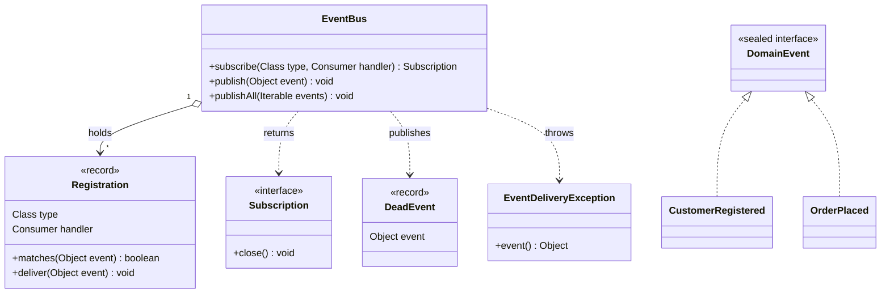
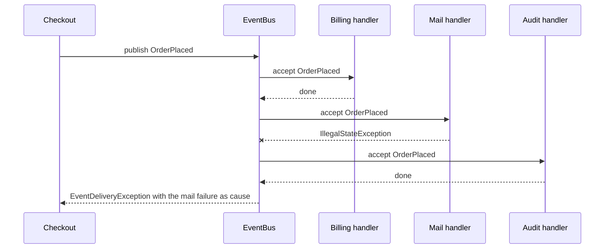
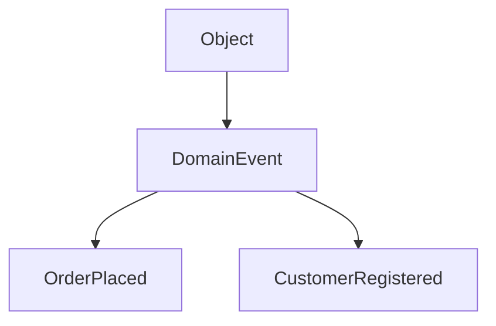
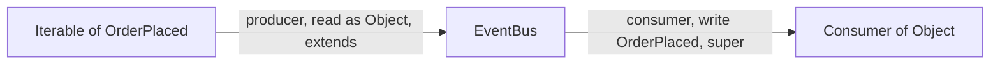

# Task 17 · A type-safe event bus

| Difficulty | Topics | Time box |
|---|---|---|
| 🟡 Medium | Generics: bounded wildcards and PECS, `Class<T>` as a type token, typesafe heterogeneous containers · Observer pattern · No unchecked warnings · Exception aggregation with suppressed exceptions · Copy-on-write for safe iteration | 2–3 h |

> **Background reading:** *Effective Java* Items 26–33 (especially Item 31 "Use bounded wildcards to increase API flexibility" and Item 33 "Consider typesafe heterogeneous containers") · GoF, "Observer" · Maurice Naftalin and Philip Wadler, *Java Generics and Collections*, ch. 2 (subtyping and wildcards) · Guava's `EventBus` documentation (for contrast)

---

## The situation

Our webshop is a modular monolith. The modules react to each other's events: billing listens to `OrderPlaced`, the mail module listens to `CustomerRegistered`. We have an `EventBus` already, and it has three problems.

* It stores handlers in a `Map<String, List<Object>>` keyed by the class name. Every listener casts with `instanceof`, so a typo in a name or a missing check fails at run time.
* The generics are raw in most places. The compiler reports **214 unchecked or raw-type warnings** for that package, and everybody has learned to ignore them.
* **One bad listener stopped all the following ones.** An exception in the billing listener meant that the mail listener never ran, and customers did not get their confirmation mail for a week.

I want a bus where the compiler checks the event type for every subscription, where a failing handler cannot silence the others, and where the code has no warnings at all. The generics part is the hard part, and that is where most of your learning will be.

## The domain

| Term | Meaning |
|---|---|
| **Domain event** | A fact that happened in the past: `CustomerRegistered`, `OrderPlaced`. Modelled as the sealed interface `DomainEvent` with records. |
| **Subscription** | The handle returned by `subscribe`. Closing it stops the delivery to that handler. |
| **Handler** | A `Consumer` for one event type, or for a supertype of it. |
| **Dead event** | An event that no handler matched. The bus publishes a `DeadEvent` so somebody can log it or alert on it. |
| **Delivery failure** | A handler threw a `RuntimeException`. The bus reports it after all handlers ran. |

### What happens during one publish

A failing middle handler must not change what the other handlers see. This diagram shows an `OrderPlaced` with three matching handlers, where the mail handler throws:

The audit handler still runs. The caller learns about the failure, but only after every handler had its chance.

## What I want from you

Implement the bus in [`EventBus`](../src/main/java/io/github/chris013/practice/task17/EventBus.java). The other main classes are given, and you should read them before you start: [`DomainEvent`](../src/main/java/io/github/chris013/practice/task17/DomainEvent.java), [`DeadEvent`](../src/main/java/io/github/chris013/practice/task17/DeadEvent.java), [`Subscription`](../src/main/java/io/github/chris013/practice/task17/Subscription.java) and [`EventDeliveryException`](../src/main/java/io/github/chris013/practice/task17/EventDeliveryException.java).

1. **`<E> Subscription subscribe(Class<E> eventType, Consumer<? super E> handler)`**
   * A handler subscribed to a type receives every event that is an instance of that type. That includes subtypes and interfaces the type implements.
   * Subscribing to `DomainEvent.class` receives every domain event. Subscribing to `Object.class` receives everything.
   * `null` for either argument throws `NullPointerException`.
   * The same handler may be subscribed more than once. Each subscription is independent.
2. **Delivery order.** `publish` delivers to every matching handler in **subscription order**. That order is global, across event types: a handler for `Object` subscribed before a handler for `OrderPlaced` runs first.
3. **`void publish(Object event)`**
   * `null` throws `NullPointerException`.
   * Every matching handler runs, even when an earlier one throws.
   * If at least one handler threw a `RuntimeException`, `publish` throws an [`EventDeliveryException`](../src/main/java/io/github/chris013/practice/task17/EventDeliveryException.java) **after** all handlers ran. Its cause is the **first** failure, and every later failure is added with `addSuppressed`.
   * `Error`s are not caught. They propagate at once. (That is a JVM-level problem; we don't want to hide it.)
4. **Dead events.** If **no** handler matched the event, `publish` publishes `new DeadEvent(event)` instead. A `DeadEvent` that nobody listens to is dropped silently. It must never recurse.
5. **`void publishAll(Iterable<?> events)`** publishes each event in iteration order, with the rules above. It stops at the first event whose delivery throws an `EventDeliveryException`, and the remaining events are not published. `null` throws `NullPointerException`.
6. **Subscribing and closing during a publish.** A publish works on a snapshot of the subscriptions:
   * A handler that subscribes during a publish does **not** receive the event being published.
   * A handler that is closed during a publish **still** receives the event being published. Later publishes do not deliver to it.
7. **`close()` on a `Subscription`** stops the delivery to its handler. It is **idempotent**: closing twice does nothing, and it never throws. Closing one of two subscriptions for the same handler leaves the other one working.
8. **No unchecked code.** The main code has no `@SuppressWarnings` and no unchecked casts, and it compiles without warnings under `-Xlint:all`. Matching a `Class<E>` to an event goes through `Class.isInstance` and `Class.cast`.

## Generics you need for this task

The bus has the signature `<E> Subscription subscribe(Class<E>, Consumer<? super E>)`. Most of the questions in a design review about it come down to three ideas.

**PECS: Producer Extends, Consumer Super.** A generic type parameter with `? extends T` lets you *read* a `T` out of a structure. A parameter with `? super T` lets you *write* a `T` into it. A `Consumer<? super OrderPlaced>` is a thing that can accept an `OrderPlaced`, and possibly anything above it. Here is the type hierarchy our handlers rely on:

Read the arrows as "is a supertype of". A `Consumer<Object>` can handle every event, so it is a valid `Consumer<? super OrderPlaced>`. That is why the test `a_consumer_of_object_can_subscribe_to_a_specific_event` compiles. If the parameter were `Consumer<E>`, a logger written as `Consumer<Object>` could not subscribe to `OrderPlaced` at all, and the API would be less useful for no safety gain. Item 31 of *Effective Java* has the full argument, and Naftalin and Wadler explain why `Consumer<Object>` is not a subtype of `Consumer<OrderPlaced>` in the first place (generics are invariant).

**Why `Iterable<?>` in `publishAll`?** The bus only *reads* the elements, and it reads them as `Object`. So the widest type is correct: `Iterable<?>` accepts a `List<OrderPlaced>`, a `Set<DomainEvent>` or a `List<Object>`. Writing `Iterable<Object>` would reject the first two, which is the mistake the PECS rule warns about.

**Why `Class<E>` and not `E.class`?** Type erasure removes `E` at compile time. Inside `subscribe`, the bus has no way to ask "is this event an `E`?" unless it gets a runtime object that knows `E`. That object is the `Class<E>` token. Java has no `E.class` syntax, which is why the caller always passes `OrderPlaced.class` explicitly.

**What is a typesafe heterogeneous container?** It is a container whose keys carry a type, so that `get(Key<T>)` returns a `T` with no cast. Effective Java Item 33 describes it, and `Map<Class<?>, Object>` with `type.cast(value)` on the way out is the standard implementation. Our bus is a close cousin: the key is the event type, the value is the handler, and the type is checked at run time by `Class.isInstance` and `Class.cast`.

**Thread safety.** The bus is safe for concurrent `subscribe`, `close` and `publish`. The reason is the `CopyOnWriteArrayList`: writes copy the list, reads see a consistent snapshot without any lock. Publishing is much more common than subscribing, so this is the right trade-off. Note that a *single* handler can still be called from two threads at the same time, if two publishes run concurrently. That is the handler's problem, and it is documented in the class Javadoc.

## Constraints & non-goals

* No external libraries (no Guava, no Spring). Only the JDK.
* Keep `EventBus` a single `final` class. The `Registration` record may be private and nested.
* No annotation scanning (`@Subscribe`), no priorities and no asynchronous delivery in this task. Those are stretch goals.
* Keep the public API exactly as above. You may add private or package-private helpers.
* Synchronization: the bus must be safe for `subscribe`, `close` and `publish` on different threads. You don't need to make it fast for writers.
* A handler failure is a bug in that handler. The bus reports it; it does not retry, log, or decide what the business does. The caller decides.
* A dead event is information for operations, not an error. Publishing one never throws on its own.
* Nothing in the bus is persistent. If the JVM dies, undelivered events are lost. That is an acceptable trade-off for in-process modules, and it is the reason we don't use this bus for payments.

## How I'd approach it

* **Start with the types, not the bus.** Write `Registration<E>` first and make `matches` and `deliver` work for one registration. The rest is a loop.
* **Use `Class<E>` as a type token.** You cannot write `E.class` or `event instanceof E` in Java, because of **erasure**: at run time, `E` does not exist. A `Class<E>` object carries the type at run time. `isInstance` answers "is this an event for me?", and `cast` returns the event as `E`.
* **Keep the cast in one place.** Do not write `(E) event` anywhere. You don't need to: if `type` and `handler` share the same `E`, `type.cast(event)` already has the type the handler needs. Explain this in your PR description, because the trick is the whole point of the exercise.
* **Keep one list for everything.** A single `List<Registration<?>>` gives you the global subscription order for free: the list keeps insertion order. Don't keep one list per type. Then you would have to merge them to get the order right.
* **Snapshot iteration.** Look at what a `CopyOnWriteArrayList` gives you for free. Iterating over it does not throw `ConcurrentModificationException`, and the iterator sees the list as it was when the loop started. That gives you the reentrancy rules in item 6 without any extra code.
* **Close by identity.** Two registrations with the same type and the same handler are *equal* if `Registration` is a record. If `close` removes "the first equal element", it can remove the wrong subscription. Remove by identity (`==`).
* **Collect failures in one pass.** Keep a `failure` variable, which is `null` at the start. The first failure creates the `EventDeliveryException`. Every later failure goes into `addSuppressed`. Throw it after the loop, never inside it.
* **Dead events need one `boolean`.** Track whether any handler matched. The dead-event rule is then two lines. Be careful with the case where a matching handler failed: it did match, so there is no dead event. Think about which code path that is.
* **Don't catch `Exception` or `Throwable`.** `RuntimeException` is the right type: handlers in this design are not allowed to throw checked exceptions. Catching `Throwable` would also catch `OutOfMemoryError`.
* Look at [`RecordingHandler`](../src/test/java/io/github/chris013/practice/task17/RecordingHandler.java): a generic test double like this is how you test a `Consumer<? super E>` without any mock setup.

## Tests

Run: `mvn test -Dtest='**/task17/**'`

[`EventBusTest`](../src/test/java/io/github/chris013/practice/task17/EventBusTest.java) groups the rules by theme: **Delivery**, **DeadEvents**, **Failures**, **Reentrancy**, **PECS** (the variance rules of the next section) and **PublishAll**. Read the **PECS** and **Reentrancy** groups first: they pin down the two subtle rules, and the names of the tests say what they do.

Show the tests

<!-- embed: src/test/java/io/github/chris013/practice/task17/EventBusTest.java -->
<!-- /embed -->

<!-- embed: src/test/java/io/github/chris013/practice/task17/RecordingHandler.java -->
<!-- /embed -->

## Definition of done

- [ ] All 28 tests in `EventBusTest` are green.
- [ ] The main code has no `@SuppressWarnings`, no raw types and no unchecked casts. `mvn -B -q test-compile` prints no warnings.
- [ ] Subscription order is global across event types, and that is pinned by a test.
- [ ] A failing handler does not stop the others, and the exception has the first failure as its cause and the others as suppressed.
- [ ] A snapshot is used for the delivery, and both reentrancy rules hold.
- [ ] Your PR description explains how `Registration.deliver` type-checks without an unchecked cast.

## Stretch goals

1. **Asynchronous delivery on virtual threads.** Add a bus variant that delivers each handler on its own virtual thread (JEP 444, `Executors.newVirtualThreadPerTaskExecutor()`). What happens to the exception aggregation? You can no longer throw one exception from `publish` as the handlers finish later. Decide what the caller gets, and write it down.
2. **Annotation scanning.** Add a `@Subscribe` method annotation and register all annotated methods of an object by reflection. Explain why we *didn't* do this in the starter: which errors move from compile time to start-up time, and how do you find them?
3. **Ordering by priority.** Let a subscription carry an `int priority` and deliver in priority order, with the subscription order as the tie-breaker. How does the copy-on-write list help or hurt you here?
4. **Generic event types.** Consider `record EntityChanged<T>(T entity)`. The class token `EntityChanged.class` cannot tell `EntityChanged<Customer>` from `EntityChanged<Order>`. Explain what a *super type token* is (the trick that Guava's `TypeToken` uses, and that Neal Gafter popularised), what it lets you do, and what it still cannot do.
5. **Unsubscribe by handler.** Add `void unsubscribe(Consumer<?> handler)`. How do you decide which subscriptions it removes, and why is this API a smell if the same handler can be registered twice?

---

## Reference solution

Spoiler: open only after you have made a serious attempt

### Key decisions

**1. One registration list, and the global order comes from it.** All subscriptions go into a single `CopyOnWriteArrayList<Registration<?>>`. Insertion order is subscription order, so "delivery in subscription order across types" is a property of the data structure, not an algorithm. The rejected alternative was a `Map<Class, List>` with a merge step at publish time, which is more code and gets the order wrong as soon as two types are involved.

**2. The type check happens in one private record.** `Registration<E>(Class<E> type, Consumer<? super E> handler)` holds the matching pair. The list holds `Registration<?>`, so the bus cannot name `E`. It doesn't need to: the body of `deliver` is type-checked once, for an arbitrary `E` that `type` and `handler` share, so `type.cast(event)` is an `E` and `Consumer<? super E>` accepts it. Try the same thing from outside, `registration.handler().accept(registration.type().cast(event))`, and it does not compile. Each call on a `Registration<?>` gets its own fresh capture (`CAP#1`, `CAP#2`), and the compiler cannot prove they are the same type. Moving the code *into* the generic type gives both fields one name for the type, and that is the whole trick. No cast is written by us, so there is nothing to suppress. The rejected alternative was storing `Consumer<Object>` and casting the event to `E` through an unchecked cast with `@SuppressWarnings`. That compiles, but it lies to the compiler, and the warning it hides is the one the task is meant to remove.

**3. Snapshot semantics for free.** Publishing iterates over the `CopyOnWriteArrayList`, which iterates over an array that is never modified in place. A handler subscribed during the publish is not in that array, and a handler closed during the publish is still in it. This is exactly the behaviour the tests pin down. The rejected alternative was an `ArrayList` with a `synchronized` block around publish. That serializes all publishes behind one lock, so a slow handler blocks every other thread, and a handler that waits for another thread to subscribe deadlocks. A plain `ArrayList` also throws `ConcurrentModificationException` on subscribe-during-publish.

**4. Close by identity.** `Subscription.close()` removes its own `Registration` with `removeIf(r -> r == registration)`. Because `Registration` is a record, `equals` compares type and handler, and two registrations of the same handler would be equal. Removing "an equal one" would close the wrong subscription. `removeIf` on a copy-on-write list is atomic, and calling it twice is harmless: the second call finds nothing.

**5. Failures are collected, and thrown once.** The loop catches `RuntimeException` only, keeps the first failure as the cause of an `EventDeliveryException`, and attaches every later one as suppressed. The exception is thrown after the loop, so every handler ran. An `Error` is not caught. The rejected alternative was to stop at the first failure, which is exactly the bug from the situation section, or to catch `Throwable`, which would also swallow `OutOfMemoryError`.

**6. Dead events come from a single flag.** `deliverToMatchingHandlers` returns whether any handler matched. `publish` publishes a `DeadEvent` only when nothing matched and the event is not already a `DeadEvent`. The second condition is what stops the recursion. A matching handler that failed still counts as matched, so the exception is thrown and no dead event follows.

### Code

<!-- embed: solutions/src/main/java/io/github/chris013/practice/task17/EventBus.java -->
<!-- /embed -->

<!-- embed: solutions/src/main/java/io/github/chris013/practice/task17/EventDeliveryException.java -->
<!-- /embed -->

### What I typically flag in first attempts

| Finding | Why it matters |
|---|---|
| Raw `Consumer` or `Class` in fields and parameters | The compiler can no longer check the event type, and the 214-warning problem is back. |
| `@SuppressWarnings("unchecked")` on the whole class, with `(E) event` inside | It hides the warning and removes the check. `Class.cast` gives the same result with a real check. |
| `Consumer<E>` instead of `Consumer<? super E>` | A logger typed as `Consumer<Object>` cannot subscribe to `OrderPlaced`. The API is needlessly rigid. |
| One failing handler stops the others | This is the bug from the situation section. Collect the failures and run every handler. |
| Swallowing exceptions, or logging and continuing without telling the caller | The publisher then believes the event was delivered. Throw an `EventDeliveryException` after the loop. |
| Looping over an `ArrayList` and subscribing inside a handler | `ConcurrentModificationException` at run time. A copy-on-write list or a snapshot avoids it. |
| Keying the subscriptions by class name strings | Two classes with the same simple name collide, and the `instanceof` checks come back. Key by `Class<?>`. |
| Exact-class matching only (`event.getClass() == type`) | A handler for `DomainEvent` silently gets nothing. `isInstance` matches subtypes and interfaces. |

