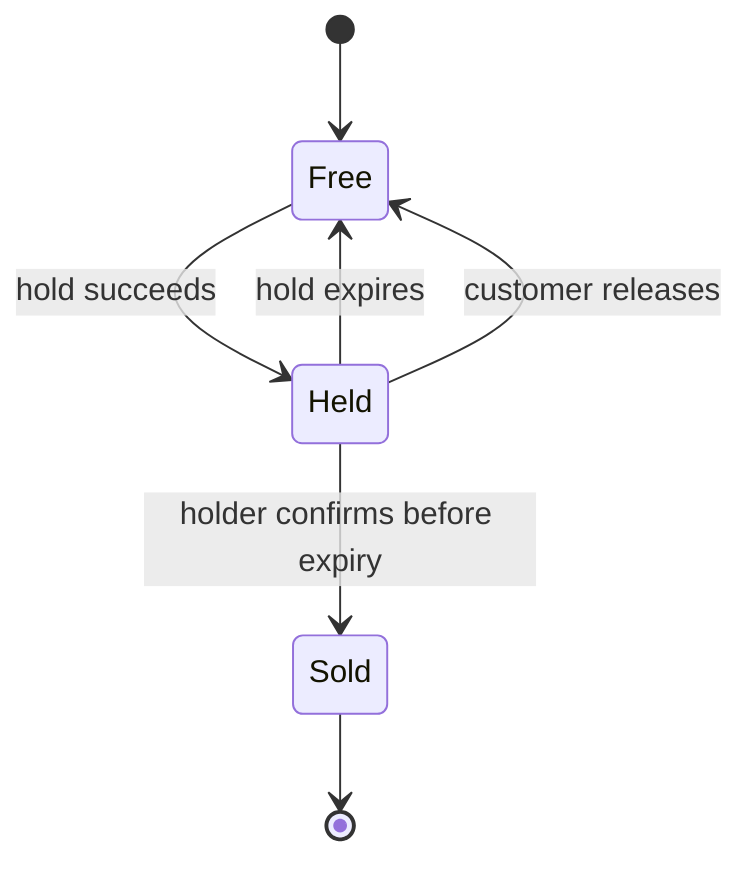
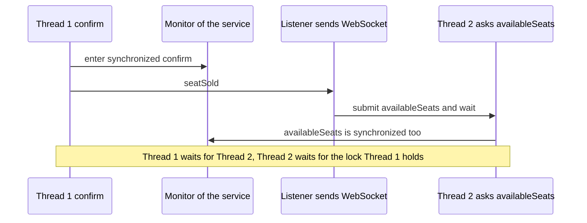
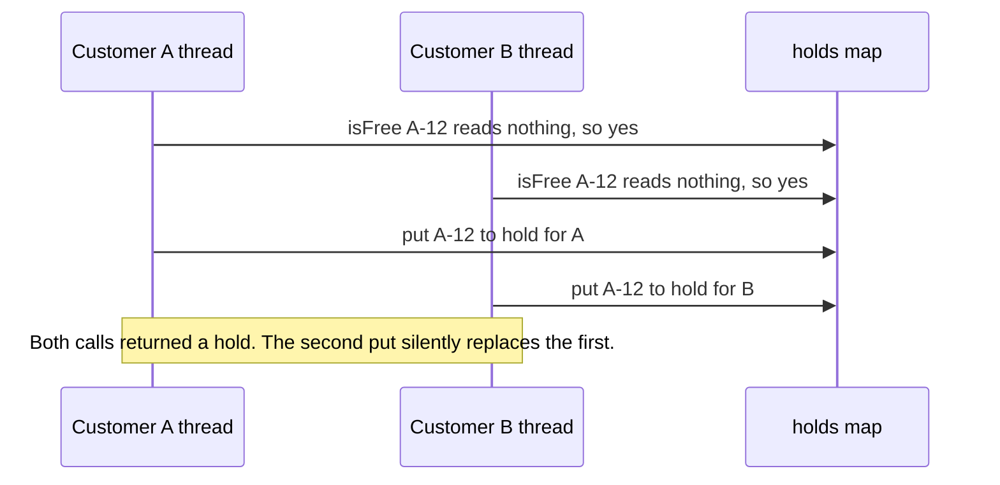

# Task 18 · Fix the race conditions in concert seat reservations

| Difficulty | Topics | Time box |
|---|---|---|
| 🔴 Hard | Concurrency bugs: check-then-act, lost updates, unsafe publication of collections, `ConcurrentModificationException`, calling alien code while holding a lock · `ConcurrentHashMap.compute` as a per-key atomic operation · Stress tests with virtual threads · Making races reproducible | 3–4 h |

> **Background reading:** *Java Concurrency in Practice* (Goetz et al.) ch. 2 ("Thread safety"), ch. 5.1–5.2 ("Synchronized collections", "Concurrent collections"), ch. 10.1 ("Deadlock", the section on "open calls") · *Effective Java* Item 79 ("Avoid excessive synchronization", alien methods) · JEP 444 (Virtual Threads) · The Javadoc of `ConcurrentHashMap.compute`: "the computation should be short and simple, and must not attempt to update any other mappings".

---

## The situation

Our venue sells tickets for one concert, online. A customer picks a seat and we **hold** it for five minutes while they type in their card details. If they pay in time, we **confirm** the seat and it is sold. If they walk away, the hold expires and the seat goes back on sale.

Last Friday, during the presale, two customers got the same seat. Another customer was charged for a seat that was already sold. The support team found the cause in our code: the seat service was written for one user at a time and then put behind a web server with 200 concurrent users. Every single-threaded test passes. Nobody noticed until real people were buying at the same moment.

The [`SeatReservationService`](../src/main/java/io/github/chris013/practice/task18/SeatReservationService.java) in the starter is that code. It is not written carelessly. It is the code a capable mid-level developer writes when they are thinking about *one* thread. Your job is to find every place where two threads can interfere, fix them, and prove each fix with a test that fails before the fix.

The most important part of this task is not the fix. It is learning to **see** the races, and to make them happen on purpose.

## The domain

| Term | Meaning |
|---|---|
| **Seat** | A seat in the venue, identified by a `SeatId` such as `A-12`. The set of seats is fixed when the service is created. |
| **Free** | Nobody holds the seat and nobody bought it. |
| **Hold** | A customer's temporary claim on a seat. It is valid while `now` is before `expiresAt`. |
| **Sold** | The seat was confirmed by the customer who held it. It never becomes free again. |
| **Listener** | Told about every hold and sale. In production it pushes WebSocket updates to every browser that shows the seat map. |

### The seat life cycle

A seat moves only along these arrows. Two arrows deserve attention: a hold **expires by the clock**, nobody has to call anything, and `Sold` has no way back.

### The listener is alien code

`ReservationListener` is an interface we do not control. Its implementation may be slow (it writes to 500 browsers), and it may call back into the service, for example to ask `availableSeats()` for the new count it shows on the page. Keep this in mind. It is the source of the deadlock you will meet in the next section.

## What I want from you

1. **[`SeatReservationService`](../src/main/java/io/github/chris013/practice/task18/SeatReservationService.java)** is the same class in both versions. Make it correct when many threads call it at once. The public API does not change.
2. `Optional<Hold> hold(SeatId, CustomerId)`:
   * an unknown seat throws `IllegalArgumentException`;
   * a free seat, or a seat whose hold has expired (`now` is at or after `expiresAt`), gives a new `Hold` that expires at `now + holdDuration`, and the listener's `seatHeld` is called;
   * a seat that is held and not expired, or sold, gives `Optional.empty()`, even when the same customer asks again.
3. `boolean confirm(SeatId, CustomerId)`:
   * returns `true` only if the seat is held by this customer and the hold has not expired. The seat then becomes sold, and the listener's `seatSold` is called;
   * otherwise returns `false` and changes nothing. Confirming a sold seat again returns `false`.
   * An unknown seat throws `IllegalArgumentException`, like `hold`.
4. `void release(SeatId, CustomerId)`: removes the hold if this customer holds the seat. Otherwise it does nothing. It never touches a sold seat.
5. `int availableSeats()`: the number of seats that are neither sold nor validly held at this instant. An expired hold counts as available.
6. `int soldCount()`: how many seats are sold.
7. `List<SeatId> soldSeats()`: a snapshot of the sold seats in sale order. A list that was returned earlier must not change when later sales happen.
8. The constructor rejects `null` with `NullPointerException` naming the parameter, and a `holdDuration` that is zero or negative with `IllegalArgumentException`.
9. The listener is called **after** the service has changed its state for that operation, and never while the service holds an internal lock.

The given types [`SeatId`](../src/main/java/io/github/chris013/practice/task18/SeatId.java), [`CustomerId`](../src/main/java/io/github/chris013/practice/task18/CustomerId.java), [`Hold`](../src/main/java/io/github/chris013/practice/task18/Hold.java) and [`ReservationListener`](../src/main/java/io/github/chris013/practice/task18/ReservationListener.java) do not change.

## Constraints & non-goals

* **No `synchronized` on the whole service just to make the tests pass.** You may use one global lock if you can justify it (see the discussion below), but it is not the answer I expect for a reference solution. Think about what the lock protects and what it blocks.
* **Never call the listener while holding a lock or inside a `compute` lambda.** That is the rule.
* No `Thread.sleep` in production code. Time comes from the injected `Clock`.
* No new dependencies. Plain Java 25.
* Holds do not need a background cleaner. Expiry is checked whenever someone asks (stretch goal 1 changes that).
* Holding several seats at once is out of scope (stretch goal 3).

## How I'd approach it

**Start by reproducing, not by fixing.** Run `mvn test -Dtest='**/task18/**'` on the starter. The single-threaded tests pass. The concurrency tests fail, and most of them fail on every run. Read each failure and ask: which two threads, doing which steps, produced this? Then read the bug table below and check that you agree.

### The bugs in the starter

| # | Where | Category | Symptom | Exposed by |
|---|---|---|---|---|
| 1 | `hold`: `isFree` then `holds.put` | Check-then-act | Two customers both get a hold on the same seat | `exactly_one_of_1000_customers_gets_a_seat_they_all_want` |
| 2 | `confirm`: read the hold, then `sold.add` and `holds.remove` in separate steps | Check-then-act | A customer confirming from two threads buys the seat twice | `a_customer_who_confirms_the_same_hold_from_50_threads_buys_the_seat_once` |
| 3 | `soldCount++` | Lost update | The counter says 190 when 200 seats were sold | `no_sale_is_lost_when_200_customers_buy_200_different_seats_at_once` |
| 4 | `sold` is a plain `ArrayList` written by many threads | Unsafe publication, lost update | Entries go missing, or the list gets corrupted | `no_sale_is_lost_when_200_customers_buy_200_different_seats_at_once` |
| 5 | `soldSeats()` returns the internal list, not a copy | Leaking internal state | A caller iterating the list while a sale happens gets `ConcurrentModificationException`, and a list returned earlier changes under the caller | `iterating_the_sold_seats_while_another_thread_sells_does_not_throw`, `a_snapshot_taken_earlier_does_not_change_when_later_sales_happen` |
| 6 | `holds` is a plain `HashMap` read and written by many threads | Unsafe publication | Lost or stale entries, undefined behaviour | Several of the tests above |

The starter has no deadlock. Its listener is called outside any lock. The deadlock is the trap in the "fix attempt" below.

### The fix attempt that looks right and is wrong

A common first reaction is to put `synchronized` on the methods:

Thread 1 holds the lock and calls the listener. The listener hands the question to another thread and waits. That thread needs the same lock to answer. Nobody can move. The test `a_listener_may_call_back_into_the_service_from_another_thread_without_deadlock` guards against this with `assertTimeoutPreemptively`. It passes on the starter because the starter has no lock to deadlock on, and it passes on the solution. Keep it green.

### The check-then-act race

Here is what happens in the starter when two customers hold the same seat at the same time:

The check and the act are two separate steps. Between them, another thread can do the same thing. Note that the second `put` does not fail. It **overwrites** the first hold, and the listener has been told about both. That is why the race is silent, and why only a test that counts the winners can see it.

### Why the tests make the race likely

A race like this might happen once in a million calls on a laptop. You do not want a test that passes 999,999 times. Two tools make it reproducible:

1. **`YieldingClock`** ([source](../src/test/java/io/github/chris013/practice/task18/YieldingClock.java)). Its `instant()` calls `Thread.yield()` before it returns the time. `hold` reads the clock between the check and the act, so every yield gives another thread the chance to run in that gap. This is a legitimate technique, not cheating. In production the same gap appears whenever a call to a database or to another service sits between a check and an act. A slow dependency widens the window in exactly the same way. We just do it on purpose.
2. **A start gate.** Every virtual thread waits on one `CountDownLatch`. Then the test releases all of them at the same moment. Without the gate, the threads start one after another and rarely overlap.

### Why virtual threads

A test that wants 1,000 contenders needs 1,000 threads. A platform thread is a real operating system thread with a large stack reserved for it, which makes 1,000 of them expensive. A virtual thread (JEP 444) is cheap to create and cheap to park, so `Executors.newVirtualThreadPerTaskExecutor()` lets the test start 1,000 contenders without strain. The tests also run in well under a second, which is what keeps them in the default test run.

### Two ways to make it correct

**Option A: one global lock.** Put every method behind one `ReentrantLock` or one monitor, and call the listener after you release it. This is simple, obviously correct, and easy to review. It also serialises *everything*: a hold on seat 1 waits for a sale on seat 2. For one concert with a few thousand seats and a few hundred requests a second, that is fine. You should be able to say that out loud in a code review.

**Option B: per-key atomicity.** Store the state of each seat in a `ConcurrentHashMap<SeatId, SeatState>`. Make each state change with `compute(seat, ...)`. The map guarantees that the function runs atomically for one key, and other keys are not blocked. The price is a rule: the function passed to `compute` must be short and must touch only that key. Calling the listener inside it is forbidden, both by the Javadoc and by common sense, because the listener may call back into the same map.

Either option works. Pick one, write down why, and check that your choice never calls alien code inside the protected region.

### Why `volatile` does not help

Some people mark `holds` or `soldCount` as `volatile`. That gives visibility: a write becomes visible to other threads. It does not make `count++` atomic, and it does not make "check, then put" atomic. Two threads can both read `null` and both write. `volatile` is the right tool for a single flag written by one thread and read by others. It is the wrong tool for a read-modify-write.

### Stop before you write the solution

Write down, in one sentence each, the answer to these: which operations are check-then-act? Which collection is shared without safe publication? Which method returns internal state? Where is the listener called, and which lock (if any) is held at that moment? Only then start on the code.

## Tests

Run: `mvn test -Dtest='**/task18/**'`

Two test classes:

* [`SeatReservationServiceTest`](../src/test/java/io/github/chris013/practice/task18/SeatReservationServiceTest.java) checks every rule with one thread. It passes on the starter, so it protects the *behaviour* while you change the *structure*.
* [`SeatReservationConcurrencyTest`](../src/test/java/io/github/chris013/practice/task18/SeatReservationConcurrencyTest.java) checks the races. On the starter five of its six tests fail. The sixth (the listener that calls back) passes on the starter and must keep passing after your change, because it is the guard against the deadlock.

Expected result on the starter: 19 tests pass and 5 of 6 concurrency tests fail. On the solution all 25 pass.

Show the tests

<!-- embed: src/test/java/io/github/chris013/practice/task18/SeatReservationConcurrencyTest.java -->
<!-- /embed -->

<!-- embed: src/test/java/io/github/chris013/practice/task18/YieldingClock.java -->
<!-- /embed -->

<!-- embed: src/test/java/io/github/chris013/practice/task18/SeatReservationServiceTest.java -->
<!-- /embed -->

## Definition of done

- [ ] All tests green, and the whole task's test run takes well under 5 seconds.
- [ ] The concurrency tests pass on 10 runs in a row, and the starter fails them on 5 runs in a row. Your PR says how you checked.
- [ ] Every shared structure is either a concurrent collection used with `compute`/atomic operations, or is guarded by one lock that never covers a listener call.
- [ ] The listener is never called while a lock is held or inside a `compute` lambda.
- [ ] `soldSeats()` returns a snapshot, not a live view.
- [ ] No `Thread.sleep` was added to any test to "fix" timing.
- [ ] Your PR description names the lock or the per-key strategy you chose and says why you rejected the other one.

## Stretch goals

1. **Expire holds with a scheduled cleanup.** Right now an expired hold is only noticed when someone asks. Add a `ScheduledExecutorService` that removes expired holds every few seconds, and inject its schedule into the service so tests stay deterministic. What does the cleanup race with? (Hint: `confirm` and the cleanup both look at the same hold.)
2. **Measure the two options.** Write a JMH benchmark (in a scratch project, not in this repository) with 16 threads that hold and release random seats. Compare one global lock against `compute`. Which one scales better, and does the answer change if the listener takes 1 ms?
3. **All-or-nothing groups.** A customer wants seats `A-1`, `A-2` and `A-3` together. Add `holdAll(Set<SeatId>, CustomerId)` that holds all of them or none. Why does per-key `compute` no longer give you this? What is the usual fix (lock ordering, or one lock for the group), and what does each cost?
4. **Make `availableSeats()` consistent.** Right now it reads seat by seat, so it can see a moment that never existed (one seat sold, another not yet). Can you return a count that matches one point in time, without a global lock? Write down what you would have to give up.
5. **Read the JDK source.** Open `ConcurrentHashMap.compute` and find where it locks the bin. Why does the Javadoc forbid touching other keys in the function? What could happen if you did?

---

## Reference solution

Spoiler: open only after you have made a serious attempt

### Key decisions

**1. One `ConcurrentHashMap` holds the state of each seat, and every change is one `compute` call.** A missing key means the seat is free. `compute` runs atomically for its key, so "check the state, then write the new state" happens as one step for each seat. Two customers racing for seat A-12 queue up on A-12 only. Seat A-13 is never blocked.

**2. The `compute` lambda decides, and we learn the decision by identity.** `hold` creates a candidate `HeldSeat` before calling `compute`. The lambda returns the candidate if the seat is available, otherwise it returns the current state unchanged. Afterwards `result != candidate` tells us whether we won. This avoids a mutable holder such as an `AtomicReference` or a one-element array. The alternative is perfectly fine too, and some teams find it clearer. The identity check is only correct because the candidate is a fresh object that nothing else can hold.

**3. The listener is called after `compute` has returned.** This is the open call from *JCIP* 10.1. Inside `compute` we would hold the map's internal bin lock, and the listener may call `availableSeats()`, which reads the same map. Outside, nobody holds anything. The cost is that a listener can see a state that is already published but whose listener call has not happened yet. That is acceptable: the listener is a notification, not the source of truth.

**4. One clock reading per operation, taken before `compute`.** `hold` reads `clock.instant()` once and uses that value for both the availability check and the new expiry. Reading the clock inside the lambda would also work, but the lambda is supposed to stay short, and the clock is alien code too. `availableSeats` takes one reading for the whole count, so all seats are judged at the same instant.

**5. Sale order in a `ConcurrentLinkedQueue`, and snapshots by copy.** The queue is append-only, and its iterator is weakly consistent: it never throws `ConcurrentModificationException`. `soldSeats()` returns `List.copyOf(...)`, a frozen copy. `soldCount()` is the queue's size, so there is no separate counter to get out of step. A `synchronizedList` would not help: iterating it still needs the caller to hold its lock, which the caller does not know about.

**6. `release` and `confirm` never touch another customer's state.** Both use `isHeldBy(state, customer, now)`, so the ownership rule is written once. `release` passes `now == null` to mean "ignore expiry": a customer may always drop their own hold, even if it expired a second ago.

**7. Why not one global lock?** It would have been correct, and it is a good answer in a code review. We chose per-key atomicity because the same design extends to many concerts and many venues without a bottleneck, and because the rule "never call alien code inside compute" is small enough to hold in one reviewed file. Stretch goal 2 asks you to measure this choice instead of trusting it.

### Code

<!-- embed: solutions/src/main/java/io/github/chris013/practice/task18/SeatReservationService.java -->
<!-- /embed -->

### What I typically flag in first attempts

| Finding | Why it matters |
|---|---|
| `synchronized` on some methods only | `hold` is unlocked while `confirm` is locked, so the two still race. A lock only protects the code that takes it. |
| Calling the listener inside a lock or a `compute` lambda | The listener may call back from another thread and wait for it. That is a deadlock, and it only happens in production. |
| Returning the internal list or map | The caller iterates while another thread writes, and gets `ConcurrentModificationException` or a changing view. Return a copy. |
| `Collections.synchronizedList` iterated without holding its lock | The wrapper makes single calls safe, not iteration. Use a concurrent collection, or copy under the lock. |
| `ConcurrentHashMap` with `containsKey` then `put` | Each call is atomic, the pair is not. Use `compute`, `putIfAbsent`, or `computeIfAbsent`. |
| `Thread.sleep` in a test to "make the race happen" | It makes the test slow and still flaky. Use a start gate and a yielding clock to widen the window instead. |
| Ignoring hold expiry in `availableSeats` | The count shows seats as taken after their hold has ended, and customers are told the venue is full. |

