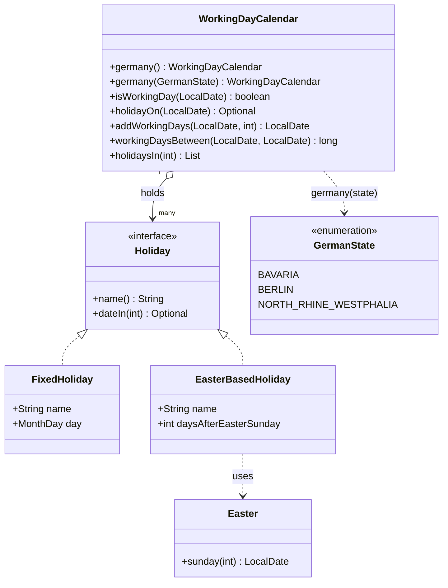
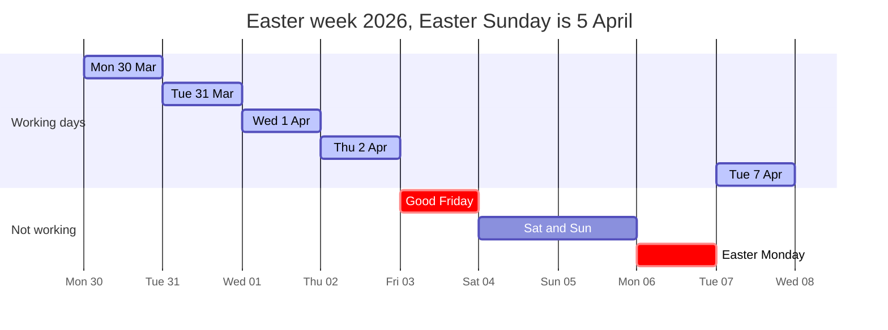
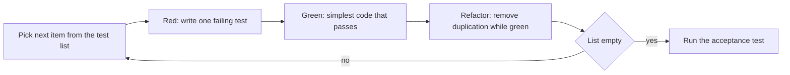

# Task 19 · Test-drive a working-day calendar

| Difficulty | Topics | Time box |
|---|---|---|
| 🟡 Medium | Test-driven development: red, green, refactor, test list, triangulation, fake it · `java.time` (`LocalDate`, `DayOfWeek`, `MonthDay`) · Holiday rules as small objects · Implementing an algorithm from a reference (Easter) | 3 h |

> **Background reading:** Kent Beck, *Test-Driven Development: By Example*: Part I (the Money example) and the Part III patterns "Test List", "Fake It" and "Triangulation" · Kent Beck, "Canon TDD" (2023, on his *Tidy First?* Substack) · *Modern Java in Action* (Urma, Fusco, Mycroft), ch. 12 "New Date and Time API" · The "Anonymous Gregorian algorithm" for Easter by Meeus, Jones and Butcher (the Wikipedia article "Date of Easter" describes it)

---

## The situation

Our German logistics company promises "delivery in 3 working days". The promise is shown on the checkout page and printed on the shipping label. Today the code counts Monday to Friday and forgets the holidays. A parcel posted on the Tuesday before Easter is promised for Good Friday, and the customer service inbox fills up every time a holiday comes after a long weekend.

A first draft exists. It is one 300-line class with a `Set<LocalDate>` of holidays typed in by hand for 2026. Nobody knows what happens in 2027, and nobody can say which test covers Easter.

We want a `WorkingDayCalendar` that we can trust, and we will build it **test-first**. This is not dogma. The rules are full of edge cases: weekends, leap days, Easter, and two states that disagree about Corpus Christi. A test list and small steps find those edge cases before the code does. A big class written in one go finds them in production.

## The domain

| Term | Meaning |
|---|---|
| **Working day** | A Monday to Friday that is not a public holiday in the calendar's region. |
| **Public holiday** | A named day that closes the offices. Nationwide holidays apply everywhere; state holidays apply only in that state. |
| **Holiday rule** | How the date of a holiday is computed for a given year: a fixed day of the year, or a number of days before or after Easter Sunday. |
| **Easter Sunday** | Not stored in a table. It is computed for each year, and it moves between 22 March and 25 April. |
| **Working days after a date** | When we add 3 working days to Thursday, the count starts on Friday. The start day itself is not counted. |

The rules are small objects, and the calendar is a list of them:



Easter week 2026 shows why the calendar matters. Thursday 2 April is the last working day before a four-day weekend:



## What I want from you

Implement the calendar in the starter. The types are in [`src/main/java/io/github/chris013/practice/task19`](../src/main/java/io/github/chris013/practice/task19/). Every rule below must be covered by a test that you wrote.

1. **[`GermanState`](../src/main/java/io/github/chris013/practice/task19/GermanState.java)** is given. Do not change it. It has three values for now.

2. **[`FixedHoliday`](../src/main/java/io/github/chris013/practice/task19/FixedHoliday.java)`(name, day)`** is a record. `dateIn(year)` returns the date of the holiday in that year. On 29 February in a non-leap year the holiday does not happen, so `dateIn` returns an empty `Optional`. A `null` name or day throws `NullPointerException`.

3. **[`EasterBasedHoliday`](../src/main/java/io/github/chris013/practice/task19/EasterBasedHoliday.java)`(name, daysAfterEasterSunday)`** is a record. It returns the date that many days after Easter Sunday. Negative numbers are allowed: Good Friday is `-2`. This holiday happens every year.

4. **[`Easter`](../src/main/java/io/github/chris013/practice/task19/Easter.java)`.sunday(year)`** returns the date of Easter Sunday in the Gregorian calendar. Use the Anonymous Gregorian algorithm. For a year before 1583 it throws `IllegalArgumentException`.

5. **[`WorkingDayCalendar`](../src/main/java/io/github/chris013/practice/task19/WorkingDayCalendar.java)`.germany()`** contains the nationwide holidays:

   | Holiday | Rule |
   |---|---|
   | New Year's Day | 1 January |
   | Good Friday | Easter Sunday minus 2 days |
   | Easter Monday | Easter Sunday plus 1 day |
   | Labour Day | 1 May |
   | Ascension Day | Easter Sunday plus 39 days |
   | Whit Monday | Easter Sunday plus 50 days |
   | German Unity Day | 3 October |
   | Christmas Day | 25 December |
   | Boxing Day | 26 December |

6. **`WorkingDayCalendar.germany(GermanState)`** adds the state holidays to the nationwide ones:

   | State | Holidays added |
   |---|---|
   | `BAVARIA` | Epiphany (6 January), Corpus Christi (Easter plus 60 days), Assumption Day (15 August), All Saints' Day (1 November) |
   | `BERLIN` | International Women's Day (8 March) |
   | `NORTH_RHINE_WESTPHALIA` | Corpus Christi (Easter plus 60 days), All Saints' Day (1 November) |

7. **`isWorkingDay(date)`** is true if the date is a Monday to Friday and no holiday of this calendar falls on it. Dates before 1583 are rejected, see rule 13.

8. **`holidayOn(date)`** returns the name of the holiday on that date, or an empty `Optional`. A holiday on a Saturday or Sunday still has a name. Example: German Unity Day 2026 is a Saturday, and `holidayOn` still names it. If two holidays fall on the same date, it returns the first one in calendar order: the nationwide holidays come first, then the state holidays in the order `germany(state)` adds them.

9. **`addWorkingDays(start, days)`** returns the date reached after `days` working days. The count starts **after** `start`. Thursday 2 April 2026 plus 3 working days is Thursday 9 April 2026. If `days` is negative, throw `IllegalArgumentException`. If `days` is `0`, return `start` when it is a working day, otherwise the next working day.

10. **`workingDaysBetween(startInclusive, endExclusive)`** counts the working days in that half-open range. Equal dates give `0`. If the end is before the start, throw `IllegalArgumentException`.

11. **`holidaysIn(year)`** returns the holiday dates of that year, in date order and without duplicates. It includes holidays that fall on a weekend. Two holidays can share a date: in 2008 Ascension Day (Easter plus 39 days, with Easter on 23 March) and Labour Day are both 1 May, so the list shows that date once and `holidaysIn(2008)` has eight entries.

12. Any `null` argument throws `NullPointerException` with the parameter name, for example `Objects.requireNonNull(date, "date")`.

13. **Years before 1583 are rejected.** Easter is undefined before the Gregorian calendar, so every method throws `IllegalArgumentException` for a date or year before 1583, even on a weekend or on 1 January. Check this first, not as a side effect of computing Easter.

## Constraints & non-goals

* **Test first.** Write the next test from your test list, watch it fail, then write the code that makes it pass. Do not write the whole class and then the tests. Your commit history will show it, and so will the reviewer.
* **The acceptance test is the north star, not a thing to edit.** [`DeliveryDateAcceptanceTest`](../src/test/java/io/github/chris013/practice/task19/DeliveryDateAcceptanceTest.java) is given. Do not change its expected values to make it pass.
* **No external holiday library** and no HTTP holiday API. The rules are small enough to own them.
* **No `LocalDate.now()`, no `Clock`.** Every method receives its dates as arguments. A calendar that knows "today" is a different, harder problem.
* **No hardcoded dates per year.** A `Map<Integer, LocalDate>` of Easter dates works until 2031 and then fails silently. The rule is the knowledge, not the table.
* **No mutable static state.** A calendar is immutable. Two calendars must never share a list that someone can change.
* **Only the three states from the enum.** Adding the other 13 is a stretch goal, not part of this task.

## How I'd approach it

Every cycle has the same four steps, and the loop ends when the list is empty:



Keep the steps separate. Red proves that the test can fail and that it talks about new behaviour, so a green bar later means something. Green lets you write the dumbest code that works, which keeps the design honest, because you cannot yet guess what the code needs. Refactor is allowed only while the bar is green, so every change in it is a change of structure and not of behaviour. If you mix them, a failure tells you nothing about which step caused it.

**Start with a test list, not with a test.** Write the list on paper or in a comment, one behaviour per line. Do not write the algorithm in the list. Here is a starting list. It will grow, and you will cross items off as you go:

- [ ] Monday to Friday without a holiday is a working day
- [ ] Saturday and Sunday are not working days
- [ ] A fixed holiday falls on the same day every year
- [ ] 29 February gives an empty result in a non-leap year
- [ ] Easter Sunday for several years (triangulate, see below)
- [ ] Good Friday is two days before Easter Sunday
- [ ] Each nationwide holiday is named on the right date
- [ ] A holiday on a weekend is still named but is not a working day
- [ ] Bavaria, Berlin and North Rhine-Westphalia each add their own holidays
- [ ] `addWorkingDays` with `0` on a working day returns the same day
- [ ] `addWorkingDays` with `0` on a weekend returns the next working day
- [ ] `addWorkingDays` skips weekends and holidays
- [ ] `addWorkingDays` with a negative number throws
- [ ] `workingDaysBetween` excludes the end date and returns `0` for equal dates
- [ ] `workingDaysBetween` throws when the end is before the start
- [ ] `holidaysIn` is sorted and includes weekend holidays
- [ ] Null arguments throw `NullPointerException`

**Outside-in or inside-out?** Both, in turns. The acceptance test is outside-in: it describes the feature as the business sees it, and it fails for a reason you can read. It tells you *that* something is missing, but it does not tell you *which small class* to write next. For that, use inside-out unit tests: `FixedHoliday` first, then `Easter`, then the calendar. Each unit test is small, so each red bar has one cause. Go back to the acceptance test after every few green steps, and see which of its lines turned green.

**The Easter test is where triangulation lives.** Start with one assertion: Easter 2026 is 5 April. The simplest green code is `return LocalDate.of(2026, 4, 5)`. That is *fake it*: the code is wrong, but the bar is green in a minute. Now add 2027. The constant fails, and you are forced to think. You could add a second `if`. Do not, yet. Add 2038, 1818 and 2285 too. Different centuries and different places in the 19-year cycle make a table of answers as large as the algorithm. When the next expected value needs more logic than the code has, stop faking and write the algorithm. Look it up in the Anonymous Gregorian reference above. It is integer arithmetic on the year, about ten lines, and it has no table.

**Know when to stop faking.** A fake is good for one step. When two tests force the same duplication, the duplication is the design. Replace the fake with the real rule, and keep every test green while you do it. This is the refactoring step: remove duplication, rename, move code, but only while the bar is green.

**Baby steps.** Each cycle should take a few minutes. If you have been red for 15 minutes, your test is too big. Split it. Typical good first tests: a Monday is a working day, a Saturday is not. Typical bad first tests: "a year of Berlin working days". Keep the year count for later, as a test that you can explain in one sentence.

**Holidays as rules, not as dates.** `Holiday.dateIn(year)` is the seam that makes the calendar work for every year. Keep the rule object small and let the calendar ask it for a date. Do not store the dates. Also keep the lists of holidays in `germany()` and `germany(state)`, so a reader can see every rule in one place.

**Walking the days.** `addWorkingDays` and `workingDaysBetween` can walk one day at a time. That is simple and fast enough for a year. Make sure the loop always ends: validate the input first, and remember that a `LocalDate` near the end of its range throws an exception instead of wrapping around.

**Which tests belong where.** The acceptance test checks business scenarios. Your unit tests check one rule each. If a unit test needs a calendar with three states and a year of data to make sense, it is an acceptance test in disguise. Move it, or cut it down.

## Tests

Run: `mvn test -Dtest='**/task19/**'`

Before you write any production code, the given acceptance test should be red. It fails with `UnsupportedOperationException` for every scenario. That is the starting point, not a bug.

[`DeliveryDateAcceptanceTest`](../src/test/java/io/github/chris013/practice/task19/DeliveryDateAcceptanceTest.java) is the outside-in north star. Write your own unit tests in a new class, for example `WorkingDayCalendarUnitTest` in the same test package. Do not put them into the acceptance test.

<details>
<summary>Show the tests</summary>

<!-- embed: src/test/java/io/github/chris013/practice/task19/DeliveryDateAcceptanceTest.java -->
**[`DeliveryDateAcceptanceTest.java`](../src/test/java/io/github/chris013/practice/task19/DeliveryDateAcceptanceTest.java)**

```java
package io.github.chris013.practice.task19;

import static org.assertj.core.api.Assertions.assertThat;

import java.time.LocalDate;
import java.util.List;
import org.junit.jupiter.api.Test;

/**
 * The outside-in "north star" for this task. It describes what the business needs, in business words.
 * It stays red until the whole feature works. Do not try to make it green in one go: write the small unit tests
 * from your test list first, and come back here when a piece is ready.
 */
class DeliveryDateAcceptanceTest {

    @Test
    void a_three_day_delivery_ordered_before_easter_skips_good_friday_and_easter_monday() {
        // Thu 2 Apr 2026. Fri 3 Apr is Good Friday, Sat and Sun are the weekend, Mon 6 Apr is Easter Monday.
        // Working days: Tue 7, Wed 8, Thu 9.
        WorkingDayCalendar germany = WorkingDayCalendar.germany();

        assertThat(germany.addWorkingDays(LocalDate.of(2026, 4, 2), 3)).isEqualTo(LocalDate.of(2026, 4, 9));
    }

    @Test
    void whit_monday_pushes_a_one_day_delivery_to_tuesday() {
        // Fri 22 May 2026 + 1 working day. Sat and Sun are skipped, and Mon 25 May is Whit Monday.
        WorkingDayCalendar germany = WorkingDayCalendar.germany();

        assertThat(germany.addWorkingDays(LocalDate.of(2026, 5, 22), 1)).isEqualTo(LocalDate.of(2026, 5, 26));
    }

    @Test
    void corpus_christi_is_a_holiday_in_bavaria_but_not_in_berlin() {
        // Corpus Christi 2026 is Thu 4 Jun. A parcel posted on Wed 3 Jun with one working day to go:
        LocalDate posted = LocalDate.of(2026, 6, 3);

        assertThat(WorkingDayCalendar.germany(GermanState.BERLIN).addWorkingDays(posted, 1))
                .isEqualTo(LocalDate.of(2026, 6, 4));
        assertThat(WorkingDayCalendar.germany(GermanState.BAVARIA).addWorkingDays(posted, 1))
                .isEqualTo(LocalDate.of(2026, 6, 5));
    }

    @Test
    void christmas_friday_and_boxing_day_saturday_leave_monday_as_the_next_working_day() {
        // Thu 24 Dec 2026. Fri 25 Dec is Christmas Day, Sat 26 Dec is Boxing Day, Sun 27 Dec is a Sunday.
        WorkingDayCalendar germany = WorkingDayCalendar.germany();

        assertThat(germany.addWorkingDays(LocalDate.of(2026, 12, 24), 1)).isEqualTo(LocalDate.of(2026, 12, 28));
    }

    @Test
    void a_holiday_on_a_weekend_does_not_reduce_the_working_days_of_the_week() {
        // German Unity Day 2026 is Sat 3 Oct. Monday 28 Sep to Monday 5 Oct has exactly five working days.
        WorkingDayCalendar germany = WorkingDayCalendar.germany();

        assertThat(germany.workingDaysBetween(LocalDate.of(2026, 9, 28), LocalDate.of(2026, 10, 5))).isEqualTo(5);
    }

    @Test
    void the_german_holidays_of_2026_are_listed_in_date_order() {
        WorkingDayCalendar germany = WorkingDayCalendar.germany();

        assertThat(germany.holidaysIn(2026)).containsExactly(
                LocalDate.of(2026, 1, 1),
                LocalDate.of(2026, 4, 3),
                LocalDate.of(2026, 4, 6),
                LocalDate.of(2026, 5, 1),
                LocalDate.of(2026, 5, 14),
                LocalDate.of(2026, 5, 25),
                LocalDate.of(2026, 10, 3),
                LocalDate.of(2026, 12, 25),
                LocalDate.of(2026, 12, 26));
    }

    @Test
    void berlin_has_254_working_days_in_2026() {
        // 261 Monday-to-Friday days in 2026, minus 7 weekday holidays. Berlin's Women's Day (Sun 8 Mar) is on a weekend.
        WorkingDayCalendar berlin = WorkingDayCalendar.germany(GermanState.BERLIN);

        assertThat(berlin.workingDaysBetween(LocalDate.of(2026, 1, 1), LocalDate.of(2027, 1, 1))).isEqualTo(254);
    }
}
```
<!-- /embed -->

</details>

## Definition of done

- [ ] `DeliveryDateAcceptanceTest` is green, and you did not edit it.
- [ ] Every item of your test list is a passing test, or you crossed it out with a reason.
- [ ] Easter is tested for at least four years from different centuries or cycle positions.
- [ ] Every holiday rule in the table appears in `germany()` or `germany(state)`, with no date typed in for a specific year.
- [ ] There are no mutable static fields, and no `LocalDate.now()` anywhere.
- [ ] `addWorkingDays` and `workingDaysBetween` reject bad input with the right exception, and their loops always end.
- [ ] Your commit history shows the red-green-refactor steps, one test at a time.

## Stretch goals

1. **A holiday that moves with the weekday.** Repentance Day is the Wednesday before 23 November, and it exists only in Saxony. Write it as a third `Holiday` implementation. Does `dateIn(year)` still fit? Where would you need more information than the year, and what would you change in the interface?
2. **Cache the holidays per year.** `isWorkingDay` looks up every holiday for every day you ask about. Where would you cache the result? How do you keep the cache from growing forever, and is it still thread-safe?
3. **Another country.** Build a calendar for Austria with its own holidays. How much code can the two calendars share? Compare a constructor that takes a list of holidays with an enum of countries. Which one stops you from forgetting a holiday?
4. **Property-based round trip.** For any start date and any `n >= 1`, the result of `addWorkingDays(start, n)` should satisfy: `workingDaysBetween(start.plusDays(1), result.plusDays(1))` equals `n`. Write the test with a loop over many start dates and many `n`. Why is the `plusDays(1)` on both ends needed, and why does the property fail for `n = 0` on a weekend?

---

## Reference solution

<details>
<summary>Spoiler: open only after you have made a serious attempt</summary>

### Key decisions

**1. Holidays are rules, not dates.** Each `Holiday` answers "when is this in year *y*?" and nothing else. The calendar never stores a date. The alternative, a `Map` of years to dates, is the first attempt most people write, and it stops working on the first of January 2027.

**2. `dateIn` returns an `Optional`, and an empty one means "does not happen this year".** A 29 February holiday has no date in 2027. Throwing an exception for that would force every caller to catch it for an ordinary situation. An empty `Optional` says what happens, and the type makes the caller handle it.

**3. Easter is computed, with its limit written down.** The Anonymous Gregorian algorithm is integer arithmetic. It is valid only for the Gregorian calendar, so `Easter.sunday` rejects years before 1583 instead of returning a wrong date. The alternative, a third-party holiday library, was ruled out by the constraints. The calendar checks the year itself, at its boundary, so the limit does not depend on which holiday happens to be checked first.

**4. The calendar is immutable.** `WorkingDayCalendar` copies its holiday list with `List.copyOf`, and the national list is a `private static final` constant. A public mutable list would let any caller change every calendar in the JVM, and tests would leak state into each other.

**5. A `switch` over the enum without a `default` branch.** If someone adds a fourth state and forgets its holidays, the compiler stops the build. A `default` that throws would only fail at runtime, for the one customer who uses that state.

**6. Walk the days, do not jump.** `addWorkingDays` and `workingDaysBetween` step through the days one at a time. A year is 365 steps, and each step checks a handful of rules. Jumping by weeks would be faster, but it adds code that is hard to check. Measure before you optimise.

**7. The test order is the design.** The tests are ordered as a TDD session produces them. The Easter tests come before `EasterBasedHoliday` uses Easter. The single-date tests come before the counting tests. Read the test file top to bottom and you can see which rule was discovered first and which one depends on it.

### Code

<!-- embed: solutions/src/main/java/io/github/chris013/practice/task19/Easter.java -->
**[`Easter.java`](../solutions/src/main/java/io/github/chris013/practice/task19/Easter.java)**

```java
package io.github.chris013.practice.task19;

import java.time.LocalDate;

/**
 * Computes the date of Easter Sunday in the Gregorian calendar.
 *
 * <p>Uses the "Anonymous Gregorian algorithm" (Meeus, Jones and Butcher). It is pure integer arithmetic, so it
 * is fast and needs no table of dates. The algorithm is only valid for the Gregorian calendar, which began in
 * October 1582 in most of Europe; 1583 is the first full year of it.
 */
public final class Easter {

    static final int FIRST_GREGORIAN_YEAR = 1583;

    private Easter() {
    }

    /**
     * @throws IllegalArgumentException if {@code year} is before 1583, when the Gregorian calendar was introduced
     */
    public static LocalDate sunday(int year) {
        if (year < FIRST_GREGORIAN_YEAR) {
            throw new IllegalArgumentException(
                    "Easter is only computed for years from " + FIRST_GREGORIAN_YEAR + ", was " + year);
        }
        int a = year % 19;
        int b = year / 100;
        int c = year % 100;
        int d = b / 4;
        int e = b % 4;
        int f = (b + 8) / 25;
        int g = (b - f + 1) / 3;
        int h = (19 * a + b - d - g + 15) % 30;
        int i = c / 4;
        int k = c % 4;
        int l = (32 + 2 * e + 2 * i - h - k) % 7;
        int m = (a + 11 * h + 22 * l) / 451;
        int month = (h + l - 7 * m + 114) / 31;
        int day = (h + l - 7 * m + 114) % 31 + 1;
        return LocalDate.of(year, month, day);
    }
}
```
<!-- /embed -->

<!-- embed: solutions/src/main/java/io/github/chris013/practice/task19/FixedHoliday.java -->
**[`FixedHoliday.java`](../solutions/src/main/java/io/github/chris013/practice/task19/FixedHoliday.java)**

```java
package io.github.chris013.practice.task19;

import java.time.LocalDate;
import java.time.MonthDay;
import java.util.Objects;
import java.util.Optional;

/**
 * A holiday on the same calendar day every year, such as 3 October.
 */
public record FixedHoliday(String name, MonthDay day) implements Holiday {

    public FixedHoliday {
        Objects.requireNonNull(name, "name");
        Objects.requireNonNull(day, "day");
    }

    /** Empty for 29 February in a non-leap year: the holiday simply does not happen that year. */
    @Override
    public Optional<LocalDate> dateIn(int year) {
        return day.isValidYear(year) ? Optional.of(day.atYear(year)) : Optional.empty();
    }
}
```
<!-- /embed -->

<!-- embed: solutions/src/main/java/io/github/chris013/practice/task19/EasterBasedHoliday.java -->
**[`EasterBasedHoliday.java`](../solutions/src/main/java/io/github/chris013/practice/task19/EasterBasedHoliday.java)**

```java
package io.github.chris013.practice.task19;

import java.time.LocalDate;
import java.util.Objects;
import java.util.Optional;

/**
 * A holiday defined as a number of days before or after Easter Sunday, such as Good Friday ({@code -2}).
 * Such a holiday happens every year, so {@link #dateIn} is never empty.
 */
public record EasterBasedHoliday(String name, int daysAfterEasterSunday) implements Holiday {

    public EasterBasedHoliday {
        Objects.requireNonNull(name, "name");
    }

    @Override
    public Optional<LocalDate> dateIn(int year) {
        return Optional.of(Easter.sunday(year).plusDays(daysAfterEasterSunday));
    }
}
```
<!-- /embed -->

<!-- embed: solutions/src/main/java/io/github/chris013/practice/task19/WorkingDayCalendar.java -->
**[`WorkingDayCalendar.java`](../solutions/src/main/java/io/github/chris013/practice/task19/WorkingDayCalendar.java)**

```java
package io.github.chris013.practice.task19;

import static java.time.DayOfWeek.SATURDAY;
import static java.time.DayOfWeek.SUNDAY;

import java.time.LocalDate;
import java.time.MonthDay;
import java.util.ArrayList;
import java.util.List;
import java.util.Objects;
import java.util.Optional;

/**
 * Working days for a German delivery company: Monday to Friday, minus public holidays.
 *
 * <p>Holidays are data, not code: each calendar holds an immutable list of {@link Holiday} rules, so two calendars
 * never share state and the holiday rules can be read in one place. The holiday rules are fixed for the life of
 * the object, so every method is a pure function of its arguments.
 *
 * <p>The calendar supports dates from 1 January 1583, the first full year of the Gregorian calendar. Every method
 * throws {@code IllegalArgumentException} for an earlier date or year, because Easter, and with it several
 * holidays, is undefined there.
 */
public final class WorkingDayCalendar {

    private static final List<Holiday> NATIONAL = List.of(
            new FixedHoliday("New Year's Day", MonthDay.of(1, 1)),
            new EasterBasedHoliday("Good Friday", -2),
            new EasterBasedHoliday("Easter Monday", 1),
            new FixedHoliday("Labour Day", MonthDay.of(5, 1)),
            new EasterBasedHoliday("Ascension Day", 39),
            new EasterBasedHoliday("Whit Monday", 50),
            new FixedHoliday("German Unity Day", MonthDay.of(10, 3)),
            new FixedHoliday("Christmas Day", MonthDay.of(12, 25)),
            new FixedHoliday("Boxing Day", MonthDay.of(12, 26)));

    private final List<Holiday> holidays;

    private WorkingDayCalendar(List<Holiday> holidays) {
        this.holidays = List.copyOf(holidays);
    }

    /** A calendar with the nationwide German holidays only. */
    public static WorkingDayCalendar germany() {
        return new WorkingDayCalendar(NATIONAL);
    }

    /** The nationwide holidays plus the holidays of the given state. */
    public static WorkingDayCalendar germany(GermanState state) {
        Objects.requireNonNull(state, "state");
        List<Holiday> all = new ArrayList<>(NATIONAL);
        all.addAll(stateHolidays(state));
        return new WorkingDayCalendar(all);
    }

    /**
     * The switch has no default branch on purpose: if someone adds a state to {@link GermanState} and forgets
     * its holidays, the compiler stops the build instead of silently giving that state no state holidays.
     */
    private static List<Holiday> stateHolidays(GermanState state) {
        return switch (state) {
            case BAVARIA -> List.of(
                    new FixedHoliday("Epiphany", MonthDay.of(1, 6)),
                    new EasterBasedHoliday("Corpus Christi", 60),
                    new FixedHoliday("All Saints' Day", MonthDay.of(11, 1)),
                    new FixedHoliday("Assumption Day", MonthDay.of(8, 15)));
            case BERLIN -> List.of(
                    new FixedHoliday("International Women's Day", MonthDay.of(3, 8)));
            case NORTH_RHINE_WESTPHALIA -> List.of(
                    new EasterBasedHoliday("Corpus Christi", 60),
                    new FixedHoliday("All Saints' Day", MonthDay.of(11, 1)));
        };
    }

    private static void requireSupportedYear(int year) {
        if (year < Easter.FIRST_GREGORIAN_YEAR) {
            throw new IllegalArgumentException(
                    "Only years from " + Easter.FIRST_GREGORIAN_YEAR + " are supported, was " + year);
        }
    }

    private static void requireSupported(LocalDate date, String name) {
        Objects.requireNonNull(date, name);
        requireSupportedYear(date.getYear());
    }

    /** True if the date is a Monday to Friday and not a holiday in this calendar. */
    public boolean isWorkingDay(LocalDate date) {
        requireSupported(date, "date");
        boolean weekend = date.getDayOfWeek() == SATURDAY || date.getDayOfWeek() == SUNDAY;
        return !weekend && holidayOn(date).isEmpty();
    }

    /** The name of the holiday on this date, or empty. A holiday on a Saturday or Sunday still has a name. */
    public Optional<String> holidayOn(LocalDate date) {
        requireSupported(date, "date");
        return holidays.stream()
                .filter(holiday -> holiday.dateIn(date.getYear()).filter(date::equals).isPresent())
                .map(Holiday::name)
                .findFirst();
    }

    /**
     * The date reached after {@code days} working days. Working days are counted after {@code start}.
     * With {@code days == 0} the result is {@code start} if it is a working day, otherwise the next working day.
     *
     * @throws IllegalArgumentException if {@code days} is negative
     */
    public LocalDate addWorkingDays(LocalDate start, int days) {
        requireSupported(start, "start");
        if (days < 0) {
            throw new IllegalArgumentException("days must not be negative, was " + days);
        }
        LocalDate date = start;
        if (days == 0) {
            while (!isWorkingDay(date)) {
                date = date.plusDays(1);
            }
            return date;
        }
        // Walk forward one day at a time. The loop ends: a working day comes at least every few days, and
        // LocalDate throws DateTimeException at the end of its range instead of wrapping around.
        int counted = 0;
        while (counted < days) {
            date = date.plusDays(1);
            if (isWorkingDay(date)) {
                counted++;
            }
        }
        return date;
    }

    /**
     * The number of working days in {@code [startInclusive, endExclusive)}.
     *
     * @throws IllegalArgumentException if {@code endExclusive} is before {@code startInclusive}
     */
    public long workingDaysBetween(LocalDate startInclusive, LocalDate endExclusive) {
        Objects.requireNonNull(startInclusive, "startInclusive");
        Objects.requireNonNull(endExclusive, "endExclusive");
        requireSupportedYear(startInclusive.getYear());
        if (endExclusive.isBefore(startInclusive)) {
            throw new IllegalArgumentException("end " + endExclusive + " is before start " + startInclusive);
        }
        long count = 0;
        for (LocalDate date = startInclusive; date.isBefore(endExclusive); date = date.plusDays(1)) {
            if (isWorkingDay(date)) {
                count++;
            }
        }
        return count;
    }

    /** All holiday dates in the year, in date order, including those that fall on a weekend. */
    public List<LocalDate> holidaysIn(int year) {
        requireSupportedYear(year);
        return holidays.stream()
                .map(holiday -> holiday.dateIn(year))
                .flatMap(Optional::stream)
                .distinct()
                .sorted()
                .toList();
    }
}
```
<!-- /embed -->

The unit tests, in the order a TDD session produces them. They are a second reference, not the only right answer. The order of the nested classes is the order of the test list:

1. `WeekdaysAndWeekends`: Monday to Friday are working days, Saturday and Sunday are not.
2. `FixedDates`: a fixed holiday repeats every year, 29 February is empty in a non-leap year, null checks.
3. `EasterSunday`: triangulation with ten years from four centuries, which no constant or small table can satisfy.
4. `EasterOffsets`: Good Friday is `-2`, and the other offsets of the national table.
5. `NationalHolidays`: each holiday is named on its date, a weekend holiday is still named, and a date with two holidays gets the first one in calendar order.
6. `StateHolidays`: each state adds its own holidays, and Corpus Christi differs between Bavaria and Berlin.
7. `AddingWorkingDays`, `CountingWorkingDays`, `HolidaysInYear` and `ArgumentChecks`: the counting rules, the whole-year totals per state, the null checks and the 1583 limit.


<!-- embed: solutions/src/test/java/io/github/chris013/practice/task19/WorkingDayCalendarTest.java -->
**[`WorkingDayCalendarTest.java`](../solutions/src/test/java/io/github/chris013/practice/task19/WorkingDayCalendarTest.java)**

```java
package io.github.chris013.practice.task19;

import static org.assertj.core.api.Assertions.assertThat;
import static org.assertj.core.api.Assertions.assertThatThrownBy;

import java.time.LocalDate;
import java.time.MonthDay;
import org.junit.jupiter.api.Nested;
import org.junit.jupiter.api.Test;
import org.junit.jupiter.params.ParameterizedTest;
import org.junit.jupiter.params.provider.CsvSource;
import org.junit.jupiter.params.provider.EnumSource;
import org.junit.jupiter.params.provider.ValueSource;

/**
 * The unit tests a TDD session produces, in the order they were written. Nested class names avoid the production
 * type names on purpose, so that {@code Easter} and {@code FixedHoliday} keep meaning the production classes.
 */
class WorkingDayCalendarTest {

    private static final WorkingDayCalendar GERMANY = WorkingDayCalendar.germany();

    @Nested
    class WeekdaysAndWeekends {

        @ParameterizedTest
        @ValueSource(strings = {"2026-03-02", "2026-03-03", "2026-03-04", "2026-03-05", "2026-03-06"})
        void monday_to_friday_are_working_days(String date) {
            assertThat(GERMANY.isWorkingDay(LocalDate.parse(date))).isTrue();
        }

        @ParameterizedTest
        @ValueSource(strings = {"2026-03-07", "2026-03-08"})
        void saturday_and_sunday_are_not_working_days(String date) {
            assertThat(GERMANY.isWorkingDay(LocalDate.parse(date))).isFalse();
        }
    }

    @Nested
    class FixedDates {

        @Test
        void a_fixed_holiday_falls_on_the_same_day_every_year() {
            Holiday labourDay = new FixedHoliday("Labour Day", MonthDay.of(5, 1));

            assertThat(labourDay.dateIn(2026)).contains(LocalDate.of(2026, 5, 1));
            assertThat(labourDay.dateIn(2027)).contains(LocalDate.of(2027, 5, 1));
        }

        @Test
        void twenty_ninth_february_does_not_happen_in_a_non_leap_year() {
            Holiday leapDay = new FixedHoliday("Leap Day", MonthDay.of(2, 29));

            assertThat(leapDay.dateIn(2027)).isEmpty();
            assertThat(leapDay.dateIn(2028)).contains(LocalDate.of(2028, 2, 29));
        }

        @Test
        void rejects_a_missing_name_or_day() {
            assertThatThrownBy(() -> new FixedHoliday(null, MonthDay.of(1, 1)))
                    .isInstanceOf(NullPointerException.class);
            assertThatThrownBy(() -> new FixedHoliday("New Year's Day", null))
                    .isInstanceOf(NullPointerException.class);
        }
    }

    @Nested
    class EasterSunday {

        // Triangulation: one year can be a lucky constant. Several years from different centuries and
        // different positions in the 19-year cycle force a real computation.
        @ParameterizedTest
        @CsvSource({
            "2000, 2000-04-23",
            "2024, 2024-03-31",
            "2025, 2025-04-20",
            "2008, 2008-03-23",
            "2026, 2026-04-05",
            "2027, 2027-03-28",
            "2038, 2038-04-25",
            "1818, 1818-03-22",
            "2285, 2285-03-22",
            "1583, 1583-04-10"
        })
        void computes_easter_sunday_for_known_years(int year, String expected) {
            assertThat(Easter.sunday(year)).isEqualTo(LocalDate.parse(expected));
        }

        @Test
        void rejects_years_before_the_gregorian_calendar() {
            assertThatThrownBy(() -> Easter.sunday(1582)).isInstanceOf(IllegalArgumentException.class);
        }
    }

    @Nested
    class EasterOffsets {

        @ParameterizedTest
        @CsvSource({
            "-2, 2026-04-03",
            "1, 2026-04-06",
            "39, 2026-05-14",
            "50, 2026-05-25",
            "60, 2026-06-04"
        })
        void counts_days_from_easter_sunday(int offset, String expected) {
            assertThat(new EasterBasedHoliday("Test", offset).dateIn(2026)).contains(LocalDate.parse(expected));
        }
    }

    @Nested
    class NationalHolidays {

        @ParameterizedTest
        @CsvSource({
            "2026-01-01, New Year's Day",
            "2026-04-03, Good Friday",
            "2026-04-06, Easter Monday",
            "2026-05-01, Labour Day",
            "2026-05-14, Ascension Day",
            "2026-05-25, Whit Monday",
            "2026-10-03, German Unity Day",
            "2026-12-25, Christmas Day",
            "2026-12-26, Boxing Day"
        })
        void names_each_national_holiday(String date, String name) {
            assertThat(GERMANY.holidayOn(LocalDate.parse(date))).contains(name);
        }

        @Test
        void a_holiday_on_a_weekend_is_still_named_but_is_not_a_working_day() {
            LocalDate unityDay = LocalDate.of(2026, 10, 3); // a Saturday

            assertThat(GERMANY.holidayOn(unityDay)).contains("German Unity Day");
            assertThat(GERMANY.isWorkingDay(unityDay)).isFalse();
        }

        @Test
        void a_date_with_two_holidays_is_named_by_the_first_one_in_calendar_order() {
            // In 2008 Ascension Day and Labour Day are both 1 May. National holidays come first in the list.
            assertThat(GERMANY.holidayOn(LocalDate.of(2008, 5, 1))).contains("Labour Day");
        }

        @Test
        void an_ordinary_weekday_has_no_holiday_name() {
            assertThat(GERMANY.holidayOn(LocalDate.of(2026, 3, 4))).isEmpty();
        }
    }

    @Nested
    class StateHolidays {

        @ParameterizedTest
        @EnumSource(GermanState.class)
        void every_state_has_the_national_holidays(GermanState state) {
            assertThat(WorkingDayCalendar.germany(state).holidayOn(LocalDate.of(2026, 5, 14)))
                    .contains("Ascension Day");
        }

        @ParameterizedTest
        @CsvSource({
            "BAVARIA, 2026-01-06, Epiphany",
            "BAVARIA, 2026-08-15, Assumption Day",
            "BAVARIA, 2026-11-01, All Saints' Day",
            "BERLIN, 2026-03-08, International Women's Day",
            "NORTH_RHINE_WESTPHALIA, 2026-11-01, All Saints' Day"
        })
        void names_the_holidays_of_each_state(GermanState state, String date, String name) {
            assertThat(WorkingDayCalendar.germany(state).holidayOn(LocalDate.parse(date))).contains(name);
        }

        @ParameterizedTest
        @CsvSource({"BAVARIA, true", "NORTH_RHINE_WESTPHALIA, true", "BERLIN, false"})
        void corpus_christi_is_a_holiday_only_in_the_states_that_observe_it(GermanState state, boolean holiday) {
            LocalDate corpusChristi2026 = LocalDate.of(2026, 6, 4);

            assertThat(WorkingDayCalendar.germany(state).holidayOn(corpusChristi2026).isPresent()).isEqualTo(holiday);
        }

        @Test
        void a_state_holiday_is_not_a_holiday_in_the_national_calendar() {
            assertThat(GERMANY.isWorkingDay(LocalDate.of(2026, 1, 6))).isTrue();
            assertThat(WorkingDayCalendar.germany(GermanState.BAVARIA).isWorkingDay(LocalDate.of(2026, 1, 6))).isFalse();
        }
    }

    @Nested
    class AddingWorkingDays {

        @ParameterizedTest
        @CsvSource({
            "2026-03-02, 1, 2026-03-03",
            "2026-03-06, 1, 2026-03-09",
            "2026-03-06, 5, 2026-03-13",
            "2026-03-07, 1, 2026-03-09",
            "2026-04-02, 1, 2026-04-07",
            "2026-04-02, 3, 2026-04-09",
            "2025-12-31, 1, 2026-01-02"
        })
        void moves_forward_by_working_days_only(String start, int days, String expected) {
            assertThat(GERMANY.addWorkingDays(LocalDate.parse(start), days)).isEqualTo(LocalDate.parse(expected));
        }

        @Test
        void zero_days_returns_a_working_day_unchanged() {
            assertThat(GERMANY.addWorkingDays(LocalDate.of(2026, 3, 4), 0)).isEqualTo(LocalDate.of(2026, 3, 4));
        }

        @ParameterizedTest
        @CsvSource({
            "2026-03-07, 2026-03-09",
            "2026-12-25, 2026-12-28"
        })
        void zero_days_on_a_non_working_day_returns_the_next_working_day(String start, String expected) {
            assertThat(GERMANY.addWorkingDays(LocalDate.parse(start), 0)).isEqualTo(LocalDate.parse(expected));
        }

        @Test
        void rejects_negative_days() {
            assertThatThrownBy(() -> GERMANY.addWorkingDays(LocalDate.of(2026, 3, 4), -1))
                    .isInstanceOf(IllegalArgumentException.class);
        }
    }

    @Nested
    class CountingWorkingDays {

        @Test
        void excludes_the_end_date() {
            assertThat(GERMANY.workingDaysBetween(LocalDate.of(2026, 3, 2), LocalDate.of(2026, 3, 3))).isEqualTo(1);
        }

        @Test
        void counts_a_full_week_as_five_working_days() {
            assertThat(GERMANY.workingDaysBetween(LocalDate.of(2026, 3, 2), LocalDate.of(2026, 3, 9))).isEqualTo(5);
        }

        @Test
        void returns_zero_for_an_empty_range() {
            assertThat(GERMANY.workingDaysBetween(LocalDate.of(2026, 3, 2), LocalDate.of(2026, 3, 2))).isZero();
        }

        @Test
        void skips_good_friday_and_easter_monday() {
            // Mon 30 Mar to Tue 7 Apr: Mon, Tue, Wed, Thu count; Good Friday, weekend and Easter Monday do not.
            assertThat(GERMANY.workingDaysBetween(LocalDate.of(2026, 3, 30), LocalDate.of(2026, 4, 7))).isEqualTo(4);
        }

        @Test
        void rejects_an_end_before_the_start() {
            assertThatThrownBy(() -> GERMANY.workingDaysBetween(LocalDate.of(2026, 3, 9), LocalDate.of(2026, 3, 2)))
                    .isInstanceOf(IllegalArgumentException.class);
        }

        @ParameterizedTest
        @CsvSource({"BAVARIA, 252", "BERLIN, 254", "NORTH_RHINE_WESTPHALIA, 253"})
        void counts_a_whole_year_per_state(GermanState state, long expected) {
            assertThat(WorkingDayCalendar.germany(state)
                    .workingDaysBetween(LocalDate.of(2026, 1, 1), LocalDate.of(2027, 1, 1))).isEqualTo(expected);
        }
    }

    @Nested
    class HolidaysInYear {

        @ParameterizedTest
        @CsvSource({"BAVARIA, 13", "BERLIN, 10", "NORTH_RHINE_WESTPHALIA, 11"})
        void lists_every_holiday_of_the_year_once(GermanState state, int expected) {
            assertThat(WorkingDayCalendar.germany(state).holidaysIn(2026)).hasSize(expected).doesNotHaveDuplicates();
        }

        @Test
        void lists_a_date_once_when_two_holidays_fall_on_it() {
            // Easter 2008 was 23 March, so Ascension Day (+39) fell on Labour Day, 1 May.
            assertThat(GERMANY.holidaysIn(2008)).hasSize(8).containsOnlyOnce(LocalDate.of(2008, 5, 1));
        }

        @Test
        void lists_holidays_in_date_order_including_those_on_weekends() {
            assertThat(GERMANY.holidaysIn(2026)).hasSize(9).isSorted().contains(LocalDate.of(2026, 10, 3));
        }
    }

    @Nested
    class ArgumentChecks {

        @Test
        void rejects_null_arguments() {
            assertThatThrownBy(() -> GERMANY.isWorkingDay(null)).isInstanceOf(NullPointerException.class);
            assertThatThrownBy(() -> GERMANY.holidayOn(null)).isInstanceOf(NullPointerException.class);
            assertThatThrownBy(() -> GERMANY.addWorkingDays(null, 1)).isInstanceOf(NullPointerException.class);
            assertThatThrownBy(() -> WorkingDayCalendar.germany(null)).isInstanceOf(NullPointerException.class);
            assertThatThrownBy(() -> GERMANY.workingDaysBetween(null, LocalDate.of(2026, 3, 9)))
                    .isInstanceOf(NullPointerException.class);
            assertThatThrownBy(() -> GERMANY.workingDaysBetween(LocalDate.of(2026, 3, 2), null))
                    .isInstanceOf(NullPointerException.class);
            assertThatThrownBy(() -> new EasterBasedHoliday(null, 1)).isInstanceOf(NullPointerException.class);
        }

        @Test
        void rejects_every_date_before_1583() {
            LocalDate newYear1500 = LocalDate.of(1500, 1, 1);  // matches New Year's Day
            LocalDate saturday1500 = LocalDate.of(1500, 1, 6); // a weekend day
            LocalDate lastDayBefore = LocalDate.of(1582, 12, 31);
            assertThatThrownBy(() -> GERMANY.isWorkingDay(newYear1500)).isInstanceOf(IllegalArgumentException.class);
            assertThatThrownBy(() -> GERMANY.isWorkingDay(saturday1500)).isInstanceOf(IllegalArgumentException.class);
            assertThatThrownBy(() -> GERMANY.holidayOn(newYear1500)).isInstanceOf(IllegalArgumentException.class);
            assertThatThrownBy(() -> GERMANY.holidaysIn(1582)).isInstanceOf(IllegalArgumentException.class);
            assertThatThrownBy(() -> GERMANY.addWorkingDays(lastDayBefore, 1))
                    .isInstanceOf(IllegalArgumentException.class);
            assertThatThrownBy(() -> GERMANY.workingDaysBetween(lastDayBefore, lastDayBefore))
                    .isInstanceOf(IllegalArgumentException.class);
        }

        @Test
        void accepts_the_first_day_of_1583() {
            assertThat(GERMANY.holidayOn(LocalDate.of(1583, 1, 1))).contains("New Year's Day");
            assertThat(GERMANY.holidaysIn(1583)).hasSize(9); // Easter 1583 was 10 April: no collisions
        }
    }
}
```
<!-- /embed -->

### What I typically flag in first attempts

| Finding | Why it matters |
|---|---|
| All tests written first, then the code | You guessed the API before you knew what it needed. Red-green cycles would have shaped it. |
| A giant first test: "a year of Berlin working days" | Red for a dozen reasons at once. You cannot tell which line to write next. |
| Easter tested for one year only (2026) | A constant `return LocalDate.of(2026, 4, 5)` passes. Triangulate with other years and other centuries. |
| A loop with no input check and no end condition | A negative `days` returns the start date by accident, or a bad loop runs for ever. Validate first, and know when the loop ends. |
| A mutable `static List<Holiday>` for the national holidays | Any caller can add a holiday to every calendar in the JVM, and tests leak state into each other. |
| Hardcoded holiday dates per year | Works for the year you typed in. The rule is the knowledge, the table is not. |

</details>
