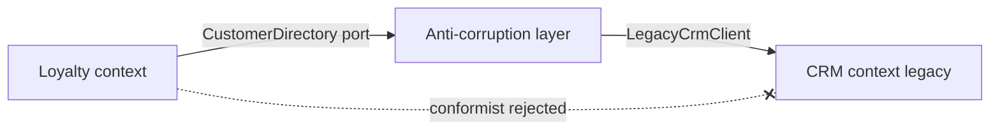
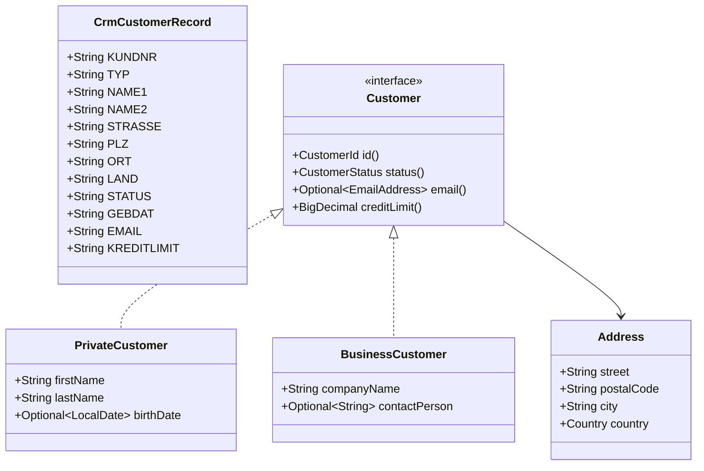

# Task 20 · An anti-corruption layer for the legacy CRM

| Difficulty | Topics | Time box |
|---|---|---|
| 🔴 Hard | DDD anti-corruption layer (ACL) and context mapping · Translating a messy legacy model into a clean domain model · Parsing and validating untrusted data · Exception translation at a boundary · Sealed domain types, value objects, `Optional` at the edges | 3–4 h |

> **Background reading:** Eric Evans, *Domain-Driven Design*, ch. 14 "Maintaining Model Integrity" (Anticorruption Layer, Context Map) · Vaughn Vernon, *Implementing Domain-Driven Design*, ch. 3 (Context Maps) and ch. 13 (Integrating Bounded Contexts) · *Effective Java* Item 73 ("Throw exceptions appropriate to the abstraction") · Alexis King, "Parse, don't validate" (2019 blog post)

---

## The situation

Our new loyalty-program service needs customer data. That data lives in a 25-year-old CRM. Its field names are German (`KUNDNR`, `GEBDAT`, `PLZ`), its values are codes (`"A"`, `"G"`, `"P"`), and its formats are odd (`"1.234,56"` for money, `"00.00.0000"` for "birth date unknown", several e-mail addresses in one field separated by `;`).

The CRM client is generated code. We must not change it.

Two teams have already sprinkled `"A".equals(rec.STATUS)` and `LocalDate.parse(rec.GEBDAT, ...)` across the code base. Now a third team wants the data too. If nothing stops it, the CRM's model will spread into every service we own, and every change in the CRM will break all of them.

So we put a **translation layer at the border**. Only the layer knows the CRM. Everything else sees our own model, where every value is valid, every name is English and every "unknown" is an explicit `Optional`.

## The domain

| Term | Meaning |
|---|---|
| **Legacy record** | `CrmCustomerRecord`: one row from the CRM, text fields, no rules. Owned by the CRM. |
| **Customer** | Our model: a sealed interface with two cases, `PrivateCustomer` and `BusinessCustomer`. |
| **Port** | `CustomerDirectory`: the interface our loyalty context uses. It speaks only domain language. |
| **Anti-corruption layer (ACL)** | The package `acl`: it implements the port and translates the CRM model into ours, so the CRM model never crosses the border. |
| **Corrupt data** | The CRM has a customer, but one field cannot be turned into a valid value. Retrying does not help. |
| **Unavailable** | The CRM cannot answer right now (timeout, connection, auth). Retrying may help. |

### The context map



The dotted, crossed-out arrow is the **conformist** alternative: the loyalty team would use `CrmCustomerRecord` directly and accept the CRM's language as its own. We reject it. The ACL costs us one translator class, and in return the CRM can change without touching our domain.

### Both models side by side



Notice what the domain side does **not** have: no `TYP` code, no `"P"` or `"F"`, no German names, no `"00.00.0000"`, no `;`-separated strings. Those belong to the CRM side and are translated away.

### The field mapping

| Legacy field | Domain | Rule |
|---|---|---|
| `KUNDNR` | `CustomerId` | Not read from the record. We asked for this id, so we keep it. |
| `TYP` | `PrivateCustomer` / `BusinessCustomer` | `P` or `F`, anything else is corrupt. |
| `NAME1` / `NAME2` (P) | `lastName` / `firstName` | Both must be non-blank. |
| `NAME1` / `NAME2` (F) | `companyName` / `contactPerson` | `NAME1` must be non-blank. Blank `NAME2` means no contact person. |
| `STRASSE`, `ORT` | `Address.street`, `Address.city` | Trimmed. |
| `PLZ` | `Address.postalCode` | 5 digits for DE, 4 for AT and CH, checked by `Address`. |
| `LAND` | `Address.country` | Known names and codes map to `DE`, `AT`, `CH`. Empty means DE. |
| `STATUS` | `CustomerStatus` | `A` ACTIVE, `I` INACTIVE, `G` BLOCKED. |
| `GEBDAT` | `birthDate` | `dd.MM.uuuu` strictly, `00.00.0000` or empty means unknown. Ignored for `F`. |
| `EMAIL` | `email` | Split on `;`, first valid address wins, junk is ignored. |
| `KREDITLIMIT` | `creditLimit` | German format `1.234,56` as `BigDecimal` with scale 2. Empty means 0.00. |

---

## What I want from you

Implement the directory and its translator. The domain types, the CRM types and the exceptions are given: do not change them.

1. **[`CrmCustomerDirectory`](../src/main/java/io/github/chris013/practice/task20/acl/CrmCustomerDirectory.java)(LegacyCrmClient crm)** implements `CustomerDirectory`.
   * `null` client → `NullPointerException` naming `crm`. `null` id → `NullPointerException`.
   * It asks the CRM with `id.value()` as `KUNDNR`.
   * A `null` record from the CRM means "not found": return `Optional.empty()`.
   * Any `CrmException` becomes a `CustomerDirectoryUnavailableException`, whatever its `code()`. The `CrmException` is the **cause**.
2. **[`CrmCustomerTranslator`](../src/main/java/io/github/chris013/practice/task20/acl/CrmCustomerTranslator.java)** is package-private with `Customer toDomain(CustomerId id, CrmCustomerRecord record)`. It takes the requested id as well as the record, because the translator must not trust or re-parse the record's own `KUNDNR`.
3. Every text field is trimmed. A `null` legacy field counts as blank.
4. `TYP` must be `P` or `F`. Anything else throws `CorruptCustomerDataException` with field `TYP`.
5. `STATUS` must be `A`, `I` or `G`. Anything else: corrupt, field `STATUS`.
6. `LAND` is case-insensitive and accepts these names:
   * `DE`: `D`, `DE`, `DEU`, `Deutschland`, `GERMANY`.
   * `AT`: `A`, `AT`, `AUT`, `Österreich`, `Oesterreich`, `AUSTRIA`.
   * `CH`: `CH`, `CHE`, `Schweiz`, `SWITZERLAND`.
   * Empty means `DE`. Anything else: corrupt, field `LAND`.
7. `PLZ` is checked by [`Address`](../src/main/java/io/github/chris013/practice/task20/domain/Address.java). When `Address` rejects it, throw corrupt with field `PLZ`, and keep the `IllegalArgumentException` as the cause. A German code with 4 digits, or an Austrian code with 5 digits, is corrupt.
8. `GEBDAT` is read only for `TYP` `P`. Empty or `00.00.0000` gives `Optional.empty()`. Any other value must be a real date in the `dd.MM.uuuu` format, read strictly: `31.02.1980` is corrupt with field `GEBDAT`, not 29 February or 2 March.
9. `EMAIL` is split on `;`. Each part is trimmed, and the first part that [`EmailAddress`](../src/main/java/io/github/chris013/practice/task20/domain/EmailAddress.java) accepts wins. If none does, the result is empty. Junk is **not** corruption.
10. `KREDITLIMIT` uses the German number format. Empty means `0.00`. The result has scale 2, so `1234` gives `1234.00`. A negative or unparsable value is corrupt with field `KREDITLIMIT`.
11. For `P`: `NAME1` (last name) and `NAME2` (first name) must both be non-blank. For `F`: `NAME1` must be non-blank, and a blank `NAME2` gives no contact person.
12. A corrupt value throws `CorruptCustomerDataException`. Its message is `customer <id>: <problem>`, for example `customer 4711: invalid PLZ '123'`. Its `field()` is the legacy field name.
13. The translator reports the **first** problem it finds. (Stretch goal 1 asks you to collect all of them.)

## Constraints & non-goals

* Do not change anything in `task20.crm` or `task20.domain`. The starter and the solution have identical copies.
* `CrmCustomerRecord` must not leave the `acl` package. Not in a return type, not in an exception, not in a field of a domain object.
* No `NumberFormat` and no `Double`. Money is `BigDecimal`.
* No lenient date parsing.
* No caching, no retries, no logging framework. Those are stretch goals.
* Translation logic lives in the ACL, not in the domain records. The records only check their own invariants.

## How I'd approach it

* Start with `CrmCustomerTranslator` and one test that makes a private customer. Get the happy path green, then add the rules one at a time. The table tests in `CrmCustomerDirectoryTest` tell you what each rule must do.
* **Parse, don't validate** (Alexis King). The translator turns text into values, and the value types (`CustomerId`, `Address`, `EmailAddress`) reject anything invalid in their constructors. After the translator has run, you never need to check a value again. If you find yourself writing `if (postalCode.length() != 5)` in the translator, move that rule into `Address` instead.
* **Exception translation** (*Effective Java* Item 73). The CRM's `CrmException` is an infrastructure detail. Callers of the port should see `CustomerDirectoryUnavailableException`, which says what happened in our language. Do not throw away the cause: the CRM error code and the stack trace are what the on-call engineer needs.
* **Why junk e-mails are ignored and a junk PLZ is corruption.** This is a business decision, and you should be able to defend it. A customer without an e-mail address can still get the loyalty newsletter by post. A customer without a valid postal code cannot receive a parcel. Ask yourself: "is this record usable?" If the answer is no, it is corrupt.
* **Why the translator is package-private.** The only public face of the ACL is the port implementation. If another class could call `toDomain` directly with a record it got from somewhere else, it would skip the exception translation and the port's contract. Keep the surface as small as possible.
* **German numbers.** `NumberFormat.getInstance(Locale.GERMAN).parse("1.234,56abc")` succeeds and returns 1234.56: it stops at the first character it does not understand. For money, use a strict regex that must match the whole string. (Outside this task, `NumberFormat` with a `ParsePosition` that you check consumed the whole string is the other safe option.)
* **Dates.** `DateTimeFormatter` with `ResolverStyle.STRICT` rejects `31.02.1980`. `LENIENT` rolls it over to 02.03.1980 (1980 is a leap year), and `SMART` clamps it to 29.02.1980. Only `STRICT` rejects it. Read the Javadoc of `ResolverStyle` before you choose. Use `uuuu`, not `yyyy`: under `STRICT`, `yyyy` is year-of-era, and without an era in the pattern even `31.12.1980` is rejected.
* **The `Optional` boundary.** `Optional` is good as a return type and as a record component that means "may be absent" (`birthDate`). It is bad as a field, a parameter, or inside a collection. The directory returns `Optional`, and the translator's helpers may too; none of them takes one as a parameter.
* **Where the ACL lives.** In hexagonal terms (ports and adapters, covered in [task 10](10-library-lending-hexagonal.md) of this series) the `CustomerDirectory` interface is a port that belongs to the loyalty context. The ACL is an adapter: it implements that port and points outwards to the CRM. The dependency arrow points inwards, from the adapter to the domain, and never from the domain to the CRM.
* `Stream.flatMap(Optional::stream)` (Java 9+) turns a stream of optionals into a stream of values. It is a good fit for "first valid e-mail".

## Tests

Run: `mvn test -Dtest='**/task20/**'`

[`CrmCustomerDirectoryTest`](../src/test/java/io/github/chris013/practice/task20/acl/CrmCustomerDirectoryTest.java) tests the directory through its port only, against a hand-written [`FakeLegacyCrmClient`](../src/test/java/io/github/chris013/practice/task20/acl/FakeLegacyCrmClient.java). Test records come from the [`CrmRecords`](../src/test/java/io/github/chris013/practice/task20/acl/CrmRecords.java) builder: start from a valid record and override one field with `with(field, value)`. Note that the translator is package-private, but the tests use the public port, so they test what callers see.

<details>
<summary>Show the tests</summary>

<!-- embed: src/test/java/io/github/chris013/practice/task20/acl/CrmCustomerDirectoryTest.java -->
**[`CrmCustomerDirectoryTest.java`](../src/test/java/io/github/chris013/practice/task20/acl/CrmCustomerDirectoryTest.java)**

```java
package io.github.chris013.practice.task20.acl;

import static io.github.chris013.practice.task20.acl.CrmRecords.aBusinessCustomerRecord;
import static io.github.chris013.practice.task20.acl.CrmRecords.aPrivateCustomerRecord;
import static org.assertj.core.api.Assertions.assertThat;
import static org.assertj.core.api.Assertions.assertThatThrownBy;

import io.github.chris013.practice.task20.crm.CrmException;
import io.github.chris013.practice.task20.domain.Address;
import io.github.chris013.practice.task20.domain.BusinessCustomer;
import io.github.chris013.practice.task20.domain.CorruptCustomerDataException;
import io.github.chris013.practice.task20.domain.Country;
import io.github.chris013.practice.task20.domain.Customer;
import io.github.chris013.practice.task20.domain.CustomerDirectoryUnavailableException;
import io.github.chris013.practice.task20.domain.CustomerId;
import io.github.chris013.practice.task20.domain.CustomerStatus;
import io.github.chris013.practice.task20.domain.EmailAddress;
import io.github.chris013.practice.task20.domain.PrivateCustomer;
import java.time.LocalDate;
import java.time.format.DateTimeParseException;
import java.util.Optional;
import org.junit.jupiter.api.Nested;
import org.junit.jupiter.api.Test;
import org.junit.jupiter.params.ParameterizedTest;
import org.junit.jupiter.params.provider.CsvSource;
import org.junit.jupiter.params.provider.ValueSource;

class CrmCustomerDirectoryTest {

    private static final CustomerId ID = new CustomerId("4711");

    private Optional<Customer> lookup(CrmRecords record) {
        return new CrmCustomerDirectory(new FakeLegacyCrmClient().with(record.build())).findById(ID);
    }

    private Customer lookupOrFail(CrmRecords record) {
        return lookup(record).orElseThrow();
    }

    @Nested
    class PrivateCustomers {

        @Test
        void maps_the_id_the_names_and_the_address() {
            assertThat(lookupOrFail(aPrivateCustomerRecord())).isInstanceOfSatisfying(PrivateCustomer.class, p -> {
                assertThat(p.id()).isEqualTo(ID);
                assertThat(p.firstName()).isEqualTo("Erika");
                assertThat(p.lastName()).isEqualTo("Mustermann");
                assertThat(p.address()).isEqualTo(new Address("Musterstrasse 1", "10115", "Berlin", Country.DE));
            });
        }

        @Test
        void trims_every_field() {
            CrmRecords record = aPrivateCustomerRecord()
                    .with("NAME1", "  Mustermann ")
                    .with("NAME2", " Erika\t")
                    .with("STRASSE", " Musterstrasse 1 ")
                    .with("PLZ", " 10115 ")
                    .with("ORT", " Berlin ");

            assertThat(lookupOrFail(record)).isInstanceOfSatisfying(PrivateCustomer.class, p -> {
                assertThat(p.lastName()).isEqualTo("Mustermann");
                assertThat(p.firstName()).isEqualTo("Erika");
                assertThat(p.address()).isEqualTo(new Address("Musterstrasse 1", "10115", "Berlin", Country.DE));
            });
        }

        @Test
        void trims_the_coded_fields_too() {
            CrmRecords record = aPrivateCustomerRecord()
                    .with("TYP", " P ").with("STATUS", " G ").with("LAND", " AT ").with("PLZ", "1010")
                    .with("GEBDAT", " 31.12.1980 ").with("KREDITLIMIT", " 1.234,56 ");

            assertThat(lookupOrFail(record)).isInstanceOfSatisfying(PrivateCustomer.class, p -> {
                assertThat(p.status()).isEqualTo(CustomerStatus.BLOCKED);
                assertThat(p.address().country()).isEqualTo(Country.AT);
                assertThat(p.birthDate()).contains(LocalDate.of(1980, 12, 31));
                assertThat(p.creditLimit().toPlainString()).isEqualTo("1234.56");
            });
        }

        @Test
        void treats_a_null_legacy_field_as_blank() {
            CrmRecords record = aPrivateCustomerRecord().with("EMAIL", null).with("KREDITLIMIT", null);

            assertThat(lookupOrFail(record)).isInstanceOfSatisfying(PrivateCustomer.class, p -> {
                assertThat(p.email()).isEmpty();
                assertThat(p.creditLimit().toPlainString()).isEqualTo("0.00");
            });
        }

        @ParameterizedTest
        @CsvSource({"A,ACTIVE", "I,INACTIVE", "G,BLOCKED"})
        void maps_the_status_codes(String code, CustomerStatus expected) {
            assertThat(lookupOrFail(aPrivateCustomerRecord().with("STATUS", code)).status()).isEqualTo(expected);
        }
    }

    @Nested
    class BusinessCustomers {

        @Test
        void maps_the_company_name_and_the_contact_person() {
            assertThat(lookupOrFail(aBusinessCustomerRecord())).isInstanceOfSatisfying(BusinessCustomer.class, b -> {
                assertThat(b.id()).isEqualTo(ID);
                assertThat(b.companyName()).isEqualTo("Muster GmbH");
                assertThat(b.contactPerson()).contains("Max Muster");
            });
        }

        @Test
        void a_blank_contact_person_becomes_empty() {
            CrmRecords record = aBusinessCustomerRecord().with("NAME2", "   ");

            assertThat(lookupOrFail(record)).isInstanceOfSatisfying(BusinessCustomer.class,
                    b -> assertThat(b.contactPerson()).isEmpty());
        }

        @Test
        void ignores_the_birth_date_field_for_businesses() {
            CrmRecords record = aBusinessCustomerRecord().with("GEBDAT", "31.02.1980");

            assertThat(lookupOrFail(record)).isInstanceOfSatisfying(BusinessCustomer.class,
                    b -> assertThat(b.companyName()).isEqualTo("Muster GmbH"));
        }

        @Test
        void a_business_without_a_company_name_is_corrupt() {
            CrmRecords record = aBusinessCustomerRecord().with("NAME1", "");

            assertThatThrownBy(() -> lookup(record))
                    .isInstanceOfSatisfying(CorruptCustomerDataException.class,
                            e -> assertThat(e.field()).isEqualTo("NAME1"));
        }
    }

    @Nested
    class Countries {

        @ParameterizedTest
        @CsvSource({
            "DE,10115,DE", "D,10115,DE", "DEU,10115,DE", "Deutschland,10115,DE", "germany,10115,DE", "'',10115,DE",
            "A,1010,AT", "AUT,1010,AT", "Österreich,1010,AT", "Oesterreich,1010,AT", "austria,1010,AT",
            "CH,8001,CH", "CHE,8001,CH", "Schweiz,8001,CH", "switzerland,8001,CH"
        })
        void maps_the_legacy_country_names_to_a_country(String land, String plz, Country expected) {
            CrmRecords record = aPrivateCustomerRecord().with("LAND", land).with("PLZ", plz);

            assertThat(lookupOrFail(record).address().country()).isEqualTo(expected);
        }

        @Test
        void an_unknown_country_is_corrupt() {
            CrmRecords record = aPrivateCustomerRecord().with("LAND", "FR");

            assertThatThrownBy(() -> lookup(record))
                    .isInstanceOfSatisfying(CorruptCustomerDataException.class,
                            e -> assertThat(e.field()).isEqualTo("LAND"));
        }
    }

    @Nested
    class BirthDates {

        @ParameterizedTest
        @CsvSource({"31.12.1980,1980-12-31", "29.02.2024,2024-02-29", "01.01.1900,1900-01-01"})
        void parses_the_german_date_format(String gebdat, LocalDate expected) {
            assertThat(lookupOrFail(aPrivateCustomerRecord().with("GEBDAT", gebdat)))
                    .isInstanceOfSatisfying(PrivateCustomer.class, p -> assertThat(p.birthDate()).contains(expected));
        }

        @ParameterizedTest
        @ValueSource(strings = {"", "00.00.0000"})
        void an_empty_or_zero_date_means_unknown(String gebdat) {
            assertThat(lookupOrFail(aPrivateCustomerRecord().with("GEBDAT", gebdat)))
                    .isInstanceOfSatisfying(PrivateCustomer.class, p -> assertThat(p.birthDate()).isEmpty());
        }

        @Test
        void a_date_that_does_not_exist_is_corrupt_and_not_moved_to_march() {
            // Lenient parsing would turn 31.02.1980 into 02.03.1980, smart parsing into 29.02.1980.
            CrmRecords record = aPrivateCustomerRecord().with("GEBDAT", "31.02.1980");

            assertThatThrownBy(() -> lookup(record))
                    .isInstanceOfSatisfying(CorruptCustomerDataException.class,
                            e -> assertThat(e.field()).isEqualTo("GEBDAT"));
        }

        @Test
        void keeps_the_date_parse_problem_as_the_cause() {
            CrmRecords record = aPrivateCustomerRecord().with("GEBDAT", "31.02.1980");

            assertThatThrownBy(() -> lookup(record)).hasCauseInstanceOf(DateTimeParseException.class);
        }
    }

    @Nested
    class Emails {

        @Test
        void lower_cases_and_trims_the_address() {
            CrmRecords record = aPrivateCustomerRecord().with("EMAIL", "  Erika@Example.DE ");

            assertThat(lookupOrFail(record).email()).contains(new EmailAddress("erika@example.de"));
        }

        @Test
        void takes_the_first_valid_address_of_several() {
            CrmRecords record = aPrivateCustomerRecord().with("EMAIL", "junk; erika@example.de ;other@example.de");

            assertThat(lookupOrFail(record).email()).contains(new EmailAddress("erika@example.de"));
        }

        @Test
        void an_empty_email_field_means_no_email() {
            assertThat(lookupOrFail(aPrivateCustomerRecord().with("EMAIL", "")).email()).isEmpty();
        }

        @ParameterizedTest
        @ValueSource(strings = {"no-at-sign", "a@b@c.de", "@example.de", "erika@", "erika@localhost", "erika@.de", "erika@example."})
        void junk_emails_are_ignored_and_are_not_corruption(String junk) {
            CrmRecords record = aPrivateCustomerRecord().with("EMAIL", junk);

            assertThat(lookupOrFail(record).email()).isEmpty();
        }
    }

    @Nested
    class CreditLimits {

        @ParameterizedTest
        @CsvSource({
            "'',0.00", "'0,5',0.50", "'1234',1234.00", "'1234,5',1234.50",
            "'1.234,56',1234.56", "'1.234.567,00',1234567.00", "'1.234',1234.00"
        })
        void reads_the_german_number_format_with_two_decimals(String raw, String expected) {
            CrmRecords record = aPrivateCustomerRecord().with("KREDITLIMIT", raw);

            assertThat(lookupOrFail(record).creditLimit().toPlainString()).isEqualTo(expected);
        }

        @Test
        void a_negative_limit_is_corrupt() {
            CrmRecords record = aPrivateCustomerRecord().with("KREDITLIMIT", "-5");

            assertThatThrownBy(() -> lookup(record))
                    .isInstanceOfSatisfying(CorruptCustomerDataException.class,
                            e -> assertThat(e.field()).isEqualTo("KREDITLIMIT"));
        }
    }

    @Nested
    class CorruptData {

        @ParameterizedTest
        @CsvSource({
            "TYP,X", "TYP,''",
            "STATUS,Z", "STATUS,''",
            "LAND,FR",
            "PLZ,123", "PLZ,ABCDE", "PLZ,1011", "PLZ,''",
            "NAME1,''", "NAME2,''",
            "GEBDAT,31.02.1980", "GEBDAT,29.02.2023", "GEBDAT,1980-12-31", "GEBDAT,32.01.1980",
            "KREDITLIMIT,abc", "KREDITLIMIT,'1.234,56abc'",
            "KREDITLIMIT,1234.56", "KREDITLIMIT,'1,234'", "KREDITLIMIT,'1.23,00'", "KREDITLIMIT,'12.34'",
            "KREDITLIMIT,'-5,00'", "KREDITLIMIT,'1 234,56'"
        })
        void names_the_legacy_field_and_the_customer(String field, String value) {
            CrmRecords record = aPrivateCustomerRecord().with(field, value);

            assertThatThrownBy(() -> lookup(record)).isInstanceOfSatisfying(CorruptCustomerDataException.class, e -> {
                assertThat(e.field()).isEqualTo(field);
                assertThat(e.customerId()).isEqualTo(ID);
            });
        }

        @Test
        void the_message_says_which_customer_and_what_is_wrong() {
            CrmRecords record = aPrivateCustomerRecord().with("PLZ", "123");

            assertThatThrownBy(() -> lookup(record)).hasMessage("customer 4711: invalid PLZ '123'");
        }

        @Test
        void keeps_the_postal_code_problem_as_the_cause() {
            CrmRecords record = aPrivateCustomerRecord().with("PLZ", "123");

            assertThatThrownBy(() -> lookup(record)).hasCauseInstanceOf(IllegalArgumentException.class);
        }

        @Test
        void a_postal_code_must_match_the_country() {
            CrmRecords record = aPrivateCustomerRecord().with("LAND", "AT"); // AT codes have 4 digits, 10115 has 5

            assertThatThrownBy(() -> lookup(record))
                    .isInstanceOfSatisfying(CorruptCustomerDataException.class,
                            e -> assertThat(e.field()).isEqualTo("PLZ"));
        }
    }

    @Nested
    class Availability {

        @Test
        void returns_empty_when_the_crm_has_no_such_customer() {
            CrmCustomerDirectory directory = new CrmCustomerDirectory(new FakeLegacyCrmClient());

            assertThat(directory.findById(ID)).isEmpty();
        }

        @Test
        void asks_the_crm_for_the_customer_number() {
            FakeLegacyCrmClient crm = new FakeLegacyCrmClient().with(aPrivateCustomerRecord().build());

            new CrmCustomerDirectory(crm).findById(ID);

            assertThat(crm.lastKundnr()).isEqualTo("4711");
        }

        @ParameterizedTest
        @ValueSource(strings = {"TIMEOUT", "CONNECTION", "AUTH"})
        void turns_every_crm_failure_into_unavailable_and_keeps_the_cause(String code) {
            CrmCustomerDirectory directory = new CrmCustomerDirectory(new FakeLegacyCrmClient().failsWith(code));

            assertThatThrownBy(() -> directory.findById(ID))
                    .isInstanceOfSatisfying(CustomerDirectoryUnavailableException.class, e ->
                            assertThat(e.getCause()).isInstanceOfSatisfying(CrmException.class,
                                    crmException -> assertThat(crmException.code()).isEqualTo(code)));
        }

        @Test
        void rejects_a_missing_client() {
            assertThatThrownBy(() -> new CrmCustomerDirectory(null)).isInstanceOf(NullPointerException.class);
        }

        @Test
        void rejects_a_missing_id() {
            CrmCustomerDirectory directory = new CrmCustomerDirectory(new FakeLegacyCrmClient());

            assertThatThrownBy(() -> directory.findById(null)).isInstanceOf(NullPointerException.class);
        }
    }
}
```
<!-- /embed -->

<!-- embed: src/test/java/io/github/chris013/practice/task20/acl/FakeLegacyCrmClient.java -->
**[`FakeLegacyCrmClient.java`](../src/test/java/io/github/chris013/practice/task20/acl/FakeLegacyCrmClient.java)**

```java
package io.github.chris013.practice.task20.acl;

import io.github.chris013.practice.task20.crm.CrmCustomerRecord;
import io.github.chris013.practice.task20.crm.CrmException;
import io.github.chris013.practice.task20.crm.LegacyCrmClient;
import java.util.HashMap;
import java.util.Map;

/** A hand-written fake CRM: holds some records, can be told to fail, and remembers what it was asked. */
final class FakeLegacyCrmClient implements LegacyCrmClient {

    private final Map<String, CrmCustomerRecord> records = new HashMap<>();
    private CrmException failure;
    private String lastKundnr;

    FakeLegacyCrmClient with(CrmCustomerRecord record) {
        records.put(record.KUNDNR, record);
        return this;
    }

    FakeLegacyCrmClient failsWith(String code) {
        failure = new CrmException(code, "CRM said " + code);
        return this;
    }

    String lastKundnr() {
        return lastKundnr;
    }

    @Override
    public CrmCustomerRecord fetch(String kundnr) throws CrmException {
        lastKundnr = kundnr;
        if (failure != null) {
            throw failure;
        }
        return records.get(kundnr);
    }
}
```
<!-- /embed -->

<!-- embed: src/test/java/io/github/chris013/practice/task20/acl/CrmRecords.java -->
**[`CrmRecords.java`](../src/test/java/io/github/chris013/practice/task20/acl/CrmRecords.java)**

```java
package io.github.chris013.practice.task20.acl;

import io.github.chris013.practice.task20.crm.CrmCustomerRecord;

/** Builds valid legacy records. Override only the fields a test is about, with {@link #with(String, String)}. */
final class CrmRecords {

    private final CrmCustomerRecord record = new CrmCustomerRecord();

    private CrmRecords() {
    }

    /** A valid private customer: Erika Mustermann, Berlin, active, born 31.12.1980. */
    static CrmRecords aPrivateCustomerRecord() {
        return new CrmRecords()
                .with("KUNDNR", "4711")
                .with("TYP", "P")
                .with("NAME1", "Mustermann")
                .with("NAME2", "Erika")
                .with("STRASSE", "Musterstrasse 1")
                .with("PLZ", "10115")
                .with("ORT", "Berlin")
                .with("LAND", "DE")
                .with("STATUS", "A")
                .with("GEBDAT", "31.12.1980")
                .with("EMAIL", "erika@example.de")
                .with("KREDITLIMIT", "1.234,56");
    }

    /** A valid business customer: Muster GmbH, contact Max Muster, Berlin, active. */
    static CrmRecords aBusinessCustomerRecord() {
        return new CrmRecords()
                .with("KUNDNR", "4711")
                .with("TYP", "F")
                .with("NAME1", "Muster GmbH")
                .with("NAME2", "Max Muster")
                .with("STRASSE", "Hauptstrasse 7")
                .with("PLZ", "10115")
                .with("ORT", "Berlin")
                .with("LAND", "DE")
                .with("STATUS", "A")
                .with("GEBDAT", "")
                .with("EMAIL", "info@muster.example")
                .with("KREDITLIMIT", "50.000,00");
    }

    CrmRecords with(String field, String value) {
        switch (field) {
            case "KUNDNR" -> record.KUNDNR = value;
            case "TYP" -> record.TYP = value;
            case "NAME1" -> record.NAME1 = value;
            case "NAME2" -> record.NAME2 = value;
            case "STRASSE" -> record.STRASSE = value;
            case "PLZ" -> record.PLZ = value;
            case "ORT" -> record.ORT = value;
            case "LAND" -> record.LAND = value;
            case "STATUS" -> record.STATUS = value;
            case "GEBDAT" -> record.GEBDAT = value;
            case "EMAIL" -> record.EMAIL = value;
            case "KREDITLIMIT" -> record.KREDITLIMIT = value;
            default -> throw new IllegalArgumentException("not a CRM field: " + field);
        }
        return this;
    }

    CrmCustomerRecord build() {
        return record;
    }
}
```
<!-- /embed -->

</details>

## Definition of done

- [ ] All tests green, and the whole task test run takes well under a second.
- [ ] `CrmCustomerTranslator` is package-private, and `CrmCustomerRecord` appears nowhere outside `acl`.
- [ ] Every corrupt value throws `CorruptCustomerDataException` with the right legacy field name; no `IllegalArgumentException` or `DateTimeParseException` escapes `findById`.
- [ ] Every `CrmException` becomes a `CustomerDirectoryUnavailableException` with the original as its cause.
- [ ] No `Double`, no lenient date parsing, no `NumberFormat`.
- [ ] The domain types are unchanged, and no CRM knowledge is in them.
- [ ] Your PR description says why junk e-mails are ignored but a junk postal code is not.

## Stretch goals

1. **Collect all problems.** Instead of failing on the first bad field, collect every problem of a record and report them together. What should the exception look like then? Would `CorruptCustomerDataException` still have one `field()`?
2. **Write-back.** Write a translator in the other direction, from `Customer` to a `CrmCustomerRecord`, for when the loyalty context changes a customer. Which domain values cannot be written back exactly? Think about `KREDITLIMIT` and `GEBDAT` for businesses.
3. **Caching with a TTL.** Wrap the directory in a cache with a time to live, as in [task 07](07-exchange-rate-decorators.md). Should a `CustomerDirectoryUnavailableException` be cached? Should `Optional.empty()` be cached?
4. **Metrics for corrupt records.** Instead of throwing for a corrupt record, count it per field and return it as "not usable". What do callers lose? What do operations gain? When would you still throw?
5. **Check the key.** A stricter ACL compares the stripped `KUNDNR` of the record with `id.value()`. If they differ, the CRM returned a record for another customer or is confused, so report it as corrupt with field `KUNDNR`. Why is it worth checking at all, when we already ignore the record's `KUNDNR`?

---

## Reference solution

<details>
<summary>Spoiler: open only after you have made a serious attempt</summary>

### Key decisions

**1. The translator is package-private and the directory is the only public class in the layer.** The directory implements the port, owns the `LegacyCrmClient` and the translator, and is the only thing outside code can see. A caller cannot skip the exception translation, because there is no other way to reach the CRM data.

**2. Value types validate themselves.** `CustomerId`, `Address` and `EmailAddress` reject bad values in their constructors. The translator therefore only has to convert text and map codes. It does not repeat the postal-code rule: it calls `new Address(...)` and translates the `IllegalArgumentException` into a corrupt-data exception with the legacy field name. One rule, one place.

**3. The requested id is the customer's identity.** `toDomain` takes the `CustomerId` we asked for, and it ignores the record's `KUNDNR`. The real reason is that `CorruptCustomerDataException` needs a valid `CustomerId` to say which customer is broken, and we already have one: the id we asked for, which `CustomerId` has checked. If we read `KUNDNR` from the record instead, a junk value would fail before we know which customer we are dealing with, and the exception would have no id to carry.

**4. Two kinds of bad data.** A junk e-mail is dropped silently, because a customer is still usable without one. A junk postal code or status is corruption, because the record cannot be used. The line between the two is "can the loyalty program act on this customer?", and that answer is a business decision, so it is written down in the code comments and in the tests.

**5. Exceptions across the boundary.** Every `CrmException` becomes `CustomerDirectoryUnavailableException` with the original as cause. The code is "retry later" for all codes here. For `AUTH` you could argue for a different answer: retrying a wrong password never helps, and an alert is more useful than a retry loop.

**6. Strict parsing everywhere.** `DateTimeFormatter` with `ResolverStyle.STRICT` rejects `31.02.1980`. Credit limits are read with a regex that must match the whole string, so `1.234,56abc` is corrupt. Money is `BigDecimal` with scale 2, so the result looks the same whatever the input form was.

### Code

<!-- embed: solutions/src/main/java/io/github/chris013/practice/task20/acl/CrmCustomerDirectory.java -->
**[`CrmCustomerDirectory.java`](../solutions/src/main/java/io/github/chris013/practice/task20/acl/CrmCustomerDirectory.java)**

```java
package io.github.chris013.practice.task20.acl;

import io.github.chris013.practice.task20.crm.CrmCustomerRecord;
import io.github.chris013.practice.task20.crm.CrmException;
import io.github.chris013.practice.task20.crm.LegacyCrmClient;
import io.github.chris013.practice.task20.domain.Customer;
import io.github.chris013.practice.task20.domain.CustomerDirectory;
import io.github.chris013.practice.task20.domain.CustomerDirectoryUnavailableException;
import io.github.chris013.practice.task20.domain.CustomerId;
import java.util.Objects;
import java.util.Optional;

/**
 * The anti-corruption layer's only public class: it answers {@link CustomerDirectory} with domain customers
 * and keeps every CRM detail (field names, codes, formats, exceptions) behind it.
 *
 * <p>Task 20: read {@code tasks/20-anti-corruption-layer.md} first.
 */
public final class CrmCustomerDirectory implements CustomerDirectory {

    private final LegacyCrmClient crm;
    private final CrmCustomerTranslator translator = new CrmCustomerTranslator();

    /**
     * @param crm the generated CRM client; must not be {@code null}
     */
    public CrmCustomerDirectory(LegacyCrmClient crm) {
        this.crm = Objects.requireNonNull(crm, "crm");
    }

    /**
     * Looks the customer up in the CRM and translates the record.
     *
     * <p>A {@code null} record from the CRM means "not found" and gives an empty Optional. Any
     * {@link CrmException} becomes a {@link CustomerDirectoryUnavailableException} that keeps the original
     * exception as its cause, so the stack trace and the CRM error code are not lost.
     */
    @Override
    public Optional<Customer> findById(CustomerId id) {
        Objects.requireNonNull(id, "id");
        CrmCustomerRecord record = fetch(id);
        if (record == null) {
            return Optional.empty();
        }
        return Optional.of(translator.toDomain(id, record));
    }

    private CrmCustomerRecord fetch(CustomerId id) {
        try {
            return crm.fetch(id.value());
        } catch (CrmException e) {
            // Every CRM code is treated as "try again later" here. AUTH could be argued differently:
            // retrying a wrong password will never help, and an alert might be the better answer.
            throw new CustomerDirectoryUnavailableException(
                    "the CRM could not load customer %s (%s)".formatted(id.value(), e.code()), e);
        }
    }
}
```
<!-- /embed -->

<!-- embed: solutions/src/main/java/io/github/chris013/practice/task20/acl/CrmCustomerTranslator.java -->
**[`CrmCustomerTranslator.java`](../solutions/src/main/java/io/github/chris013/practice/task20/acl/CrmCustomerTranslator.java)**

```java
package io.github.chris013.practice.task20.acl;

import static java.util.Map.entry;

import io.github.chris013.practice.task20.crm.CrmCustomerRecord;
import io.github.chris013.practice.task20.domain.Address;
import io.github.chris013.practice.task20.domain.BusinessCustomer;
import io.github.chris013.practice.task20.domain.CorruptCustomerDataException;
import io.github.chris013.practice.task20.domain.Country;
import io.github.chris013.practice.task20.domain.Customer;
import io.github.chris013.practice.task20.domain.CustomerId;
import io.github.chris013.practice.task20.domain.CustomerStatus;
import io.github.chris013.practice.task20.domain.EmailAddress;
import io.github.chris013.practice.task20.domain.PrivateCustomer;
import java.math.BigDecimal;
import java.time.LocalDate;
import java.time.format.DateTimeFormatter;
import java.time.format.DateTimeParseException;
import java.time.format.ResolverStyle;
import java.util.Arrays;
import java.util.Locale;
import java.util.Map;
import java.util.Objects;
import java.util.Optional;
import java.util.regex.Pattern;

/**
 * Turns one legacy CRM record into a domain {@link Customer}. Package-private on purpose: only the
 * directory may use it, so nothing outside the layer can call it with a half-trusted record.
 *
 * <p>Parse, don't validate: every value is checked once, here, and what comes out is always valid.
 * The first problem found is reported; the message names the legacy field so support can find it.
 *
 * <p>Task 20: read {@code tasks/20-anti-corruption-layer.md} first.
 */
final class CrmCustomerTranslator {

    private static final DateTimeFormatter GEBDAT_FORMAT =
            DateTimeFormatter.ofPattern("dd.MM.uuuu").withResolverStyle(ResolverStyle.STRICT);
    private static final String UNKNOWN_BIRTH_DATE = "00.00.0000";

    /** German number format with an optional comma-separated decimal part: 1.234,56 or 1234 or 0,5. */
    private static final Pattern KREDITLIMIT_FORMAT = Pattern.compile("(?:\\d{1,3}(?:\\.\\d{3})+|\\d+)(?:,\\d{1,2})?");

    /** Keys are upper-case, so lookups are case-insensitive. An empty LAND means Germany (legacy default). */
    private static final Map<String, Country> COUNTRIES = Map.ofEntries(
            entry("D", Country.DE), entry("DE", Country.DE), entry("DEU", Country.DE),
            entry("DEUTSCHLAND", Country.DE), entry("GERMANY", Country.DE),
            entry("A", Country.AT), entry("AT", Country.AT), entry("AUT", Country.AT),
            entry("ÖSTERREICH", Country.AT), entry("OESTERREICH", Country.AT), entry("AUSTRIA", Country.AT),
            entry("CH", Country.CH), entry("CHE", Country.CH), entry("SCHWEIZ", Country.CH),
            entry("SWITZERLAND", Country.CH));

    /**
     * Translates {@code record} for the customer {@code id} that was asked for.
     *
     * <p>The record's own KUNDNR is not used: we asked the CRM for {@code id}, so {@code id} is the
     * trusted identity of the customer.
     *
     * @throws CorruptCustomerDataException for any field that cannot be turned into a valid value
     */
    Customer toDomain(CustomerId id, CrmCustomerRecord record) {
        Objects.requireNonNull(id, "id");
        Objects.requireNonNull(record, "record");
        String type = clean(record.TYP);
        if (!type.equals("P") && !type.equals("F")) {
            throw corrupt(id, "TYP", "invalid TYP '%s'".formatted(type), null);
        }
        CustomerStatus status = status(id, record.STATUS);
        Address address = address(id, record);
        Optional<EmailAddress> email = firstValidEmail(clean(record.EMAIL));
        BigDecimal creditLimit = creditLimit(id, record.KREDITLIMIT);

        if (type.equals("P")) {
            String lastName = required(id, "NAME1", record.NAME1);
            String firstName = required(id, "NAME2", record.NAME2);
            Optional<LocalDate> birthDate = birthDate(id, record.GEBDAT);
            return new PrivateCustomer(id, firstName, lastName, birthDate, address, status, email, creditLimit);
        }
        String companyName = required(id, "NAME1", record.NAME1);
        String contact = clean(record.NAME2);
        Optional<String> contactPerson = contact.isEmpty() ? Optional.empty() : Optional.of(contact);
        // GEBDAT is ignored for businesses: it has no meaning there, so junk in it is not our problem.
        return new BusinessCustomer(id, companyName, contactPerson, address, status, email, creditLimit);
    }

    private static CustomerStatus status(CustomerId id, String rawStatus) {
        return switch (clean(rawStatus)) {
            case "A" -> CustomerStatus.ACTIVE;
            case "I" -> CustomerStatus.INACTIVE;
            case "G" -> CustomerStatus.BLOCKED;
            default -> throw corrupt(id, "STATUS", "invalid STATUS '%s'".formatted(clean(rawStatus)), null);
        };
    }

    private static Address address(CustomerId id, CrmCustomerRecord record) {
        Country country = country(id, record.LAND);
        String postalCode = clean(record.PLZ);
        try {
            return new Address(clean(record.STRASSE), postalCode, clean(record.ORT), country);
        } catch (IllegalArgumentException e) {
            // Keep the Address check as the single source of truth, but report it with the legacy field name.
            throw corrupt(id, "PLZ", "invalid PLZ '%s'".formatted(postalCode), e);
        }
    }

    private static Country country(CustomerId id, String rawLand) {
        String land = clean(rawLand);
        if (land.isEmpty()) {
            return Country.DE;
        }
        Country country = COUNTRIES.get(land.toUpperCase(Locale.ROOT));
        if (country == null) {
            throw corrupt(id, "LAND", "invalid LAND '%s'".formatted(land), null);
        }
        return country;
    }

    private static Optional<LocalDate> birthDate(CustomerId id, String rawBirthDate) {
        String value = clean(rawBirthDate);
        if (value.isEmpty() || value.equals(UNKNOWN_BIRTH_DATE)) {
            return Optional.empty();
        }
        try {
            return Optional.of(LocalDate.parse(value, GEBDAT_FORMAT));
        } catch (DateTimeParseException e) {
            // STRICT resolving rejects 31.02.1980 instead of quietly turning it into 29.02.1980 (SMART)
            // or 02.03.1980 (LENIENT).
            throw corrupt(id, "GEBDAT", "invalid GEBDAT '%s'".formatted(value), e);
        }
    }

    private static BigDecimal creditLimit(CustomerId id, String rawLimit) {
        String value = clean(rawLimit);
        if (value.isEmpty()) {
            return new BigDecimal("0.00");
        }
        // A regex, not NumberFormat: NumberFormat.parse("1.234,56abc") succeeds and silently ignores the junk.
        if (!KREDITLIMIT_FORMAT.matcher(value).matches()) {
            throw corrupt(id, "KREDITLIMIT", "invalid KREDITLIMIT '%s'".formatted(value), null);
        }
        return new BigDecimal(value.replace(".", "").replace(',', '.')).setScale(2);
    }

    private static Optional<EmailAddress> firstValidEmail(String rawEmails) {
        // The CRM stores zero, one or several addresses separated by ";". Junk is ignored, not corruption.
        return Arrays.stream(rawEmails.split(";"))
                .map(CrmCustomerTranslator::clean)
                .filter(candidate -> !candidate.isEmpty())
                .map(CrmCustomerTranslator::tryEmail)
                .flatMap(Optional::stream)
                .findFirst();
    }

    private static Optional<EmailAddress> tryEmail(String candidate) {
        try {
            return Optional.of(new EmailAddress(candidate));
        } catch (IllegalArgumentException e) {
            return Optional.empty();
        }
    }

    private static String required(CustomerId id, String field, String raw) {
        String value = clean(raw);
        if (value.isEmpty()) {
            throw corrupt(id, field, "missing " + field, null);
        }
        return value;
    }

    /** Null-safe trim: legacy fields may be null, and we treat null the same as blank. */
    private static String clean(String raw) {
        return raw == null ? "" : raw.strip();
    }

    private static CorruptCustomerDataException corrupt(CustomerId id, String field, String problem, Throwable cause) {
        return new CorruptCustomerDataException(id, field, problem, cause);
    }
}
```
<!-- /embed -->

### What I typically flag in first attempts

| Finding | Why it matters |
|---|---|
| The CRM record is returned from the port, or stored in a domain object | The CRM model leaks, and every consumer depends on the legacy field names. |
| `catch (Exception e)` around the CRM call | Hides programming errors as "unavailable" and retries bugs forever. Catch the one type you can handle. |
| `CrmException` replaced by a new exception with only a message | The CRM code and the stack trace are gone. Always pass the cause. |
| `LocalDate.parse` with the default resolver | `31.02.1980` silently becomes a different date. Use `STRICT`. |
| `NumberFormat` for money | It accepts trailing junk, and `Double` loses cents. Use a strict pattern and `BigDecimal`. |
| `Optional` parameters or `null` fields in the domain records | Callers have to guess what "absent" means. Use `Optional` for returns and for "may be absent" components only. |
| Checks like `if (plz.length() != 5)` in the translator | The rule now lives in two places and will drift apart. Put it in the value type. |
| Junk e-mail treated as corruption, or a junk postal code silently dropped | Both choices hide a business decision. Decide, write it down, and test both sides. |

</details>
