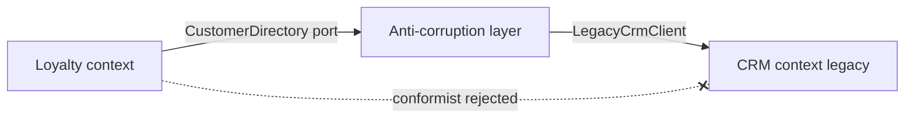
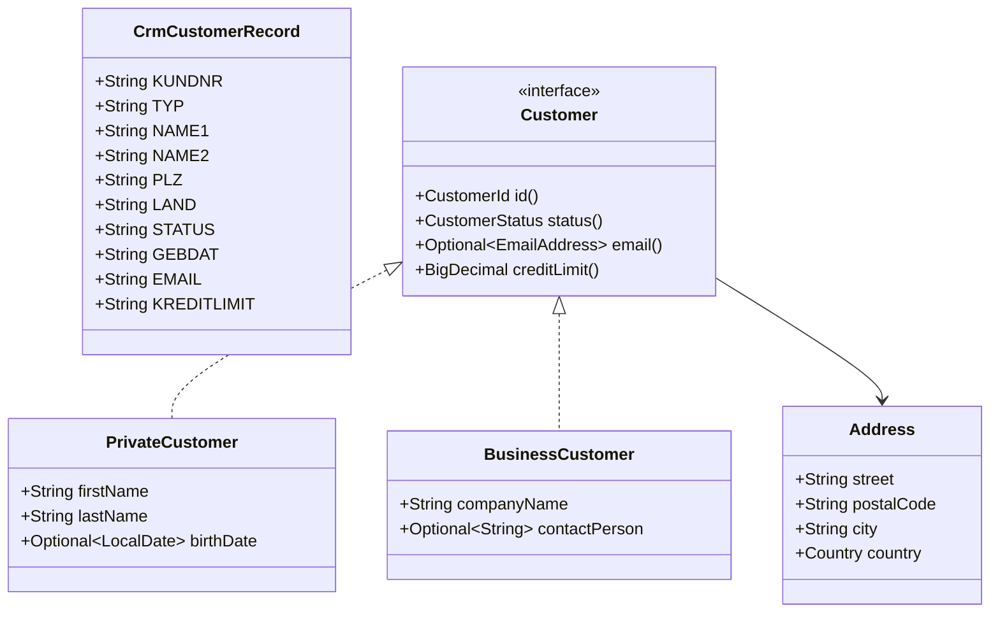

# Task 20 · An anti-corruption layer for the legacy CRM

| Difficulty | Topics | Time box |
|---|---|---|
| 🔴 Hard | DDD anti-corruption layer (ACL) and context mapping · Translating a messy legacy model into a clean domain model · Parsing and validating untrusted data · Exception translation at a boundary · Sealed domain types, value objects, `Optional` at the edges | 3–4 h |

> **Background reading:** Eric Evans, *Domain-Driven Design*, ch. 14 "Maintaining Model Integrity" (Anticorruption Layer, Context Map) · Vaughn Vernon, *Implementing Domain-Driven Design*, ch. 3 (Context Maps) and ch. 13 (Integrating Bounded Contexts) · *Effective Java* Item 73 ("Throw exceptions appropriate to the abstraction") · Alexis King, "Parse, don't validate" (2019 blog post)

---

## The situation

Our new loyalty-program service needs customer data. That data lives in a 25-year-old CRM. Its field names are German (`KUNDNR`, `GEBDAT`, `PLZ`), its values are codes (`"A"`, `"G"`, `"P"`), and its formats are odd (`"1.234,56"` for money, `"00.00.0000"` for "birth date unknown", several e-mail addresses in one field separated by `;`).

The CRM client is generated code. We must not change it.

Two teams have already sprinkled `"A".equals(rec.STATUS)` and `LocalDate.parse(rec.GEBDAT, ...)` across the code base. Now a third team wants the data too. If nothing stops it, the CRM's model will spread into every service we own, and every change in the CRM will break all of them.

So we put a **translation layer at the border**. Only the layer knows the CRM. Everything else sees our own model, where every value is valid, every name is English and every "unknown" is an explicit `Optional`.

## The domain

| Term | Meaning |
|---|---|
| **Legacy record** | `CrmCustomerRecord`: one row from the CRM, text fields, no rules. Owned by the CRM. |
| **Customer** | Our model: a sealed interface with two cases, `PrivateCustomer` and `BusinessCustomer`. |
| **Port** | `CustomerDirectory`: the interface our loyalty context uses. It speaks only domain language. |
| **Anti-corruption layer (ACL)** | The package `acl`: it implements the port and translates in both directions, so the CRM model never crosses the border. |
| **Corrupt data** | The CRM has a customer, but one field cannot be turned into a valid value. Retrying does not help. |
| **Unavailable** | The CRM cannot answer right now (timeout, connection, auth). Retrying may help. |

### The context map

The dotted, crossed-out arrow is the **conformist** alternative: the loyalty team would use `CrmCustomerRecord` directly and accept the CRM's language as its own. We reject it. The ACL costs us one translator class, and in return the CRM can change without touching our domain.

### Both models side by side

Notice what the domain side does **not** have: no `TYP` code, no `"P"` or `"F"`, no German names, no `"00.00.0000"`, no `;`-separated strings. Those belong to the CRM side and are translated away.

### The field mapping

| Legacy field | Domain | Rule |
|---|---|---|
| `KUNDNR` | `CustomerId` | Not read from the record. We asked for this id, so we keep it. |
| `TYP` | `PrivateCustomer` / `BusinessCustomer` | `P` or `F`, anything else is corrupt. |
| `NAME1` / `NAME2` (P) | `lastName` / `firstName` | Both must be non-blank. |
| `NAME1` / `NAME2` (F) | `companyName` / `contactPerson` | `NAME1` must be non-blank. Blank `NAME2` means no contact person. |
| `STRASSE`, `ORT` | `Address.street`, `Address.city` | Trimmed. |
| `PLZ` | `Address.postalCode` | 5 digits for DE, 4 for AT and CH, checked by `Address`. |
| `LAND` | `Address.country` | Known names and codes map to `DE`, `AT`, `CH`. Empty means DE. |
| `STATUS` | `CustomerStatus` | `A` ACTIVE, `I` INACTIVE, `G` BLOCKED. |
| `GEBDAT` | `birthDate` | `dd.MM.yyyy` strictly, `00.00.0000` or empty means unknown. Ignored for `F`. |
| `EMAIL` | `email` | Split on `;`, first valid address wins, junk is ignored. |
| `KREDITLIMIT` | `creditLimit` | German format `1.234,56` as `BigDecimal` with scale 2. Empty means 0.00. |

---

## What I want from you

Implement the directory and its translator. The domain types, the CRM types and the exceptions are given: do not change them.

1. **[`CrmCustomerDirectory`](../src/main/java/io/github/chris013/practice/task20/acl/CrmCustomerDirectory.java)(LegacyCrmClient crm)** implements `CustomerDirectory`.
   * `null` client → `NullPointerException` naming `crm`. `null` id → `NullPointerException`.
   * It asks the CRM with `id.value()` as `KUNDNR`.
   * A `null` record from the CRM means "not found": return `Optional.empty()`.
   * Any `CrmException` becomes a `CustomerDirectoryUnavailableException`, whatever its `code()`. The `CrmException` is the **cause**.
2. **[`CrmCustomerTranslator`](../src/main/java/io/github/chris013/practice/task20/acl/CrmCustomerTranslator.java)** is package-private with `Customer toDomain(CustomerId id, CrmCustomerRecord record)`. It takes the requested id as well as the record, because the translator must not trust or re-parse the record's own `KUNDNR`.
3. Every text field is trimmed. A `null` legacy field counts as blank.
4. `TYP` must be `P` or `F`. Anything else throws `CorruptCustomerDataException` with field `TYP`.
5. `STATUS` must be `A`, `I` or `G`. Anything else: corrupt, field `STATUS`.
6. `LAND` is case-insensitive and accepts these names:
   * `DE`: `D`, `DE`, `DEU`, `Deutschland`, `GERMANY`.
   * `AT`: `A`, `AT`, `AUT`, `Österreich`, `Oesterreich`, `AUSTRIA`.
   * `CH`: `CH`, `CHE`, `Schweiz`, `SWITZERLAND`.
   * Empty means `DE`. Anything else: corrupt, field `LAND`.
7. `PLZ` is checked by [`Address`](../src/main/java/io/github/chris013/practice/task20/domain/Address.java). When `Address` rejects it, throw corrupt with field `PLZ`, and keep the `IllegalArgumentException` as the cause. A German code with 4 digits, or an Austrian code with 5 digits, is corrupt.
8. `GEBDAT` is read only for `TYP` `P`. Empty or `00.00.0000` gives `Optional.empty()`. Any other value must be a real date in the `dd.MM.uuuu` format, read strictly: `31.02.1980` is corrupt with field `GEBDAT`, not March 3rd.
9. `EMAIL` is split on `;`. Each part is trimmed, and the first part that [`EmailAddress`](../src/main/java/io/github/chris013/practice/task20/domain/EmailAddress.java) accepts wins. If none does, the result is empty. Junk is **not** corruption.
10. `KREDITLIMIT` uses the German number format. Empty means `0.00`. The result has scale 2, so `1234` gives `1234.00`. A negative or unparsable value is corrupt with field `KREDITLIMIT`.
11. For `P`: `NAME1` (last name) and `NAME2` (first name) must both be non-blank. For `F`: `NAME1` must be non-blank, and a blank `NAME2` gives no contact person.
12. A corrupt value throws `CorruptCustomerDataException`. Its message is `customer <id>: <problem>`, for example `customer 4711: invalid PLZ '123'`. Its `field()` is the legacy field name.
13. The translator reports the **first** problem it finds. (Stretch goal 1 asks you to collect all of them.)

## Constraints & non-goals

* Do not change anything in `task20.crm` or `task20.domain`. The starter and the solution have identical copies.
* `CrmCustomerRecord` must not leave the `acl` package. Not in a return type, not in an exception, not in a field of a domain object.
* No `NumberFormat` and no `Double`. Money is `BigDecimal`.
* No lenient date parsing.
* No caching, no retries, no logging framework. Those are stretch goals.
* Translation logic lives in the ACL, not in the domain records. The records only check their own invariants.

## How I'd approach it

* Start with `CrmCustomerTranslator` and one test that makes a private customer. Get the happy path green, then add the rules one at a time. The table tests in `CrmCustomerDirectoryTest` tell you what each rule must do.
* **Parse, don't validate** (Alexis King). The translator turns text into values, and the value types (`CustomerId`, `Address`, `EmailAddress`) reject anything invalid in their constructors. After the translator has run, you never need to check a value again. If you find yourself writing `if (postalCode.length() != 5)` in the translator, move that rule into `Address` instead.
* **Exception translation** (*Effective Java* Item 73). The CRM's `CrmException` is an infrastructure detail. Callers of the port should see `CustomerDirectoryUnavailableException`, which says what happened in our language. Do not throw away the cause: the CRM error code and the stack trace are what the on-call engineer needs.
* **Why junk e-mails are ignored and a junk PLZ is corruption.** This is a business decision, and you should be able to defend it. A customer without an e-mail address can still get the loyalty newsletter by post. A customer without a valid postal code cannot receive a parcel. Ask yourself: "is this record usable?" If the answer is no, it is corrupt.
* **Why the translator is package-private.** The only public face of the ACL is the port implementation. If another class could call `toDomain` directly with a record it got from somewhere else, it would skip the exception translation and the port's contract. Keep the surface as small as possible.
* **German numbers.** `NumberFormat.getInstance(Locale.GERMAN).parse("1.234,56abc")` succeeds and returns 1234.56: it stops at the first character it does not understand. For money, use a strict regex like the one in the solution, or `ParsePosition` and check that the whole string was consumed.
* **Dates.** `DateTimeFormatter` with `ResolverStyle.STRICT` rejects `31.02.1980`. The default `SMART` style does not reject it: it clamps the day to the last valid day of the month. `LENIENT` rolls it over to 03.03.1980. Read the Javadoc of `ResolverStyle` before you choose.
* **The `Optional` boundary.** `Optional` is good as a return type and as a record component that means "may be absent" (`birthDate`). It is bad as a field, a parameter, or inside a collection. Your translator returns `Optional`; it does not take one.
* **Where the ACL lives.** In hexagonal terms (ports and adapters, covered in task 10 of this series) the `CustomerDirectory` interface is a port that belongs to the loyalty context. The ACL is an adapter: it implements that port and points outwards to the CRM. The dependency arrow points inwards, from the adapter to the domain, and never from the domain to the CRM.
* `Stream.flatMap(Optional::stream)` (Java 9+) turns a stream of optionals into a stream of values. It is a good fit for "first valid e-mail".

## Tests

Run: `mvn test -Dtest='**/task20/**'`

[`CrmCustomerDirectoryTest`](../src/test/java/io/github/chris013/practice/task20/acl/CrmCustomerDirectoryTest.java) tests the directory through its port only, against a hand-written [`FakeLegacyCrmClient`](../src/test/java/io/github/chris013/practice/task20/acl/FakeLegacyCrmClient.java). Test records come from the [`CrmRecords`](../src/test/java/io/github/chris013/practice/task20/acl/CrmRecords.java) builder: start from a valid record and override one field with `with(field, value)`. Note that the translator is package-private, but the tests use the public port, so they test what callers see.

Show the tests

<!-- embed: src/test/java/io/github/chris013/practice/task20/acl/CrmCustomerDirectoryTest.java -->
<!-- /embed -->

<!-- embed: src/test/java/io/github/chris013/practice/task20/acl/FakeLegacyCrmClient.java -->
<!-- /embed -->

<!-- embed: src/test/java/io/github/chris013/practice/task20/acl/CrmRecords.java -->
<!-- /embed -->

## Definition of done

- [ ] All tests green, and the whole task test run takes well under a second.
- [ ] `CrmCustomerTranslator` is package-private, and `CrmCustomerRecord` appears nowhere outside `acl`.
- [ ] Every corrupt value throws `CorruptCustomerDataException` with the right legacy field name. No other exception type comes out of `findById`.
- [ ] Every `CrmException` becomes a `CustomerDirectoryUnavailableException` with the original as its cause.
- [ ] No `Double`, no lenient date parsing, no `NumberFormat`.
- [ ] The domain types are unchanged, and no CRM knowledge is in them.
- [ ] Your PR description says why junk e-mails are ignored but a junk postal code is not.

## Stretch goals

1. **Collect all problems.** Instead of failing on the first bad field, collect every problem of a record and report them together. What should the exception look like then? Would `CorruptCustomerDataException` still have one `field()`?
2. **Write-back.** Write a translator in the other direction, from `Customer` to a `CrmCustomerRecord`, for when the loyalty context changes a customer. Which domain values cannot be written back exactly? Think about `KREDITLIMIT` and `GEBDAT` for businesses.
3. **Caching with a TTL.** Wrap the directory in a cache with a time to live, as in [task 07](07-exchange-rate-decorators.md). Should a `CustomerDirectoryUnavailableException` be cached? Should `Optional.empty()` be cached?
4. **Metrics for corrupt records.** Instead of throwing for a corrupt record, count it per field and return it as "not usable". What do callers lose? What do operations gain? When would you still throw?

---

## Reference solution

Spoiler: open only after you have made a serious attempt

### Key decisions

**1. The translator is package-private and the directory is the only public class in the layer.** The directory implements the port, owns the `LegacyCrmClient` and the translator, and is the only thing outside code can see. A caller cannot skip the exception translation, because there is no other way to reach the CRM data.

**2. Value types validate themselves.** `CustomerId`, `Address` and `EmailAddress` reject bad values in their constructors. The translator therefore only has to convert text and map codes. It does not repeat the postal-code rule: it calls `new Address(...)` and translates the `IllegalArgumentException` into a corrupt-data exception with the legacy field name. One rule, one place.

**3. The requested id is the customer's identity.** `toDomain` takes the `CustomerId` we asked for, and it ignores the record's `KUNDNR`. Re-parsing a value we already know invites a second failure path that has nothing to do with the customer data. The alternative, reading `KUNDNR` from the record, was rejected for this reason.

**4. Two kinds of bad data.** A junk e-mail is dropped silently, because a customer is still usable without one. A junk postal code or status is corruption, because the record cannot be used. The line between the two is "can the loyalty program act on this customer?", and that answer is a business decision, so it is written down in the code comments and in the tests.

**5. Exceptions across the boundary.** Every `CrmException` becomes `CustomerDirectoryUnavailableException` with the original as cause. The code is "retry later" for all codes here. For `AUTH` you could argue for a different answer: retrying a wrong password never helps, and an alert is more useful than a retry loop.

**6. Strict parsing everywhere.** `DateTimeFormatter` with `ResolverStyle.STRICT` rejects `31.02.1980`. Credit limits are read with a regex that must match the whole string, so `1.234,56abc` is corrupt. Money is `BigDecimal` with scale 2, so the result looks the same whatever the input form was.

### Code

<!-- embed: solutions/src/main/java/io/github/chris013/practice/task20/acl/CrmCustomerDirectory.java -->
<!-- /embed -->

<!-- embed: solutions/src/main/java/io/github/chris013/practice/task20/acl/CrmCustomerTranslator.java -->
<!-- /embed -->

### What I typically flag in first attempts

| Finding | Why it matters |
|---|---|
| The CRM record is returned from the port, or stored in a domain object | The CRM model leaks, and every consumer depends on the legacy field names. |
| `catch (Exception e)` around the CRM call | Hides programming errors as "unavailable" and retries bugs forever. Catch the one type you can handle. |
| `CrmException` replaced by a new exception with only a message | The CRM code and the stack trace are gone. Always pass the cause. |
| `LocalDate.parse` with the default resolver | `31.02.1980` silently becomes a different date. Use `STRICT`. |
| `NumberFormat` for money | It accepts trailing junk, and `Double` loses cents. Use a strict pattern and `BigDecimal`. |
| `Optional` parameters or `null` fields in the domain records | Callers have to guess what "absent" means. Use `Optional` for returns and for "may be absent" components only. |
| Checks like `if (plz.length() != 5)` in the translator | The rule now lives in two places and will drift apart. Put it in the value type. |
| Junk e-mail treated as corruption, or a junk postal code silently dropped | Both choices hide a business decision. Decide, write it down, and test both sides. |

