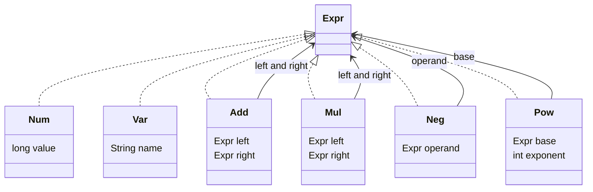
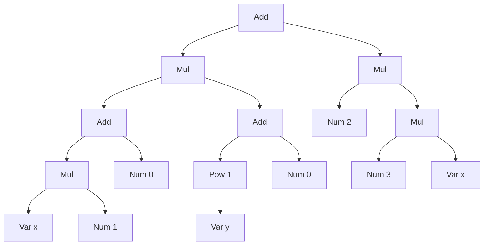
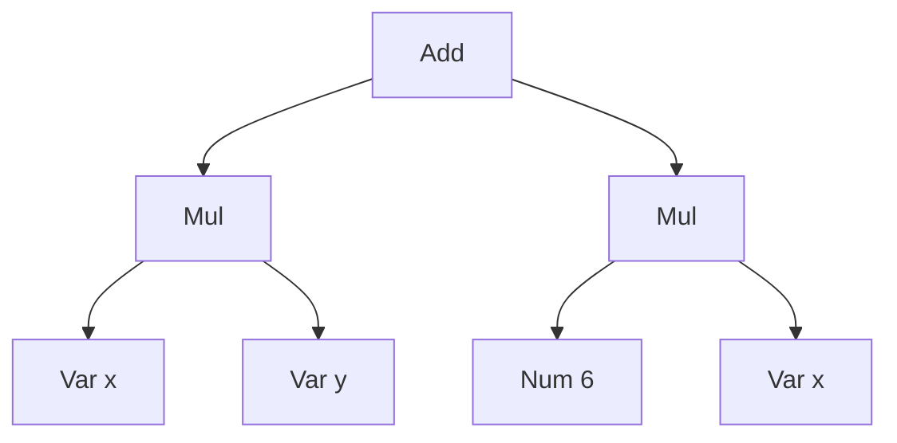

# Task 21 · Simplifying formulas with records and nested patterns

| Difficulty | Topics | Time box |
|---|---|---|
| 🟡 Medium | Algebraic data types in Java (sealed interface + records) · Nested record patterns in `switch` · Recursion over immutable trees · Fixed-point iteration · Pretty-printing with operator precedence · Data-oriented programming vs. the Visitor pattern | 2–3 h |

> **Background reading:** Brian Goetz, "Data-Oriented Programming in Java" (InfoQ, 2022) · JEP 409 (sealed classes), JEP 440 (record patterns), JEP 441 (pattern matching for `switch`) · *Design Patterns* (GoF), "Interpreter" and "Visitor" · *Structure and Interpretation of Computer Programs*, section 2.3.2 ("Example: Symbolic Differentiation"), for the stretch goal.

---

## The situation

Our pricing team edits formulas in the back office. A product manager types something like `basePrice * (1 + markup) + 0`, and we store it as a tree, not as a string. The tree is evaluated for every price on a page, so it needs to be fast, and the admin UI shows it back to people who need to read it.

Two problems showed up in production:

* **Noise.** Formulas that come out of the form builder are full of `x * 1 + 0` and `-(-discount)`. They are correct, but they cost time on every evaluation and they look like a bug to the person who reads them.
* **Parentheses everywhere.** The first printer wraps every compound sub-expression in brackets, so `x + 1` comes out as `(x + 1)` and `x * 2 + 1` as `((x * 2) + 1)`. Nobody can read that.

I want a **simplifier** that rewrites a tree into a smaller tree with the same value, and a **printer** that uses parentheses only where the meaning needs them. Both are recursive functions over an immutable tree. That is a good place to learn how Java 21+ models data: a closed set of node types, and `switch` expressions that read like the algebra they implement.

## The domain

| Term | Meaning |
|---|---|
| **Expression** | A formula as a tree. Every node is an `Expr`. |
| **Leaf** | `Num` (a whole number) or `Var` (a name such as `x`). |
| **Operator node** | `Add`, `Mul` (binary), `Neg` (unary), `Pow` (a base and an integer exponent). |
| **Constant folding** | Replacing an operation on two numbers by its result: `2 + 3` becomes `5`. |
| **Rewrite rule** | A local law like `x * 1 = x`. The simplifier applies a fixed list of them. |
| **Fixed point** | The state where another pass of the rules changes nothing. |
| **Precedence** | How tightly an operator binds: `*` before `+`, `^` before `*`. |

### The sealed hierarchy

Every record is immutable and validates its components in the compact constructor. [`Expr`](../src/main/java/io/github/chris013/practice/task21/Expr.java) gives you short factories (`add`, `mul`, `pow` and so on), so tests read like the formula.

### One formula, before and after

The formula is `(x * 1 + 0) * (y^1 + 0) + 2 * (3 * x)`. As a tree:

After simplification it is `x * y + 6 * x`, which has seven nodes instead of sixteen:

The simplifier needed two passes: the first one changed the tree, the second one confirmed that nothing else changed.

## What I want from you

The seven types in the `task21` package are complete: [`Expr`](../src/main/java/io/github/chris013/practice/task21/Expr.java), [`Num`](../src/main/java/io/github/chris013/practice/task21/Num.java), [`Var`](../src/main/java/io/github/chris013/practice/task21/Var.java), [`Add`](../src/main/java/io/github/chris013/practice/task21/Add.java), [`Mul`](../src/main/java/io/github/chris013/practice/task21/Mul.java), [`Neg`](../src/main/java/io/github/chris013/practice/task21/Neg.java) and [`Pow`](../src/main/java/io/github/chris013/practice/task21/Pow.java). Do not change them. Implement the three classes below.

1. **[`Evaluator`](../src/main/java/io/github/chris013/practice/task21/Evaluator.java)`.evaluate(expr, variables)`**
   * A `Num` is its value. A `Var` is looked up in `variables`. A missing variable throws `IllegalArgumentException`, and the message contains the variable's name.
   * `Add`, `Mul` and `Neg` use exact `long` arithmetic (`Math.addExact` and friends). An overflow throws `ArithmeticException`. Never silently wrap around.
   * `Pow` with exponent 0 is 1, also for base 0.
   * Do not multiply the base `exponent` times in a loop. `1^1000000000` must return at once.

2. **[`Printer`](../src/main/java/io/github/chris013/practice/task21/Printer.java)`.print(expr)`**
   * Infix notation with single spaces: `x + 1`, `2 * (x + 1)`.
   * Precedence from loosest to tightest: `+`, `*`, unary `-`, `^`. Put parentheses only where the meaning needs them.
   * `+` and `*` are left-associative, and the shape of the tree stays visible: `add(add(a, b), c)` prints `a + b + c`, but `add(a, add(b, c))` prints `a + (b + c)`. The same holds for `mul`.
   * `-x`, `-(x + 1)`, `-(2 * x)`, `-(-x)`, and `-x^2` for `neg(pow(x, 2))`, because a power binds tighter than a negation.
   * `x^2`, `(x + 1)^2`, `(-x)^2`, `(x^2)^3`. A power of a negative number needs parentheses: `(-3)^2`.
   * A negative number prints as `-3`. A negation of one prints as `-(-3)`.
   * Subtraction is represented as `add(a, neg(b))` and prints as `a + -b`. That is accepted for now (stretch goal 2 makes it `a - b`).

3. **[`Simplifier`](../src/main/java/io/github/chris013/practice/task21/Simplifier.java)`.simplify(expr)`**
   * The result has the same value as the input for every assignment of the variables.
   * Apply these rules. Each node is simplified after its children, and the rules are the only transformations:
     1. Folding: `Add`, `Mul`, `Neg` or `Pow` whose operands are all `Num` becomes a `Num`, with exact arithmetic. An overflow throws `ArithmeticException`.
     2. `x + 0` and `0 + x` become `x`.
     3. `x * 1` and `1 * x` become `x`.
     4. `x * 0` and `0 * x` become `0`.
     5. `-(-x)` becomes `x`.
     6. `x^0` becomes `1`, and `x^1` becomes `x`. (`0^n` for `n > 0` is covered by folding.)
     7. `x + x` becomes `2 * x`, for any `x` that is structurally equal to the other operand.
     8. `n * (m * x)` with `Num` `n` and `m` becomes `(n * m) * x`.
   * Repeat passes until a pass changes nothing. The result of one pass is the input of the next.
   * There are **no other rules**. No distribution, no reordering: `x * 2` stays `x * 2`, and `2 * (x * 3)` stays as it is.

## Constraints & non-goals

* Integers only: `long`, never `double`, and no `BigInteger`. Overflow is an error, not a rounding.
* No parser, no variable substitution, no derivative. Those are stretch goals.
* Use the existing records and factories. Do not add public methods to `Expr` or the records.
* No `default` branch in any `switch` over `Expr`. The compiler's exhaustiveness check is the point of the sealed type.
* Use only the standard library and Java 25 language features. No libraries.
* Rule 4 drops the operand, so `x * 0` evaluates to `0` even if `x` is an unknown variable. That is an accepted consequence of the rule and worth a sentence in your PR description.

## How I'd approach it

* **Order.** Start with `Evaluator`. It is one `switch` with one case per node, and it sets the pattern you will reuse. Then `Printer`, then `Simplifier`, which is the hardest.
* **Read the switch as the algebra.** A case like `case Add(Expr x, Num(long n)) when n == 0 -> x;` says "x plus zero is x" in the same shape as the math. Record patterns let you reach into nested nodes in one line. Put the most specific patterns first. The order of the cases decides which rule wins.
* **Printer: give each node a number.** Each node has a precedence. A child needs parentheses when its precedence is lower than what its position requires. The left and right operands of `+` and `*` need different numbers. Left-associativity is exactly that asymmetry. Think about what a negative number looks like after a minus sign and at the base of a power.
* **Simplifier: one bottom-up pass is not enough.** After `x + x` becomes `2 * x`, the new node may match another rule, but the rules for its parent have already run. Example: `2 * x + 2 * x` becomes `2 * (2 * x)` in the first pass and `4 * x` only in the second. Loop until the tree equals the previous tree. Records have structural `equals`, so that check is one line.
* **Why it terminates.** Every rule except `x + x` removes at least one node. `x + x` becomes `2 * x`, which can keep the node count (when `x` is a single node), but it removes an `Add`, and no rule creates one. So each pass that changes the tree makes either the node count or the number of `Add` nodes smaller, and that cannot go on forever. A rule that grows the tree, such as `x` to `x + 0`, breaks this argument, and the loop runs forever. Any rule you add has to make progress.
* **Overflow.** Folding uses the same exact arithmetic as the evaluator, so an overflow in a constant throws in both places. That is what you want: the simplifier must not change the meaning of a formula, even when the meaning is an error.
* **Power by squaring.** Repeated squaring is the standard trick. The naive version squares one step too far and overflows for `2^62`, which is a valid result. Square only when a higher bit of the exponent is still to come.
* **Sealed types vs. Visitor.** A `Visitor` interface with `visitAdd`, `visitMul` and so on works too: each operation becomes a class, and double dispatch picks the method. Visitor and a sealed `switch` make the *same* trade-off: the node types are closed, and adding an operation is cheap. A new node type breaks every visitor, just as it breaks every `switch`. If the node types were truly open (plugins adding nodes), you would use neither; you would put `evaluate` and `print` on the nodes themselves (GoF Interpreter). You would still pick Visitor on a Java version without pattern matching, or for a published API that clients implement, where a base visitor with default methods lets the hierarchy grow (see `javax.lang.model.element.ElementVisitor`). Here we have Java 25 and no external implementors, so the `switch` is shorter and the compiler checks it.
* **Data-oriented thinking.** The records carry data only. The behaviour lives in functions that take the data. Goetz calls this data-oriented programming. It is the same idea as the Visitor, without the double dispatch.

## Tests

Run: `mvn test -Dtest='**/task21/**'`

[`EvaluatorTest`](../src/test/java/io/github/chris013/practice/task21/EvaluatorTest.java), [`PrinterTest`](../src/test/java/io/github/chris013/practice/task21/PrinterTest.java) and [`SimplifierTest`](../src/test/java/io/github/chris013/practice/task21/SimplifierTest.java) check the three classes. [`ExprTest`](../src/test/java/io/github/chris013/practice/task21/ExprTest.java) checks the given records and passes from the start. It is there so you know what the records already guarantee.

The simplifier tests have one nested group per rule, a group for formulas that combine several rules, a fixed-point case that needs a second pass, and two property-style tests. Those run ten formulas against three assignments of the variables, and they check that simplification keeps the value and that a second simplification changes nothing.

Show the tests

<!-- embed: src/test/java/io/github/chris013/practice/task21/EvaluatorTest.java -->
<!-- /embed -->

<!-- embed: src/test/java/io/github/chris013/practice/task21/PrinterTest.java -->
<!-- /embed -->

<!-- embed: src/test/java/io/github/chris013/practice/task21/SimplifierTest.java -->
<!-- /embed -->

## Definition of done

- [ ] `Evaluator`, `Printer` and `Simplifier` are complete; the records are unchanged.
- [ ] All tests in `**/task21/**` are green.
- [ ] No `default` branch in a `switch` over `Expr`; the compiler checks exhaustiveness.
- [ ] No `double` anywhere; all overflow throws `ArithmeticException`.
- [ ] `Simplifier` loops until a pass changes nothing, and it has no rule beyond the eight listed.
- [ ] Your PR description says why you chose the switch over a Visitor for this code, and what you would change if a new node type `Div` were added.

## Stretch goals

1. **Symbolic derivative.** Write `Derivative.of(expr, "x")` for the sum, product (`(u * v)' = u' * v + u * v'`), negation and power rules (`(u^n)' = n * u^(n-1)`). The output will be ugly, such as `1 * x^1 + x * 0`. Run it through `Simplifier` and check the result against a numeric difference in a test. *SICP* section 2.3.2 walks through this exact problem.
2. **Print subtraction.** Make `add(a, neg(b))` print as `a - b`, and `add(a, neg(neg(b)))` print in a way you can defend. Keep the rest of the printer unchanged, and add tests for the boundary cases.
3. **A `Sub` record.** Add `Sub(Expr left, Expr right)` to the sealed hierarchy. Write down what changes: every `switch` gets a new case, the rules for `x - x` and `x - 0` become easy, and the printer gets simpler. Then decide whether the simplifier should turn `Sub` into `Add` and `Neg` first, and why.
4. **A parser.** Write a recursive-descent parser from text such as `(x + 1) * 2 ^ 3` to `Expr`. Check that `Printer.print(parse(text))` gives back a text that parses to the same tree. Left-associative operators make this a good test of your precedence table.
5. **The Visitor version.** Implement `Evaluator` as a `Visitor<R>` interface with one method per record and compare the code size and the effort of adding `Div` in both designs. Write a short note in the PR description that says which design makes adding `Div` cheap and which one makes adding a new operation cheap, as in the paragraph "Sealed types vs. Visitor" above.

---

## Reference solution

Spoiler: open only after you have made a serious attempt

### Key decisions

**1. A sealed interface with six records, and nothing else.** `Expr` is the sum type (one of six alternatives) and each record is a product (its components). The `permits` clause lists every alternative, so a `switch` over `Expr` without a `default` branch is checked by the compiler. The rejected alternative was an abstract class with `evaluate`, `print` and `simplify` methods on every node. That spreads each operation across six classes and makes each new operation a change to all of them.

**2. One `switch` per operation, with record patterns and guards.** The rules read like the algebra, and the cases are in order from most specific to least specific. The last case in each `switch` is a total type pattern (`case Add a -> a`), which means "no rule applies". It is not a `default`: it covers only the type it names, so a new node type still breaks the build wherever a `switch` needs a case for it.

**3. Simplify children first, then the parent, and repeat.** A bottom-up pass means every rule sees simplified operands, so `(x * 1 + 0) + (y + 0)` needs no special handling. The loop repeats until the tree equals the previous one, because a rule's output can match another rule in the same node. The rejected alternative was a fixed number of passes. It works until someone builds a formula that needs one more pass, and then it silently returns a formula that could be simpler.

**4. The printer uses one number per node and a minimum per position.** Each child gets parentheses only when its precedence is lower than the minimum of its slot. `Add` asks its left child for `ADD` and its right child for `MUL`; that single difference gives left associativity and keeps `a + (b + c)` as written. The rejected alternative was to parenthesize every compound child. That is exactly the noise the users complained about.

**5. Exact `long` arithmetic with `Math.*Exact`.** `double` would make `0.1 + 0.2` a question, and `2^63` would round instead of failing. `BigInteger` would be correct for all integers, but it is more code and nothing in the business needs it yet. Overflow throws, which is the honest answer for now.

**6. Exponentiation by squaring, squaring only when needed.** A loop of multiplications makes `1^1000000000` take seconds. The naive squaring version squares one step too far and overflows for `2^62`. The solution squares only when a higher bit of the exponent is still set.

### Code

<!-- embed: solutions/src/main/java/io/github/chris013/practice/task21/Simplifier.java -->
<!-- /embed -->

<!-- embed: solutions/src/main/java/io/github/chris013/practice/task21/Printer.java -->
<!-- /embed -->

<!-- embed: solutions/src/main/java/io/github/chris013/practice/task21/Evaluator.java -->
<!-- /embed -->

### What I typically flag in first attempts

| Finding | Why it matters |
|---|---|
| `default ->` in the `switch` over `Expr` | A new node type compiles silently and gets the wrong behaviour. The exhaustiveness check is the reason for the sealed type. |
| Mutable nodes with `setLeft` or `setOperand` | Rewriting a shared tree in place changes formulas that other views still show. Records make the bottom-up rebuild safe. |
| One giant method with `instanceof` chains | No exhaustiveness check, and the rules are mixed together. Put one rule per case. |
| Simplifying top-down once | `x * 1` inside `+ 0` is only visible after the inner node is simplified. Top-down misses the rules that depend on simplified children. |
| A rule that grows the tree, such as `x` to `x + 0` | The fixed-point loop never ends. Every rule has to make measurable progress: fewer nodes, or (like `x + x`) fewer `Add` nodes without more nodes. |
| Parentheses around every compound child | The output is unreadable, which is the reason the printer exists. Parenthesize by precedence. |
| `double` for the arithmetic | `0.1 + 0.2` is not `0.3`, and large integers round silently. Use `long` with the `*Exact` methods. |
| `Math.multiplyExact` missing in the power loop | An overflow wraps around and returns a wrong, possibly negative, result without any error. |

