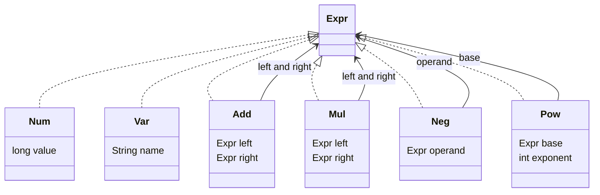
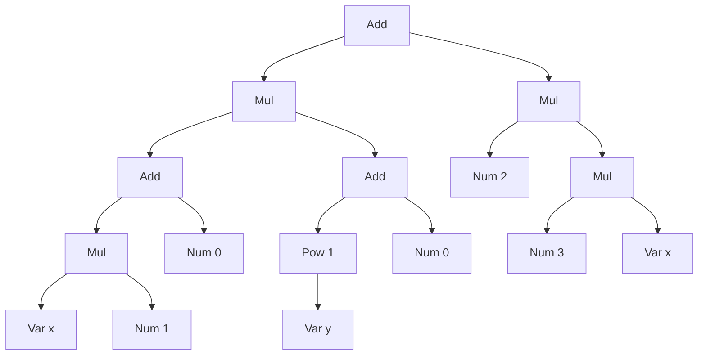
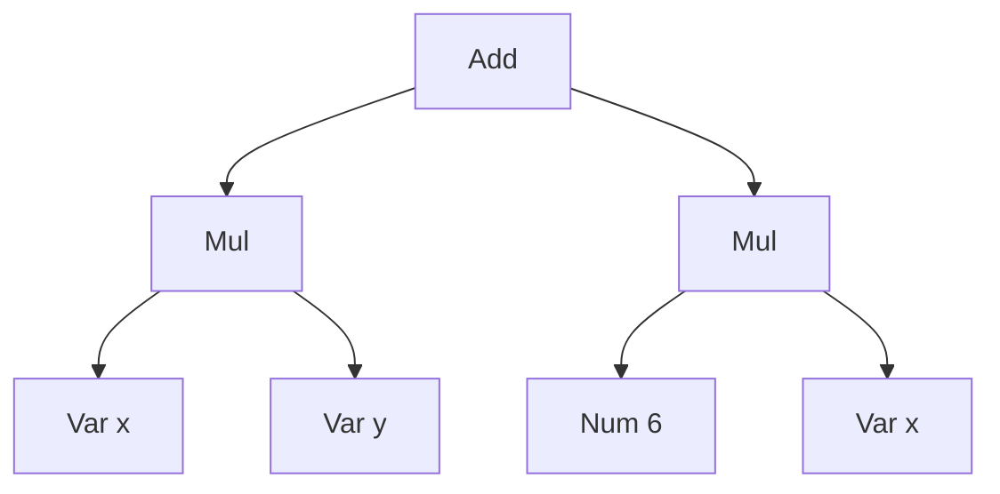

# Task 21 · Simplifying formulas with records and nested patterns

| Difficulty | Topics | Time box |
|---|---|---|
| 🟡 Medium | Algebraic data types in Java (sealed interface + records) · Nested record patterns in `switch` · Recursion over immutable trees · Fixed-point iteration · Pretty-printing with operator precedence · Data-oriented programming vs. the Visitor pattern | 2–3 h |

> **Background reading:** Brian Goetz, "Data-Oriented Programming in Java" (InfoQ, 2022) · JEP 409 (sealed classes), JEP 440 (record patterns), JEP 441 (pattern matching for `switch`) · *Design Patterns* (GoF), "Interpreter" and "Visitor" · *Structure and Interpretation of Computer Programs*, section 2.3.2 ("Example: Symbolic Differentiation"), for the stretch goal.

---

## The situation

Our pricing team edits formulas in the back office. A product manager types something like `basePrice * (1 + markup) + 0`, and we store it as a tree, not as a string. The tree is evaluated for every price on a page, so it needs to be fast, and the admin UI shows it back to people who need to read it.

Two problems showed up in production:

* **Noise.** Formulas that come out of the form builder are full of `x * 1 + 0` and `-(-discount)`. They are correct, but they cost time on every evaluation and they look like a bug to the person who reads them.
* **Parentheses everywhere.** The first printer wraps every compound sub-expression in brackets, so `x + 1` comes out as `(x + 1)` and `x * 2 + 1` as `((x * 2) + 1)`. Nobody can read that.

I want a **simplifier** that rewrites a tree into a smaller tree with the same value, and a **printer** that uses parentheses only where the meaning needs them. Both are recursive functions over an immutable tree. That is a good place to learn how Java 21+ models data: a closed set of node types, and `switch` expressions that read like the algebra they implement.

## The domain

| Term | Meaning |
|---|---|
| **Expression** | A formula as a tree. Every node is an `Expr`. |
| **Leaf** | `Num` (a whole number) or `Var` (a name such as `x`). |
| **Operator node** | `Add`, `Mul` (binary), `Neg` (unary), `Pow` (a base and an integer exponent). |
| **Constant folding** | Replacing an operation on two numbers by its result: `2 + 3` becomes `5`. |
| **Rewrite rule** | A local law like `x * 1 = x`. The simplifier applies a fixed list of them. |
| **Fixed point** | The state where another pass of the rules changes nothing. |
| **Precedence** | How tightly an operator binds: `*` before `+`, `^` before `*`. |

### The sealed hierarchy



Every record is immutable and validates its components in the compact constructor. [`Expr`](../src/main/java/io/github/chris013/practice/task21/Expr.java) gives you short factories (`add`, `mul`, `pow` and so on), so tests read like the formula.

### One formula, before and after

The formula is `(x * 1 + 0) * (y^1 + 0) + 2 * (3 * x)`. As a tree:



After simplification it is `x * y + 6 * x`, which has seven nodes instead of sixteen:



The simplifier needed two passes: the first one changed the tree, the second one confirmed that nothing else changed.

## What I want from you

The seven types in the `task21` package are complete: [`Expr`](../src/main/java/io/github/chris013/practice/task21/Expr.java), [`Num`](../src/main/java/io/github/chris013/practice/task21/Num.java), [`Var`](../src/main/java/io/github/chris013/practice/task21/Var.java), [`Add`](../src/main/java/io/github/chris013/practice/task21/Add.java), [`Mul`](../src/main/java/io/github/chris013/practice/task21/Mul.java), [`Neg`](../src/main/java/io/github/chris013/practice/task21/Neg.java) and [`Pow`](../src/main/java/io/github/chris013/practice/task21/Pow.java). Do not change them. Implement the three classes below.

1. **[`Evaluator`](../src/main/java/io/github/chris013/practice/task21/Evaluator.java)`.evaluate(expr, variables)`**
   * A `Num` is its value. A `Var` is looked up in `variables`. A missing variable throws `IllegalArgumentException`, and the message contains the variable's name.
   * `Add`, `Mul` and `Neg` use exact `long` arithmetic (`Math.addExact` and friends). An overflow throws `ArithmeticException`. Never silently wrap around.
   * `Pow` with exponent 0 is 1, also for base 0.
   * Do not multiply the base `exponent` times in a loop. `1^1000000000` must return at once.

2. **[`Printer`](../src/main/java/io/github/chris013/practice/task21/Printer.java)`.print(expr)`**
   * Infix notation with single spaces: `x + 1`, `2 * (x + 1)`.
   * Precedence from loosest to tightest: `+`, `*`, unary `-`, `^`. Put parentheses only where the meaning needs them.
   * `+` and `*` are left-associative, and the shape of the tree stays visible: `add(add(a, b), c)` prints `a + b + c`, but `add(a, add(b, c))` prints `a + (b + c)`. The same holds for `mul`.
   * `-x`, `-(x + 1)`, `-(2 * x)`, `-(-x)`, and `-x^2` for `neg(pow(x, 2))`, because a power binds tighter than a negation.
   * `x^2`, `(x + 1)^2`, `(-x)^2`, `(x^2)^3`. A power of a negative number needs parentheses: `(-3)^2`.
   * A negative number prints as `-3`. A negation of one prints as `-(-3)`.
   * Subtraction is represented as `add(a, neg(b))` and prints as `a + -b`. That is accepted for now (stretch goal 2 makes it `a - b`).

3. **[`Simplifier`](../src/main/java/io/github/chris013/practice/task21/Simplifier.java)`.simplify(expr)`**
   * The result has the same value as the input for every assignment of the variables.
   * Apply these rules. Each node is simplified after its children, and the rules are the only transformations:
     1. Folding: `Add`, `Mul`, `Neg` or `Pow` whose operands are all `Num` becomes a `Num`, with exact arithmetic. An overflow throws `ArithmeticException`.
     2. `x + 0` and `0 + x` become `x`.
     3. `x * 1` and `1 * x` become `x`.
     4. `x * 0` and `0 * x` become `0`.
     5. `-(-x)` becomes `x`.
     6. `x^0` becomes `1`, and `x^1` becomes `x`. (`0^n` for `n > 0` is covered by folding.)
     7. `x + x` becomes `2 * x`, for any `x` that is structurally equal to the other operand.
     8. `n * (m * x)` with `Num` `n` and `m` becomes `(n * m) * x`.
   * Repeat passes until a pass changes nothing. The result of one pass is the input of the next.
   * There are **no other rules**. No distribution, no reordering: `x * 2` stays `x * 2`, and `2 * (x * 3)` stays as it is.

## Constraints & non-goals

* Integers only: `long`, never `double`, and no `BigInteger`. Overflow is an error, not a rounding.
* No parser, no variable substitution, no derivative. Those are stretch goals.
* Use the existing records and factories. Do not add public methods to `Expr` or the records.
* No `default` branch in any `switch` over `Expr`. The compiler's exhaustiveness check is the point of the sealed type.
* Use only the standard library and Java 25 language features. No libraries.
* Rule 4 drops the operand, so `x * 0` evaluates to `0` even if `x` is an unknown variable. That is an accepted consequence of the rule and worth a sentence in your PR description.

## How I'd approach it

* **Order.** Start with `Evaluator`. It is one `switch` with one case per node, and it sets the pattern you will reuse. Then `Printer`, then `Simplifier`, which is the hardest.
* **Read the switch as the algebra.** A case like `case Add(Expr x, Num(long n)) when n == 0 -> x;` says "x plus zero is x" in the same shape as the math. Record patterns let you reach into nested nodes in one line. Put the most specific patterns first. The order of the cases decides which rule wins.
* **Printer: give each node a number.** Each node has a precedence. A child needs parentheses when its precedence is lower than what its position requires. The left and right operands of `+` and `*` need different numbers. Left-associativity is exactly that asymmetry. Think about what a negative number looks like after a minus sign and at the base of a power.
* **Simplifier: one bottom-up pass is not enough.** After `x + x` becomes `2 * x`, the new node may match another rule, but the rules for its parent have already run. Example: `2 * x + 2 * x` becomes `2 * (2 * x)` in the first pass and `4 * x` only in the second. Loop until the tree equals the previous tree. Records have structural `equals`, so that check is one line.
* **Why it terminates.** Every rule except `x + x` removes at least one node. `x + x` becomes `2 * x`, which can keep the node count (when `x` is a single node), but it removes an `Add`, and no rule creates one. So each pass that changes the tree makes either the node count or the number of `Add` nodes smaller, and that cannot go on forever. A rule that grows the tree, such as `x` to `x + 0`, breaks this argument, and the loop runs forever. Any rule you add has to make progress.
* **Overflow.** Folding uses the same exact arithmetic as the evaluator, so an overflow in a constant throws in both places. That is what you want: the simplifier must not change the meaning of a formula, even when the meaning is an error.
* **Power by squaring.** Repeated squaring is the standard trick. The naive version squares one step too far and overflows for `2^62`, which is a valid result. Square only when a higher bit of the exponent is still to come.
* **Sealed types vs. Visitor.** A `Visitor` interface with `visitAdd`, `visitMul` and so on works too: each operation becomes a class, and double dispatch picks the method. Visitor and a sealed `switch` make the *same* trade-off: the node types are closed, and adding an operation is cheap. A new node type breaks every visitor, just as it breaks every `switch`. If the node types were truly open (plugins adding nodes), you would use neither; you would put `evaluate` and `print` on the nodes themselves (GoF Interpreter). You would still pick Visitor on a Java version without pattern matching, or for a published API that clients implement, where a base visitor with default methods lets the hierarchy grow (see `javax.lang.model.element.ElementVisitor`). Here we have Java 25 and no external implementors, so the `switch` is shorter and the compiler checks it.
* **Data-oriented thinking.** The records carry data only. The behaviour lives in functions that take the data. Goetz calls this data-oriented programming. It is the same idea as the Visitor, without the double dispatch.

## Tests

Run: `mvn test -Dtest='**/task21/**'`

[`EvaluatorTest`](../src/test/java/io/github/chris013/practice/task21/EvaluatorTest.java), [`PrinterTest`](../src/test/java/io/github/chris013/practice/task21/PrinterTest.java) and [`SimplifierTest`](../src/test/java/io/github/chris013/practice/task21/SimplifierTest.java) check the three classes. [`ExprTest`](../src/test/java/io/github/chris013/practice/task21/ExprTest.java) checks the given records and passes from the start. It is there so you know what the records already guarantee.

The simplifier tests have one nested group per rule, a group for formulas that combine several rules, a fixed-point case that needs a second pass, and two property-style tests. Those run ten formulas against three assignments of the variables, and they check that simplification keeps the value and that a second simplification changes nothing.

<details>
<summary>Show the tests</summary>

<!-- embed: src/test/java/io/github/chris013/practice/task21/EvaluatorTest.java -->
**[`EvaluatorTest.java`](../src/test/java/io/github/chris013/practice/task21/EvaluatorTest.java)**

```java
package io.github.chris013.practice.task21;

import static io.github.chris013.practice.task21.Expr.add;
import static io.github.chris013.practice.task21.Expr.mul;
import static io.github.chris013.practice.task21.Expr.neg;
import static io.github.chris013.practice.task21.Expr.num;
import static io.github.chris013.practice.task21.Expr.pow;
import static io.github.chris013.practice.task21.Expr.var;
import static org.assertj.core.api.Assertions.assertThat;
import static org.assertj.core.api.Assertions.assertThatThrownBy;

import java.util.Map;
import org.junit.jupiter.api.Nested;
import org.junit.jupiter.api.Test;
import org.junit.jupiter.params.ParameterizedTest;
import org.junit.jupiter.params.provider.CsvSource;

class EvaluatorTest {

    private static final Map<String, Long> VARIABLES = Map.of("x", 3L, "y", -2L);

    private static long eval(Expr expr) {
        return Evaluator.evaluate(expr, VARIABLES);
    }

    @Nested
    class Leaves {

        @Test
        void a_number_is_its_own_value() {
            assertThat(eval(num(42))).isEqualTo(42);
        }

        @Test
        void a_variable_is_looked_up_by_name() {
            assertThat(eval(var("y"))).isEqualTo(-2);
        }

        @Test
        void an_unknown_variable_is_rejected_and_named() {
            assertThatThrownBy(() -> eval(var("z")))
                    .isInstanceOf(IllegalArgumentException.class)
                    .hasMessageContaining("z");
        }
    }

    @Nested
    class Operations {

        @Test
        void add_and_multiply_follow_the_tree() {
            assertThat(eval(add(num(2), mul(num(3), num(4))))).isEqualTo(14);
            assertThat(eval(mul(add(num(2), num(3)), num(4)))).isEqualTo(20);
        }

        @Test
        void negation_flips_the_sign() {
            assertThat(eval(neg(var("x")))).isEqualTo(-3);
            assertThat(eval(neg(neg(var("x"))))).isEqualTo(3);
        }

        @ParameterizedTest(name = "{0}^{1} = {2}")
        @CsvSource({"3, 0, 1", "0, 0, 1", "3, 1, 3", "3, 4, 81", "-2, 3, -8", "2, 62, 4611686018427387904",
            "-2, 63, -9223372036854775808"})
        void powers_are_exact(long base, int exponent, long expected) {
            assertThat(eval(pow(num(base), exponent))).isEqualTo(expected);
        }

        @Test
        void a_power_of_minus_one_or_one_with_a_huge_exponent_is_fast() {
            assertThat(eval(pow(num(-1), 1_000_001))).isEqualTo(-1);
            assertThat(eval(pow(num(1), 1_000_000_000))).isEqualTo(1);
        }

        @Test
        void nested_expressions_use_the_variables() {
            assertThat(eval(pow(add(var("x"), num(1)), 2))).isEqualTo(16);
        }
    }

    @Nested
    class Overflow {

        @Test
        void addition_that_does_not_fit_throws() {
            assertThatThrownBy(() -> eval(add(num(Long.MAX_VALUE), num(1))))
                    .isInstanceOf(ArithmeticException.class);
        }

        @Test
        void multiplication_that_does_not_fit_throws() {
            assertThatThrownBy(() -> eval(mul(num(Long.MAX_VALUE), num(2))))
                    .isInstanceOf(ArithmeticException.class);
        }

        @Test
        void power_that_does_not_fit_throws() {
            assertThatThrownBy(() -> eval(pow(num(2), 63))).isInstanceOf(ArithmeticException.class);
        }

        @Test
        void negation_that_does_not_fit_throws() {
            assertThatThrownBy(() -> eval(neg(num(Long.MIN_VALUE)))).isInstanceOf(ArithmeticException.class);
        }
    }
}
```
<!-- /embed -->

<!-- embed: src/test/java/io/github/chris013/practice/task21/PrinterTest.java -->
**[`PrinterTest.java`](../src/test/java/io/github/chris013/practice/task21/PrinterTest.java)**

```java
package io.github.chris013.practice.task21;

import static io.github.chris013.practice.task21.Expr.add;
import static io.github.chris013.practice.task21.Expr.mul;
import static io.github.chris013.practice.task21.Expr.neg;
import static io.github.chris013.practice.task21.Expr.num;
import static io.github.chris013.practice.task21.Expr.pow;
import static io.github.chris013.practice.task21.Expr.var;
import static org.assertj.core.api.Assertions.assertThat;

import java.util.stream.Stream;
import org.junit.jupiter.params.ParameterizedTest;
import org.junit.jupiter.params.provider.Arguments;
import org.junit.jupiter.params.provider.MethodSource;

class PrinterTest {

    static Stream<Arguments> expressions() {
        Expr x = var("x");
        Expr y = var("y");
        Expr a = var("a");
        Expr b = var("b");
        Expr c = var("c");
        return Stream.of(
                Arguments.of(num(7), "7"),
                Arguments.of(num(-3), "-3"),
                Arguments.of(x, "x"),
                Arguments.of(add(x, num(1)), "x + 1"),
                Arguments.of(mul(num(2), add(x, num(1))), "2 * (x + 1)"),
                Arguments.of(mul(num(2), x), "2 * x"),
                Arguments.of(add(mul(num(2), x), num(1)), "2 * x + 1"),
                Arguments.of(neg(x), "-x"),
                Arguments.of(neg(add(x, num(1))), "-(x + 1)"),
                Arguments.of(neg(mul(num(2), x)), "-(2 * x)"),
                Arguments.of(neg(neg(x)), "-(-x)"),
                Arguments.of(neg(num(-3)), "-(-3)"),
                Arguments.of(neg(pow(x, 2)), "-x^2"),
                Arguments.of(pow(x, 2), "x^2"),
                Arguments.of(pow(x, 0), "x^0"),
                Arguments.of(pow(add(x, num(1)), 2), "(x + 1)^2"),
                Arguments.of(pow(neg(x), 2), "(-x)^2"),
                Arguments.of(pow(num(-3), 2), "(-3)^2"),
                Arguments.of(pow(pow(x, 2), 3), "(x^2)^3"),
                Arguments.of(add(add(a, b), c), "a + b + c"),
                Arguments.of(add(a, add(b, c)), "a + (b + c)"),
                Arguments.of(mul(mul(a, b), c), "a * b * c"),
                Arguments.of(mul(a, mul(b, c)), "a * (b * c)"),
                Arguments.of(mul(add(a, b), c), "(a + b) * c"),
                Arguments.of(add(a, mul(b, c)), "a + b * c"),
                Arguments.of(add(a, neg(b)), "a + -b"),
                Arguments.of(mul(x, neg(y)), "x * -y"));
    }

    @ParameterizedTest(name = "{1}")
    @MethodSource("expressions")
    void prints_with_only_the_parentheses_that_are_needed(Expr expr, String expected) {
        assertThat(Printer.print(expr)).isEqualTo(expected);
    }
}
```
<!-- /embed -->

<!-- embed: src/test/java/io/github/chris013/practice/task21/SimplifierTest.java -->
**[`SimplifierTest.java`](../src/test/java/io/github/chris013/practice/task21/SimplifierTest.java)**

```java
package io.github.chris013.practice.task21;

import static io.github.chris013.practice.task21.Expr.add;
import static io.github.chris013.practice.task21.Expr.mul;
import static io.github.chris013.practice.task21.Expr.neg;
import static io.github.chris013.practice.task21.Expr.num;
import static io.github.chris013.practice.task21.Expr.pow;
import static io.github.chris013.practice.task21.Expr.var;
import static org.assertj.core.api.Assertions.assertThat;
import static org.assertj.core.api.Assertions.assertThatThrownBy;

import java.util.List;
import java.util.Map;
import java.util.stream.Stream;
import org.junit.jupiter.api.Nested;
import org.junit.jupiter.api.Test;
import org.junit.jupiter.params.ParameterizedTest;
import org.junit.jupiter.params.provider.MethodSource;

class SimplifierTest {

    private static final Expr X = var("x");
    private static final Expr Y = var("y");

    private static Expr simplify(Expr expr) {
        return Simplifier.simplify(expr);
    }

    @Nested
    class ConstantFolding {

        @Test
        void folds_arithmetic_on_numbers() {
            assertThat(simplify(add(num(2), num(3)))).isEqualTo(num(5));
            assertThat(simplify(mul(num(2), num(3)))).isEqualTo(num(6));
            assertThat(simplify(neg(num(4)))).isEqualTo(num(-4));
            assertThat(simplify(pow(num(-2), 3))).isEqualTo(num(-8));
        }

        @Test
        void folds_nested_constants_bottom_up() {
            assertThat(simplify(add(mul(num(2), num(3)), pow(num(2), 2)))).isEqualTo(num(10));
        }

        @Test
        void an_overflowing_fold_throws_like_evaluation_does() {
            assertThatThrownBy(() -> simplify(add(num(Long.MAX_VALUE), num(1))))
                    .isInstanceOf(ArithmeticException.class);
        }

        @Test
        void a_negation_that_does_not_fit_throws() {
            assertThatThrownBy(() -> simplify(neg(num(Long.MIN_VALUE)))).isInstanceOf(ArithmeticException.class);
        }
    }

    @Nested
    class Identities {

        @Test
        void adding_zero_on_either_side_gives_the_other_side() {
            assertThat(simplify(add(X, num(0)))).isEqualTo(X);
            assertThat(simplify(add(num(0), X))).isEqualTo(X);
            assertThat(simplify(add(mul(X, Y), num(0)))).isEqualTo(mul(X, Y));
        }

        @Test
        void multiplying_by_one_on_either_side_gives_the_other_side() {
            assertThat(simplify(mul(X, num(1)))).isEqualTo(X);
            assertThat(simplify(mul(num(1), X))).isEqualTo(X);
        }

        @Test
        void multiplying_by_zero_on_either_side_gives_zero() {
            assertThat(simplify(mul(X, num(0)))).isEqualTo(num(0));
            assertThat(simplify(mul(num(0), add(X, Y)))).isEqualTo(num(0));
        }

        @Test
        void a_double_negation_is_removed() {
            assertThat(simplify(neg(neg(X)))).isEqualTo(X);
        }

        @Test
        void a_power_of_zero_is_one_and_a_power_of_one_is_the_base() {
            assertThat(simplify(pow(X, 0))).isEqualTo(num(1));
            assertThat(simplify(pow(X, 1))).isEqualTo(X);
        }

        @Test
        void zero_to_a_positive_power_is_zero() {
            assertThat(simplify(pow(num(0), 5))).isEqualTo(num(0));
        }
    }

    @Nested
    class SelfAddition {

        @Test
        void adding_a_term_to_itself_becomes_two_times_the_term() {
            assertThat(simplify(add(X, X))).isEqualTo(mul(num(2), X));
        }

        @Test
        void works_for_compound_terms_too() {
            Expr term = add(X, Y);
            assertThat(simplify(add(term, term))).isEqualTo(mul(num(2), term));
        }

        @Test
        void different_terms_are_left_alone() {
            assertThat(simplify(add(X, Y))).isEqualTo(add(X, Y));
        }
    }

    @Nested
    class ConstantGrouping {

        @Test
        void a_constant_times_a_constant_times_a_term_is_grouped() {
            assertThat(simplify(mul(num(2), mul(num(3), X)))).isEqualTo(mul(num(6), X));
        }

        @Test
        void a_constant_on_the_right_is_not_moved_to_the_left() {
            // No commutative reordering: the simplifier only knows the rules listed in the task.
            assertThat(simplify(mul(num(2), mul(X, num(3))))).isEqualTo(mul(num(2), mul(X, num(3))));
        }

        @Test
        void a_grouped_constant_that_does_not_fit_throws() {
            assertThatThrownBy(() -> simplify(mul(num(Long.MAX_VALUE), mul(num(2), X))))
                    .isInstanceOf(ArithmeticException.class);
        }
    }

    @Nested
    class CombinedRules {

        @Test
        void an_inner_simplification_enables_an_outer_one() {
            Expr formula = mul(add(mul(X, num(1)), num(0)), add(pow(Y, 1), num(0)));
            assertThat(simplify(formula)).isEqualTo(mul(X, Y));
        }

        @Test
        void negations_and_zeros_cancel_out_in_one_go() {
            assertThat(simplify(neg(neg(add(X, num(0)))))).isEqualTo(X);
        }
    }

    @Nested
    class FixedPoint {

        @Test
        void a_rule_output_that_matches_another_rule_is_simplified_again() {
            // 2x + 2x -> 2 * (2x) -> 4x. The second step only exists because of the fixed-point loop.
            Expr twiceTwoX = add(mul(num(2), X), mul(num(2), X));
            assertThat(simplify(twiceTwoX)).isEqualTo(mul(num(4), X));
        }
    }

    @Nested
    class Leftovers {

        @ParameterizedTest(name = "{0} stays as it is")
        @MethodSource("irreducible")
        void formulas_without_a_rule_stay_the_same(Expr expr) {
            assertThat(simplify(expr)).isEqualTo(expr);
        }

        static Stream<Expr> irreducible() {
            return Stream.of(X, add(X, Y), mul(X, Y), mul(X, num(2)), neg(X), pow(X, 2), neg(pow(X, 2)));
        }
    }

    /** Ten formulas that exercise several rules at once. Every variable used here has a value in ASSIGNMENTS. */
    static Stream<Expr> samples() {
        Expr x = X;
        Expr y = Y;
        Expr z = var("z");
        return Stream.of(
                mul(add(mul(x, num(1)), num(0)), add(pow(y, 1), num(0))),
                mul(add(x, x), mul(num(2), mul(num(3), y))),
                neg(neg(add(x, num(0)))),
                add(pow(y, 1), mul(num(0), z)),
                mul(pow(add(x, num(1)), 2), num(1)),
                add(mul(num(2), x), mul(num(2), x)),
                mul(num(3), mul(num(2), add(x, y))),
                neg(mul(num(1), pow(z, 0))),
                add(add(x, num(0)), add(y, add(z, num(0)))),
                pow(neg(pow(x, 1)), 3));
    }

    /** Three different assignments, chosen so that signs and zero both show up. */
    private static final List<Map<String, Long>> ASSIGNMENTS = List.of(
            Map.of("x", 3L, "y", -2L, "z", 5L),
            Map.of("x", 0L, "y", 7L, "z", -1L),
            Map.of("x", -4L, "y", 1L, "z", 2L));

    @ParameterizedTest
    @MethodSource("samples")
    void simplifying_keeps_the_value_for_every_assignment(Expr expr) {
        Expr simplified = simplify(expr);
        for (Map<String, Long> variables : ASSIGNMENTS) {
            assertThat(Evaluator.evaluate(simplified, variables)).isEqualTo(Evaluator.evaluate(expr, variables));
        }
    }

    @ParameterizedTest
    @MethodSource("samples")
    void simplifying_twice_changes_nothing(Expr expr) {
        Expr once = simplify(expr);
        assertThat(simplify(once)).isEqualTo(once);
    }
}
```
<!-- /embed -->

</details>

## Definition of done

- [ ] `Evaluator`, `Printer` and `Simplifier` are complete; the records are unchanged.
- [ ] All tests in `**/task21/**` are green.
- [ ] No `default` branch in a `switch` over `Expr`; the compiler checks exhaustiveness.
- [ ] No `double` anywhere; all overflow throws `ArithmeticException`.
- [ ] `Simplifier` loops until a pass changes nothing, and it has no rule beyond the eight listed.
- [ ] Your PR description says why you chose the switch over a Visitor for this code, and what you would change if a new node type `Div` were added.

## Stretch goals

1. **Symbolic derivative.** Write `Derivative.of(expr, "x")` for the sum, product (`(u * v)' = u' * v + u * v'`), negation and power rules (`(u^n)' = n * u^(n-1)`). The output will be ugly, such as `1 * x^1 + x * 0`. Run it through `Simplifier` and check the result against a numeric difference in a test. *SICP* section 2.3.2 walks through this exact problem.
2. **Print subtraction.** Make `add(a, neg(b))` print as `a - b`, and `add(a, neg(neg(b)))` print in a way you can defend. Keep the rest of the printer unchanged, and add tests for the boundary cases.
3. **A `Sub` record.** Add `Sub(Expr left, Expr right)` to the sealed hierarchy. Write down what changes: every `switch` gets a new case, the rules for `x - x` and `x - 0` become easy, and the printer gets simpler. Then decide whether the simplifier should turn `Sub` into `Add` and `Neg` first, and why.
4. **A parser.** Write a recursive-descent parser from text such as `(x + 1) * 2 ^ 3` to `Expr`. Check that `Printer.print(parse(text))` gives back a text that parses to the same tree. Left-associative operators make this a good test of your precedence table.
5. **The Visitor version.** Implement `Evaluator` as a `Visitor<R>` interface with one method per record and compare the code size and the effort of adding `Div` in both designs. Write a short note in the PR description that says which design makes adding `Div` cheap and which one makes adding a new operation cheap, as in the paragraph "Sealed types vs. Visitor" above.

---

## Reference solution

<details>
<summary>Spoiler: open only after you have made a serious attempt</summary>

### Key decisions

**1. A sealed interface with six records, and nothing else.** `Expr` is the sum type (one of six alternatives) and each record is a product (its components). The `permits` clause lists every alternative, so a `switch` over `Expr` without a `default` branch is checked by the compiler. The rejected alternative was an abstract class with `evaluate`, `print` and `simplify` methods on every node. That spreads each operation across six classes and makes each new operation a change to all of them.

**2. One `switch` per operation, with record patterns and guards.** The rules read like the algebra, and the cases are in order from most specific to least specific. The last case in each `switch` is a total type pattern (`case Add a -> a`), which means "no rule applies". It is not a `default`: it covers only the type it names, so a new node type still breaks the build wherever a `switch` needs a case for it.

**3. Simplify children first, then the parent, and repeat.** A bottom-up pass means every rule sees simplified operands, so `(x * 1 + 0) + (y + 0)` needs no special handling. The loop repeats until the tree equals the previous one, because a rule's output can match another rule in the same node. The rejected alternative was a fixed number of passes. It works until someone builds a formula that needs one more pass, and then it silently returns a formula that could be simpler.

**4. The printer uses one number per node and a minimum per position.** Each child gets parentheses only when its precedence is lower than the minimum of its slot. `Add` asks its left child for `ADD` and its right child for `MUL`; that single difference gives left associativity and keeps `a + (b + c)` as written. The rejected alternative was to parenthesize every compound child. That is exactly the noise the users complained about.

**5. Exact `long` arithmetic with `Math.*Exact`.** `double` would make `0.1 + 0.2` a question, and `2^63` would round instead of failing. `BigInteger` would be correct for all integers, but it is more code and nothing in the business needs it yet. Overflow throws, which is the honest answer for now.

**6. Exponentiation by squaring, squaring only when needed.** A loop of multiplications makes `1^1000000000` take seconds. The naive squaring version squares one step too far and overflows for `2^62`. The solution squares only when a higher bit of the exponent is still set.

### Code

<!-- embed: solutions/src/main/java/io/github/chris013/practice/task21/Simplifier.java -->
**[`Simplifier.java`](../solutions/src/main/java/io/github/chris013/practice/task21/Simplifier.java)**

```java
package io.github.chris013.practice.task21;

import java.util.Objects;

/**
 * Rewrites an expression into a smaller one with the same value.
 * <p>Task 21: read {@code tasks/21-expression-simplifier.md} first.
 */
public final class Simplifier {

    private Simplifier() {}

    /**
     * Applies the rewrite rules bottom-up and repeats until a pass changes nothing (a fixed point). The result
     * evaluates to the same value as the input for every assignment of the variables.
     *
     * @throws ArithmeticException if constant folding overflows, exactly as evaluation would
     */
    public static Expr simplify(Expr expr) {
        Objects.requireNonNull(expr, "expr");
        Expr current = expr;
        while (true) {
            Expr next = pass(current);
            if (next.equals(current)) {
                return current;
            }
            current = next;
        }
    }

    /**
     * One bottom-up pass: children first, then the rules on the parent. A rule can produce a shape that another rule
     * would match (for example {@code x + x} gives {@code 2 * x}, and {@code 2 * x + 2 * x} gives {@code 2 * (2 * x)}),
     * and the parent does not see that until the next pass. That is why {@link #simplify} loops.
     */
    private static Expr pass(Expr expr) {
        return switch (expr) {
            case Num n -> n;
            case Var v -> v;
            case Neg(Expr operand) -> negation(new Neg(pass(operand)));
            case Add(Expr left, Expr right) -> sum(new Add(pass(left), pass(right)));
            case Mul(Expr left, Expr right) -> product(new Mul(pass(left), pass(right)));
            case Pow(Expr base, int exponent) -> power(new Pow(pass(base), exponent));
        };
    }

    private static Expr negation(Neg neg) {
        return switch (neg) {
            case Neg(Num(long n)) -> Expr.num(Math.negateExact(n));
            case Neg(Neg(Expr x)) -> x;
            case Neg n -> n;
        };
    }

    private static Expr sum(Add add) {
        return switch (add) {
            case Add(Num(long a), Num(long b)) -> Expr.num(Math.addExact(a, b));
            case Add(Expr x, Num(long n)) when n == 0 -> x;
            case Add(Num(long n), Expr x) when n == 0 -> x;
            // Records have structural equals, so "the same term twice" is a plain equality check.
            case Add(Expr x, Expr y) when x.equals(y) -> Expr.mul(Expr.num(2), x);
            case Add a -> a;
        };
    }

    private static Expr product(Mul mul) {
        return switch (mul) {
            case Mul(Num(long a), Num(long b)) -> Expr.num(Math.multiplyExact(a, b));
            case Mul(Num(long n), _) when n == 0 -> Expr.num(0);
            case Mul(_, Num(long n)) when n == 0 -> Expr.num(0);
            case Mul(Expr x, Num(long n)) when n == 1 -> x;
            case Mul(Num(long n), Expr x) when n == 1 -> x;
            case Mul(Num(long n), Mul(Num(long m), Expr x)) -> Expr.mul(Expr.num(Math.multiplyExact(n, m)), x);
            case Mul m -> m;
        };
    }

    private static Expr power(Pow pow) {
        return switch (pow) {
            case Pow(Num(long base), int exponent) -> Expr.num(Evaluator.exactPower(base, exponent));
            case Pow(_, int exponent) when exponent == 0 -> Expr.num(1);
            case Pow(Expr x, int exponent) when exponent == 1 -> x;
            case Pow p -> p;
        };
    }
}
```
<!-- /embed -->

<!-- embed: solutions/src/main/java/io/github/chris013/practice/task21/Printer.java -->
**[`Printer.java`](../solutions/src/main/java/io/github/chris013/practice/task21/Printer.java)**

```java
package io.github.chris013.practice.task21;

import java.util.Objects;

/**
 * Turns an expression tree back into readable text with as few parentheses as possible.
 * <p>Task 21: read {@code tasks/21-expression-simplifier.md} first.
 */
public final class Printer {

    // Higher number = binds tighter. A child is parenthesized when it binds looser than its slot requires.
    private static final int ADD = 1;
    private static final int MUL = 2;
    private static final int NEG = 3;
    private static final int POW = 4;
    private static final int ATOM = 5;

    private Printer() {}

    /**
     * Examples: {@code x + 1}, {@code 2 * (x + 1)}, {@code -(x + 1)}, {@code (-x)^2}, {@code a + (b + c)}.
     */
    public static String print(Expr expr) {
        Objects.requireNonNull(expr, "expr");
        return switch (expr) {
            case Num(long value) -> Long.toString(value);
            case Var(String name) -> name;
            // Add and Mul are left-associative: the left child may have the same precedence without parentheses,
            // the right child may not, so a + (b + c) keeps the structure of the tree visible.
            case Add(Expr left, Expr right) -> printAt(left, ADD) + " + " + printAt(right, MUL);
            case Mul(Expr left, Expr right) -> printAt(left, MUL) + " * " + printAt(right, NEG);
            case Neg(Expr operand) -> "-" + printAt(operand, POW);
            case Pow(Expr base, int exponent) -> printAt(base, ATOM) + "^" + exponent;
        };
    }

    private static String printAt(Expr expr, int minPrecedence) {
        String text = print(expr);
        return precedence(expr) < minPrecedence ? "(" + text + ")" : text;
    }

    /** A negative number reads like a negation, so it gets the negation's precedence. */
    private static int precedence(Expr expr) {
        return switch (expr) {
            case Add ignored -> ADD;
            case Mul ignored -> MUL;
            case Neg ignored -> NEG;
            case Pow ignored -> POW;
            case Num(long value) -> value < 0 ? NEG : ATOM;
            case Var ignored -> ATOM;
        };
    }
}
```
<!-- /embed -->

<!-- embed: solutions/src/main/java/io/github/chris013/practice/task21/Evaluator.java -->
**[`Evaluator.java`](../solutions/src/main/java/io/github/chris013/practice/task21/Evaluator.java)**

```java
package io.github.chris013.practice.task21;

import java.util.Map;
import java.util.Objects;

/**
 * Computes the value of an expression with exact {@code long} arithmetic.
 * <p>Task 21: read {@code tasks/21-expression-simplifier.md} first.
 */
public final class Evaluator {

    private Evaluator() {}

    /**
     * @throws IllegalArgumentException if the expression uses a variable that is not in {@code variables}
     * @throws ArithmeticException if an intermediate result does not fit into a {@code long}
     */
    public static long evaluate(Expr expr, Map<String, Long> variables) {
        Objects.requireNonNull(expr, "expr");
        Objects.requireNonNull(variables, "variables");
        return switch (expr) {
            case Num(long value) -> value;
            case Var(String name) -> lookup(name, variables);
            case Add(Expr left, Expr right) -> Math.addExact(evaluate(left, variables), evaluate(right, variables));
            case Mul(Expr left, Expr right) -> Math.multiplyExact(evaluate(left, variables), evaluate(right, variables));
            case Neg(Expr operand) -> Math.negateExact(evaluate(operand, variables));
            case Pow(Expr base, int exponent) -> exactPower(evaluate(base, variables), exponent);
        };
    }

    private static long lookup(String name, Map<String, Long> variables) {
        Long value = variables.get(name);
        if (value == null) {
            throw new IllegalArgumentException("unknown variable: " + name);
        }
        return value;
    }

    /**
     * Integer power by repeated squaring, with overflow checks. It squares only when a higher bit of the exponent
     * is still to come, so it never squares a value larger than the final result. That keeps {@code 2^62} valid
     * while {@code 2^63} throws, and {@code 1^1000000000} takes about 30 steps instead of a billion multiplications.
     */
    static long exactPower(long base, int exponent) {
        long result = 1;
        long factor = base;
        int remaining = exponent;
        while (remaining > 0) {
            if ((remaining & 1) == 1) {
                result = Math.multiplyExact(result, factor);
            }
            remaining >>= 1;
            if (remaining > 0) {
                factor = Math.multiplyExact(factor, factor);
            }
        }
        return result;
    }
}
```
<!-- /embed -->

### What I typically flag in first attempts

| Finding | Why it matters |
|---|---|
| `default ->` in the `switch` over `Expr` | A new node type compiles silently and gets the wrong behaviour. The exhaustiveness check is the reason for the sealed type. |
| Mutable nodes with `setLeft` or `setOperand` | Rewriting a shared tree in place changes formulas that other views still show. Records make the bottom-up rebuild safe. |
| One giant method with `instanceof` chains | No exhaustiveness check, and the rules are mixed together. Put one rule per case. |
| Simplifying top-down once | `x * 1` inside `+ 0` is only visible after the inner node is simplified. Top-down misses the rules that depend on simplified children. |
| A rule that grows the tree, such as `x` to `x + 0` | The fixed-point loop never ends. Every rule has to make measurable progress: fewer nodes, or (like `x + x`) fewer `Add` nodes without more nodes. |
| Parentheses around every compound child | The output is unreadable, which is the reason the printer exists. Parenthesize by precedence. |
| `double` for the arithmetic | `0.1 + 0.2` is not `0.3`, and large integers round silently. Use `long` with the `*Exact` methods. |
| `Math.multiplyExact` missing in the power loop | An overflow wraps around and returns a wrong, possibly negative, result without any error. |

</details>
