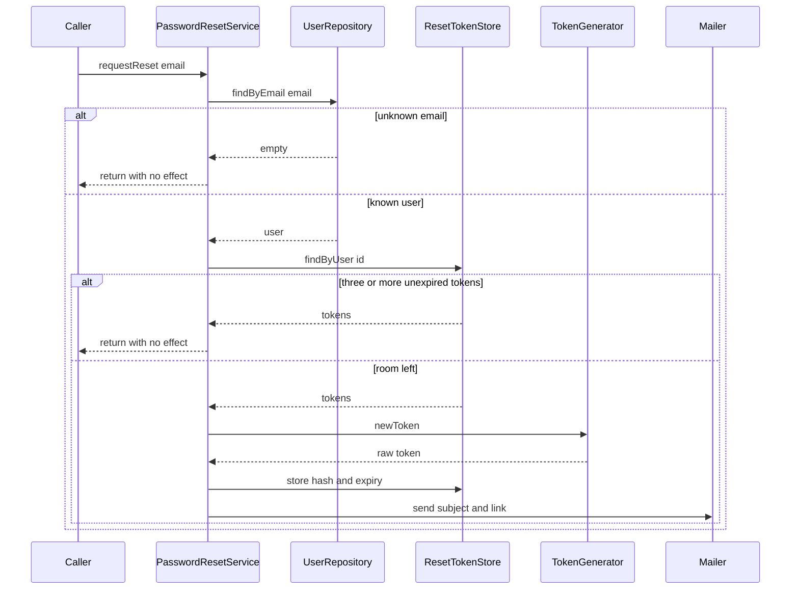
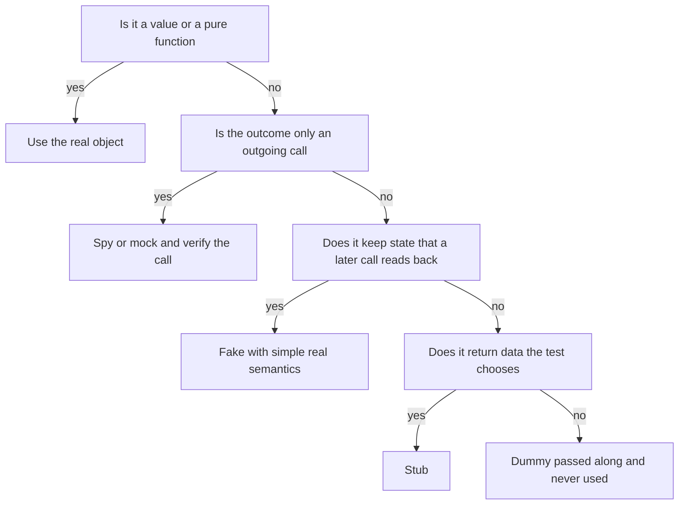

# Task 22 · The right test double for the job: password reset

| Difficulty | Topics | Time box |
|---|---|---|
| 🟡 Medium | Test doubles: dummy, stub, spy, mock, fake (Meszaros) · State verification vs. behaviour verification · Mockito where it shines, and where it hurts · Over-specified tests that break on refactoring · Testing security-relevant behaviour | 2–3 h |

> **Background reading:** Gerard Meszaros, *xUnit Test Patterns*, ch. 11 ("Using Test Doubles") · Martin Fowler, "Mocks Aren't Stubs" (2007, on martinfowler.com) · Vladimir Khorikov, *Unit Testing: Principles, Practices, and Patterns*, ch. 5 ("Mocks and test fragility") · Steve Freeman and Nat Pryce, *Growing Object-Oriented Software, Guided by Tests*, ch. 7–8 (mock only the types you own) · Mockito documentation: strict stubs and `ArgumentCaptor`

---

## The situation

Our webshop has a "forgot my password" feature. A customer enters an email address, gets a link, clicks it and chooses a new password. Every rule in that flow exists because someone would otherwise abuse it:

* An unknown email must not reveal whether an account exists (**account enumeration**).
* A user must not be able to flood a mailbox with reset links.
* A leaked token table must not contain anything an attacker can use, so we store only hashes.
* A link works once, only for 30 minutes, and a successful reset kills all other links.

The team wrote [`PasswordResetService`](../src/main/java/io/github/chris013/practice/task22/PasswordResetService.java) and a test class that mocks **every** collaborator and verifies **every** call. It passes. But when someone reordered two private lines last month, without changing any behaviour, several tests went red. Nobody wants to touch the service now, and the tests still do not prove that a new password actually works.

I want you to write the test suite that should have been there. Mockito is a good tool. It is also the wrong tool for most of what this class does. Learning which is which is the real goal of this task.

## The domain

| Term | Meaning |
|---|---|
| **User** | An account with an id, an email and a password hash. The password itself is never stored. |
| **Reset token** | A random secret sent by email. The store keeps only its SHA-256 hash. |
| **Outstanding token** | A token that is not expired yet. A user may have at most three. |
| **Port** | An interface that we own and that the service needs: `UserRepository`, `ResetTokenStore`, `TokenGenerator`, `PasswordHasher`, `Mailer`. |
| **Clock** | `java.time.Clock`, a JDK type. The service reads time only through it. |

The service has one public method per use case. Here is the flow of a reset request:

Notice what the customer can see: a mail, or nothing. The token generator, the hash and the store are internal. A good test checks what the customer and the mailbox see, and the state the service leaves behind. It does not check the steps in between.

## What I want from you

Write a new test class `src/test/java/io/github/chris013/practice/task22/PasswordResetServiceStateTest.java`. Keep the existing `PasswordResetServiceMockistTest` in place as the example of what to avoid. Your suite must cover every rule below.

1. **Unknown email:** [`requestReset`](../src/main/java/io/github/chris013/practice/task22/PasswordResetService.java) returns normally, sends no mail and stores no token.
2. **The mail:** it goes to the user's address, has the subject `Reset your password`, and its body contains `https://shop.example/reset?token=` followed by the raw token.
3. **Only the hash is stored:** the stored token hash is 64 lower-case hex characters, and the raw token does not appear in it.
4. **Lifetime:** a token expires 30 minutes after it was issued.
5. **Rate limit:** with three outstanding tokens, a fourth request sends nothing and stores nothing. One second before the oldest token expires the limit still holds. Once the tokens have expired, a new request works again.
6. **Valid token:** [`resetPassword`](../src/main/java/io/github/chris013/practice/task22/PasswordResetService.java) returns [`PasswordChanged`](../src/main/java/io/github/chris013/practice/task22/PasswordChanged.java). The old password no longer works and the new one does. Check that with the stored `passwordHash` and the [`PasswordHasher`](../src/main/java/io/github/chris013/practice/task22/PasswordHasher.java), not by counting calls.
7. **Single use:** the same token cannot be used twice.
8. **Siblings die:** after one successful reset, the user's other outstanding tokens are rejected too.
9. **Expiry boundary:** a token is still valid one second before `expiresAt` and rejected exactly at `expiresAt`. A rejected expired token is removed from the store.
10. **Weak password:** fewer than 12 characters gives [`PasswordTooWeak`](../src/main/java/io/github/chris013/practice/task22/PasswordTooWeak.java) with the reason `at least 12 characters`. The token stays valid, so the same token can be used with a good password. Exactly 12 characters is accepted.
11. **Unknown token:** [`InvalidToken`](../src/main/java/io/github/chris013/practice/task22/InvalidToken.java), and the password stays unchanged.
12. **Mail failure:** if the mailer throws, the exception reaches the caller. Write a test that pins this behaviour and say in your PR description whether you think it is right. Section "How I'd approach it" has a question to help you decide.

Do the refactoring experiment described below, and write down what you saw in your PR description.

## Constraints & non-goals

* **Do not change `src/main`.** The production code is complete, and it is identical in the starter and the solution. If you think it is wrong, explain why in your PR description. The refactoring experiment is the one time you touch it, and you revert it.
* **Do not mock what you do not need to mock.** Mockito is allowed. Use it where the requirement is an outgoing call that nothing else can observe, and add a comment that says why a fake would not do.
* **Do not mock `Clock`.** Use `Clock.fixed` or a small `MutableClock`.
* No `Thread.sleep` and no `Instant.now()`. The SHA-256 hasher that ships with the task is fast enough to use directly.
* The whole task test run must stay well under 5 seconds.

## How I'd approach it

### Which double do I need?

Meszaros uses "test double" as the umbrella term. There are five kinds, and each one answers a different question. The table gives one example from this task for each.

| Double | What it does | Example in this task |
|---|---|---|
| **Dummy** | Is passed along to satisfy a parameter and is never used | The token store and the generator in a test of an unknown email. The service never touches them. |
| **Stub** | Returns canned answers to calls, nothing more | A `TokenGenerator` that hands out predictable tokens (`token-1`, `token-2`), so the test knows the raw token. |
| **Spy** | Records calls so that the test can read them afterwards | A `FakeMailer` that keeps every sent message in a list. |
| **Mock** | Expects specific calls, and fails if they do not happen | `mock(Mailer.class)` in the unknown-email test, verified with `verifyNoInteractions`. |
| **Fake** | Has a real but simpler implementation of the dependency | `InMemoryUsers`, which saves and finds users like the real repository would. |

The flowchart turns that into a decision. Read it top to bottom and stop at the first yes:

Two cases in this task deserve a second look. `PasswordHasher` is a pure function in our setup, so use the real `Sha256PasswordHasher`. `UserRepository` and `ResetTokenStore` both return data **and** keep state: a token saved in one call must be found in the next. That makes them fakes, not stubs. A stub that returns `Optional.of(user)` cannot notice that the service forgot to save the new password.

### Behaviour, not implementation

Khorikov's first criterion for a good test is that it survives a refactoring that changes no observable behaviour. "Observable" means: what a caller of the service sees, and what the service leaves in its dependencies that someone else reads. The order of internal calls is not observable. The number of times the generator was called is not observable either, unless the generator is itself a visible side effect.

Try this experiment on your own machine. Do not commit it.

1. In `requestReset`, move the line `String token = generator.newToken();` so that it runs right after `Instant now = clock.instant();`, before the rate-limit check. A rate-limited request then generates a token and throws it away.
2. You will get a compile error, because the lambda in `.filter(token -> ...)` now shadows the local variable. Rename the lambda parameter. This is a small, real-world wrinkle, and it is also a reminder that reordering code is not free.
3. Run both test classes. The mockist test fails in the rate-limit test (`verify(generator, never()).newToken()`) and in the ordered-interaction test. Your state-based suite stays green, because nothing a customer or the mailbox can see has changed.
4. Revert the change with `git checkout -- src/main`.

The mockist test failed because it tested the steps, not the result. The state-based suite did not fail because it tested the result. That is the whole argument for state verification.

### Where mocks are justified

A mock is a good choice when the requirement is an outgoing call that has no other trace. "Unknown emails send no mail" is such a rule: the only thing that changes is that the mailer receives nothing. A hand-written `FakeMailer` can also check that, by looking at its list. Both work. The reference suite uses a Mockito mock once, so you can see the form, and it explains why in a comment.

`Clock` is different. It is a JDK type, it has one method that matters, and we do not own it. Mocking it means stubbing `instant()` in every test, and the test then reads like a clock setup instead of a business rule. The same goes for value objects such as `User` and `ResetToken`: there is nothing to isolate.

### Mailer failure, and why the order matters

The service stores the token **before** it sends the mail. Think through both failure cases:

* Store, then send, and the mailer throws: the user gets no mail, but the token exists and counts against the limit of three for 30 minutes. Three failures in a row block the user for half an hour, and no mail is sent during that time.
* Send, then store, and the store throws: the user gets a link that the service does not know. Clicking it gives "invalid token", and that is confusing, but nothing unsafe happens.

Which order is right? Think about who the user is in each case, and what an attacker can do with each failure. Write your answer in your PR description. The reference suite pins the current order and explains the trade-off.

## Tests

Run: `mvn test -Dtest='**/task22/**'`

This task differs from the others. The production code is complete, so the starter suite is green from the start. The **test suite is the deliverable**. Your suite should be green too. Then read the mockist test critically: every line that verifies an internal step is a candidate for deletion.

Show the tests

<!-- embed: src/test/java/io/github/chris013/practice/task22/PasswordResetServiceMockistTest.java -->
<!-- /embed -->

## Definition of done

- [ ] `PasswordResetServiceStateTest` is green, and each numbered rule in "What I want from you" has at least one test.
- [ ] No mock of a value object, of `Clock` or of `PasswordHasher`.
- [ ] Every Mockito call in your suite has a comment that says why a fake would not do.
- [ ] Boundaries are tested: one second before expiry, exactly at expiry, exactly 12 characters, the third and fourth token.
- [ ] You ran the refactoring experiment, saw the mockist test fail, saw your suite stay green, and reverted it (`git diff src/main` is empty).
- [ ] Your PR description says whether the mail-failure behaviour is right, and why.

## Stretch goals

1. The token lookup compares hashes. Is a constant-time comparison needed there, the way `Sha256PasswordHasher` uses `MessageDigest.isEqual` for passwords? Argue both sides before you write any code.
2. Replace the direct `mailer.send` with a domain event, such as `PasswordResetRequested`, that a listener turns into mail. Which of your tests change, and which stay the same?
3. Write one contract test that both `InMemoryResetTokens` and a real JDBC-backed store (for example H2 in the test scope) must pass. What does it catch that the fake alone cannot?
4. Move the lifetime and the limit of three into a small `ResetPolicy` record. Do the boundary tests still read clearly?

---

## Reference solution

Spoiler: open only after you have made a serious attempt

### Key decisions

**1. Fakes for the two stores, assertions on their contents.** [`InMemoryUsers`](../solutions/src/test/java/io/github/chris013/practice/task22/InMemoryUsers.java) and [`InMemoryResetTokens`](../solutions/src/test/java/io/github/chris013/practice/task22/InMemoryResetTokens.java) keep the real semantics: `save` replaces, `delete` of a missing token does nothing. The tests then ask "is the token still there?" and "does the password work?". With stubs, the test would only check that `delete` was called, and a service that forgot to delete would still pass. The rejected alternative was a Mockito mock with canned `Optional`s.

**2. A stub generator with a counter, not a constant.** The reference uses `this::nextToken`, which returns `token-1`, `token-2` and so on. A constant token would make the second request overwrite the first hash in the store, and the rate-limit tests would then count the wrong thing. It is still a stub: it returns canned values and nothing else, and the test can name them in advance.

**3. The real hasher.** `Sha256PasswordHasher` is deterministic and has no I/O, so there is nothing to isolate. The tests check that `hasher.matches` accepts the new password and rejects the old one. Asserting that `hash` was called would prove nothing about whether the user can log in.

**4. Exactly one justified mock.** The unknown-email test uses `mock(Mailer.class)` and `verifyNoInteractions`. "No mail was sent" is the requirement, and a mock states it directly. The comment in the test says so. The other tests use `FakeMailer`, which records the mail so the test can read the link and the subject.

**5. `MutableClock` instead of a mocked `Clock`.** The boundary tests move the clock with `advanceBy(LIFETIME)` and read as business sentences. A mocked `Clock` would need an `instant()` stub in every test.

**6. Store first, then send, and the mail-failure behaviour pinned.** [`MailerFailureTest`](../solutions/src/test/java/io/github/chris013/practice/task22/MailerFailureTest.java) shows that the exception reaches the caller and the token remains in the store. The reason for this order is an invariant: every link that can be in a customer's mailbox is already in the store, so the service never mails a link it cannot honour. If the store write fails, nothing is mailed. The price is the lockout described in "How I'd approach it". A real fix, such as a retry or a transactional outbox, is outside this task.

### Code

<!-- embed: solutions/src/main/java/io/github/chris013/practice/task22/PasswordResetService.java -->
<!-- /embed -->

<!-- embed: solutions/src/main/java/io/github/chris013/practice/task22/ResetToken.java -->
<!-- /embed -->

<!-- embed: solutions/src/main/java/io/github/chris013/practice/task22/Sha256PasswordHasher.java -->
<!-- /embed -->

<!-- embed: solutions/src/test/java/io/github/chris013/practice/task22/PasswordResetServiceTest.java -->
<!-- /embed -->

<!-- embed: solutions/src/test/java/io/github/chris013/practice/task22/InMemoryResetTokens.java -->
<!-- /embed -->

<!-- embed: solutions/src/test/java/io/github/chris013/practice/task22/FakeMailer.java -->
<!-- /embed -->

<!-- embed: solutions/src/test/java/io/github/chris013/practice/task22/MailerFailureTest.java -->
<!-- /embed -->

### What I typically flag in first attempts

| Finding | Why it matters |
|---|---|
| Mocking `User`, `ResetToken` or `EmailAddress` | Value objects have no collaborators to isolate. A mock of a record fails for reasons unrelated to the rule. |
| Verifying that `hasher.hash` was called | The requirement is "the new password works". Verify that with `matches`, not with a call that a broken hasher would also make. |
| `verifyNoMoreInteractions` on every collaborator | Every harmless new call, such as an extra read or a log line, breaks the test. Verify what the requirement needs. |
| Mocking `Clock` | `Clock.fixed` or `MutableClock` is simpler, and stubbing `instant()` in each test is noise. |
| `anyString()` everywhere in stubs | The test no longer says which token it is about, and a wrong lookup passes silently. |
| Proving "only hashes are stored" with an `ArgumentCaptor` on `store` alone | The captor shows what was passed in, not what the store now holds. Read the store's contents after the call. |
| Asserting on log calls | If you add logging, a test that checks log calls breaks when someone rewords a message. Logs are not behaviour that a customer sees. |

