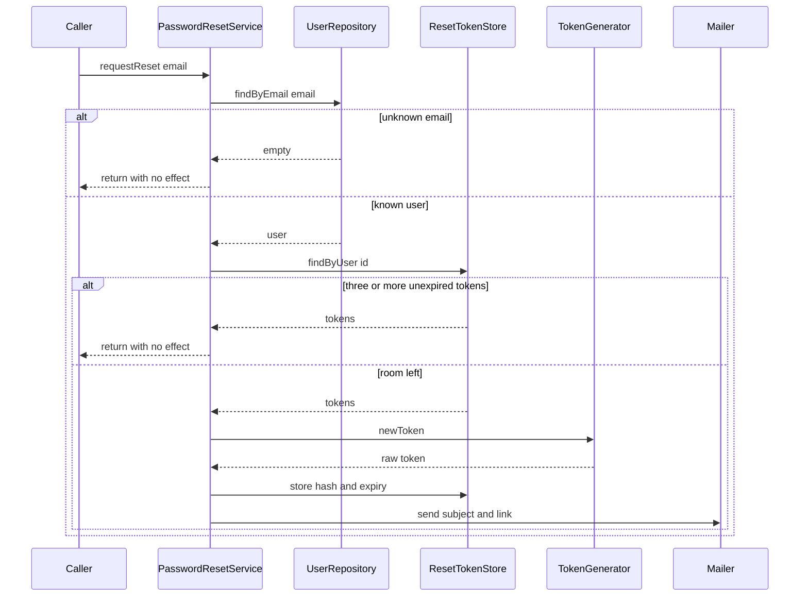
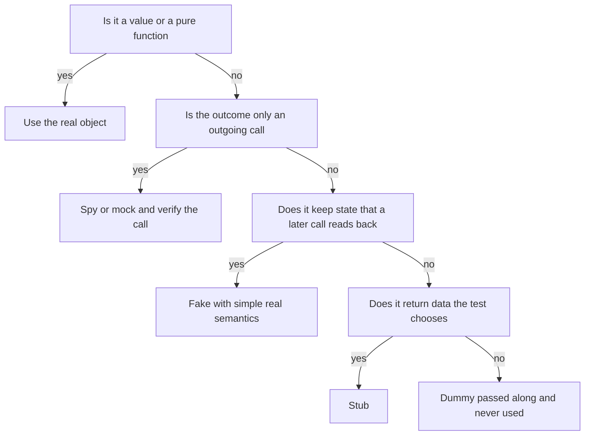

# Task 22 · The right test double for the job: password reset

| Difficulty | Topics | Time box |
|---|---|---|
| 🟡 Medium | Test doubles: dummy, stub, spy, mock, fake (Meszaros) · State verification vs. behaviour verification · Mockito where it shines, and where it hurts · Over-specified tests that break on refactoring · Testing security-relevant behaviour | 2–3 h |

> **Background reading:** Gerard Meszaros, *xUnit Test Patterns*, ch. 11 ("Using Test Doubles") · Martin Fowler, "Mocks Aren't Stubs" (2007, on martinfowler.com) · Vladimir Khorikov, *Unit Testing: Principles, Practices, and Patterns*, ch. 5 ("Mocks and test fragility") · Steve Freeman and Nat Pryce, *Growing Object-Oriented Software, Guided by Tests*, ch. 7–8 (mock only the types you own) · Mockito documentation: strict stubs and `ArgumentCaptor`

---

## The situation

Our webshop has a "forgot my password" feature. A customer enters an email address, gets a link, clicks it and chooses a new password. Every rule in that flow exists because someone would otherwise abuse it:

* An unknown email must not reveal whether an account exists (**account enumeration**).
* A user must not be able to flood a mailbox with reset links.
* A leaked token table must not contain anything an attacker can use, so we store only hashes.
* A link works once, only for 30 minutes, and a successful reset kills all other links.

The team wrote [`PasswordResetService`](../src/main/java/io/github/chris013/practice/task22/PasswordResetService.java) and a test class that mocks **every** collaborator and verifies **every** call. It passes. But when someone reordered two private lines last month, without changing any behaviour, several tests went red. Nobody wants to touch the service now, and the tests still do not prove that a new password actually works.

I want you to write the test suite that should have been there. Mockito is a good tool. It is also the wrong tool for most of what this class does. Learning which is which is the real goal of this task.

## The domain

| Term | Meaning |
|---|---|
| **User** | An account with an id, an email and a password hash. The password itself is never stored. |
| **Reset token** | A random secret sent by email. The store keeps only its SHA-256 hash. |
| **Outstanding token** | A token that is not expired yet. A user may have at most three. |
| **Port** | An interface that we own and that the service needs: `UserRepository`, `ResetTokenStore`, `TokenGenerator`, `PasswordHasher`, `Mailer`. |
| **Clock** | `java.time.Clock`, a JDK type. The service reads time only through it. |

The service has one public method per use case. Here is the flow of a reset request:



Notice what the customer can see: a mail, or nothing. The token generator, the hash and the store are internal. A good test checks what the customer and the mailbox see, and the state the service leaves behind. It does not check the steps in between.

## What I want from you

Write a new test class `src/test/java/io/github/chris013/practice/task22/PasswordResetServiceStateTest.java`. Keep the existing `PasswordResetServiceMockistTest` in place as the example of what to avoid. Your suite must cover every rule below.

1. **Unknown email:** [`requestReset`](../src/main/java/io/github/chris013/practice/task22/PasswordResetService.java) returns normally, sends no mail and stores no token.
2. **The mail:** it goes to the user's address, has the subject `Reset your password`, and its body contains `https://shop.example/reset?token=` followed by the raw token.
3. **Only the hash is stored:** the stored token hash is 64 lower-case hex characters, and the raw token does not appear in it.
4. **Lifetime:** a token expires 30 minutes after it was issued.
5. **Rate limit:** with three outstanding tokens, a fourth request sends nothing and stores nothing. One second before the oldest token expires the limit still holds. Once the tokens have expired, a new request works again.
6. **Valid token:** [`resetPassword`](../src/main/java/io/github/chris013/practice/task22/PasswordResetService.java) returns [`PasswordChanged`](../src/main/java/io/github/chris013/practice/task22/PasswordChanged.java). The old password no longer works and the new one does. Check that with the stored `passwordHash` and the [`PasswordHasher`](../src/main/java/io/github/chris013/practice/task22/PasswordHasher.java), not by counting calls.
7. **Single use:** the same token cannot be used twice.
8. **Siblings die:** after one successful reset, the user's other outstanding tokens are rejected too.
9. **Expiry boundary:** a token is still valid one second before `expiresAt` and rejected exactly at `expiresAt`. A rejected expired token is removed from the store.
10. **Weak password:** fewer than 12 characters gives [`PasswordTooWeak`](../src/main/java/io/github/chris013/practice/task22/PasswordTooWeak.java) with the reason `at least 12 characters`. The token stays valid, so the same token can be used with a good password. Exactly 12 characters is accepted.
11. **Unknown token:** [`InvalidToken`](../src/main/java/io/github/chris013/practice/task22/InvalidToken.java), and the password stays unchanged.
12. **Mail failure:** if the mailer throws, the exception reaches the caller. Write a test that pins this behaviour and say in your PR description whether you think it is right. Section "How I'd approach it" has a question to help you decide.

Do the refactoring experiment described below, and write down what you saw in your PR description.

## Constraints & non-goals

* **Do not change `src/main`.** The production code is complete, and it is identical in the starter and the solution. If you think it is wrong, explain why in your PR description. The refactoring experiment is the one time you touch it, and you revert it.
* **Do not mock what you do not need to mock.** Mockito is allowed. Use it where the requirement is an outgoing call that nothing else can observe, or where you need a collaborator to fail, and add a comment that says why a hand-written double would be less clear.
* **Do not mock `Clock`.** Use `Clock.fixed` or a small `MutableClock`.
* No `Thread.sleep` and no `Instant.now()`. The SHA-256 hasher that ships with the task is fast enough to use directly.
* The whole task test run must stay well under 5 seconds.

## How I'd approach it

### Which double do I need?

Meszaros uses "test double" as the umbrella term. There are five kinds, and each one answers a different question. The table gives one example from this task for each.

| Double | What it does | Example in this task |
|---|---|---|
| **Dummy** | Is passed along to satisfy a parameter and is never used | The `TokenGenerator` in the unknown-email test: the service returns before it asks for a token, so any implementation would do. |
| **Stub** | Returns canned answers to calls, nothing more | A `TokenGenerator` that hands out predictable tokens (`token-1`, `token-2`), so the test knows the raw token. |
| **Spy** | Records calls so that the test can read them afterwards | A `RecordingMailer` that keeps every sent message in a list. |
| **Mock** | Is told which calls to expect, and fails on a missing or an unexpected call | `mock(Mailer.class)` in the unknown-email test, verified with `verifyNoInteractions`. |
| **Fake** | Has a real but simpler implementation of the dependency | `InMemoryUsers`, which saves and finds users like the real repository would. |

Mockito blurs mock and spy: its mocks record every call and you verify afterwards. Strictly that is spy-style verification. The word "mock" in Mockito is the library's, not Meszaros's.

The flowchart turns that into a decision. Read it top to bottom and stop at the first yes:



Two cases in this task deserve a second look. `PasswordHasher` is a pure function in our setup, so use the real `Sha256PasswordHasher`. `UserRepository` and `ResetTokenStore` both return data **and** keep state: a token saved in one call must be found in the next. That makes them fakes, not stubs. A stub that returns `Optional.of(user)` cannot notice that the service forgot to save the new password.

### Behaviour, not implementation

Khorikov names four pillars of a good unit test, and he argues that one of them, resistance to refactoring, is not negotiable: a test must survive a refactoring that changes no observable behaviour. "Observable" means: what a caller of the service sees, and what the service leaves in its dependencies that someone else reads. The order of internal calls is not observable. The number of times the generator was called is not observable either, unless the generator is itself a visible side effect.

Khorikov also separates *managed* dependencies, which are ours, such as our own database: they are an implementation detail, so use the real thing or a fake. *Unmanaged* dependencies, such as SMTP, are observable by the outside world, so we mock them. That is exactly why the two stores get fakes and the `Mailer` is the only legitimate mock target. Khorikov's rule is also never to assert interactions with stubs: `verify(users).findByEmail(EMAIL)` in the mockist test checks a call that only exists to feed the service its data.

Try this experiment on your own machine. Do not commit it.

1. In `requestReset`, move the line `String token = generator.newToken();` so that it runs right after `Instant now = clock.instant();`, before the rate-limit check. A rate-limited request then generates a token and throws it away.
2. You will get a compile error, because the lambda in `.filter(token -> ...)` now shadows the local variable. Rename the lambda parameter. This is a small, real-world wrinkle, and it is also a reminder that reordering code is not free.
3. Run both test classes. The mockist test fails in the rate-limit test (`verify(generator, never()).newToken()`) and in the ordered-interaction test. Your state-based suite stays green, because nothing a customer or the mailbox can see has changed.
4. Revert the change with `git checkout -- src/main`.

The mockist test failed because it tested the steps, not the result. The state-based suite did not fail because it tested the result. That is the whole argument for state verification.

### Where mocks are justified

A mock is a good choice when the requirement is an outgoing call that has no other trace. "Unknown emails send no mail" is such a rule: the only thing that changes is that the mailer receives nothing. A hand-written `RecordingMailer` can also check that, by looking at its list. Both work. The reference suite uses Mockito in two places, a mock for the unknown-email test and `doThrow` for the failing mailer, so you can see both forms, and each one says in a comment why it was chosen over a hand-written double.

`Clock` is different. It is a JDK type, it has one method that matters, and we do not own it. Mocking it means stubbing `instant()` in every test, and the test then reads like a clock setup instead of a business rule. The same goes for value objects such as `User` and `ResetToken`: there is nothing to isolate.

### Mailer failure, and why the order matters

The service stores the token **before** it sends the mail. Think through both failure cases:

* Store, then send, and the mailer throws: the user gets no mail, but the token exists and counts against the limit of three for 30 minutes. Three failures in a row block the user for half an hour, and no mail is sent during that time.
* Send, then store, and the store throws: the user gets a link that the service does not know. Clicking it gives "invalid token", and that is confusing, but nothing unsafe happens.
* Whichever order you pick, a propagating exception is an oracle: a known email fails while the mail system is down, an unknown one never does. The endpoint must answer the same way in both cases (catch, log, return the generic "if an account exists, we sent a mail"), or the mail must go out asynchronously, as in stretch goal 2. A known email also does more work than an unknown one (it hashes, stores and mails), so a timing measurement can tell them apart too. That is a smaller leak, and fixing it is outside this task.

Which order is right? Think about who the user is in each case, and what an attacker can do with each failure. Write your answer in your PR description. The reference suite pins the current order and explains the trade-off.

## Tests

Run: `mvn test -Dtest='**/task22/**'`

This task differs from the others. The production code is complete, so the starter suite is green from the start. The **test suite is the deliverable**. Your suite should be green too. Then read the mockist test critically: every line that verifies an internal step is a candidate for deletion.

<details>
<summary>Show the tests</summary>

<!-- embed: src/test/java/io/github/chris013/practice/task22/PasswordResetServiceMockistTest.java -->
**[`PasswordResetServiceMockistTest.java`](../src/test/java/io/github/chris013/practice/task22/PasswordResetServiceMockistTest.java)**

```java
package io.github.chris013.practice.task22;

import static org.assertj.core.api.Assertions.assertThat;
import static org.mockito.ArgumentMatchers.any;
import static org.mockito.ArgumentMatchers.anyString;
import static org.mockito.ArgumentMatchers.eq;
import static org.mockito.Mockito.inOrder;
import static org.mockito.Mockito.never;
import static org.mockito.Mockito.verify;
import static org.mockito.Mockito.verifyNoInteractions;
import static org.mockito.Mockito.verifyNoMoreInteractions;
import static org.mockito.Mockito.when;

import java.time.Clock;
import java.time.Duration;
import java.time.Instant;
import java.time.ZoneOffset;
import java.util.List;
import java.util.Optional;
import org.junit.jupiter.api.BeforeEach;
import org.junit.jupiter.api.Test;
import org.junit.jupiter.api.extension.ExtendWith;
import org.mockito.ArgumentCaptor;
import org.mockito.InOrder;
import org.mockito.Mock;
import org.mockito.junit.jupiter.MockitoExtension;

/**
 * Every collaborator is a mock and every interaction is verified. It passes today, and it is also
 * the kind of test that breaks the moment someone refactors without changing behaviour.
 */
@ExtendWith(MockitoExtension.class)
class PasswordResetServiceMockistTest {

    private static final EmailAddress EMAIL = new EmailAddress("anna@example.com");
    private static final UserId ANNA = new UserId("anna");
    private static final User USER = new User(ANNA, EMAIL, "old-hash");
    private static final Instant NOW = Instant.parse("2026-11-09T10:00:00Z");

    @Mock
    private UserRepository users;
    @Mock
    private ResetTokenStore tokens;
    @Mock
    private TokenGenerator generator;
    @Mock
    private PasswordHasher hasher;
    @Mock
    private Mailer mailer;

    private final Clock clock = Clock.fixed(NOW, ZoneOffset.UTC);
    private PasswordResetService service;

    @BeforeEach
    void createService() {
        service = new PasswordResetService(users, tokens, generator, hasher, mailer, clock);
    }

    @Test
    void unknown_email_does_nothing() {
        when(users.findByEmail(EMAIL)).thenReturn(Optional.empty());

        service.requestReset(EMAIL);

        verify(users).findByEmail(EMAIL);
        verifyNoInteractions(tokens, generator, mailer);
        verifyNoMoreInteractions(users);
    }

    @Test
    void stores_a_token_and_mails_the_link_in_this_order() {
        when(users.findByEmail(EMAIL)).thenReturn(Optional.of(USER));
        when(tokens.findByUser(ANNA)).thenReturn(List.of());
        when(generator.newToken()).thenReturn("raw-token");

        service.requestReset(EMAIL);

        ArgumentCaptor<ResetToken> stored = ArgumentCaptor.forClass(ResetToken.class);
        ArgumentCaptor<String> body = ArgumentCaptor.forClass(String.class);
        InOrder inOrder = inOrder(users, tokens, generator, mailer);
        inOrder.verify(users).findByEmail(EMAIL);
        inOrder.verify(tokens).findByUser(ANNA);
        inOrder.verify(generator).newToken();
        inOrder.verify(tokens).store(stored.capture());
        inOrder.verify(mailer).send(eq(EMAIL), eq("Reset your password"), body.capture());
        verifyNoMoreInteractions(users, tokens, generator, mailer);

        assertThat(stored.getValue().tokenHash()).isNotEqualTo("raw-token");
        assertThat(stored.getValue().expiresAt()).isEqualTo(NOW.plus(Duration.ofMinutes(30)));
        assertThat(body.getValue()).contains("https://shop.example/reset?token=raw-token");
    }

    @Test
    void a_user_with_three_outstanding_tokens_gets_no_new_token_and_no_mail() {
        when(users.findByEmail(EMAIL)).thenReturn(Optional.of(USER));
        when(tokens.findByUser(ANNA)).thenReturn(List.of(
                tokenExpiringIn(Duration.ofMinutes(5)),
                tokenExpiringIn(Duration.ofMinutes(10)),
                tokenExpiringIn(Duration.ofMinutes(20))));

        service.requestReset(EMAIL);

        InOrder inOrder = inOrder(users, tokens);
        inOrder.verify(users).findByEmail(EMAIL);
        inOrder.verify(tokens).findByUser(ANNA);
        verify(generator, never()).newToken();
        verify(tokens, never()).store(any());
        verifyNoInteractions(mailer, hasher);
        verifyNoMoreInteractions(users, tokens, generator);
    }

    @Test
    void a_valid_token_changes_the_password_and_deletes_all_tokens_of_the_user() {
        ResetToken used = new ResetToken("used-hash", ANNA, NOW.plusSeconds(60));
        ResetToken sibling = new ResetToken("sibling-hash", ANNA, NOW.plusSeconds(120));
        when(tokens.findByTokenHash(anyString())).thenReturn(Optional.of(used));
        when(users.findById(ANNA)).thenReturn(Optional.of(USER));
        when(hasher.hash("correct horse battery")).thenReturn("new-hash");
        when(tokens.findByUser(ANNA)).thenReturn(List.of(used, sibling));

        ResetResult result = service.resetPassword("raw-token", "correct horse battery");

        ArgumentCaptor<User> saved = ArgumentCaptor.forClass(User.class);
        InOrder inOrder = inOrder(tokens, users, hasher);
        inOrder.verify(tokens).findByTokenHash(anyString());
        inOrder.verify(users).findById(ANNA);
        inOrder.verify(hasher).hash("correct horse battery");
        inOrder.verify(users).save(saved.capture());
        inOrder.verify(tokens).findByUser(ANNA);
        inOrder.verify(tokens).delete("used-hash");
        inOrder.verify(tokens).delete("sibling-hash");
        verifyNoMoreInteractions(users, tokens, hasher);

        assertThat(result).isEqualTo(new PasswordChanged());
        assertThat(saved.getValue().passwordHash()).isEqualTo("new-hash");
    }

    @Test
    void an_expired_token_is_deleted_and_rejected() {
        ResetToken expired = new ResetToken("expired-hash", ANNA, NOW);
        when(tokens.findByTokenHash(anyString())).thenReturn(Optional.of(expired));

        ResetResult result = service.resetPassword("raw-token", "correct horse battery");

        // The service hashes the raw token itself, so the test captures the hash it looked up.
        ArgumentCaptor<String> lookedUp = ArgumentCaptor.forClass(String.class);
        verify(tokens).findByTokenHash(lookedUp.capture());
        assertThat(result).isEqualTo(new ExpiredToken());
        verify(tokens).delete(lookedUp.getValue());
        verifyNoMoreInteractions(tokens);
        verifyNoInteractions(users, hasher, mailer, generator);
    }

    @Test
    void an_unknown_token_is_rejected_without_touching_users() {
        when(tokens.findByTokenHash(anyString())).thenReturn(Optional.empty());

        ResetResult result = service.resetPassword("guessed-token", "correct horse battery");

        assertThat(result).isEqualTo(new InvalidToken());
        verify(tokens).findByTokenHash(anyString());
        verifyNoMoreInteractions(tokens);
        verifyNoInteractions(users, hasher);
    }

    @Test
    void a_weak_password_is_refused_and_the_token_is_kept() {
        ResetToken valid = new ResetToken("valid-hash", ANNA, NOW.plusSeconds(60));
        when(tokens.findByTokenHash(anyString())).thenReturn(Optional.of(valid));

        ResetResult result = service.resetPassword("raw-token", "short");

        assertThat(result).isEqualTo(new PasswordTooWeak("at least 12 characters"));
        verify(tokens).findByTokenHash(anyString());
        verifyNoMoreInteractions(tokens);
        verifyNoInteractions(users, hasher);
    }

    private static ResetToken tokenExpiringIn(Duration lifetime) {
        return new ResetToken("hash-" + lifetime.toMinutes(), ANNA, NOW.plus(lifetime));
    }
}
```
<!-- /embed -->

</details>

## Definition of done

- [ ] `PasswordResetServiceStateTest` is green, and each numbered rule in "What I want from you" has at least one test.
- [ ] No mock of a value object, of `Clock` or of `PasswordHasher`.
- [ ] Every Mockito call in your suite has a comment that says why it is clearer than a hand-written double.
- [ ] Boundaries are tested: one second before expiry, exactly at expiry, exactly 12 characters, the third and fourth token.
- [ ] You ran the refactoring experiment, saw the mockist test fail, saw your suite stay green, and reverted it (`git diff src/main` is empty).
- [ ] Your PR description says whether the mail-failure behaviour is right, and why.

## Stretch goals

1. The token lookup compares hashes. Is a constant-time comparison needed there, the way `Sha256PasswordHasher` uses `MessageDigest.isEqual` for passwords? Argue both sides before you write any code.
2. Replace the direct `mailer.send` with a domain event, such as `PasswordResetRequested`, that a listener turns into mail. Which of your tests change, and which stay the same?
3. Write one contract test that both `InMemoryResetTokens` and a real JDBC-backed store (for example H2 in the test scope) must pass. What does it catch that the fake alone cannot?
4. Move the lifetime and the limit of three into a small `ResetPolicy` record. Do the boundary tests still read clearly?

---

## Reference solution

<details>
<summary>Spoiler: open only after you have made a serious attempt</summary>

### Key decisions

**1. Fakes for the two stores, assertions on their contents.** [`InMemoryUsers`](../solutions/src/test/java/io/github/chris013/practice/task22/InMemoryUsers.java) and [`InMemoryResetTokens`](../solutions/src/test/java/io/github/chris013/practice/task22/InMemoryResetTokens.java) keep the real semantics: `save` replaces, `delete` of a missing token does nothing. The tests then ask "is the token still there?" and "does the password work?". With stubs, the test would only check that `delete` was called, and a service that forgot to delete would still pass. The rejected alternative was a Mockito mock with canned `Optional`s.

**2. A stub generator with a counter, not a constant.** The reference uses `this::nextToken`, which returns `token-1`, `token-2` and so on. A constant token would make the second request overwrite the first hash in the store, and the rate-limit tests would then count the wrong thing. It is still a stub: it returns canned values and nothing else, and the test can name them in advance.

**3. The real hasher.** `Sha256PasswordHasher` is deterministic and has no I/O, so there is nothing to isolate. The tests check that `hasher.matches` accepts the new password and rejects the old one. Asserting that `hash` was called would prove nothing about whether the user can log in.

**4. Mockito only where it states the requirement best.** The unknown-email test uses `mock(Mailer.class)` and `verifyNoInteractions`. "No mail was sent" is the requirement, and a mock states it directly. The comment in the test says so. The other tests use `RecordingMailer`, which records the mail so the test can read the link and the subject. `MailerFailureTest` uses `doThrow` for the one case where the mailer must fail; a throwing lambda would do the same, and the comment says so.

**5. `MutableClock` instead of a mocked `Clock`.** The boundary tests move the clock with `advanceBy(LIFETIME)` and read as business sentences. A mocked `Clock` would need an `instant()` stub in every test.

**6. Store first, then send, and the mail-failure behaviour pinned.** [`MailerFailureTest`](../solutions/src/test/java/io/github/chris013/practice/task22/MailerFailureTest.java) shows that the exception reaches the caller and the token remains in the store. The reason for this order is an invariant: every link that can be in a customer's mailbox is already in the store, so the service never mails a link it cannot honour. If the store write fails, nothing is mailed. The price is the lockout described in "How I'd approach it". The propagating exception is also an enumeration oracle, so pinning it is fine at service level only because the web layer must hide it. A real fix, such as a retry or a transactional outbox, is outside this task.

### Code

<!-- embed: solutions/src/main/java/io/github/chris013/practice/task22/PasswordResetService.java -->
**[`PasswordResetService.java`](../solutions/src/main/java/io/github/chris013/practice/task22/PasswordResetService.java)**

```java
package io.github.chris013.practice.task22;

import java.time.Clock;
import java.time.Duration;
import java.time.Instant;
import java.util.List;
import java.util.Objects;
import java.util.Optional;

/**
 * Lets a customer who forgot the password choose a new one, by email.
 *
 * <p>Rules this class enforces (the tests check each of them):
 * <ul>
 *   <li>an unknown email gets the same silent result as a known one, so nobody can probe which emails have accounts;</li>
 *   <li>at most 3 unexpired tokens per user, so nobody can flood a mailbox;</li>
 *   <li>only the SHA-256 hash of a token is stored, so a leaked store is useless to an attacker;</li>
 *   <li>a token is valid for 30 minutes and works once;</li>
 *   <li>a successful reset invalidates every other token of that user.</li>
 * </ul>
 */
public final class PasswordResetService {

    static final Duration TOKEN_LIFETIME = Duration.ofMinutes(30);
    static final int MAX_OUTSTANDING_TOKENS = 3;
    static final int MINIMUM_PASSWORD_LENGTH = 12;
    static final String MAIL_SUBJECT = "Reset your password";
    static final String RESET_LINK_PREFIX = "https://shop.example/reset?token=";

    private static final long TOKEN_LIFETIME_MINUTES = TOKEN_LIFETIME.toMinutes();

    private final UserRepository users;
    private final ResetTokenStore tokens;
    private final TokenGenerator generator;
    private final PasswordHasher hasher;
    private final Mailer mailer;
    private final Clock clock;

    public PasswordResetService(UserRepository users, ResetTokenStore tokens, TokenGenerator generator,
            PasswordHasher hasher, Mailer mailer, Clock clock) {
        this.users = Objects.requireNonNull(users, "users");
        this.tokens = Objects.requireNonNull(tokens, "tokens");
        this.generator = Objects.requireNonNull(generator, "generator");
        this.hasher = Objects.requireNonNull(hasher, "hasher");
        this.mailer = Objects.requireNonNull(mailer, "mailer");
        this.clock = Objects.requireNonNull(clock, "clock");
    }

    /**
     * Sends a reset link if the email belongs to an account and the rate limit allows it.
     * Returns normally in every case except a mail-system failure, which propagates to the caller.
     */
    public void requestReset(EmailAddress email) {
        Objects.requireNonNull(email, "email");
        Optional<User> user = users.findByEmail(email);
        if (user.isEmpty()) {
            return;
        }
        UserId userId = user.get().id();
        Instant now = clock.instant();
        long outstanding = tokens.findByUser(userId).stream()
                .filter(token -> !token.isExpiredAt(now))
                .count();
        if (outstanding >= MAX_OUTSTANDING_TOKENS) {
            return;
        }
        String token = generator.newToken();
        tokens.store(new ResetToken(Sha256.hex(token), userId, now.plus(TOKEN_LIFETIME)));
        mailer.send(user.get().email(), MAIL_SUBJECT, messageBody(token));
    }

    /**
     * Checks the token and, if it is valid and the password is acceptable, changes the password.
     * The token is the secret from the mail link; we look it up by its hash.
     */
    public ResetResult resetPassword(String token, String newPassword) {
        Objects.requireNonNull(token, "token");
        Objects.requireNonNull(newPassword, "newPassword");
        String tokenHash = Sha256.hex(token);
        Optional<ResetToken> stored = tokens.findByTokenHash(tokenHash);
        if (stored.isEmpty()) {
            return new InvalidToken();
        }
        ResetToken resetToken = stored.get();
        if (resetToken.isExpiredAt(clock.instant())) {
            tokens.delete(tokenHash);
            return new ExpiredToken();
        }
        // The token is not consumed here: a weak password is a typo, not a misuse.
        if (newPassword.codePointCount(0, newPassword.length()) < MINIMUM_PASSWORD_LENGTH) {
            return new PasswordTooWeak("at least " + MINIMUM_PASSWORD_LENGTH + " characters");
        }
        User user = users.findById(resetToken.userId()).orElseThrow(() -> new IllegalStateException(
                "reset token refers to an unknown user " + resetToken.userId().value()));
        users.save(new User(user.id(), user.email(), hasher.hash(newPassword)));
        // Single use, and a changed password makes every other outstanding link useless too.
        List<ResetToken> ownTokens = tokens.findByUser(user.id());
        for (ResetToken own : ownTokens) {
            tokens.delete(own.tokenHash());
        }
        return new PasswordChanged();
    }

    private static String messageBody(String token) {
        return "Open this link to choose a new password: " + RESET_LINK_PREFIX + token
                + "\n\nThe link expires in " + TOKEN_LIFETIME_MINUTES + " minutes.";
    }
}
```
<!-- /embed -->

<!-- embed: solutions/src/main/java/io/github/chris013/practice/task22/ResetToken.java -->
**[`ResetToken.java`](../solutions/src/main/java/io/github/chris013/practice/task22/ResetToken.java)**

```java
package io.github.chris013.practice.task22;

import java.time.Instant;
import java.util.Objects;

/**
 * A password reset token as it is stored: the SHA-256 hash of the token, never the token itself.
 * If the store leaks, the attacker gets hashes they cannot use to reset anyone's password.
 */
public record ResetToken(String tokenHash, UserId userId, Instant expiresAt) {

    public ResetToken {
        Objects.requireNonNull(tokenHash, "tokenHash");
        Objects.requireNonNull(userId, "userId");
        Objects.requireNonNull(expiresAt, "expiresAt");
    }

    /** Expired from the moment {@code now} reaches {@code expiresAt}, not one tick later. */
    public boolean isExpiredAt(Instant now) {
        return !now.isBefore(expiresAt);
    }
}
```
<!-- /embed -->

<!-- embed: solutions/src/main/java/io/github/chris013/practice/task22/Sha256PasswordHasher.java -->
**[`Sha256PasswordHasher.java`](../solutions/src/main/java/io/github/chris013/practice/task22/Sha256PasswordHasher.java)**

```java
package io.github.chris013.practice.task22;

import java.nio.charset.StandardCharsets;
import java.security.MessageDigest;
import java.util.Objects;

/**
 * Hashes passwords with plain SHA-256.
 *
 * <p>For the exercise only; use bcrypt/argon2 in production. SHA-256 is fast on purpose, which
 * is exactly what a password hash must not be: an attacker with the database can try billions of
 * guesses per second. A real hasher is slow and salted.
 */
public final class Sha256PasswordHasher implements PasswordHasher {

    @Override
    public String hash(String raw) {
        return Sha256.hex(Objects.requireNonNull(raw, "raw"));
    }

    @Override
    public boolean matches(String raw, String hash) {
        byte[] computed = hash(raw).getBytes(StandardCharsets.UTF_8);
        byte[] expected = Objects.requireNonNull(hash, "hash").getBytes(StandardCharsets.UTF_8);
        // Constant-time comparison, so the time taken does not reveal how many leading characters matched.
        return MessageDigest.isEqual(computed, expected);
    }
}
```
<!-- /embed -->

<!-- embed: solutions/src/test/java/io/github/chris013/practice/task22/PasswordResetServiceTest.java -->
**[`PasswordResetServiceTest.java`](../solutions/src/test/java/io/github/chris013/practice/task22/PasswordResetServiceTest.java)**

```java
package io.github.chris013.practice.task22;

import static org.assertj.core.api.Assertions.assertThat;
import static org.assertj.core.api.Assertions.assertThatNullPointerException;
import static org.mockito.Mockito.mock;
import static org.mockito.Mockito.verifyNoInteractions;

import io.github.chris013.practice.task22.RecordingMailer.SentMail;
import java.time.Duration;
import java.time.Instant;
import java.util.concurrent.atomic.AtomicInteger;
import org.junit.jupiter.api.BeforeEach;
import org.junit.jupiter.api.Nested;
import org.junit.jupiter.api.Test;
import org.junit.jupiter.params.ParameterizedTest;
import org.junit.jupiter.params.provider.ValueSource;

/** State-based: we check what the users, the token store and the mailbox look like afterwards. */
class PasswordResetServiceTest {

    private static final EmailAddress EMAIL = new EmailAddress("anna@example.com");
    private static final UserId ANNA = new UserId("anna");
    private static final Instant NOW = Instant.parse("2026-11-09T10:00:00Z");
    private static final Duration LIFETIME = Duration.ofMinutes(30);
    private static final String OLD_PASSWORD = "old-password-123";
    private static final String NEW_PASSWORD = "new-password-456";

    private final InMemoryUsers users = new InMemoryUsers();
    private final InMemoryResetTokens tokens = new InMemoryResetTokens();
    private final RecordingMailer mailer = new RecordingMailer();
    private final MutableClock clock = new MutableClock(NOW);
    private final Sha256PasswordHasher hasher = new Sha256PasswordHasher();
    private final AtomicInteger issued = new AtomicInteger();
    private final PasswordResetService service = serviceWith(mailer);

    @BeforeEach
    void anna_has_an_account() {
        users.save(new User(ANNA, EMAIL, hasher.hash(OLD_PASSWORD)));
    }

    /** A stub: every call hands out the next predictable token, so tests can name them. */
    private String nextToken() {
        return "token-" + issued.incrementAndGet();
    }

    private PasswordResetService serviceWith(Mailer mailerToUse) {
        return new PasswordResetService(users, tokens, this::nextToken, hasher, mailerToUse, clock);
    }

    private void requestReset() {
        service.requestReset(EMAIL);
    }

    private boolean passwordIs(String raw) {
        return hasher.matches(raw, users.findById(ANNA).orElseThrow().passwordHash());
    }

    @Nested
    class RequestingAReset {

        @Test
        void unknown_email_sends_nothing_and_stores_nothing() {
            // Mockito is the clearer choice here, not the only one: verifyNoInteractions states "nothing was sent"
            // in one line and keeps failing if Mailer later gains a second method. An empty recording-mailer
            // list would prove the same today.
            Mailer outbox = mock(Mailer.class);

            serviceWith(outbox).requestReset(new EmailAddress("nobody@example.com"));

            verifyNoInteractions(outbox);
            assertThat(tokens.count()).isZero();
        }

        @Test
        void mails_a_link_that_contains_the_token() {
            requestReset();

            assertThat(mailer.sent()).hasSize(1);
            SentMail mail = mailer.sent().getFirst();
            assertThat(mail.to()).isEqualTo(EMAIL);
            assertThat(mail.subject()).isEqualTo("Reset your password");
            assertThat(mail.body()).contains("https://shop.example/reset?token=token-1");
        }

        @Test
        void stores_only_the_hash_of_the_token_with_a_30_minute_lifetime() {
            requestReset();

            ResetToken stored = tokens.findByUser(ANNA).getFirst();
            // SHA-256 in lower-case hex: 64 characters, and the raw token is nowhere to be seen.
            assertThat(stored.tokenHash()).matches("[0-9a-f]{64}").doesNotContain("token-1");
            assertThat(stored.userId()).isEqualTo(ANNA);
            assertThat(stored.expiresAt()).isEqualTo(NOW.plus(LIFETIME));
        }

        @Test
        void a_fourth_request_is_ignored_while_three_tokens_are_outstanding() {
            requestReset();
            requestReset();
            requestReset();

            requestReset();

            assertThat(mailer.sent()).hasSize(3);
            assertThat(tokens.findByUser(ANNA)).hasSize(3);
        }

        @Test
        void the_limit_still_holds_one_second_before_the_oldest_token_expires() {
            requestReset();
            requestReset();
            requestReset();

            clock.advanceBy(LIFETIME.minusSeconds(1));
            requestReset();

            assertThat(mailer.sent()).hasSize(3);
        }

        @Test
        void a_new_token_is_allowed_again_once_the_old_ones_have_expired() {
            requestReset();
            requestReset();
            requestReset();
            clock.advanceBy(LIFETIME);

            requestReset();

            assertThat(mailer.sent()).hasSize(4);
        }
    }

    @Nested
    class Construction {

        @Test
        void refuses_null_collaborators() {
            assertThatNullPointerException()
                    .isThrownBy(() -> new PasswordResetService(
                            null, tokens, PasswordResetServiceTest.this::nextToken, hasher, mailer, clock))
                    .withMessage("users");
        }
    }

    @Nested
    class ResettingThePassword {

        @BeforeEach
        void request_a_token() {
            requestReset();
        }

        @Test
        void a_valid_token_changes_the_password() {
            ResetResult result = service.resetPassword("token-1", NEW_PASSWORD);

            assertThat(result).isEqualTo(new PasswordChanged());
            assertThat(passwordIs(NEW_PASSWORD)).isTrue();
            assertThat(passwordIs(OLD_PASSWORD)).isFalse();
        }

        @Test
        void a_token_works_only_once() {
            service.resetPassword("token-1", NEW_PASSWORD);

            ResetResult second = service.resetPassword("token-1", "another-password-789");

            assertThat(second).isEqualTo(new InvalidToken());
            assertThat(passwordIs(NEW_PASSWORD)).isTrue();
        }

        @Test
        void using_one_token_invalidates_the_other_outstanding_tokens() {
            requestReset();

            service.resetPassword("token-1", NEW_PASSWORD);

            assertThat(service.resetPassword("token-2", "another-password-789")).isEqualTo(new InvalidToken());
            assertThat(tokens.findByUser(ANNA)).isEmpty();
        }

        @Test
        void a_token_is_still_valid_one_second_before_it_expires() {
            clock.advanceBy(LIFETIME.minusSeconds(1));

            assertThat(service.resetPassword("token-1", NEW_PASSWORD)).isEqualTo(new PasswordChanged());
        }

        @Test
        void a_token_is_rejected_exactly_when_it_expires_and_is_removed() {
            clock.advanceBy(LIFETIME);

            assertThat(service.resetPassword("token-1", NEW_PASSWORD)).isEqualTo(new ExpiredToken());
            assertThat(tokens.findByUser(ANNA)).isEmpty();
            assertThat(passwordIs(OLD_PASSWORD)).isTrue();
        }

        @ParameterizedTest
        @ValueSource(strings = {"", "a", "elevenchars"})
        void a_password_under_12_characters_is_refused_and_the_token_stays_valid(String weak) {
            ResetResult result = service.resetPassword("token-1", weak);

            assertThat(result).isEqualTo(new PasswordTooWeak("at least 12 characters"));
            assertThat(service.resetPassword("token-1", NEW_PASSWORD)).isEqualTo(new PasswordChanged());
        }

        @Test
        void exactly_12_characters_is_enough() {
            assertThat(service.resetPassword("token-1", "twelve-chars")).isEqualTo(new PasswordChanged());
        }

        @Test
        void an_unknown_token_is_rejected_and_changes_nothing() {
            ResetResult result = service.resetPassword("guessed-token", NEW_PASSWORD);

            assertThat(result).isEqualTo(new InvalidToken());
            assertThat(passwordIs(OLD_PASSWORD)).isTrue();
            assertThat(tokens.findByUser(ANNA)).hasSize(1);
        }
    }
}
```
<!-- /embed -->

<!-- embed: solutions/src/test/java/io/github/chris013/practice/task22/InMemoryResetTokens.java -->
**[`InMemoryResetTokens.java`](../solutions/src/test/java/io/github/chris013/practice/task22/InMemoryResetTokens.java)**

```java
package io.github.chris013.practice.task22;

import java.util.LinkedHashMap;
import java.util.List;
import java.util.Map;
import java.util.Optional;

/** A fake token store that keeps tokens in a map keyed by hash, like the real table would. */
final class InMemoryResetTokens implements ResetTokenStore {

    private final Map<String, ResetToken> byHash = new LinkedHashMap<>();

    @Override
    public void store(ResetToken token) {
        byHash.put(token.tokenHash(), token);
    }

    @Override
    public Optional<ResetToken> findByTokenHash(String tokenHash) {
        return Optional.ofNullable(byHash.get(tokenHash));
    }

    @Override
    public void delete(String tokenHash) {
        byHash.remove(tokenHash);
    }

    @Override
    public List<ResetToken> findByUser(UserId userId) {
        return byHash.values().stream().filter(token -> token.userId().equals(userId)).toList();
    }

    int count() {
        return byHash.size();
    }
}
```
<!-- /embed -->

<!-- embed: solutions/src/test/java/io/github/chris013/practice/task22/RecordingMailer.java -->
**[`RecordingMailer.java`](../solutions/src/test/java/io/github/chris013/practice/task22/RecordingMailer.java)**

```java
package io.github.chris013.practice.task22;

import java.util.ArrayList;
import java.util.List;

/**
 * A hand-written spy: it records every message, and the test reads the record afterwards.
 * That is usually all a mailer needs. No Mockito required.
 */
final class RecordingMailer implements Mailer {

    record SentMail(EmailAddress to, String subject, String body) {
    }

    private final List<SentMail> sent = new ArrayList<>();

    @Override
    public void send(EmailAddress to, String subject, String body) {
        sent.add(new SentMail(to, subject, body));
    }

    List<SentMail> sent() {
        return List.copyOf(sent);
    }
}
```
<!-- /embed -->

<!-- embed: solutions/src/test/java/io/github/chris013/practice/task22/MailerFailureTest.java -->
**[`MailerFailureTest.java`](../solutions/src/test/java/io/github/chris013/practice/task22/MailerFailureTest.java)**

```java
package io.github.chris013.practice.task22;

import static org.assertj.core.api.Assertions.assertThat;
import static org.assertj.core.api.Assertions.assertThatThrownBy;
import static org.mockito.ArgumentMatchers.any;
import static org.mockito.Mockito.doThrow;

import java.time.Clock;
import java.time.Instant;
import java.time.ZoneOffset;
import org.junit.jupiter.api.Test;
import org.junit.jupiter.api.extension.ExtendWith;
import org.mockito.Mock;
import org.mockito.junit.jupiter.MockitoExtension;

/**
 * Pins what happens when the mail system is down. The current behaviour is deliberate to discuss:
 * the exception reaches the caller, and the token that was already stored stays in the store.
 */
@ExtendWith(MockitoExtension.class)
class MailerFailureTest {

    private static final EmailAddress EMAIL = new EmailAddress("anna@example.com");
    private static final UserId ANNA = new UserId("anna");

    @Mock
    private Mailer mailer;

    @Test
    void a_failing_mailer_propagates_and_leaves_the_stored_token_behind() {
        InMemoryUsers users = new InMemoryUsers();
        InMemoryResetTokens tokens = new InMemoryResetTokens();
        users.save(new User(ANNA, EMAIL, "some-hash"));
        Clock clock = Clock.fixed(Instant.parse("2026-11-09T10:00:00Z"), ZoneOffset.UTC);
        PasswordResetService service = new PasswordResetService(
                users, tokens, () -> "token-1", new Sha256PasswordHasher(), mailer, clock);
        // A throwing lambda would do the same. doThrow is shown because it is the Mockito form you will meet for void methods.
        doThrow(new IllegalStateException("SMTP server is down")).when(mailer).send(any(), any(), any());

        assertThatThrownBy(() -> service.requestReset(EMAIL))
                .isInstanceOf(IllegalStateException.class)
                .hasMessage("SMTP server is down");

        // The user never got the mail, but the token exists and counts against the limit of 3 for 30 minutes.
        assertThat(tokens.findByUser(ANNA)).hasSize(1);
    }
}
```
<!-- /embed -->

### What I typically flag in first attempts

| Finding | Why it matters |
|---|---|
| Mocking `User`, `ResetToken` or `EmailAddress` | Value objects have no collaborators to isolate. A mock of a record fails for reasons unrelated to the rule. |
| Verifying that `hasher.hash` was called | The requirement is "the new password works". Verify that with `matches`, not with a call that a broken hasher would also make. |
| `verifyNoMoreInteractions` on every collaborator | Every harmless new call, such as an extra read or a log line, breaks the test. Verify what the requirement needs. |
| Mocking `Clock` | `Clock.fixed` or `MutableClock` is simpler, and stubbing `instant()` in each test is noise. |
| `anyString()` everywhere in stubs | The test no longer says which token it is about, and a wrong lookup passes silently. |
| Asserting only that the stored hash differs from the raw token | "isNotEqualTo(raw)" also passes for a reversed or Base64-encoded token. Check the format (64 lower-case hex characters) and that the raw token does not occur in it, as rule 3 says. |
| Proving "only hashes are stored" with an `ArgumentCaptor` on `store` alone | The captor shows what was passed in, not what the store now holds. Read the store's contents after the call. |
| Asserting on log calls | If you add logging, a test that checks log calls breaks when someone rewords a message. Logs are not behaviour that a customer sees. |

</details>
