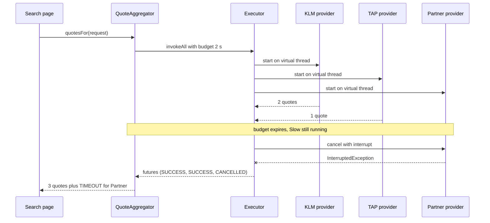

# Task 23 · A travel quote aggregator with deadlines

| Difficulty | Topics | Time box |
|---|---|---|
| 🔴 Hard | Concurrency for I/O fan-out: virtual threads, `ExecutorService.invokeAll` with a timeout, `Future.state()`, `resultNow()` and `exceptionNow()` (Java 19+) · Timeouts, cancellation and interruption · Partial results and failure reporting · Testing concurrent code deterministically with latches · Comparison with `CompletableFuture` and structured concurrency (preview) | 3–4 h |

> **Background reading:** JEP 444 (virtual threads) · JEP 505 (structured concurrency, fifth preview in JDK 25) · *Java Concurrency in Practice* ch. 6.3.7–6.3.8 ("Placing time limits on tasks", "Example: a travel reservations portal") and ch. 7.1 (interruption) · *Modern Java in Action* ch. 16 (`CompletableFuture`) · *Effective Java* Item 80 ("Prefer executors, tasks, and streams to threads")

---

## The situation

Our travel site asks 4 to 8 airline and partner APIs for quotes. The search page has a **2-second budget**. Today the code calls them one after another, so a search takes the sum of all the response times. That is slow.

A previous attempt used `CompletableFuture.supplyAsync` on the common pool. It was faster, but it had two problems. First, nothing cancelled the HTTP calls that were still running after the page had been rendered. Those calls ran for minutes and exhausted the connection pool. Second, the common pool is sized for CPU work, and blocking HTTP calls starved it.

What we need: **one provider that hangs must not slow the page beyond the budget, and its work must be cancelled.** A late provider is not an error for the whole search. We show the quotes we have, and we tell the page which providers did not answer.

## The domain

| Term | Meaning |
|---|---|
| **Trip request** | "AMS to LIS, departing 2027-03-01, 2 passengers". Airport codes are three uppercase letters (IATA). |
| **Quote** | One offer: a provider, a price with two decimals, and a flight number. |
| **Provider** | An airline or partner API. Its call is a plain blocking call. |
| **Budget** | The total time we are willing to wait for all providers together. |
| **Timeout failure** | The provider had not answered when the budget ended. We cancelled it. |
| **Error failure** | The provider answered with an exception, for example HTTP 503. |



The time budget looks like this with four providers. Three answer in time, and one hangs until the budget ends. Notice that every bar starts at zero. They run side by side, not one after another.

```mermaid
gantt
    title Search with a 2000 ms budget, all providers started at once
    dateFormat x
    axisFormat %S.%L s
    section Providers
    KLM answers after 300 ms       :done, k1, 0, 300
    TAP answers after 800 ms       :done, t1, 0, 800
    Iberia answers after 1500 ms   :done, i1, 0, 1500
    Partner hangs until budget     :crit, p1, 0, 2000
```



The bars show milliseconds. The whole search takes about 2000 ms. Sequential calls would take 300 + 800 + 1500 = 2600 ms for the three good providers alone, and they would never finish once the hanging one is reached.

## What I want from you

Implement [`QuoteAggregator`](../src/main/java/io/github/chris013/practice/task23/QuoteAggregator.java). The other types in the package are given and complete. Read them first, because they define the rules for the results.

1. **[`QuoteAggregator(providers, budget)`](../src/main/java/io/github/chris013/practice/task23/QuoteAggregator.java)**
   * `providers` and `budget` must not be `null`: `NullPointerException` naming the parameter.
   * An empty provider list is an `IllegalArgumentException`.
   * A budget that is zero or negative is an `IllegalArgumentException`.
   * Create your own executor with `Executors.newVirtualThreadPerTaskExecutor()`.
2. **`quotesFor(request)`** calls every provider at the same time.
   * The whole call returns after at most `budget`, measured once for all providers.
   * A provider that answers in time contributes its quotes to the result.
   * A provider that has not answered when the budget ends is cancelled **with interruption**. It is reported as a [`ProviderFailure`](../src/main/java/io/github/chris013/practice/task23/ProviderFailure.java) with reason `TIMEOUT`.
   * A provider that throws is reported as `ERROR`. Its detail is the exception's simple class name, a colon, and its message, for example `IOException: 503`. If there is no message, the detail is the class name alone.
   * A provider that throws an `Error` makes `quotesFor` rethrow it.
   * A `null` request is a `NullPointerException`.
   * If the calling thread is interrupted while it waits, the method throws `InterruptedException`.
3. **`close()`** shuts the executor down, so no virtual thread outlives the aggregator. A search that is still running when `close()` is called reports the interrupted providers as `ERROR` with detail `InterruptedException`.
4. The result is an [`AggregatedQuotes`](../src/main/java/io/github/chris013/practice/task23/AggregatedQuotes.java) (given). Its quotes are sorted by price, then provider name, then flight number. Its failures are sorted by provider name. `cheapest()` is empty when there are no quotes. `isComplete()` is true when there are no failures.
5. [`TripRequest`](../src/main/java/io/github/chris013/practice/task23/TripRequest.java) and [`Quote`](../src/main/java/io/github/chris013/practice/task23/Quote.java) (given) validate their input. Their rules are tested too, so you can see the boundaries.

## Constraints & non-goals

* **No CompletableFuture in the solution.** Read about it, and compare in the design section, but use `invokeAll`.
* **No `StructuredTaskScope`.** It is a preview API in JDK 25. It needs `--enable-preview`, and the project does not enable it. A sketch is in the reference solution.
* **No `Thread.sleep` in the tests** to "wait for" a thread. Use latches and barriers. The only sleep is inside the slow fake, and it is at most 50 ms.
* **No per-provider timeouts yet.** One overall budget is enough for this task. Per-provider budgets are a stretch goal.
* **Do not swallow `InterruptedException`.** If you catch it, you must either rethrow it or restore the interrupt flag.
* **Do not catch `Throwable`.** A provider can fail with an `Error`, such as `OutOfMemoryError`. That is not an answer from the provider, so `quotesFor` rethrows it instead of reporting it as a failure. Use the future's state, not a catch-all.

## How I'd approach it

* **Start with the timeline, not the code.** Draw the sequence diagram above for three providers, one of them hanging. Where does the budget start? Where does the cancel happen? Who waits?
* **Use `invokeAll(tasks, timeout, unit)`.** It does most of the work for you. It starts all tasks, waits at most the timeout, and cancels the tasks that are still running. The futures come back in the same order as the tasks, so you can match each future to its provider by index.
* **Use the future's state, not `get()`.** After `invokeAll`, every future is done. Switch on `future.state()`:
  * `SUCCESS`: `resultNow()` returns the value, with no checked exception.
  * `FAILED`: `exceptionNow()` returns the cause, with no checked exception.
  * `CANCELLED`: the budget ran out.

  `get()` wraps the cause in an `ExecutionException` and throws `CancellationException` for cancelled futures. Those are exceptions used as control flow, and each one needs a `catch`. The state switch is shorter, and the compiler reminds you of each case.
* **Why virtual threads?** A blocking HTTP call parks its thread until the response comes back. A platform thread is expensive, so a pool of 200 can run out. A virtual thread is cheap, and the JVM unmounts it while it waits. So one thread per provider call is fine, and the blocking code stays simple. This is what makes the old `supplyAsync` version unnecessary, and also why its common pool was the wrong choice.
* **Why cancellation must interrupt.** `Future.cancel(false)` only marks the future as cancelled. The provider's thread keeps running and keeps its connection. `cancel(true)` interrupts the thread, and a well-behaved HTTP client or a `CountDownLatch.await()` stops when it sees the interrupt. The provider contract in [`QuoteProvider`](../src/main/java/io/github/chris013/practice/task23/QuoteProvider.java) says exactly this.
* **Why the budget is overall, not per provider.** All providers start at the same moment, so the budget is one deadline. If you waited for each provider with its own `get(timeout)` in a loop, the waits would add up: four providers that all hang would cost four times the budget. `invokeAll` with one timeout gives you the right behaviour without arithmetic.
* **Why the caller's interrupt is not swallowed.** If the user closes the page, the thread running `quotesFor` is interrupted. That is information the caller needs. `Thread.currentThread().interrupt()` in a `catch` block is one way to keep it, but then the method still returns normally and the caller might keep working. Declaring `throws InterruptedException` is clearer: the caller gets an exception, the cancellation happens in `invokeAll`, and the caller decides what to do. Java clears the flag when it throws the exception, which is the standard convention.
* **Why `close()` cancels first.** `ExecutorService.close()` (Java 19+) waits for running tasks. `invokeAll` has already cancelled late providers, but a search may still be in progress on another thread. `shutdownNow()` interrupts those providers, and only then does `close()` wait for them to react. A provider that ignores interruption would still block `close()`, which is why the provider contract requires it to respond to interrupts.
* **Test with latches, not sleeps.** A hanging fake blocks on a `CountDownLatch` that is never released. The test waits until the provider has started, and until the cancellation has reached it. Both are signalled by a latch with a timeout. A sleep would make the test slow and flaky.
* **Keep the timing assertions loose.** The budget is 200 ms in the tests. Assert a range (for example, less than 1500 ms), not an exact time. Machines are noisy.

### Why not CompletableFuture?

`CompletableFuture` looks like the natural tool, because it has timeouts built in. `orTimeout(2, SECONDS)` completes the future exceptionally when the time is up. `completeOnTimeout(List.of(), 2, SECONDS)` completes it with a fallback value. Both only complete the future. The supplier keeps running. A `CompletableFuture` is not bound to a thread, so there is nothing to interrupt. `cancel(true)` ignores its argument, even when the supplier runs on a virtual-thread executor. The page gets its answer on time, but the HTTP call keeps its connection, which is the original bug.

| Approach | Wall time | Cancels late work | Blocking I/O OK | Stable API |
|---|---|---|---|---|
| Sequential | sum of all calls | no | yes | yes |
| `supplyAsync` on the common pool | about the budget | no | starves the pool | yes |
| `invokeAll` on virtual threads | about the budget | yes, with interrupt | yes | yes |
| `StructuredTaskScope` | about the budget | yes, with interrupt | yes | preview in JDK 25 |

`invokeAll` on virtual threads is the only row that cancels late work and has a stable API. It keeps the threads, so it can interrupt them.

## Tests

Run: `mvn test -Dtest='**/task23/**'`

[`QuoteAggregatorTest`](../src/test/java/io/github/chris013/practice/task23/QuoteAggregatorTest.java) covers the rules in the contract, with a nested class per group. [`ValueValidationTest`](../src/test/java/io/github/chris013/practice/task23/ValueValidationTest.java) covers the given validation rules. The helpers are in [`FakeProvider`](../src/test/java/io/github/chris013/practice/task23/FakeProvider.java): an answering provider, a failing provider, a slow provider, a barrier provider, and the hanging provider with its latches.

<details>
<summary>Show the tests</summary>

<!-- embed: src/test/java/io/github/chris013/practice/task23/QuoteAggregatorTest.java -->
**[`QuoteAggregatorTest.java`](../src/test/java/io/github/chris013/practice/task23/QuoteAggregatorTest.java)**

```java
package io.github.chris013.practice.task23;

import static io.github.chris013.practice.task23.FakeProvider.answering;
import static io.github.chris013.practice.task23.FakeProvider.answeringAfter;
import static io.github.chris013.practice.task23.FakeProvider.failing;
import static io.github.chris013.practice.task23.FakeProvider.failingWith;
import static io.github.chris013.practice.task23.FakeProvider.quote;
import static io.github.chris013.practice.task23.FakeProvider.slowAnswering;
import static io.github.chris013.practice.task23.FakeProvider.throwingError;
import static org.assertj.core.api.Assertions.assertThat;
import static org.assertj.core.api.Assertions.assertThatThrownBy;

import io.github.chris013.practice.task23.FakeProvider.Hanging;
import io.github.chris013.practice.task23.ProviderFailure.Reason;
import java.math.BigDecimal;
import java.time.Duration;
import java.time.LocalDate;
import java.util.List;
import java.util.concurrent.CyclicBarrier;
import java.util.concurrent.atomic.AtomicReference;
import org.assertj.core.groups.Tuple;
import org.junit.jupiter.api.Nested;
import org.junit.jupiter.api.Test;
import org.junit.jupiter.params.ParameterizedTest;
import org.junit.jupiter.params.provider.CsvSource;

class QuoteAggregatorTest {

    private static final TripRequest REQUEST = new TripRequest("AMS", "LIS", LocalDate.of(2027, 3, 1), 2);
    private static final Duration BUDGET = Duration.ofMillis(200);

    @Nested
    class AllProvidersAnswer {

        @Test
        void returns_all_quotes_sorted_by_price_and_is_complete() throws Exception {
            try (var aggregator = new QuoteAggregator(List.of(
                    answering("KLM", quote("KLM", "149.00", "KL1601")),
                    answering("TAP", quote("TAP", "99.90", "TP1234"), quote("TAP", "120.00", "TP1236"))), BUDGET)) {

                AggregatedQuotes result = aggregator.quotesFor(REQUEST);

                assertThat(result.quotes()).extracting(Quote::price).containsExactly(
                        new BigDecimal("99.90"), new BigDecimal("120.00"),
                        new BigDecimal("149.00"));
                assertThat(result.failures()).isEmpty();
                assertThat(result.isComplete()).isTrue();
                assertThat(result.cheapest()).map(Quote::provider).contains("TAP");
            }
        }

        @Test
        void breaks_price_ties_by_provider_name_then_flight_number() throws Exception {
            try (var aggregator = new QuoteAggregator(List.of(
                    answering("Iberia", quote("Iberia", "100.00", "IB2")),
                    answering("Air France", quote("Air France", "100.00", "AF9")),
                    answering("Iberia Express", quote("Iberia", "100.00", "IB1"))), BUDGET)) {

                AggregatedQuotes result = aggregator.quotesFor(REQUEST);

                assertThat(result.quotes()).extracting(Quote::provider, Quote::flightNumber).containsExactly(
                        Tuple.tuple("Air France", "AF9"),
                        Tuple.tuple("Iberia", "IB1"),
                        Tuple.tuple("Iberia", "IB2"));
            }
        }

        @Test
        void has_no_cheapest_quote_when_nobody_quoted() throws Exception {
            try (var aggregator = new QuoteAggregator(List.of(answering("Empty")), BUDGET)) {
                assertThat(aggregator.quotesFor(REQUEST).cheapest()).isEmpty();
            }
        }
    }

    @Nested
    class OneProviderFails {

        @Test
        void keeps_the_other_quotes_and_reports_the_error_with_its_message() throws Exception {
            try (var aggregator = new QuoteAggregator(List.of(
                    failing("Broken"),
                    answering("TAP", quote("TAP", "99.90", "TP1234"))), BUDGET)) {

                AggregatedQuotes result = aggregator.quotesFor(REQUEST);

                assertThat(result.quotes()).extracting(Quote::provider).containsExactly("TAP");
                assertThat(result.failures()).containsExactly(
                        new ProviderFailure("Broken", Reason.ERROR, "IOException: 503"));
                assertThat(result.isComplete()).isFalse();
            }
        }

        @Test
        void gives_no_quotes_and_no_cheapest_when_every_provider_fails() throws Exception {
            try (var aggregator = new QuoteAggregator(List.of(failing("A"), failing("B")), BUDGET)) {

                AggregatedQuotes result = aggregator.quotesFor(REQUEST);

                assertThat(result.quotes()).isEmpty();
                assertThat(result.cheapest()).isEmpty();
                assertThat(result.failures()).extracting(ProviderFailure::provider).containsExactly("A", "B");
            }
        }

        @Test
        void reports_only_the_class_name_when_the_exception_has_no_message() throws Exception {
            try (var aggregator = new QuoteAggregator(List.of(
                    failingWith("Silent", new IllegalStateException())), BUDGET)) {

                AggregatedQuotes result = aggregator.quotesFor(REQUEST);

                assertThat(result.failures()).containsExactly(
                        new ProviderFailure("Silent", Reason.ERROR, "IllegalStateException"));
            }
        }

        @Test
        void an_error_in_a_provider_is_not_turned_into_a_failure() throws Exception {
            try (var aggregator = new QuoteAggregator(List.of(throwingError("Broken")), BUDGET)) {
                assertThatThrownBy(() -> aggregator.quotesFor(REQUEST))
                        .isInstanceOf(StackOverflowError.class);
            }
        }
    }

    @Nested
    class TimeBudget {

        @Test
        void a_hanging_provider_is_reported_as_timeout_after_about_the_budget() throws Exception {
            Hanging hanging = FakeProvider.hanging("Stuck");
            try (var aggregator = new QuoteAggregator(List.of(hanging), BUDGET)) {
                long start = System.nanoTime();

                AggregatedQuotes result = aggregator.quotesFor(REQUEST);

                Duration elapsed = Duration.ofNanos(System.nanoTime() - start);
                assertThat(elapsed).isLessThan(Duration.ofMillis(1_500));
                assertThat(elapsed).isGreaterThanOrEqualTo(Duration.ofMillis(150));
                assertThat(result.quotes()).isEmpty();
                assertThat(result.failures()).extracting(ProviderFailure::reason).containsExactly(Reason.TIMEOUT);
            }
        }

        @Test
        void a_hanging_provider_is_interrupted_when_the_budget_expires() throws Exception {
            Hanging hanging = FakeProvider.hanging("Stuck");
            try (var aggregator = new QuoteAggregator(List.of(hanging), BUDGET)) {
                aggregator.quotesFor(REQUEST);

                assertThat(hanging.awaitInterrupted(Duration.ofSeconds(1))).isTrue();
            }
        }

        @Test
        void keeps_a_provider_that_answers_within_the_budget() throws Exception {
            try (var aggregator = new QuoteAggregator(List.of(
                    slowAnswering("Slow", Duration.ofMillis(50), quote("Slow", "80.00", "SL1")),
                    FakeProvider.hanging("Stuck")), BUDGET)) {

                AggregatedQuotes result = aggregator.quotesFor(REQUEST);

                assertThat(result.quotes()).extracting(Quote::provider).containsExactly("Slow");
                assertThat(result.failures()).extracting(ProviderFailure::provider).containsExactly("Stuck");
            }
        }

        @Test
        void the_budget_is_shared_by_all_providers_not_added_up_per_provider() throws Exception {
            // Four hanging providers. Waiting for each one in turn with its own timeout would take 4 x 200 ms.
            try (var aggregator = new QuoteAggregator(List.of(
                    FakeProvider.hanging("A"), FakeProvider.hanging("B"),
                    FakeProvider.hanging("C"), FakeProvider.hanging("D")), BUDGET)) {
                long start = System.nanoTime();

                AggregatedQuotes result = aggregator.quotesFor(REQUEST);

                Duration elapsed = Duration.ofNanos(System.nanoTime() - start);
                assertThat(elapsed).isLessThan(Duration.ofMillis(700));
                assertThat(result.failures()).hasSize(4);
            }
        }
    }

    @Nested
    class Parallelism {

        @Test
        void providers_run_at_the_same_time() throws Exception {
            // If the providers ran one after another, the first would wait at the barrier until the budget
            // expired, and the result would not be complete.
            CyclicBarrier barrier = new CyclicBarrier(5);
            List<QuoteProvider> providers = List.of(
                    answeringAfter("P1", barrier, quote("P1", "10.00", "F1")),
                    answeringAfter("P2", barrier, quote("P2", "10.00", "F2")),
                    answeringAfter("P3", barrier, quote("P3", "10.00", "F3")),
                    answeringAfter("P4", barrier, quote("P4", "10.00", "F4")),
                    answeringAfter("P5", barrier, quote("P5", "10.00", "F5")));
            try (var aggregator = new QuoteAggregator(providers, Duration.ofSeconds(1))) {

                AggregatedQuotes result = aggregator.quotesFor(REQUEST);

                assertThat(result.quotes()).hasSize(5);
                assertThat(result.isComplete()).isTrue();
            }
        }
    }

    @Nested
    class CallerInterrupted {

        @Test
        void throws_interrupted_exception_and_cancels_the_providers() throws Exception {
            Hanging hanging = FakeProvider.hanging("Stuck");
            AtomicReference<InterruptedException> thrown = new AtomicReference<>();
            try (var aggregator = new QuoteAggregator(List.of(hanging), Duration.ofSeconds(10))) {
                Thread caller = Thread.ofVirtual().start(() -> {
                    try {
                        aggregator.quotesFor(REQUEST);
                    } catch (InterruptedException e) {
                        thrown.set(e);
                    }
                });

                assertThat(hanging.awaitStarted(Duration.ofSeconds(1))).isTrue();
                caller.interrupt();

                assertThat(caller.join(Duration.ofSeconds(2))).isTrue();
                assertThat(thrown.get()).isInstanceOf(InterruptedException.class);
                assertThat(hanging.awaitInterrupted(Duration.ofSeconds(1))).isTrue();
            }
        }
    }

    @Nested
    class Closing {

        @Test
        void close_interrupts_a_search_that_is_still_running() throws Exception {
            Hanging hanging = FakeProvider.hanging("Stuck");
            var aggregator = new QuoteAggregator(List.of(hanging), Duration.ofSeconds(10));
            try {
                AtomicReference<AggregatedQuotes> result = new AtomicReference<>();
                Thread caller = Thread.ofVirtual().start(() -> {
                    try {
                        result.set(aggregator.quotesFor(REQUEST));
                    } catch (InterruptedException e) {
                        Thread.currentThread().interrupt();
                    }
                });
                assertThat(hanging.awaitStarted(Duration.ofSeconds(1))).isTrue();

                Thread closer = Thread.ofVirtual().start(aggregator::close);

                assertThat(hanging.awaitInterrupted(Duration.ofSeconds(1))).isTrue();
                assertThat(closer.join(Duration.ofSeconds(1))).isTrue();
                assertThat(caller.join(Duration.ofSeconds(1))).isTrue();
                assertThat(result.get().failures())
                        .containsExactly(new ProviderFailure("Stuck", Reason.ERROR, "InterruptedException"));
            } finally {
                aggregator.close(); // closing twice is harmless
            }
        }
    }

    @Nested
    class Construction {

        @Test
        void rejects_a_null_budget_naming_the_parameter() {
            assertThatThrownBy(() -> new QuoteAggregator(List.of(answering("A")), null))
                    .isInstanceOf(NullPointerException.class)
                    .hasMessageContaining("budget");
        }

        @Test
        void rejects_an_empty_provider_list() {
            assertThatThrownBy(() -> new QuoteAggregator(List.of(), BUDGET))
                    .isInstanceOf(IllegalArgumentException.class);
        }

        @Test
        void rejects_null_providers_naming_the_parameter() {
            assertThatThrownBy(() -> new QuoteAggregator(null, BUDGET))
                    .isInstanceOf(NullPointerException.class)
                    .hasMessageContaining("providers");
        }

        @ParameterizedTest
        @CsvSource({"0", "-1"})
        void rejects_a_budget_that_is_not_positive(long millis) {
            assertThatThrownBy(() -> new QuoteAggregator(List.of(answering("A")), Duration.ofMillis(millis)))
                    .isInstanceOf(IllegalArgumentException.class);
        }

        @Test
        void rejects_a_null_request() throws Exception {
            try (var aggregator = new QuoteAggregator(List.of(answering("A")), BUDGET)) {
                assertThatThrownBy(() -> aggregator.quotesFor(null))
                        .isInstanceOf(NullPointerException.class)
                        .hasMessageContaining("request");
            }
        }
    }
}
```
<!-- /embed -->

<!-- embed: src/test/java/io/github/chris013/practice/task23/FakeProvider.java -->
**[`FakeProvider.java`](../src/test/java/io/github/chris013/practice/task23/FakeProvider.java)**

```java
package io.github.chris013.practice.task23;

import java.io.IOException;
import java.math.BigDecimal;
import java.time.Duration;
import java.util.List;
import java.util.concurrent.BrokenBarrierException;
import java.util.concurrent.CountDownLatch;
import java.util.concurrent.CyclicBarrier;
import java.util.concurrent.TimeUnit;
import java.util.concurrent.atomic.AtomicBoolean;

/** Hand-written provider fakes. Each factory method describes one behaviour. */
final class FakeProvider implements QuoteProvider {

    @FunctionalInterface
    interface Behaviour {
        List<Quote> respond(TripRequest request) throws Exception;
    }

    private final String name;
    private final Behaviour behaviour;

    private FakeProvider(String name, Behaviour behaviour) {
        this.name = name;
        this.behaviour = behaviour;
    }

    static Quote quote(String provider, String price, String flight) {
        return new Quote(provider, new BigDecimal(price), flight);
    }

    static QuoteProvider answering(String name, Quote... quotes) {
        List<Quote> answer = List.of(quotes);
        return new FakeProvider(name, request -> answer);
    }

    static QuoteProvider failing(String name) {
        return failingWith(name, new IOException("503"));
    }

    static QuoteProvider failingWith(String name, Exception failure) {
        return new FakeProvider(name, request -> {
            throw failure;
        });
    }

    static QuoteProvider throwingError(String name) {
        return new FakeProvider(name, request -> {
            throw new StackOverflowError("test");
        });
    }

    /** Answers after a short delay. Keep the delay well below the budget used in the test. */
    static QuoteProvider slowAnswering(String name, Duration delay, Quote... quotes) {
        List<Quote> answer = List.of(quotes);
        return new FakeProvider(name, request -> {
            Thread.sleep(delay.toMillis());
            return answer;
        });
    }

    /** Waits on a barrier, so it only answers if all barrier parties are running at the same time. */
    static QuoteProvider answeringAfter(String name, CyclicBarrier barrier, Quote quote) {
        return new FakeProvider(name, request -> {
            barrier.await(1, TimeUnit.SECONDS);
            return List.of(quote);
        });
    }

    static Hanging hanging(String name) {
        return new Hanging(name);
    }

    @Override
    public String name() {
        return name;
    }

    @Override
    public List<Quote> quotesFor(TripRequest request) throws Exception {
        return behaviour.respond(request);
    }

    /** Never answers. Records whether it was interrupted, so a test can check the cancellation. */
    static final class Hanging implements QuoteProvider {

        private final String name;
        private final CountDownLatch started = new CountDownLatch(1);
        private final CountDownLatch neverReleased = new CountDownLatch(1);
        private final CountDownLatch interruptedSignal = new CountDownLatch(1);
        private final AtomicBoolean interrupted = new AtomicBoolean();

        private Hanging(String name) {
            this.name = name;
        }

        @Override
        public String name() {
            return name;
        }

        @Override
        public List<Quote> quotesFor(TripRequest request) throws InterruptedException {
            started.countDown();
            try {
                neverReleased.await();
                return List.of();
            } catch (InterruptedException e) {
                interrupted.set(true);
                interruptedSignal.countDown();
                throw e;
            }
        }

        /** Waits until this provider has started running, so the test does not race the start. */
        boolean awaitStarted(Duration timeout) throws InterruptedException {
            return started.await(timeout.toMillis(), TimeUnit.MILLISECONDS);
        }

        /** Waits until the cancellation has reached this provider. The interrupt is asynchronous. */
        boolean awaitInterrupted(Duration timeout) throws InterruptedException {
            return interruptedSignal.await(timeout.toMillis(), TimeUnit.MILLISECONDS) && interrupted.get();
        }
    }
}
```
<!-- /embed -->

<!-- embed: src/test/java/io/github/chris013/practice/task23/ValueValidationTest.java -->
**[`ValueValidationTest.java`](../src/test/java/io/github/chris013/practice/task23/ValueValidationTest.java)**

```java
package io.github.chris013.practice.task23;

import static org.assertj.core.api.Assertions.assertThatThrownBy;

import java.math.BigDecimal;
import java.time.LocalDate;
import org.junit.jupiter.api.Test;
import org.junit.jupiter.params.ParameterizedTest;
import org.junit.jupiter.params.provider.CsvSource;

class ValueValidationTest {

    private static final LocalDate DEPARTURE = LocalDate.of(2027, 3, 1);

    @ParameterizedTest
    @CsvSource({"am,LIS,1", "AMSS,LIS,1", "AM,LIS,1", "AMS,LIS,0", "AMS,LIS,10"})
    void rejects_a_bad_iata_code_or_passenger_count(String from, String to, int passengers) {
        assertThatThrownBy(() -> new TripRequest(from, to, DEPARTURE, passengers))
                .isInstanceOf(IllegalArgumentException.class);
    }

    @Test
    void accepts_the_boundaries_of_the_passenger_count() {
        new TripRequest("AMS", "LIS", DEPARTURE, 1);
        new TripRequest("AMS", "LIS", DEPARTURE, 9);
    }

    @ParameterizedTest
    @CsvSource({"0.00", "-1.00", "12", "12.5", "12.000"})
    void rejects_a_price_that_is_not_positive_with_exactly_two_decimals(String price) {
        assertThatThrownBy(() -> new Quote("TAP", new BigDecimal(price), "TP1"))
                .isInstanceOf(IllegalArgumentException.class);
    }

    @Test
    void accepts_a_price_with_two_decimals() {
        new Quote("TAP", new BigDecimal("0.01"), "TP1");
    }
}
```
<!-- /embed -->

</details>

## Definition of done

- [ ] All tests green, and the whole task 23 test run finishes in well under 5 seconds.
- [ ] A hanging provider does not delay the result beyond the budget, and it is interrupted.
- [ ] Providers run in parallel, and the budget is shared, not added up.
- [ ] No `Thread.sleep` in your code or in the tests, except inside the slow fake.
- [ ] No `InterruptedException` is swallowed, and `close()` shuts the executor down.
- [ ] Your PR description says why you chose `invokeAll` over `CompletableFuture` for this workload.

## Stretch goals

1. Add per-provider budgets on top of the overall budget. A provider can have its own shorter limit, and the overall budget still applies.
2. Return the quotes that arrived so far progressively, for example through a callback, so the page can show the first results while the others are still running.
3. Add hedged requests: if the first call to a provider is slow, start a second call to another instance of it, and use whichever answers first.
4. Add a circuit breaker for a provider that timed out five times in a row. Link it to the decorators in [task 07](07-exchange-rate-decorators.md). Should the breaker wrap the provider, or the whole aggregator?

---

## Reference solution

<details>
<summary>Spoiler: open only after you have made a serious attempt</summary>

### Key decisions

**1. One virtual thread per provider call.** The executor is `Executors.newVirtualThreadPerTaskExecutor()`. A blocking HTTP call is fine there. We do not use the common pool, which is sized for CPU work, and we do not use a fixed pool, where a few hanging calls would block the others.

**2. `invokeAll` with one timeout.** It starts every task, waits at most the budget in total, and cancels what is still running with interruption. We get the timeout and the cancellation from one call. The alternative, a `get(timeout)` loop, adds up the waits, as explained above.

**3. Map each future by its state.** `state()` tells us exactly what happened, and `resultNow()` and `exceptionNow()` are safe to call after the matching state. The alternative, `get()` with a `try` block for `ExecutionException` and `CancellationException`, hides the cases and makes the code longer.

**4. Keep the provider for each future by index.** `invokeAll` returns the futures in the order of the tasks, so `providers.get(i)` names the provider. The alternative, a map from future to provider, is extra state for no gain.

**5. Declare `InterruptedException` on `quotesFor`.** The caller decides what an interrupt means. We do not catch it and return a partial result, because that would make a shutdown look like a normal search. Rethrowing `CancellationException` would hide the interrupt inside an unchecked exception that callers forget to handle.

**6. `close()` cancels, then waits.** `invokeAll` has already cancelled late providers, but a search may still be in progress on another thread. `shutdownNow()` interrupts its providers, and `close()` then waits until they have reacted. A provider that ignores interruption would still block `close()`. That is why the provider contract requires it to respond to interrupts.

**7. Sorting lives in the result record.** `AggregatedQuotes` sorts its lists in the compact constructor. Every caller gets the same order, and the page does not have to remember to sort.

### Code

<!-- embed: solutions/src/main/java/io/github/chris013/practice/task23/QuoteAggregator.java -->
**[`QuoteAggregator.java`](../solutions/src/main/java/io/github/chris013/practice/task23/QuoteAggregator.java)**

```java
package io.github.chris013.practice.task23;

import io.github.chris013.practice.task23.ProviderFailure.Reason;
import java.time.Duration;
import java.util.ArrayList;
import java.util.List;
import java.util.Objects;
import java.util.concurrent.Callable;
import java.util.concurrent.ExecutorService;
import java.util.concurrent.Executors;
import java.util.concurrent.Future;
import java.util.concurrent.TimeUnit;

/**
 * Asks all providers at the same time and returns after at most {@code budget}.
 *
 * <p>Each provider runs on its own virtual thread. Virtual threads make a blocking HTTP call cheap, so we
 * can simply block and let the scheduler park the thread. The budget is one deadline for the whole search,
 * not one per provider: all providers start at the same moment, so the slowest one decides the wait.
 *
 * <p>Task 23: read {@code tasks/23-quote-aggregator.md} first.
 */
public final class QuoteAggregator implements AutoCloseable {

    private final List<QuoteProvider> providers;
    private final Duration budget;
    private final ExecutorService executor;

    /**
     * @throws IllegalArgumentException if {@code providers} is empty or {@code budget} is not positive
     */
    public QuoteAggregator(List<QuoteProvider> providers, Duration budget) {
        Objects.requireNonNull(providers, "providers");
        Objects.requireNonNull(budget, "budget");
        if (providers.isEmpty()) {
            throw new IllegalArgumentException("At least one quote provider is needed");
        }
        if (budget.isNegative() || budget.isZero()) {
            throw new IllegalArgumentException("The budget must be positive, got " + budget);
        }
        this.providers = List.copyOf(providers);
        this.budget = budget;
        // Created last, so a failed validation above does not leak an executor.
        this.executor = Executors.newVirtualThreadPerTaskExecutor();
    }

    /**
     * Calls every provider concurrently and waits at most the budget in total. Providers that have not
     * answered by then are cancelled with interruption and reported as {@link Reason#TIMEOUT}.
     *
     * <p>We declare {@code InterruptedException} instead of swallowing it. If the caller's thread is
     * interrupted, {@code invokeAll} cancels the provider tasks too, and the caller decides what to do.
     *
     * @throws InterruptedException if the calling thread is interrupted while waiting
     */
    public AggregatedQuotes quotesFor(TripRequest request) throws InterruptedException {
        Objects.requireNonNull(request, "request");
        List<Callable<List<Quote>>> tasks = providers.stream()
                .<Callable<List<Quote>>>map(provider -> () -> provider.quotesFor(request))
                .toList();

        // invokeAll returns once every task is done, or when the budget runs out. Unfinished tasks are
        // cancelled with interruption. The futures come back in the same order as the tasks.
        List<Future<List<Quote>>> futures = executor.invokeAll(tasks, budget.toNanos(), TimeUnit.NANOSECONDS);

        List<Quote> quotes = new ArrayList<>();
        List<ProviderFailure> failures = new ArrayList<>();
        for (int i = 0; i < futures.size(); i++) {
            String provider = providers.get(i).name();
            Future<List<Quote>> future = futures.get(i);
            switch (future.state()) {
                case SUCCESS -> quotes.addAll(future.resultNow());
                case FAILED -> {
                    Throwable cause = future.exceptionNow();
                    if (cause instanceof Error error) {
                        throw error; // a broken JVM or library, not an answer from the provider
                    }
                    failures.add(new ProviderFailure(provider, Reason.ERROR, describe(cause)));
                }
                case CANCELLED -> failures.add(new ProviderFailure(
                        provider, Reason.TIMEOUT, "no answer within " + budget.toMillis() + " ms"));
                case RUNNING -> throw new IllegalStateException("invokeAll returned before " + provider + " finished");
            }
        }
        return new AggregatedQuotes(quotes, failures);
    }

    /**
     * Shuts the executor down. {@code shutdownNow()} interrupts the providers that are still running, and
     * {@code close()} then waits until they have reacted. A provider that ignores interruption would still
     * block {@code close()}.
     */
    @Override
    public void close() {
        executor.shutdownNow();
        executor.close();
    }

    private static String describe(Throwable failure) {
        String type = failure.getClass().getSimpleName();
        return failure.getMessage() == null ? type : type + ": " + failure.getMessage();
    }
}
```
<!-- /embed -->

### Sketch: the same idea with `StructuredTaskScope`

This is a sketch, not code you can compile without `--enable-preview`. The project does not enable preview features, so it is not compiled here.

```java
final class CollectAll implements Joiner<List<Quote>, Void> {
    final Queue<Subtask<? extends List<Quote>>> finished = new ConcurrentLinkedQueue<>();
    @Override public boolean onComplete(Subtask<? extends List<Quote>> subtask) { finished.add(subtask); return false; }
    @Override public Void result() { return null; }
}

var joiner = new CollectAll();
try (var scope = StructuredTaskScope.open(joiner, cf -> cf.withTimeout(budget))) {
    providers.forEach(p -> scope.fork(() -> p.quotesFor(request)));
    try {
        scope.join();
    } catch (StructuredTaskScope.TimeoutException e) {
        // the scope is cancelled: unfinished subtasks are interrupted
    }
}
// joiner.finished holds SUCCESS/FAILED subtasks; every provider not in it is a TIMEOUT
```

The structure is attractive. The scope owns the threads, so they cannot outlive it, and the deadline is a property of the scope. It is still a preview API in JDK 25, and it changes between previews. With JDK 25's timeout, unfinished subtasks end up `UNAVAILABLE`, and `Subtask.get()` cannot be used for partial results after a timeout. That is why the joiner collects the finished subtasks itself. It is one more reason to wait for the API to become final, and to use the stable `invokeAll` today.

### What I typically flag in first attempts

| Finding | Why it matters |
|---|---|
| `CompletableFuture.supplyAsync(...)` with no executor | Runs on the common pool, which is sized for CPU work. Blocking calls starve it. Pass a virtual-thread executor, or use `invokeAll`. |
| `future.cancel(false)` or no cancel at all | The provider keeps running and holding its connection. The bug in the situation section is exactly this. Use `cancel(true)` or `invokeAll` timeouts. |
| `catch (InterruptedException e) {}` | The caller can no longer tell that it was asked to stop. Rethrow it, or restore the flag with `Thread.currentThread().interrupt()`. |
| `get(timeout)` in a loop over providers | Each wait adds to the total: four hanging providers cost four budgets, not one. Use one deadline for all. |
| `catch (Throwable t)` around each provider | It hides `Error`s such as `OutOfMemoryError`. Use the future's state, and rethrow real errors. |
| `Thread.sleep(500)` in the test "to let the threads finish" | Slow and flaky. Use a latch, and wait for the signal with a timeout. |
| `CompletableFuture.cancel(true)` expected to stop the work | It does not interrupt the running task. The supplier keeps running. Only futures that own a thread (the `FutureTask`s returned by `ExecutorService.submit`/`invokeAll`) interrupt on `cancel(true)`. |

</details>
