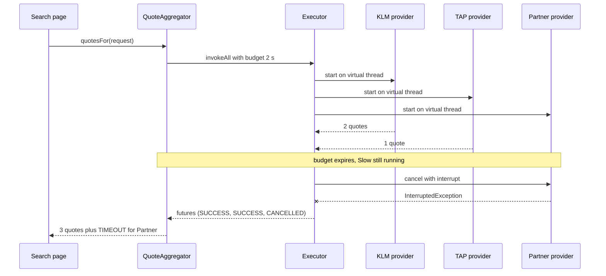

# Task 23 · A travel quote aggregator with deadlines

| Difficulty | Topics | Time box |
|---|---|---|
| 🔴 Hard | Concurrency for I/O fan-out: virtual threads, `ExecutorService.invokeAll` with a timeout, `Future.state()`, `resultNow()` and `exceptionNow()` (Java 19+) · Timeouts, cancellation and interruption · Partial results and failure reporting · Testing concurrent code deterministically with latches · Comparison with `CompletableFuture` and structured concurrency (preview) | 3–4 h |

> **Background reading:** JEP 444 (virtual threads) · JEP 505 (structured concurrency, fifth preview in JDK 25) · *Java Concurrency in Practice* ch. 6.3 ("Placing time limits on tasks") and ch. 7.1 (interruption) · *Modern Java in Action* ch. 16 (`CompletableFuture`) · *Effective Java* Item 80 ("Prefer executors, tasks, and streams to threads")

---

## The situation

Our travel site asks 4 to 8 airline and partner APIs for quotes. The search page has a **2-second budget**. Today the code calls them one after another, so a search takes the sum of all the response times. That is slow.

A previous attempt used `CompletableFuture.supplyAsync` on the common pool. It was faster, but it had two problems. First, nothing cancelled the HTTP calls that were still running after the page had been rendered. Those calls ran for minutes and exhausted the connection pool. Second, the common pool is sized for CPU work, and blocking HTTP calls starved it.

What we need: **one provider that hangs must not slow the page beyond the budget, and its work must be cancelled.** A late provider is not an error for the whole search. We show the quotes we have, and we tell the page which providers did not answer.

## The domain

| Term | Meaning |
|---|---|
| **Trip request** | "AMS to LIS, departing 2027-03-01, 2 passengers". Airport codes are three uppercase letters (IATA). |
| **Quote** | One offer: a provider, a price with two decimals, and a flight number. |
| **Provider** | An airline or partner API. Its call is a plain blocking call. |
| **Budget** | The total time we are willing to wait for all providers together. |
| **Timeout failure** | The provider had not answered when the budget ended. We cancelled it. |
| **Error failure** | The provider answered with an exception, for example HTTP 503. |



The time budget looks like this with four providers. Three answer in time, and one hangs until the budget ends. Notice that every bar starts at zero. They run side by side, not one after another.

```mermaid
gantt
    title Search with a 2000 ms budget, all providers started at once
    dateFormat x
    section Providers
    ECB answers after 300 ms       :done, e1, 0, 300
    Backup answers after 800 ms    :done, b1, 0, 800
    Airline answers after 1500 ms  :done, a1, 0, 1500
    Partner hangs until budget     :crit, p1, 0, 2000
```



The bars show milliseconds. The whole search takes about 2000 ms. Sequential calls would take 300 + 800 + 1500 = 2600 ms for the three good providers alone, and they would never finish once the hanging one is reached.

## What I want from you

Implement [`QuoteAggregator`](../src/main/java/io/github/chris013/practice/task23/QuoteAggregator.java). The other types in the package are given and complete. Read them first, because they define the rules for the results.

1. **[`QuoteAggregator(providers, budget)`](../src/main/java/io/github/chris013/practice/task23/QuoteAggregator.java)**
   * `providers` and `budget` must not be `null`: `NullPointerException` naming the parameter.
   * An empty provider list is an `IllegalArgumentException`.
   * A budget that is zero or negative is an `IllegalArgumentException`.
   * Create your own executor with `Executors.newVirtualThreadPerTaskExecutor()`.
2. **`quotesFor(request)`** calls every provider at the same time.
   * The whole call returns after at most `budget`, measured once for all providers.
   * A provider that answers in time contributes its quotes to the result.
   * A provider that has not answered when the budget ends is cancelled **with interruption**. It is reported as a [`ProviderFailure`](../src/main/java/io/github/chris013/practice/task23/ProviderFailure.java) with reason `TIMEOUT`.
   * A provider that throws is reported as `ERROR`. Its detail is the exception's simple class name, a colon, and its message, for example `IOException: 503`. If there is no message, the detail is the class name alone.
   * A `null` request is a `NullPointerException`.
   * If the calling thread is interrupted while it waits, the method throws `InterruptedException`.
3. **`close()`** shuts the executor down, so no virtual thread outlives the aggregator.
4. The result is an [`AggregatedQuotes`](../src/main/java/io/github/chris013/practice/task23/AggregatedQuotes.java) (given). Its quotes are sorted by price, then provider name, then flight number. Its failures are sorted by provider name. `cheapest()` is empty when there are no quotes. `isComplete()` is true when there are no failures.
5. [`TripRequest`](../src/main/java/io/github/chris013/practice/task23/TripRequest.java) and [`Quote`](../src/main/java/io/github/chris013/practice/task23/Quote.java) (given) validate their input. Their rules are tested too, so you can see the boundaries.

## Constraints & non-goals

* **No CompletableFuture in the solution.** Read about it, and compare in the design section, but use `invokeAll`.
* **No `StructuredTaskScope`.** It is a preview API in JDK 25. It needs `--enable-preview`, and the project does not enable it. A sketch is in the reference solution.
* **No `Thread.sleep` in the tests** to "wait for" a thread. Use latches and barriers. The only sleep is inside the slow fake, and it is at most 50 ms.
* **No per-provider timeouts yet.** One overall budget is enough for this task. Per-provider budgets are a stretch goal.
* **Do not swallow `InterruptedException`.** If you catch it, you must either rethrow it or restore the interrupt flag.
* **Do not catch `Throwable`.** A provider can fail with an `Error`, and that should not be hidden either. Use the future's state, not a catch-all.

## How I'd approach it

* **Start with the timeline, not the code.** Draw the sequence diagram above for three providers, one of them hanging. Where does the budget start? Where does the cancel happen? Who waits?
* **Use `invokeAll(tasks, timeout, unit)`.** It does most of the work for you. It starts all tasks, waits at most the timeout, and cancels the tasks that are still running. The futures come back in the same order as the tasks, so you can match each future to its provider by index.
* **Use the future's state, not `get()`.** After `invokeAll`, every future is done. Switch on `future.state()`:
  * `SUCCESS`: `resultNow()` returns the value, with no checked exception.
  * `FAILED`: `exceptionNow()` returns the cause, with no checked exception.
  * `CANCELLED`: the budget ran out.

  `get()` wraps the cause in an `ExecutionException` and throws `CancellationException` for cancelled futures. Those are exceptions used as control flow, and each one needs a `catch`. The state switch is shorter, and the compiler reminds you of each case.
* **Why virtual threads?** A blocking HTTP call parks its thread until the response comes back. A platform thread is expensive, so a pool of 200 can run out. A virtual thread is cheap, and the JVM unmounts it while it waits. So one thread per provider call is fine, and the blocking code stays simple. This is what makes the old `supplyAsync` version unnecessary, and also why its common pool was the wrong choice.
* **Why cancellation must interrupt.** `Future.cancel(false)` only marks the future as cancelled. The provider's thread keeps running and keeps its connection. `cancel(true)` interrupts the thread, and a well-behaved HTTP client or a `CountDownLatch.await()` stops when it sees the interrupt. The provider contract in [`QuoteProvider`](../src/main/java/io/github/chris013/practice/task23/QuoteProvider.java) says exactly this.
* **Why the budget is overall, not per provider.** All providers start at the same moment, so the budget is one deadline. If you waited for each provider with its own `get(timeout)` in a loop, the waits would add up: four providers that all hang would cost four times the budget. `invokeAll` with one timeout gives you the right behaviour without arithmetic.
* **Why the caller's interrupt is not swallowed.** If the user closes the page, the thread running `quotesFor` is interrupted. That is information the caller needs. `Thread.currentThread().interrupt()` in a `catch` block is one way to keep it, but then the method still returns normally and the caller might keep working. Declaring `throws InterruptedException` is clearer: the caller gets an exception, the cancellation happens in `invokeAll`, and the caller decides what to do. Java clears the flag when it throws the exception, which is the standard convention.
* **Why `close()` cancels first.** `ExecutorService.close()` (Java 19+) waits for running tasks. If a provider ignores interruption, `close()` waits forever. Calling `shutdownNow()` first interrupts the tasks, and only then does `close()` wait for them.
* **Test with latches, not sleeps.** A hanging fake blocks on a `CountDownLatch` that is never released. The test waits until the provider has started, and until the cancellation has reached it. Both are signalled by a latch with a timeout. A sleep would make the test slow and flaky.
* **Keep the timing assertions loose.** The budget is 200 ms in the tests. Assert a range (for example, less than 1500 ms), not an exact time. Machines are noisy.

## Tests

Run: `mvn test -Dtest='**/task23/**'`

[`QuoteAggregatorTest`](../src/test/java/io/github/chris013/practice/task23/QuoteAggregatorTest.java) covers the rules in the contract, with a nested class per group. [`ValueValidationTest`](../src/test/java/io/github/chris013/practice/task23/ValueValidationTest.java) covers the given validation rules. The helpers are in [`FakeProvider`](../src/test/java/io/github/chris013/practice/task23/FakeProvider.java): an answering provider, a failing provider, a slow provider, a barrier provider, and the hanging provider with its latches.

<details>
<summary>Show the tests</summary>

<!-- embed: src/test/java/io/github/chris013/practice/task23/QuoteAggregatorTest.java -->
<!-- /embed -->

<!-- embed: src/test/java/io/github/chris013/practice/task23/FakeProvider.java -->
<!-- /embed -->

<!-- embed: src/test/java/io/github/chris013/practice/task23/ValueValidationTest.java -->
<!-- /embed -->

</details>

## Definition of done

- [ ] All tests green, and the whole task 23 test run finishes in well under 5 seconds.
- [ ] A hanging provider does not delay the result beyond the budget, and it is interrupted.
- [ ] Providers run in parallel, and the budget is shared, not added up.
- [ ] No `Thread.sleep` in your code or in the tests, except inside the slow fake.
- [ ] No `InterruptedException` is swallowed, and `close()` shuts the executor down.
- [ ] Your PR description says why you chose `invokeAll` over `CompletableFuture` for this workload.

## Stretch goals

1. Add per-provider budgets on top of the overall budget. A provider can have its own shorter limit, and the overall budget still applies.
2. Return the quotes that arrived so far progressively, for example through a callback, so the page can show the first results while the others are still running.
3. Add hedged requests: if the first call to a provider is slow, start a second call to another instance of it, and use whichever answers first.
4. Add a circuit breaker for a provider that timed out five times in a row. Link it to the decorators in [task 07](07-exchange-rate-decorators.md). Should the breaker wrap the provider, or the whole aggregator?

---

## Reference solution

<details>
<summary>Spoiler: open only after you have made a serious attempt</summary>

### Key decisions

**1. One virtual thread per provider call.** The executor is `Executors.newVirtualThreadPerTaskExecutor()`. A blocking HTTP call is fine there. We do not use the common pool, which is sized for CPU work, and we do not use a fixed pool, where a few hanging calls would block the others.

**2. `invokeAll` with one timeout.** It starts every task, waits at most the budget in total, and cancels what is still running with interruption. We get the timeout and the cancellation from one call. The alternative, a `get(timeout)` loop, adds up the waits, as explained above.

**3. Map each future by its state.** `state()` tells us exactly what happened, and `resultNow()` and `exceptionNow()` are safe to call after the matching state. The alternative, `get()` with a `try` block for `ExecutionException` and `CancellationException`, hides the cases and makes the code longer.

**4. Keep the provider for each future by index.** `invokeAll` returns the futures in the order of the tasks, so `providers.get(i)` names the provider. The alternative, a map from future to provider, is extra state for no gain.

**5. Declare `InterruptedException` on `quotesFor`.** The caller decides what an interrupt means. We do not catch it and return a partial result, because that would make a shutdown look like a normal search. Rethrowing `CancellationException` would hide the interrupt inside an unchecked exception that callers forget to handle.

**6. `close()` cancels, then waits.** `shutdownNow()` interrupts the remaining tasks, and `close()` waits for them to finish. Without the first call, a provider that ignores interruption would hold up the close forever.

**7. Sorting lives in the result record.** `AggregatedQuotes` sorts its lists in the compact constructor. Every caller gets the same order, and the page does not have to remember to sort.

### Code

<!-- embed: solutions/src/main/java/io/github/chris013/practice/task23/QuoteAggregator.java -->
<!-- /embed -->

### Sketch: the same idea with `StructuredTaskScope`

This is a sketch, not code you can compile without `--enable-preview`. Check the JDK 25 javadoc and JEP 505 for the exact signatures, especially the joiner.

```java
try (var scope = StructuredTaskScope.open(/* a joiner that waits for all */)) {
    List<Subtask<List<Quote>>> subtasks = providers.stream()
            .map(p -> scope.fork(() -> p.quotesFor(request)))
            .toList();
    scope.joinUntil(Instant.now().plus(budget));   // throws TimeoutException at the deadline
    // Leaving the try block shuts the scope down and cancels unfinished subtasks.
    // Then map each subtask by state(), as in the solution.
}
```

The structure is attractive. The scope owns the threads, so they cannot outlive it, and the deadline is a property of the scope. It is still a preview API in JDK 25, and it changes between previews. That is why we use `invokeAll`, which is stable.

### What I typically flag in first attempts

| Finding | Why it matters |
|---|---|
| `CompletableFuture.supplyAsync(...)` with no executor | Runs on the common pool, which is sized for CPU work. Blocking calls starve it. Pass a virtual-thread executor, or use `invokeAll`. |
| `future.cancel(false)` or no cancel at all | The provider keeps running and holding its connection. The bug in the situation section is exactly this. Use `cancel(true)` or `invokeAll` timeouts. |
| `catch (InterruptedException e) {}` | The caller can no longer tell that it was asked to stop. Rethrow it, or restore the flag with `Thread.currentThread().interrupt()`. |
| `get(timeout)` in a loop over providers | Each wait adds to the total: four hanging providers cost four budgets, not one. Use one deadline for all. |
| `catch (Throwable t)` around each provider | It hides `Error`s such as `OutOfMemoryError`. Use the future's state, and let real errors escape. |
| `Thread.sleep(500)` in the test "to let the threads finish" | Slow and flaky. Use a latch, and wait for the signal with a timeout. |
| `CompletableFuture.cancel(true)` expected to stop the work | It does not interrupt the running task. The supplier keeps running. Only `ExecutorService` tasks get interrupted. |

</details>
