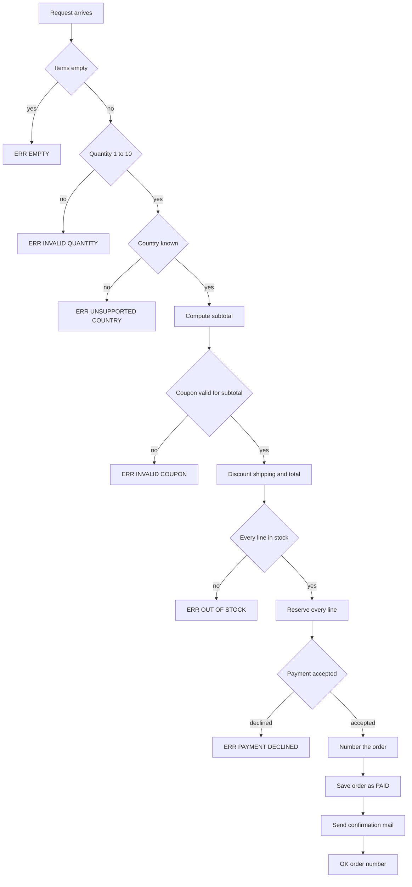
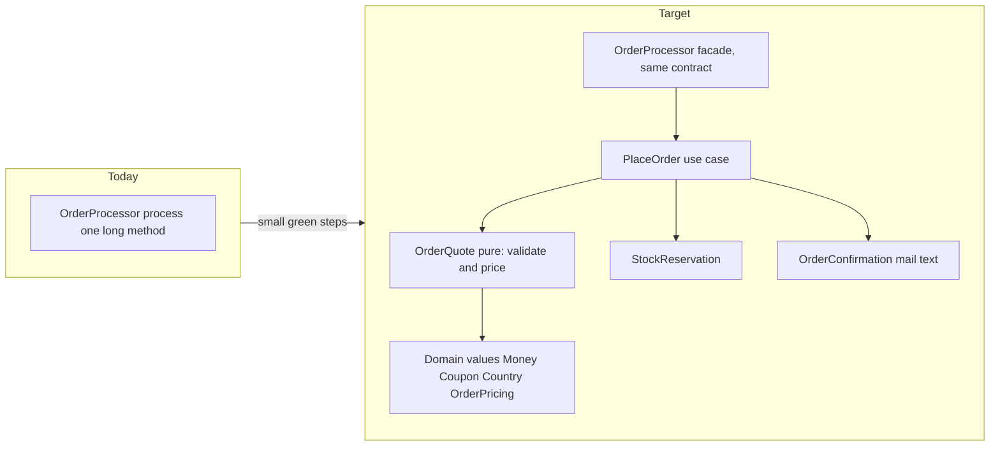
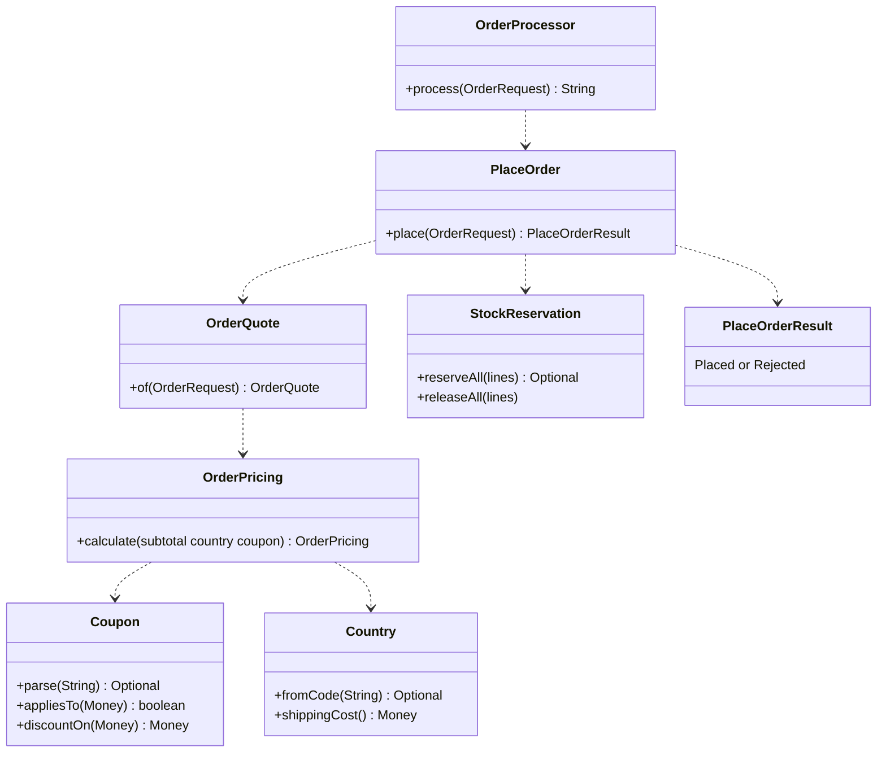

# Task 24 · Breaking up a god class

| Difficulty | Topics | Time box |
|---|---|---|
| 🔴 Hard | Refactoring a large legacy class safely (characterization tests, Extract Function, Extract Class, Move Function, Replace Primitive with Object, Split Phase) · Toward hexagonal architecture (ports for side effects) · Keeping a legacy facade for compatibility · Fixing a bug only after the structure makes it obvious | 4–5 h |

> **Background reading:** Martin Fowler, *Refactoring* (2nd ed.) ch. 1 (the first worked example, read it again before you start), ch. 6 ("Extract Function", "Split Phase", "Introduce Parameter Object"), ch. 7 ("Extract Class", "Replace Primitive with Object") · Michael Feathers, *Working Effectively with Legacy Code* ch. 13 ("I need to make a change, but I don't know what tests to write") and ch. 20 ("This class is too big") · John Ousterhout, *A Philosophy of Software Design* ch. 9 ("Better Together or Better Apart?")

---

## The situation

`OrderProcessor` is the class behind the checkout page. Everything that happens when a customer presses "Buy" goes through its one method, `process`: input validation, country and shipping rules, coupons, totals, stock, payment, the order number, the database row and the confirmation mail. The class is about 180 lines, nearly all of it in that method, with nested `if`s, magic numbers and the same rounding repeated in every coupon branch.

Years ago someone "made it testable" by putting every collaborator behind an interface. That was a good step, and it is the only part of the design that works well today. The logic is still inline. Every change to a coupon touches the same method as a change to the mail text, and nobody dares to touch either without a fear of breaking the other.

There is also a real bug. When the payment provider declines the card, the stock that was already reserved is **never released**. Products stay sold out until someone fixes the warehouse by hand. Support has tickets about it every week.

The tempting fix is four lines inside the `catch` block. That would work. But the rule we want is "a declined payment leaves the warehouse as it was", and we want that rule to be obvious in the code, testable on its own, and impossible to forget when the next person adds a step. You get there by restructuring first. The bug fix is the last step, not the first.

So the order of work is the one from *Working Effectively with Legacy Code*: **protect the behaviour with tests, then change the structure in small green steps, then change the behaviour.** Do not mix the three in one commit.

## The domain

| Term | Meaning |
|---|---|
| **Order request** | What the checkout page sends: customer, e-mail, country code, items, optional coupon code. The strings come straight from the web form. |
| **Item** | A SKU, a quantity from 1 to 10, and the unit price in euros with cents. |
| **Subtotal** | The sum of all lines, before the coupon. |
| **Coupon** | `SAVE10` takes 10 % off the subtotal. `FIVEOFF` takes 5.00 off, but only when the subtotal is at least 25.00. A blank code means no coupon. Anything else is invalid. |
| **Shipping** | 4.90 to Germany, 9.90 to Austria, France and the Netherlands. Free when the subtotal after the discount is at least 50.00. |
| **Order number** | `ORD-yyyyMMdd-NNNN`, counted from 1 per processor. Only a placed order uses a number. |
| **Port** | An interface for a side effect owned by another team: `StockService` (warehouse), `PaymentGateway`, `MailSender`, `OrderStore` (database). |

The result of `process` is a string. The checkout page parses it, so the strings are a public contract: `OK:<orderId>`, `ERR:EMPTY`, `ERR:INVALID_QUANTITY`, `ERR:INVALID_COUPON`, `ERR:OUT_OF_STOCK:<sku>`, `ERR:PAYMENT_DECLINED` and `ERR:UNSUPPORTED_COUNTRY`.

### What the legacy method does, in order

Look at the diagram and notice where the decision points and the side effects are. Everything before "Reserve every line" can be computed without touching the outside world. Everything after it cannot be undone without help. That boundary is the most important line in this task.

### Current structure vs. target structure

Be careful with that diagram. The arrows are dependencies, not the order of execution. The execution order is the one in the flowchart above.

Who does what, before and after. Each row is one responsibility. Today they all sit in `process`.

| Responsibility | Today | After the refactoring |
|---|---|---|
| Validation | Early `return`s at the top of `process` | `OrderQuote.of` in the pure phase; `OrderLine` refuses a quantity outside 1 to 10 |
| Country and shipping cost | `"DE".equals` checks and magic numbers in `process` | `Country` enum with its shipping cost |
| Coupon parsing and minimum | `"SAVE10".equals` and the 25.00 check in `process` | `Coupon` sealed type; the `FIVEOFF` minimum lives in `Coupon.FixedAmount` |
| Pricing and rounding | Repeated `setScale` calls in `process` | `OrderPricing.calculate` returns every number; `Money` rounds |
| Stock check, reserve and release | Two loops in `process`, and no release | `StockReservation`: check all lines, then reserve all lines, and release on decline |
| Payment | `try`/`catch` around `charge` in `process` | `PlaceOrder` calls the `PaymentGateway` port after the pricing phase |
| Order numbering | Counter and format in `process` | `OrderIds`, called only after the charge succeeded |
| Mail text | A `StringBuilder` in `process` | `OrderConfirmation` formats the numbers from `OrderPricing` |
| Persistence | `orderStore.save` in `process` | `PlaceOrder` saves after the payment, with the same numbers |
| Mapping to legacy strings | `"ERR:..."` literals in `process` | The `OrderProcessor` facade, one `switch` over `PlaceOrderResult` |

## What I want from you

Two things must be true at the end. The behaviour of `OrderProcessor` is unchanged for every input the characterization tests check, except for the one rule the business changed. And the structure is one that a new colleague can read in ten minutes.

### Part 1: the structure

1. The public constructor and `process` of [`OrderProcessor`](../src/main/java/io/github/chris013/practice/task24/OrderProcessor.java) stay exactly as they are. The checkout page calls them. The strings they return are the contract listed above, byte for byte.
2. [`OrderProcessorCharacterizationTest`](../src/test/java/io/github/chris013/practice/task24/OrderProcessorCharacterizationTest.java) is green before you start, and it is green after every commit. You do not edit it.
3. Validation and pricing are a **pure phase**: no port, no clock, no stock lookup, no side effect. Pricing takes plain values and returns a value. Its result contains every number that the mail and the database need.
4. The coupon is a closed set of variants (`SAVE10`, `FIVEOFF`, no coupon). Its parsing and its minimum-subtotal rule live in one place. Comparing strings like `"SAVE10".equals(code)` outside that place is a failure.
5. The country is a closed set with its shipping cost. Unknown and `null` codes are refused, and codes are exact: `"de"` is not `"DE"`.
6. Money is `BigDecimal` and every amount is rounded to cents in one place. No `double`.
7. Stock is checked for every line before any line is reserved. The first short SKU in request order is reported.
8. The order number is only used up when the payment succeeded.
9. The confirmation mail is built from the numbers of the pricing phase. The subject is `Order <id> confirmed`. The body format is the one the characterization tests pin down.
10. The internal code uses a result type, not strings. Only the facade turns it into `OK:...` and `ERR:...`.

### Part 2: the bug

11. [`OrderProcessorNewRulesTest`](../src/test/java/io/github/chris013/practice/task24/OrderProcessorNewRulesTest.java) describes the new rule: **when the payment is declined, every reserved line is released.** Two of its tests fail on the starter. Make them green.
12. A declined payment still saves nothing, sends no mail and does not use an order number. Those tests were green before and must stay green.
13. You fix the bug **after** part 1 is done, in its own commit, test first.

## Constraints & non-goals

* The given ports ([`StockService`](../src/main/java/io/github/chris013/practice/task24/StockService.java), [`PaymentGateway`](../src/main/java/io/github/chris013/practice/task24/PaymentGateway.java), [`MailSender`](../src/main/java/io/github/chris013/practice/task24/MailSender.java), [`OrderStore`](../src/main/java/io/github/chris013/practice/task24/OrderStore.java)) and the records ([`OrderRequest`](../src/main/java/io/github/chris013/practice/task24/OrderRequest.java), [`Item`](../src/main/java/io/github/chris013/practice/task24/Item.java)) are owned by other teams. Do not change them.
* No big-bang rewrite. The file must compile and the characterization test must be green at every commit.
* No new behaviour in part 1. If you notice the stock bug while you refactor, write it down and leave it alone until part 2.
* No "utils" package. Split by responsibility (pricing, stock, mail, numbering), not by technical layer.
* No Spring, no mocking library. The fakes in `src/test` are enough.
* The legacy strings are only produced in the facade. The core must not know that `"ERR:..."` exists.

## How I'd approach it

Follow this sequence. Each numbered step ends in a commit with the tests green. If a step is hard, make it smaller.

1. **Characterization first.** Read the test class and check that you understand what each assertion pins down. Run it. It must be green. You will not write a single new characterization test here, because the set in the repository already covers every result code, every total, the order number and the mail. If you find behaviour that is not covered and that you intend to keep, add a test for it *before* you touch that code, and put it in the same commit.

2. **Extract Function, phase by phase, inside the class.** Turn the blocks of the method into private methods with names from the business: validate, country shipping, coupon discount, total, stock check, reserve, charge, number, mail body, save. Change one thing per commit. Keep the local variables that the later steps need as parameters. Do not change the order of the calls yet.

3. **Split Phase.** Introduce a value that holds every number of the order: subtotal, discount, shipping, total. Compute it in one method that has no side effects. Then the side-effect part reads that value and does not compute anything. Only after this step is green, look at the boundary in your flowchart: everything before the first reserve is phase 1.

4. **Replace Primitive with Object, coupon.** Parse the coupon code once, into a sealed type with a variant per kind of coupon. The `FIVEOFF` minimum belongs to that variant. The discount calculation moves with it. Watch the rounding: `10.05` with 10 % off is `1.005`, which must round half up to `1.01`, because the test pins that.

5. **Replace Primitive with Object, country.** The same idea for the country: an enum that holds the shipping cost. Keep the exact-match rule. Watch the `null` country.

6. **Extract Class.** Move the stock rule, the mail text and the order number into their own small classes. Move the whole use case into a class of its own (`PlaceOrder` in the solution), so the facade becomes a thin adapter. A class that is extracted must have a reason to change that is different from the others. If you cannot name the reason, do not extract it.

7. **Introduce a result type.** Let the core return a sealed result (placed with the order number, or rejected with a reason) instead of strings. The facade maps it back to the legacy strings with one `switch`. The compiler then checks that every reason is mapped.

8. **Only now fix the bug, test first.** `OrderProcessorNewRulesTest` is already red. Make it green with the smallest change. The change should be obvious from the structure. If it is not obvious, go back to step 6 and look at the boundary again. Commit the fix on its own.

Some traps to watch for:

* **The coupon-before-stock order.** An invalid coupon is reported before an out-of-stock product. Your pricing phase must run before the stock check, and the coupon check must run inside it.
* **The minimum subtotal of `FIVEOFF`** is checked against the subtotal, not against the total after shipping. `24.99` is refused, `25.00` is accepted.
* **Free shipping is measured after the discount.** A basket of 55.56 with 10 % off is 50.00 and gets free shipping.
* **Round in one place.** Money that is rounded at three different places can differ by a cent from the legacy total. In the solution that place is the `Money` constructor. It is safe because all inputs are already in cents.
* **Counting.** The number goes up only for a placed order. If you assign it before the payment, the characterization test for a declined card fails.
* **Mocks that pin the old call order.** If you test the processor with a mock that checks "reserve, then charge, then save", you have pinned the legacy sequence and made the next change harder. Use the fakes and check the outcome: the stock levels, the saved orders, the mail.
* **Fakes in pricing tests.** If the pricing phase needs a fake, something is still in the wrong place. Pricing takes numbers and returns numbers.

Thinking about the design: *A Philosophy of Software Design* ch. 9 asks whether two things are better together or apart. Ask it about the coupon and the pricing: do they change for the same reason? About the stock and the payment: do they fail for the same reason? A good split groups code that changes together and separates code that changes for different reasons. A bad split is the one you made because "utils" sounded tidy.

## Tests

Run: `mvn test -Dtest='**/task24/**'`

* `OrderProcessorCharacterizationTest`: 44 tests, green from the start and green after every step.
* `OrderProcessorNewRulesTest`: 3 tests. Two of them fail on the starter. They must be green at the end.
* The fakes (`FakeStock`, `FakePayments`, `RecordingMailer`, `InMemoryOrderStore`) and the test shop in `Shop` are helpers. Read them, do not change them unless you have a good reason.

Show the tests

<!-- embed: src/test/java/io/github/chris013/practice/task24/OrderProcessorCharacterizationTest.java -->
<!-- /embed -->

<!-- embed: src/test/java/io/github/chris013/practice/task24/OrderProcessorNewRulesTest.java -->
<!-- /embed -->

## Definition of done

- [ ] `OrderProcessorCharacterizationTest` is green at every commit. You did not edit it.
- [ ] The constructor and `process` of `OrderProcessor` are unchanged. Every legacy string is produced by the facade only.
- [ ] Pricing is a pure phase: no port, no clock, no fake in its tests.
- [ ] The coupon is a sealed type. The `FIVEOFF` minimum is in one place.
- [ ] The country is an enum with its shipping cost. Codes are exact.
- [ ] Stock is checked for all lines before any line is reserved.
- [ ] The order number is only used for a placed order.
- [ ] `OrderProcessorNewRulesTest` is green: a declined payment releases all reserved stock.
- [ ] You can explain in one sentence what each class is responsible for, and why it is separate from the others.
- [ ] The git history shows one green step per commit, and the bug fix is its own commit.

## Stretch goals

1. Replace the legacy strings at the call sites with the result type, and delete the facade. Change the checkout page, or write an adapter for it, and say in your PR what would break.
2. Make `process` idempotent for a retried request. A request with the same customer and the same idempotency key must return the same `OK:` result and must not charge twice. Decide where the key is kept and what a retry with different items should return.
3. Compensate stock per line, like a small saga. If the payment succeeds but saving the order fails, the reserved stock must be released and the customer must be refunded or the failure must be recorded. Write the failure cases as tests first.
4. Write property tests for the pricing phase. For random subtotals and coupons, the total is never negative, the discount never exceeds the subtotal, and the total in cents equals the sum of its parts.

---

Spoiler: open only after you have made a serious attempt

### Key decisions

**1. Pricing is computed before anything is reserved, and it returns a value.**
The legacy method interleaves rules with side effects, so a rule can only be read in the context of the calls around it. Splitting the work into a pure phase that returns the numbers makes the rules testable without fakes and makes the boundary between "may still fail for free" and "has effects" visible. The alternative was to keep one method and only extract the helpers. That is Extract Function without Split Phase, and it leaves the boundary hidden.

**2. Coupon and country are closed types, not strings.**
A string is an unchecked input that every method has to re-validate. Once a `Coupon` exists, its minimum subtotal can only be checked by its own code. The alternative was a `Map` from code to discount. That works for two codes, but the rules are not data: a percentage and a fixed amount with a minimum behave differently, and a `switch` over a sealed type makes the compiler list every case.

**3. The stock rule has its own class.**
"Check every line, then reserve every line" and its reverse are one rule, and they must stay together. Keeping them in `StockReservation` means the processor cannot reserve line by line without the check. The alternative was a private method inside the processor. It works, but the next person who adds a step would have to know the rule to keep it.

**4. The result type is internal; the strings live in the facade.**
The checkout page needs `"ERR:..."`, but the core does not. If the core returned strings, every new rule would have to invent a string, and a typo would be a silent bug. The facade is one `switch`. The alternative was to change the page to the new result type at once. That is a big-bang change across two teams, so the facade stays until the page moves (stretch goal 1).

**5. The order number is assigned after the charge.**
The number is part of the order, and an order exists only after the payment succeeded. Assigning it earlier would make declined attempts consume numbers, and the characterization test `a_declined_payment_does_not_use_up_a_number` says that must not happen.

**6. The bug fix is one line in the use case, after the split.**
Once the reservation and the payment are separate steps in one method, "release on decline" is a single call in the `catch` block. Before the split it would have been the same call, but in the middle of 180 lines where nobody reads it. The structure is what makes the fix obvious and easy to review.

**7. Money rounds to cents on construction.**
The `Money` constructor rounds every amount to cents, unit prices included. That keeps the rounding in one place. It preserves the legacy totals only because `Item` prices already have cents. A unit price with more decimals would be rounded in the solution and not in the legacy code. The `Item` contract rules that out, so the difference is not reachable, but it is the reason the rule must stay written down.

### Code

<!-- embed: solutions/src/main/java/io/github/chris013/practice/task24/application/PlaceOrder.java -->
<!-- /embed -->

<!-- embed: solutions/src/main/java/io/github/chris013/practice/task24/application/OrderQuote.java -->
<!-- /embed -->

<!-- embed: solutions/src/main/java/io/github/chris013/practice/task24/application/StockReservation.java -->
<!-- /embed -->

<!-- embed: solutions/src/main/java/io/github/chris013/practice/task24/application/PlaceOrderResult.java -->
<!-- /embed -->

<!-- embed: solutions/src/main/java/io/github/chris013/practice/task24/application/OrderConfirmation.java -->
<!-- /embed -->

<!-- embed: solutions/src/main/java/io/github/chris013/practice/task24/OrderProcessor.java -->
<!-- /embed -->

<!-- embed: solutions/src/main/java/io/github/chris013/practice/task24/domain/Coupon.java -->
<!-- /embed -->

<!-- embed: solutions/src/main/java/io/github/chris013/practice/task24/domain/OrderPricing.java -->
<!-- /embed -->

<!-- embed: solutions/src/main/java/io/github/chris013/practice/task24/domain/Money.java -->
<!-- /embed -->

<!-- embed: solutions/src/main/java/io/github/chris013/practice/task24/domain/Country.java -->
<!-- /embed -->

<!-- embed: solutions/src/test/java/io/github/chris013/practice/task24/domain/OrderPricingTest.java -->
<!-- /embed -->

### What I typically flag in first attempts

| Finding | Why it matters |
|---|---|
| The first "refactoring" commit also changes a rule, for example the rounding or the order of the checks | You can no longer tell which change broke a test. Keep behaviour changes out of the structure commits. |
| A `utils` or `helpers` class with pricing, stock and mail in it | It is a bag of functions split by technical layer. The next change still touches three files for one business rule. |
| The core returns `"ERR:..."` strings, or `OrderProcessor` is still the core | The legacy contract leaks into every new rule. Keep the strings at the edge only. |
| `Money` as a `double`, or rounding in three places | A cent of difference in the mail and the database is a support ticket. Round once and test the boundary. |
| A mock that checks "reserve, then charge, then save" in order | The test pins the legacy sequence, so the next reordering breaks it for no business reason. Test the outcome. |
| The release call added first, before the structure | The fix hides in the long method and the refactoring commits then mix structure and behaviour. |
| A rewrite of the whole class in one commit | Nothing is green in between, so a broken total cannot be traced to a step. |
| The coupon is checked after the stock is reserved | An invalid coupon then leaves reserved stock behind. The pricing phase must refuse before any side effect. |

