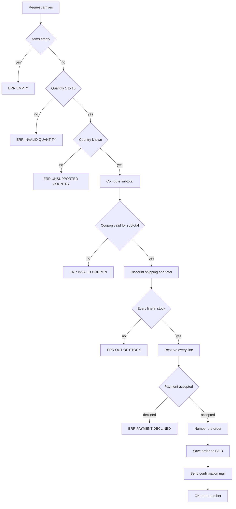
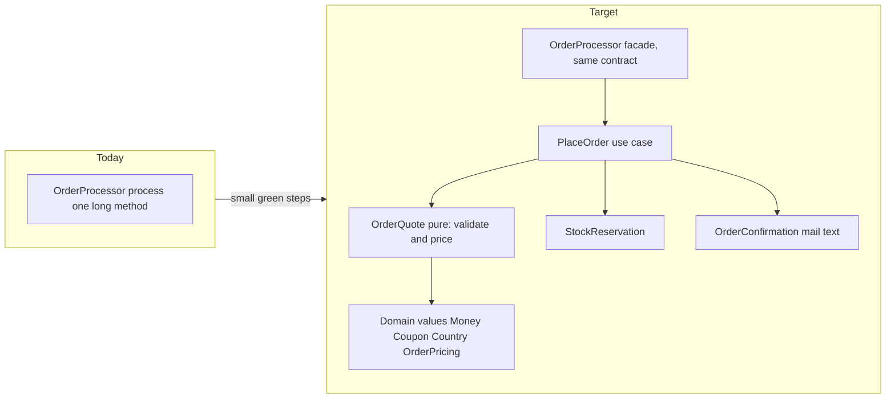
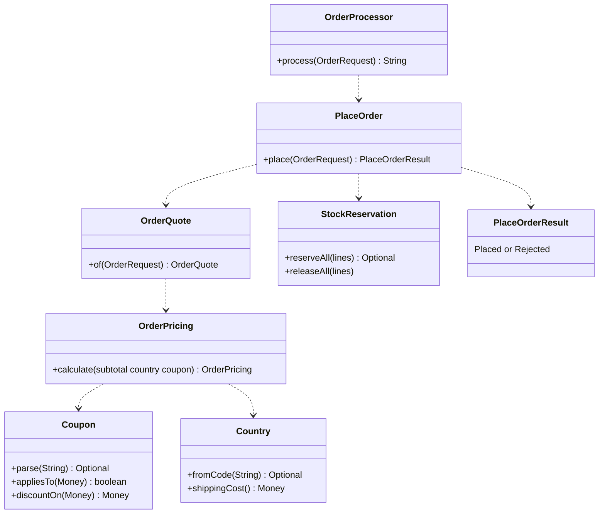

# Task 24 · Breaking up a god class

| Difficulty | Topics | Time box |
|---|---|---|
| 🔴 Hard | Refactoring a large legacy class safely (characterization tests, Extract Function, Extract Class, Move Function, Replace Primitive with Object, Split Phase) · Toward hexagonal architecture (ports for side effects) · Keeping a legacy facade for compatibility · Fixing a bug only after the structure makes it obvious | 4–5 h |

> **Background reading:** Martin Fowler, *Refactoring* (2nd ed.) ch. 1 (the first worked example, read it again before you start), ch. 6 ("Extract Function", "Split Phase", "Introduce Parameter Object"), ch. 7 ("Extract Class", "Replace Primitive with Object") · Michael Feathers, *Working Effectively with Legacy Code* ch. 13 ("I need to make a change, but I don't know what tests to write") and ch. 20 ("This class is too big") · John Ousterhout, *A Philosophy of Software Design* ch. 9 ("Better Together or Better Apart?")

---

## The situation

`OrderProcessor` is the class behind the checkout page. Everything that happens when a customer presses "Buy" goes through its one method, `process`: input validation, country and shipping rules, coupons, totals, stock, payment, the order number, the database row and the confirmation mail. The class is about 180 lines, nearly all of it in that method, with nested `if`s, magic numbers and the same rounding repeated in every coupon branch.

Years ago someone "made it testable" by putting every collaborator behind an interface. That was a good step, and it is the only part of the design that works well today. The logic is still inline. Every change to a coupon touches the same method as a change to the mail text, and nobody dares to touch either without a fear of breaking the other.

There is also a real bug. When the payment provider declines the card, the stock that was already reserved is **never released**. Products stay sold out until someone fixes the warehouse by hand. Support has tickets about it every week.

The tempting fix is four lines inside the `catch` block. That would work. But the rule we want is "a declined payment leaves the warehouse as it was", and we want that rule to be obvious in the code, testable on its own, and impossible to forget when the next person adds a step. You get there by restructuring first. The bug fix is the last step, not the first.

So the order of work is the one from *Working Effectively with Legacy Code*: **protect the behaviour with tests, then change the structure in small green steps, then change the behaviour.** Do not mix the three in one commit.

## The domain

| Term | Meaning |
|---|---|
| **Order request** | What the checkout page sends: customer, e-mail, country code, items, optional coupon code. The strings come straight from the web form. |
| **Item** | A SKU, a quantity from 1 to 10, and the unit price in euros with cents. |
| **Subtotal** | The sum of all lines, before the coupon. |
| **Coupon** | `SAVE10` takes 10 % off the subtotal. `FIVEOFF` takes 5.00 off, but only when the subtotal is at least 25.00. A blank code means no coupon. Anything else is invalid. |
| **Shipping** | 4.90 to Germany, 9.90 to Austria, France and the Netherlands. Free when the subtotal after the discount is at least 50.00. |
| **Order number** | `ORD-yyyyMMdd-NNNN`, counted from 1 per processor. Only a placed order uses a number. |
| **Port** | An interface for a side effect owned by another team: `StockService` (warehouse), `PaymentGateway`, `MailSender`, `OrderStore` (database). |

The result of `process` is a string. The checkout page parses it, so the strings are a public contract: `OK:<orderId>`, `ERR:EMPTY`, `ERR:INVALID_QUANTITY`, `ERR:INVALID_COUPON`, `ERR:OUT_OF_STOCK:<sku>`, `ERR:PAYMENT_DECLINED` and `ERR:UNSUPPORTED_COUNTRY`.

### What the legacy method does, in order



Look at the diagram and notice where the decision points and the side effects are. Everything before "Reserve every line" can be computed without touching the outside world. Everything after it cannot be undone without help. That boundary is the most important line in this task.

### Current structure vs. target structure



Be careful with that diagram. The arrows are dependencies, not the order of execution. The execution order is the one in the flowchart above.



Who does what, before and after. Each row is one responsibility. Today they all sit in `process`.

| Responsibility | Today | After the refactoring |
|---|---|---|
| Validation | Early `return`s at the top of `process` | `OrderQuote.of` in the pure phase; `OrderLine` refuses a quantity outside 1 to 10 |
| Country and shipping cost | `"DE".equals` checks and magic numbers in `process` | `Country` enum with its shipping cost |
| Coupon parsing and minimum | `"SAVE10".equals` and the 25.00 check in `process` | `Coupon` sealed type; the `FIVEOFF` minimum lives in `Coupon.FixedAmount` |
| Pricing and rounding | Repeated `setScale` calls in `process` | `OrderPricing.calculate` returns every number; `Money` rounds |
| Stock check, reserve and release | Two loops in `process`, and no release | `StockReservation`: check all lines, then reserve all lines, and release on decline |
| Payment | `try`/`catch` around `charge` in `process` | `PlaceOrder` calls the `PaymentGateway` port after the pricing phase |
| Order numbering | Counter and format in `process` | `OrderIds`, called only after the charge succeeded |
| Mail text | A `StringBuilder` in `process` | `OrderConfirmation` formats the numbers from `OrderPricing` |
| Persistence | `orderStore.save` in `process` | `PlaceOrder` saves after the payment, with the same numbers |
| Mapping to legacy strings | `"ERR:..."` literals in `process` | The `OrderProcessor` facade, one `switch` over `PlaceOrderResult` |

## What I want from you

Two things must be true at the end. The behaviour of `OrderProcessor` is unchanged for every input the characterization tests check, except for the one rule the business changed. And the structure is one that a new colleague can read in ten minutes.

### Part 1: the structure

1. The public constructor and `process` of [`OrderProcessor`](../src/main/java/io/github/chris013/practice/task24/OrderProcessor.java) stay exactly as they are. The checkout page calls them. The strings they return are the contract listed above, byte for byte.
2. [`OrderProcessorCharacterizationTest`](../src/test/java/io/github/chris013/practice/task24/OrderProcessorCharacterizationTest.java) is green before you start, and it is green after every commit. You do not edit it.
3. Validation and pricing are a **pure phase**: no port, no clock, no stock lookup, no side effect. Pricing takes plain values and returns a value. Its result contains every number that the mail and the database need.
4. The coupon is a closed set of variants (`SAVE10`, `FIVEOFF`, no coupon). Its parsing and its minimum-subtotal rule live in one place. Comparing strings like `"SAVE10".equals(code)` outside that place is a failure.
5. The country is a closed set with its shipping cost. Unknown and `null` codes are refused, and codes are exact: `"de"` is not `"DE"`.
6. Money is `BigDecimal` and every amount is rounded to cents in one place. No `double`.
7. Stock is checked for every line before any line is reserved. The first short SKU in request order is reported.
8. The order number is only used up when the payment succeeded.
9. The confirmation mail is built from the numbers of the pricing phase. The subject is `Order <id> confirmed`. The body format is the one the characterization tests pin down.
10. The internal code uses a result type, not strings. Only the facade turns it into `OK:...` and `ERR:...`.

### Part 2: the bug

11. [`OrderProcessorNewRulesTest`](../src/test/java/io/github/chris013/practice/task24/OrderProcessorNewRulesTest.java) describes the new rule: **when the payment is declined, every reserved line is released.** Two of its tests fail on the starter. Make them green.
12. A declined payment still saves nothing, sends no mail and does not use an order number. Those tests were green before and must stay green.
13. You fix the bug **after** part 1 is done, in its own commit, test first.

## Constraints & non-goals

* The given ports ([`StockService`](../src/main/java/io/github/chris013/practice/task24/StockService.java), [`PaymentGateway`](../src/main/java/io/github/chris013/practice/task24/PaymentGateway.java), [`MailSender`](../src/main/java/io/github/chris013/practice/task24/MailSender.java), [`OrderStore`](../src/main/java/io/github/chris013/practice/task24/OrderStore.java)) and the records ([`OrderRequest`](../src/main/java/io/github/chris013/practice/task24/OrderRequest.java), [`Item`](../src/main/java/io/github/chris013/practice/task24/Item.java)) are owned by other teams. Do not change them.
* No big-bang rewrite. The file must compile and the characterization test must be green at every commit.
* No new behaviour in part 1. If you notice the stock bug while you refactor, write it down and leave it alone until part 2.
* No "utils" package. Split by responsibility (pricing, stock, mail, numbering), not by technical layer.
* No Spring, no mocking library. The fakes in `src/test` are enough.
* The legacy strings are only produced in the facade. The core must not know that `"ERR:..."` exists.

## How I'd approach it

Follow this sequence. Each numbered step ends in a commit with the tests green. If a step is hard, make it smaller.

1. **Characterization first.** Read the test class and check that you understand what each assertion pins down. Run it. It must be green. You will not write a single new characterization test here, because the set in the repository already covers every result code, every total, the order number and the mail. If you find behaviour that is not covered and that you intend to keep, add a test for it *before* you touch that code, and put it in the same commit.

2. **Extract Function, phase by phase, inside the class.** Turn the blocks of the method into private methods with names from the business: validate, country shipping, coupon discount, total, stock check, reserve, charge, number, mail body, save. Change one thing per commit. Keep the local variables that the later steps need as parameters. Do not change the order of the calls yet.

3. **Split Phase.** Introduce a value that holds every number of the order: subtotal, discount, shipping, total. Compute it in one method that has no side effects. Then the side-effect part reads that value and does not compute anything. Only after this step is green, look at the boundary in your flowchart: everything before the first reserve is phase 1.

4. **Replace Primitive with Object, coupon.** Parse the coupon code once, into a sealed type with a variant per kind of coupon. The `FIVEOFF` minimum belongs to that variant. The discount calculation moves with it. Watch the rounding: `10.05` with 10 % off is `1.005`, which must round half up to `1.01`, because the test pins that.

5. **Replace Primitive with Object, country.** The same idea for the country: an enum that holds the shipping cost. Keep the exact-match rule. Watch the `null` country.

6. **Extract Class.** Move the stock rule, the mail text and the order number into their own small classes. Move the whole use case into a class of its own (`PlaceOrder` in the solution), so the facade becomes a thin adapter. A class that is extracted must have a reason to change that is different from the others. If you cannot name the reason, do not extract it.

7. **Introduce a result type.** Let the core return a sealed result (placed with the order number, or rejected with a reason) instead of strings. The facade maps it back to the legacy strings with one `switch`. The compiler then checks that every reason is mapped.

8. **Only now fix the bug, test first.** `OrderProcessorNewRulesTest` is already red. Make it green with the smallest change. The change should be obvious from the structure. If it is not obvious, go back to step 6 and look at the boundary again. Commit the fix on its own.

Some traps to watch for:

* **The coupon-before-stock order.** An invalid coupon is reported before an out-of-stock product. Your pricing phase must run before the stock check, and the coupon check must run inside it.
* **The minimum subtotal of `FIVEOFF`** is checked against the subtotal, not against the total after shipping. `24.99` is refused, `25.00` is accepted.
* **Free shipping is measured after the discount.** A basket of 55.56 with 10 % off is 50.00 and gets free shipping.
* **Round in one place.** Money that is rounded at three different places can differ by a cent from the legacy total. In the solution that place is the `Money` constructor. It is safe because all inputs are already in cents.
* **Counting.** The number goes up only for a placed order. If you assign it before the payment, the characterization test for a declined card fails.
* **Mocks that pin the old call order.** If you test the processor with a mock that checks "reserve, then charge, then save", you have pinned the legacy sequence and made the next change harder. Use the fakes and check the outcome: the stock levels, the saved orders, the mail.
* **Fakes in pricing tests.** If the pricing phase needs a fake, something is still in the wrong place. Pricing takes numbers and returns numbers.

Thinking about the design: *A Philosophy of Software Design* ch. 9 asks whether two things are better together or apart. Ask it about the coupon and the pricing: do they change for the same reason? About the stock and the payment: do they fail for the same reason? A good split groups code that changes together and separates code that changes for different reasons. A bad split is the one you made because "utils" sounded tidy.

## Tests

Run: `mvn test -Dtest='**/task24/**'`

* `OrderProcessorCharacterizationTest`: 44 tests, green from the start and green after every step.
* `OrderProcessorNewRulesTest`: 3 tests. Two of them fail on the starter. They must be green at the end.
* The fakes (`FakeStock`, `FakePayments`, `RecordingMailer`, `InMemoryOrderStore`) and the test shop in `Shop` are helpers. Read them, do not change them unless you have a good reason.

<details>
<summary>Show the tests</summary>

<!-- embed: src/test/java/io/github/chris013/practice/task24/OrderProcessorCharacterizationTest.java -->
**[`OrderProcessorCharacterizationTest.java`](../src/test/java/io/github/chris013/practice/task24/OrderProcessorCharacterizationTest.java)**

```java
package io.github.chris013.practice.task24;

import static io.github.chris013.practice.task24.Shop.item;
import static io.github.chris013.practice.task24.Shop.order;
import static org.assertj.core.api.Assertions.assertThat;

import java.math.BigDecimal;

import org.junit.jupiter.api.Nested;
import org.junit.jupiter.api.Test;
import org.junit.jupiter.params.ParameterizedTest;
import org.junit.jupiter.params.provider.CsvSource;

/**
 * Pins down what {@link OrderProcessor} does today. Green before you start, green after every refactoring step.
 *
 * <p>Deliberately silent about stock after a declined payment: that is the bug, and the new-rules test covers it.
 */
class OrderProcessorCharacterizationTest {

    @Nested
    class Result_codes {

        @Test
        void an_order_without_items_is_rejected() {
            Shop shop = new Shop();

            assertThat(shop.processor.process(order("DE", null))).isEqualTo("ERR:EMPTY");
        }

        @Test
        void a_quantity_of_zero_is_rejected() {
            Shop shop = new Shop();

            assertThat(shop.processor.process(order("DE", null, item("TEA-GREEN", 0))))
                    .isEqualTo("ERR:INVALID_QUANTITY");
        }

        @Test
        void a_quantity_of_eleven_is_rejected_but_ten_is_allowed() {
            Shop shop = new Shop();

            assertThat(shop.processor.process(order("DE", null, item("TEA-GREEN", 11))))
                    .isEqualTo("ERR:INVALID_QUANTITY");
            assertThat(shop.processor.process(order("DE", null, item("TEA-GREEN", 10))))
                    .startsWith("OK:");
        }

        @Test
        void a_country_outside_the_four_supported_ones_is_rejected() {
            Shop shop = new Shop();

            assertThat(shop.processor.process(order("CH", null, item("TEA-GREEN", 1))))
                    .isEqualTo("ERR:UNSUPPORTED_COUNTRY");
        }

        @ParameterizedTest
        @CsvSource({"SAVE20", "save10", "FREESHIP"})
        void an_unknown_coupon_is_rejected(String coupon) {
            Shop shop = new Shop();

            assertThat(shop.processor.process(order("DE", coupon, item("TEA-GREEN", 1))))
                    .isEqualTo("ERR:INVALID_COUPON");
        }

        @Test
        void fiveoff_is_rejected_below_a_subtotal_of_25_euros() {
            Shop shop = new Shop();

            assertThat(shop.processor.process(order("DE", "FIVEOFF", item("CANDLE-24", 1))))
                    .isEqualTo("ERR:INVALID_COUPON");
        }

        @Test
        void an_item_that_is_out_of_stock_is_reported_by_sku() {
            Shop shop = new Shop();
            shop.stock.with("TEA-GREEN", 1);

            assertThat(shop.processor.process(order("DE", null, item("TEA-GREEN", 2))))
                    .isEqualTo("ERR:OUT_OF_STOCK:TEA-GREEN");
        }

        @Test
        void the_first_item_without_stock_in_request_order_is_reported() {
            Shop shop = new Shop();
            shop.stock.with("TEA-GREEN", 0).with("BOOK-KAFKA", 0);

            assertThat(shop.processor.process(order("DE", null,
                    item("MUG-BLUE", 1), item("TEA-GREEN", 1), item("BOOK-KAFKA", 1))))
                    .isEqualTo("ERR:OUT_OF_STOCK:TEA-GREEN");
        }

        @Test
        void a_coupon_error_is_reported_before_a_stock_error() {
            Shop shop = new Shop();
            shop.stock.with("TEA-GREEN", 0);

            assertThat(shop.processor.process(order("DE", "SAVE20", item("TEA-GREEN", 1))))
                    .isEqualTo("ERR:INVALID_COUPON");
        }

        @Test
        void stock_is_checked_for_every_line_before_anything_is_reserved() {
            Shop shop = new Shop();
            shop.stock.with("TEA-GREEN", 0);

            shop.processor.process(order("DE", null, item("MUG-BLUE", 2), item("TEA-GREEN", 1)));

            assertThat(shop.stock.availableOf("MUG-BLUE")).isEqualTo(100);
            assertThat(shop.payments.charges()).isEmpty();
            assertThat(shop.store.saved()).isEmpty();
        }

        @Test
        void a_declined_payment_is_reported_as_such() {
            Shop shop = new Shop();
            shop.payments.declineNextCharges(1);

            assertThat(shop.processor.process(order("DE", null, item("TEA-GREEN", 1))))
                    .isEqualTo("ERR:PAYMENT_DECLINED");
        }

        @Test
        void an_empty_order_is_reported_before_a_bad_country() {
            Shop shop = new Shop();

            assertThat(shop.processor.process(order("CH", null))).isEqualTo("ERR:EMPTY");
        }

        @Test
        void a_bad_quantity_is_reported_before_a_bad_country() {
            Shop shop = new Shop();

            assertThat(shop.processor.process(order("CH", null, item("TEA-GREEN", 0))))
                    .isEqualTo("ERR:INVALID_QUANTITY");
        }

        @Test
        void a_bad_country_is_reported_before_a_bad_coupon() {
            Shop shop = new Shop();

            assertThat(shop.processor.process(order("CH", "SAVE20", item("TEA-GREEN", 1))))
                    .isEqualTo("ERR:UNSUPPORTED_COUNTRY");
        }
    }

    @Nested
    class Totals {

        /** Subtotal, coupon and shipping decide the total. The last column is what the customer pays. */
        @ParameterizedTest(name = "{0} {1} {2} x{3} is {4}")
        @CsvSource({
            "DE,,TEA-GREEN,2,24.90",
            "AT,,TEA-GREEN,2,29.90",
            "FR,,MUG-BLUE,2,34.90",
            "NL,SAVE10,BOOK-KAFKA,1,36.90",
            "DE,,TEA-GREEN,4,44.90",
            "DE,,TEA-GREEN,5,50.00",
            "DE,SAVE10,BOOK-KAFKA,1,31.90",
            "DE,SAVE10,BOOK-KAFKA,2,54.00",
            "DE,SAVE10,SOAP-10,1,13.94",
            "DE,SAVE10,SOAP-10,5,50.12",
            "DE,FIVEOFF,MUG-BLUE,2,24.90",
            "NL,FIVEOFF,BOOK-KAFKA,1,34.90",
            "DE,FIVEOFF,BOOK-KAFKA,2,55.00",
            "NL,,BOOK-KAFKA,2,60.00",
            "DE,FIVEOFF,TEA-GREEN,5,49.90"
        })
        void the_total_is_subtotal_minus_coupon_plus_shipping(
                String country, String coupon, String sku, int quantity, String total) {
            Shop shop = new Shop();

            assertThat(shop.processor.process(order(country, coupon, item(sku, quantity))))
                    .startsWith("OK:");
            assertThat(shop.store.saved()).singleElement()
                    .satisfies(saved -> assertThat(saved.total()).isEqualByComparingTo(total));
            assertThat(shop.payments.charges()).singleElement()
                    .satisfies(charge -> assertThat(charge.amount()).isEqualByComparingTo(total));
        }

        @Test
        void a_blank_coupon_is_the_same_as_no_coupon() {
            Shop shop = new Shop();

            shop.processor.process(order("DE", "   ", item("TEA-GREEN", 2)));

            assertThat(shop.store.saved().get(0).total()).isEqualByComparingTo("24.90");
        }

        @Test
        void fiveoff_takes_5_euros_off_at_a_subtotal_of_exactly_25_euros() {
            Shop shop = new Shop();

            shop.processor.process(order("DE", "FIVEOFF", item("MUG-BLUE", 2)));

            assertThat(shop.mailer.sent().get(0).body()).contains("Discount: 5,00 EUR");
        }
    }

    @Nested
    class Order_numbers {

        @Test
        void the_first_order_of_the_day_is_numbered_0001() {
            Shop shop = new Shop();

            assertThat(shop.processor.process(order("DE", null, item("TEA-GREEN", 1))))
                    .isEqualTo("OK:ORD-20260301-0001");
        }

        @Test
        void numbers_count_up_for_each_placed_order() {
            Shop shop = new Shop();

            shop.processor.process(order("DE", null, item("TEA-GREEN", 1)));

            assertThat(shop.processor.process(order("DE", null, item("TEA-GREEN", 1))))
                    .isEqualTo("OK:ORD-20260301-0002");
        }

        @Test
        void a_rejected_request_does_not_use_up_a_number() {
            Shop shop = new Shop();
            shop.processor.process(order("CH", null, item("TEA-GREEN", 1)));

            assertThat(shop.processor.process(order("DE", null, item("TEA-GREEN", 1))))
                    .isEqualTo("OK:ORD-20260301-0001");
        }

        @Test
        void a_declined_payment_does_not_use_up_a_number() {
            Shop shop = new Shop();
            shop.payments.declineNextCharges(1);
            shop.processor.process(order("DE", null, item("TEA-GREEN", 1)));

            assertThat(shop.processor.process(order("DE", null, item("TEA-GREEN", 1))))
                    .isEqualTo("OK:ORD-20260301-0001");
        }

        @Test
        void each_processor_counts_on_its_own() {
            assertThat(new Shop().processor.process(order("DE", null, item("TEA-GREEN", 1))))
                    .isEqualTo("OK:ORD-20260301-0001");
            assertThat(new Shop().processor.process(order("DE", null, item("TEA-GREEN", 1))))
                    .isEqualTo("OK:ORD-20260301-0001");
        }
    }

    @Nested
    class Side_effects {

        @Test
        void a_placed_order_reserves_its_stock() {
            Shop shop = new Shop();

            shop.processor.process(order("DE", null, item("TEA-GREEN", 2), item("MUG-BLUE", 1)));

            assertThat(shop.stock.availableOf("TEA-GREEN")).isEqualTo(98);
            assertThat(shop.stock.availableOf("MUG-BLUE")).isEqualTo(99);
        }

        @Test
        void a_placed_order_is_saved_as_paid_for_the_customer() {
            Shop shop = new Shop();

            shop.processor.process(order("DE", "SAVE10", item("TEA-GREEN", 2), item("MUG-BLUE", 1)));

            assertThat(shop.store.saved()).containsExactly(new InMemoryOrderStore.Saved(
                    "ORD-20260301-0001", "C-42", new BigDecimal("34.15"), "PAID"));
        }

        @Test
        void the_customer_gets_one_confirmation_mail_with_the_exact_text() {
            Shop shop = new Shop();

            shop.processor.process(order("DE", "SAVE10", item("TEA-GREEN", 2), item("MUG-BLUE", 1)));

            assertThat(shop.mailer.sent()).containsExactly(new RecordingMailer.Sent(
                    "anna@example.com",
                    "Order ORD-20260301-0001 confirmed",
                    """
                    Thank you for your order ORD-20260301-0001.
                    TEA-GREEN x2: 20,00 EUR
                    MUG-BLUE x1: 12,50 EUR
                    Subtotal: 32,50 EUR
                    Discount: 3,25 EUR
                    Shipping: 4,90 EUR
                    Total: 34,15 EUR
                    """));
        }

        @Test
        void the_customer_is_charged_the_total_once() {
            Shop shop = new Shop();

            shop.processor.process(order("DE", "SAVE10", item("TEA-GREEN", 2), item("MUG-BLUE", 1)));

            assertThat(shop.payments.charges())
                    .containsExactly(new FakePayments.Charge("C-42", new BigDecimal("34.15")));
        }

        @Test
        void a_subtotal_of_exactly_50_euros_ships_free_and_the_mail_says_so() {
            Shop shop = new Shop();

            shop.processor.process(order("DE", null, item("TEA-GREEN", 5)));

            assertThat(shop.mailer.sent().get(0).body()).isEqualTo("""
                    Thank you for your order ORD-20260301-0001.
                    TEA-GREEN x5: 50,00 EUR
                    Subtotal: 50,00 EUR
                    Discount: 0,00 EUR
                    Shipping: 0,00 EUR
                    Total: 50,00 EUR
                    """);
        }

        @Test
        void without_a_coupon_the_mail_shows_a_discount_of_zero() {
            Shop shop = new Shop();

            shop.processor.process(order("AT", null, item("TEA-GREEN", 1)));

            assertThat(shop.mailer.sent().get(0).body()).isEqualTo("""
                    Thank you for your order ORD-20260301-0001.
                    TEA-GREEN x1: 10,00 EUR
                    Subtotal: 10,00 EUR
                    Discount: 0,00 EUR
                    Shipping: 9,90 EUR
                    Total: 19,90 EUR
                    """);
        }
    }
}
```
<!-- /embed -->

<!-- embed: src/test/java/io/github/chris013/practice/task24/OrderProcessorNewRulesTest.java -->
**[`OrderProcessorNewRulesTest.java`](../src/test/java/io/github/chris013/practice/task24/OrderProcessorNewRulesTest.java)**

```java
package io.github.chris013.practice.task24;

import static io.github.chris013.practice.task24.Shop.item;
import static io.github.chris013.practice.task24.Shop.order;
import static org.assertj.core.api.Assertions.assertThat;

import org.junit.jupiter.api.Nested;
import org.junit.jupiter.api.Test;

/**
 * The new requirement from the business: a declined card must not leave stock reserved.
 *
 * <p>The first test fails on the starter. That is the point: it is the bug, written down as a rule.
 */
class OrderProcessorNewRulesTest {

    @Nested
    class When_payment_is_declined {

        @Test
        void all_reserved_stock_is_released() {
            Shop shop = new Shop();
            shop.payments.declineNextCharges(1);

            shop.processor.process(order("DE", null, item("TEA-GREEN", 2), item("MUG-BLUE", 1)));

            assertThat(shop.stock.availableOf("TEA-GREEN")).isEqualTo(100);
            assertThat(shop.stock.availableOf("MUG-BLUE")).isEqualTo(100);
        }

        @Test
        void the_stock_is_free_again_for_the_next_customer() {
            Shop shop = new Shop();
            shop.stock.with("TEA-GREEN", 2);
            shop.payments.declineNextCharges(1);
            shop.processor.process(order("DE", null, item("TEA-GREEN", 2)));

            assertThat(shop.processor.process(order("DE", null, item("TEA-GREEN", 2))))
                    .isEqualTo("OK:ORD-20260301-0001");
        }

        @Test
        void nothing_is_saved_and_no_mail_is_sent() {
            Shop shop = new Shop();
            shop.payments.declineNextCharges(1);

            assertThat(shop.processor.process(order("DE", null, item("TEA-GREEN", 1))))
                    .isEqualTo("ERR:PAYMENT_DECLINED");

            assertThat(shop.store.saved()).isEmpty();
            assertThat(shop.mailer.sent()).isEmpty();
        }
    }
}
```
<!-- /embed -->

</details>

## Definition of done

- [ ] `OrderProcessorCharacterizationTest` is green at every commit. You did not edit it.
- [ ] The constructor and `process` of `OrderProcessor` are unchanged. Every legacy string is produced by the facade only.
- [ ] Pricing is a pure phase: no port, no clock, no fake in its tests.
- [ ] The coupon is a sealed type. The `FIVEOFF` minimum is in one place.
- [ ] The country is an enum with its shipping cost. Codes are exact.
- [ ] Stock is checked for all lines before any line is reserved.
- [ ] The order number is only used for a placed order.
- [ ] `OrderProcessorNewRulesTest` is green: a declined payment releases all reserved stock.
- [ ] You can explain in one sentence what each class is responsible for, and why it is separate from the others.
- [ ] The git history shows one green step per commit, and the bug fix is its own commit.

## Stretch goals

1. Replace the legacy strings at the call sites with the result type, and delete the facade. Change the checkout page, or write an adapter for it, and say in your PR what would break.
2. Make `process` idempotent for a retried request. A request with the same customer and the same idempotency key must return the same `OK:` result and must not charge twice. Decide where the key is kept and what a retry with different items should return.
3. Compensate stock per line, like a small saga. If the payment succeeds but saving the order fails, the reserved stock must be released and the customer must be refunded or the failure must be recorded. Write the failure cases as tests first.
4. Write property tests for the pricing phase. For random subtotals and coupons, the total is never negative, the discount never exceeds the subtotal, and the total in cents equals the sum of its parts.

---

<details>
<summary>Spoiler: open only after you have made a serious attempt</summary>

### Key decisions

**1. Pricing is computed before anything is reserved, and it returns a value.**
The legacy method interleaves rules with side effects, so a rule can only be read in the context of the calls around it. Splitting the work into a pure phase that returns the numbers makes the rules testable without fakes and makes the boundary between "may still fail for free" and "has effects" visible. The alternative was to keep one method and only extract the helpers. That is Extract Function without Split Phase, and it leaves the boundary hidden.

**2. Coupon and country are closed types, not strings.**
A string is an unchecked input that every method has to re-validate. Once a `Coupon` exists, its minimum subtotal can only be checked by its own code. The alternative was a `Map` from code to discount. That works for two codes, but the rules are not data: a percentage and a fixed amount with a minimum behave differently, and a `switch` over a sealed type makes the compiler list every case.

**3. The stock rule has its own class.**
"Check every line, then reserve every line" and its reverse are one rule, and they must stay together. Keeping them in `StockReservation` means the processor cannot reserve line by line without the check. The alternative was a private method inside the processor. It works, but the next person who adds a step would have to know the rule to keep it.

**4. The result type is internal; the strings live in the facade.**
The checkout page needs `"ERR:..."`, but the core does not. If the core returned strings, every new rule would have to invent a string, and a typo would be a silent bug. The facade is one `switch`. The alternative was to change the page to the new result type at once. That is a big-bang change across two teams, so the facade stays until the page moves (stretch goal 1).

**5. The order number is assigned after the charge.**
The number is part of the order, and an order exists only after the payment succeeded. Assigning it earlier would make declined attempts consume numbers, and the characterization test `a_declined_payment_does_not_use_up_a_number` says that must not happen.

**6. The bug fix is one line in the use case, after the split.**
Once the reservation and the payment are separate steps in one method, "release on decline" is a single call in the `catch` block. Before the split it would have been the same call, but in the middle of 180 lines where nobody reads it. The structure is what makes the fix obvious and easy to review.

**7. Money rounds to cents on construction.**
The `Money` constructor rounds every amount to cents, unit prices included. That keeps the rounding in one place. It preserves the legacy totals only because `Item` prices already have cents. A unit price with more decimals would be rounded in the solution and not in the legacy code. The `Item` contract rules that out, so the difference is not reachable, but it is the reason the rule must stay written down.

### Code

<!-- embed: solutions/src/main/java/io/github/chris013/practice/task24/application/PlaceOrder.java -->
**[`PlaceOrder.java`](../solutions/src/main/java/io/github/chris013/practice/task24/application/PlaceOrder.java)**

```java
package io.github.chris013.practice.task24.application;

import io.github.chris013.practice.task24.MailSender;
import io.github.chris013.practice.task24.OrderRequest;
import io.github.chris013.practice.task24.OrderStore;
import io.github.chris013.practice.task24.PaymentDeclinedException;
import io.github.chris013.practice.task24.PaymentGateway;
import io.github.chris013.practice.task24.StockService;

import java.math.BigDecimal;
import java.time.Clock;
import java.util.Objects;
import java.util.Optional;

/**
 * The use case: place one order. It is a Split Phase in two steps.
 *
 * <ol>
 *   <li>{@link OrderQuote#of} decides everything it can without side effects (validation and price).</li>
 *   <li>{@link #execute} touches the world: stock, payment, storage and mail, in that order.</li>
 * </ol>
 *
 * <p>The side effects only ever see a valid, priced order. Ports are the interfaces from the warehouse, payment,
 * mail and database teams. This class knows nothing about how they are implemented.
 */
public final class PlaceOrder {

    private final StockReservation stock;
    private final PaymentGateway payments;
    private final MailSender mailSender;
    private final OrderStore orderStore;
    private final OrderIds orderIds;

    public PlaceOrder(StockService stock, PaymentGateway payments, MailSender mailSender,
            OrderStore orderStore, Clock clock) {
        this.stock = new StockReservation(stock);
        this.payments = Objects.requireNonNull(payments, "payments");
        this.mailSender = Objects.requireNonNull(mailSender, "mailSender");
        this.orderStore = Objects.requireNonNull(orderStore, "orderStore");
        this.orderIds = new OrderIds(clock);
    }

    public PlaceOrderResult place(OrderRequest request) {
        Objects.requireNonNull(request, "request");
        return switch (OrderQuote.of(request)) {
            case OrderQuote.Refused refused -> PlaceOrderResult.Rejected.because(refused.reason());
            case OrderQuote.Accepted accepted -> execute(accepted);
        };
    }

    private PlaceOrderResult execute(OrderQuote.Accepted order) {
        Optional<String> shortSku = stock.reserveAll(order.lines());
        if (shortSku.isPresent()) {
            return PlaceOrderResult.Rejected.outOfStock(shortSku.get());
        }

        BigDecimal total = order.pricing().total().amount();
        try {
            payments.charge(order.customerId(), total);
        } catch (PaymentDeclinedException declined) {
            // Stock was reserved before the card was charged. Give it back, or the next customer
            // sees a product as sold out that nobody bought.
            stock.releaseAll(order.lines());
            return PlaceOrderResult.Rejected.because(RejectionReason.PAYMENT_DECLINED);
        }

        String orderId = orderIds.next();
        orderStore.save(orderId, order.customerId(), total, "PAID");
        mailSender.send(order.email(), OrderConfirmation.subject(orderId), OrderConfirmation.body(orderId, order));
        return new PlaceOrderResult.Placed(orderId);
    }
}
```
<!-- /embed -->

<!-- embed: solutions/src/main/java/io/github/chris013/practice/task24/application/OrderQuote.java -->
**[`OrderQuote.java`](../solutions/src/main/java/io/github/chris013/practice/task24/application/OrderQuote.java)**

```java
package io.github.chris013.practice.task24.application;

import io.github.chris013.practice.task24.Item;
import io.github.chris013.practice.task24.OrderRequest;
import io.github.chris013.practice.task24.domain.Country;
import io.github.chris013.practice.task24.domain.Coupon;
import io.github.chris013.practice.task24.domain.Money;
import io.github.chris013.practice.task24.domain.OrderLine;
import io.github.chris013.practice.task24.domain.OrderPricing;

import java.util.List;
import java.util.Objects;
import java.util.Optional;

/**
 * Phase 1 of placing an order (Split Phase): turn the request into domain values and work out the price.
 *
 * <p>This is pure. No collaborators, no clock, no stock, no payment. Whatever it returns, nothing has been touched
 * yet. Every refusal that can be decided from the request alone is decided here, which is why an invalid coupon
 * is reported before an out-of-stock product, as the legacy code did.
 */
sealed interface OrderQuote permits OrderQuote.Accepted, OrderQuote.Refused {

    /** A valid order with its price. Everything phase 2 needs is in here. */
    record Accepted(String customerId, String email, List<OrderLine> lines, OrderPricing pricing)
            implements OrderQuote {

        public Accepted {
            Objects.requireNonNull(customerId, "customerId");
            Objects.requireNonNull(email, "email");
            lines = List.copyOf(lines);
            Objects.requireNonNull(pricing, "pricing");
        }
    }

    record Refused(RejectionReason reason) implements OrderQuote {

        public Refused {
            Objects.requireNonNull(reason, "reason");
        }
    }

    static OrderQuote of(OrderRequest request) {
        if (request.items() == null || request.items().isEmpty()) {
            return new Refused(RejectionReason.EMPTY);
        }
        for (Item item : request.items()) {
            if (!OrderLine.isValidQuantity(item.quantity())) {
                return new Refused(RejectionReason.INVALID_QUANTITY);
            }
        }

        Optional<Country> country = Country.fromCode(request.country());
        if (country.isEmpty()) {
            return new Refused(RejectionReason.UNSUPPORTED_COUNTRY);
        }

        Optional<Coupon> coupon = Coupon.parse(request.couponCode());
        if (coupon.isEmpty()) {
            return new Refused(RejectionReason.INVALID_COUPON);
        }

        List<OrderLine> lines = request.items().stream()
                .map(item -> new OrderLine(item.sku(), item.quantity(), new Money(item.unitPrice())))
                .toList();
        Money subtotal = OrderPricing.subtotalOf(lines);
        if (!coupon.get().appliesTo(subtotal)) {
            return new Refused(RejectionReason.INVALID_COUPON);
        }

        OrderPricing pricing = OrderPricing.calculate(subtotal, country.get(), coupon.get());
        return new Accepted(request.customerId(), request.email(), lines, pricing);
    }
}
```
<!-- /embed -->

<!-- embed: solutions/src/main/java/io/github/chris013/practice/task24/application/StockReservation.java -->
**[`StockReservation.java`](../solutions/src/main/java/io/github/chris013/practice/task24/application/StockReservation.java)**

```java
package io.github.chris013.practice.task24.application;

import io.github.chris013.practice.task24.StockService;
import io.github.chris013.practice.task24.domain.OrderLine;

import java.util.List;
import java.util.Objects;
import java.util.Optional;

/**
 * Owns the rule "check every line, then reserve every line" and its reverse. Extracted from the processor so the
 * rule lives next to the only code that can break it.
 */
final class StockReservation {

    private final StockService stock;

    StockReservation(StockService stock) {
        this.stock = Objects.requireNonNull(stock, "stock");
    }

    /**
     * Reserves all lines, or none. Returns the first SKU that is short, in request order, and reserves nothing
     * in that case. Checking first is what keeps a half-filled order out of the warehouse.
     */
    Optional<String> reserveAll(List<OrderLine> lines) {
        for (OrderLine line : lines) {
            if (stock.available(line.sku()) < line.quantity()) {
                return Optional.of(line.sku());
            }
        }
        for (OrderLine line : lines) {
            stock.reserve(line.sku(), line.quantity());
        }
        return Optional.empty();
    }

    void releaseAll(List<OrderLine> lines) {
        for (OrderLine line : lines) {
            stock.release(line.sku(), line.quantity());
        }
    }
}
```
<!-- /embed -->

<!-- embed: solutions/src/main/java/io/github/chris013/practice/task24/application/PlaceOrderResult.java -->
**[`PlaceOrderResult.java`](../solutions/src/main/java/io/github/chris013/practice/task24/application/PlaceOrderResult.java)**

```java
package io.github.chris013.practice.task24.application;

import java.util.Objects;

/**
 * The outcome of placing an order: either the order number, or the reason it was refused. A result type instead
 * of an exception, because a refused order is an expected business outcome, not a bug.
 */
public sealed interface PlaceOrderResult permits PlaceOrderResult.Placed, PlaceOrderResult.Rejected {

    record Placed(String orderId) implements PlaceOrderResult {

        public Placed {
            Objects.requireNonNull(orderId, "orderId");
        }
    }

    /**
     * {@code sku} names the product that is out of stock. It is set for {@link RejectionReason#OUT_OF_STOCK}
     * and {@code null} for every other reason. The constructor enforces that, so no caller can get it wrong.
     */
    record Rejected(RejectionReason reason, String sku) implements PlaceOrderResult {

        public Rejected {
            Objects.requireNonNull(reason, "reason");
            if (reason == RejectionReason.OUT_OF_STOCK) {
                Objects.requireNonNull(sku, "sku");
            } else if (sku != null) {
                throw new IllegalArgumentException("sku is only set for OUT_OF_STOCK, not for " + reason);
            }
        }

        public static Rejected because(RejectionReason reason) {
            return new Rejected(reason, null);
        }

        public static Rejected outOfStock(String sku) {
            return new Rejected(RejectionReason.OUT_OF_STOCK, sku);
        }
    }
}
```
<!-- /embed -->

<!-- embed: solutions/src/main/java/io/github/chris013/practice/task24/application/OrderConfirmation.java -->
**[`OrderConfirmation.java`](../solutions/src/main/java/io/github/chris013/practice/task24/application/OrderConfirmation.java)**

```java
package io.github.chris013.practice.task24.application;

import io.github.chris013.practice.task24.domain.Money;
import io.github.chris013.practice.task24.domain.OrderLine;
import io.github.chris013.practice.task24.domain.OrderPricing;

import java.util.Locale;

/**
 * The customer's confirmation mail. It only formats numbers that were already computed by the pricing phase, so
 * the mail can never disagree with the amount that was charged.
 */
final class OrderConfirmation {

    private OrderConfirmation() {}

    static String subject(String orderId) {
        return "Order " + orderId + " confirmed";
    }

    static String body(String orderId, OrderQuote.Accepted order) {
        StringBuilder body = new StringBuilder();
        body.append("Thank you for your order ").append(orderId).append(".\n");
        for (OrderLine line : order.lines()) {
            body.append(line.sku()).append(" x").append(line.quantity()).append(": ")
                    .append(eur(line.lineTotal())).append("\n");
        }
        OrderPricing pricing = order.pricing();
        body.append("Subtotal: ").append(eur(pricing.subtotal())).append("\n");
        body.append("Discount: ").append(eur(pricing.discount())).append("\n");
        body.append("Shipping: ").append(eur(pricing.shipping())).append("\n");
        body.append("Total: ").append(eur(pricing.total())).append("\n");
        return body.toString();
    }

    /** German formatting for the customer, two decimals, straight from {@link java.math.BigDecimal}. */
    private static String eur(Money amount) {
        return String.format(Locale.GERMANY, "%.2f EUR", amount.amount());
    }
}
```
<!-- /embed -->

<!-- embed: solutions/src/main/java/io/github/chris013/practice/task24/OrderProcessor.java -->
**[`OrderProcessor.java`](../solutions/src/main/java/io/github/chris013/practice/task24/OrderProcessor.java)**

```java
package io.github.chris013.practice.task24;

import io.github.chris013.practice.task24.application.PlaceOrder;
import io.github.chris013.practice.task24.application.PlaceOrderResult;

import java.time.Clock;

/**
 * Compatibility facade for the checkout page. It keeps the old constructor and the old string results, so the page
 * does not change. All the logic lives in {@link PlaceOrder}. New code should call {@link PlaceOrder} directly
 * and match on {@link PlaceOrderResult}.
 */
public class OrderProcessor {

    private final PlaceOrder placeOrder;

    public OrderProcessor(StockService stock, PaymentGateway payments, MailSender mailSender,
            OrderStore orderStore, Clock clock) {
        this.placeOrder = new PlaceOrder(stock, payments, mailSender, orderStore, clock);
    }

    /** Returns {@code "OK:<orderId>"} or one of the legacy {@code "ERR:..."} codes. */
    public String process(OrderRequest req) {
        return switch (placeOrder.place(req)) {
            case PlaceOrderResult.Placed placed -> "OK:" + placed.orderId();
            case PlaceOrderResult.Rejected rejected -> "ERR:" + legacyCode(rejected);
        };
    }

    private static String legacyCode(PlaceOrderResult.Rejected rejected) {
        return switch (rejected.reason()) {
            case EMPTY -> "EMPTY";
            case INVALID_QUANTITY -> "INVALID_QUANTITY";
            case UNSUPPORTED_COUNTRY -> "UNSUPPORTED_COUNTRY";
            case INVALID_COUPON -> "INVALID_COUPON";
            case OUT_OF_STOCK -> "OUT_OF_STOCK:" + rejected.sku();
            case PAYMENT_DECLINED -> "PAYMENT_DECLINED";
        };
    }
}
```
<!-- /embed -->

<!-- embed: solutions/src/main/java/io/github/chris013/practice/task24/domain/Coupon.java -->
**[`Coupon.java`](../solutions/src/main/java/io/github/chris013/practice/task24/domain/Coupon.java)**

```java
package io.github.chris013.practice.task24.domain;

import java.math.BigDecimal;
import java.util.Optional;

/**
 * A coupon, replacing the string comparisons of the legacy code. The three variants behave differently, so they
 * are three records and the compiler checks that every {@code switch} over them handles all of them.
 */
public sealed interface Coupon permits Coupon.Percentage, Coupon.FixedAmount, Coupon.NoCoupon {

    /**
     * Reads a customer's code. {@code null} or blank means "no coupon". Empty means the code is unknown.
     * Codes are case-sensitive, as they were in the legacy checkout.
     */
    static Optional<Coupon> parse(String code) {
        if (code == null || code.isBlank()) {
            return Optional.of(new NoCoupon());
        }
        return switch (code) {
            case "SAVE10" -> Optional.of(new Percentage(10));
            case "FIVEOFF" -> Optional.of(new FixedAmount(
                    new Money(new BigDecimal("5.00")), new Money(new BigDecimal("25.00"))));
            default -> Optional.empty();
        };
    }

    /** A coupon can be refused for a basket, e.g. a fixed discount below its minimum subtotal. */
    boolean appliesTo(Money subtotal);

    /** Only meaningful when {@link #appliesTo} is true. */
    Money discountOn(Money subtotal);

    record Percentage(int percent) implements Coupon {

        @Override
        public boolean appliesTo(Money subtotal) {
            return true;
        }

        @Override
        public Money discountOn(Money subtotal) {
            return subtotal.percent(percent);
        }
    }

    /** A fixed amount off. The minimum subtotal guarantees the discount never exceeds the subtotal. */
    record FixedAmount(Money amount, Money minimumSubtotal) implements Coupon {

        @Override
        public boolean appliesTo(Money subtotal) {
            return subtotal.isAtLeast(minimumSubtotal);
        }

        @Override
        public Money discountOn(Money subtotal) {
            return amount;
        }
    }

    record NoCoupon() implements Coupon {

        @Override
        public boolean appliesTo(Money subtotal) {
            return true;
        }

        @Override
        public Money discountOn(Money subtotal) {
            return Money.ZERO;
        }
    }
}
```
<!-- /embed -->

<!-- embed: solutions/src/main/java/io/github/chris013/practice/task24/domain/OrderPricing.java -->
**[`OrderPricing.java`](../solutions/src/main/java/io/github/chris013/practice/task24/domain/OrderPricing.java)**

```java
package io.github.chris013.practice.task24.domain;

import java.math.BigDecimal;
import java.util.List;
import java.util.Objects;

/**
 * The money side of an order, computed before anything is reserved or charged. This is the "phase 1" of the
 * split: no collaborators, no clock, no exceptions for business outcomes. It is easy to test because it is pure.
 */
public record OrderPricing(Money subtotal, Money discount, Money shipping, Money total) {

    /** Shipping is free from this amount, measured after the discount. */
    public static final Money FREE_SHIPPING_FROM = new Money(new BigDecimal("50.00"));

    public static Money subtotalOf(List<OrderLine> lines) {
        return lines.stream().map(OrderLine::lineTotal).reduce(Money.ZERO, Money::plus);
    }

    /** Caller must have checked {@link Coupon#appliesTo} already. */
    public static OrderPricing calculate(Money subtotal, Country country, Coupon coupon) {
        Objects.requireNonNull(subtotal, "subtotal");
        Objects.requireNonNull(country, "country");
        Objects.requireNonNull(coupon, "coupon");

        Money discount = coupon.discountOn(subtotal);
        Money discounted = subtotal.minus(discount);
        Money shipping = discounted.isAtLeast(FREE_SHIPPING_FROM) ? Money.ZERO : country.shippingCost();
        return new OrderPricing(subtotal, discount, shipping, discounted.plus(shipping));
    }
}
```
<!-- /embed -->

<!-- embed: solutions/src/main/java/io/github/chris013/practice/task24/domain/Money.java -->
**[`Money.java`](../solutions/src/main/java/io/github/chris013/practice/task24/domain/Money.java)**

```java
package io.github.chris013.practice.task24.domain;

import java.math.BigDecimal;
import java.math.RoundingMode;
import java.util.Objects;

/**
 * An amount of euros, always rounded to cents.
 *
 * <p>Why a type and not a bare {@code BigDecimal}: the rounding rule lives in one place, the constructor. Every
 * amount that exists is already in cents, so nobody can forget to round at a call site.
 */
public record Money(BigDecimal amount) {

    public static final Money ZERO = new Money(BigDecimal.ZERO);

    public Money {
        Objects.requireNonNull(amount, "amount");
        amount = amount.setScale(2, RoundingMode.HALF_UP);
    }

    public Money plus(Money other) {
        return new Money(amount.add(other.amount));
    }

    public Money minus(Money other) {
        return new Money(amount.subtract(other.amount));
    }

    public Money times(int factor) {
        return new Money(amount.multiply(BigDecimal.valueOf(factor)));
    }

    /** {@code percent} of this amount, e.g. {@code percent(10)} for 10 %. Rounded half up to cents. */
    public Money percent(int percent) {
        return new Money(amount.multiply(BigDecimal.valueOf(percent)).movePointLeft(2));
    }

    public boolean isAtLeast(Money other) {
        return amount.compareTo(other.amount) >= 0;
    }
}
```
<!-- /embed -->

<!-- embed: solutions/src/main/java/io/github/chris013/practice/task24/domain/Country.java -->
**[`Country.java`](../solutions/src/main/java/io/github/chris013/practice/task24/domain/Country.java)**

```java
package io.github.chris013.practice.task24.domain;

import java.math.BigDecimal;
import java.util.Optional;

/**
 * The countries we ship to, each with its shipping cost. A closed set, so an enum: the compiler finds every
 * place that needs to change when we add a country.
 */
public enum Country {

    DE(new Money(new BigDecimal("4.90"))),
    AT(new Money(new BigDecimal("9.90"))),
    FR(new Money(new BigDecimal("9.90"))),
    NL(new Money(new BigDecimal("9.90")));

    private final Money shippingCost;

    Country(Money shippingCost) {
        this.shippingCost = shippingCost;
    }

    public Money shippingCost() {
        return shippingCost;
    }

    /** Empty for {@code null} and for codes we do not ship to. Codes are exact: "de" is not "DE". */
    public static Optional<Country> fromCode(String code) {
        for (Country country : values()) {
            if (country.name().equals(code)) {
                return Optional.of(country);
            }
        }
        return Optional.empty();
    }
}
```
<!-- /embed -->

<!-- embed: solutions/src/test/java/io/github/chris013/practice/task24/domain/OrderPricingTest.java -->
**[`OrderPricingTest.java`](../solutions/src/test/java/io/github/chris013/practice/task24/domain/OrderPricingTest.java)**

```java
package io.github.chris013.practice.task24.domain;

import static org.assertj.core.api.Assertions.assertThat;
import static org.assertj.core.api.Assertions.assertThatThrownBy;

import java.math.BigDecimal;

import org.junit.jupiter.api.Nested;
import org.junit.jupiter.api.Test;
import org.junit.jupiter.params.ParameterizedTest;
import org.junit.jupiter.params.provider.CsvSource;

/** The pricing phase is pure, so it needs no fakes: numbers in, numbers out. */
class OrderPricingTest {

    private static Money eur(String amount) {
        return new Money(new BigDecimal(amount));
    }

    @Nested
    class Coupons {

        @ParameterizedTest
        @CsvSource({"SAVE10", "FIVEOFF"})
        void a_known_code_is_recognised(String code) {
            assertThat(Coupon.parse(code)).isPresent();
        }

        @ParameterizedTest
        @CsvSource({"save10", "SAVE20", "FREESHIP", "' SAVE10'"})
        void an_unknown_code_is_not_a_coupon(String code) {
            assertThat(Coupon.parse(code)).isEmpty();
        }

        @Test
        void a_blank_code_means_no_coupon() {
            assertThat(Coupon.parse("   ")).containsInstanceOf(Coupon.NoCoupon.class);
        }

        @Test
        void a_null_code_means_no_coupon() {
            assertThat(Coupon.parse(null)).containsInstanceOf(Coupon.NoCoupon.class);
        }

        @Test
        void fiveoff_applies_from_25_euros_and_not_below() {
            Coupon fiveOff = Coupon.parse("FIVEOFF").orElseThrow();

            assertThat(fiveOff.appliesTo(eur("24.99"))).isFalse();
            assertThat(fiveOff.appliesTo(eur("25.00"))).isTrue();
        }
    }

    @Nested
    class Pricing {

        @Test
        void a_percentage_is_rounded_half_up_to_cents() {
            // 10.05 x 10 % = 1.005, which rounds half up to 1.01
            assertThat(new Coupon.Percentage(10).discountOn(eur("10.05"))).isEqualTo(eur("1.01"));
        }

        @Test
        void shipping_is_free_at_exactly_50_euros_after_the_discount() {
            OrderPricing pricing = OrderPricing.calculate(eur("55.56"), Country.DE,
                    new Coupon.Percentage(10));

            // 55.56 - 5.556 (rounds to 5.56) = 50.00, which is free shipping
            assertThat(pricing.shipping()).isEqualTo(Money.ZERO);
            assertThat(pricing.total()).isEqualTo(eur("50.00"));
        }

        @Test
        void shipping_is_charged_just_below_the_threshold() {
            OrderPricing pricing = OrderPricing.calculate(eur("49.99"), Country.FR, new Coupon.NoCoupon());

            assertThat(pricing.shipping()).isEqualTo(eur("9.90"));
            assertThat(pricing.total()).isEqualTo(eur("59.89"));
        }
    }

    @Nested
    class Guards {

        @Test
        void an_order_line_cannot_have_zero_or_eleven_items() {
            assertThatThrownBy(() -> new OrderLine("TEA-GREEN", 0, eur("10.00")))
                    .isInstanceOf(IllegalArgumentException.class);
            assertThatThrownBy(() -> new OrderLine("TEA-GREEN", 11, eur("10.00")))
                    .isInstanceOf(IllegalArgumentException.class);
        }

        @Test
        void country_codes_are_exact() {
            assertThat(Country.fromCode("de")).isEmpty();
            assertThat(Country.fromCode(null)).isEmpty();
            assertThat(Country.fromCode("DE")).contains(Country.DE);
        }
    }
}
```
<!-- /embed -->

### What I typically flag in first attempts

| Finding | Why it matters |
|---|---|
| The first "refactoring" commit also changes a rule, for example the rounding or the order of the checks | You can no longer tell which change broke a test. Keep behaviour changes out of the structure commits. |
| A `utils` or `helpers` class with pricing, stock and mail in it | It is a bag of functions split by technical layer. The next change still touches three files for one business rule. |
| The core returns `"ERR:..."` strings, or `OrderProcessor` is still the core | The legacy contract leaks into every new rule. Keep the strings at the edge only. |
| `Money` as a `double`, or rounding in three places | A cent of difference in the mail and the database is a support ticket. Round once and test the boundary. |
| A mock that checks "reserve, then charge, then save" in order | The test pins the legacy sequence, so the next reordering breaks it for no business reason. Test the outcome. |
| The release call added first, before the structure | The fix hides in the long method and the refactoring commits then mix structure and behaviour. |
| A rewrite of the whole class in one commit | Nothing is green in between, so a broken total cannot be traced to a step. |
| The coupon is checked after the stock is reserved | An invalid coupon then leaves reserved stock behind. The pricing phase must refuse before any side effect. |

</details>
