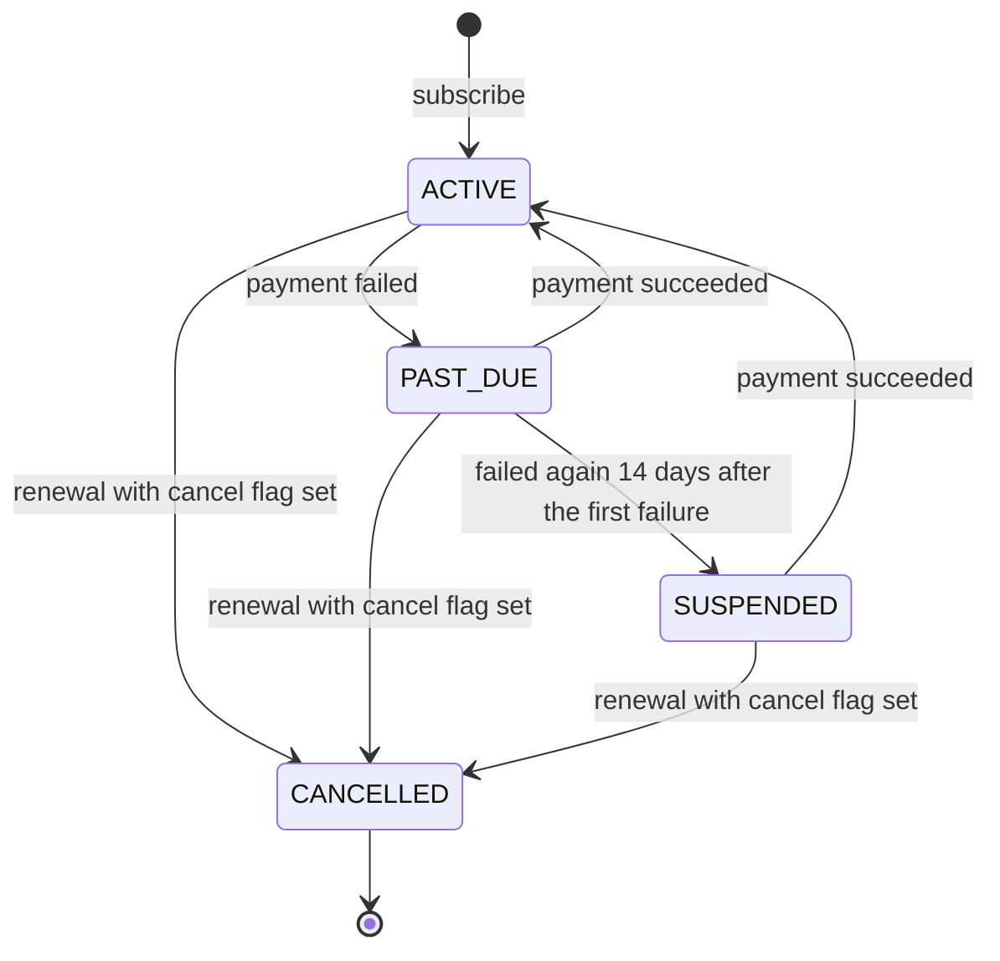
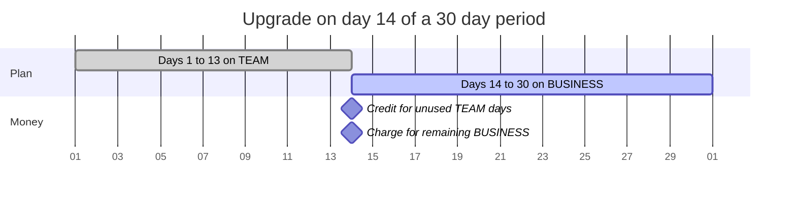
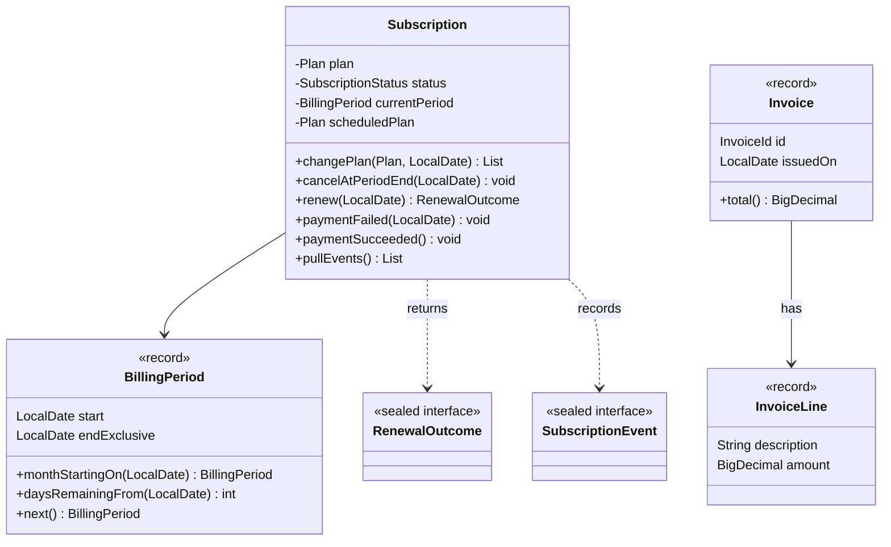
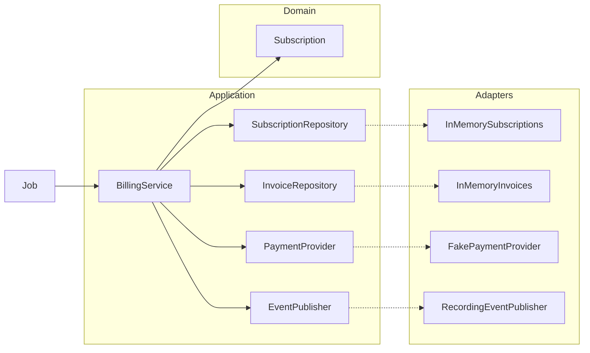
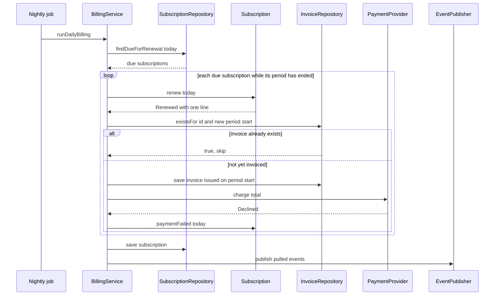

# Task 25 · Capstone: subscription billing

| Difficulty | Topics | Time box |
|---|---|---|
| ⚫ Expert | Everything together: DDD aggregate with a lifecycle, value objects, domain events · Hexagonal architecture with ports and in-memory adapters · Money and proration math with exact rounding rules · Time with an injected `Clock` · Idempotent batch jobs · Sealed results | 6–8 h (a weekend) |

> **Background reading:** everything from tasks 01 ([Money](01-money-value-object.md)), [08](08-order-aggregate.md) (the `Order` aggregate), [10](10-library-lending-hexagonal.md), [12](12-document-approval-type-state.md) and [15](15-gift-card-results.md) · Vernon, *Implementing Domain-Driven Design* (2013), ch. 10 "Aggregates" and ch. 14 "Application" · Stripe's public documentation on "Prorations" (for comparison; our rules are simpler and stated below) · *Effective Java* Item 17 ("Minimize mutability")

---

## The situation

Our SaaS product, **Teamboard** (a project management tool), sells monthly subscriptions. Billing today is a nightly SQL script plus manual corrections in Excel by the finance team. Every upgrade mid-month is a spreadsheet exercise, and a crash halfway through the script has once charged a customer twice.

Finance wants four things from the new billing module:

* **Immediate upgrades with fair proration.** A customer who upgrades on day 14 pays for the rest of the month on the new plan, minus what they did not use of the old one.
* **Downgrades at the end of the period.** Nobody loses features in the middle of a month they have paid for.
* **Cancellation at the end of the period.** The customer keeps access until the period they paid for is over.
* **Dunning for failed payments.** A failed card puts the subscription into a grace period. If it is still failing after 14 days, the customer is suspended.

And the nightly run must be **safe to re-run**. If the process dies halfway, starting it again must not charge anyone twice.

This task is the capstone. It asks you to combine ideas from the whole practice course: value objects, a sealed set of results, an aggregate that guards its own rules, events, an injected clock, and a service that wires ports to adapters. There is no new trick in it. The hard part is keeping all the pieces consistent.

## The domain

| Term | Meaning |
|---|---|
| **Plan** | `FREE` (0.00), `TEAM` (29.00) or `BUSINESS` (79.00) per month. Ordered by price. |
| **Subscription** | One customer's contract for a plan. The aggregate root. It owns its status, period and scheduled changes. |
| **Billing period** | The half-open range of days `[start, endExclusive)` that one payment covers. A month, in our case. |
| **Proration** | Charging only for the days that are left of a period, after a plan change. |
| **Renewal** | The moment a period ends and the next one starts. Renewal may create an invoice. |
| **Invoice** | A document with lines (charges and credits) and a total that is never below zero. |
| **Dunning** | What happens after a failed payment: first `PAST_DUE`, then `SUSPENDED` after the grace period. |
| **Grace period** | 14 days after the first failed payment. |
| **Idempotent run** | A job whose second run over the same data does nothing that the first run has not already done. |

A word on month ends. `plusMonths` clamps 31 January to 28 February. `next()` starts from that end, so the next period runs 28 February to 28 March. The anchor day is lost, and the subscription bills on the 28th from then on (stretch: keep the anchor day).

### The status lifecycle



A subscription can be cancelled in any status except `CANCELLED`; a customer who stopped paying must still be able to leave. Cancellation does not end the subscription on the spot. It sets a flag, and the next renewal turns the subscription into `CANCELLED`.

### An upgrade in the middle of a period

April has 30 days. The customer is on `TEAM` and upgrades to `BUSINESS` on 14 April.



### The domain model



### Ports and adapters

The domain does not know about databases, payment gateways or message buses. The service talks to them through **ports**, which are interfaces in `application`. The **adapters** that implement them live outside the core. In this task the adapters are in-memory, and the tests add two more.



The arrows point in one direction only. The domain depends on nothing. Application depends on the domain and on its own ports. Adapters depend on the ports. That is what lets you swap a database for a list without touching a single rule.

### One nightly run

The job loops over the subscriptions that are due. For each one it renews until the period is current, then creates, saves and charges the renewal invoice. Only after that it saves the subscription and publishes its events.



## What I want from you

Implement the aggregate and the service. The domain types, the ports and the value objects are given. Read them first, they carry the vocabulary.

1. **[`Subscription.start`](../src/main/java/io/github/chris013/practice/task25/domain/Subscription.java)(id, customerId, plan, today)**: the subscription is `ACTIVE`, its first period is `BillingPeriod.monthStartingOn(today)`, and it records `SubscriptionStarted`. `FREE` is allowed.
2. **`changePlan(newPlan, today)`**:
   * The same plan as the current one: `IllegalArgumentException`.
   * Not `ACTIVE`: `IllegalStateException`. Also `IllegalStateException` if `today` is on or after the end of the current period (renewal is due first).
   * **Upgrade** (the new plan is more expensive): takes effect now. Returns exactly two lines. The credit is `-(oldPrice × daysRemaining / periodDays)` and the charge is `newPrice × daysRemaining / periodDays`. Each is rounded HALF_UP to cents **separately**. The descriptions are `Unused time on TEAM (17 of 30 days)` and `Remaining time on BUSINESS (17 of 30 days)`. It clears any scheduled downgrade and records `PlanUpgraded`.
   * **Downgrade** (cheaper): is scheduled for the start of the next period, returns an empty list, and records `PlanChangeScheduled` dated at the period end. A second downgrade replaces the first.
3. **`cancelAtPeriodEnd(today)`**: allowed while `ACTIVE`, `PAST_DUE` or `SUSPENDED`; `IllegalStateException` once `CANCELLED`. Also `IllegalStateException` if `today` is on or after the end of the current period (renewal is due first). Calling it again changes nothing. It sets a flag. It does not change the status.
4. **`resume()`**: clears the cancel flag. Calling it when nothing is cancelled changes nothing. `IllegalStateException` if the subscription is `CANCELLED`.
5. **`renew(today)`**:
   * `IllegalStateException` if the subscription is `CANCELLED`, or if `today` is before the end of the current period.
   * If the cancel flag is set: the status becomes `CANCELLED`, the result is `RenewalOutcome.Ended`, and `SubscriptionEnded` is recorded.
   * Otherwise: the scheduled plan (if any) becomes the plan, the period moves to the next month, and `SubscriptionRenewed` is recorded. The result is `Renewed` with one line, `TEAM plan, 2026-05-01 to 2026-05-31` (the end date is shown inclusive) and the plan's monthly price. `FREE` gives `Renewed` with no lines.
   * It moves **one** period per call. A subscription that is two periods behind needs two calls.
6. **`paymentFailed(today)`**:
   * `ACTIVE` → `PAST_DUE`, remembers `today` as the first failure, records `SubscriptionPastDue`.
   * `PAST_DUE` and at least 14 days after the first failure → `SUSPENDED`, records `SubscriptionSuspended`.
   * `PAST_DUE` with fewer than 14 days: nothing changes. Later failures do not move the first failure date.
   * `SUSPENDED`: nothing changes. `CANCELLED`: `IllegalStateException`.
7. **`paymentSucceeded()`**: `PAST_DUE` or `SUSPENDED` → `ACTIVE`, clears the failure date, records `SubscriptionReactivated`. `ACTIVE`: nothing changes. `CANCELLED`: `IllegalStateException`.
8. **`pullEvents()`** returns the events recorded since the last call, in the order they happened, and forgets them.
9. **[`BillingService.subscribe(customerId, plan)`](../src/main/java/io/github/chris013/practice/task25/application/BillingService.java)**: gets the id from `SubscriptionIds`, starts the subscription with today from the `Clock`, saves it, publishes its events, and returns the id.
10. **`changePlan(id, newPlan)`** on the service: an unknown id is an `IllegalArgumentException`. For a non-empty result from the aggregate, create an invoice dated today, **save it**, and charge its total when it is greater than zero. `Declined` → `paymentFailed(today)`. `Paid` → `paymentSucceeded()`. Then save the subscription and publish its events.
11. **`cancel(id)`** on the service: `cancelAtPeriodEnd(today)`, save, publish.
12. **`runDailyBilling()`**: for each subscription from `findDueForRenewal(today)`, renew while its period has ended. For each `Renewed` with lines:
    * if `existsFor(subscriptionId, newPeriodStart)` is true, count it as `skippedAlreadyInvoiced` and do nothing else;
    * otherwise create an invoice **issued on the new period's first day**, save it, count it as `invoiced`, then charge it; `Declined` → `paymentFailed(today)` (counted as `paymentsFailed`), `Paid` → `paymentSucceeded()`.

    `Ended` is counted as `ended`. Every `Renewed` is counted as `renewed`, FREE ones included. After each subscription, save it and then publish its events.
13. **`Invoice.total()`** is never below `0.00`. Credits larger than the charges give `0.00`.
14. **In-memory adapters**: `SequentialSubscriptionIds` produces `SUB-0001`, `SUB-0002`, … and `SequentialInvoiceIds` produces `INV-0001`, `INV-0002`, … (four digits, zero-padded). `InMemorySubscriptions.findDueForRenewal` never returns a `CANCELLED` subscription. `InMemoryInvoices.existsFor` matches on the invoice's `issuedOn` date.
15. **Dates**: the service gets today from the injected `Clock` (`LocalDate.now(clock)`). The aggregate receives dates as parameters and never reads the clock itself.

## Constraints & non-goals

* **No `double` or `float` for money.** Use `BigDecimal` with explicit scales and rounding.
* **No `LocalDate.now()`** anywhere. Time comes from the injected `Clock` in the service and from parameters in the aggregate.
* **Billing rules live in `Subscription`**, not in the service. The service decides *when* to call, the aggregate decides *whether* and *what*.
* **Nothing is charged at signup.** `subscribe` does not invoice the first period. Checkout does that outside this module. (Stretch goal 3 asks you to change that.)
* **No dunning schedule.** The grace period is measured from the first failed charge. The next charge attempt happens with the next renewal, not on a retry timer.
* **No taxes, no VAT, no currencies other than euro.** [Task 13](13-receipt-enums.md) covers taxes.
* **No persistence, no threads.** The in-memory adapters are single-threaded. Two nodes running the nightly job at once is a stretch goal.
* A `FREE` subscription has no lines at renewal, and no proration credit, but it still gets its period moved and its events published.

## How I'd approach it

* **Start with the period, then the lifecycle, then the money.** `BillingPeriod` is given, but read its tests: they explain the half-open convention and the January 31st case. Then write `Subscription.start`, `paymentFailed` and `paymentSucceeded`, which are small state transitions. Only then tackle `changePlan`, where the money is. Write `renew` last, because it is where the rules meet.
* **Reuse what you know.** Money arithmetic is the same kind of problem as task 01. The sealed `RenewalOutcome` and `PaymentResult` use the pattern-matching style of task 06. The events and the "record it, pull it, publish it" flow follow task 08's `Order`. The injected `Clock` is the one from task 07.
* **Proration: multiply first, divide once.** `29.00 × 17 / 30` is exact in `BigDecimal` if you multiply before you divide. Then round the result once, HALF_UP. Do this for each line on its own. The worked example below shows why the difference matters.
* **Think about the ordering in the service.** Ask yourself what happens if the process dies after each line. Where is the database write? Where is the charge? What does the rerun see? If the answer is "a second charge", you have the order wrong.
* **Idempotency is about *what the rerun sees*, not about a flag.** The renewal invoice is recognised by its issue date. Think about why that is enough, and what could still go wrong. (The flags table lists one of those cases.)
* **Keep the aggregate's public surface small.** Anything you add beyond the contract above is a design decision you must justify.
* **Test with the fakes.** `FakePaymentProvider` and `RecordingEventPublisher` are in `src/test`. `RecordingEventPublisher` also writes to a shared log, so you can check that the save came before the publish.

### The worked example

Upgrade from `TEAM` to `BUSINESS` on 14 April 2026, in a period from 1 April to 30 April (30 days).

| Step | Calculation | Result |
|---|---|---|
| Days remaining, 14 April inclusive to 1 May exclusive | 30 − 13 | 17 |
| Credit for the unused `TEAM` days | −(29.00 x 17 / 30) = −16.4333… | −16.43 |
| Charge for the remaining `BUSINESS` days | 79.00 x 17 / 30 = 44.7666… | 44.77 |
| Invoice total | −16.43 + 44.77 | 28.34 |
| The exact answer, for comparison (not used) | (79.00 − 29.00) x 17 / 30 = 28.3333… | 28.33 |

The invoice shows 28.34, which is what the customer sees when they add up the two printed lines. Rounding the exact difference would give 28.33 and an invoice that does not add up.

## Tests

Run: `mvn test -Dtest='**/task25/**'`

The tests are in three places. [`BillingPeriodTest`](../src/test/java/io/github/chris013/practice/task25/domain/BillingPeriodTest.java) and [`InvoiceTest`](../src/test/java/io/github/chris013/practice/task25/domain/InvoiceTest.java) cover the given value types, so they pass on the starter. [`SubscriptionTest`](../src/test/java/io/github/chris013/practice/task25/domain/SubscriptionTest.java) covers the aggregate, and [`BillingServiceTest`](../src/test/java/io/github/chris013/practice/task25/application/BillingServiceTest.java) covers the service with the in-memory adapters. Most of the new tests fail on the starter until you implement the TODOs.

<details>
<summary>Show the tests</summary>

<!-- embed: src/test/java/io/github/chris013/practice/task25/domain/SubscriptionTest.java -->
**[`SubscriptionTest.java`](../src/test/java/io/github/chris013/practice/task25/domain/SubscriptionTest.java)**

```java
package io.github.chris013.practice.task25.domain;

import static org.assertj.core.api.Assertions.assertThat;
import static org.assertj.core.api.Assertions.assertThatThrownBy;

import io.github.chris013.practice.task25.domain.RenewalOutcome.Ended;
import io.github.chris013.practice.task25.domain.RenewalOutcome.Renewed;
import io.github.chris013.practice.task25.domain.SubscriptionEvent.PlanChangeScheduled;
import io.github.chris013.practice.task25.domain.SubscriptionEvent.PlanUpgraded;
import io.github.chris013.practice.task25.domain.SubscriptionEvent.SubscriptionEnded;
import io.github.chris013.practice.task25.domain.SubscriptionEvent.SubscriptionPastDue;
import io.github.chris013.practice.task25.domain.SubscriptionEvent.SubscriptionReactivated;
import io.github.chris013.practice.task25.domain.SubscriptionEvent.SubscriptionRenewed;
import io.github.chris013.practice.task25.domain.SubscriptionEvent.SubscriptionStarted;
import io.github.chris013.practice.task25.domain.SubscriptionEvent.SubscriptionSuspended;
import java.math.BigDecimal;
import java.time.LocalDate;
import java.util.List;
import org.junit.jupiter.api.Nested;
import org.junit.jupiter.api.Test;
import org.junit.jupiter.params.ParameterizedTest;
import org.junit.jupiter.params.provider.CsvSource;

class SubscriptionTest {

    private static final SubscriptionId ID = new SubscriptionId("SUB-0001");
    private static final CustomerId ANNA = new CustomerId("anna");
    private static final LocalDate APRIL_1 = LocalDate.of(2026, 4, 1);
    private static final LocalDate APRIL_14 = LocalDate.of(2026, 4, 14);
    private static final LocalDate MAY_1 = LocalDate.of(2026, 5, 1);
    private static final LocalDate JUNE_1 = LocalDate.of(2026, 6, 1);

    /** A subscription that started on April 1st. Its start event is still pending. */
    private static Subscription subscription(Plan plan) {
        return Subscription.start(ID, ANNA, plan, APRIL_1);
    }

    /** Same as {@link #subscription}, but with the start event already pulled, so tests can assert on new events only. */
    private static Subscription subscriptionWithoutEvents(Plan plan) {
        Subscription subscription = subscription(plan);
        subscription.pullEvents();
        return subscription;
    }

    @Nested
    class Starting {

        @Test
        void begins_active_with_a_period_that_starts_today() {
            Subscription subscription = subscription(Plan.TEAM);

            assertThat(subscription.id()).isEqualTo(ID);
            assertThat(subscription.customerId()).isEqualTo(ANNA);
            assertThat(subscription.plan()).isEqualTo(Plan.TEAM);
            assertThat(subscription.status()).isEqualTo(SubscriptionStatus.ACTIVE);
            assertThat(subscription.currentPeriod()).isEqualTo(new BillingPeriod(APRIL_1, MAY_1));
            assertThat(subscription.scheduledPlan()).isEmpty();
            assertThat(subscription.cancelAtPeriodEnd()).isFalse();
        }

        @Test
        void allows_the_free_plan() {
            assertThat(subscription(Plan.FREE).plan()).isEqualTo(Plan.FREE);
        }

        @Test
        void records_subscription_started_as_its_first_event() {
            assertThat(subscription(Plan.TEAM).pullEvents())
                    .containsExactly(new SubscriptionStarted(ID, ANNA, Plan.TEAM, APRIL_1));
        }
    }

    @Nested
    class Upgrading {

        @Test
        void prorates_both_plans_on_day_14_of_a_30_day_period() {
            // TEAM unused: 29.00 x 17 / 30 = 16.433... -> 16.43, credited.
            // BUSINESS remaining: 79.00 x 17 / 30 = 44.766... -> 44.77, charged.
            List<InvoiceLine> lines = subscription(Plan.TEAM).changePlan(Plan.BUSINESS, APRIL_14);

            assertThat(lines).containsExactly(
                    new InvoiceLine("Unused time on TEAM (17 of 30 days)", new BigDecimal("-16.43")),
                    new InvoiceLine("Remaining time on BUSINESS (17 of 30 days)", new BigDecimal("44.77")));
        }

        @Test
        void rounds_each_line_separately_so_the_total_is_28_34_not_the_exact_28_33() {
            // Exact difference: (79.00 - 29.00) x 17 / 30 = 28.333... Rounded lines: 44.77 - 16.43 = 28.34.
            List<InvoiceLine> lines = subscription(Plan.TEAM).changePlan(Plan.BUSINESS, APRIL_14);

            BigDecimal total = new Invoice(new InvoiceId("INV-1"), ID, ANNA, APRIL_14, lines).total();

            assertThat(total).isEqualByComparingTo("28.34");
        }

        @Test
        void an_upgrade_on_the_first_day_credits_and_charges_whole_months() {
            List<InvoiceLine> lines = subscription(Plan.TEAM).changePlan(Plan.BUSINESS, APRIL_1);

            assertThat(lines).containsExactly(
                    new InvoiceLine("Unused time on TEAM (30 of 30 days)", new BigDecimal("-29.00")),
                    new InvoiceLine("Remaining time on BUSINESS (30 of 30 days)", new BigDecimal("79.00")));
        }

        @Test
        void an_upgrade_from_free_has_a_zero_credit_line() {
            // TEAM on day 15: 16 days remain. 29.00 x 16 / 30 = 15.466... -> 15.47.
            List<InvoiceLine> lines = subscription(Plan.FREE).changePlan(Plan.TEAM, LocalDate.of(2026, 4, 15));

            assertThat(lines).containsExactly(
                    new InvoiceLine("Unused time on FREE (16 of 30 days)", new BigDecimal("0.00")),
                    new InvoiceLine("Remaining time on TEAM (16 of 30 days)", new BigDecimal("15.47")));
        }

        @Test
        void takes_effect_immediately() {
            Subscription subscription = subscription(Plan.TEAM);

            subscription.changePlan(Plan.BUSINESS, APRIL_14);

            assertThat(subscription.plan()).isEqualTo(Plan.BUSINESS);
        }

        @Test
        void records_a_plan_upgraded_event() {
            Subscription subscription = subscriptionWithoutEvents(Plan.TEAM);

            subscription.changePlan(Plan.BUSINESS, APRIL_14);

            assertThat(subscription.pullEvents())
                    .containsExactly(new PlanUpgraded(ID, Plan.TEAM, Plan.BUSINESS, APRIL_14));
        }

        @Test
        void clears_a_scheduled_downgrade() {
            Subscription subscription = subscription(Plan.TEAM);
            subscription.changePlan(Plan.FREE, APRIL_1);
            assertThat(subscription.scheduledPlan()).contains(Plan.FREE);

            subscription.changePlan(Plan.BUSINESS, APRIL_14);

            assertThat(subscription.scheduledPlan()).isEmpty();
        }

        @Test
        void rejects_the_plan_the_subscription_already_has() {
            assertThatThrownBy(() -> subscription(Plan.TEAM).changePlan(Plan.TEAM, APRIL_14))
                    .isInstanceOf(IllegalArgumentException.class);
        }

        @Test
        void rejects_a_change_unless_the_subscription_is_active() {
            Subscription subscription = subscription(Plan.TEAM);
            subscription.paymentFailed(APRIL_1);

            assertThatThrownBy(() -> subscription.changePlan(Plan.BUSINESS, APRIL_14))
                    .isInstanceOf(IllegalStateException.class);
        }

        @Test
        void rejects_a_change_once_the_period_has_ended_and_renewal_is_due() {
            assertThatThrownBy(() -> subscription(Plan.TEAM).changePlan(Plan.BUSINESS, MAY_1))
                    .isInstanceOf(IllegalStateException.class);
        }
    }

    @Nested
    class Downgrading {

        @Test
        void is_scheduled_for_the_next_period_and_returns_no_lines() {
            Subscription subscription = subscription(Plan.BUSINESS);

            List<InvoiceLine> lines = subscription.changePlan(Plan.TEAM, APRIL_14);

            assertThat(lines).isEmpty();
            assertThat(subscription.scheduledPlan()).contains(Plan.TEAM);
        }

        @Test
        void keeps_the_higher_plan_until_the_period_ends() {
            Subscription subscription = subscription(Plan.BUSINESS);

            subscription.changePlan(Plan.TEAM, APRIL_14);

            assertThat(subscription.plan()).isEqualTo(Plan.BUSINESS);
        }

        @Test
        void records_a_plan_change_scheduled_event_dated_at_the_period_end() {
            Subscription subscription = subscriptionWithoutEvents(Plan.BUSINESS);

            subscription.changePlan(Plan.TEAM, APRIL_14);

            assertThat(subscription.pullEvents())
                    .containsExactly(new PlanChangeScheduled(ID, Plan.BUSINESS, Plan.TEAM, MAY_1));
        }

        @Test
        void a_second_downgrade_replaces_the_first() {
            Subscription subscription = subscription(Plan.BUSINESS);

            subscription.changePlan(Plan.TEAM, APRIL_14);
            subscription.changePlan(Plan.FREE, APRIL_14);

            assertThat(subscription.scheduledPlan()).contains(Plan.FREE);
        }
    }

    @Nested
    class CancellingAndResuming {

        @Test
        void cancelling_sets_the_flag_but_keeps_the_subscription_active() {
            Subscription subscription = subscription(Plan.TEAM);

            subscription.cancelAtPeriodEnd(APRIL_14);

            assertThat(subscription.cancelAtPeriodEnd()).isTrue();
            assertThat(subscription.status()).isEqualTo(SubscriptionStatus.ACTIVE);
            assertThat(subscription.plan()).isEqualTo(Plan.TEAM);
        }

        @Test
        void cancelling_twice_changes_nothing() {
            Subscription subscription = subscriptionWithoutEvents(Plan.TEAM);

            subscription.cancelAtPeriodEnd(APRIL_14);
            subscription.cancelAtPeriodEnd(APRIL_14);

            assertThat(subscription.cancelAtPeriodEnd()).isTrue();
            assertThat(subscription.pullEvents()).isEmpty();
        }

        @Test
        void resuming_undoes_the_cancellation() {
            Subscription subscription = subscription(Plan.TEAM);
            subscription.cancelAtPeriodEnd(APRIL_14);

            subscription.resume();

            assertThat(subscription.cancelAtPeriodEnd()).isFalse();
            assertThat(subscription.renew(MAY_1)).isEqualTo(
                    new Renewed(List.of(new InvoiceLine("TEAM plan, 2026-05-01 to 2026-05-31", new BigDecimal("29.00")))));
        }

        @Test
        void a_suspended_subscription_can_be_cancelled_and_ends_at_renewal() {
            Subscription subscription = subscription(Plan.TEAM);
            subscription.paymentFailed(APRIL_1);
            subscription.paymentFailed(APRIL_1.plusDays(14));

            subscription.cancelAtPeriodEnd(APRIL_14);

            assertThat(subscription.renew(MAY_1)).isEqualTo(new Ended());
            assertThat(subscription.status()).isEqualTo(SubscriptionStatus.CANCELLED);
        }

        @Test
        void a_cancelled_subscription_cannot_be_cancelled_again() {
            Subscription subscription = subscription(Plan.TEAM);
            subscription.cancelAtPeriodEnd(APRIL_14);
            subscription.renew(MAY_1);

            assertThatThrownBy(() -> subscription.cancelAtPeriodEnd(MAY_1))
                    .isInstanceOf(IllegalStateException.class);
        }

        @Test
        void a_cancellation_is_rejected_once_the_period_has_ended() {
            assertThatThrownBy(() -> subscription(Plan.TEAM).cancelAtPeriodEnd(MAY_1))
                    .isInstanceOf(IllegalStateException.class);
        }
    }

    @Nested
    class Renewal {

        @Test
        void is_not_allowed_the_day_before_the_period_ends() {
            assertThatThrownBy(() -> subscription(Plan.TEAM).renew(MAY_1.minusDays(1)))
                    .isInstanceOf(IllegalStateException.class);
        }

        @Test
        void starts_the_next_period_and_bills_it_on_the_day_the_period_ends() {
            Subscription subscription = subscription(Plan.TEAM);

            RenewalOutcome outcome = subscription.renew(MAY_1);

            assertThat(outcome).isEqualTo(
                    new Renewed(List.of(new InvoiceLine("TEAM plan, 2026-05-01 to 2026-05-31", new BigDecimal("29.00")))));
            assertThat(subscription.currentPeriod()).isEqualTo(new BillingPeriod(MAY_1, JUNE_1));
        }

        @Test
        void applies_a_scheduled_downgrade_and_bills_the_new_plan() {
            Subscription subscription = subscription(Plan.BUSINESS);
            subscription.changePlan(Plan.TEAM, APRIL_14);

            RenewalOutcome outcome = subscription.renew(MAY_1);

            assertThat(outcome).isEqualTo(
                    new Renewed(List.of(new InvoiceLine("TEAM plan, 2026-05-01 to 2026-05-31", new BigDecimal("29.00")))));
            assertThat(subscription.plan()).isEqualTo(Plan.TEAM);
            assertThat(subscription.scheduledPlan()).isEmpty();
        }

        @Test
        void a_free_plan_renews_without_any_lines() {
            Subscription subscription = subscription(Plan.FREE);

            assertThat(subscription.renew(MAY_1)).isEqualTo(new Renewed(List.of()));
            assertThat(subscription.currentPeriod()).isEqualTo(new BillingPeriod(MAY_1, JUNE_1));
        }

        @Test
        void moves_one_period_per_call_even_when_several_are_due() {
            Subscription subscription = subscription(Plan.TEAM);

            subscription.renew(JUNE_1);

            assertThat(subscription.currentPeriod()).isEqualTo(new BillingPeriod(MAY_1, JUNE_1));
        }

        @Test
        void records_a_renewed_event_with_the_new_period() {
            Subscription subscription = subscriptionWithoutEvents(Plan.TEAM);

            subscription.renew(MAY_1);

            assertThat(subscription.pullEvents())
                    .containsExactly(new SubscriptionRenewed(ID, Plan.TEAM, new BillingPeriod(MAY_1, JUNE_1)));
        }

        @Test
        void a_cancelled_subscription_ends_instead_of_renewing() {
            Subscription subscription = subscriptionWithoutEvents(Plan.TEAM);
            subscription.cancelAtPeriodEnd(APRIL_14);

            RenewalOutcome outcome = subscription.renew(MAY_1);

            assertThat(outcome).isEqualTo(new Ended());
            assertThat(subscription.status()).isEqualTo(SubscriptionStatus.CANCELLED);
            assertThat(subscription.pullEvents()).containsExactly(new SubscriptionEnded(ID, MAY_1));
        }

        @Test
        void an_ended_subscription_cannot_be_renewed_or_resumed() {
            Subscription subscription = subscription(Plan.TEAM);
            subscription.cancelAtPeriodEnd(APRIL_14);
            subscription.renew(MAY_1);

            assertThatThrownBy(() -> subscription.renew(JUNE_1)).isInstanceOf(IllegalStateException.class);
            assertThatThrownBy(subscription::resume).isInstanceOf(IllegalStateException.class);
        }
    }

    @Nested
    class Dunning {

        @Test
        void the_first_failed_payment_makes_the_subscription_past_due() {
            Subscription subscription = subscriptionWithoutEvents(Plan.TEAM);

            subscription.paymentFailed(APRIL_14);

            assertThat(subscription.status()).isEqualTo(SubscriptionStatus.PAST_DUE);
            assertThat(subscription.pullEvents()).containsExactly(new SubscriptionPastDue(ID, APRIL_14));
        }

        @ParameterizedTest
        @CsvSource({"0, PAST_DUE", "13, PAST_DUE", "14, SUSPENDED", "30, SUSPENDED"})
        void suspends_the_subscription_once_14_days_have_passed_since_the_first_failure(
                int daysAfterFirstFailure, SubscriptionStatus expected) {
            Subscription subscription = subscription(Plan.TEAM);
            subscription.paymentFailed(APRIL_1);

            subscription.paymentFailed(APRIL_1.plusDays(daysAfterFirstFailure));

            assertThat(subscription.status()).isEqualTo(expected);
        }

        @Test
        void later_failures_do_not_move_the_first_failure_date() {
            Subscription subscription = subscription(Plan.TEAM);
            subscription.paymentFailed(APRIL_1);
            subscription.paymentFailed(APRIL_1.plusDays(10));

            subscription.paymentFailed(APRIL_1.plusDays(14));

            assertThat(subscription.status()).isEqualTo(SubscriptionStatus.SUSPENDED);
        }

        @Test
        void a_suspension_is_recorded_as_an_event() {
            Subscription subscription = subscription(Plan.TEAM);
            subscription.paymentFailed(APRIL_1);
            subscription.pullEvents();

            subscription.paymentFailed(APRIL_1.plusDays(14));

            assertThat(subscription.pullEvents())
                    .containsExactly(new SubscriptionSuspended(ID, APRIL_1.plusDays(14)));
        }

        @Test
        void a_successful_payment_reactivates_a_past_due_subscription_and_restarts_the_grace_period() {
            Subscription subscription = subscription(Plan.TEAM);
            subscription.paymentFailed(APRIL_1);

            subscription.paymentSucceeded();
            assertThat(subscription.status()).isEqualTo(SubscriptionStatus.ACTIVE);

            subscription.paymentFailed(APRIL_1.plusDays(20));
            assertThat(subscription.status()).isEqualTo(SubscriptionStatus.PAST_DUE);
        }

        @Test
        void a_successful_payment_reactivates_a_suspended_subscription() {
            Subscription subscription = subscription(Plan.TEAM);
            subscription.paymentFailed(APRIL_1);
            subscription.paymentFailed(APRIL_1.plusDays(14));

            subscription.paymentSucceeded();

            assertThat(subscription.status()).isEqualTo(SubscriptionStatus.ACTIVE);
        }

        @Test
        void a_reactivation_is_recorded_as_an_event() {
            Subscription subscription = subscription(Plan.TEAM);
            subscription.paymentFailed(APRIL_1);
            subscription.pullEvents();

            subscription.paymentSucceeded();

            assertThat(subscription.pullEvents()).containsExactly(new SubscriptionReactivated(ID));
        }

        @Test
        void a_successful_payment_on_an_active_subscription_changes_nothing() {
            Subscription subscription = subscriptionWithoutEvents(Plan.TEAM);

            subscription.paymentSucceeded();

            assertThat(subscription.status()).isEqualTo(SubscriptionStatus.ACTIVE);
            assertThat(subscription.pullEvents()).isEmpty();
        }

        @Test
        void a_failed_payment_on_a_cancelled_subscription_is_rejected() {
            Subscription subscription = subscription(Plan.TEAM);
            subscription.cancelAtPeriodEnd(APRIL_14);
            subscription.renew(MAY_1);

            assertThatThrownBy(() -> subscription.paymentFailed(MAY_1)).isInstanceOf(IllegalStateException.class);
        }
    }

    @Nested
    class Events {

        @Test
        void pull_events_hands_over_each_event_only_once() {
            Subscription subscription = subscription(Plan.TEAM);

            assertThat(subscription.pullEvents()).hasSize(1);
            assertThat(subscription.pullEvents()).isEmpty();
        }

        @Test
        void events_come_out_in_the_order_they_happened() {
            Subscription subscription = subscription(Plan.TEAM);

            subscription.changePlan(Plan.BUSINESS, APRIL_14);
            subscription.paymentFailed(APRIL_14);
            subscription.renew(MAY_1);

            assertThat(subscription.pullEvents()).containsExactly(
                    new SubscriptionStarted(ID, ANNA, Plan.TEAM, APRIL_1),
                    new PlanUpgraded(ID, Plan.TEAM, Plan.BUSINESS, APRIL_14),
                    new SubscriptionPastDue(ID, APRIL_14),
                    new SubscriptionRenewed(ID, Plan.BUSINESS, new BillingPeriod(MAY_1, JUNE_1)));
        }
    }
}
```
<!-- /embed -->

<!-- embed: src/test/java/io/github/chris013/practice/task25/application/BillingServiceTest.java -->
**[`BillingServiceTest.java`](../src/test/java/io/github/chris013/practice/task25/application/BillingServiceTest.java)**

```java
package io.github.chris013.practice.task25.application;

import static org.assertj.core.api.Assertions.assertThat;
import static org.assertj.core.api.Assertions.assertThatThrownBy;

import io.github.chris013.practice.task25.adapter.inmemory.InMemoryInvoices;
import io.github.chris013.practice.task25.adapter.inmemory.InMemorySubscriptions;
import io.github.chris013.practice.task25.adapter.inmemory.SequentialInvoiceIds;
import io.github.chris013.practice.task25.adapter.inmemory.SequentialSubscriptionIds;
import io.github.chris013.practice.task25.application.FakePaymentProvider.Charge;
import io.github.chris013.practice.task25.domain.BillingPeriod;
import io.github.chris013.practice.task25.domain.CustomerId;
import io.github.chris013.practice.task25.domain.Invoice;
import io.github.chris013.practice.task25.domain.InvoiceId;
import io.github.chris013.practice.task25.domain.InvoiceLine;
import io.github.chris013.practice.task25.domain.Plan;
import io.github.chris013.practice.task25.domain.Subscription;
import io.github.chris013.practice.task25.domain.SubscriptionEvent.SubscriptionReactivated;
import io.github.chris013.practice.task25.domain.SubscriptionEvent.SubscriptionStarted;
import io.github.chris013.practice.task25.domain.SubscriptionId;
import io.github.chris013.practice.task25.domain.SubscriptionStatus;
import java.math.BigDecimal;
import java.time.LocalDate;
import java.util.ArrayList;
import java.util.List;
import java.util.Optional;
import org.junit.jupiter.api.Nested;
import org.junit.jupiter.api.Test;

class BillingServiceTest {

    private static final CustomerId ANNA = new CustomerId("anna");
    private static final CustomerId BEN = new CustomerId("ben");
    private static final LocalDate APRIL_1 = LocalDate.of(2026, 4, 1);
    private static final LocalDate APRIL_14 = LocalDate.of(2026, 4, 14);
    private static final LocalDate MAY_1 = LocalDate.of(2026, 5, 1);
    private static final LocalDate JUNE_1 = LocalDate.of(2026, 6, 1);
    private static final BillingRunReport NOTHING_HAPPENED = new BillingRunReport(0, 0, 0, 0, 0);

    private final MutableClock clock = new MutableClock(APRIL_1);
    private final InMemorySubscriptions subscriptions = new InMemorySubscriptions();
    private final InMemoryInvoices invoices = new InMemoryInvoices();
    private final FakePaymentProvider payments = new FakePaymentProvider();
    private final List<String> log = new ArrayList<>();
    private final RecordingEventPublisher publisher = new RecordingEventPublisher(log);
    private final BillingService billing = serviceWith(subscriptions);

    private BillingService serviceWith(SubscriptionRepository repository) {
        return new BillingService(
                repository, invoices, payments, publisher,
                new SequentialSubscriptionIds(), new SequentialInvoiceIds(), clock);
    }

    private Subscription subscription(SubscriptionId id) {
        return subscriptions.findById(id).orElseThrow();
    }

    /** Wraps the real store and writes "saved" to the shared log, so the order of saves and publishes can be checked. */
    private record LoggingSubscriptions(SubscriptionRepository delegate, List<String> log)
            implements SubscriptionRepository {

        @Override
        public Optional<Subscription> findById(SubscriptionId id) {
            return delegate.findById(id);
        }

        @Override
        public List<Subscription> findDueForRenewal(LocalDate today) {
            return delegate.findDueForRenewal(today);
        }

        @Override
        public void save(Subscription subscription) {
            log.add("saved");
            delegate.save(subscription);
        }
    }

    @Nested
    class Subscribing {

        @Test
        void gives_each_new_subscription_the_next_sequential_id() {
            SubscriptionId first = billing.subscribe(ANNA, Plan.TEAM);
            SubscriptionId second = billing.subscribe(BEN, Plan.FREE);

            assertThat(first.value()).isEqualTo("SUB-0001");
            assertThat(second.value()).isEqualTo("SUB-0002");
            assertThat(subscription(first).plan()).isEqualTo(Plan.TEAM);
            assertThat(subscription(second).customerId()).isEqualTo(BEN);
        }

        @Test
        void a_new_subscription_is_active_on_the_day_it_starts() {
            SubscriptionId id = billing.subscribe(ANNA, Plan.TEAM);

            assertThat(subscription(id).status()).isEqualTo(SubscriptionStatus.ACTIVE);
            assertThat(subscription(id).currentPeriod()).isEqualTo(new BillingPeriod(APRIL_1, MAY_1));
        }
    }

    @Nested
    class Upgrading {

        @Test
        void an_upgrade_issues_a_proration_invoice_and_charges_the_net_amount() {
            SubscriptionId id = billing.subscribe(ANNA, Plan.TEAM);
            clock.moveTo(APRIL_14);

            billing.changePlan(id, Plan.BUSINESS);

            assertThat(subscription(id).plan()).isEqualTo(Plan.BUSINESS);
            Invoice invoice = invoices.findBySubscription(id).getFirst();
            assertThat(invoice.issuedOn()).isEqualTo(APRIL_14);
            assertThat(invoice.lines()).containsExactly(
                    new InvoiceLine("Unused time on TEAM (17 of 30 days)", new BigDecimal("-16.43")),
                    new InvoiceLine("Remaining time on BUSINESS (17 of 30 days)", new BigDecimal("44.77")));
            assertThat(payments.charges()).containsExactly(new Charge(ANNA, new BigDecimal("28.34"), invoice.id()));
        }

        @Test
        void a_declined_upgrade_charge_puts_the_subscription_past_due_but_keeps_the_new_plan() {
            SubscriptionId id = billing.subscribe(ANNA, Plan.TEAM);
            clock.moveTo(APRIL_14);
            payments.declineEverything();

            billing.changePlan(id, Plan.BUSINESS);

            assertThat(subscription(id).status()).isEqualTo(SubscriptionStatus.PAST_DUE);
            assertThat(subscription(id).plan()).isEqualTo(Plan.BUSINESS);
        }

        @Test
        void a_downgrade_creates_no_invoice_and_no_charge() {
            SubscriptionId id = billing.subscribe(ANNA, Plan.BUSINESS);

            billing.changePlan(id, Plan.TEAM);

            assertThat(invoices.findBySubscription(id)).isEmpty();
            assertThat(payments.charges()).isEmpty();
            assertThat(subscription(id).scheduledPlan()).contains(Plan.TEAM);
        }

        @Test
        void rejects_an_unknown_subscription() {
            assertThatThrownBy(() -> billing.changePlan(new SubscriptionId("SUB-9999"), Plan.TEAM))
                    .isInstanceOf(IllegalArgumentException.class);
        }
    }

    @Nested
    class DailyBilling {

        @Test
        void renews_a_due_subscription_and_bills_the_new_period() {
            SubscriptionId id = billing.subscribe(ANNA, Plan.TEAM);
            clock.moveTo(MAY_1);

            BillingRunReport report = billing.runDailyBilling();

            assertThat(report).isEqualTo(new BillingRunReport(1, 0, 1, 0, 0));
            Invoice invoice = invoices.findBySubscription(id).getFirst();
            assertThat(invoice.issuedOn()).isEqualTo(MAY_1);
            assertThat(invoice.lines()).containsExactly(
                    new InvoiceLine("TEAM plan, 2026-05-01 to 2026-05-31", new BigDecimal("29.00")));
            assertThat(payments.charges()).containsExactly(new Charge(ANNA, new BigDecimal("29.00"), invoice.id()));
            assertThat(subscription(id).currentPeriod()).isEqualTo(new BillingPeriod(MAY_1, JUNE_1));
        }

        @Test
        void does_nothing_before_the_period_ends() {
            billing.subscribe(ANNA, Plan.TEAM);
            clock.moveTo(LocalDate.of(2026, 4, 30));

            assertThat(billing.runDailyBilling()).isEqualTo(NOTHING_HAPPENED);
            assertThat(payments.charges()).isEmpty();
        }

        @Test
        void re_running_the_same_day_does_not_charge_twice() {
            SubscriptionId id = billing.subscribe(ANNA, Plan.TEAM);
            clock.moveTo(MAY_1);
            billing.runDailyBilling();

            BillingRunReport second = billing.runDailyBilling();

            assertThat(second).isEqualTo(NOTHING_HAPPENED);
            assertThat(payments.charges()).hasSize(1);
            assertThat(invoices.findBySubscription(id)).hasSize(1);
        }

        @Test
        void after_a_crash_the_invoice_is_neither_created_nor_charged_again() {
            SubscriptionId id = billing.subscribe(ANNA, Plan.TEAM);
            clock.moveTo(MAY_1);
            // The job saved the May invoice, then crashed before it saved the subscription.
            invoices.save(new Invoice(
                    new InvoiceId("INV-CRASHED"), id, ANNA, MAY_1,
                    List.of(new InvoiceLine("TEAM plan, 2026-05-01 to 2026-05-31", new BigDecimal("29.00")))));

            BillingRunReport report = billing.runDailyBilling();

            assertThat(report).isEqualTo(new BillingRunReport(1, 0, 0, 0, 1));
            assertThat(payments.charges()).isEmpty();
            assertThat(invoices.findBySubscription(id)).hasSize(1);
            assertThat(subscription(id).currentPeriod().start()).isEqualTo(MAY_1);
        }

        @Test
        void a_free_subscription_renews_without_an_invoice() {
            billing.subscribe(ANNA, Plan.FREE);
            clock.moveTo(MAY_1);

            assertThat(billing.runDailyBilling()).isEqualTo(new BillingRunReport(1, 0, 0, 0, 0));
            assertThat(payments.charges()).isEmpty();
        }

        @Test
        void a_declined_renewal_marks_the_subscription_past_due_and_is_counted() {
            SubscriptionId id = billing.subscribe(ANNA, Plan.TEAM);
            clock.moveTo(MAY_1);
            payments.declineEverything();

            assertThat(billing.runDailyBilling()).isEqualTo(new BillingRunReport(1, 0, 1, 1, 0));
            assertThat(subscription(id).status()).isEqualTo(SubscriptionStatus.PAST_DUE);
        }

        @Test
        void a_subscription_two_periods_behind_gets_two_invoices() {
            SubscriptionId id = billing.subscribe(ANNA, Plan.TEAM);
            clock.moveTo(JUNE_1);

            assertThat(billing.runDailyBilling()).isEqualTo(new BillingRunReport(2, 0, 2, 0, 0));
            assertThat(invoices.findBySubscription(id)).extracting(Invoice::issuedOn).containsExactly(MAY_1, JUNE_1);
            assertThat(subscription(id).currentPeriod().start()).isEqualTo(JUNE_1);
        }

        @Test
        void a_cancelled_subscription_ends_without_an_invoice_and_is_not_due_again() {
            SubscriptionId id = billing.subscribe(ANNA, Plan.TEAM);
            billing.cancel(id);
            clock.moveTo(MAY_1);

            assertThat(billing.runDailyBilling()).isEqualTo(new BillingRunReport(0, 1, 0, 0, 0));
            assertThat(subscription(id).status()).isEqualTo(SubscriptionStatus.CANCELLED);
            assertThat(invoices.findBySubscription(id)).isEmpty();
            assertThat(billing.runDailyBilling()).isEqualTo(NOTHING_HAPPENED);
        }
    }

    @Nested
    class Dunning {

        @Test
        void a_paid_renewal_reactivates_a_past_due_subscription() {
            SubscriptionId id = billing.subscribe(ANNA, Plan.TEAM);
            clock.moveTo(MAY_1);
            payments.declineEverything();
            billing.runDailyBilling();
            assertThat(subscription(id).status()).isEqualTo(SubscriptionStatus.PAST_DUE);

            payments.acceptEverything();
            clock.moveTo(JUNE_1);
            billing.runDailyBilling();

            assertThat(subscription(id).status()).isEqualTo(SubscriptionStatus.ACTIVE);
            assertThat(publisher.published()).anySatisfy(event ->
                    assertThat(event).isInstanceOf(SubscriptionReactivated.class));
        }

        @Test
        void a_second_declined_renewal_after_14_days_suspends() {
            SubscriptionId id = billing.subscribe(ANNA, Plan.TEAM);
            clock.moveTo(MAY_1);
            payments.declineEverything();
            billing.runDailyBilling();

            clock.moveTo(JUNE_1);
            billing.runDailyBilling();

            assertThat(subscription(id).status()).isEqualTo(SubscriptionStatus.SUSPENDED);
        }
    }

    @Nested
    class Publishing {

        @Test
        void publishes_renewal_events_only_after_the_subscription_is_saved() {
            BillingService logged = serviceWith(new LoggingSubscriptions(subscriptions, log));
            logged.subscribe(ANNA, Plan.TEAM);
            clock.moveTo(MAY_1);
            log.clear();

            logged.runDailyBilling();

            assertThat(log).containsExactly("saved", "published SubscriptionRenewed");
        }

        @Test
        void publishes_the_start_of_a_subscription() {
            billing.subscribe(ANNA, Plan.TEAM);

            assertThat(publisher.published()).singleElement().isInstanceOf(SubscriptionStarted.class);
        }
    }
}
```
<!-- /embed -->

<!-- embed: src/test/java/io/github/chris013/practice/task25/application/FakePaymentProvider.java -->
**[`FakePaymentProvider.java`](../src/test/java/io/github/chris013/practice/task25/application/FakePaymentProvider.java)**

```java
package io.github.chris013.practice.task25.application;

import io.github.chris013.practice.task25.domain.CustomerId;
import io.github.chris013.practice.task25.domain.InvoiceId;
import java.math.BigDecimal;
import java.util.ArrayList;
import java.util.List;

/** Records every charge. Accepts them all, unless the test calls {@link #declineEverything()}. */
final class FakePaymentProvider implements PaymentProvider {

    record Charge(CustomerId customerId, BigDecimal amount, InvoiceId reference) {}

    private final List<Charge> charges = new ArrayList<>();
    private boolean declining;

    void declineEverything() {
        declining = true;
    }

    void acceptEverything() {
        declining = false;
    }

    @Override
    public PaymentResult charge(CustomerId customerId, BigDecimal amount, InvoiceId reference) {
        charges.add(new Charge(customerId, amount, reference));
        return declining
                ? new PaymentResult.Declined("card declined")
                : new PaymentResult.Paid("tx-" + charges.size());
    }

    List<Charge> charges() {
        return List.copyOf(charges);
    }
}
```
<!-- /embed -->

<!-- embed: src/test/java/io/github/chris013/practice/task25/application/RecordingEventPublisher.java -->
**[`RecordingEventPublisher.java`](../src/test/java/io/github/chris013/practice/task25/application/RecordingEventPublisher.java)**

```java
package io.github.chris013.practice.task25.application;

import io.github.chris013.practice.task25.domain.SubscriptionEvent;
import java.util.ArrayList;
import java.util.List;

/**
 * Remembers every published event. It also appends a line to a shared log, so a test can check that
 * events were published after the subscription was saved.
 */
final class RecordingEventPublisher implements EventPublisher {

    private final List<SubscriptionEvent> published = new ArrayList<>();
    private final List<String> log;

    RecordingEventPublisher(List<String> log) {
        this.log = log;
    }

    @Override
    public void publish(SubscriptionEvent event) {
        published.add(event);
        log.add("published " + event.getClass().getSimpleName());
    }

    List<SubscriptionEvent> published() {
        return List.copyOf(published);
    }
}
```
<!-- /embed -->

<!-- embed: src/test/java/io/github/chris013/practice/task25/application/MutableClock.java -->
**[`MutableClock.java`](../src/test/java/io/github/chris013/practice/task25/application/MutableClock.java)**

```java
package io.github.chris013.practice.task25.application;

import java.time.Clock;
import java.time.Instant;
import java.time.LocalDate;
import java.time.ZoneId;
import java.time.ZoneOffset;

/** A clock that stays on the given day, at 09:00 UTC, until the test moves it. */
final class MutableClock extends Clock {

    private LocalDate today;

    MutableClock(LocalDate today) {
        this.today = today;
    }

    void moveTo(LocalDate day) {
        today = day;
    }

    @Override
    public Instant instant() {
        return today.atTime(9, 0).toInstant(ZoneOffset.UTC);
    }

    @Override
    public ZoneId getZone() {
        return ZoneOffset.UTC;
    }

    @Override
    public Clock withZone(ZoneId zone) {
        throw new UnsupportedOperationException("Not needed in these tests");
    }
}
```
<!-- /embed -->

</details>

## Definition of done

- [ ] `mvn test -Dtest='**/task25/**'` is green, and the whole task runs in well under 5 seconds.
- [ ] Every rule in "What I want from you" is covered by a test, and the boundaries are tested (day 13 and day 14 of the grace period, the first and last day of a period, a credit larger than the charge).
- [ ] No `double`, no `float`, no `LocalDate.now()`, no `Instant.now()` anywhere in the main code.
- [ ] The aggregate has no reference to ports, the clock or the service. The service has no `if` on a subscription status.
- [ ] Invoices are saved before they are charged, and events are published after the subscription is saved.
- [ ] A second run of `runDailyBilling` on the same day creates no invoice and no charge.
- [ ] Your PR description says why the renewal invoice is issued on the period's first day, and what happens if the process dies between the invoice save and the subscription save.

## Stretch goals

1. **Carry credit forward.** A credit larger than the charges should not vanish. Keep the leftover as a balance on the subscription and apply it to the next invoice. Where does the balance live, in the aggregate or in a separate `Account`? Why?
2. **Yearly plans.** Add a yearly billing interval. What does `BillingPeriod.monthStartingOn` become, and how does proration change for a 365-day period?
3. **Bill the first period at signup.** Add an invoice in `subscribe` for the first period. What happens when that charge is declined? Is the subscription `PAST_DUE` from day one, or does it not start at all? If the signup invoice also covers taxes, see [Task 13](13-receipt-enums.md).
4. **Two nodes, one nightly job.** Two copies of the job start at midnight. Which rule keeps them from charging the same renewal twice, the idempotency check or a lock? Link your answer to tasks [11](11-token-bucket-rate-limiter.md) and [18](18-seat-reservation-races.md). Can both protections fail at once?
5. **Event-sourced subscription.** Store the events, not the state, and rebuild the subscription from them. Which of the rules in this task become harder to write, and which get easier?

---

## Reference solution

<details>
<summary>Spoiler: open only after you have made a serious attempt</summary>

### Key decisions

**1. The aggregate decides, the service orchestrates.** `Subscription` owns every rule: when an upgrade is allowed, what a renewal bills, when a failed payment becomes a suspension. `BillingService` loads, calls one method, turns the returned lines into an invoice, charges, saves and publishes. The rejected alternative was a `BillingService` with `if (status == PAST_DUE)` branches. That works for one caller, and every new caller then has to copy the rule correctly.

**2. Dates come in as parameters.** The aggregate takes `LocalDate today` in every method that needs it, and never reads the clock. Only the service calls `LocalDate.now(clock)`. The rejected alternative was giving the aggregate a `Clock`. That makes the domain depend on infrastructure, and the tests then need a clock they do not really need.

**3. Money is multiply-then-divide, rounded once per line.** `prorated` multiplies the price by the days, divides by the period length with HALF_UP to two decimals, and the credit is negated afterwards. There are no doubles anywhere. The rejected alternative was to compute the difference once and round the total. That gives 28.33 where the printed lines add up to 28.34.

**4. The invoice is saved before it is charged.** The rejected order, charge then save, risks a second charge: if the process dies after the charge, the rerun finds no invoice and charges again. Saving first rules that out, because a rerun finds the invoice and does not charge again. The price is the opposite gap: if the process dies between the save and the charge, the invoice stays unpaid, and the rerun skips it. This task accepts that gap; the flags table and stretch goal 4 come back to it. Charging a customer twice is worse than billing one invoice late.

**5. A renewal invoice is recognised by its issue date.** Renewal invoices are issued on the first day of the period they bill, so `existsFor(subscription, periodStart)` is a complete check. An upgrade invoice can share a date with a period start, but only after that period's renewal has run, because `changePlan` refuses while a renewal is due. The check depends on that rule. A catch-up renewal is also backdated: the May invoice of a job that runs on 1 June says issued 1 May. A production system would put the billed period on the invoice (with an invoice kind, so proration invoices do not match) and a unique key on (subscription, period start). The rejected alternative was a separate "billed periods" table. It is more explicit, but a second source of truth to keep in step.

**6. Sealed results instead of exceptions for the normal outcomes.** `RenewalOutcome` (`Renewed` or `Ended`) and `PaymentResult` (`Paid` or `Declined`) are values, because a declined card or a cancelled subscription is normal business. The service matches them with an exhaustive `switch`. Exceptions remain for bugs: a renewal before it is due, a change to a cancelled subscription.

**7. Events are pulled from the aggregate and published after the save.** The aggregate only records; it never publishes. The service publishes after `save`, so a listener never reacts to a change that the database rejected. The price is at-least-once delivery: a rerun after a crash can publish `SubscriptionRenewed` a second time, so consumers must be idempotent.

**8. The grace period counts from the first failure.** `firstFailedPaymentOn` is set once, by the transition from `ACTIVE`. A second failure does not restart the clock, otherwise a customer whose card fails every day would never be suspended. A successful payment clears the date.

### Code

<!-- embed: solutions/src/main/java/io/github/chris013/practice/task25/domain/Subscription.java -->
**[`Subscription.java`](../solutions/src/main/java/io/github/chris013/practice/task25/domain/Subscription.java)**

```java
package io.github.chris013.practice.task25.domain;

import static io.github.chris013.practice.task25.domain.SubscriptionStatus.ACTIVE;
import static io.github.chris013.practice.task25.domain.SubscriptionStatus.CANCELLED;
import static io.github.chris013.practice.task25.domain.SubscriptionStatus.PAST_DUE;
import static io.github.chris013.practice.task25.domain.SubscriptionStatus.SUSPENDED;

import io.github.chris013.practice.task25.domain.RenewalOutcome.Ended;
import io.github.chris013.practice.task25.domain.RenewalOutcome.Renewed;
import io.github.chris013.practice.task25.domain.SubscriptionEvent.PlanChangeScheduled;
import io.github.chris013.practice.task25.domain.SubscriptionEvent.PlanUpgraded;
import io.github.chris013.practice.task25.domain.SubscriptionEvent.SubscriptionEnded;
import io.github.chris013.practice.task25.domain.SubscriptionEvent.SubscriptionPastDue;
import io.github.chris013.practice.task25.domain.SubscriptionEvent.SubscriptionReactivated;
import io.github.chris013.practice.task25.domain.SubscriptionEvent.SubscriptionRenewed;
import io.github.chris013.practice.task25.domain.SubscriptionEvent.SubscriptionStarted;
import io.github.chris013.practice.task25.domain.SubscriptionEvent.SubscriptionSuspended;
import java.math.BigDecimal;
import java.math.RoundingMode;
import java.time.LocalDate;
import java.time.temporal.ChronoUnit;
import java.util.ArrayList;
import java.util.List;
import java.util.Objects;
import java.util.Optional;

/**
 * A customer's subscription, and the aggregate root for every change to its plan, period and status.
 *
 * <p>The billing service only orchestrates: it loads, calls a method here, saves, charges and publishes. The rules
 * live here because they are facts about the subscription. Whoever calls, the same upgrade is allowed or refused
 * and a renewal moves the same way. Money is a consequence: this class returns invoice lines, and the service turns
 * them into an {@link Invoice}.
 *
 * <p>Dates arrive as parameters. The aggregate never reads the system clock, so the caller decides what "today" is.
 */
public final class Subscription {

    /** Days after the first failed payment before the subscription is suspended. */
    static final int GRACE_PERIOD_DAYS = 14;

    private final SubscriptionId id;
    private final CustomerId customerId;
    private final List<SubscriptionEvent> events = new ArrayList<>();
    private Plan plan;
    private SubscriptionStatus status;
    private BillingPeriod currentPeriod;
    private Plan scheduledPlan;
    private boolean cancelAtPeriodEnd;
    private LocalDate firstFailedPaymentOn;

    private Subscription(SubscriptionId id, CustomerId customerId, Plan plan, BillingPeriod currentPeriod) {
        this.id = id;
        this.customerId = customerId;
        this.plan = plan;
        this.currentPeriod = currentPeriod;
        this.status = ACTIVE;
    }

    /** Starts an active subscription whose first period begins today. Any plan, including FREE, is allowed. */
    public static Subscription start(SubscriptionId id, CustomerId customerId, Plan plan, LocalDate today) {
        Objects.requireNonNull(id, "id");
        Objects.requireNonNull(customerId, "customerId");
        Objects.requireNonNull(plan, "plan");
        Objects.requireNonNull(today, "today");
        Subscription subscription = new Subscription(id, customerId, plan, BillingPeriod.monthStartingOn(today));
        subscription.events.add(new SubscriptionStarted(id, customerId, plan, today));
        return subscription;
    }

    /**
     * Upgrades take effect now, with proration. Downgrades wait until the period ends.
     *
     * @return the proration lines for an upgrade, or an empty list for a downgrade
     */
    public List<InvoiceLine> changePlan(Plan newPlan, LocalDate today) {
        Objects.requireNonNull(newPlan, "newPlan");
        Objects.requireNonNull(today, "today");
        if (newPlan == plan) {
            throw new IllegalArgumentException("The subscription is already on %s".formatted(plan));
        }
        requireStatus(ACTIVE, "change the plan");
        requireInCurrentPeriod(today, "change the plan");
        if (newPlan.isUpgradeFrom(plan)) {
            return upgradeTo(newPlan, today);
        }
        scheduledPlan = newPlan;
        events.add(new PlanChangeScheduled(id, plan, newPlan, currentPeriod.endExclusive()));
        return List.of();
    }

    /**
     * Stops the subscription at the end of the current period. Calling it again changes nothing.
     * Cancelling is a promise about the future, so it does not refund or change the current period.
     */
    public void cancelAtPeriodEnd(LocalDate today) {
        Objects.requireNonNull(today, "today");
        if (status == CANCELLED) {
            throw new IllegalStateException("A cancelled subscription cannot be cancelled again");
        }
        requireInCurrentPeriod(today, "cancel");
        cancelAtPeriodEnd = true;
    }

    /** Undoes a cancellation that has not taken effect yet. */
    public void resume() {
        if (status == CANCELLED) {
            throw new IllegalStateException("A cancelled subscription cannot be resumed");
        }
        cancelAtPeriodEnd = false;
    }

    /**
     * Ends the current period and starts the next one. Renews one period per call. A caller that is several
     * periods behind calls again until {@link #currentPeriod()} reaches today.
     */
    public RenewalOutcome renew(LocalDate today) {
        Objects.requireNonNull(today, "today");
        if (status == CANCELLED) {
            throw new IllegalStateException("A cancelled subscription cannot be renewed");
        }
        if (today.isBefore(currentPeriod.endExclusive())) {
            throw new IllegalStateException(
                    "The period runs until %s, so renewal is not due on %s".formatted(currentPeriod.endExclusive(), today));
        }
        if (cancelAtPeriodEnd) {
            status = CANCELLED;
            events.add(new SubscriptionEnded(id, today));
            return new Ended();
        }
        if (scheduledPlan != null) {
            plan = scheduledPlan;
            scheduledPlan = null;
        }
        currentPeriod = currentPeriod.next();
        events.add(new SubscriptionRenewed(id, plan, currentPeriod));
        return new Renewed(linesFor(plan, currentPeriod));
    }

    /**
     * The first failure makes the subscription PAST_DUE. Once {@link #GRACE_PERIOD_DAYS} have passed since that
     * first failure, a further failure suspends it. Later failures do not move the first failure date.
     */
    public void paymentFailed(LocalDate today) {
        Objects.requireNonNull(today, "today");
        switch (status) {
            case ACTIVE -> {
                status = PAST_DUE;
                firstFailedPaymentOn = today;
                events.add(new SubscriptionPastDue(id, today));
            }
            case PAST_DUE -> {
                if (ChronoUnit.DAYS.between(firstFailedPaymentOn, today) >= GRACE_PERIOD_DAYS) {
                    status = SUSPENDED;
                    events.add(new SubscriptionSuspended(id, today));
                }
            }
            case SUSPENDED -> {
                // Already suspended. Nothing more to do.
            }
            case CANCELLED -> throw new IllegalStateException("A cancelled subscription has no payments to fail");
        }
    }

    /** A successful payment clears the failure and starts a new grace period from zero next time. */
    public void paymentSucceeded() {
        switch (status) {
            case ACTIVE -> {
                // Nothing to recover from.
            }
            case PAST_DUE, SUSPENDED -> {
                status = ACTIVE;
                firstFailedPaymentOn = null;
                events.add(new SubscriptionReactivated(id));
            }
            case CANCELLED -> throw new IllegalStateException("A cancelled subscription has no payments to succeed");
        }
    }

    /** Returns the events recorded since the last call, and forgets them. */
    public List<SubscriptionEvent> pullEvents() {
        List<SubscriptionEvent> recorded = List.copyOf(events);
        events.clear();
        return recorded;
    }

    public SubscriptionId id() {
        return id;
    }

    public CustomerId customerId() {
        return customerId;
    }

    public Plan plan() {
        return plan;
    }

    public SubscriptionStatus status() {
        return status;
    }

    public BillingPeriod currentPeriod() {
        return currentPeriod;
    }

    public Optional<Plan> scheduledPlan() {
        return Optional.ofNullable(scheduledPlan);
    }

    public boolean cancelAtPeriodEnd() {
        return cancelAtPeriodEnd;
    }

    private List<InvoiceLine> upgradeTo(Plan newPlan, LocalDate today) {
        int daysLeft = currentPeriod.daysRemainingFrom(today);
        int periodDays = currentPeriod.lengthInDays();
        List<InvoiceLine> lines = List.of(
                new InvoiceLine(
                        "Unused time on %s (%d of %d days)".formatted(plan, daysLeft, periodDays),
                        prorated(plan, daysLeft, periodDays).negate()),
                new InvoiceLine(
                        "Remaining time on %s (%d of %d days)".formatted(newPlan, daysLeft, periodDays),
                        prorated(newPlan, daysLeft, periodDays)));
        events.add(new PlanUpgraded(id, plan, newPlan, today));
        plan = newPlan;
        scheduledPlan = null;
        return lines;
    }

    /**
     * Multiplies first and divides once, so there is no floating point error. Each line is rounded on its own,
     * half-up to cents, so the lines on an invoice add up to what the customer sees on each line.
     */
    private static BigDecimal prorated(Plan plan, int days, int periodDays) {
        return plan.monthlyPrice()
                .multiply(BigDecimal.valueOf(days))
                .divide(BigDecimal.valueOf(periodDays), 2, RoundingMode.HALF_UP);
    }

    private static List<InvoiceLine> linesFor(Plan plan, BillingPeriod period) {
        if (plan == Plan.FREE) {
            return List.of();
        }
        String description = "%s plan, %s to %s".formatted(plan, period.start(), period.endExclusive().minusDays(1));
        return List.of(new InvoiceLine(description, plan.monthlyPrice()));
    }

    private void requireStatus(SubscriptionStatus required, String action) {
        if (status != required) {
            throw new IllegalStateException("Cannot %s while the subscription is %s".formatted(action, status));
        }
    }

    private void requireInCurrentPeriod(LocalDate today, String action) {
        if (!today.isBefore(currentPeriod.endExclusive())) {
            throw new IllegalStateException(
                    "Cannot %s: the period ended on %s and renewal is due, run renewal first"
                            .formatted(action, currentPeriod.endExclusive()));
        }
    }
}
```
<!-- /embed -->

<!-- embed: solutions/src/main/java/io/github/chris013/practice/task25/application/BillingService.java -->
**[`BillingService.java`](../solutions/src/main/java/io/github/chris013/practice/task25/application/BillingService.java)**

```java
package io.github.chris013.practice.task25.application;

import io.github.chris013.practice.task25.domain.CustomerId;
import io.github.chris013.practice.task25.domain.Invoice;
import io.github.chris013.practice.task25.domain.InvoiceLine;
import io.github.chris013.practice.task25.domain.Plan;
import io.github.chris013.practice.task25.domain.RenewalOutcome;
import io.github.chris013.practice.task25.domain.Subscription;
import io.github.chris013.practice.task25.domain.SubscriptionEvent;
import io.github.chris013.practice.task25.domain.SubscriptionId;
import java.time.Clock;
import java.time.LocalDate;
import java.util.List;
import java.util.Objects;

/**
 * The application service: the use cases of the billing module. It loads aggregates, asks them to change,
 * turns their answers into invoices, charges, saves and publishes. It does not decide any billing rule itself.
 *
 * <p>Ordering rules that keep the system safe to re-run:
 * <ul>
 *   <li>an invoice is saved before it is charged, so a crash after the charge cannot create a second charge;</li>
 *   <li>the subscription is saved before its events are published, so no listener reacts to a change that was lost;</li>
 *   <li>a renewal invoice is recognised by {@link InvoiceRepository#existsFor}, so a second run skips it.</li>
 * </ul>
 */
public final class BillingService {

    private final SubscriptionRepository subscriptions;
    private final InvoiceRepository invoices;
    private final PaymentProvider payments;
    private final EventPublisher eventPublisher;
    private final SubscriptionIds subscriptionIds;
    private final InvoiceIds invoiceIds;
    private final Clock clock;

    public BillingService(
            SubscriptionRepository subscriptions,
            InvoiceRepository invoices,
            PaymentProvider payments,
            EventPublisher eventPublisher,
            SubscriptionIds subscriptionIds,
            InvoiceIds invoiceIds,
            Clock clock) {
        this.subscriptions = Objects.requireNonNull(subscriptions, "subscriptions");
        this.invoices = Objects.requireNonNull(invoices, "invoices");
        this.payments = Objects.requireNonNull(payments, "payments");
        this.eventPublisher = Objects.requireNonNull(eventPublisher, "eventPublisher");
        this.subscriptionIds = Objects.requireNonNull(subscriptionIds, "subscriptionIds");
        this.invoiceIds = Objects.requireNonNull(invoiceIds, "invoiceIds");
        this.clock = Objects.requireNonNull(clock, "clock");
    }

    /** Creates a subscription that starts today. The first period is not billed here (see the task text). */
    public SubscriptionId subscribe(CustomerId customerId, Plan plan) {
        Subscription subscription = Subscription.start(subscriptionIds.next(), customerId, plan, today());
        subscriptions.save(subscription);
        publishPendingEvents(subscription);
        return subscription.id();
    }

    /** An upgrade is billed at once, with proration. A downgrade is only scheduled. */
    public void changePlan(SubscriptionId id, Plan newPlan) {
        Subscription subscription = load(id);
        LocalDate today = today();
        List<InvoiceLine> lines = subscription.changePlan(newPlan, today);
        if (!lines.isEmpty()) {
            Invoice invoice = newInvoice(subscription, today, lines);
            invoices.save(invoice);
            collect(subscription, invoice, today);
        }
        subscriptions.save(subscription);
        publishPendingEvents(subscription);
    }

    /** Cancellation takes effect at the end of the current period. */
    public void cancel(SubscriptionId id) {
        Subscription subscription = load(id);
        subscription.cancelAtPeriodEnd(today());
        subscriptions.save(subscription);
        publishPendingEvents(subscription);
    }

    /**
     * The nightly job. Safe to run again after a crash: a renewal whose invoice already exists is skipped, so
     * nobody is charged twice. An invoice that was saved but never charged is skipped too and stays unpaid; the
     * task's key decisions explain this gap. A subscription that is several periods behind gets one invoice per
     * period.
     */
    public BillingRunReport runDailyBilling() {
        LocalDate today = today();
        Tally tally = new Tally();
        for (Subscription subscription : subscriptions.findDueForRenewal(today)) {
            renewUntilCurrent(subscription, today, tally);
            subscriptions.save(subscription);
            publishPendingEvents(subscription);
        }
        return tally.toReport();
    }

    private void renewUntilCurrent(Subscription subscription, LocalDate today, Tally tally) {
        while (!subscription.currentPeriod().endExclusive().isAfter(today)) {
            switch (subscription.renew(today)) {
                case RenewalOutcome.Ended _ -> {
                    tally.ended++;
                    return;
                }
                case RenewalOutcome.Renewed renewed -> {
                    tally.renewed++;
                    invoiceRenewal(subscription, renewed, today, tally);
                }
            }
        }
    }

    private void invoiceRenewal(Subscription subscription, RenewalOutcome.Renewed renewal, LocalDate today, Tally tally) {
        if (renewal.lines().isEmpty()) {
            return; // FREE: nothing to bill.
        }
        LocalDate periodStart = subscription.currentPeriod().start();
        if (invoices.existsFor(subscription.id(), periodStart)) {
            tally.skippedAlreadyInvoiced++;
            return;
        }
        Invoice invoice = newInvoice(subscription, periodStart, renewal.lines());
        invoices.save(invoice);
        tally.invoiced++;
        if (collect(subscription, invoice, today)) {
            tally.paymentsFailed++;
        }
    }

    /** Charges the invoice if it asks for money. Returns true if the card was declined. */
    private boolean collect(Subscription subscription, Invoice invoice, LocalDate today) {
        if (invoice.total().signum() <= 0) {
            return false;
        }
        return switch (payments.charge(invoice.customerId(), invoice.total(), invoice.id())) {
            case PaymentResult.Paid _ -> {
                subscription.paymentSucceeded();
                yield false;
            }
            case PaymentResult.Declined _ -> {
                subscription.paymentFailed(today);
                yield true;
            }
        };
    }

    private Invoice newInvoice(Subscription subscription, LocalDate issuedOn, List<InvoiceLine> lines) {
        return new Invoice(invoiceIds.next(), subscription.id(), subscription.customerId(), issuedOn, lines);
    }

    private void publishPendingEvents(Subscription subscription) {
        for (SubscriptionEvent event : subscription.pullEvents()) {
            eventPublisher.publish(event);
        }
    }

    private Subscription load(SubscriptionId id) {
        Objects.requireNonNull(id, "id");
        return subscriptions.findById(id)
                .orElseThrow(() -> new IllegalArgumentException("Unknown subscription " + id.value()));
    }

    private LocalDate today() {
        return LocalDate.now(clock);
    }

    /** Mutable counters for one run. The caller only ever sees the immutable {@link BillingRunReport}. */
    private static final class Tally {
        private int renewed;
        private int ended;
        private int invoiced;
        private int paymentsFailed;
        private int skippedAlreadyInvoiced;

        BillingRunReport toReport() {
            return new BillingRunReport(renewed, ended, invoiced, paymentsFailed, skippedAlreadyInvoiced);
        }
    }
}
```
<!-- /embed -->

<!-- embed: solutions/src/main/java/io/github/chris013/practice/task25/domain/BillingPeriod.java -->
**[`BillingPeriod.java`](../solutions/src/main/java/io/github/chris013/practice/task25/domain/BillingPeriod.java)**

```java
package io.github.chris013.practice.task25.domain;

import java.time.LocalDate;
import java.time.temporal.ChronoUnit;
import java.util.Objects;

/**
 * Given. A half-open range of days, {@code start} inclusive and {@code endExclusive} not included.
 *
 * <p>Half-open ranges make adjacent periods line up without gaps or overlaps: January ends on the 1st of
 * February, and that same day is the first day of the next period.
 */
public record BillingPeriod(LocalDate start, LocalDate endExclusive) {

    public BillingPeriod {
        Objects.requireNonNull(start, "start");
        Objects.requireNonNull(endExclusive, "endExclusive");
        if (!endExclusive.isAfter(start)) {
            throw new IllegalArgumentException("A period must end after it starts: %s to %s".formatted(start, endExclusive));
        }
    }

    /**
     * One calendar month. {@link LocalDate#plusMonths} clamps the day of the month: January 31st plus one month is
     * February 28th (29th in a leap year). That is the sensible answer to "one month later", but the anchor day
     * is lost. A subscription that started on the 31st keeps billing on the 28th from then on.
     */
    public static BillingPeriod monthStartingOn(LocalDate start) {
        Objects.requireNonNull(start, "start");
        return new BillingPeriod(start, start.plusMonths(1));
    }

    public int lengthInDays() {
        return (int) ChronoUnit.DAYS.between(start, endExclusive);
    }

    /** Days from {@code day} (inclusive) up to the end of the period. The day must be inside the period. */
    public int daysRemainingFrom(LocalDate day) {
        Objects.requireNonNull(day, "day");
        if (day.isBefore(start) || !day.isBefore(endExclusive)) {
            throw new IllegalArgumentException("%s is outside the period %s to %s".formatted(day, start, endExclusive));
        }
        return (int) ChronoUnit.DAYS.between(day, endExclusive);
    }

    /** The period that directly follows this one. */
    public BillingPeriod next() {
        return monthStartingOn(endExclusive);
    }
}
```
<!-- /embed -->

<!-- embed: solutions/src/main/java/io/github/chris013/practice/task25/adapter/inmemory/InMemoryInvoices.java -->
**[`InMemoryInvoices.java`](../solutions/src/main/java/io/github/chris013/practice/task25/adapter/inmemory/InMemoryInvoices.java)**

```java
package io.github.chris013.practice.task25.adapter.inmemory;

import io.github.chris013.practice.task25.application.InvoiceRepository;
import io.github.chris013.practice.task25.domain.Invoice;
import io.github.chris013.practice.task25.domain.SubscriptionId;
import java.time.LocalDate;
import java.util.ArrayList;
import java.util.List;
import java.util.Objects;

/** Keeps invoices in a list, in the order they were saved. For tests and local runs. */
public final class InMemoryInvoices implements InvoiceRepository {

    private final List<Invoice> all = new ArrayList<>();

    @Override
    public void save(Invoice invoice) {
        all.add(Objects.requireNonNull(invoice, "invoice"));
    }

    @Override
    public boolean existsFor(SubscriptionId subscriptionId, LocalDate periodStart) {
        Objects.requireNonNull(subscriptionId, "subscriptionId");
        Objects.requireNonNull(periodStart, "periodStart");
        return all.stream().anyMatch(invoice -> invoice.subscriptionId().equals(subscriptionId)
                && invoice.issuedOn().equals(periodStart));
    }

    @Override
    public List<Invoice> findBySubscription(SubscriptionId subscriptionId) {
        Objects.requireNonNull(subscriptionId, "subscriptionId");
        return all.stream().filter(invoice -> invoice.subscriptionId().equals(subscriptionId)).toList();
    }
}
```
<!-- /embed -->

### What I typically flag in first attempts

| Finding | Why it matters |
|---|---|
| `double` for prorated amounts | `16.433…` as a double, then rounded, can differ by a cent from the `BigDecimal` answer, and the customer notices. Multiply the `BigDecimal` first and divide once. |
| Rounding the sum instead of each line | The invoice total no longer equals the sum of the printed lines. Round each line, then add. |
| `LocalDate.now()` in the aggregate or the service | Tests depend on the day they run, and renewal boundaries become impossible to test. Inject a `Clock` in the service and pass dates into the aggregate. |
| Billing rules in the service, such as `if status PAST_DUE then ...` | The rule is copied into every caller. The next caller forgets one branch and suspends a customer who has paid. |
| Publishing events before the save | A listener reacts to a change that the database then rejects. The listener and the database now disagree. |
| A non-idempotent nightly job (charge, then save, with no check) | A crash after the charge and before the save charges the same customer again on the rerun. |
| Skipping an invoice that exists but was never charged | A crash between the invoice save and the charge leaves an unpaid invoice that the rerun skips forever. Real systems store an invoice status (OPEN or PAID) and let a collector retry OPEN invoices. |
| A mutable `BillingPeriod`, or a `List` that the caller can change | The period of a stored subscription changes under the aggregate's feet. Records, `List.copyOf` and no setters keep the state safe. |
| Resetting the grace period on every failure | A card that fails every day never reaches the 14-day limit, so the customer is never suspended. |

</details>
