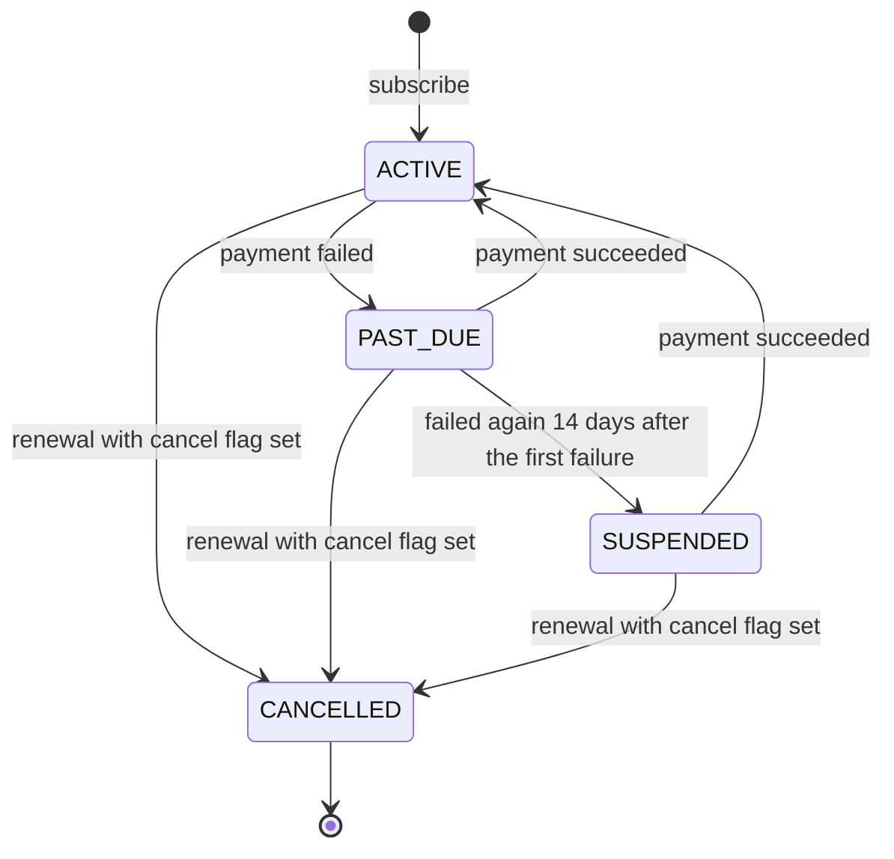
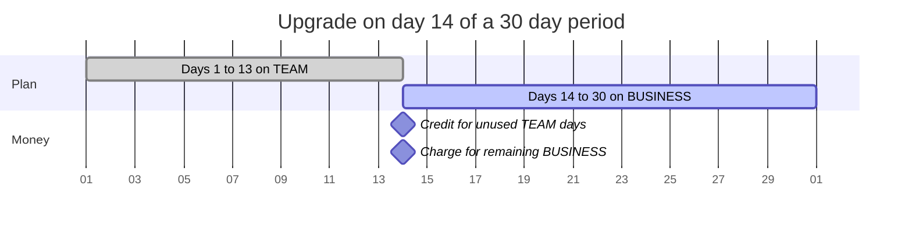
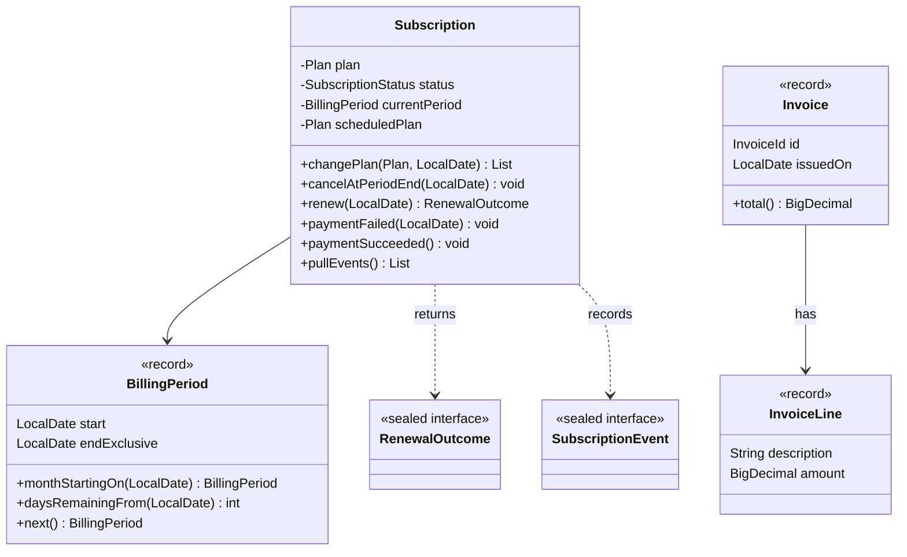
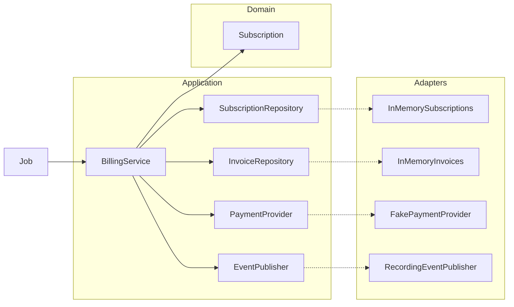
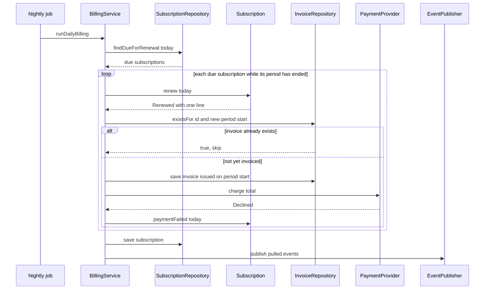

# Task 25 · Capstone: subscription billing

| Difficulty | Topics | Time box |
|---|---|---|
| ⚫ Expert | Everything together: DDD aggregate with a lifecycle, value objects, domain events · Hexagonal architecture with ports and in-memory adapters · Money and proration math with exact rounding rules · Time with an injected `Clock` · Idempotent batch jobs · Sealed results | 6–8 h (a weekend) |

> **Background reading:** everything from tasks 01 ([Money](01-money-value-object.md)), [08](08-order-aggregate.md) (the `Order` aggregate), [10](10-library-lending-hexagonal.md), [12](12-document-approval-type-state.md) and [15](15-gift-card-results.md) · Vernon, *Implementing Domain-Driven Design* (2013), ch. 10 "Aggregates" and ch. 14 "Application" · Stripe's public documentation on "Prorations" (for comparison; our rules are simpler and stated below) · *Effective Java* Item 17 ("Minimize mutability")

---

## The situation

Our SaaS product, **Teamboard** (a project management tool), sells monthly subscriptions. Billing today is a nightly SQL script plus manual corrections in Excel by the finance team. Every upgrade mid-month is a spreadsheet exercise, and a crash halfway through the script has once charged a customer twice.

Finance wants four things from the new billing module:

* **Immediate upgrades with fair proration.** A customer who upgrades on day 14 pays for the rest of the month on the new plan, minus what they did not use of the old one.
* **Downgrades at the end of the period.** Nobody loses features in the middle of a month they have paid for.
* **Cancellation at the end of the period.** The customer keeps access until the period they paid for is over.
* **Dunning for failed payments.** A failed card puts the subscription into a grace period. If it is still failing after 14 days, the customer is suspended.

And the nightly run must be **safe to re-run**. If the process dies halfway, starting it again must not charge anyone twice.

This task is the capstone. It asks you to combine ideas from the whole practice course: value objects, a sealed set of results, an aggregate that guards its own rules, events, an injected clock, and a service that wires ports to adapters. There is no new trick in it. The hard part is keeping all the pieces consistent.

## The domain

| Term | Meaning |
|---|---|
| **Plan** | `FREE` (0.00), `TEAM` (29.00) or `BUSINESS` (79.00) per month. Ordered by price. |
| **Subscription** | One customer's contract for a plan. The aggregate root. It owns its status, period and scheduled changes. |
| **Billing period** | The half-open range of days `[start, endExclusive)` that one payment covers. A month, in our case. |
| **Proration** | Charging only for the days that are left of a period, after a plan change. |
| **Renewal** | The moment a period ends and the next one starts. Renewal may create an invoice. |
| **Invoice** | A document with lines (charges and credits) and a total that is never below zero. |
| **Dunning** | What happens after a failed payment: first `PAST_DUE`, then `SUSPENDED` after the grace period. |
| **Grace period** | 14 days after the first failed payment. |
| **Idempotent run** | A job whose second run over the same data does nothing that the first run has not already done. |

A word on month ends. `plusMonths` clamps 31 January to 28 February. `next()` starts from that end, so the next period runs 28 February to 28 March. The anchor day is lost, and the subscription bills on the 28th from then on (stretch: keep the anchor day).

### The status lifecycle

A subscription can be cancelled in any status except `CANCELLED`; a customer who stopped paying must still be able to leave. Cancellation does not end the subscription on the spot. It sets a flag, and the next renewal turns the subscription into `CANCELLED`.

### An upgrade in the middle of a period

April has 30 days. The customer is on `TEAM` and upgrades to `BUSINESS` on 14 April.

### The domain model

### Ports and adapters

The domain does not know about databases, payment gateways or message buses. The service talks to them through **ports**, which are interfaces in `application`. The **adapters** that implement them live outside the core. In this task the adapters are in-memory, and the tests add two more.

The arrows point in one direction only. The domain depends on nothing. Application depends on the domain and on its own ports. Adapters depend on the ports. That is what lets you swap a database for a list without touching a single rule.

### One nightly run

The job loops over the subscriptions that are due. For each one it renews until the period is current, then creates, saves and charges the renewal invoice. Only after that it saves the subscription and publishes its events.

## What I want from you

Implement the aggregate and the service. The domain types, the ports and the value objects are given. Read them first, they carry the vocabulary.

1. **[`Subscription.start`](../src/main/java/io/github/chris013/practice/task25/domain/Subscription.java)(id, customerId, plan, today)**: the subscription is `ACTIVE`, its first period is `BillingPeriod.monthStartingOn(today)`, and it records `SubscriptionStarted`. `FREE` is allowed.
2. **`changePlan(newPlan, today)`**:
   * The same plan as the current one: `IllegalArgumentException`.
   * Not `ACTIVE`: `IllegalStateException`. Also `IllegalStateException` if `today` is on or after the end of the current period (renewal is due first).
   * **Upgrade** (the new plan is more expensive): takes effect now. Returns exactly two lines. The credit is `-(oldPrice × daysRemaining / periodDays)` and the charge is `newPrice × daysRemaining / periodDays`. Each is rounded HALF_UP to cents **separately**. The descriptions are `Unused time on TEAM (17 of 30 days)` and `Remaining time on BUSINESS (17 of 30 days)`. It clears any scheduled downgrade and records `PlanUpgraded`.
   * **Downgrade** (cheaper): is scheduled for the start of the next period, returns an empty list, and records `PlanChangeScheduled` dated at the period end. A second downgrade replaces the first.
3. **`cancelAtPeriodEnd(today)`**: allowed while `ACTIVE`, `PAST_DUE` or `SUSPENDED`; `IllegalStateException` once `CANCELLED`. Also `IllegalStateException` if `today` is on or after the end of the current period (renewal is due first). Calling it again changes nothing. It sets a flag. It does not change the status.
4. **`resume()`**: clears the cancel flag. Calling it when nothing is cancelled changes nothing. `IllegalStateException` if the subscription is `CANCELLED`.
5. **`renew(today)`**:
   * `IllegalStateException` if the subscription is `CANCELLED`, or if `today` is before the end of the current period.
   * If the cancel flag is set: the status becomes `CANCELLED`, the result is `RenewalOutcome.Ended`, and `SubscriptionEnded` is recorded.
   * Otherwise: the scheduled plan (if any) becomes the plan, the period moves to the next month, and `SubscriptionRenewed` is recorded. The result is `Renewed` with one line, `TEAM plan, 2026-05-01 to 2026-05-31` (the end date is shown inclusive) and the plan's monthly price. `FREE` gives `Renewed` with no lines.
   * It moves **one** period per call. A subscription that is two periods behind needs two calls.
6. **`paymentFailed(today)`**:
   * `ACTIVE` → `PAST_DUE`, remembers `today` as the first failure, records `SubscriptionPastDue`.
   * `PAST_DUE` and at least 14 days after the first failure → `SUSPENDED`, records `SubscriptionSuspended`.
   * `PAST_DUE` with fewer than 14 days: nothing changes. Later failures do not move the first failure date.
   * `SUSPENDED`: nothing changes. `CANCELLED`: `IllegalStateException`.
7. **`paymentSucceeded()`**: `PAST_DUE` or `SUSPENDED` → `ACTIVE`, clears the failure date, records `SubscriptionReactivated`. `ACTIVE`: nothing changes. `CANCELLED`: `IllegalStateException`.
8. **`pullEvents()`** returns the events recorded since the last call, in the order they happened, and forgets them.
9. **[`BillingService.subscribe(customerId, plan)`](../src/main/java/io/github/chris013/practice/task25/application/BillingService.java)**: gets the id from `SubscriptionIds`, starts the subscription with today from the `Clock`, saves it, publishes its events, and returns the id.
10. **`changePlan(id, newPlan)`** on the service: an unknown id is an `IllegalArgumentException`. For a non-empty result from the aggregate, create an invoice dated today, **save it**, and charge its total when it is greater than zero. `Declined` → `paymentFailed(today)`. `Paid` → `paymentSucceeded()`. Then save the subscription and publish its events.
11. **`cancel(id)`** on the service: `cancelAtPeriodEnd(today)`, save, publish.
12. **`runDailyBilling()`**: for each subscription from `findDueForRenewal(today)`, renew while its period has ended. For each `Renewed` with lines:
    * if `existsFor(subscriptionId, newPeriodStart)` is true, count it as `skippedAlreadyInvoiced` and do nothing else;
    * otherwise create an invoice **issued on the new period's first day**, save it, count it as `invoiced`, then charge it; `Declined` → `paymentFailed(today)` (counted as `paymentsFailed`), `Paid` → `paymentSucceeded()`.

    `Ended` is counted as `ended`. Every `Renewed` is counted as `renewed`, FREE ones included. After each subscription, save it and then publish its events.
13. **`Invoice.total()`** is never below `0.00`. Credits larger than the charges give `0.00`.
14. **In-memory adapters**: `SequentialSubscriptionIds` produces `SUB-0001`, `SUB-0002`, … and `SequentialInvoiceIds` produces `INV-0001`, `INV-0002`, … (four digits, zero-padded). `InMemorySubscriptions.findDueForRenewal` never returns a `CANCELLED` subscription. `InMemoryInvoices.existsFor` matches on the invoice's `issuedOn` date.
15. **Dates**: the service gets today from the injected `Clock` (`LocalDate.now(clock)`). The aggregate receives dates as parameters and never reads the clock itself.

## Constraints & non-goals

* **No `double` or `float` for money.** Use `BigDecimal` with explicit scales and rounding.
* **No `LocalDate.now()`** anywhere. Time comes from the injected `Clock` in the service and from parameters in the aggregate.
* **Billing rules live in `Subscription`**, not in the service. The service decides *when* to call, the aggregate decides *whether* and *what*.
* **Nothing is charged at signup.** `subscribe` does not invoice the first period. Checkout does that outside this module. (Stretch goal 3 asks you to change that.)
* **No dunning schedule.** The grace period is measured from the first failed charge. The next charge attempt happens with the next renewal, not on a retry timer.
* **No taxes, no VAT, no currencies other than euro.** [Task 13](13-receipt-enums.md) covers taxes.
* **No persistence, no threads.** The in-memory adapters are single-threaded. Two nodes running the nightly job at once is a stretch goal.
* A `FREE` subscription has no lines at renewal, and no proration credit, but it still gets its period moved and its events published.

## How I'd approach it

* **Start with the period, then the lifecycle, then the money.** `BillingPeriod` is given, but read its tests: they explain the half-open convention and the January 31st case. Then write `Subscription.start`, `paymentFailed` and `paymentSucceeded`, which are small state transitions. Only then tackle `changePlan`, where the money is. Write `renew` last, because it is where the rules meet.
* **Reuse what you know.** Money arithmetic is the same kind of problem as task 01. The sealed `RenewalOutcome` and `PaymentResult` use the pattern-matching style of task 06. The events and the "record it, pull it, publish it" flow follow task 08's `Order`. The injected `Clock` is the one from task 07.
* **Proration: multiply first, divide once.** `29.00 × 17 / 30` is exact in `BigDecimal` if you multiply before you divide. Then round the result once, HALF_UP. Do this for each line on its own. The worked example below shows why the difference matters.
* **Think about the ordering in the service.** Ask yourself what happens if the process dies after each line. Where is the database write? Where is the charge? What does the rerun see? If the answer is "a second charge", you have the order wrong.
* **Idempotency is about *what the rerun sees*, not about a flag.** The renewal invoice is recognised by its issue date. Think about why that is enough, and what could still go wrong. (The flags table lists one of those cases.)
* **Keep the aggregate's public surface small.** Anything you add beyond the contract above is a design decision you must justify.
* **Test with the fakes.** `FakePaymentProvider` and `RecordingEventPublisher` are in `src/test`. `RecordingEventPublisher` also writes to a shared log, so you can check that the save came before the publish.

### The worked example

Upgrade from `TEAM` to `BUSINESS` on 14 April 2026, in a period from 1 April to 30 April (30 days).

| Step | Calculation | Result |
|---|---|---|
| Days remaining, 14 April inclusive to 1 May exclusive | 30 − 13 | 17 |
| Credit for the unused `TEAM` days | −(29.00 x 17 / 30) = −16.4333… | −16.43 |
| Charge for the remaining `BUSINESS` days | 79.00 x 17 / 30 = 44.7666… | 44.77 |
| Invoice total | −16.43 + 44.77 | 28.34 |
| The exact answer, for comparison (not used) | (79.00 − 29.00) x 17 / 30 = 28.3333… | 28.33 |

The invoice shows 28.34, which is what the customer sees when they add up the two printed lines. Rounding the exact difference would give 28.33 and an invoice that does not add up.

## Tests

Run: `mvn test -Dtest='**/task25/**'`

The tests are in three places. [`BillingPeriodTest`](../src/test/java/io/github/chris013/practice/task25/domain/BillingPeriodTest.java) and [`InvoiceTest`](../src/test/java/io/github/chris013/practice/task25/domain/InvoiceTest.java) cover the given value types, so they pass on the starter. [`SubscriptionTest`](../src/test/java/io/github/chris013/practice/task25/domain/SubscriptionTest.java) covers the aggregate, and [`BillingServiceTest`](../src/test/java/io/github/chris013/practice/task25/application/BillingServiceTest.java) covers the service with the in-memory adapters. Most of the new tests fail on the starter until you implement the TODOs.

Show the tests

<!-- embed: src/test/java/io/github/chris013/practice/task25/domain/SubscriptionTest.java -->
<!-- /embed -->

<!-- embed: src/test/java/io/github/chris013/practice/task25/application/BillingServiceTest.java -->
<!-- /embed -->

<!-- embed: src/test/java/io/github/chris013/practice/task25/application/FakePaymentProvider.java -->
<!-- /embed -->

<!-- embed: src/test/java/io/github/chris013/practice/task25/application/RecordingEventPublisher.java -->
<!-- /embed -->

<!-- embed: src/test/java/io/github/chris013/practice/task25/application/MutableClock.java -->
<!-- /embed -->

## Definition of done

- [ ] `mvn test -Dtest='**/task25/**'` is green, and the whole task runs in well under 5 seconds.
- [ ] Every rule in "What I want from you" is covered by a test, and the boundaries are tested (day 13 and day 14 of the grace period, the first and last day of a period, a credit larger than the charge).
- [ ] No `double`, no `float`, no `LocalDate.now()`, no `Instant.now()` anywhere in the main code.
- [ ] The aggregate has no reference to ports, the clock or the service. The service has no `if` on a subscription status.
- [ ] Invoices are saved before they are charged, and events are published after the subscription is saved.
- [ ] A second run of `runDailyBilling` on the same day creates no invoice and no charge.
- [ ] Your PR description says why the renewal invoice is issued on the period's first day, and what happens if the process dies between the invoice save and the subscription save.

## Stretch goals

1. **Carry credit forward.** A credit larger than the charges should not vanish. Keep the leftover as a balance on the subscription and apply it to the next invoice. Where does the balance live, in the aggregate or in a separate `Account`? Why?
2. **Yearly plans.** Add a yearly billing interval. What does `BillingPeriod.monthStartingOn` become, and how does proration change for a 365-day period?
3. **Bill the first period at signup.** Add an invoice in `subscribe` for the first period. What happens when that charge is declined? Is the subscription `PAST_DUE` from day one, or does it not start at all? If the signup invoice also covers taxes, see [Task 13](13-receipt-enums.md).
4. **Two nodes, one nightly job.** Two copies of the job start at midnight. Which rule keeps them from charging the same renewal twice, the idempotency check or a lock? Link your answer to tasks [11](11-token-bucket-rate-limiter.md) and [18](18-seat-reservation-races.md). Can both protections fail at once?
5. **Event-sourced subscription.** Store the events, not the state, and rebuild the subscription from them. Which of the rules in this task become harder to write, and which get easier?

---

## Reference solution

Spoiler: open only after you have made a serious attempt

### Key decisions

**1. The aggregate decides, the service orchestrates.** `Subscription` owns every rule: when an upgrade is allowed, what a renewal bills, when a failed payment becomes a suspension. `BillingService` loads, calls one method, turns the returned lines into an invoice, charges, saves and publishes. The rejected alternative was a `BillingService` with `if (status == PAST_DUE)` branches. That works for one caller, and every new caller then has to copy the rule correctly.

**2. Dates come in as parameters.** The aggregate takes `LocalDate today` in every method that needs it, and never reads the clock. Only the service calls `LocalDate.now(clock)`. The rejected alternative was giving the aggregate a `Clock`. That makes the domain depend on infrastructure, and the tests then need a clock they do not really need.

**3. Money is multiply-then-divide, rounded once per line.** `prorated` multiplies the price by the days, divides by the period length with HALF_UP to two decimals, and the credit is negated afterwards. There are no doubles anywhere. The rejected alternative was to compute the difference once and round the total. That gives 28.33 where the printed lines add up to 28.34.

**4. The invoice is saved before it is charged.** The rejected order, charge then save, risks a second charge: if the process dies after the charge, the rerun finds no invoice and charges again. Saving first rules that out, because a rerun finds the invoice and does not charge again. The price is the opposite gap: if the process dies between the save and the charge, the invoice stays unpaid, and the rerun skips it. This task accepts that gap; the flags table and stretch goal 4 come back to it. Charging a customer twice is worse than billing one invoice late.

**5. A renewal invoice is recognised by its issue date.** Renewal invoices are issued on the first day of the period they bill, so `existsFor(subscription, periodStart)` is a complete check. An upgrade invoice can share a date with a period start, but only after that period's renewal has run, because `changePlan` refuses while a renewal is due. The check depends on that rule. A catch-up renewal is also backdated: the May invoice of a job that runs on 1 June says issued 1 May. A production system would put the billed period on the invoice (with an invoice kind, so proration invoices do not match) and a unique key on (subscription, period start). The rejected alternative was a separate "billed periods" table. It is more explicit, but a second source of truth to keep in step.

**6. Sealed results instead of exceptions for the normal outcomes.** `RenewalOutcome` (`Renewed` or `Ended`) and `PaymentResult` (`Paid` or `Declined`) are values, because a declined card or a cancelled subscription is normal business. The service matches them with an exhaustive `switch`. Exceptions remain for bugs: a renewal before it is due, a change to a cancelled subscription.

**7. Events are pulled from the aggregate and published after the save.** The aggregate only records; it never publishes. The service publishes after `save`, so a listener never reacts to a change that the database rejected. The price is at-least-once delivery: a rerun after a crash can publish `SubscriptionRenewed` a second time, so consumers must be idempotent.

**8. The grace period counts from the first failure.** `firstFailedPaymentOn` is set once, by the transition from `ACTIVE`. A second failure does not restart the clock, otherwise a customer whose card fails every day would never be suspended. A successful payment clears the date.

### Code

<!-- embed: solutions/src/main/java/io/github/chris013/practice/task25/domain/Subscription.java -->
<!-- /embed -->

<!-- embed: solutions/src/main/java/io/github/chris013/practice/task25/application/BillingService.java -->
<!-- /embed -->

<!-- embed: solutions/src/main/java/io/github/chris013/practice/task25/domain/BillingPeriod.java -->
<!-- /embed -->

<!-- embed: solutions/src/main/java/io/github/chris013/practice/task25/adapter/inmemory/InMemoryInvoices.java -->
<!-- /embed -->

### What I typically flag in first attempts

| Finding | Why it matters |
|---|---|
| `double` for prorated amounts | `16.433…` as a double, then rounded, can differ by a cent from the `BigDecimal` answer, and the customer notices. Multiply the `BigDecimal` first and divide once. |
| Rounding the sum instead of each line | The invoice total no longer equals the sum of the printed lines. Round each line, then add. |
| `LocalDate.now()` in the aggregate or the service | Tests depend on the day they run, and renewal boundaries become impossible to test. Inject a `Clock` in the service and pass dates into the aggregate. |
| Billing rules in the service, such as `if status PAST_DUE then ...` | The rule is copied into every caller. The next caller forgets one branch and suspends a customer who has paid. |
| Publishing events before the save | A listener reacts to a change that the database then rejects. The listener and the database now disagree. |
| A non-idempotent nightly job (charge, then save, with no check) | A crash after the charge and before the save charges the same customer again on the rerun. |
| Skipping an invoice that exists but was never charged | A crash between the invoice save and the charge leaves an unpaid invoice that the rerun skips forever. Real systems store an invoice status (OPEN or PAID) and let a collector retry OPEN invoices. |
| A mutable `BillingPeriod`, or a `List` that the caller can change | The period of a stored subscription changes under the aggregate's feet. Records, `List.copyOf` and no setters keep the state safe. |
| Resetting the grace period on every failure | A card that fails every day never reaches the 14-day limit, so the customer is never suspended. |

