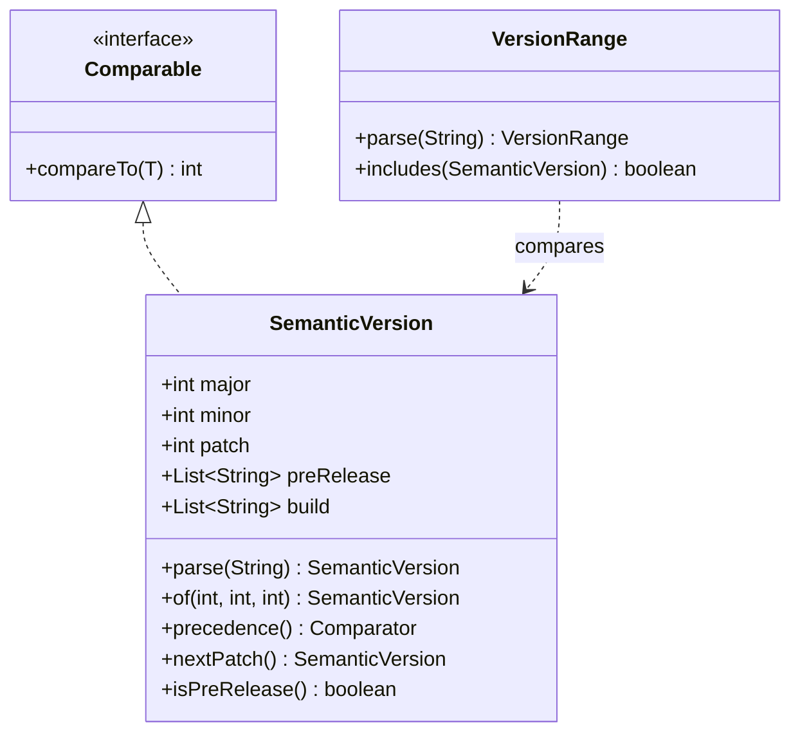
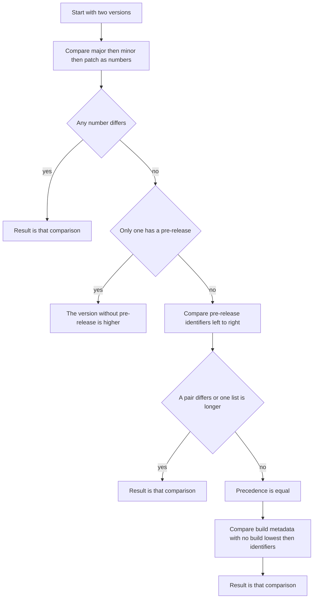

# Task 26 · Semantic versions and the compareTo contract

| Difficulty | Topics | Time box |
|---|---|---|
| 🟢 Easy | Value object with a precise parser · `Comparable` consistent with `equals` (and what a `TreeSet` does when it is not) · `Comparator` composition · Static factories · Following an external specification exactly | 1.5–2 h |

> **Background reading:** Semantic Versioning 2.0.0 (semver.org), especially §9 (pre-release), §10 (build metadata) and §11 (precedence) · *Effective Java* Item 14 ("Consider implementing `Comparable`"), Item 10 and 11 (`equals` and `hashCode`), Item 17 ("Minimize mutability") · the Javadoc of `java.lang.Comparable`, especially "consistent with equals" and the `BigDecimal` example · the npm `semver` documentation for caret and tilde ranges (the range part of this task)

---

## The situation

Our internal plugin marketplace stores every plugin version as a string and sorts the list with `String.compareTo`. That gives two bad results:

* `1.10.0` sorts **before** `1.9.0`, because `"1.1"` is less than `"1.9"` character by character.
* `2.0.0-rc.1` counts as **newer** than `2.0.0`, because `"2.0.0"` is a prefix of `"2.0.0-rc.1"`, and `String.compareTo` ranks a shorter prefix lower.

The "update to latest" button picked release candidates, and customers ended up with pre-release plugins installed. That is the bug.

A second problem sits next to it. Plugins declare which host versions they support, for example `^2.3.0`, and the host checks that with a regular expression that nobody on the team understands. When it fails, it says "no match", and that's all.

We want two things: a proper `SemanticVersion` value object that knows the SemVer ordering rules, and a small `VersionRange` that understands the `^`, `~` and comparator syntax the plugin authors already use.

## The domain

| Term | Meaning |
|---|---|
| **Version** | `MAJOR.MINOR.PATCH`, optionally followed by `-` and a pre-release, and `+` and build metadata. Example: `2.0.0-rc.1+build.7`. |
| **Pre-release** | A version that is *before* the stable release with the same numbers: `2.0.0-rc.1` comes before `2.0.0`. |
| **Build metadata** | Information after `+`. It never changes which version is newer, so SemVer says it must be ignored for precedence. |
| **Precedence** | The SemVer ordering rules (§11), without build metadata. |
| **Range** | A set of versions, such as `^1.2.3`. A plugin supports a host version when the host version is in the range. |

### How precedence is decided

This flowchart is the whole of `compareTo`. Build metadata is only consulted at the very end, and only when the precedence says the two versions are equal.

## What I want from you

Implement [`SemanticVersion`](../src/main/java/io/github/chris013/practice/task26/SemanticVersion.java) and [`VersionRange`](../src/main/java/io/github/chris013/practice/task26/VersionRange.java). The tests in `src/test` are the contract. Every rule below is checked by a test.

1. **Parsing** (`SemanticVersion.parse`). The text must match SemVer 2.0.0 exactly:
   * three core numbers `MAJOR.MINOR.PATCH`, digits only, no leading zeros except `0`, each one fitting an `int`;
   * optional `-` followed by dot-separated pre-release identifiers. Each identifier is non-empty and made of `[0-9A-Za-z-]`. A purely numeric identifier has no leading zeros;
   * optional `+` followed by dot-separated build identifiers. Same character rules, leading zeros allowed.
   * No `v` prefix, no whitespace.
2. **Errors** for bad text are an `IllegalArgumentException` whose message contains the input in single quotes and says what is wrong, for example `invalid version '01.2.3': leading zero in major`. The tests check these fragments of the message: `version is empty`, `expected three numbers`, `invalid character 'v' in major`, `leading zero in major`, `invalid character ' ' in major`, `empty pre-release identifier`, `leading zero in pre-release identifier '01'`, `empty build identifier`, `invalid character '$' in pre-release identifier` and `major is too large`. `null` gives a `NullPointerException`.
3. **Construction.** The record's compact constructor rejects negative numbers (`IllegalArgumentException`), applies the same identifier rules to the lists, and copies both lists with `List.copyOf`. `of(major, minor, patch)` creates a version without pre-release or build.
4. **`toString`** returns the canonical text, so `parse(v.toString())` equals `v`.
5. **`compareTo`** follows SemVer §11 and then uses build metadata as the last tie-breaker, so that it returns zero **only** for equal versions:
   * major, minor and patch compare numerically;
   * a version with a pre-release is lower than the same version without one;
   * pre-release identifiers compare left to right. Numeric identifiers compare by value and are lower than alphanumeric ones. Alphanumeric identifiers compare as ASCII strings. When all shared identifiers are equal, the shorter list is lower;
   * only if precedence is equal: no build metadata is lower than any build metadata. Otherwise the identifiers compare as ASCII strings, left to right, and the shorter list is lower.
6. **`precedence()`** returns one shared `Comparator` that uses rule 5 **without** the build metadata step. Its Javadoc says that it is inconsistent with `equals`.
7. **`isPreRelease()`** is true when there is at least one pre-release identifier. **`isStable()`** is true when `major >= 1` and there is no pre-release.
8. **`nextMajor()`, `nextMinor()`, `nextPatch()`** drop the pre-release and the build metadata and follow the npm rules:
   * `nextPatch()`: `1.2.3-rc.1` gives `1.2.3`; otherwise the patch goes up by one.
   * `nextMinor()`: `1.3.0-rc.1` gives `1.3.0`; otherwise the minor goes up by one and the patch becomes 0.
   * `nextMajor()`: `2.0.0-rc.1` gives `2.0.0`; otherwise the major goes up by one and minor and patch become 0.
9. **`VersionRange.parse`** accepts exactly one of these forms. Surrounding whitespace is ignored:
   * `*`: every version without a pre-release (see rule 11);
   * an exact version, `1.2.3`, or `=1.2.3`;
   * `^X.Y.Z`: `>=X.Y.Z <(X+1).0.0`. If `X` is 0, the upper bound moves to the next minor: `^0.2.3` is `>=0.2.3 <0.3.0`. If `X` and `Y` are 0, it moves to the next patch: `^0.0.3` is `>=0.0.3 <0.0.4`;
   * `~X.Y.Z`: `>=X.Y.Z <X.(Y+1).0`;
   * one or more space-separated comparators, each one of `>=`, `>`, `<=`, `<`, `=` followed by a version. All of them must hold, for example `>=1.2.0 <1.5.0`.
   
   Caret, tilde and exact versions may carry a pre-release (`^1.2.3-beta.2`) and build metadata. Build metadata is ignored.
10. **Invalid ranges** give an `IllegalArgumentException` whose message contains the input in single quotes. This includes an empty range, a comparator without an operator when there are several comparators, a caret or tilde with whitespace after it, and a bump that would overflow an `int`.
11. **Pre-release rule.** A version with a pre-release is included only when:
    * it satisfies every comparator, **and**
    * at least one comparator's version is a pre-release with the same `major.minor.patch`.

    So `^1.2.3-beta.2` includes `1.2.3-beta.4`, but not `1.2.4-beta.1`. And `^1.2.3` and `*` never include a pre-release.
12. **Comparisons** in ranges use `SemanticVersion.precedence()`, so build metadata never changes the result.
13. **`VersionRange.toString`** returns the original text, trimmed.

## Constraints & non-goals

* Plain Java 25, no libraries in the main code. Both classes are immutable.
* You may use the semver.org regular expression, but we recommend splitting the text so the error can name the exact part that is wrong.
* **No OR-ranges** (`^1.2 || ^2.0`), **no partial versions** (`^1.2`) and **no `maxSatisfying`** in this task. They are stretch goals.
* `nextX()` may throw `ArithmeticException` when the number would not fit an `int`. It does not need its own exception type.
* `VersionRange` does not need `equals` or `hashCode`.

## How I'd approach it

* **Write the parser first, and have it fail with specific messages.** Split the text at `+`, then at the first `-`, then the core at `.`. Each step can report exactly what is wrong. The list of identifiers can be checked in the record's constructor, which means `parse` and `new SemanticVersion(...)` share one set of rules.
* **Compare with composition, not with subtraction.** `Comparator.comparingInt(SemanticVersion::major).thenComparingInt(SemanticVersion::minor)…` says what it does. In `compareTo`, do not write `return major - other.major;`. That is correct here only because we forbid negative numbers. The real problem is overflow: `a - b` wraps around when the operands are large and of opposite sign. For example, `Integer.MIN_VALUE - 1` is `Integer.MAX_VALUE`, a large positive number, so the sign is wrong. *Effective Java* Item 14 explains why `Integer.compare` is the habit to build.
* **Compare numeric identifiers without parsing them.** A numeric identifier has no leading zeros, so a longer one is always the bigger one. Compare the lengths first, then the characters. This works even for a 30-digit identifier, which would not fit in any Java number type.
* **Make `compareTo` and `equals` agree.** Precedence ignores build metadata, so `compareTo` must add build metadata as the last step. Then zero means "the same version", and `equals` on the record (which compares all five components) agrees with it. "Consistent with equals" means `compareTo` returns zero exactly when `equals` returns true. The classic counterexample is `BigDecimal`: `new BigDecimal("1.0")` and `new BigDecimal("1.00")` are not `equals`, because the scale differs, so a `HashSet` keeps both. Their `compareTo` is 0, so a `TreeSet` keeps only one. `precedence()` breaks the same way: `1.0.0+a` and `1.0.0+b` compare as equal, so `new TreeSet<>(precedence())` keeps only one of them. A `TreeSet` decides "same element" with `compare` or `compareTo` and never calls `equals`, so `add` returns `false` for a version that is not `equals` to the one already stored. That breaks the `Set` contract, which is defined in terms of `equals`.
* **Keep `precedence()` as a second, deliberately weaker comparator.** Read its Javadoc. It is correct for sorting for display, for `max`, and for range checks. It is wrong for a `TreeSet`, as the tests show.
* **The range check is a list of bounds.** A `VersionRange` can hold a list of small "operator plus version" pairs, all of which must hold. Caret and tilde are just a helper that writes those pairs for you. The pre-release rule is one extra check before the bounds are tested.
* **Caret is the one with a table to get right.** Work out the upper bound for each case before you write code:

| Written | Expands to | Included | Not included |
|---|---|---|---|
| `^1.2.3` | `>=1.2.3 <2.0.0` | `1.2.3`, `1.9.9` | `1.2.2`, `2.0.0` |
| `^0.2.3` | `>=0.2.3 <0.3.0` | `0.2.3`, `0.2.9` | `0.3.0` |
| `^0.0.3` | `>=0.0.3 <0.0.4` | `0.0.3` | `0.0.4`, `0.1.0` |
| `~1.2.3` | `>=1.2.3 <1.3.0` | `1.2.9` | `1.3.0` |
| `~0.2.3` | `>=0.2.3 <0.3.0` | `0.2.9` | `0.3.0` |
| `^1.2.3-beta.2` | `>=1.2.3-beta.2 <2.0.0` | `1.2.3-beta.4` | `1.2.4-beta.1`, `1.2.3-beta.1` |

* **Think about the pre-release rule with a concrete example before you write it.** For `^1.2.3-beta.2`, the candidate `1.2.4-beta.1` satisfies `>=1.2.3-beta.2 <2.0.0`. It is still rejected, because no comparator is a pre-release for `1.2.4`. That is the rule working as intended.
* **Parse the range in two steps.** First decide the form from the first character (`*`, `^`, `~`, or a comparator list). Then parse the versions with `SemanticVersion.parse`, so the version rules live in one place.

## Tests

Run: `mvn test -Dtest='**/task26/**'`

The test classes:

* [`SemanticVersionParsingTest`](../src/test/java/io/github/chris013/practice/task26/SemanticVersionParsingTest.java): valid and invalid text, round trips, and the record's constructor rules.
* [`SemanticVersionOrderingTest`](../src/test/java/io/github/chris013/practice/task26/SemanticVersionOrderingTest.java): the SemVer example chain, build metadata, consistency with `equals`, and the two tree sets.
* [`NextVersionTest`](../src/test/java/io/github/chris013/practice/task26/NextVersionTest.java): the `nextX()` tables.
* [`VersionRangeTest`](../src/test/java/io/github/chris013/practice/task26/VersionRangeTest.java): caret, tilde, exact, `*`, comparator sets, the pre-release rule, and invalid ranges.

Show the tests

<!-- embed: src/test/java/io/github/chris013/practice/task26/SemanticVersionParsingTest.java -->
<!-- /embed -->

<!-- embed: src/test/java/io/github/chris013/practice/task26/SemanticVersionOrderingTest.java -->
<!-- /embed -->

<!-- embed: src/test/java/io/github/chris013/practice/task26/NextVersionTest.java -->
<!-- /embed -->

<!-- embed: src/test/java/io/github/chris013/practice/task26/VersionRangeTest.java -->
<!-- /embed -->

## Definition of done

- [ ] `mvn test -Dtest='**/task26/**'` is green.
- [ ] `compareTo` returns zero only for versions that are `equals`. You can explain why build metadata is the last tie-breaker.
- [ ] No subtraction in any comparison, and every parse error says which part is wrong.
- [ ] Precedence is never used as a key of a `TreeSet` or `TreeMap` in the code you wrote.
- [ ] Both classes are immutable, and the lists are copied.
- [ ] Your PR description says why `^0.2.3` does not include `0.3.0`, using the rule and not a table.

## Stretch goals

1. **OR-ranges.** Accept `^1.2 || ^2.0`. What should `includes` do when the same version matches two of the sub-ranges? Does the pre-release rule apply per sub-range or to the whole expression?
2. **Partial versions.** Accept `^1.2` (which means `^1.2.0`) and `1.x`. Where does the missing patch number come from, and does `^1.2` include `1.2.0-rc.1`?
3. **`maxSatisfying`.** Write a static method `Optional<SemanticVersion> maxSatisfying(Collection<SemanticVersion> versions, VersionRange range)`. Which comparator should you use to pick the maximum, and why does it matter here?
4. **A sealed range type.** Replace the list of bounds with a sealed interface whose implementations are `Exact`, `Caret`, `Tilde` and `Comparators`. What do you gain, and what does `switch` on it give you?

---

## Reference solution

Spoiler: open only after you have made a serious attempt

### Key decisions

**1. The parser splits the text, and the record checks the parts.** `parse` splits at `+` and then at the first `-`. Each piece produces its own message ("empty build identifier", "leading zero in major"). The record's compact constructor checks the same identifier rules for the lists it receives, so there is one set of rules. The rejected alternative was the semver.org regular expression. It is short, but when it fails it can only say "invalid version".

**2. Numbers are checked before `Integer.parseInt`.** Each core part is checked for digits, then for leading zeros, and only then parsed. The `NumberFormatException` from a too-large number is turned into an `IllegalArgumentException` with a useful message. Callers should not have to know that the parser uses `Integer.parseInt` internally.

**3. Comparison by composition, and without subtraction.** The precedence comparator is `comparingInt(...).thenComparingInt(...).thenComparing(preRelease, comparePreRelease)`. `compareTo` adds the build step with one more `thenComparing`. The rejected alternative was `return major - other.major`, which works here only because negative numbers are forbidden.

**4. Numeric identifiers are compared by length, then by characters.** No parsing and no overflow. The rejected alternative was `Long.parseLong`, which breaks on a 20-digit identifier.

**5. `precedence()` is one shared constant, and its Javadoc gives a warning.** The SemVer precedence rule is needed for range checks and for display, so we keep it. We do not hide the inconsistency with `equals`; we document it. The rejected alternative was to drop the method and make every caller use `compareTo`, which would make range checks depend on build metadata, and it must not.

**6. Build metadata is compared as plain ASCII, so `a.10` sorts before `a.9`.** That is what the rule says, and it is a total order. We do not try to be clever about numbers in build metadata, because build metadata has no meaning for ordering in the first place. The test locks this in so that nobody "fixes" it by accident.

**7. Ranges are a list of bounds.** `Bound` is an operator and a version, and `holds` uses `precedence()`. Caret and tilde only write the bounds, so the matching logic exists once. The rejected alternative was one class per range form with its own `includes`, which would repeat the pre-release rule four times.

**8. The pre-release rule is one method.** `allowsPreReleaseOf` checks whether any bound is a pre-release with the same `major.minor.patch`. That is the whole rule, and it is written in the same words as the task.

### Code

<!-- embed: solutions/src/main/java/io/github/chris013/practice/task26/SemanticVersion.java -->
<!-- /embed -->

<!-- embed: solutions/src/main/java/io/github/chris013/practice/task26/VersionRange.java -->
<!-- /embed -->

### What I typically flag in first attempts

| Finding | Why it matters |
|---|---|
| Comparing versions as strings anywhere, even "just for display" | `1.10.0` sorts before `1.9.0`. The bug that started this task comes back with every new call site. |
| `compareTo` written as `return major - other.major` | Correct only because negative numbers are forbidden. The next person who relaxes that rule gets wrong results without any warning. |
| `equals` ignores build metadata, or `compareTo` ignores it without saying so | Then `equals` and `compareTo` disagree, and a `TreeSet` silently drops versions. Either document it or make both agree. |
| Accepting a leading zero such as `01.2.3` | It is not SemVer, and two strings for one version make equality checks fail in confusing ways. |
| One regular expression for the whole version, with "invalid version" as the only message | When a plugin author sees "invalid version '1.2.3-'", they cannot tell what to fix. Split the text and say which part is wrong. |
| `Integer.parseInt` called without a check, so a 99999999999 gives a `NumberFormatException` | Callers who expect `IllegalArgumentException` get a different type. Check, then parse, and wrap the failure. |
| `^` ranges that include pre-releases of the next major (`^1.2.3` accepting `2.0.0-rc.1`) | The pre-release rule exists so that customers do not get release candidates by accident. Test the case explicitly. |

