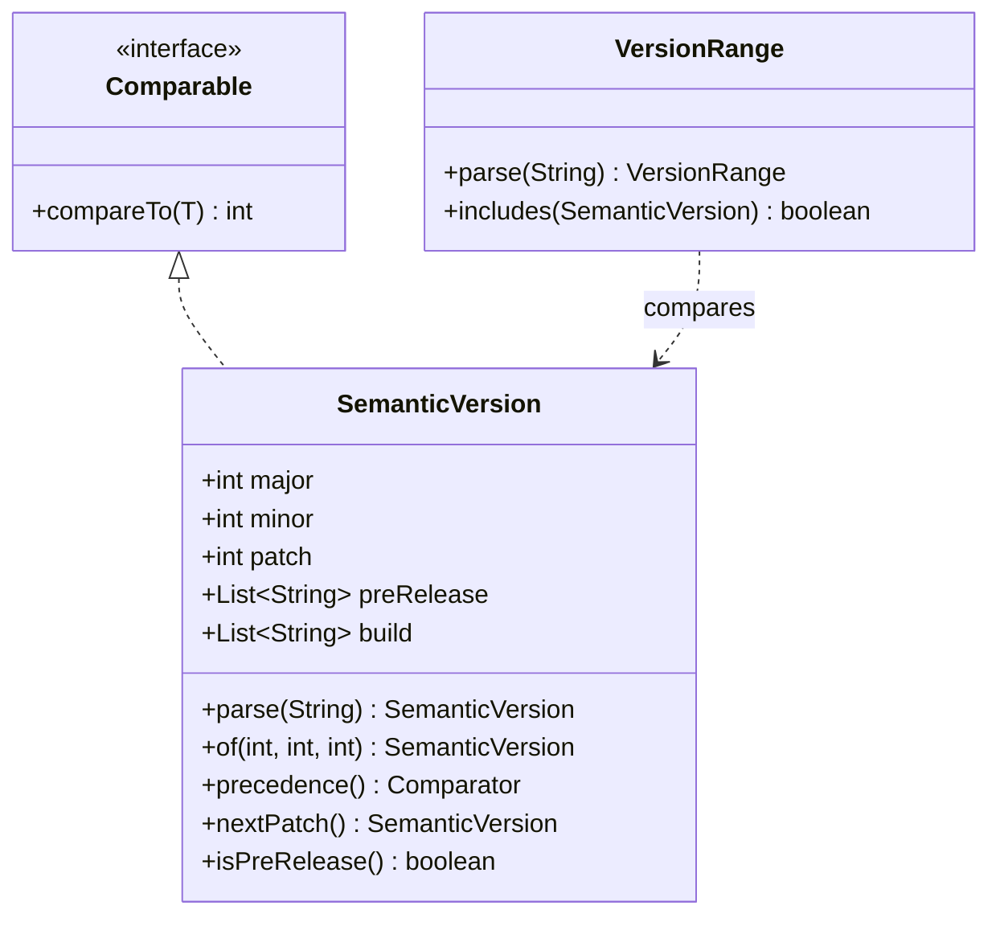
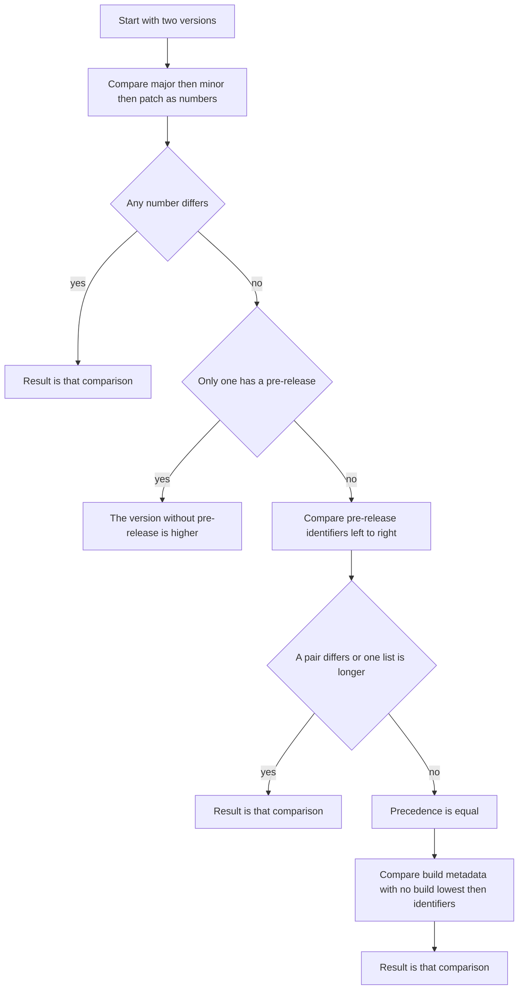

# Task 26 · Semantic versions and the compareTo contract

| Difficulty | Topics | Time box |
|---|---|---|
| 🟢 Easy | Value object with a precise parser · `Comparable` consistent with `equals` (and what a `TreeSet` does when it is not) · `Comparator` composition · Static factories · Following an external specification exactly | 1.5–2 h |

> **Background reading:** Semantic Versioning 2.0.0 (semver.org), especially §9 (pre-release), §10 (build metadata) and §11 (precedence) · *Effective Java* Item 14 ("Consider implementing `Comparable`"), Item 10 and 11 (`equals` and `hashCode`), Item 17 ("Minimize mutability") · the Javadoc of `java.lang.Comparable`, especially "consistent with equals" and the `BigDecimal` example · the npm `semver` documentation for caret and tilde ranges (the range part of this task)

---

## The situation

Our internal plugin marketplace stores every plugin version as a string and sorts the list with `String.compareTo`. That gives two bad results:

* `1.10.0` sorts **before** `1.9.0`, because `"1.1"` is less than `"1.9"` character by character.
* `2.0.0-rc.1` counts as **newer** than `2.0.0`, because `"2.0.0"` is a prefix of `"2.0.0-rc.1"`, and `String.compareTo` ranks a shorter prefix lower.

The "update to latest" button picked release candidates, and customers ended up with pre-release plugins installed. That is the bug.

A second problem sits next to it. Plugins declare which host versions they support, for example `^2.3.0`, and the host checks that with a regular expression that nobody on the team understands. When it fails, it says "no match", and that's all.

We want two things: a proper `SemanticVersion` value object that knows the SemVer ordering rules, and a small `VersionRange` that understands the `^`, `~` and comparator syntax the plugin authors already use.

## The domain

| Term | Meaning |
|---|---|
| **Version** | `MAJOR.MINOR.PATCH`, optionally followed by `-` and a pre-release, and `+` and build metadata. Example: `2.0.0-rc.1+build.7`. |
| **Pre-release** | A version that is *before* the stable release with the same numbers: `2.0.0-rc.1` comes before `2.0.0`. |
| **Build metadata** | Information after `+`. It never changes which version is newer, so SemVer says it must be ignored for precedence. |
| **Precedence** | The SemVer ordering rules (§11), without build metadata. |
| **Range** | A set of versions, such as `^1.2.3`. A plugin supports a host version when the host version is in the range. |



### How precedence is decided

This flowchart is the whole of `compareTo`. Build metadata is only consulted at the very end, and only when the precedence says the two versions are equal.



## What I want from you

Implement [`SemanticVersion`](../src/main/java/io/github/chris013/practice/task26/SemanticVersion.java) and [`VersionRange`](../src/main/java/io/github/chris013/practice/task26/VersionRange.java). The tests in `src/test` are the contract. Every rule below is checked by a test.

1. **Parsing** (`SemanticVersion.parse`). The text must match SemVer 2.0.0 exactly:
   * three core numbers `MAJOR.MINOR.PATCH`, digits only, no leading zeros except `0`, each one fitting an `int`;
   * optional `-` followed by dot-separated pre-release identifiers. Each identifier is non-empty and made of `[0-9A-Za-z-]`. A purely numeric identifier has no leading zeros;
   * optional `+` followed by dot-separated build identifiers. Same character rules, leading zeros allowed.
   * No `v` prefix, no whitespace.
2. **Errors** for bad text are an `IllegalArgumentException` whose message contains the input in single quotes and says what is wrong, for example `invalid version '01.2.3': leading zero in major`. The tests check these fragments of the message: `version is empty`, `expected three numbers`, `invalid character 'v' in major`, `leading zero in major`, `invalid character ' ' in major`, `empty pre-release identifier`, `leading zero in pre-release identifier '01'`, `empty build identifier`, `invalid character '$' in pre-release identifier` and `major is too large`. `null` gives a `NullPointerException`.
3. **Construction.** The record's compact constructor rejects negative numbers (`IllegalArgumentException`), applies the same identifier rules to the lists, and copies both lists with `List.copyOf`. `of(major, minor, patch)` creates a version without pre-release or build.
4. **`toString`** returns the canonical text, so `parse(v.toString())` equals `v`.
5. **`compareTo`** follows SemVer §11 and then uses build metadata as the last tie-breaker, so that it returns zero **only** for equal versions:
   * major, minor and patch compare numerically;
   * a version with a pre-release is lower than the same version without one;
   * pre-release identifiers compare left to right. Numeric identifiers compare by value and are lower than alphanumeric ones. Alphanumeric identifiers compare as ASCII strings. When all shared identifiers are equal, the shorter list is lower;
   * only if precedence is equal: no build metadata is lower than any build metadata. Otherwise the identifiers compare as ASCII strings, left to right, and the shorter list is lower.
6. **`precedence()`** returns one shared `Comparator` that uses rule 5 **without** the build metadata step. Its Javadoc says that it is inconsistent with `equals`.
7. **`isPreRelease()`** is true when there is at least one pre-release identifier. **`isStable()`** is true when `major >= 1` and there is no pre-release.
8. **`nextMajor()`, `nextMinor()`, `nextPatch()`** drop the pre-release and the build metadata and follow the npm rules:
   * `nextPatch()`: `1.2.3-rc.1` gives `1.2.3`; otherwise the patch goes up by one.
   * `nextMinor()`: `1.3.0-rc.1` gives `1.3.0`; otherwise the minor goes up by one and the patch becomes 0.
   * `nextMajor()`: `2.0.0-rc.1` gives `2.0.0`; otherwise the major goes up by one and minor and patch become 0.
9. **`VersionRange.parse`** accepts exactly one of these forms. Surrounding whitespace is ignored:
   * `*`: every version without a pre-release (see rule 11);
   * an exact version, `1.2.3`, or `=1.2.3`;
   * `^X.Y.Z`: `>=X.Y.Z <(X+1).0.0`. If `X` is 0, the upper bound moves to the next minor: `^0.2.3` is `>=0.2.3 <0.3.0`. If `X` and `Y` are 0, it moves to the next patch: `^0.0.3` is `>=0.0.3 <0.0.4`;
   * `~X.Y.Z`: `>=X.Y.Z <X.(Y+1).0`;
   * one or more space-separated comparators, each one of `>=`, `>`, `<=`, `<`, `=` followed by a version. All of them must hold, for example `>=1.2.0 <1.5.0`.
   
   Caret, tilde and exact versions may carry a pre-release (`^1.2.3-beta.2`) and build metadata. Build metadata is ignored.
10. **Invalid ranges** give an `IllegalArgumentException` whose message contains the input in single quotes. This includes an empty range, a comparator without an operator when there are several comparators, a caret or tilde with whitespace after it, and a bump that would overflow an `int`.
11. **Pre-release rule.** A version with a pre-release is included only when:
    * it satisfies every comparator, **and**
    * at least one comparator's version is a pre-release with the same `major.minor.patch`.

    So `^1.2.3-beta.2` includes `1.2.3-beta.4`, but not `1.2.4-beta.1`. And `^1.2.3` and `*` never include a pre-release.
12. **Comparisons** in ranges use `SemanticVersion.precedence()`, so build metadata never changes the result.
13. **`VersionRange.toString`** returns the original text, trimmed.

## Constraints & non-goals

* Plain Java 25, no libraries in the main code. Both classes are immutable.
* You may use the semver.org regular expression, but we recommend splitting the text so the error can name the exact part that is wrong.
* **No OR-ranges** (`^1.2 || ^2.0`), **no partial versions** (`^1.2`) and **no `maxSatisfying`** in this task. They are stretch goals.
* `nextX()` may throw `ArithmeticException` when the number would not fit an `int`. It does not need its own exception type.
* `VersionRange` does not need `equals` or `hashCode`.

## How I'd approach it

* **Write the parser first, and have it fail with specific messages.** Split the text at `+`, then at the first `-`, then the core at `.`. Each step can report exactly what is wrong. The list of identifiers can be checked in the record's constructor, which means `parse` and `new SemanticVersion(...)` share one set of rules.
* **Compare with composition, not with subtraction.** `Comparator.comparingInt(SemanticVersion::major).thenComparingInt(SemanticVersion::minor)…` says what it does. In `compareTo`, do not write `return major - other.major;`. That is correct here only because we forbid negative numbers. The real problem is overflow: `a - b` wraps around when the operands are large and of opposite sign. For example, `Integer.MIN_VALUE - 1` is `Integer.MAX_VALUE`, a large positive number, so the sign is wrong. *Effective Java* Item 14 explains why `Integer.compare` is the habit to build.
* **Compare numeric identifiers without parsing them.** A numeric identifier has no leading zeros, so a longer one is always the bigger one. Compare the lengths first, then the characters. This works even for a 30-digit identifier, which would not fit in any Java number type.
* **Make `compareTo` and `equals` agree.** Precedence ignores build metadata, so `compareTo` must add build metadata as the last step. Then zero means "the same version", and `equals` on the record (which compares all five components) agrees with it. "Consistent with equals" means `compareTo` returns zero exactly when `equals` returns true. The classic counterexample is `BigDecimal`: `new BigDecimal("1.0")` and `new BigDecimal("1.00")` are not `equals`, because the scale differs, so a `HashSet` keeps both. Their `compareTo` is 0, so a `TreeSet` keeps only one. `precedence()` breaks the same way: `1.0.0+a` and `1.0.0+b` compare as equal, so `new TreeSet<>(precedence())` keeps only one of them. A `TreeSet` decides "same element" with `compare` or `compareTo` and never calls `equals`, so `add` returns `false` for a version that is not `equals` to the one already stored. That breaks the `Set` contract, which is defined in terms of `equals`.
* **Keep `precedence()` as a second, deliberately weaker comparator.** Read its Javadoc. It is correct for sorting for display, for `max`, and for range checks. It is wrong for a `TreeSet`, as the tests show.
* **The range check is a list of bounds.** A `VersionRange` can hold a list of small "operator plus version" pairs, all of which must hold. Caret and tilde are just a helper that writes those pairs for you. The pre-release rule is one extra check before the bounds are tested.
* **Caret is the one with a table to get right.** Work out the upper bound for each case before you write code:

| Written | Expands to | Included | Not included |
|---|---|---|---|
| `^1.2.3` | `>=1.2.3 <2.0.0` | `1.2.3`, `1.9.9` | `1.2.2`, `2.0.0` |
| `^0.2.3` | `>=0.2.3 <0.3.0` | `0.2.3`, `0.2.9` | `0.3.0` |
| `^0.0.3` | `>=0.0.3 <0.0.4` | `0.0.3` | `0.0.4`, `0.1.0` |
| `~1.2.3` | `>=1.2.3 <1.3.0` | `1.2.9` | `1.3.0` |
| `~0.2.3` | `>=0.2.3 <0.3.0` | `0.2.9` | `0.3.0` |
| `^1.2.3-beta.2` | `>=1.2.3-beta.2 <2.0.0` | `1.2.3-beta.4` | `1.2.4-beta.1`, `1.2.3-beta.1` |

* **Think about the pre-release rule with a concrete example before you write it.** For `^1.2.3-beta.2`, the candidate `1.2.4-beta.1` satisfies `>=1.2.3-beta.2 <2.0.0`. It is still rejected, because no comparator is a pre-release for `1.2.4`. That is the rule working as intended.
* **Parse the range in two steps.** First decide the form from the first character (`*`, `^`, `~`, or a comparator list). Then parse the versions with `SemanticVersion.parse`, so the version rules live in one place.

## Tests

Run: `mvn test -Dtest='**/task26/**'`

The test classes:

* [`SemanticVersionParsingTest`](../src/test/java/io/github/chris013/practice/task26/SemanticVersionParsingTest.java): valid and invalid text, round trips, and the record's constructor rules.
* [`SemanticVersionOrderingTest`](../src/test/java/io/github/chris013/practice/task26/SemanticVersionOrderingTest.java): the SemVer example chain, build metadata, consistency with `equals`, and the two tree sets.
* [`NextVersionTest`](../src/test/java/io/github/chris013/practice/task26/NextVersionTest.java): the `nextX()` tables.
* [`VersionRangeTest`](../src/test/java/io/github/chris013/practice/task26/VersionRangeTest.java): caret, tilde, exact, `*`, comparator sets, the pre-release rule, and invalid ranges.

<details>
<summary>Show the tests</summary>

<!-- embed: src/test/java/io/github/chris013/practice/task26/SemanticVersionParsingTest.java -->
**[`SemanticVersionParsingTest.java`](../src/test/java/io/github/chris013/practice/task26/SemanticVersionParsingTest.java)**

```java
package io.github.chris013.practice.task26;

import static org.assertj.core.api.Assertions.assertThat;
import static org.assertj.core.api.Assertions.assertThatThrownBy;

import java.util.ArrayList;
import java.util.List;
import org.junit.jupiter.api.Nested;
import org.junit.jupiter.api.Test;
import org.junit.jupiter.params.ParameterizedTest;
import org.junit.jupiter.params.provider.CsvSource;

class SemanticVersionParsingTest {

    @Nested
    class Valid {

        @ParameterizedTest
        @CsvSource({
            "0.0.0",
            "1.2.3",
            "10.20.30",
            "2147483647.2147483647.2147483647",
            "1.0.0-alpha",
            "1.0.0-alpha.1",
            "1.0.0-0.3.7",
            "1.0.0-x.7.z.92",
            "1.0.0-0A.is.legal",
            "1.0.0-x-y-z.--",
            "1.0.0-alpha.123456789012345678901234567890.beta-gamma.1",
            "1.0.0+20130313144700",
            "1.0.0-beta+exp.sha.5114f85",
            "1.0.0+21AF26D3----117B344092BD",
            "1.0.0+001",
        })
        void parses_and_prints_the_same_text(String text) {
            assertThat(SemanticVersion.parse(text)).hasToString(text);
        }

        @Test
        void printed_text_parses_back_to_an_equal_version() {
            List<SemanticVersion> versions = List.of(
                    new SemanticVersion(1, 0, 0, List.of("rc", "1"), List.of("build", "7")),
                    SemanticVersion.of(0, 0, 0),
                    new SemanticVersion(1, 2, 3, List.of(), List.of("001")));

            for (SemanticVersion version : versions) {
                assertThat(SemanticVersion.parse(version.toString())).as(version.toString()).isEqualTo(version);
            }
        }

        @Test
        void exposes_each_part() {
            SemanticVersion version = SemanticVersion.parse("1.2.3-rc.1+build.7");

            assertThat(version.major()).isEqualTo(1);
            assertThat(version.minor()).isEqualTo(2);
            assertThat(version.patch()).isEqualTo(3);
            assertThat(version.preRelease()).containsExactly("rc", "1");
            assertThat(version.build()).containsExactly("build", "7");
        }

        @Test
        void of_builds_a_stable_version_without_metadata() {
            SemanticVersion version = SemanticVersion.of(1, 2, 3);

            assertThat(version).isEqualTo(SemanticVersion.parse("1.2.3"));
            assertThat(version.preRelease()).isEmpty();
            assertThat(version.build()).isEmpty();
        }

        @ParameterizedTest
        @CsvSource({
            "1.2.3, false, true",
            "0.9.0, false, false",
            "1.0.0+build, false, true",
            "1.0.0-rc.1, true, false",
            "2.0.0-rc.1, true, false",
        })
        void tells_pre_releases_and_stable_versions_apart(String text, boolean preRelease, boolean stable) {
            SemanticVersion version = SemanticVersion.parse(text);

            assertThat(version.isPreRelease()).isEqualTo(preRelease);
            assertThat(version.isStable()).isEqualTo(stable);
        }
    }

    @Nested
    class Invalid {

        // Column 1 is the input, column 2 a fragment of the message. The input is quoted so that spaces survive.
        @ParameterizedTest
        @CsvSource(delimiter = '|', quoteCharacter = '"', value = {
            "\"\"|version is empty",
            "1.2|expected three numbers",
            "1.2.3.4|expected three numbers",
            "v1.2.3|invalid character 'v' in major",
            "01.2.3|leading zero in major",
            "1.2.3-|empty pre-release identifier",
            "1.2.3-01|leading zero in pre-release identifier '01'",
            "1.2.3-a..b|empty pre-release identifier",
            "1.2.3+|empty build identifier",
            "1.2.3-a$|invalid character '$' in pre-release identifier",
            "99999999999.0.0|major is too large",
            "\" 1.2.3\"|invalid character ' ' in major",
        })
        void rejects_the_text_and_says_what_is_wrong(String text, String reason) {
            assertThatThrownBy(() -> SemanticVersion.parse(text))
                    .isInstanceOf(IllegalArgumentException.class)
                    .hasMessageContaining("'" + text + "'")
                    .hasMessageContaining(reason);
        }

        @Test
        void rejects_null() {
            assertThatThrownBy(() -> SemanticVersion.parse(null)).isInstanceOf(NullPointerException.class);
        }
    }

    @Nested
    class Construction {

        @Test
        void rejects_a_negative_number() {
            assertThatThrownBy(() -> new SemanticVersion(-1, 0, 0, List.of(), List.of()))
                    .isInstanceOf(IllegalArgumentException.class);
            assertThatThrownBy(() -> SemanticVersion.of(0, 0, -1)).isInstanceOf(IllegalArgumentException.class);
        }

        @Test
        void rejects_a_leading_zero_in_a_numeric_pre_release_identifier() {
            assertThatThrownBy(() -> new SemanticVersion(1, 0, 0, List.of("01"), List.of()))
                    .isInstanceOf(IllegalArgumentException.class);
        }

        @Test
        void allows_a_leading_zero_in_build_metadata() {
            assertThat(new SemanticVersion(1, 0, 0, List.of(), List.of("007")).build()).containsExactly("007");
        }

        @Test
        void rejects_null_components() {
            assertThatThrownBy(() -> new SemanticVersion(1, 0, 0, null, List.of()))
                    .isInstanceOf(NullPointerException.class);
            assertThatThrownBy(() -> new SemanticVersion(1, 0, 0, List.of(), null))
                    .isInstanceOf(NullPointerException.class);
        }

        @Test
        void copies_the_lists_so_later_changes_do_not_leak_in() {
            List<String> preRelease = new ArrayList<>(List.of("rc"));
            SemanticVersion version = new SemanticVersion(1, 0, 0, preRelease, List.of());

            preRelease.add("2");

            assertThat(version.preRelease()).containsExactly("rc");
        }
    }
}
```
<!-- /embed -->

<!-- embed: src/test/java/io/github/chris013/practice/task26/SemanticVersionOrderingTest.java -->
**[`SemanticVersionOrderingTest.java`](../src/test/java/io/github/chris013/practice/task26/SemanticVersionOrderingTest.java)**

```java
package io.github.chris013.practice.task26;

import static org.assertj.core.api.Assertions.assertThat;

import java.util.ArrayList;
import java.util.Collections;
import java.util.HashSet;
import java.util.List;
import java.util.Set;
import java.util.TreeSet;
import org.junit.jupiter.api.Nested;
import org.junit.jupiter.api.Test;
import org.junit.jupiter.params.ParameterizedTest;
import org.junit.jupiter.params.provider.CsvSource;

class SemanticVersionOrderingTest {

    /** The example chain from SemVer section 11.4, lowest first. */
    private static final List<String> SEMVER_CHAIN = List.of(
            "1.0.0-alpha",
            "1.0.0-alpha.1",
            "1.0.0-alpha.beta",
            "1.0.0-beta",
            "1.0.0-beta.2",
            "1.0.0-beta.11",
            "1.0.0-rc.1",
            "1.0.0");

    private static SemanticVersion v(String text) {
        return SemanticVersion.parse(text);
    }

    private static List<SemanticVersion> chain() {
        return SEMVER_CHAIN.stream().map(SemanticVersion::parse).toList();
    }

    @Nested
    class Precedence {

        @Test
        void follows_the_semver_example_chain() {
            List<SemanticVersion> versions = chain();

            assertThat(versions).isSorted();
            assertThat(versions).doesNotHaveDuplicates();

            List<SemanticVersion> shuffled = new ArrayList<>(versions.reversed());
            Collections.sort(shuffled);
            assertThat(shuffled).containsExactlyElementsOf(versions);
        }

        @Test
        void sorts_numbers_by_value_not_by_text() {
            assertThat(v("1.9.0")).isLessThan(v("1.10.0"));
            assertThat(v("1.9.9")).isLessThan(v("2.0.0"));
        }

        @ParameterizedTest
        @CsvSource({
            "1.2.3, 1.2.4",
            "1.2.9, 1.3.0",
            "1.9.9, 2.0.0",
            "0.9.9, 1.0.0-alpha",
            "1.0.0-rc.1, 1.0.0",
            "1.0.0-alpha, 1.0.0-alpha.0",
            "1.0.0-1, 1.0.0-alpha",
            "1.0.0-2, 1.0.0-10",
            "1.0.0-9, 1.0.0-99999999999999999999",
            "1.0.0-A, 1.0.0-a",
            "2.0.0-rc.1, 2.0.0-rc.1.1",
        })
        void orders_the_lower_version_first(String lower, String higher) {
            assertThat(v(lower)).isLessThan(v(higher));
            assertThat(v(higher)).isGreaterThan(v(lower));
        }

        @Test
        void precedence_comparator_is_one_shared_constant() {
            assertThat(SemanticVersion.precedence()).isSameAs(SemanticVersion.precedence());
        }

        @Test
        void precedence_sorts_the_same_way_when_there_is_no_build_metadata() {
            List<SemanticVersion> versions = chain();
            List<SemanticVersion> shuffled = new ArrayList<>(versions.reversed());

            shuffled.sort(SemanticVersion.precedence());

            assertThat(shuffled).containsExactlyElementsOf(versions);
        }
    }

    @Nested
    class BuildMetadata {

        @Test
        void precedence_ignores_build_metadata() {
            assertThat(SemanticVersion.precedence().compare(v("1.0.0+a"), v("1.0.0+b"))).isZero();
        }

        @Test
        void compare_to_breaks_the_tie_with_build_metadata() {
            assertThat(v("1.0.0+a")).isLessThan(v("1.0.0+b"));
        }

        @ParameterizedTest
        @CsvSource({
            "1.0.0, 1.0.0+build.1",
            "1.0.0+a, 1.0.0+a.1",
            "1.0.0+a.10, 1.0.0+a.9",
            "1.0.0-rc.1+zzz, 1.0.0+aaa",
        })
        void orders_builds_after_precedence_as_plain_ascii(String lower, String higher) {
            assertThat(v(lower)).isLessThan(v(higher));
        }
    }

    @Nested
    class ConsistentWithEquals {

        @ParameterizedTest
        @CsvSource({
            "1.0.0, 1.0.0, true",
            "1.0.0+a, 1.0.0+a, true",
            "1.0.0+a, 1.0.0+b, false",
            "1.0.0+a, 1.0.0, false",
            "1.0.0-rc.1, 1.0.0-rc.1, true",
            "1.0.0-rc.1, 1.0.0-rc.2, false",
        })
        void compare_to_is_zero_exactly_when_equals_is_true(String left, String right, boolean same) {
            assertThat(v(left).compareTo(v(right)) == 0).isEqualTo(same);
            assertThat(v(left).equals(v(right))).isEqualTo(same);
        }

        @Test
        void a_natural_order_tree_set_keeps_both_builds() {
            TreeSet<SemanticVersion> versions = new TreeSet<>();

            versions.add(v("1.0.0+a"));
            versions.add(v("1.0.0+b"));

            assertThat(versions).hasSize(2);
        }

        @Test
        void a_hash_set_keeps_both_builds() {
            Set<SemanticVersion> versions = new HashSet<>(List.of(v("1.0.0+a"), v("1.0.0+b")));

            assertThat(versions).hasSize(2);
        }

        @Test
        void a_precedence_tree_set_treats_the_two_builds_as_one() {
            TreeSet<SemanticVersion> versions = new TreeSet<>(SemanticVersion.precedence());

            assertThat(versions.add(v("1.0.0+a"))).isTrue();
            assertThat(versions.add(v("1.0.0+b"))).isFalse();

            assertThat(versions).containsExactly(v("1.0.0+a"));
        }
    }
}
```
<!-- /embed -->

<!-- embed: src/test/java/io/github/chris013/practice/task26/NextVersionTest.java -->
**[`NextVersionTest.java`](../src/test/java/io/github/chris013/practice/task26/NextVersionTest.java)**

```java
package io.github.chris013.practice.task26;

import static org.assertj.core.api.Assertions.assertThat;
import static org.assertj.core.api.Assertions.assertThatThrownBy;

import org.junit.jupiter.api.Nested;
import org.junit.jupiter.api.Test;
import org.junit.jupiter.params.ParameterizedTest;
import org.junit.jupiter.params.provider.CsvSource;

class NextVersionTest {

    @Nested
    class NextPatch {

        @ParameterizedTest
        @CsvSource({
            "0.0.0, 0.0.1",
            "1.2.3, 1.2.4",
            "1.2.3+build.5, 1.2.4",
            "1.2.3-rc.1, 1.2.3",
            "1.2.3-rc.1+b, 1.2.3",
        })
        void drops_the_pre_release_or_bumps_the_patch(String from, String expected) {
            assertThat(SemanticVersion.parse(from).nextPatch()).hasToString(expected);
        }
    }

    @Nested
    class NextMinor {

        @ParameterizedTest
        @CsvSource({
            "1.0.0, 1.1.0",
            "1.2.3, 1.3.0",
            "1.2.3+b, 1.3.0",
            "1.2.3-rc.1, 1.3.0",
            "1.3.0-rc.1, 1.3.0",
        })
        void bumps_the_minor_or_drops_a_pre_release_on_a_zero_patch(String from, String expected) {
            assertThat(SemanticVersion.parse(from).nextMinor()).hasToString(expected);
        }
    }

    @Nested
    class NextMajor {

        @ParameterizedTest
        @CsvSource({
            "1.2.3, 2.0.0",
            "1.2.3+b, 2.0.0",
            "2.0.0-rc.1, 2.0.0",
            "2.1.0-rc.1, 3.0.0",
            "2.0.1-rc.1, 3.0.0",
        })
        void bumps_the_major_or_drops_a_pre_release_on_zero_minor_and_patch(String from, String expected) {
            assertThat(SemanticVersion.parse(from).nextMajor()).hasToString(expected);
        }
    }

    @Nested
    class Overflow {

        @Test
        void refuses_to_wrap_around_past_the_largest_int() {
            SemanticVersion largest = SemanticVersion.of(Integer.MAX_VALUE, 0, 0);

            assertThatThrownBy(largest::nextMajor).isInstanceOf(ArithmeticException.class);
        }
    }
}
```
<!-- /embed -->

<!-- embed: src/test/java/io/github/chris013/practice/task26/VersionRangeTest.java -->
**[`VersionRangeTest.java`](../src/test/java/io/github/chris013/practice/task26/VersionRangeTest.java)**

```java
package io.github.chris013.practice.task26;

import static org.assertj.core.api.Assertions.assertThat;
import static org.assertj.core.api.Assertions.assertThatThrownBy;

import org.junit.jupiter.api.Nested;
import org.junit.jupiter.api.Test;
import org.junit.jupiter.params.ParameterizedTest;
import org.junit.jupiter.params.provider.CsvSource;
import org.junit.jupiter.params.provider.ValueSource;

class VersionRangeTest {

    private static boolean includes(String range, String version) {
        return VersionRange.parse(range).includes(SemanticVersion.parse(version));
    }

    @Nested
    class Caret {

        @ParameterizedTest
        @CsvSource({
            "^1.2.3, 1.2.3, true",
            "^1.2.3, 1.9.9, true",
            "^1.2.3, 1.2.2, false",
            "^1.2.3, 2.0.0, false",
            "^0.2.3, 0.2.3, true",
            "^0.2.3, 0.2.9, true",
            "^0.2.3, 0.3.0, false",
            "^0.2.3, 0.2.2, false",
            "^0.0.3, 0.0.3, true",
            "^0.0.3, 0.0.4, false",
            "^0.0.3, 0.1.0, false",
        })
        void follows_the_npm_rules_for_major_minor_and_patch_zero(String range, String version, boolean expected) {
            assertThat(includes(range, version)).isEqualTo(expected);
        }
    }

    @Nested
    class Tilde {

        @ParameterizedTest
        @CsvSource({
            "~1.2.3, 1.2.3, true",
            "~1.2.3, 1.2.9, true",
            "~1.2.3, 1.3.0, false",
            "~1.2.3, 1.2.2, false",
            "~0.2.3, 0.2.9, true",
            "~0.2.3, 0.3.0, false",
        })
        void allows_only_patch_changes(String range, String version, boolean expected) {
            assertThat(includes(range, version)).isEqualTo(expected);
        }
    }

    @Nested
    class Exact {

        @ParameterizedTest
        @CsvSource({
            "1.2.3, 1.2.3, true",
            "1.2.3, 1.2.4, false",
            "=1.2.3, 1.2.3, true",
            "1.2.3, 1.2.3+build.5, true",
            "1.2.3-rc.1, 1.2.3-rc.1, true",
            "1.2.3-rc.1, 1.2.3-rc.2, false",
        })
        void matches_by_precedence_only(String range, String version, boolean expected) {
            assertThat(includes(range, version)).isEqualTo(expected);
        }
    }

    @Nested
    class Star {

        @ParameterizedTest
        @CsvSource({
            "*, 0.0.0, true",
            "*, 0.1.0, true",
            "*, 1.0.0, true",
            "*, 1.0.0+build.9, true",
            "*, 1.0.0-rc.1, false",
        })
        void includes_every_version_without_a_pre_release(String range, String version, boolean expected) {
            assertThat(includes(range, version)).isEqualTo(expected);
        }
    }

    @Nested
    class ComparatorSets {

        @ParameterizedTest
        @CsvSource({
            ">=1.2.0 <1.5.0, 1.2.0, true",
            ">=1.2.0 <1.5.0, 1.4.9, true",
            ">=1.2.0 <1.5.0, 1.5.0, false",
            ">=1.2.0 <1.5.0, 1.1.9, false",
            ">1.2.0 <=1.5.0, 1.2.0, false",
            ">1.2.0 <=1.5.0, 1.5.0, true",
            "<2.0.0, 1.9.9, true",
            "<2.0.0, 2.0.0, false",
        })
        void every_comparator_must_hold(String range, String version, boolean expected) {
            assertThat(includes(range, version)).isEqualTo(expected);
        }
    }

    @Nested
    class PreReleases {

        @ParameterizedTest
        @CsvSource({
            "^1.2.3-beta.2, 1.2.3-beta.4, true",
            "^1.2.3-beta.2, 1.2.3-beta.1, false",
            "^1.2.3-beta.2, 1.2.4-beta.1, false",
            "^1.2.3-beta.2, 1.2.3, true",
            "^1.2.3-beta.2, 2.0.0-rc.1, false",
            "^1.2.3, 1.3.0-rc.1, false",
            "~1.2.3-beta.2, 1.2.3-beta.3, true",
            "~1.2.3-beta.2, 1.2.4-beta.1, false",
            ">=1.2.0-rc.1 <1.2.0, 1.2.0-rc.2, true",
            ">=1.2.0 <1.5.0, 1.4.0-rc.1, false",
        })
        void a_pre_release_needs_a_comparator_with_the_same_major_minor_patch(
                String range, String version, boolean expected) {
            assertThat(includes(range, version)).isEqualTo(expected);
        }
    }

    @Nested
    class Parsing {

        @Test
        void to_string_returns_the_trimmed_original_text() {
            assertThat(VersionRange.parse("  ^1.2.3 ")).hasToString("^1.2.3");
            assertThat(VersionRange.parse(">=1.2.0 <1.5.0")).hasToString(">=1.2.0 <1.5.0");
        }

        @ParameterizedTest
        @ValueSource(strings = {
            "",
            "   ",
            "^",
            "~",
            "^1.2",
            "^1.2.3 <2.0.0",
            "~ 1.2.3",
            ">=",
            ">=1.2.0 1.5.0",
            "1.2.3 <2.0.0",
            ">=1.2.3 foo",
            "x",
            "*1.2.3",
            "^2147483647.0.0",
        })
        void rejects_malformed_ranges_and_names_the_input(String text) {
            assertThatThrownBy(() -> VersionRange.parse(text))
                    .isInstanceOf(IllegalArgumentException.class)
                    .hasMessageContaining("invalid range '" + text.strip() + "'");
        }

        @Test
        void rejects_null() {
            assertThatThrownBy(() -> VersionRange.parse(null)).isInstanceOf(NullPointerException.class);
        }
    }
}
```
<!-- /embed -->

</details>

## Definition of done

- [ ] `mvn test -Dtest='**/task26/**'` is green.
- [ ] `compareTo` returns zero only for versions that are `equals`. You can explain why build metadata is the last tie-breaker.
- [ ] No subtraction in any comparison, and every parse error says which part is wrong.
- [ ] Precedence is never used as a key of a `TreeSet` or `TreeMap` in the code you wrote.
- [ ] Both classes are immutable, and the lists are copied.
- [ ] Your PR description says why `^0.2.3` does not include `0.3.0`, using the rule and not a table.

## Stretch goals

1. **OR-ranges.** Accept `^1.2 || ^2.0`. What should `includes` do when the same version matches two of the sub-ranges? Does the pre-release rule apply per sub-range or to the whole expression?
2. **Partial versions.** Accept `^1.2` (which means `^1.2.0`) and `1.x`. Where does the missing patch number come from, and does `^1.2` include `1.2.0-rc.1`?
3. **`maxSatisfying`.** Write a static method `Optional<SemanticVersion> maxSatisfying(Collection<SemanticVersion> versions, VersionRange range)`. Which comparator should you use to pick the maximum, and why does it matter here?
4. **A sealed range type.** Replace the list of bounds with a sealed interface whose implementations are `Exact`, `Caret`, `Tilde` and `Comparators`. What do you gain, and what does `switch` on it give you?

---

## Reference solution

<details>
<summary>Spoiler: open only after you have made a serious attempt</summary>

### Key decisions

**1. The parser splits the text, and the record checks the parts.** `parse` splits at `+` and then at the first `-`. Each piece produces its own message ("empty build identifier", "leading zero in major"). The record's compact constructor checks the same identifier rules for the lists it receives, so there is one set of rules. The rejected alternative was the semver.org regular expression. It is short, but when it fails it can only say "invalid version".

**2. Numbers are checked before `Integer.parseInt`.** Each core part is checked for digits, then for leading zeros, and only then parsed. The `NumberFormatException` from a too-large number is turned into an `IllegalArgumentException` with a useful message. Callers should not have to know that the parser uses `Integer.parseInt` internally.

**3. Comparison by composition, and without subtraction.** The precedence comparator is `comparingInt(...).thenComparingInt(...).thenComparing(preRelease, comparePreRelease)`. `compareTo` adds the build step with one more `thenComparing`. The rejected alternative was `return major - other.major`, which works here only because negative numbers are forbidden.

**4. Numeric identifiers are compared by length, then by characters.** No parsing and no overflow. The rejected alternative was `Long.parseLong`, which breaks on a 20-digit identifier.

**5. `precedence()` is one shared constant, and its Javadoc gives a warning.** The SemVer precedence rule is needed for range checks and for display, so we keep it. We do not hide the inconsistency with `equals`; we document it. The rejected alternative was to drop the method and make every caller use `compareTo`, which would make range checks depend on build metadata, and it must not.

**6. Build metadata is compared as plain ASCII, so `a.10` sorts before `a.9`.** That is what the rule says, and it is a total order. We do not try to be clever about numbers in build metadata, because build metadata has no meaning for ordering in the first place. The test locks this in so that nobody "fixes" it by accident.

**7. Ranges are a list of bounds.** `Bound` is an operator and a version, and `holds` uses `precedence()`. Caret and tilde only write the bounds, so the matching logic exists once. The rejected alternative was one class per range form with its own `includes`, which would repeat the pre-release rule four times.

**8. The pre-release rule is one method.** `allowsPreReleaseOf` checks whether any bound is a pre-release with the same `major.minor.patch`. That is the whole rule, and it is written in the same words as the task.

### Code

<!-- embed: solutions/src/main/java/io/github/chris013/practice/task26/SemanticVersion.java -->
**[`SemanticVersion.java`](../solutions/src/main/java/io/github/chris013/practice/task26/SemanticVersion.java)**

```java
package io.github.chris013.practice.task26;

import java.util.Comparator;
import java.util.List;
import java.util.Objects;

/**
 * A version number as defined by Semantic Versioning 2.0.0 (semver.org), for example {@code 2.0.0-rc.1+build.7}.
 *
 * <p>Why not keep versions as strings? {@code String.compareTo} puts {@code 1.10.0} before {@code 1.9.0}, and it
 * ranks {@code 2.0.0-rc.1} above {@code 2.0.0}. Both mistakes reached our customers.
 *
 * <p>{@link #compareTo} is consistent with {@link #equals}: it returns zero only for identical versions, because it
 * uses build metadata as the last tie-breaker. {@link #precedence()} ignores build metadata, so it is not consistent
 * with equals. Read its Javadoc before you put it into a sorted set or map.
 */
public record SemanticVersion(int major, int minor, int patch, List<String> preRelease, List<String> build)
        implements Comparable<SemanticVersion> {

    /** SemVer section 11, without the build metadata tie-breaker. */
    private static final Comparator<SemanticVersion> PRECEDENCE = Comparator.comparingInt(SemanticVersion::major)
            .thenComparingInt(SemanticVersion::minor)
            .thenComparingInt(SemanticVersion::patch)
            .thenComparing(SemanticVersion::preRelease, SemanticVersion::comparePreRelease);

    /** The natural order: precedence first, then build metadata. Consistent with equals. */
    private static final Comparator<SemanticVersion> FULL_ORDER =
            PRECEDENCE.thenComparing(SemanticVersion::build, SemanticVersion::compareBuild);

    /**
     * Validates the parts and copies the lists, so the record is immutable.
     *
     * @throws IllegalArgumentException if a number is negative or an identifier breaks the SemVer rules
     * @throws NullPointerException if a component is null
     */
    public SemanticVersion {
        requireNotNegative(major, "major");
        requireNotNegative(minor, "minor");
        requireNotNegative(patch, "patch");
        preRelease = List.copyOf(Objects.requireNonNull(preRelease, "preRelease"));
        build = List.copyOf(Objects.requireNonNull(build, "build"));
        checkIdentifiers(preRelease, "pre-release", true);
        checkIdentifiers(build, "build", false);
    }

    /** A stable version without pre-release or build metadata. */
    public static SemanticVersion of(int major, int minor, int patch) {
        return new SemanticVersion(major, minor, patch, List.of(), List.of());
    }

    /**
     * Parses exactly the SemVer 2.0.0 grammar. Anything else is rejected, including a {@code v} prefix and whitespace.
     *
     * <p>The parser splits the text by its separators ({@code +} first, then the first {@code -}) and lets the
     * constructor validate the identifiers. One regular expression would also work, but it could only say
     * "invalid version", and the message is the part a user actually reads.
     *
     * @throws IllegalArgumentException if the text is not a valid version; the message names the input
     */
    public static SemanticVersion parse(String text) {
        Objects.requireNonNull(text, "text");
        try {
            return parseOrThrow(text);
        } catch (IllegalArgumentException e) {
            throw new IllegalArgumentException("invalid version '" + text + "': " + e.getMessage(), e);
        }
    }

    private static SemanticVersion parseOrThrow(String text) {
        if (text.isEmpty()) {
            throw new IllegalArgumentException("version is empty");
        }
        String rest = text;
        List<String> build = List.of();
        int plus = rest.indexOf('+');
        if (plus >= 0) {
            build = splitIdentifiers(rest.substring(plus + 1));
            rest = rest.substring(0, plus);
        }
        List<String> preRelease = List.of();
        int dash = rest.indexOf('-');
        if (dash >= 0) {
            preRelease = splitIdentifiers(rest.substring(dash + 1));
            rest = rest.substring(0, dash);
        }
        // The core never contains '-' or '+', so the first separator of each kind is the right one.
        String[] core = rest.split("\\.", -1);
        if (core.length != 3) {
            throw new IllegalArgumentException("expected three numbers MAJOR.MINOR.PATCH, found " + core.length);
        }
        return new SemanticVersion(
                parseNumber(core[0], "major"),
                parseNumber(core[1], "minor"),
                parseNumber(core[2], "patch"),
                preRelease,
                build);
    }

    /** Non-negative integers only: no sign, no leading zeros, and it must fit an {@code int}. */
    private static int parseNumber(String digits, String part) {
        if (digits.isEmpty()) {
            throw new IllegalArgumentException("empty " + part);
        }
        for (char c : digits.toCharArray()) {
            if (!isAsciiDigit(c)) {
                throw new IllegalArgumentException("invalid character '" + c + "' in " + part);
            }
        }
        if (digits.length() > 1 && digits.charAt(0) == '0') {
            throw new IllegalArgumentException("leading zero in " + part);
        }
        try {
            return Integer.parseInt(digits);
        } catch (NumberFormatException e) {
            // Without this, the caller would see a NumberFormatException, which is not the contract.
            throw new IllegalArgumentException(part + " is too large", e);
        }
    }

    private static List<String> splitIdentifiers(String dotted) {
        return List.of(dotted.split("\\.", -1));
    }

    private static void checkIdentifiers(List<String> identifiers, String kind, boolean forbidLeadingZeros) {
        for (String id : identifiers) {
            if (id.isEmpty()) {
                throw new IllegalArgumentException("empty " + kind + " identifier");
            }
            for (char c : id.toCharArray()) {
                if (!isIdentifierChar(c)) {
                    throw new IllegalArgumentException(
                            "invalid character '" + c + "' in " + kind + " identifier '" + id + "'");
                }
            }
            if (forbidLeadingZeros && allDigits(id) && id.length() > 1 && id.charAt(0) == '0') {
                throw new IllegalArgumentException("leading zero in " + kind + " identifier '" + id + "'");
            }
        }
    }

    private static void requireNotNegative(int value, String name) {
        if (value < 0) {
            throw new IllegalArgumentException(name + " must not be negative, was " + value);
        }
    }

    /**
     * SemVer precedence: major, minor and patch numerically, then pre-release, and build metadata is ignored.
     *
     * <p><b>Warning:</b> two versions that differ only in build metadata compare as equal here, but are not
     * {@link #equals}. Do not use this comparator in a {@code TreeSet} or as the key of a {@code TreeMap}: the set
     * would silently drop one of them. It is safe for sorting for display, for {@code max}/{@code min}, and for
     * range checks, where build metadata must not matter.
     */
    public static Comparator<SemanticVersion> precedence() {
        return PRECEDENCE;
    }

    /**
     * Compares precedence first and build metadata second, so that {@code compareTo} returns zero only for equal
     * versions. That makes it safe in sorted collections.
     */
    @Override
    public int compareTo(SemanticVersion other) {
        return FULL_ORDER.compare(this, other);
    }

    /** A version with a pre-release (such as {@code 1.0.0-rc.1}) is lower than the same version without one. */
    public boolean isPreRelease() {
        return !preRelease.isEmpty();
    }

    /** Major version 1 or higher, and no pre-release. Major 0 means "initial development" in SemVer. */
    public boolean isStable() {
        return major >= 1 && !isPreRelease();
    }

    /**
     * The next major release, following the npm rules. A pre-release such as {@code 2.0.0-rc.1} becomes
     * {@code 2.0.0}, because that release is the one the pre-release was heading for.
     *
     * @throws ArithmeticException if the major number would not fit an {@code int}
     */
    public SemanticVersion nextMajor() {
        if (isPreRelease() && minor == 0 && patch == 0) {
            return of(major, 0, 0);
        }
        return of(Math.incrementExact(major), 0, 0);
    }

    /**
     * The next minor release, following the npm rules. {@code 1.3.0-rc.1} becomes {@code 1.3.0}.
     *
     * @throws ArithmeticException if the minor number would not fit an {@code int}
     */
    public SemanticVersion nextMinor() {
        if (isPreRelease() && patch == 0) {
            return of(major, minor, 0);
        }
        return of(major, Math.incrementExact(minor), 0);
    }

    /**
     * The next patch release, following the npm rules. {@code 1.2.3-rc.1} becomes {@code 1.2.3}.
     *
     * @throws ArithmeticException if the patch number would not fit an {@code int}
     */
    public SemanticVersion nextPatch() {
        if (isPreRelease()) {
            return of(major, minor, patch);
        }
        return of(major, minor, Math.incrementExact(patch));
    }

    /** The canonical text, for example {@code 1.0.0-rc.1+build.7}. {@code parse(v.toString())} gives back {@code v}. */
    @Override
    public String toString() {
        StringBuilder text = new StringBuilder()
                .append(major).append('.').append(minor).append('.').append(patch);
        if (isPreRelease()) {
            text.append('-').append(String.join(".", preRelease));
        }
        if (!build.isEmpty()) {
            text.append('+').append(String.join(".", build));
        }
        return text.toString();
    }

    /** SemVer 11.4: an empty pre-release is the stable version, so it sorts higher. Lists are compared left to right. */
    private static int comparePreRelease(List<String> left, List<String> right) {
        if (left.isEmpty() || right.isEmpty()) {
            return Boolean.compare(left.isEmpty(), right.isEmpty());
        }
        int common = Math.min(left.size(), right.size());
        for (int i = 0; i < common; i++) {
            int result = compareIdentifier(left.get(i), right.get(i));
            if (result != 0) {
                return result;
            }
        }
        // All shared identifiers are equal, so the longer list has more fields and is higher.
        return Integer.compare(left.size(), right.size());
    }

    private static int compareIdentifier(String left, String right) {
        boolean leftNumeric = allDigits(left);
        boolean rightNumeric = allDigits(right);
        if (leftNumeric && rightNumeric) {
            // No leading zeros, so a longer number is the bigger one. Comparing lengths first means we never
            // parse the number, and there is no overflow however long the identifier is.
            if (left.length() != right.length()) {
                return Integer.compare(left.length(), right.length());
            }
            return left.compareTo(right);
        }
        if (leftNumeric != rightNumeric) {
            // Numeric identifiers are lower than alphanumeric ones.
            return leftNumeric ? -1 : 1;
        }
        return left.compareTo(right);
    }

    /**
     * Build metadata is only a tie-breaker, so it has no meaning for ordering. We keep it simple: no build sorts
     * lower than any build, then identifiers compare as plain ASCII strings. That means {@code a.10} sorts before
     * {@code a.9}, which is correct by the rules and is documented in the task.
     */
    private static int compareBuild(List<String> left, List<String> right) {
        int common = Math.min(left.size(), right.size());
        for (int i = 0; i < common; i++) {
            int result = left.get(i).compareTo(right.get(i));
            if (result != 0) {
                return result;
            }
        }
        return Integer.compare(left.size(), right.size());
    }

    private static boolean allDigits(String text) {
        if (text.isEmpty()) {
            return false;
        }
        for (char c : text.toCharArray()) {
            if (!isAsciiDigit(c)) {
                return false;
            }
        }
        return true;
    }

    private static boolean isAsciiDigit(char c) {
        return c >= '0' && c <= '9';
    }

    private static boolean isIdentifierChar(char c) {
        return isAsciiDigit(c) || (c >= 'A' && c <= 'Z') || (c >= 'a' && c <= 'z') || c == '-';
    }
}
```
<!-- /embed -->

<!-- embed: solutions/src/main/java/io/github/chris013/practice/task26/VersionRange.java -->
**[`VersionRange.java`](../solutions/src/main/java/io/github/chris013/practice/task26/VersionRange.java)**

```java
package io.github.chris013.practice.task26;

import java.util.ArrayList;
import java.util.List;
import java.util.Objects;

/**
 * Which host versions a plugin supports, written in the npm style and simplified.
 *
 * <p>Accepted forms (exactly one of them):
 * <ul>
 *   <li>{@code *}: every version without a pre-release;</li>
 *   <li>{@code 1.2.3}, or {@code =1.2.3}: exactly this version;</li>
 *   <li>{@code ^1.2.3}: compatible with 1.2.3, so {@code >=1.2.3 <2.0.0}. For major 0 the upper bound moves to the
 *       next minor ({@code ^0.2.3} is {@code <0.3.0}), and for {@code 0.0.x} to the next patch;</li>
 *   <li>{@code ~1.2.3}: patch changes only, {@code >=1.2.3 <1.3.0};</li>
 *   <li>one or more space-separated comparators, all of which must hold, for example {@code >=1.2.0 <1.5.0}.</li>
 * </ul>
 *
 * <p>Pre-releases follow a simplified npm rule: a pre-release is included only when it satisfies the comparators and
 * at least one comparator is itself a pre-release with the same major.minor.patch. So {@code ^1.2.3-beta.2} includes
 * {@code 1.2.3-beta.4} but not {@code 1.2.4-beta.1}, and {@code ^1.2.3} and {@code *} never include a pre-release.
 *
 * <p>Comparisons use {@link SemanticVersion#precedence()}, so build metadata is ignored.
 */
public final class VersionRange {

    private final String text;
    private final List<Bound> bounds;

    private VersionRange(String text, List<Bound> bounds) {
        this.text = text;
        this.bounds = bounds;
    }

    /**
     * Parses a range. Surrounding whitespace is ignored.
     *
     * @throws IllegalArgumentException if the range is malformed; the message names the input
     */
    public static VersionRange parse(String text) {
        Objects.requireNonNull(text, "text");
        String trimmed = text.strip();
        try {
            return new VersionRange(trimmed, parseBounds(trimmed));
        } catch (IllegalArgumentException | ArithmeticException e) {
            // ArithmeticException comes from bumping a major such as 2147483647 in a caret range.
            throw new IllegalArgumentException("invalid range '" + trimmed + "': " + e.getMessage(), e);
        }
    }

    /** True when the version satisfies every comparator and the pre-release rule. */
    public boolean includes(SemanticVersion version) {
        Objects.requireNonNull(version, "version");
        if (version.isPreRelease() && !allowsPreReleaseOf(version)) {
            return false;
        }
        for (Bound bound : bounds) {
            if (!bound.holds(version)) {
                return false;
            }
        }
        return true;
    }

    /** The original text, trimmed. */
    @Override
    public String toString() {
        return text;
    }

    private boolean allowsPreReleaseOf(SemanticVersion candidate) {
        return bounds.stream()
                .anyMatch(bound -> bound.version().isPreRelease() && sameCore(bound.version(), candidate));
    }

    private static boolean sameCore(SemanticVersion left, SemanticVersion right) {
        return left.major() == right.major() && left.minor() == right.minor() && left.patch() == right.patch();
    }

    private static List<Bound> parseBounds(String text) {
        if (text.isEmpty()) {
            throw new IllegalArgumentException("range is empty");
        }
        if (text.equals("*")) {
            return List.of();
        }
        if (text.charAt(0) == '^' || text.charAt(0) == '~') {
            String version = text.substring(1);
            if (version.chars().anyMatch(Character::isWhitespace)) {
                throw new IllegalArgumentException("'" + text.charAt(0) + "' takes exactly one version");
            }
            SemanticVersion base = SemanticVersion.parse(version);
            return text.charAt(0) == '^' ? caretBounds(base) : tildeBounds(base);
        }
        String[] tokens = text.split("\\s+");
        if (tokens.length == 1) {
            return List.of(parseComparator(tokens[0], false));
        }
        List<Bound> bounds = new ArrayList<>();
        for (String token : tokens) {
            bounds.add(parseComparator(token, true));
        }
        return List.copyOf(bounds);
    }

    /** {@code ^1.2.3} is {@code >=1.2.3 <2.0.0}. For major 0 the first non-zero part is the one that may not change. */
    private static List<Bound> caretBounds(SemanticVersion base) {
        SemanticVersion upper;
        if (base.major() > 0) {
            upper = SemanticVersion.of(Math.incrementExact(base.major()), 0, 0);
        } else if (base.minor() > 0) {
            upper = SemanticVersion.of(0, Math.incrementExact(base.minor()), 0);
        } else {
            upper = SemanticVersion.of(0, 0, Math.incrementExact(base.patch()));
        }
        return List.of(new Bound(Operator.GREATER_OR_EQUAL, base), new Bound(Operator.LESS, upper));
    }

    /** {@code ~1.2.3} is {@code >=1.2.3 <1.3.0}. */
    private static List<Bound> tildeBounds(SemanticVersion base) {
        SemanticVersion upper = SemanticVersion.of(base.major(), Math.incrementExact(base.minor()), 0);
        return List.of(new Bound(Operator.GREATER_OR_EQUAL, base), new Bound(Operator.LESS, upper));
    }

    /**
     * A comparator is an operator followed by a version, for example {@code >=1.2.0}. The operator may be left out
     * only when the range is a single version, which means exact match.
     */
    private static Bound parseComparator(String token, boolean operatorRequired) {
        for (Operator operator : Operator.values()) {
            // Declared with ">=" and "<=" before ">" and "<", so the longer symbol wins.
            if (token.startsWith(operator.symbol)) {
                return new Bound(operator, SemanticVersion.parse(token.substring(operator.symbol.length())));
            }
        }
        if (operatorRequired) {
            throw new IllegalArgumentException(
                    "comparator '" + token + "' needs an operator (>=, >, <=, <, =)");
        }
        return new Bound(Operator.EQUAL, SemanticVersion.parse(token));
    }

    private enum Operator {
        GREATER_OR_EQUAL(">="),
        LESS_OR_EQUAL("<="),
        GREATER(">"),
        LESS("<"),
        EQUAL("=");

        private final String symbol;

        Operator(String symbol) {
            this.symbol = symbol;
        }

        boolean accepts(int comparison) {
            return switch (this) {
                case GREATER_OR_EQUAL -> comparison >= 0;
                case LESS_OR_EQUAL -> comparison <= 0;
                case GREATER -> comparison > 0;
                case LESS -> comparison < 0;
                case EQUAL -> comparison == 0;
            };
        }
    }

    private record Bound(Operator operator, SemanticVersion version) {

        boolean holds(SemanticVersion candidate) {
            return operator.accepts(SemanticVersion.precedence().compare(candidate, version));
        }
    }
}
```
<!-- /embed -->

### What I typically flag in first attempts

| Finding | Why it matters |
|---|---|
| Comparing versions as strings anywhere, even "just for display" | `1.10.0` sorts before `1.9.0`. The bug that started this task comes back with every new call site. |
| `compareTo` written as `return major - other.major` | Correct only because negative numbers are forbidden. The next person who relaxes that rule gets wrong results without any warning. |
| `equals` ignores build metadata, or `compareTo` ignores it without saying so | Then `equals` and `compareTo` disagree, and a `TreeSet` silently drops versions. Either document it or make both agree. |
| Accepting a leading zero such as `01.2.3` | It is not SemVer, and two strings for one version make equality checks fail in confusing ways. |
| One regular expression for the whole version, with "invalid version" as the only message | When a plugin author sees "invalid version '1.2.3-'", they cannot tell what to fix. Split the text and say which part is wrong. |
| `Integer.parseInt` called without a check, so a 99999999999 gives a `NumberFormatException` | Callers who expect `IllegalArgumentException` get a different type. Check, then parse, and wrap the failure. |
| `^` ranges that include pre-releases of the next major (`^1.2.3` accepting `2.0.0-rc.1`) | The pre-release rule exists so that customers do not get release candidates by accident. Test the case explicitly. |

</details>
