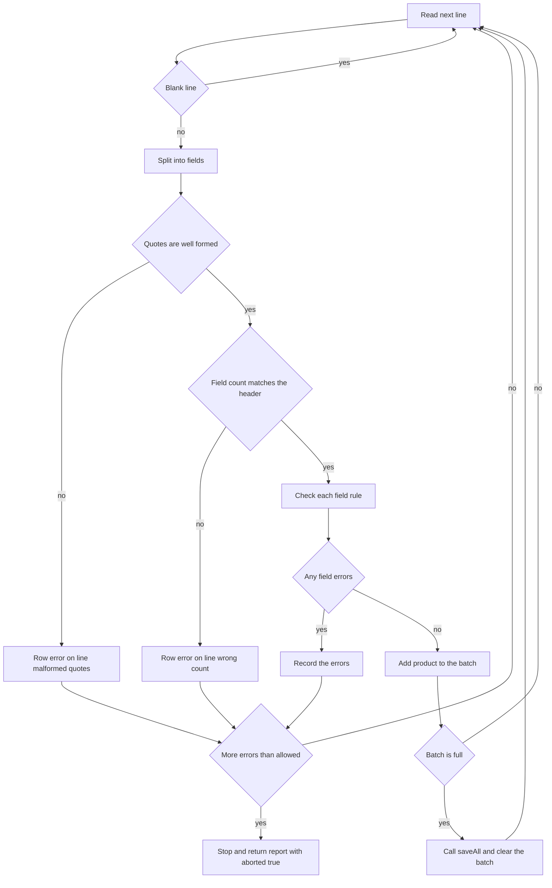
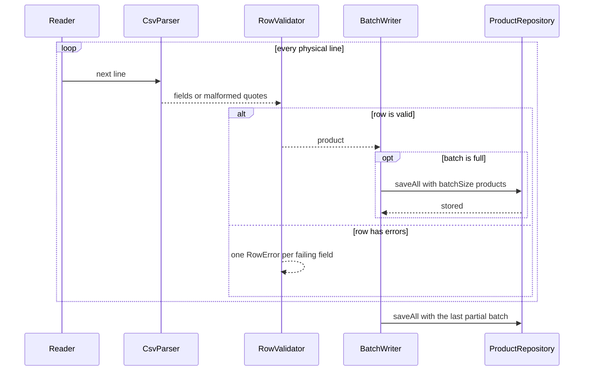

# Task 27 · Importing a supplier price list: streaming I/O and an error report

| Difficulty | Topics | Time box |
|---|---|---|
| 🟡 Medium | Streaming I/O with `Reader` and `BufferedReader` · try-with-resources and suppressed exceptions on close · Collecting all validation errors instead of failing on the first · A small hand-written parser for quoted fields · Batching writes · Fail-fast vs. fail-safe | 3 h |

> **Background reading:** *Effective Java* Item 9 ("Prefer try-with-resources to try-finally") and Items 69–72 (exceptions) · RFC 4180, section 2 (the quoting rules for CSV) · *Modern Java in Action* ch. 5 (`Files.lines` and laziness) · Martin Fowler, "Replacing Throwing Exceptions with Notification in Validations" (2014) · Michael Feathers, *Working Effectively with Legacy Code* (the chapter on seams)

---

## The situation

Every night each supplier sends us a price list as a CSV file. It is semicolon-separated, because that is what the German suppliers' spreadsheet programs produce. Some suppliers send 2 million rows.

The current importer has three problems:

* It calls `Files.readAllLines`, so the whole file sits in memory before the first row is checked.
* It stops at the first bad row with a stack trace. The supplier fixes that one row, sends the file again, and the next error shows up the next morning.
* When the database fails, the file handle stays open, because nobody closes it on that path.

Every morning someone phones us and asks: "Which rows were wrong?" We want the answer in one report: every problem, with its line number. Valid rows should be saved in batches while we read, so we never hold 2 million rows in memory. And when a file is clearly garbage (say, 5,000 errors in the first 10,000 lines), we should stop reading and say so, instead of spending an hour on it.

## The domain

| Term | Meaning |
|---|---|
| **Physical line number** | The line number in the file, counted from 1 for the header. Blank lines count too. This is the number a supplier sees in their editor. |
| **Row error** | One problem with one field of one line, with the line number, the column name and a message. |
| **Field** | One `;`-separated value. A field may be wrapped in `"` quotes. |
| **Batch** | A group of valid products sent to the database in one call. |
| **Abort** | Stopping early because there are too many errors. The report says `aborted`. |
| **Fail-fast vs. fail-safe** | Fail-fast stops at the first problem. Fail-safe keeps going and reports everything. This importer is fail-safe per row, and fail-fast per file. |

### How one line travels through the importer



### Who calls whom



## A sample file and its report

Here is a supplier file with typical problems. It is the input for the rules below, and you can use it as a manual test.

```csv
sku;name;price;stock
COF-001;Ethiopia Yirgacheffe 250 g;12,99;40
TEA-GRN-7;"Green tea; sencha";3,50;120
COF-002;Colombia Supremo 500 g;0;15
ab;Filter paper;1,20;500
COF-001;Ethiopia again;12,99;3
MIL-01;Oat milk 1 l;1,49;1000001

CUP-9;"Espresso ""Double"" cup";8,00;30
MUG-3;Mug;6,00
```

With `batchSize` 2 and `maxErrors` 5, the importer saves `[COF-001, TEA-GRN-7]` and then `[CUP-9]`, and returns this report:

| Line | Field | Message | Why |
|---|---|---|---|
| 4 | `price` | must be a positive price like 12,99 | the price is `0` |
| 5 | `sku` | must be 3 to 20 characters A-Z, 0-9 or - | `ab` is too short and in lower case |
| 6 | `sku` | duplicate of line 2 | `COF-001` was already valid on line 2 |
| 7 | `stock` | must be a whole number from 0 to 1000000 | 1000001 is over the limit |
| 10 | `line` | expected 4 fields but found 3 | the `MUG-3` row has no stock column |

`rowsRead` is 8 (the blank line 8 is skipped and not counted), `imported` is 3, and `aborted` is `false`.

With `maxErrors` 2 instead, the third error on line 6 crosses the limit. The importer stops there. Lines 7 to 10 are never read. The batch `[COF-001, TEA-GRN-7]` was already saved, so `imported` is 2. The report has `aborted` set to `true` and `rowsRead` is 5.

## What I want from you

Implement [`CatalogImporter`](../src/main/java/io/github/chris013/practice/task27/CatalogImporter.java). The types [`Product`](../src/main/java/io/github/chris013/practice/task27/Product.java), [`ProductRepository`](../src/main/java/io/github/chris013/practice/task27/ProductRepository.java), [`RowError`](../src/main/java/io/github/chris013/practice/task27/RowError.java), [`ImportReport`](../src/main/java/io/github/chris013/practice/task27/ImportReport.java), [`CsvFormatException`](../src/main/java/io/github/chris013/practice/task27/CsvFormatException.java) and [`FileOpener`](../src/main/java/io/github/chris013/practice/task27/FileOpener.java) are given and complete. Do not change them.

**Constructors**

1. `new CatalogImporter(repository, batchSize, maxErrors)`: `batchSize` must be at least 1 and `maxErrors` must be at least 0. Otherwise `IllegalArgumentException`. A `null` repository is a `NullPointerException`.

**The header (line 1)**

2. The header names the columns. The names are case-sensitive and may come in any order. Columns you do not need are ignored.
3. `sku`, `name`, `price` and `stock` are required. A missing one, or a name that appears twice, throws `CsvFormatException`. Its message names the column. This is thrown, not reported, because no row of such a file can be trusted.
4. An empty file throws `CsvFormatException`. Its message contains the word `empty`.

**Splitting a line**

5. Fields are separated by `;`. A field may be wrapped in `"`. Inside quotes, `;` is a normal character and `""` is one `"`.
6. A quote only counts as an opening quote when it is the first character of a field. A quote in the middle of an unquoted field is malformed.
7. Quotes do not span lines. A line that has text after a closing quote (other than `;` or the end of the line), or that ends inside quotes, is a row error on field `line` with the message `malformed quotes`.
8. Unquoted fields are trimmed. Quoted fields are kept exactly as written between the quotes.
9. A row with a different number of fields than the header is a row error on field `line` with the message `expected N fields but found M`, where `N` is the number of header columns (extra columns included).

**Blank lines and line numbers**

10. A line that contains only whitespace is skipped. It is not counted in `rowsRead`.
11. Line numbers are physical. The header is line 1, and every line after it adds 1, skipped lines included.

**Field rules**

Every rule is checked, in the order `sku`, `name`, `price`, `stock`. A row can have several errors, and each failing field gets exactly one `RowError`. The `field` value is the column name, and the message is exactly the text given here.

12. `sku` must match `[A-Z0-9-]{3,20}`. Message: `must be 3 to 20 characters A-Z, 0-9 or -`.
13. `sku` must not already be used by an earlier valid row in this file. The later row gets the message `duplicate of line N`, where `N` is the line of the first valid row with that SKU. A row that is invalid for any reason does not register its SKU.
14. `name` must not be blank and must be at most 100 characters. Message: `must not be blank and at most 100 characters`.
15. `price` is a German decimal: digits, optionally a comma and one or two decimals (`12,99`, `5`, `0,5`). No thousands separators, no sign, and it must be greater than 0. The result is a `BigDecimal` with scale 2. Message: `must be a positive price like 12,99`.
16. `stock` is an integer from 0 to 1000000, written with digits only. Message: `must be a whole number from 0 to 1000000`.

**Batches and the report**

17. Valid rows go to `repository.saveAll` in batches of exactly `batchSize`. Only the last batch may be smaller. Never call `saveAll` with an empty list.
18. The importer reads one line at a time. It must not read the whole input before it starts.
19. After each row, if the total number of row errors is greater than `maxErrors`, stop reading at once. Return a report with `aborted` set to `true`. The pending batch is not saved. Batches that were already saved stay saved. The check is done after the whole row, so one row with three errors adds all three, and the report contains them.
20. `ImportReport.rowsRead` counts the rows that were read, including the row that caused the abort. `imported` counts only the products that `saveAll` accepted. `errors` holds every row error, in line order.
21. An exception thrown by the repository propagates to the caller unchanged. The importer must not catch it and must not swallow it.

**Resources**

22. `importFrom(Reader)` reads the reader and must **not** close it. The caller owns it.
23. `importFrom(Path)` opens the file as UTF-8 and always closes it: after a normal import, after a repository failure, and after a failure while reading.
24. If the repository throws and closing the file also throws, the close exception is added to the repository exception as a suppressed exception. The repository exception is the one that propagates.
25. An `IOException` from opening, reading or closing is wrapped in an `UncheckedIOException`. This applies to both `importFrom` methods.

The tests also use a package-private constructor, `CatalogImporter(ProductRepository, int, int, FileOpener)`. It is the seam for the `Path` tests: the public constructor passes `file -> Files.newBufferedReader(file, UTF_8)`, and the tests pass a fake opener that returns a counting reader. You must implement it too.

## Constraints & non-goals

* Plain Java 25. No CSV library (no Apache Commons CSV, no Jackson), no Lombok, no Spring.
* Do **not** use `Files.readAllLines`, and do **not** call `String.split(";")` on a whole line. Both break the quoting rules.
* Do not read the whole input before you start. The test with 10,000 lines checks that you stop early.
* Do not parse prices with `Double.parseDouble`. Money is `BigDecimal`.
* Multi-line quoted fields are out of scope. Lines are never joined (stretch goal 3).
* No parallel validation and no retry of the repository (stretch goals 2 and 4).

## How I'd approach it

* **Start with the parser.** Write `CsvParser.split(String)` as a small state machine. Make the states explicit (field start, unquoted, inside quotes, after a quote). Every test of the parser is a line of text, so you can see the rules directly. Decide how the parser reports malformed quotes. A malformed line is expected input, not a bug, so think about whether an exception fits. Say which option you picked and why.
* **Read lazily, one line at a time.** There are three ways to read a text file. `Files.readAllLines` returns a `List` of every line, so memory grows with the file. `Files.lines` returns a lazy `Stream` that reads a line when the stream asks for it (*Modern Java in Action* ch. 5). But that stream keeps the file open until it is closed, so it must be used in try-with-resources, and a stream that is never closed leaks the handle. `BufferedReader.readLine` is the simplest lazy option: one line per call, and the only thing to close is the reader. The importer takes a `Reader`, so the tests can pass a string, and `readLine` is all it needs.
* **Then the header.** A header problem means the file is wrong, so throw `CsvFormatException` at once. Row problems are different, and they are collected.
* **Then the validator.** Make it a class with one method per field rule, or one method that checks all four in order. Each rule adds at most one `RowError`. Read the test `collects_every_field_error_of_a_row_in_column_order` before you write the code.
* **Duplicate SKUs need memory.** The validator must remember which SKUs of *valid* rows it has seen, and which line each came from. Think about the lifetime of this memory: one import, not one `CatalogImporter` object. Why does that matter if the same importer runs twice?
* **Line numbers are the easiest thing to get wrong.** `BufferedReader.readLine` does not tell you the line number. Count it yourself. Increment it for every line, including the blank ones you skip. Then check your count against the test `skips_blank_lines_but_keeps_the_physical_line_numbers`.
* **Batching.** A small class that holds the pending products and calls `saveAll` when it is full is enough. Remember the final flush. Remember to pass a copy of the list to the repository.
* **Try-with-resources is the whole resource story.** Think about what it does when the body throws and `close` also throws (Effective Java Item 9). Then check whether the `importFrom(Reader)` method needs it at all.
* **Notification vs. exceptions.** Row errors are an expected result: a supplier file is allowed to contain mistakes. So they go into the report. A file without a header is a broken input, so it throws. Fowler's article on notifications describes this split. Decide for each problem which group it belongs to, and say why in your PR description.
* **Abort.** Decide where the check goes: after each error, or after each row? The rule above says after each row. Think about why, and whether the report would be more useful with the other choice.
* **Partial imports.** When the import aborts, the batches that were already saved stay in the database. Is that acceptable? Write your answer in the PR description, and name at least two alternatives (a staging table, two passes over the file, one transaction) with what each costs.
* **Seams.** The `FileOpener` is a seam. The public constructor wires the real file system, and the tests wire a fake. That is how you test "the file is closed after a repository failure" without a real file that can fail in the right way.

## Tests

Run: `mvn test -Dtest='**/task27/**'`

[`CatalogImporterTest`](../src/test/java/io/github/chris013/practice/task27/CatalogImporterTest.java) is grouped into `Header`, `ValidRows`, `RowErrors`, `Abort`, `Resources` and `Arguments`. It uses the helpers [`RecordingRepository`](../src/test/java/io/github/chris013/practice/task27/RecordingRepository.java), [`CountingReader`](../src/test/java/io/github/chris013/practice/task27/CountingReader.java) and [`CsvLines`](../src/test/java/io/github/chris013/practice/task27/CsvLines.java). [`ImportReportTest`](../src/test/java/io/github/chris013/practice/task27/ImportReportTest.java) checks the two rules of the report.

<details>
<summary>Show the tests</summary>

<!-- embed: src/test/java/io/github/chris013/practice/task27/CatalogImporterTest.java -->
<!-- /embed -->

</details>

## Definition of done

- [ ] Every test is green, and the whole task runs in well under 5 seconds.
- [ ] Nothing reads the whole input before processing it. `Files.readAllLines` and `String.split` on a line are not used.
- [ ] Every row error is collected, with the physical line number. Blank lines are skipped and still counted in the line numbers.
- [ ] A reader passed to `importFrom(Reader)` is never closed by the importer.
- [ ] A file is always closed, and a close failure never hides the repository failure.
- [ ] Prices are `BigDecimal` with scale 2. No `double` appears anywhere.
- [ ] Your PR description says what happens to the saved batches after an abort, and what you would change if the business wanted "all or nothing".

## Stretch goals

1. Write the report as a CSV file for the supplier, with the columns `line;field;message`. Make sure the message is escaped correctly when it contains `;` or `"`.
2. Validate rows in parallel with a bounded thread pool. Which parts of the importer are not safe to run in parallel? (Hint: the duplicate SKU check.)
3. Support quoted fields that span several lines (the full RFC 4180 rules). How does this change the line numbers in an error report? Where does the abort check go?
4. Add a `--dry-run` mode: the same validation, but `saveAll` is never called. Which of your tests would you change?
5. Resume an aborted import. Where would you store the position, and what must be true for resuming to be safe?

---

## Reference solution

<details>
<summary>Spoiler: open only after you have made a serious attempt</summary>

### Key decisions

**1. Row errors are notifications, file problems are exceptions.** A supplier file may contain many wrong rows, and the business wants all of them in one report. So a bad row becomes data: a `RowError` in an `ImportReport`. A file without a header, or with a missing required column, cannot be trusted at all. Nothing in it can be checked against the rules, so it throws `CsvFormatException` and returns no report. The alternative, returning a report with one error for "no header", would make the caller check two different result shapes.

**2. Each row ends in a sealed type.** `RowOutcome` is either `Valid` (a product) or `Invalid` (a list of errors). The importer's switch must handle both cases, and the compiler checks it. The alternative, a nullable product next to a list of errors, allows states that cannot happen, such as a product with errors.

**3. The parser is a state machine with four states.** The rules fit into four states: field start, unquoted, inside quotes, and after a quote. Each character has one transition, and a quote is only special in the right place. A regular expression would be shorter, but it would not show the rules, and the error for "text after a closing quote" would be hard to write.

**4. Line numbers come from the loop, not from the reader.** `BufferedReader.readLine` throws away line endings and says nothing about position. The loop counts every line, including the skipped blank ones. Counting the rows that were kept would give the wrong numbers for any file with a blank line.

**5. Duplicate detection lives in the validator, for one import.** The validator keeps a map from SKU to the line of the first valid row. It is created once per `importFrom` call, not once per importer. If it were a field of `CatalogImporter`, a second import with the same importer would reject every SKU as a duplicate.

**6. Batching is its own class with a copy in and a count out.** `BatchWriter` passes `List.copyOf` to the repository, so the repository cannot keep a list that is cleared afterwards. It counts `saved` only after `saveAll` returns, so `imported` never includes a batch that failed.

**7. Resources: the importer closes only what it opened.** `importFrom(Path)` opens the file, so it uses try-with-resources. `importFrom(Reader)` did not open the reader, so it does not close it. Using try-with-resources in both would make every caller's reader close, which is a bug the caller could not see. In the `Path` version, if the body throws and `close()` also throws, the close exception is added to the first one with `addSuppressed` (Effective Java Item 9). The original cause is never hidden. An `IOException` from `close()` on the normal path becomes an `UncheckedIOException`, like every other I/O failure here.

**8. The opener is a seam, not a mock.** Feathers calls a seam a place where you can change behaviour without editing the code at that place. `FileOpener` is a one-method interface, and the public constructor passes the real `Files.newBufferedReader`. The tests pass their own opener. That is simpler than mocking `Files`, and it still runs the real `try` block, so the closing rules are tested as they are written.

**9. Abort after the row, and keep the saved batches: a partial import.** The check is after each row, so a row with three errors is reported in full. The pending batch is not saved, because a half-imported file with an unknown tail is harder to explain than a file that was not imported at all. The saved batches stay saved, because the importer has no transaction. Three alternatives exist, each with a cost:

* *Staging table.* Write every row into a staging table, validate there, and copy the valid rows into the product table in one step. Nothing reaches the product table until the file is checked. The cost is a second table and a second write of up to 2 million rows.
* *Two passes.* Read the file once to validate and collect errors. Only if it is clean, read it again and save. Nothing is saved from a bad file. The cost is reading the file twice, and the file could change between the two passes.
* *One transaction.* Wrap all saves in one database transaction and roll back on abort. The semantics are clean, but a long transaction holds locks and grows the undo log for millions of rows.

We chose batches with no transaction, because the database write is the slow part. This assumes that `saveAll` upserts by SKU, so a rerun with the full file overwrites what was saved. The report says what happened with `aborted` and `imported`, and the next full file fixes the rest. If the repository did not upsert, this decision would be wrong, and the staging table would be the right answer.

### Code

<!-- embed: solutions/src/main/java/io/github/chris013/practice/task27/CatalogImporter.java -->
<!-- /embed -->

<!-- embed: solutions/src/main/java/io/github/chris013/practice/task27/CsvParser.java -->
<!-- /embed -->

<!-- embed: solutions/src/main/java/io/github/chris013/practice/task27/RowValidator.java -->
<!-- /embed -->

<!-- embed: solutions/src/main/java/io/github/chris013/practice/task27/BatchWriter.java -->
<!-- /embed -->

<!-- embed: solutions/src/main/java/io/github/chris013/practice/task27/CsvHeader.java -->
<!-- /embed -->

### What I typically flag in first attempts

| Finding | Why it matters |
|---|---|
| `Files.readAllLines` or `Files.lines` collected into a list | The whole file is in memory before the first row is checked. `Files.lines` is lazy, but it must be closed (use try-with-resources), and a stream that is never closed leaks the file handle. |
| Stopping at the first error | The supplier gets one error per morning, which is the problem this task exists to fix. |
| `line.split(";")` for the whole line | Breaks `"Green tea; sencha"`. The quoting rules need a parser that reads characters in order. |
| Line numbers from a counter that skips blank lines | The supplier opens line 40 in the editor and finds the wrong row. Count every physical line. |
| Closing a `Reader` the caller passed in | The caller may still need it, and closing it there is an invisible side effect. Only close what you opened. |
| Catching the repository exception and returning a report | The import looks finished when the database is down. Let the exception propagate. |
| Saving the pending batch after an abort without saying so | The report says `aborted`, but the rows that were saved after the bad ones are a surprise. Decide on purpose, and say so in the report. |
| `Double.parseDouble` for prices | `0,1 + 0,2` is not `0,3` in binary floating point. Use `BigDecimal` with scale 2. |

</details>
