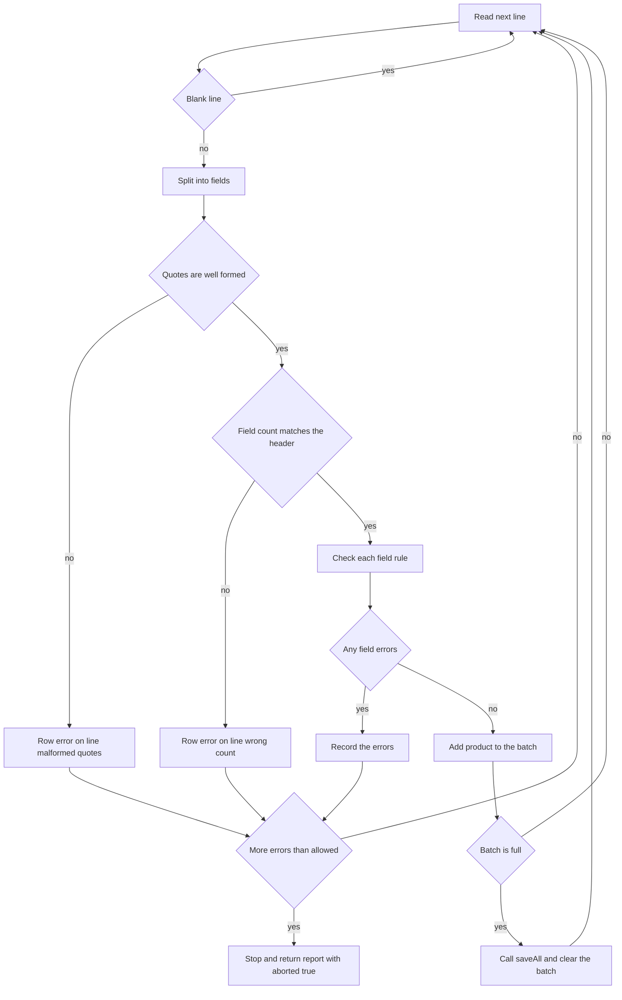
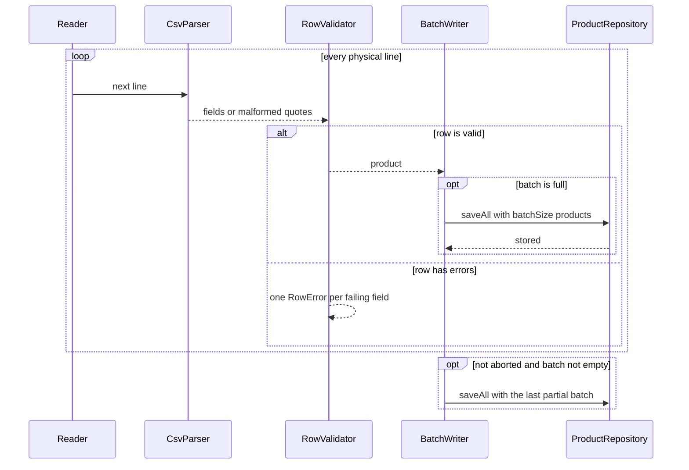

# Task 27 · Importing a supplier price list: streaming I/O and an error report

| Difficulty | Topics | Time box |
|---|---|---|
| 🟡 Medium | Streaming I/O with `Reader` and `BufferedReader` · try-with-resources and suppressed exceptions on close · Collecting all validation errors instead of failing on the first · A small hand-written parser for quoted fields · Batching writes · Fail-fast vs. fail-safe | 3 h |

> **Background reading:** *Effective Java* Item 9 ("Prefer try-with-resources to try-finally") and Items 69–72 (exceptions) · RFC 4180, section 2 (the quoting rules for CSV) · *Modern Java in Action* ch. 5 (`Files.lines` and laziness) · Martin Fowler, "Replacing Throwing Exceptions with Notification in Validations" (2014) · Michael Feathers, *Working Effectively with Legacy Code* (the chapter on seams)

---

## The situation

Every night each supplier sends us a price list as a CSV file. It is semicolon-separated, because that is what the German suppliers' spreadsheet programs produce. Some suppliers send 2 million rows.

The current importer has three problems:

* It calls `Files.readAllLines`, so the whole file sits in memory before the first row is checked.
* It stops at the first bad row with a stack trace. The supplier fixes that one row, sends the file again, and the next error shows up the next morning.
* When the database fails, the file handle stays open, because nobody closes it on that path.

Every morning someone phones us and asks: "Which rows were wrong?" We want the answer in one report: every problem, with its line number. Valid rows should be saved in batches while we read, so we never hold 2 million rows in memory. And when a file is clearly garbage (say, 5,000 errors in the first 10,000 lines), we should stop reading and say so, instead of spending an hour on it.

## The domain

| Term | Meaning |
|---|---|
| **Physical line number** | The line number in the file, counted from 1 for the header. Blank lines count too. This is the number a supplier sees in their editor. |
| **Row error** | One problem with one field of one line, with the line number, the column name and a message. |
| **Field** | One `;`-separated value. A field may be wrapped in `"` quotes. |
| **Batch** | A group of valid products sent to the database in one call. |
| **Abort** | Stopping early because there are too many errors. The report says `aborted`. |
| **Fail-fast vs. fail-safe** | Fail-fast stops at the first problem. Fail-safe keeps going and reports everything. This importer is fail-safe per row, and fail-fast per file. |

### How one line travels through the importer



### Who calls whom



## A sample file and its report

Here is a supplier file with typical problems. It is the input for the rules below, and you can use it as a manual test.

```csv
sku;name;price;stock
COF-001;Ethiopia Yirgacheffe 250 g;12,99;40
TEA-GRN-7;"Green tea; sencha";3,50;120
COF-002;Colombia Supremo 500 g;0;15
ab;Filter paper;1,20;500
COF-001;Ethiopia again;12,99;3
MIL-01;Oat milk 1 l;1,49;1000001

CUP-9;"Espresso ""Double"" cup";8,00;30
MUG-3;Mug;6,00
```

With `batchSize` 2 and `maxErrors` 5, the importer saves `[COF-001, TEA-GRN-7]` and then `[CUP-9]`, and returns this report:

| Line | Field | Message | Why |
|---|---|---|---|
| 4 | `price` | must be a positive price like 12,99 | the price is `0` |
| 5 | `sku` | must be 3 to 20 characters A-Z, 0-9 or - | `ab` is too short and in lower case |
| 6 | `sku` | duplicate of line 2 | `COF-001` was already valid on line 2 |
| 7 | `stock` | must be a whole number from 0 to 1000000 | 1000001 is over the limit |
| 10 | `line` | expected 4 fields but found 3 | the `MUG-3` row has no stock column |

`rowsRead` is 8 (the blank line 8 is skipped and not counted), `imported` is 3, and `aborted` is `false`.

With `maxErrors` 2 instead, the third error on line 6 crosses the limit. The importer stops there. Lines 7 to 10 are never read. The batch `[COF-001, TEA-GRN-7]` was already saved, so `imported` is 2. The report has `aborted` set to `true` and `rowsRead` is 5.

## What I want from you

Implement [`CatalogImporter`](../src/main/java/io/github/chris013/practice/task27/CatalogImporter.java). The types [`Product`](../src/main/java/io/github/chris013/practice/task27/Product.java), [`ProductRepository`](../src/main/java/io/github/chris013/practice/task27/ProductRepository.java), [`RowError`](../src/main/java/io/github/chris013/practice/task27/RowError.java), [`ImportReport`](../src/main/java/io/github/chris013/practice/task27/ImportReport.java), [`CsvFormatException`](../src/main/java/io/github/chris013/practice/task27/CsvFormatException.java) and [`FileOpener`](../src/main/java/io/github/chris013/practice/task27/FileOpener.java) are given and complete. Do not change them.

**Constructors**

1. `new CatalogImporter(repository, batchSize, maxErrors)`: `batchSize` must be at least 1 and `maxErrors` must be at least 0. Otherwise `IllegalArgumentException`. A `null` repository is a `NullPointerException`.

**The header (line 1)**

2. The header names the columns. The names are case-sensitive and may come in any order. Columns you do not need are ignored.
3. `sku`, `name`, `price` and `stock` are required. A missing one, or a name that appears twice, throws `CsvFormatException`. Its message names the column. This is thrown, not reported, because no row of such a file can be trusted.
4. An empty file throws `CsvFormatException`. Its message contains the word `empty`.

**Splitting a line**

5. Fields are separated by `;`. A field may be wrapped in `"`. Inside quotes, `;` is a normal character and `""` is one `"`.
6. A quote only counts as an opening quote when it is the first character of a field. A quote in the middle of an unquoted field is malformed. Spaces around a quoted field are not allowed: `; "Coffee"` is malformed.
7. Quotes do not span lines. A line that has text after a closing quote (other than `;` or the end of the line), or that ends inside quotes, is a row error on field `line` with the message `malformed quotes`.
8. Unquoted fields are trimmed. Quoted fields are kept exactly as written between the quotes.
9. A row with a different number of fields than the header is a row error on field `line` with the message `expected N fields but found M`, where `N` is the number of header columns (extra columns included).

**Blank lines and line numbers**

10. A line that contains only whitespace is skipped. It is not counted in `rowsRead`.
11. Line numbers are physical. The header is line 1, and every line after it adds 1, skipped lines included.

**Field rules**

Every rule is checked, in the order `sku`, `name`, `price`, `stock`. A row can have several errors, and each failing field gets exactly one `RowError`. The `field` value is the column name, and the message is exactly the text given here.

12. `sku` must match `[A-Z0-9-]{3,20}`. Message: `must be 3 to 20 characters A-Z, 0-9 or -`.
13. `sku` must not already be used by an earlier valid row in this file. The later row gets the message `duplicate of line N`, where `N` is the line of the first valid row with that SKU. A row that is invalid for any reason does not register its SKU.
14. `name` must not be blank and must be at most 100 characters. Message: `must not be blank and at most 100 characters`.
15. `price` is a German decimal: digits, optionally a comma and one or two decimals (`12,99`, `5`, `0,5`). No thousands separators, no sign, and it must be greater than 0. The result is a `BigDecimal` with scale 2. Message: `must be a positive price like 12,99`.
16. `stock` is an integer from 0 to 1000000, written with digits only. Message: `must be a whole number from 0 to 1000000`.

**Batches and the report**

17. Valid rows go to `repository.saveAll` in batches of exactly `batchSize`. Only the last batch may be smaller. Never call `saveAll` with an empty list.
18. The importer reads one line at a time. It must not read the whole input before it starts.
19. After each row, if the total number of row errors is greater than `maxErrors`, stop reading at once. Return a report with `aborted` set to `true`. The pending batch is not saved. Batches that were already saved stay saved. The check is done after the whole row, so one row with three errors adds all three, and the report contains them.
20. `ImportReport.rowsRead` counts the rows that were read, including the row that caused the abort. `imported` counts only the products that `saveAll` accepted. `errors` holds every row error, in line order.
21. An exception thrown by the repository propagates to the caller unchanged. The importer must not catch it and must not swallow it.

**Resources**

22. `importFrom(Reader)` reads the reader and must **not** close it. The caller owns it.
23. `importFrom(Path)` opens the file as UTF-8 and always closes it: after a normal import, after a repository failure, and after a failure while reading.
24. If the repository throws and closing the file also throws, the close exception is added to the repository exception as a suppressed exception. The repository exception is the one that propagates.
25. An `IOException` from opening, reading or closing is wrapped in an `UncheckedIOException`. This applies to both `importFrom` methods.

The tests also use a package-private constructor, `CatalogImporter(ProductRepository, int, int, FileOpener)`. It is the seam for the `Path` tests: the public constructor passes `file -> Files.newBufferedReader(file, UTF_8)`, and the tests pass a fake opener that returns a counting reader. You must implement it too.

## Constraints & non-goals

* Plain Java 25. No CSV library (no Apache Commons CSV, no Jackson), no Lombok, no Spring.
* Do **not** use `Files.readAllLines`, and do **not** call `String.split(";")` on a whole line. Both break the quoting rules.
* Do not read the whole input before you start. The test with 10,000 lines checks that you stop early.
* Do not parse prices with `Double.parseDouble`. Money is `BigDecimal`.
* Multi-line quoted fields are out of scope. Lines are never joined (stretch goal 3).
* No parallel validation and no retry of the repository (stretch goals 2 and 4).

## How I'd approach it

* **Start with the parser.** Write `CsvParser.split(String)` as a small state machine. Make the states explicit (field start, unquoted, inside quotes, after a quote). Every test of the parser is a line of text, so you can see the rules directly. Decide how the parser reports malformed quotes. A malformed line is expected input, not a bug, so think about whether an exception fits. Say which option you picked and why.
* **Read lazily, one line at a time.** There are three ways to read a text file. `Files.readAllLines` returns a `List` of every line, so memory grows with the file. `Files.lines` returns a lazy `Stream` that reads a line when the stream asks for it (*Modern Java in Action* ch. 5). But that stream keeps the file open until it is closed, so it must be used in try-with-resources, and a stream that is never closed leaks the handle. `BufferedReader.readLine` is the simplest lazy option: one line per call, and the only thing to close is the reader. The importer takes a `Reader`, so the tests can pass a string, and `readLine` is all it needs.
* **Then the header.** A header problem means the file is wrong, so throw `CsvFormatException` at once. Row problems are different, and they are collected.
* **Then the validator.** Make it a class with one method per field rule, or one method that checks all four in order. Each rule adds at most one `RowError`. Read the test `collects_every_field_error_of_a_row_in_column_order` before you write the code.
* **Duplicate SKUs need memory.** The validator must remember which SKUs of *valid* rows it has seen, and which line each came from. Think about the lifetime of this memory: one import, not one `CatalogImporter` object. Why does that matter if the same importer runs twice?
* **Line numbers are the easiest thing to get wrong.** `BufferedReader.readLine` does not tell you the line number. Count it yourself. Increment it for every line, including the blank ones you skip. Then check your count against the test `skips_blank_lines_but_keeps_the_physical_line_numbers`.
* **Batching.** A small class that holds the pending products and calls `saveAll` when it is full is enough. Remember the final flush. Remember to pass a copy of the list to the repository.
* **Try-with-resources is the whole resource story.** Think about what it does when the body throws and `close` also throws (Effective Java Item 9). Then check whether the `importFrom(Reader)` method needs it at all.
* **Notification vs. exceptions.** Row errors are an expected result: a supplier file is allowed to contain mistakes. So they go into the report. A file without a header is a broken input, so it throws. Fowler's article on notifications describes this split. Decide for each problem which group it belongs to, and say why in your PR description.
* **Abort.** Decide where the check goes: after each error, or after each row? The rule above says after each row. Think about why, and whether the report would be more useful with the other choice.
* **Partial imports.** When the import aborts, the batches that were already saved stay in the database. Is that acceptable? Write your answer in the PR description, and name at least two alternatives (a staging table, two passes over the file, one transaction) with what each costs.
* **Seams.** The `FileOpener` is a seam. The public constructor wires the real file system, and the tests wire a fake. That is how you test "the file is closed after a repository failure" without a real file that can fail in the right way.

## Tests

Run: `mvn test -Dtest='**/task27/**'`

[`CatalogImporterTest`](../src/test/java/io/github/chris013/practice/task27/CatalogImporterTest.java) is grouped into `Header`, `ValidRows`, `RowErrors`, `Abort`, `Resources` and `Arguments`. It uses the helpers [`RecordingRepository`](../src/test/java/io/github/chris013/practice/task27/RecordingRepository.java), [`CountingReader`](../src/test/java/io/github/chris013/practice/task27/CountingReader.java) and [`CsvLines`](../src/test/java/io/github/chris013/practice/task27/CsvLines.java). [`ImportReportTest`](../src/test/java/io/github/chris013/practice/task27/ImportReportTest.java) checks the two rules of the report.

<details>
<summary>Show the tests</summary>

<!-- embed: src/test/java/io/github/chris013/practice/task27/CatalogImporterTest.java -->
**[`CatalogImporterTest.java`](../src/test/java/io/github/chris013/practice/task27/CatalogImporterTest.java)**

```java
package io.github.chris013.practice.task27;

import static io.github.chris013.practice.task27.CsvLines.HEADER;
import static io.github.chris013.practice.task27.CsvLines.row;
import static org.assertj.core.api.Assertions.assertThat;
import static org.assertj.core.api.Assertions.assertThatThrownBy;

import java.io.IOException;
import java.io.Reader;
import java.io.StringReader;
import java.io.UncheckedIOException;
import java.math.BigDecimal;
import java.nio.charset.StandardCharsets;
import java.nio.file.Files;
import java.nio.file.Path;
import org.junit.jupiter.api.Nested;
import org.junit.jupiter.api.Test;
import org.junit.jupiter.api.io.TempDir;
import org.junit.jupiter.params.ParameterizedTest;
import org.junit.jupiter.params.provider.CsvSource;
import org.junit.jupiter.params.provider.ValueSource;

class CatalogImporterTest {

    private static final String SKU_RULE = "must be 3 to 20 characters A-Z, 0-9 or -";
    private static final String PRICE_RULE = "must be a positive price like 12,99";
    private static final String STOCK_RULE = "must be a whole number from 0 to 1000000";
    private static final String NAME_RULE = "must not be blank and at most 100 characters";

    private final RecordingRepository repository = new RecordingRepository();

    private CatalogImporter importer(int batchSize, int maxErrors) {
        return new CatalogImporter(repository, batchSize, maxErrors);
    }

    private ImportReport importLines(int batchSize, int maxErrors, String... lines) {
        return importer(batchSize, maxErrors).importFrom(new StringReader(CsvLines.of(lines)));
    }

    @Nested
    class Header {

        @ParameterizedTest
        @CsvSource(delimiter = '|', value = {
            "name;price;stock|sku",
            "sku;price;stock|name",
            "sku;name;stock|price",
            "sku;name;price|stock"})
        void rejects_a_file_without_a_required_column(String header, String missingColumn) {
            assertThatThrownBy(() -> importLines(10, 0, header))
                    .isInstanceOf(CsvFormatException.class)
                    .hasMessageContaining(missingColumn);
        }

        @Test
        void rejects_a_column_that_is_named_twice() {
            assertThatThrownBy(() -> importLines(10, 0, "sku;name;price;stock;sku"))
                    .isInstanceOf(CsvFormatException.class)
                    .hasMessageContaining("duplicate column: sku");
        }

        @Test
        void rejects_an_empty_file() {
            assertThatThrownBy(() -> importer(10, 0).importFrom(new StringReader("")))
                    .isInstanceOf(CsvFormatException.class)
                    .hasMessageContaining("empty");
        }

        @Test
        void accepts_the_required_columns_in_any_order() {
            ImportReport report = importLines(10, 0, "stock;price;name;sku", "5;12,99;Coffee;COF-1");

            assertThat(report.isClean()).isTrue();
            assertThat(repository.allProducts())
                    .containsExactly(new Product("COF-1", "Coffee", new BigDecimal("12.99"), 5));
        }

        @Test
        void ignores_extra_columns() {
            ImportReport report = importLines(10, 0, "sku;name;note;price;stock", "COF-1;Coffee;fresh;12,99;5");

            assertThat(report.isClean()).isTrue();
            assertThat(repository.allProducts())
                    .containsExactly(new Product("COF-1", "Coffee", new BigDecimal("12.99"), 5));
        }
    }

    @Nested
    class ValidRows {

        @Test
        void reads_the_types_and_the_scale_of_every_field() {
            ImportReport report = importLines(10, 0, HEADER, row("COF-1", "Coffee", "5", "7"));

            assertThat(repository.allProducts())
                    .containsExactly(new Product("COF-1", "Coffee", new BigDecimal("5.00"), 7));
            assertThat(report.rowsRead()).isEqualTo(1);
            assertThat(report.imported()).isEqualTo(1);
        }

        @Test
        void saves_valid_rows_in_batches_of_the_batch_size() {
            ImportReport report = importLines(2, 0,
                    HEADER,
                    row("A-1", "One", "1", "1"),
                    row("A-2", "Two", "2", "2"),
                    row("A-3", "Three", "3", "3"),
                    row("A-4", "Four", "4", "4"),
                    row("A-5", "Five", "5", "5"));

            assertThat(repository.batchSizes()).containsExactly(2, 2, 1);
            assertThat(report.rowsRead()).isEqualTo(5);
            assertThat(report.imported()).isEqualTo(5);
            assertThat(report.isClean()).isTrue();
        }

        @Test
        void sends_only_full_batches_when_the_rows_divide_evenly() {
            importLines(2, 0, HEADER,
                    row("A-1", "One", "1", "1"),
                    row("A-2", "Two", "2", "2"),
                    row("A-3", "Three", "3", "3"),
                    row("A-4", "Four", "4", "4"));

            assertThat(repository.batchSizes()).containsExactly(2, 2);
        }

        @Test
        void never_calls_the_repository_when_no_row_is_valid() {
            importLines(10, 10, HEADER, "ab;Tea;1;1");

            assertThat(repository.batchSizes()).isEmpty();
        }

        @Test
        void keeps_semicolons_and_doubled_quotes_inside_a_quoted_field() {
            importLines(10, 0, HEADER, "COF-1;\"Coffee; \"\"dark\"\" roast\";12,99;5");

            assertThat(repository.allProducts()).extracting(Product::name)
                    .containsExactly("Coffee; \"dark\" roast");
        }

        @Test
        void trims_unquoted_fields() {
            importLines(10, 0, HEADER, "  COF-1 ; Coffee ;12,99; 5 ");

            assertThat(repository.allProducts())
                    .containsExactly(new Product("COF-1", "Coffee", new BigDecimal("12.99"), 5));
        }

        @Test
        void keeps_the_spaces_inside_a_quoted_field() {
            importLines(10, 0, HEADER, "COF-1;\" Coffee \";12,99;5");

            assertThat(repository.allProducts()).extracting(Product::name).containsExactly(" Coffee ");
        }
    }

    @Nested
    class RowErrors {

        @ParameterizedTest
        @ValueSource(strings = {"ABC", "ABCDEFGHIJ0123456789", "A-1"})
        void accepts_skus_at_the_length_and_character_boundaries(String sku) {
            ImportReport report = importLines(10, 10, HEADER, row(sku, "Coffee", "1", "1"));

            assertThat(report.isClean()).isTrue();
        }

        @ParameterizedTest
        @ValueSource(strings = {"AB", "ABCDEFGHIJ01234567890", "abc", "A_B", "A B"})
        void rejects_a_sku_outside_the_rules(String sku) {
            ImportReport report = importLines(10, 10, HEADER, row(sku, "Coffee", "1", "1"));

            assertThat(report.errors()).containsExactly(new RowError(2, "sku", SKU_RULE));
        }

        @ParameterizedTest
        @ValueSource(strings = {"", "   ", "\"   \""})
        void rejects_a_blank_name(String name) {
            ImportReport report = importLines(10, 10, HEADER, row("COF-1", name, "1", "1"));

            assertThat(report.errors()).containsExactly(new RowError(2, "name", NAME_RULE));
        }

        @Test
        void accepts_a_name_of_exactly_100_characters() {
            ImportReport report = importLines(10, 10, HEADER, row("COF-1", "x".repeat(100), "1", "1"));

            assertThat(report.isClean()).isTrue();
        }

        @Test
        void rejects_a_name_of_101_characters() {
            ImportReport report = importLines(10, 10, HEADER, row("COF-1", "x".repeat(101), "1", "1"));

            assertThat(report.errors()).containsExactly(new RowError(2, "name", NAME_RULE));
        }

        @ParameterizedTest
        @CsvSource(delimiterString = ";", value = {"12,99;12.99", "5;5.00", "0,5;0.50", "12,5;12.50", "0,01;0.01"})
        void reads_german_prices_as_money_with_two_decimals(String price, String expected) {
            importLines(10, 0, HEADER, row("COF-1", "Coffee", price, "1"));

            assertThat(repository.allProducts()).extracting(Product::price)
                    .containsExactly(new BigDecimal(expected));
        }

        @ParameterizedTest
        @ValueSource(strings = {"0", "0,00", "-1", "12,999", "1.000,50", "12,", ",5", "abc", "1 000"})
        void rejects_a_price_that_is_not_a_positive_german_decimal(String price) {
            ImportReport report = importLines(10, 10, HEADER, row("COF-1", "Coffee", price, "1"));

            assertThat(report.errors()).containsExactly(new RowError(2, "price", PRICE_RULE));
        }

        @ParameterizedTest
        @ValueSource(strings = {"0", "1000000"})
        void accepts_stock_at_both_ends_of_the_range(String stock) {
            ImportReport report = importLines(10, 10, HEADER, row("COF-1", "Coffee", "1", stock));

            assertThat(report.isClean()).isTrue();
        }

        @ParameterizedTest
        @ValueSource(strings = {"-1", "1000001", "1,5", "1.5", "abc", "99999999999"})
        void rejects_stock_outside_a_whole_number_from_0_to_1000000(String stock) {
            ImportReport report = importLines(10, 10, HEADER, row("COF-1", "Coffee", "1", stock));

            assertThat(report.errors()).containsExactly(new RowError(2, "stock", STOCK_RULE));
        }

        @Test
        void collects_every_field_error_of_a_row_in_column_order() {
            ImportReport report = importLines(10, 10, HEADER, "ab;;0;-1");

            assertThat(report.errors()).extracting(RowError::field).containsExactly("sku", "name", "price", "stock");
            assertThat(report.errors()).extracting(RowError::lineNumber).containsOnly(2);
            assertThat(report.imported()).isZero();
        }

        @ParameterizedTest
        @CsvSource(delimiter = '|', value = {
            "COF-1;Coffee;12,99|expected 4 fields but found 3",
            "COF-1;Coffee;12,99;5;extra|expected 4 fields but found 5"})
        void reports_a_wrong_number_of_fields_on_the_line(String row, String message) {
            ImportReport report = importLines(10, 10, HEADER, row);

            assertThat(report.errors()).containsExactly(new RowError(2, "line", message));
        }

        @ParameterizedTest
        @ValueSource(strings = {
            "COF-1;\"Coffee\"x;12,99;5",
            "COF-1;\"Coffee;12,99;5",
            "COF-1;Cof\"fee;12,99;5",
            "COF-1; \"Coffee\";12,99;5",
            "COF-1;\"Coffee\" ;12,99;5"})
        void reports_malformed_quotes_as_a_line_error(String row) {
            ImportReport report = importLines(10, 10, HEADER, row);

            assertThat(report.errors()).containsExactly(new RowError(2, "line", "malformed quotes"));
        }

        @Test
        void reports_a_duplicate_sku_against_the_first_line_that_had_it() {
            ImportReport report = importLines(10, 10, HEADER,
                    row("COF-1", "Coffee", "12,99", "5"),
                    row("TEA-1", "Tea", "3,50", "5"),
                    row("COF-1", "Other", "1,00", "1"));

            assertThat(report.errors()).containsExactly(new RowError(4, "sku", "duplicate of line 2"));
            assertThat(repository.allProducts()).hasSize(2);
        }

        @Test
        void a_row_that_failed_does_not_register_its_sku() {
            ImportReport report = importLines(10, 10, HEADER,
                    row("COF-1", "Coffee", "0", "5"),
                    row("COF-1", "Coffee", "12,99", "5"));

            // Line 2 is the only error. Line 3 is not a duplicate, because line 2 never registered COF-1.
            assertThat(report.errors()).containsExactly(new RowError(2, "price", PRICE_RULE));
            assertThat(report.imported()).isEqualTo(1);
        }

        @Test
        void skips_blank_lines_but_keeps_the_physical_line_numbers() {
            ImportReport report = importLines(10, 10, HEADER,
                    "",
                    row("COF-1", "Coffee", "12,99", "5"),
                    "   ",
                    "ab;Tea;1;1");

            assertThat(report.rowsRead()).isEqualTo(2);
            assertThat(report.errors()).containsExactly(new RowError(5, "sku", SKU_RULE));
        }
    }

    @Nested
    class Abort {

        @Test
        void stops_at_the_row_that_exceeds_max_errors_and_leaves_the_rest_unread() {
            ImportReport report = importLines(2, 2, HEADER,
                    row("COF-1", "Coffee", "12,99", "5"),
                    row("TEA-1", "Tea", "3,50", "5"),
                    row("MIL-1", "Milk", "1,20", "5"),
                    row("x", "Bad", "1", "1"),
                    row("y", "Bad", "1", "1"),
                    row("z", "Bad", "1", "1"),
                    row("TEA-2", "Tea", "1", "1"));

            assertThat(report.aborted()).isTrue();
            assertThat(report.errors()).extracting(RowError::lineNumber).containsExactly(5, 6, 7);
            assertThat(report.rowsRead()).isEqualTo(6);
            // The first batch was saved. The pending MIL-1 row was not, because the import stopped before a flush.
            assertThat(repository.batchSizes()).containsExactly(2);
            assertThat(report.imported()).isEqualTo(2);
        }

        @Test
        void does_not_abort_while_the_error_count_is_at_the_limit() {
            ImportReport report = importLines(10, 2, HEADER,
                    "x;a;1;1",
                    "y;b;1;1",
                    row("COF-1", "Coffee", "12,99", "5"));

            assertThat(report.aborted()).isFalse();
            assertThat(report.errors()).hasSize(2);
            assertThat(report.imported()).isEqualTo(1);
        }

        @Test
        void aborts_at_the_first_error_when_max_errors_is_zero() {
            ImportReport report = importLines(10, 0, HEADER,
                    "x;a;1;1",
                    row("COF-1", "Coffee", "12,99", "5"));

            assertThat(report.aborted()).isTrue();
            assertThat(report.errors()).hasSize(1);
            assertThat(report.imported()).isZero();
        }

        @Test
        void stops_reading_a_garbage_file_long_before_its_end() {
            String badRow = "x;" + "Coffee".repeat(5) + ";1;1";
            String text = HEADER + "\n" + (badRow + "\n").repeat(10_000);
            CountingReader reader = new CountingReader(text);

            ImportReport report = importer(10, 2).importFrom(reader);

            assertThat(report.aborted()).isTrue();
            assertThat(repository.allProducts()).isEmpty();
            // The importer reads in chunks of a few thousand characters. It must not read the whole 10,000 lines.
            assertThat(reader.charsRead()).isLessThan(text.length() / 10);
        }

        @Test
        void keeps_every_error_of_the_row_that_crosses_the_limit() {
            // Line 2 has one error and fills the limit of 1. Line 3 has four errors, so the total becomes 5.
            // The whole row is added, so the report holds all four of its errors, not just the first.
            ImportReport report = importLines(10, 1, HEADER, "x;a;1;1", "ab;;0;-1", row("COF-1", "Coffee", "1", "1"));

            assertThat(report.aborted()).isTrue();
            assertThat(report.errors()).hasSize(5);
            assertThat(report.rowsRead()).isEqualTo(2);
        }
    }

    @Nested
    class Resources {

        @Test
        void importFrom_a_reader_does_not_close_it() {
            CountingReader reader = new CountingReader(CsvLines.of(HEADER, row("COF-1", "Coffee", "12,99", "5")));

            importer(10, 0).importFrom(reader);

            assertThat(reader.isClosed()).isFalse();
        }

        @Test
        void importFrom_a_path_reads_utf_8_umlauts_correctly(@TempDir Path directory) throws IOException {
            Path file = directory.resolve("prices.csv");
            Files.writeString(file,
                    CsvLines.of(HEADER, row("KAF-1", "Kaffee für Gäste, Größe L", "12,99", "5")),
                    StandardCharsets.UTF_8);

            importer(10, 0).importFrom(file);

            assertThat(repository.allProducts()).extracting(Product::name)
                    .containsExactly("Kaffee für Gäste, Größe L");
        }

        @Test
        void importFrom_a_path_closes_the_file_after_a_normal_import() {
            CountingReader file = new CountingReader(CsvLines.of(HEADER, row("COF-1", "Coffee", "12,99", "5")));

            importerOpening(file).importFrom(Path.of("prices.csv"));

            assertThat(file.isClosed()).isTrue();
        }

        @Test
        void importFrom_a_path_closes_the_file_when_the_repository_fails() {
            repository.failWith(new IllegalStateException("database is down"));
            CountingReader file = new CountingReader(CsvLines.of(HEADER, row("COF-1", "Coffee", "12,99", "5")));

            assertThatThrownBy(() -> importerOpening(file).importFrom(Path.of("prices.csv")))
                    .isInstanceOf(IllegalStateException.class)
                    .hasMessage("database is down");
            assertThat(file.isClosed()).isTrue();
        }

        @Test
        void attaches_a_failure_to_close_as_suppressed_to_the_repository_failure() {
            repository.failWith(new IllegalStateException("database is down"));
            CountingReader file = new CountingReader(
                    CsvLines.of(HEADER, row("COF-1", "Coffee", "12,99", "5")), new IOException("close failed"));

            assertThatThrownBy(() -> importerOpening(file).importFrom(Path.of("prices.csv")))
                    .isInstanceOf(IllegalStateException.class)
                    .hasMessage("database is down")
                    .satisfies(failure -> assertThat(failure.getSuppressed())
                            .extracting(Throwable::getMessage)
                            .containsExactly("close failed"));
        }

        @Test
        void wraps_an_io_failure_from_opening_the_file() {
            FileOpener failingOpener = file -> {
                throw new IOException("no such file");
            };
            CatalogImporter importer = new CatalogImporter(repository, 10, 0, failingOpener);

            assertThatThrownBy(() -> importer.importFrom(Path.of("missing.csv")))
                    .isInstanceOf(UncheckedIOException.class)
                    .hasCauseInstanceOf(IOException.class);
        }

        @Test
        void wraps_an_io_failure_while_reading_from_a_reader_or_a_path() {
            Reader broken = new Reader() {
                @Override
                public int read(char[] buffer, int offset, int length) throws IOException {
                    throw new IOException("disk failed");
                }

                @Override
                public void close() {
                    // nothing to close
                }
            };

            assertThatThrownBy(() -> importer(10, 0).importFrom(broken))
                    .isInstanceOf(UncheckedIOException.class)
                    .hasCauseInstanceOf(IOException.class);
            assertThatThrownBy(() -> importerOpening(broken).importFrom(Path.of("prices.csv")))
                    .isInstanceOf(UncheckedIOException.class)
                    .hasCauseInstanceOf(IOException.class);
        }

        @Test
        void wraps_an_io_failure_from_closing_after_a_good_import() {
            CountingReader file = new CountingReader(
                    CsvLines.of(HEADER, row("COF-1", "Coffee", "12,99", "5")), new IOException("close failed"));

            assertThatThrownBy(() -> importerOpening(file).importFrom(Path.of("prices.csv")))
                    .isInstanceOf(UncheckedIOException.class)
                    .hasCauseInstanceOf(IOException.class);
        }

        @Test
        void importFrom_a_path_closes_the_file_when_the_header_is_wrong() {
            CountingReader file = new CountingReader("name;price;stock\n");

            assertThatThrownBy(() -> importerOpening(file).importFrom(Path.of("prices.csv")))
                    .isInstanceOf(CsvFormatException.class)
                    .hasMessageContaining("sku");
            assertThat(file.isClosed()).isTrue();
        }

        @Test
        void importFrom_a_path_closes_the_file_when_reading_fails() {
            CountingReader file = new FailingReader();

            assertThatThrownBy(() -> importerOpening(file).importFrom(Path.of("prices.csv")))
                    .isInstanceOf(UncheckedIOException.class)
                    .hasCauseInstanceOf(IOException.class);
            assertThat(file.isClosed()).isTrue();
        }

        private CatalogImporter importerOpening(Reader file) {
            return new CatalogImporter(repository, 10, 0, path -> file);
        }

        /** A reader whose every read fails, to see that the file is still closed. */
        private static final class FailingReader extends CountingReader {

            FailingReader() {
                super("");
            }

            @Override
            public int read(char[] buffer, int offset, int length) throws IOException {
                throw new IOException("disk failed");
            }
        }
    }

    @Nested
    class Arguments {

        @Test
        void rejects_a_batch_size_below_one() {
            assertThatThrownBy(() -> new CatalogImporter(repository, 0, 0))
                    .isInstanceOf(IllegalArgumentException.class);
        }

        @Test
        void rejects_a_negative_max_errors() {
            assertThatThrownBy(() -> new CatalogImporter(repository, 1, -1))
                    .isInstanceOf(IllegalArgumentException.class);
        }

        @Test
        void requires_a_repository_and_a_reader() {
            assertThatThrownBy(() -> new CatalogImporter(null, 1, 0))
                    .isInstanceOf(NullPointerException.class)
                    .hasMessageContaining("repository");
            assertThatThrownBy(() -> importer(1, 0).importFrom((Reader) null))
                    .isInstanceOf(NullPointerException.class)
                    .hasMessageContaining("reader");
        }
    }
}
```
<!-- /embed -->

</details>

## Definition of done

- [ ] Every test is green, and the whole task runs in well under 5 seconds.
- [ ] Nothing reads the whole input before processing it. `Files.readAllLines` and `String.split` on a line are not used.
- [ ] Every row error is collected, with the physical line number. Blank lines are skipped and still counted in the line numbers.
- [ ] A reader passed to `importFrom(Reader)` is never closed by the importer.
- [ ] A file is always closed, and a close failure never hides the repository failure.
- [ ] Prices are `BigDecimal` with scale 2. No `double` appears anywhere.
- [ ] Your PR description says what happens to the saved batches after an abort, and what you would change if the business wanted "all or nothing".

## Stretch goals

1. Write the report as a CSV file for the supplier, with the columns `line;field;message`. Make sure the message is escaped correctly when it contains `;` or `"`.
2. Validate rows in parallel with a bounded thread pool. Which parts of the importer are not safe to run in parallel? (Hint: the duplicate SKU check.)
3. Support quoted fields that span several lines (the full RFC 4180 rules). How does this change the line numbers in an error report? Where does the abort check go?
4. Add a `--dry-run` mode: the same validation, but `saveAll` is never called. Which of your tests would you change?
5. Resume an aborted import. Where would you store the position, and what must be true for resuming to be safe?

---

## Reference solution

<details>
<summary>Spoiler: open only after you have made a serious attempt</summary>

### Key decisions

**1. Row errors are notifications, file problems are exceptions.** A supplier file may contain many wrong rows, and the business wants all of them in one report. So a bad row becomes data: a `RowError` in an `ImportReport`. A file without a header, or with a missing required column, cannot be trusted at all. Nothing in it can be checked against the rules, so it throws `CsvFormatException` and returns no report. The alternative, returning a report with one error for "no header", would make the caller check two different result shapes.

**2. Each row ends in a sealed type.** `RowOutcome` is either `Valid` (a product) or `Invalid` (a list of errors). The importer's switch must handle both cases, and the compiler checks it. The alternative, a nullable product next to a list of errors, allows states that cannot happen, such as a product with errors.

**3. The parser is a state machine with four states.** The rules fit into four states: field start, unquoted, inside quotes, and after a quote. Each character has one transition, and a quote is only special in the right place. A regular expression would be shorter, but it would not show the rules, and the error for "text after a closing quote" would be hard to write.

**4. Line numbers come from the loop, not from the reader.** `BufferedReader.readLine` throws away line endings and says nothing about position. The loop counts every line, including the skipped blank ones. Counting the rows that were kept would give the wrong numbers for any file with a blank line.

**5. Duplicate detection lives in the validator, for one import.** The validator keeps a map from SKU to the line of the first valid row. It is created once per `importFrom` call, not once per importer. If it were a field of `CatalogImporter`, a second import with the same importer would reject every SKU as a duplicate.

**6. Batching is its own class with a copy in and a count out.** `BatchWriter` passes `List.copyOf` to the repository, so the repository cannot keep a list that is cleared afterwards. It counts `saved` only after `saveAll` returns, so `imported` never includes a batch that failed.

**7. Resources: the importer closes only what it opened.** `importFrom(Path)` opens the file, so it uses try-with-resources. `importFrom(Reader)` did not open the reader, so it does not close it. Using try-with-resources in both would make every caller's reader close, which is a bug the caller could not see. In the `Path` version, if the body throws and `close()` also throws, the close exception is added to the first one with `addSuppressed` (Effective Java Item 9). The original cause is never hidden. An `IOException` from `close()` on the normal path becomes an `UncheckedIOException`, like every other I/O failure here.

**8. The opener is a seam, not a mock.** Feathers calls a seam a place where you can change behaviour without editing the code at that place. `FileOpener` is a one-method interface, and the public constructor passes the real `Files.newBufferedReader`. The tests pass their own opener. That is simpler than mocking `Files`, and it still runs the real `try` block, so the closing rules are tested as they are written.

**9. Abort after the row, and keep the saved batches: a partial import.** The check is after each row, so a row with three errors is reported in full. The pending batch is not saved, because a half-imported file with an unknown tail is harder to explain than a file that was not imported at all. The saved batches stay saved, because the importer has no transaction. Three alternatives exist, each with a cost:

* *Staging table.* Write every row into a staging table, validate there, and copy the valid rows into the product table in one step. Nothing reaches the product table until the file is checked. The cost is a second table and a second write of up to 2 million rows.
* *Two passes.* Read the file once to validate and collect errors. Only if it is clean, read it again and save. Nothing is saved from a bad file. The cost is reading the file twice, and the file could change between the two passes.
* *One transaction.* Wrap all saves in one database transaction and roll back on abort. The semantics are clean, but a long transaction holds locks and grows the undo log for millions of rows.

We chose batches with no transaction, because the database write is the slow part. This assumes that `saveAll` upserts by SKU, so a rerun with the full file overwrites what was saved. The report says what happened with `aborted` and `imported`, and the next full file fixes the rest. If the repository did not upsert, this decision would be wrong, and the staging table would be the right answer.

### Code

<!-- embed: solutions/src/main/java/io/github/chris013/practice/task27/CatalogImporter.java -->
**[`CatalogImporter.java`](../solutions/src/main/java/io/github/chris013/practice/task27/CatalogImporter.java)**

```java
package io.github.chris013.practice.task27;

import java.io.BufferedReader;
import java.io.IOException;
import java.io.Reader;
import java.io.UncheckedIOException;
import java.nio.charset.StandardCharsets;
import java.nio.file.Files;
import java.nio.file.Path;
import java.util.ArrayList;
import java.util.List;
import java.util.Objects;
import java.util.Optional;

/**
 * Imports a supplier price list (semicolon-separated CSV) into a {@link ProductRepository}.
 *
 * <p>The importer streams: it reads one line at a time and never holds the whole file in memory. It collects
 * every row error with its physical line number instead of stopping at the first one. It gives up early when
 * the number of errors exceeds {@code maxErrors}, because a file with that many errors is probably garbage.
 *
 * <p>Task 27: read {@code tasks/27-csv-import-report.md} first.
 */
public final class CatalogImporter {

    private final ProductRepository repository;
    private final int batchSize;
    private final int maxErrors;
    private final FileOpener opener;

    /**
     * @param batchSize how many valid products go to the repository in one call; at least 1
     * @param maxErrors how many row errors are tolerated; the import aborts on the error after this many; at least 0
     */
    public CatalogImporter(ProductRepository repository, int batchSize, int maxErrors) {
        this(repository, batchSize, maxErrors, file -> Files.newBufferedReader(file, StandardCharsets.UTF_8));
    }

    /** The same as the public constructor, but with a seam for the file opener, so tests can observe closing. */
    CatalogImporter(ProductRepository repository, int batchSize, int maxErrors, FileOpener opener) {
        this.repository = Objects.requireNonNull(repository, "repository");
        if (batchSize < 1) {
            throw new IllegalArgumentException("batchSize must be at least 1, was " + batchSize);
        }
        if (maxErrors < 0) {
            throw new IllegalArgumentException("maxErrors must not be negative, was " + maxErrors);
        }
        this.batchSize = batchSize;
        this.maxErrors = maxErrors;
        this.opener = Objects.requireNonNull(opener, "opener");
    }

    /**
     * Imports from a reader that the caller owns. This method reads it but must NOT close it.
     *
     * @throws CsvFormatException if the header is missing or a required column is missing or duplicated
     * @throws UncheckedIOException if reading fails
     */
    public ImportReport importFrom(Reader reader) {
        Objects.requireNonNull(reader, "reader");
        try {
            // No try-with-resources here: closing the reader is the caller's job, not ours.
            return run(reader);
        } catch (IOException e) {
            throw new UncheckedIOException(e);
        }
    }

    /**
     * Imports a UTF-8 file. The file is always closed, also when the repository throws.
     *
     * @throws CsvFormatException if the header is missing or a required column is missing or duplicated
     * @throws UncheckedIOException if opening, reading or closing the file fails
     */
    public ImportReport importFrom(Path file) {
        Objects.requireNonNull(file, "file");
        // try-with-resources closes the reader on every path. If the body throws and close() throws too,
        // the close exception is added to the body's exception as a suppressed one, not lost.
        try (Reader reader = opener.open(file)) {
            return run(reader);
        } catch (IOException e) {
            throw new UncheckedIOException(e);
        }
    }

    private ImportReport run(Reader source) throws IOException {
        BufferedReader in = new BufferedReader(source);
        CsvHeader header = readHeader(in);
        RowValidator validator = new RowValidator();
        BatchWriter batches = new BatchWriter(repository, batchSize);
        List<RowError> errors = new ArrayList<>();
        int lineNumber = 1; // the header was line 1
        int rowsRead = 0;
        for (String line = in.readLine(); line != null; line = in.readLine()) {
            lineNumber++;
            if (line.isBlank()) {
                continue; // skipped, not counted, but the line number above still moves on
            }
            rowsRead++;
            RowOutcome outcome = parseRow(lineNumber, line, header, validator);
            switch (outcome) {
                case RowOutcome.Valid valid -> batches.add(valid.product());
                case RowOutcome.Invalid invalid -> {
                    errors.addAll(invalid.errors());
                    if (errors.size() > maxErrors) {
                        // Stop now. The pending batch stays unsaved: a file this bad should not be half-imported
                        // without a decision by a person. Batches that were already saved stay saved.
                        return new ImportReport(rowsRead, batches.saved(), errors, true);
                    }
                }
            }
        }
        batches.flush();
        return new ImportReport(rowsRead, batches.saved(), errors, false);
    }

    private static CsvHeader readHeader(BufferedReader in) throws IOException {
        String line = in.readLine();
        if (line == null) {
            throw new CsvFormatException("the file is empty: it has no header line");
        }
        if (line.isBlank()) {
            throw new CsvFormatException("the header line is blank");
        }
        Optional<List<String>> names = CsvParser.split(line);
        if (names.isEmpty()) {
            throw new CsvFormatException("the header line has malformed quotes");
        }
        return CsvHeader.of(names.get());
    }

    private static RowOutcome parseRow(int lineNumber, String line, CsvHeader header, RowValidator validator) {
        Optional<List<String>> fields = CsvParser.split(line);
        if (fields.isEmpty()) {
            return new RowOutcome.Invalid(List.of(new RowError(lineNumber, "line", "malformed quotes")));
        }
        List<String> values = fields.get();
        if (values.size() != header.columnCount()) {
            String message = "expected %d fields but found %d".formatted(header.columnCount(), values.size());
            return new RowOutcome.Invalid(List.of(new RowError(lineNumber, "line", message)));
        }
        return validator.validate(
                lineNumber,
                header.value(values, "sku"),
                header.value(values, "name"),
                header.value(values, "price"),
                header.value(values, "stock"));
    }
}
```
<!-- /embed -->

<!-- embed: solutions/src/main/java/io/github/chris013/practice/task27/CsvParser.java -->
**[`CsvParser.java`](../solutions/src/main/java/io/github/chris013/practice/task27/CsvParser.java)**

```java
package io.github.chris013.practice.task27;

import java.util.ArrayList;
import java.util.List;
import java.util.Optional;

/**
 * Splits one physical line into fields. The rules are small but exact, so a tiny state machine reads better
 * than a regular expression: a quote only means something as the first character of a field, a quoted field
 * ends at a quote that is not doubled, and nothing may follow a closing quote except a separator.
 *
 * <p>Lines are never joined. Quoted fields cannot span lines in this importer (see the task for the trade-off).
 */
final class CsvParser {

    private static final char SEPARATOR = ';';
    private static final char QUOTE = '"';

    private enum State {
        /** At the start of a field, nothing read yet. */
        FIELD_START,
        /** Inside an unquoted field. */
        UNQUOTED,
        /** Inside a quoted field. */
        IN_QUOTES,
        /** Just read a quote inside a quoted field: either the closing quote or the first half of {@code ""}. */
        AFTER_QUOTE
    }

    private CsvParser() {
    }

    /**
     * Returns the fields of {@code line}, or an empty Optional when the quotes are malformed. Unquoted fields
     * are trimmed. Quoted fields are returned exactly as written between their quotes.
     */
    static Optional<List<String>> split(String line) {
        List<String> fields = new ArrayList<>();
        StringBuilder value = new StringBuilder();
        State state = State.FIELD_START;
        for (int i = 0; i < line.length(); i++) {
            char c = line.charAt(i);
            if (state == State.IN_QUOTES) {
                // Separators and everything else are literal inside quotes.
                if (c == QUOTE) {
                    state = State.AFTER_QUOTE;
                } else {
                    value.append(c);
                }
            } else if (c == SEPARATOR) {
                fields.add(finishField(value, state));
                value.setLength(0);
                state = State.FIELD_START;
            } else if (state == State.AFTER_QUOTE) {
                if (c != QUOTE) {
                    return Optional.empty(); // text after a closing quote
                }
                value.append(QUOTE); // "" inside quotes is one quote character
                state = State.IN_QUOTES;
            } else if (c == QUOTE) {
                if (state == State.UNQUOTED) {
                    return Optional.empty(); // a quote in the middle of an unquoted field
                }
                state = State.IN_QUOTES; // an opening quote, as the first character of the field
            } else {
                value.append(c);
                state = State.UNQUOTED;
            }
        }
        if (state == State.IN_QUOTES) {
            return Optional.empty(); // the line ended before the closing quote
        }
        fields.add(finishField(value, state));
        return Optional.of(fields);
    }

    private static String finishField(StringBuilder value, State state) {
        return state == State.AFTER_QUOTE ? value.toString() : value.toString().strip();
    }
}
```
<!-- /embed -->

<!-- embed: solutions/src/main/java/io/github/chris013/practice/task27/RowValidator.java -->
**[`RowValidator.java`](../solutions/src/main/java/io/github/chris013/practice/task27/RowValidator.java)**

```java
package io.github.chris013.practice.task27;

import java.math.BigDecimal;
import java.util.ArrayList;
import java.util.HashMap;
import java.util.List;
import java.util.Map;
import java.util.Optional;
import java.util.regex.Pattern;

/**
 * Applies the field rules to one row and collects one error per failing field, in column order.
 *
 * <p>It also remembers the SKUs of the valid rows seen so far, because a duplicate SKU can only be detected by
 * looking back. One validator belongs to one import, so the memory is released when the import ends.
 */
final class RowValidator {

    private static final Pattern SKU = Pattern.compile("[A-Z0-9-]{3,20}");
    private static final Pattern PRICE = Pattern.compile("\\d+(,\\d{1,2})?");
    private static final Pattern STOCK = Pattern.compile("\\d{1,9}");
    private static final int MAX_NAME_LENGTH = 100;
    private static final int MAX_STOCK = 1_000_000;

    private final Map<String, Integer> lineBySku = new HashMap<>();

    /**
     * Validates the four required fields. Every problem is reported, not only the first one, so the supplier
     * can fix the whole row in one go. A row with any problem does not register its SKU.
     */
    RowOutcome validate(int lineNumber, String sku, String name, String price, String stock) {
        List<RowError> errors = new ArrayList<>();
        checkSku(lineNumber, sku, errors);
        if (name.isBlank() || name.length() > MAX_NAME_LENGTH) {
            errors.add(new RowError(lineNumber, "name", "must not be blank and at most 100 characters"));
        }
        Optional<BigDecimal> parsedPrice = parsePrice(price);
        if (parsedPrice.isEmpty()) {
            errors.add(new RowError(lineNumber, "price", "must be a positive price like 12,99"));
        }
        Optional<Integer> parsedStock = parseStock(stock);
        if (parsedStock.isEmpty()) {
            errors.add(new RowError(lineNumber, "stock", "must be a whole number from 0 to 1000000"));
        }
        if (!errors.isEmpty()) {
            return new RowOutcome.Invalid(errors);
        }
        lineBySku.put(sku, lineNumber);
        return new RowOutcome.Valid(new Product(sku, name, parsedPrice.orElseThrow(), parsedStock.orElseThrow()));
    }

    private void checkSku(int lineNumber, String sku, List<RowError> errors) {
        if (!SKU.matcher(sku).matches()) {
            errors.add(new RowError(lineNumber, "sku", "must be 3 to 20 characters A-Z, 0-9 or -"));
        } else if (lineBySku.containsKey(sku)) {
            // The first valid row keeps the SKU, so later rows point back to it.
            errors.add(new RowError(lineNumber, "sku", "duplicate of line " + lineBySku.get(sku)));
        }
    }

    /** German decimal without thousands separators. "12,99" becomes 12.99 with scale 2, never a double. */
    private static Optional<BigDecimal> parsePrice(String text) {
        if (!PRICE.matcher(text).matches()) {
            return Optional.empty();
        }
        BigDecimal value = new BigDecimal(text.replace(',', '.')).setScale(2);
        return value.signum() > 0 ? Optional.of(value) : Optional.empty();
    }

    /** Only digits are accepted, so no sign and no separator. At most 9 digits, so parseInt cannot overflow. */
    private static Optional<Integer> parseStock(String text) {
        if (!STOCK.matcher(text).matches()) {
            return Optional.empty();
        }
        int value = Integer.parseInt(text);
        return value <= MAX_STOCK ? Optional.of(value) : Optional.empty();
    }
}
```
<!-- /embed -->

<!-- embed: solutions/src/main/java/io/github/chris013/practice/task27/BatchWriter.java -->
**[`BatchWriter.java`](../solutions/src/main/java/io/github/chris013/practice/task27/BatchWriter.java)**

```java
package io.github.chris013.practice.task27;

import java.util.ArrayList;
import java.util.List;

/**
 * Collects valid products and passes them to the repository in batches of exactly {@code batchSize}. Only the
 * last batch may be smaller. It never calls the repository with an empty list.
 */
final class BatchWriter {

    private final ProductRepository repository;
    private final int batchSize;
    private final List<Product> pending = new ArrayList<>();
    private int saved;

    BatchWriter(ProductRepository repository, int batchSize) {
        this.repository = repository;
        this.batchSize = batchSize;
    }

    void add(Product product) {
        pending.add(product);
        if (pending.size() == batchSize) {
            flush();
        }
    }

    /** Saves the pending products, if there are any. The count only grows after the repository has succeeded. */
    void flush() {
        if (pending.isEmpty()) {
            return;
        }
        // A copy, so the repository cannot keep a list that we are about to clear.
        repository.saveAll(List.copyOf(pending));
        saved += pending.size();
        pending.clear();
    }

    int saved() {
        return saved;
    }
}
```
<!-- /embed -->

<!-- embed: solutions/src/main/java/io/github/chris013/practice/task27/CsvHeader.java -->
**[`CsvHeader.java`](../solutions/src/main/java/io/github/chris013/practice/task27/CsvHeader.java)**

```java
package io.github.chris013.practice.task27;

import java.util.HashMap;
import java.util.List;
import java.util.Map;

/**
 * The column names of the first line, with the position of each one. Column names are case-sensitive and may
 * come in any order. Columns that are not required are allowed and ignored.
 */
final class CsvHeader {

    private static final List<String> REQUIRED = List.of("sku", "name", "price", "stock");

    private final Map<String, Integer> positions;
    private final int columnCount;

    private CsvHeader(Map<String, Integer> positions, int columnCount) {
        this.positions = positions;
        this.columnCount = columnCount;
    }

    /**
     * Checks the header once, up front, so that every row can rely on it. A problem here means the whole file
     * is wrong, so this throws instead of collecting row errors.
     */
    static CsvHeader of(List<String> names) {
        Map<String, Integer> positions = new HashMap<>();
        for (int i = 0; i < names.size(); i++) {
            if (positions.putIfAbsent(names.get(i), i) != null) {
                throw new CsvFormatException("duplicate column: " + names.get(i));
            }
        }
        for (String column : REQUIRED) {
            if (!positions.containsKey(column)) {
                throw new CsvFormatException("missing required column: " + column);
            }
        }
        return new CsvHeader(positions, names.size());
    }

    /** The number of columns in the header, including the ignored ones. Every row must have this many fields. */
    int columnCount() {
        return columnCount;
    }

    /** The field of a required column. Only call this for a row that already has {@link #columnCount()} fields. */
    String value(List<String> fields, String column) {
        return fields.get(positions.get(column));
    }
}
```
<!-- /embed -->

### What I typically flag in first attempts

| Finding | Why it matters |
|---|---|
| `Files.readAllLines` or `Files.lines` collected into a list | The whole file is in memory before the first row is checked. `Files.lines` is lazy, but it must be closed (use try-with-resources), and a stream that is never closed leaks the file handle. |
| Stopping at the first error | The supplier gets one error per morning, which is the problem this task exists to fix. |
| `line.split(";")` for the whole line | Breaks `"Green tea; sencha"`. The quoting rules need a parser that reads characters in order. |
| Line numbers from a counter that skips blank lines | The supplier opens line 40 in the editor and finds the wrong row. Count every physical line. |
| Closing a `Reader` the caller passed in | The caller may still need it, and closing it there is an invisible side effect. Only close what you opened. |
| Catching the repository exception and returning a report | The import looks finished when the database is down. Let the exception propagate. |
| Saving the pending batch after an abort without saying so | The report says `aborted`, but the rows that were saved after the bad ones are a surprise. Decide on purpose, and say so in the report. |
| `Double.parseDouble` for prices | `0,1 + 0,2` is not `0,3` in binary floating point. Use `BigDecimal` with scale 2. |

</details>
