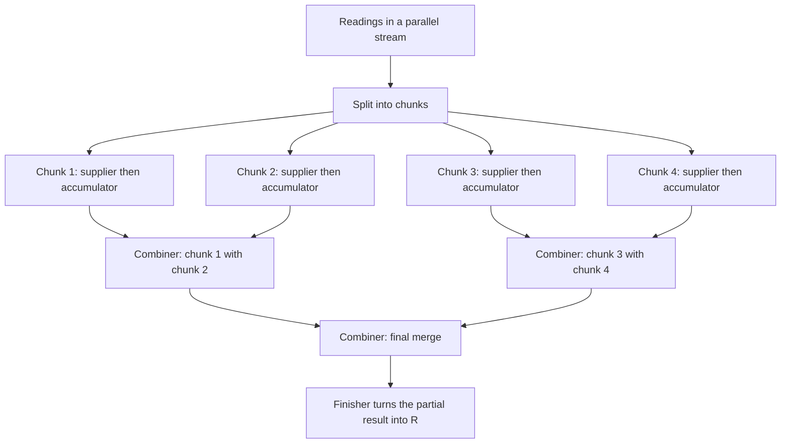
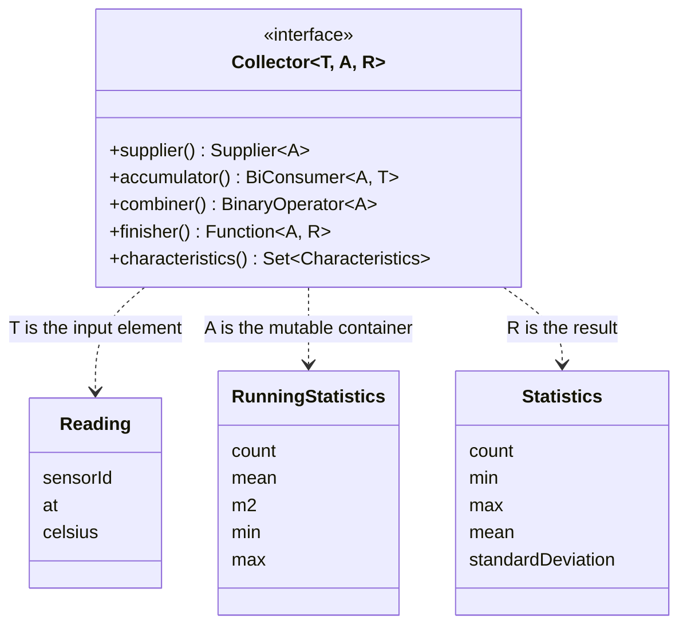

# Task 28 · Write your own Collectors

| Difficulty | Topics | Time box |
|---|---|---|
| 🟡 Medium | The `Collector` interface (supplier, accumulator, combiner, finisher, characteristics) · Mutable reduction vs. `reduce` · Parallel streams and why the combiner must be correct · Numerically stable statistics (Welford, Chan) · Generic APIs with PECS · Composing with `groupingBy` and `collectingAndThen` | 2–3 h |

> **Background reading:** *Modern Java in Action* ch. 6 (especially 6.5 "The Collector interface" and 6.6 "Developing your own collector") and ch. 7 (parallel streams) · Javadoc of `java.util.stream.Collector` (the identity and associativity constraints) · *Effective Java* Item 46 ("Prefer side-effect-free functions in streams") and Item 48 ("Use caution when making streams parallel") · B. P. Welford (1962) and Chan, Golub & LeVeque (1979) on computing variance; the Wikipedia article "Algorithms for calculating variance" summarises both.

---

## The situation

Our logistics company runs cold-storage warehouses. Thousands of temperature sensors send readings, and the monitoring service computes statistics over millions of readings per hour. Three things went wrong in the last month:

* The code calls `stream().mapToDouble(...).average()` five times per sensor, so every sensor's readings are walked five times.
* The standard deviation uses the textbook formula `sqrt(E[x²] - E[x]²)`. For one sensor it returned `NaN`. The formula subtracts two large, nearly equal numbers, and the rounding error can be bigger than the answer.
* Someone added `.parallel()` to a custom reduction that adds readings to a shared `ArrayList`. The results change from run to run, because threads write to the same list at the same time.

The fix is to write proper collectors. A collector is the reusable piece that says how to build a result from a stream of values, and it can be run in parallel if you give it the right parts. You will write four of them.

## The domain

| Term | Meaning |
|---|---|
| **Reading** | One temperature sample: sensor id, instant, degrees Celsius. The celsius value is finite. |
| **Statistics** | Count, min, max, mean and population standard deviation of a non-empty set of readings. |
| **Population standard deviation** | Divide the sum of squared deviations by `n`, not by `n - 1`. |
| **Partial result** | The mutable state of a collector after it has seen some of the readings. Each thread has its own. |
| **Combiner** | The operation that merges two partial results into one. Parallel streams use it. |

### How a parallel collect works



Each chunk gets its **own** container from the supplier, so the accumulators never touch each other. The combiner tree then merges the containers in an order the library chooses, not you. That is why the combiner must give the same answer whatever the grouping is.

### The type parameters of `Collector<T, A, R>`



* **T** is what goes in: a `Reading`.
* **A** is the mutable container that exists while the collect runs. It is never shown to the caller.
* **R** is what comes out. `Optional<Statistics>` for our statistics collector.

## What I want from you

Implement the four public methods of [`SensorCollectors`](../src/main/java/io/github/chris013/practice/task28/SensorCollectors.java). The records [`Reading`](../src/main/java/io/github/chris013/practice/task28/Reading.java) and [`Statistics`](../src/main/java/io/github/chris013/practice/task28/Statistics.java) are given. Do not change them.

1. **`statistics()`** returns a `Collector<Reading, ?, Optional<Statistics>>`.
   * One pass over the readings. The accumulator uses Welford's online update, and the combiner uses Chan et al.'s pairwise merge. Both are written out in the "How I'd approach it" section.
   * Empty input gives `Optional.empty()`. A single reading gives a standard deviation of `0`.
   * `min` and `max` are exact. The mean and the standard deviation must match a sequential run within a relative tolerance of `1e-9`.
   * The combiner must give the same result as one pass over both halves. It must also work when one half is empty.
   * The characteristics are `UNORDERED`, and no more. Explain in the Javadoc why `IDENTITY_FINISH` and `CONCURRENT` are not set.
2. **`topK(int k, Comparator<? super T> order)`** returns a `Collector<T, ?, List<T>>` with the `k` greatest elements, greatest first.
   * The result is unmodifiable.
   * `k` must be at least 1. Otherwise throw `IllegalArgumentException`.
   * If the input has fewer than `k` elements, return all of them.
   * Keep at most `k` elements in memory at any time, using a bounded `PriorityQueue`. Do not sort the whole input.
   * The combiner merges two partial results and keeps `k` elements.
   * With no ties, parallel and sequential runs give the same list. Ties at the cut-off may go either way, and the Javadoc says so.
   * The parameter is `Comparator<? super T>`, so a `Comparator<Object>` can rank a stream of Strings.
3. **`statisticsPerSensor()`** returns a `Collector<Reading, ?, SortedMap<String, Statistics>>`.
   * Build it from `groupingBy` (with `TreeMap::new`), `statistics()`, and `collectingAndThen`. Do not write a supplier or accumulator here.
   * Each group has at least one reading, so the `Optional` from `statistics()` is never empty for a group. Unwrap it.
   * The returned map is sorted by sensor id and unmodifiable.
   * Empty input gives an empty map.
4. **`countAbove(double thresholdCelsius)`** returns a `Collector<Reading, ?, Map<Boolean, Long>>`.
   * It counts the readings strictly above the threshold. A reading equal to the threshold is not above it.
   * Both keys, `true` and `false`, are always present, even when one partition is empty.
   * A threshold that is NaN or infinite throws `IllegalArgumentException`.
   * Use `partitioningBy` and `counting()`.

Every collector gives the same result sequentially and in parallel.

## Constraints & non-goals

* **No shared mutable state outside the accumulation containers.** Do not capture a list, a map or a counter in a lambda and write to it from the accumulator. That is the bug in the story above.
* **No `reduce` with a mutable identity.** `reduce` gives the same identity object to every chunk. Use a collector, which creates a new container per chunk.
* **No sorting for `topK`.** The point of the task is memory and time proportional to `k`, not `n`.
* **No `IDENTITY_FINISH` and no `CONCURRENT`** on the statistics collector. Explain why in the Javadoc, as the task asks.
* **No dependencies.** Plain Java 25, no libraries, no streaming frameworks.
* **No LaTeX in the Javadoc.** Plain text or `{@code}` only.

## How I'd approach it

* **Start with `topK`.** It is the smallest, and it shows the shape of every collector: a supplier, an accumulator, a combiner, and a finisher. Write the sequential version first, then add the combiner, then run the parallel test.
* **Why `reduce` with a mutable container is wrong.** `stream.reduce(new ArrayList<>(), (list, x) -> { list.add(x); return list; }, combiner)` shares one `ArrayList` between every chunk, so the parallel run races on it. Even with a fresh container per chunk, `reduce` passes the same identity object to every chunk. With a mutable container, every chunk's accumulator mutates that one shared object. `reduce` is designed for immutable values, where the accumulator returns a new value. `collect` with a `Collector` is the mutable-reduction counterpart: its supplier creates a fresh container for every chunk.
* **The two constraints from the `Collector` Javadoc.** The supplier's container must be an identity for the combiner: merging an empty container into any partial result leaves that result unchanged. And the combiner must be associative: `combine(combine(a, b), c)` must equal `combine(a, combine(b, c))`. Parallel streams choose the tree of merges themselves, so you must not depend on it.
* **Characteristics.** `IDENTITY_FINISH` means the finisher is a plain cast, so `A` and `R` are the same type. Use it only when that is true. `UNORDERED` means the result does not depend on the encounter order. `CONCURRENT` means one shared container is updated by several threads, so the accumulator must be thread-safe. It is rarely what you want: a thread-safe container is harder to get right and usually slower than one container per chunk. The usual exception is grouping into a `ConcurrentHashMap`.
* **When parallel streams help.** They help when the source splits cheaply (an `ArrayList`, an array, `IntStream.range`), the work per element is CPU-bound and not trivial, and the combine step is cheap. They hurt on small inputs, on sources that split badly (`LinkedList`, `Stream.iterate`, a stream of lines from a socket), and in a server, where the shared common pool is used by other requests too. *Effective Java* Item 48 gives the same advice.
* **Welford's online update.** For each new value `x`, with `n` the count after adding it:

```text
delta = x - mean
mean  = mean + delta / n
m2    = m2 + delta * (x - mean)
```

  The population variance is `m2 / n`. The key is the third line. It multiplies `delta`, the distance from the old mean, by `x - mean`, the distance from the new mean. Both are small numbers, so the update never forms `x*x` and never subtracts two large, nearly equal sums.

* **Chan's merge.** Two partial results A and B, with `n = nA + nB`:

```text
delta = meanB - meanA
mean  = meanA + delta * nB / n
m2    = m2A + m2B + delta * delta * nA * nB / n
```

  Guard the empty cases explicitly. If both parts are empty, `n` is 0 and `nB / n` is `0 / 0`, which is NaN. If only one part is empty, the formulas happen to give the other part, but an early return is clearer and does not depend on that.
* **Min and max** are easy to forget in the merge. They are not in the formulas above, and a merge that only updates `count`, `mean` and `m2` gives wrong answers silently.
* **Worked example: why the textbook formula fails.** Take the four values `1e9 + 4`, `1e9 + 7`, `1e9 + 13` and `1e9 + 16`. Their true mean is `1e9 + 10`, and their true variance is `22.5`. A double has about 16 significant digits, so the squares are about `1e18` and each one is rounded to a multiple of 128.

  | Quantity | Computed in doubles | Exact |
  |---|---|---|
  | sum of squares / n (E[x²]) | `1.00000002E18` | 1000000020000000122.5 |
  | mean² (E[x]²) | `1.0000000200000001E18` | 1000000020000000100 |
  | difference | `-128.0` | `22.5` |

  The difference should be `22.5`, but rounding leaves `-128.0`. The square root of a negative number is `NaN`, which is the bug from the story. Welford's method on the same four values gives a mean of `1e9 + 10` and a standard deviation of `4.7434`, because it never forms the large squares.
* **PECS in `topK`.** The comparator *consumes* the elements; it does not produce them. So the parameter is `Comparator<? super T>`: a `Comparator<Object>` is a valid consumer of Strings. *Effective Java* Item 31 ("Use bounded wildcards to increase API flexibility") gives the rule. Try the method with `Comparator<String>` and with `Comparator<Object>`, and see what the compiler accepts.
* **The min-heap for `topK`.** A `PriorityQueue` with the comparator, used as a min-heap, has the least element at its head. You keep the `k` greatest elements by asking one question for each new element: is it greater than the head? If yes, replace the head. Think about why this is the cheapest check you can make.
* **Composition.** `statisticsPerSensor()` should read like a sentence. `groupingBy(sensorId, TreeMap::new, oneSensor)` where `oneSensor` is `statistics()` with the `Optional` unwrapped. Then `collectingAndThen` makes the map unmodifiable. If you find yourself writing a loop, you are re-implementing `groupingBy`.
* **Counting with two keys.** `groupingBy` only creates keys that appear in the input. `partitioningBy` always creates both `true` and `false`, which is what the dashboard needs.
* **Test with real parallelism.** `parallelStream()` on an `ArrayList` of 200,000 items splits into several chunks on a multi-core machine. A test that passes sequentially and fails in parallel is what you are looking for.

## Tests

Run: `mvn test -Dtest='**/task28/**'`

* [`StatisticsCollectorTest`](../src/test/java/io/github/chris013/practice/task28/StatisticsCollectorTest.java) covers the statistics, the numerical stability on the 1e9 data, the combiner called directly, and parallel against sequential.
* [`TopKCollectorTest`](../src/test/java/io/github/chris013/practice/task28/TopKCollectorTest.java) covers `k` larger than the input, `k` of one, Strings and Readings, the unmodifiable result, `k` of zero, PECS, and the parallel run.
* [`ComposedCollectorsTest`](../src/test/java/io/github/chris013/practice/task28/ComposedCollectorsTest.java) covers the per-sensor map and `countAbove`, including the case where one partition is empty.
* [`TestReadings`](../src/test/java/io/github/chris013/practice/task28/TestReadings.java) holds the deterministic random data and the helper that compares statistics with a tolerance.

<details>
<summary>Show the tests</summary>

<!-- embed: src/test/java/io/github/chris013/practice/task28/StatisticsCollectorTest.java -->
**[`StatisticsCollectorTest.java`](../src/test/java/io/github/chris013/practice/task28/StatisticsCollectorTest.java)**

```java
package io.github.chris013.practice.task28;

import static io.github.chris013.practice.task28.TestReadings.assertSameStatistics;
import static io.github.chris013.practice.task28.TestReadings.collectInTwoHalves;
import static io.github.chris013.practice.task28.TestReadings.randomReadings;
import static io.github.chris013.practice.task28.TestReadings.reading;
import static org.assertj.core.api.Assertions.assertThat;
import static org.assertj.core.api.Assertions.within;

import java.util.List;
import java.util.Optional;
import java.util.stream.Stream;
import org.junit.jupiter.api.Nested;
import org.junit.jupiter.api.Test;

class StatisticsCollectorTest {

    @Test
    void a_single_reading_has_zero_standard_deviation() {
        Statistics stats = statisticsOf(List.of(reading("s1", 21.5))).orElseThrow();

        assertThat(stats.count()).isEqualTo(1);
        assertThat(stats.min()).isEqualTo(21.5);
        assertThat(stats.max()).isEqualTo(21.5);
        assertThat(stats.mean()).isEqualTo(21.5);
        assertThat(stats.standardDeviation()).isZero();
    }

    @Test
    void computes_the_population_standard_deviation_of_a_known_data_set() {
        // Classic textbook data: mean 5, sum of squared deviations 32, population variance 32 / 8 = 4.
        List<Reading> readings = Stream.of(2, 4, 4, 4, 5, 5, 7, 9)
                .map(value -> reading("s1", value))
                .toList();

        Statistics stats = statisticsOf(readings).orElseThrow();

        assertThat(stats.count()).isEqualTo(8);
        assertThat(stats.min()).isEqualTo(2.0);
        assertThat(stats.max()).isEqualTo(9.0);
        assertThat(stats.mean()).isEqualTo(5.0);
        assertThat(stats.standardDeviation()).isEqualTo(2.0);
    }

    @Test
    void empty_input_gives_no_statistics() {
        assertThat(statisticsOf(List.of())).isEmpty();
    }

    @Nested
    class NumericalStability {

        // All values are about 1e9. A double has about 16 significant digits, so the squares are about 1e18 and
        // each one is rounded to a multiple of 128. The variance is 22.5, which is a tiny part of that sum.
        private static final List<Double> NEAR_A_BILLION = List.of(1e9 + 4, 1e9 + 7, 1e9 + 13, 1e9 + 16);

        @Test
        void welford_keeps_the_small_variance_when_the_values_are_large() {
            Statistics stats = statisticsOf(NEAR_A_BILLION.stream().map(v -> reading("s1", v)).toList())
                    .orElseThrow();

            assertThat(stats.mean()).isCloseTo(1e9 + 10, within(1e-6));
            assertThat(stats.standardDeviation()).isCloseTo(Math.sqrt(22.5), within(1e-6));
        }

        @Test
        void the_textbook_formula_loses_the_variance_here() {
            // E[x^2] and E[x]^2 are both about 1e18 and are rounded to multiples of 128. Their difference, which should
            // be 22.5, comes out as -128, so sqrt returns NaN.
            double naive = naiveStandardDeviation(NEAR_A_BILLION);

            assertThat(naive).isNaN();
        }

        /** The formula most people write first. Kept here only to show that it is wrong. */
        private static double naiveStandardDeviation(List<Double> values) {
            double sum = 0;
            double sumOfSquares = 0;
            for (double value : values) {
                sum += value;
                sumOfSquares += value * value;
            }
            double n = values.size();
            double mean = sum / n;
            return Math.sqrt(sumOfSquares / n - mean * mean);
        }
    }

    @Nested
    class Combiner {

        @Test
        void merging_two_partial_results_gives_the_same_answer_as_one_pass() {
            List<Reading> readings = randomReadings(1_000, 1, "s1");

            Optional<Statistics> merged = collectInTwoHalves(SensorCollectors.statistics(), readings.subList(0, 400),
                    readings.subList(400, readings.size()));

            assertSameStatistics(merged.orElseThrow(), statisticsOf(readings).orElseThrow());
        }

        @Test
        void merging_with_an_empty_half_keeps_the_other_half() {
            List<Reading> readings = randomReadings(50, 2, "s1");
            List<Reading> none = List.of();

            assertSameStatistics(collectInTwoHalves(SensorCollectors.statistics(), readings, none).orElseThrow(),
                    statisticsOf(readings).orElseThrow());
            assertSameStatistics(collectInTwoHalves(SensorCollectors.statistics(), none, readings).orElseThrow(),
                    statisticsOf(readings).orElseThrow());
        }

        @Test
        void merging_two_empty_halves_gives_no_statistics() {
            assertThat(collectInTwoHalves(SensorCollectors.statistics(), List.of(), List.of())).isEmpty();
        }
    }

    @Nested
    class Parallel {

        @Test
        void parallel_and_sequential_give_the_same_statistics_for_200000_readings() {
            List<Reading> readings = randomReadings(200_000, 42, "s1", "s2", "s3");

            Statistics sequential = readings.stream().collect(SensorCollectors.statistics()).orElseThrow();
            Statistics parallel = readings.parallelStream().collect(SensorCollectors.statistics()).orElseThrow();

            assertSameStatistics(parallel, sequential);
        }
    }

    private static Optional<Statistics> statisticsOf(List<Reading> readings) {
        return readings.stream().collect(SensorCollectors.statistics());
    }
}
```
<!-- /embed -->

<!-- embed: src/test/java/io/github/chris013/practice/task28/TopKCollectorTest.java -->
**[`TopKCollectorTest.java`](../src/test/java/io/github/chris013/practice/task28/TopKCollectorTest.java)**

```java
package io.github.chris013.practice.task28;

import static io.github.chris013.practice.task28.TestReadings.collectInTwoHalves;
import static io.github.chris013.practice.task28.TestReadings.reading;
import static org.assertj.core.api.Assertions.assertThat;
import static org.assertj.core.api.Assertions.assertThatThrownBy;

import java.util.ArrayList;
import java.util.Collections;
import java.util.Comparator;
import java.util.List;
import java.util.Random;
import java.util.stream.Collector;
import java.util.stream.IntStream;
import java.util.stream.Stream;
import org.junit.jupiter.api.Nested;
import org.junit.jupiter.api.Test;
import org.junit.jupiter.params.ParameterizedTest;
import org.junit.jupiter.params.provider.CsvSource;

class TopKCollectorTest {

    private static final Comparator<String> BY_LENGTH = Comparator.comparingInt(String::length);

    @Test
    void returns_the_k_greatest_elements_greatest_first() {
        List<String> fruits = List.of("pear", "fig", "banana", "kiwi", "apple");

        List<String> result = fruits.stream().collect(SensorCollectors.topK(2, BY_LENGTH));

        assertThat(result).containsExactly("banana", "apple");
    }

    @Test
    void returns_everything_when_k_is_larger_than_the_input() {
        List<String> result = Stream.of("fig", "banana", "pear")
                .collect(SensorCollectors.topK(10, BY_LENGTH));

        assertThat(result).containsExactly("banana", "pear", "fig");
    }

    @Test
    void k_of_one_is_the_maximum() {
        List<String> result = Stream.of("fig", "banana", "pear")
                .collect(SensorCollectors.topK(1, BY_LENGTH));

        assertThat(result).containsExactly("banana");
    }

    @Test
    void empty_input_gives_an_empty_list() {
        List<String> result = Stream.<String>empty().collect(SensorCollectors.topK(3, BY_LENGTH));

        assertThat(result).isEmpty();
    }

    @Test
    void works_for_readings_ordered_by_temperature() {
        List<Reading> readings = List.of(
                reading("a", -1.0), reading("b", 5.0), reading("c", 2.5), reading("d", 9.0), reading("e", 0.0));

        List<Reading> warmest = readings.stream()
                .collect(SensorCollectors.topK(3, Comparator.comparingDouble(Reading::celsius)));

        assertThat(warmest).extracting(Reading::sensorId).containsExactly("d", "b", "c");
    }

    @Test
    void the_result_cannot_be_modified() {
        List<String> result = Stream.of("fig", "banana").collect(SensorCollectors.topK(2, BY_LENGTH));

        assertThatThrownBy(() -> result.add("kiwi")).isInstanceOf(UnsupportedOperationException.class);
    }

    @ParameterizedTest
    @CsvSource({"0", "-1", "-100"})
    void needs_k_of_at_least_one(int k) {
        assertThatThrownBy(() -> SensorCollectors.topK(k, BY_LENGTH))
                .isInstanceOf(IllegalArgumentException.class);
    }

    @Test
    void the_comparator_must_not_be_null() {
        assertThatThrownBy(() -> SensorCollectors.topK(2, null)).isInstanceOf(NullPointerException.class);
    }

    @Test
    void accepts_a_comparator_for_a_supertype_so_it_can_rank_strings() {
        // PECS: the comparator only consumes elements, so a Comparator<Object> ranks a stream of Strings.
        Comparator<Object> byText = Comparator.comparing(Object::toString);

        List<String> result = Stream.of("pear", "apple", "zucchini").collect(SensorCollectors.topK(2, byText));

        assertThat(result).containsExactly("zucchini", "pear");
    }

    @Nested
    class Parallel {

        @Test
        void parallel_equals_sequential_when_there_are_no_ties() {
            List<Integer> numbers = new ArrayList<>(IntStream.range(0, 100_000).boxed().toList());
            Collections.shuffle(numbers, new Random(42));

            List<Integer> sequential = numbers.stream().collect(SensorCollectors.topK(10, Comparator.naturalOrder()));
            List<Integer> parallel = numbers.parallelStream()
                    .collect(SensorCollectors.topK(10, Comparator.naturalOrder()));

            assertThat(sequential).containsExactly(99_999, 99_998, 99_997, 99_996, 99_995,
                    99_994, 99_993, 99_992, 99_991, 99_990);
            assertThat(parallel).isEqualTo(sequential);
        }

        @Test
        void merging_two_partial_heaps_keeps_only_k_elements() {
            Collector<String, ?, List<String>> collector = SensorCollectors.topK(2, BY_LENGTH);

            List<String> result = collectInTwoHalves(collector, List.of("fig", "banana"),
                    List.of("strawberry", "kiwi"));

            assertThat(result).containsExactly("strawberry", "banana");
        }
    }
}
```
<!-- /embed -->

<!-- embed: src/test/java/io/github/chris013/practice/task28/ComposedCollectorsTest.java -->
**[`ComposedCollectorsTest.java`](../src/test/java/io/github/chris013/practice/task28/ComposedCollectorsTest.java)**

```java
package io.github.chris013.practice.task28;

import static io.github.chris013.practice.task28.TestReadings.assertSameStatistics;
import static io.github.chris013.practice.task28.TestReadings.randomReadings;
import static io.github.chris013.practice.task28.TestReadings.reading;
import static org.assertj.core.api.Assertions.assertThat;
import static org.assertj.core.api.Assertions.assertThatThrownBy;

import java.util.List;
import java.util.Map;
import java.util.SortedMap;
import org.junit.jupiter.api.Nested;
import org.junit.jupiter.api.Test;
import org.junit.jupiter.params.ParameterizedTest;
import org.junit.jupiter.params.provider.CsvSource;

class ComposedCollectorsTest {

    @Nested
    class StatisticsPerSensor {

        @Test
        void gives_one_entry_per_sensor_sorted_by_sensor_id() {
            List<Reading> readings = List.of(
                    reading("kitchen", 4.0), reading("dock", -18.0), reading("kitchen", 6.0), reading("dock", -16.0));

            SortedMap<String, Statistics> perSensor = readings.stream()
                    .collect(SensorCollectors.statisticsPerSensor());

            assertThat(perSensor.keySet()).containsExactly("dock", "kitchen");
            assertThat(perSensor.get("dock").count()).isEqualTo(2);
            assertThat(perSensor.get("dock").mean()).isEqualTo(-17.0);
            assertThat(perSensor.get("kitchen").mean()).isEqualTo(5.0);
            assertThat(perSensor.get("kitchen").standardDeviation()).isEqualTo(1.0);
        }

        @Test
        void the_map_cannot_be_modified() {
            SortedMap<String, Statistics> perSensor = List.of(reading("dock", -18.0))
                    .stream()
                    .collect(SensorCollectors.statisticsPerSensor());

            assertThatThrownBy(() -> perSensor.put("new", perSensor.get("dock")))
                    .isInstanceOf(UnsupportedOperationException.class);
        }

        @Test
        void empty_input_gives_an_empty_map() {
            assertThat(List.<Reading>of().stream().collect(SensorCollectors.statisticsPerSensor())).isEmpty();
        }

        @Test
        void parallel_equals_sequential_for_200000_readings() {
            List<Reading> readings = randomReadings(200_000, 7, "dock", "freezer", "kitchen", "office");

            SortedMap<String, Statistics> sequential = readings.stream()
                    .collect(SensorCollectors.statisticsPerSensor());
            SortedMap<String, Statistics> parallel = readings.parallelStream()
                    .collect(SensorCollectors.statisticsPerSensor());

            assertThat(parallel.keySet()).containsExactlyElementsOf(sequential.keySet());
            sequential.forEach((sensor, stats) -> assertSameStatistics(parallel.get(sensor), stats));
        }
    }

    @Nested
    class CountAbove {

        private static final List<Reading> READINGS = List.of(
                reading("dock", -18.0), reading("dock", -2.0), reading("dock", -2.0), reading("dock", 3.0));

        @Test
        void counts_readings_strictly_above_the_threshold() {
            Map<Boolean, Long> counts = READINGS.stream().collect(SensorCollectors.countAbove(-2.0));

            // The two readings at exactly -2.0 are not above -2.0.
            assertThat(counts).containsEntry(true, 1L).containsEntry(false, 3L);
        }

        @Test
        void has_both_keys_when_no_reading_is_above() {
            Map<Boolean, Long> counts = READINGS.stream().collect(SensorCollectors.countAbove(10.0));

            assertThat(counts).containsEntry(true, 0L).containsEntry(false, 4L);
        }

        @Test
        void has_both_keys_when_every_reading_is_above() {
            Map<Boolean, Long> counts = READINGS.stream().collect(SensorCollectors.countAbove(-100.0));

            assertThat(counts).containsEntry(true, 4L).containsEntry(false, 0L);
        }

        @Test
        void has_both_keys_for_empty_input() {
            Map<Boolean, Long> counts = List.<Reading>of().stream().collect(SensorCollectors.countAbove(0.0));

            assertThat(counts).containsEntry(true, 0L).containsEntry(false, 0L);
        }

        @ParameterizedTest
        @CsvSource({"NaN", "Infinity", "-Infinity"})
        void rejects_a_threshold_that_is_not_a_finite_number(double threshold) {
            assertThatThrownBy(() -> SensorCollectors.countAbove(threshold))
                    .isInstanceOf(IllegalArgumentException.class);
        }

        @Test
        void parallel_equals_sequential() {
            List<Reading> readings = randomReadings(200_000, 11, "dock", "kitchen");

            Map<Boolean, Long> sequential = readings.stream().collect(SensorCollectors.countAbove(-18.0));
            Map<Boolean, Long> parallel = readings.parallelStream().collect(SensorCollectors.countAbove(-18.0));

            assertThat(parallel).isEqualTo(sequential);
        }
    }
}
```
<!-- /embed -->

<!-- embed: src/test/java/io/github/chris013/practice/task28/TestReadings.java -->
**[`TestReadings.java`](../src/test/java/io/github/chris013/practice/task28/TestReadings.java)**

```java
package io.github.chris013.practice.task28;

import static org.assertj.core.api.Assertions.assertThat;
import static org.assertj.core.api.Assertions.within;

import java.time.Instant;
import java.util.ArrayList;
import java.util.List;
import java.util.Random;
import java.util.stream.Collector;

/** Builders and assertion helpers shared by the Task 28 tests. */
final class TestReadings {

    static final Instant AT = Instant.parse("2026-03-01T09:00:00Z");

    private TestReadings() {
    }

    static Reading reading(String sensorId, double celsius) {
        return new Reading(sensorId, AT, celsius);
    }

    /** Deterministic pseudo-random readings: cold-storage temperatures around -18 C, spread over the sensors. */
    static List<Reading> randomReadings(int count, long seed, String... sensorIds) {
        Random random = new Random(seed);
        List<Reading> readings = new ArrayList<>(count);
        for (int i = 0; i < count; i++) {
            String sensor = sensorIds[random.nextInt(sensorIds.length)];
            readings.add(reading(sensor, -18.0 + 4.0 * random.nextGaussian()));
        }
        return readings;
    }

    /**
     * Parallel reductions merge partial results in another order than a sequential pass, so the floating-point
     * results can differ in the last bits. Count, min and max are exact; mean and deviation get a relative
     * tolerance of 1e-9.
     */
    static void assertSameStatistics(Statistics actual, Statistics expected) {
        assertThat(actual.count()).isEqualTo(expected.count());
        assertThat(actual.min()).isEqualTo(expected.min());
        assertThat(actual.max()).isEqualTo(expected.max());
        assertThat(actual.mean()).isCloseTo(expected.mean(), within(Math.abs(expected.mean()) * 1e-9));
        assertThat(actual.standardDeviation())
                .isCloseTo(expected.standardDeviation(), within(Math.abs(expected.standardDeviation()) * 1e-9));
    }

    /** Splits the work the way a parallel stream does: two accumulators, merged with the combiner. */
    static <T, A, R> R collectInTwoHalves(Collector<T, A, R> collector, List<T> left, List<T> right) {
        A leftAccumulator = collector.supplier().get();
        left.forEach(item -> collector.accumulator().accept(leftAccumulator, item));
        A rightAccumulator = collector.supplier().get();
        right.forEach(item -> collector.accumulator().accept(rightAccumulator, item));
        A merged = collector.combiner().apply(leftAccumulator, rightAccumulator);
        return collector.finisher().apply(merged);
    }
}
```
<!-- /embed -->

</details>

## Definition of done

- [ ] All tests green, and the whole task runs in well under 5 seconds.
- [ ] `statistics()` uses Welford in the accumulator and Chan's merge in the combiner. Empty input and single values are handled.
- [ ] The combiner handles an empty half on either side, and it also merges `min` and `max`.
- [ ] `topK` keeps at most `k` elements at any time, and the result is unmodifiable and greatest first.
- [ ] `statisticsPerSensor()` is built from `groupingBy`, `statistics()` and `collectingAndThen`, with no hand-written supplier or accumulator.
- [ ] `countAbove` always has both keys, and a NaN threshold is rejected.
- [ ] No shared mutable state outside the accumulation containers.
- [ ] The Javadoc of `statistics()` says why `IDENTITY_FINISH` and `CONCURRENT` are not set, and whether `UNORDERED` is safe.

## Stretch goals

1. Write `histogram(double bucketWidth)` as a collector that counts readings per bucket. Which key type do you use, and how do you keep the map sorted? Make sure the combiner adds counts without losing a bucket.
2. Percentiles cannot be merged exactly from partial results: the median of two medians is not the median. Explain why, and read about the t-digest idea (Dunning and Ertl, "Computing Extremely Accurate Quantiles Using t-Digests"). What would you give up?
3. JEP 485 ("Stream Gatherers", final in JDK 24) adds `Stream.gather`, which is a stateful intermediate step. Write a moving average over the last `n` readings with a gatherer. Then explain why a moving average is a poor fit for a `Collector`, which only produces one result at the end.
4. Benchmark `statistics()` against five `averagingDouble` calls with JMH on a realistic input size. Report the numbers and what they do not tell you.

---

## Reference solution

<details>
<summary>Spoiler: open only after you have made a serious attempt</summary>

### Key decisions

**1. The statistics container is a private mutable class, not a `double[]` or a `List`.** `RunningStatistics` holds `count`, `mean`, `m2`, `min` and `max`. The container is the state of the collector, and the finisher turns it into an `Optional<Statistics>`. Because the finisher changes the type, `IDENTITY_FINISH` is not allowed.

**2. Welford in the accumulator, Chan in the combiner.** Both are numerically stable. The combiner checks for an empty side first, because an empty side has no mean. The merge uses the sizes of both sides, so the result does not depend on how the parallel stream split the data.

**3. `UNORDERED` and nothing else.** The order of readings does not change the mean or the variance mathematically. It can change the last few bits of the floating-point result, which is why the tests compare with a relative tolerance. `CONCURRENT` is not set, because each chunk has its own container; the alternative would be a shared, locked container, which is slower and harder to reason about.

**4. `topK` uses a bounded min-heap, not a sort.** The heap holds at most `k` elements. Each new element is compared with the head, and it replaces the head only if it is greater. The combiner offers the elements of the other heap to this one, so it still holds at most `k`. Sorting everything would cost O(n log n) time and O(n) memory.

**5. PECS on the comparator.** The parameter is `Comparator<? super T>`, because the comparator only reads the elements. The result is sorted once at the end with `order.reversed()`, and `List.copyOf` makes it unmodifiable.

**6. `statisticsPerSensor()` is composition, not a loop.** `collectingAndThen(statistics(), Optional::orElseThrow)` gives a collector for one sensor. `groupingBy` with `TreeMap::new` puts one of those in each group, and `collectingAndThen` makes the sorted map unmodifiable. The `orElseThrow` is safe because a group only exists when it has at least one reading.

**7. `countAbove` uses `partitioningBy`.** It always creates both keys, which `groupingBy` would not do for an empty partition. A NaN threshold is rejected up front, because every comparison with NaN is false, and the counts would be wrong without any error.

### Code

<!-- embed: solutions/src/main/java/io/github/chris013/practice/task28/SensorCollectors.java -->
**[`SensorCollectors.java`](../solutions/src/main/java/io/github/chris013/practice/task28/SensorCollectors.java)**

```java
package io.github.chris013.practice.task28;

import java.util.ArrayList;
import java.util.Collections;
import java.util.Comparator;
import java.util.List;
import java.util.Map;
import java.util.Objects;
import java.util.Optional;
import java.util.PriorityQueue;
import java.util.SortedMap;
import java.util.TreeMap;
import java.util.stream.Collector;
import java.util.stream.Collectors;

/**
 * Collectors for sensor readings: statistics, top-k, per-sensor summaries and threshold counts.
 *
 * <p>Every collector here keeps its state in its own accumulation container. None of them shares a list or a
 * map between threads, so the same collector gives the same answer sequentially and in parallel.
 */
public final class SensorCollectors {

    private SensorCollectors() {
    }

    /**
     * Count, min, max, mean and population standard deviation in one pass, numerically stable.
     *
     * <p>Empty input gives {@link Optional#empty()}. A single reading gives a standard deviation of {@code 0}.
     * The result must be the same sequentially and in parallel, within floating-point tolerance.
     *
     * <p>The accumulator is a {@link RunningStatistics} that uses Welford's online update, not the sums of
     * {@code x} and {@code x*x}. The combiner uses Chan et al.'s merge, so two halves computed in parallel give the
     * same result as one pass over everything. The finisher turns the accumulator into {@code Optional<Statistics>},
     * so the characteristics are {@link Collector.Characteristics#UNORDERED} only:
     * <ul>
     *   <li>{@code IDENTITY_FINISH} is not set because the finisher really does change the type, from
     *       {@code RunningStatistics} to {@code Optional<Statistics>}.</li>
     *   <li>{@code UNORDERED} is fine: the order of the readings does not change the mathematical result. The
     *       floating-point result can differ in the last few bits, which is why the tests compare with a tolerance.</li>
     *   <li>{@code CONCURRENT} is not set: the accumulator is not thread-safe, and each thread gets its own.</li>
     * </ul>
     */
    public static Collector<Reading, ?, Optional<Statistics>> statistics() {
        return Collector.of(
                RunningStatistics::new,
                (running, reading) -> running.add(reading.celsius()),
                RunningStatistics::merge,
                RunningStatistics::toStatistics,
                Collector.Characteristics.UNORDERED);
    }

    /**
     * The {@code k} greatest elements according to {@code order}, greatest first, as an unmodifiable list.
     *
     * <p>A min-heap of at most {@code k} elements: its head is the smallest element we still keep. A new element
     * replaces the head only when it is greater, so memory is O(k) and the time is O(n log k). Sorting all
     * elements would cost O(n log n) time and O(n) memory for the same answer.
     *
     * <p>The parameter is {@code Comparator<? super T>} (PECS: the comparator consumes the elements), so you can pass
     * a {@code Comparator<Object>} to rank Strings.
     *
     * <p>If the input has fewer than {@code k} elements, all of them are returned. Which of several equal elements
     * is kept at the cut-off is unspecified.
     *
     * @throws IllegalArgumentException if {@code k} is less than 1
     */
    public static <T> Collector<T, ?, List<T>> topK(int k, Comparator<? super T> order) {
        if (k < 1) {
            throw new IllegalArgumentException("k must be at least 1, was " + k);
        }
        Objects.requireNonNull(order, "order");
        return Collector.of(
                () -> new BoundedHeap<T>(k, order),
                BoundedHeap::offer,
                BoundedHeap::merge,
                BoundedHeap::greatestFirst,
                Collector.Characteristics.UNORDERED);
    }

    /**
     * Statistics per sensor. The per-sensor collector is an ordinary composition: {@code groupingBy} with a
     * {@code TreeMap} so keys are sorted, {@link #statistics()} as the downstream collector, and
     * {@code collectingAndThen} to take the value out of the {@code Optional} and make the map unmodifiable.
     * A group always has at least one reading, so {@code orElseThrow} cannot fail. Empty input gives an empty map.
     */
    public static Collector<Reading, ?, SortedMap<String, Statistics>> statisticsPerSensor() {
        Collector<Reading, ?, Statistics> oneSensor =
                Collectors.collectingAndThen(statistics(), Optional::orElseThrow);
        return Collectors.collectingAndThen(
                Collectors.groupingBy(Reading::sensorId, TreeMap::new, oneSensor),
                Collections::unmodifiableSortedMap);
    }

    /**
     * Counts with {@link Collectors#partitioningBy partitioningBy}, which always creates both keys.
     * A reading equal to the threshold is not above it. A NaN threshold would make every comparison false
     * without any error, so it is rejected up front.
     *
     * @throws IllegalArgumentException if the threshold is NaN or infinite
     */
    public static Collector<Reading, ?, Map<Boolean, Long>> countAbove(double thresholdCelsius) {
        if (!Double.isFinite(thresholdCelsius)) {
            throw new IllegalArgumentException("threshold must be finite, was " + thresholdCelsius);
        }
        return Collectors.partitioningBy(
                reading -> reading.celsius() > thresholdCelsius,
                Collectors.counting());
    }

    /**
     * Mutable accumulation state for {@link #statistics()}.
     *
     * <p>Welford's update for one new value {@code x}:
     * {@code delta = x - mean; mean += delta / n; m2 += delta * (x - mean)}.
     * Chan's merge for two parts A and B with {@code n = nA + nB}:
     * {@code delta = meanB - meanA; mean = meanA + delta * nB / n; m2 = m2A + m2B + delta^2 * nA * nB / n}.
     */
    private static final class RunningStatistics {

        private long count;
        private double mean;
        /** Sum of squared distances from the mean. Variance is {@code m2 / count}. */
        private double m2;
        private double min = Double.POSITIVE_INFINITY;
        private double max = Double.NEGATIVE_INFINITY;

        void add(double x) {
            count++;
            double delta = x - mean;
            mean += delta / count;
            m2 += delta * (x - mean);
            min = Math.min(min, x);
            max = Math.max(max, x);
        }

        RunningStatistics merge(RunningStatistics other) {
            if (other.count == 0) {
                return this;
            }
            if (count == 0) {
                count = other.count;
                mean = other.mean;
                m2 = other.m2;
                min = other.min;
                max = other.max;
                return this;
            }
            double nA = count;
            double nB = other.count;
            double n = nA + nB;
            double delta = other.mean - mean;
            mean += delta * (nB / n);
            m2 += other.m2 + delta * delta * (nA * nB / n);
            count += other.count;
            min = Math.min(min, other.min);
            max = Math.max(max, other.max);
            return this;
        }

        Optional<Statistics> toStatistics() {
            if (count == 0) {
                return Optional.empty();
            }
            // m2 cannot be negative in exact arithmetic. The clamp only guards against rounding, so sqrt never sees a
            // negative number.
            double variance = Math.max(0.0, m2) / count;
            return Optional.of(new Statistics(count, min, max, mean, Math.sqrt(variance)));
        }
    }

    /**
     * Keeps the {@code capacity} greatest elements seen so far. The heap's head is the least of them, so it is the
     * element a new candidate has to beat.
     */
    private static final class BoundedHeap<T> {

        private final int capacity;
        private final Comparator<? super T> order;
        private final PriorityQueue<T> smallestFirst;

        BoundedHeap(int capacity, Comparator<? super T> order) {
            this.capacity = capacity;
            this.order = order;
            this.smallestFirst = new PriorityQueue<>(order);
        }

        void offer(T element) {
            if (smallestFirst.size() < capacity) {
                smallestFirst.add(element);
            } else if (order.compare(element, smallestFirst.peek()) > 0) {
                smallestFirst.poll();
                smallestFirst.add(element);
            }
        }

        BoundedHeap<T> merge(BoundedHeap<T> other) {
            other.smallestFirst.forEach(this::offer);
            return this;
        }

        List<T> greatestFirst() {
            List<T> sorted = new ArrayList<>(smallestFirst);
            sorted.sort(order.reversed());
            return List.copyOf(sorted);
        }
    }
}
```
<!-- /embed -->

### What I typically flag in first attempts

| Finding | Why it matters |
|---|---|
| Textbook variance `sqrt(E[x²] - E[x]²)` | Subtracts two nearly equal large numbers. The 1e9 example gives a variance of -128 and a NaN. Use Welford. |
| A combiner that ignores the right side, or throws on an empty side | Parallel runs silently lose data, or fail only when the stream splits in a particular way. Test the combiner directly. |
| A shared `ArrayList` filled with `forEach` in a parallel stream | Threads write to one list at the same time. Results change from run to run. Use a collector with one container per chunk. |
| `Collectors.reducing` or `reduce` with a mutable identity | The same object is shared between chunks, and the combiner may mutate it. Use `Collector.of` with a supplier. |
| `topK` by sorting all the readings | O(n log n) time and O(n) memory, when a heap of size `k` needs O(n log k) time and O(k) memory. |
| Returning the internal mutable list from the finisher | The caller can change the result, and the result changes if the collector is reused. Return `List.copyOf`. |
| Forgetting `min` and `max` in the merge | Merged results look right in the mean, but the extremes are wrong. Test the extremes after a parallel run. |
| Calling `averagingDouble` five times per sensor | Walks the readings five times, and gives no standard deviation. One collector gives everything in one pass. |

</details>
