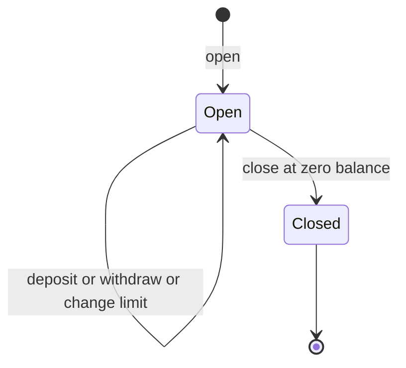
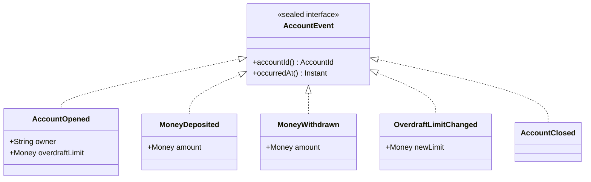
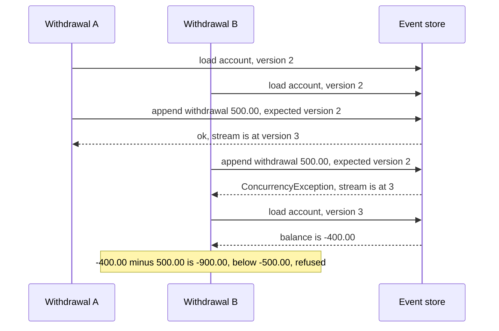

# Task 29 · An event-sourced bank account

| Difficulty | Topics | Time box |
|---|---|---|
| 🔴 Hard | Event sourcing: commands vs. events, rebuilding state by replay, `apply` never validates · Optimistic concurrency with expected versions and retry · An event store port with an in-memory adapter · Read models (projections) built from the same events · Sealed event hierarchy with exhaustive `switch` | 4 h |

> **Background reading:** Martin Fowler, "Event Sourcing" (martinfowler.com, 2005) · Greg Young, "CQRS Documents" (2010) · Vaughn Vernon, *Implementing Domain-Driven Design*, Appendix A "Aggregates and Event Sourcing" · Microsoft Azure Architecture Center, "Event Sourcing pattern" · *Effective Java*, Item 17 "Minimize mutability" · [Task 08](08-order-aggregate.md) (recording domain events) and [Task 10](10-library-lending-hexagonal.md) (ports and adapters)

---

## The situation

Our neobank keeps every account as a row with a `balance` column. Every service that touches money updates that column. That design has three problems:

* **Auditors cannot reconstruct how a balance came about.** The row only shows the current number. The history of how it got there is gone.
* **Support cannot answer "why was I overdrawn on the 3rd?"** The answer is in the transactions, but the balance was changed by several services, and nothing ties the two together.
* **Two parallel withdrawals took an account €400 below its overdraft limit.** Both services read the balance of €100.00, both checked "€100.00 minus €500.00 is above the limit", and both wrote €-400.00. The real balance should have been €-900.00. This is a **lost update**: the second write silently overwrote the first.

We move accounts to **event sourcing**. The events become the source of truth. The balance is no longer stored. It is *derived* by replaying the events. Concurrent writers are detected with **expected versions**, so the second withdrawal is checked against the state that really exists.

## The domain

| Term | Meaning |
|---|---|
| **Event** | A fact about an account that already happened, in the past tense: `MoneyWithdrawn`. Events are never changed or deleted. |
| **Command** | A request to do something, in the imperative: `withdraw`. A command can be refused. |
| **Stream** | The ordered list of events of one account. The stream is the account's history. |
| **Version** | The number of events in a stream. Version 0 is an empty stream. |
| **Expected version** | The version a writer saw when it loaded the stream. The store accepts an append only if the stream still has that version. |
| **Replay** | Rebuilding the state by applying every event of the stream in order. |
| **Balance** | Not stored anywhere. It is the sum of the deposits minus the withdrawals, computed by replay. |
| **Overdraft limit** | How far below zero the balance may go. A balance of €-500.00 is allowed with a limit of €500.00. |
| **Projection** | A read model built from events, for a specific question, such as the statement on screen. |

### Commands versus events

| | Command | Event |
|---|---|---|
| Name | Imperative: `withdraw` | Past tense: `MoneyWithdrawn` |
| Can it fail? | Yes. It is checked against the current state and may be refused | No. It already happened |
| Checked? | Yes. Arguments and business rules | Never. `apply` only applies it |
| Meaning | A request | A fact |
| Who creates it | The caller asks for it | The aggregate records it when the command passes |
| Example | `withdraw(500.00 EUR)` | `MoneyWithdrawn(500.00 EUR, on 2026-03-03)` |

### The life cycle of an account

Only `Open` accepts money. In `Closed`, every command is refused with `AccountClosedException`. The transition to `Closed` needs a zero balance, so no money is lost by closing.

### The events

The set is closed: these five events are the only ones. Because the interface is sealed, a `switch` over it must handle all five. If someone adds a sixth event, every `switch` stops compiling until it is handled. That is the safety net you want.

### Why expected versions stop the lost update

Walk through it with the numbers from the situation. The balance is €100.00 and the limit is €500.00.

| Step | What happens | Stream |
|---|---|---|
| 1 | A loads the history: opening and a deposit of €100.00. Balance €100.00 | version 2 |
| 2 | B loads the same history. Balance €100.00 | version 2 |
| 3 | A checks €100.00 minus €500.00 = €-400.00. That is above €-500.00, so it is valid | |
| 4 | A appends `MoneyWithdrawn` 500.00 with expected version 2 | Accepted, now version 3 |
| 5 | B checks €100.00 minus €500.00 on its stale copy. Also valid, but on the wrong state | |
| 6 | B appends with expected version 2 | Refused, stream is at 3 |
| 7 | B reloads. Three events, balance €-400.00 | version 3 |
| 8 | B checks €-400.00 minus €500.00 = €-900.00. That is below €-500.00 | Refused with `InsufficientFundsException` |

The balance stays at €-400.00. Nothing was lost, and the second withdrawal was judged against the real state. Note that step 6 does not fail because the money is wrong. It fails because the writer is out of date. Retrying is the right answer there. Step 8 is a business refusal. Retrying it would never succeed, which is why the service does not retry it.

## What I want from you

Implement the aggregate, the service, the in-memory store and the statement projection. The given types (`Money`, the events, the exceptions, `EventStore`, `ConcurrencyException`, `StatementLine`) are complete. Read them first, and do not change them.

1. **[`Account.open(id, owner, overdraftLimit, now)`](../src/main/java/io/github/chris013/practice/task29/domain/Account.java)** records an `AccountOpened`. The owner must not be blank and the overdraft limit must not be negative. Both are `IllegalArgumentException`.
2. **`Account.replay(history)`** rebuilds the account. The history must not be empty, must start with `AccountOpened`, must contain only events of this account, and must not contain a second `AccountOpened`. Each violation is an `IllegalArgumentException`. Afterwards there are no uncommitted events, and `version()` equals the size of the history.
3. **`deposit(amount, now)`** requires an amount greater than zero. Otherwise it is an `IllegalArgumentException`.
4. **`withdraw(amount, now)`** requires an amount greater than zero. The new balance must not be below minus the overdraft limit. The limit itself is allowed. One cent beyond it throws `InsufficientFundsException`. Its message contains the attempted amount and the available amount, which is the balance plus the limit.
5. **`changeOverdraftLimit(newLimit, now)`** requires a limit that is not negative (`IllegalArgumentException`). A limit below the current debt is an `IllegalStateException`. A limit exactly equal to the debt is allowed.
6. **`close(now)`** requires a balance of exactly zero. Otherwise it is an `IllegalStateException`.
7. **Closed accounts.** Every command on a closed account throws `AccountClosedException`. This includes closing a closed account. Argument checks come first, then the closed check, then the business rules.
8. **Failed commands record nothing.** After a refused command, `uncommittedEvents()` and `version()` are unchanged.
9. **`apply(event)`** is one `switch` over the sealed `AccountEvent` with no `default` branch. It never throws for a business reason, and it never checks a rule.
10. **Queries.** `id()`, `owner()`, `balance()`, `overdraftLimit()`, `isClosed()`, `version()` (committed and uncommitted events together), `uncommittedEvents()` (an unmodifiable copy) and `markCommitted()`, which clears the uncommitted list.
11. **Time.** Every event carries the `now` that the caller passed in. The aggregate never reads a clock.
12. **[`InMemoryEventStore`](../src/main/java/io/github/chris013/practice/task29/adapter/inmemory/InMemoryEventStore.java)**. `load` returns the full history, oldest first, and an empty list for an unknown stream. The returned list cannot be changed. `append` succeeds only if the stream currently has exactly `expectedVersion` events, and otherwise throws `ConcurrencyException`. Appending to a new stream needs expected version 0. The version check and the write are one atomic step, so the store is safe for concurrent writers.
13. **[`AccountService`](../src/main/java/io/github/chris013/practice/task29/application/AccountService.java)** `open(owner, overdraftLimit)` takes the next id from the supplier and returns it. It appends the opening event with expected version 0.
14. **Every other command** (`deposit`, `withdraw`, `changeOverdraftLimit`, `close`) runs this cycle: load the history, throw `IllegalArgumentException("unknown account " + id)` if it is empty, replay it, run the command, append the uncommitted events with the version it loaded, then call `markCommitted()`.
15. **Retries.** If the append throws `ConcurrencyException`, the service runs the whole cycle again: reload, replay, and re-run the command, which re-checks the rules against the new state. It makes at most 3 attempts in total. After the third failure it rethrows the last `ConcurrencyException`. Business exceptions are never retried.
16. **`balanceOf(id)`** replays the account and returns its balance. An unknown id is an `IllegalArgumentException`.
17. **[`AccountStatement`](../src/main/java/io/github/chris013/practice/task29/projection/AccountStatement.java)** `of(history)` returns one `StatementLine` per event, in order. The date is the UTC date of the event. The descriptions are `Account opened`, `Deposit`, `Withdrawal`, `Overdraft limit set to 500.00 EUR` (the new limit), and `Account closed`. Amounts are `0.00` for the opening, the limit change and the closing, `+amount` for a deposit and `-amount` for a withdrawal. `balance` is the running balance after the line. The projection has its own exhaustive `switch`. It does not call `Account`.

## Constraints & non-goals

* **Plain Java 25.** No event store library, no JSON, no database. The store is in memory.
* **Single currency.** Everything is EUR, as `Money` already says.
* **No clock reads in the aggregate or in the projection.** Time comes in as a parameter, or from the injected `Clock` in the service.
* **No mocks.** Use hand-written fakes such as `MutableClock` and the racing store in `AccountServiceTest`.
* **No snapshots, no event upcasting, no persistence of events.** These are stretch goals.
* **Do not put the balance in an event.** The balance is derived. An event that carries a balance is a second source of truth that can disagree with the others.

## How I'd approach it

* **Start with `Account`.** Write the fields, `apply` and `replay` first. Once replay works and the state is right, the commands are small. Each one is "check, then `record` the event".
* **Keep `apply` dumb.** It copies data from the event into the state, and nothing else. The most common mistake is that a command changes the state directly and then `apply` changes it again. The balance is then counted twice. Make `record` the only place that calls `apply`, and make commands call `record` only.
* **Why `apply` must not validate.** Suppose in 2027 the rule changes and the overdraft limit may no longer exceed €300. A 2026 history can contain a withdrawal that was valid under the old rule. If `apply` checked the current rule, `Account.replay` would throw for an account that is perfectly fine, and support could not open it. The events are facts. Rules are checked on the way in, when a new event is about to be recorded. They are not re-checked on the way out, when old events are read back. The test `applies_an_old_withdrawal_that_today_would_refuse` checks exactly this.
* **Replay checks shape, not rules.** The history must be one account, opened once and first. Those are structural facts about the data, so a broken history is a bug worth reporting loudly.
* **Order of checks in a command.** Argument checks first, because a `null` or a zero amount is a programming error. Then the closed check, then the business rules. Keeping the order the same everywhere makes the behaviour predictable. If you are unsure, the tests tell you the order.
* **The retry loop reloads everything.** Do not reuse the `Account` object from the failed attempt. It holds the state from before the conflict. The retry must load the stream again and replay it, so the rules are checked against the state that exists now.
* **Read the clock once per attempt.** Take `clock.instant()` inside the lambda that runs the command. Every event of that attempt then has the same, correct time of attempt.
* **The store's version check must be atomic.** A `get` for the version, a comparison, and then a `put` is a race. Two threads can both see version 2 and both write. `ConcurrentHashMap.compute` runs your function while it holds the lock for that key. Throwing inside it leaves the old mapping in place. This is the same idea as task 18.
* **Why the projection is separate.** Read models change for their own reasons. The statement may gain a column, or a monthly report may appear. If the statement used `Account`, every change to the statement would touch the aggregate, and every change to the aggregate could break the statement. The statement reads the same events, with its own switch and its own running balance. This is the idea behind CQRS: write side and read side can evolve on their own.
* **Event versioning, a teaser.** Events live for years, so their shape must change carefully. If you rename a field, you do not rewrite old events. You write an *upcaster* that turns the old shape into the new one when it is read. Stretch goal 2 asks you to do this for a renamed event.
* **Snapshots, a teaser.** A stream with 10 000 events takes time to replay. A snapshot stores the state at version 100, so the replay can start there. It is an optimisation. Do not add it before you have a measured reason. Stretch goal 1 asks for it.

## Tests

Run: `mvn test -Dtest='**/task29/**'`

* [`AccountTest`](../src/test/java/io/github/chris013/practice/task29/AccountTest.java) covers the aggregate: the rules, the boundaries, the closed state, and replay.
* [`InMemoryEventStoreTest`](../src/test/java/io/github/chris013/practice/task29/InMemoryEventStoreTest.java) covers the store, including 100 virtual threads that all try to append with the same expected version.
* [`AccountServiceTest`](../src/test/java/io/github/chris013/practice/task29/AccountServiceTest.java) covers the service. A test-only store decorator sneaks a second writer in before the first append. That is how the retry and the €400 bug are tested.
* [`AccountStatementTest`](../src/test/java/io/github/chris013/practice/task29/AccountStatementTest.java) covers the projection with a scripted history.

Show the tests

<!-- embed: src/test/java/io/github/chris013/practice/task29/AccountTest.java -->
<!-- /embed -->

<!-- embed: src/test/java/io/github/chris013/practice/task29/InMemoryEventStoreTest.java -->
<!-- /embed -->

<!-- embed: src/test/java/io/github/chris013/practice/task29/AccountServiceTest.java -->
<!-- /embed -->

<!-- embed: src/test/java/io/github/chris013/practice/task29/AccountStatementTest.java -->
<!-- /embed -->

## Definition of done

- [ ] `mvn test -Dtest='**/task29/**'` is green.
- [ ] `Account.apply` is the only place where state changes, and it has no `default` branch.
- [ ] No command changes the state directly. Each one calls `record`.
- [ ] A withdrawal of exactly the limit is accepted, and one cent more is refused.
- [ ] A refused command leaves `uncommittedEvents()` and `version()` unchanged.
- [ ] `AccountService` retries `ConcurrencyException` at most three times and never retries a business exception.
- [ ] `InMemoryEventStore.append` checks the version and writes in one atomic step.
- [ ] `AccountStatement` has its own `switch` and does not use `Account`.
- [ ] No compiler warnings with `mvn -B clean test-compile`.

## Stretch goals

1. **Snapshots every 100 events.** Store the state at versions 100, 200, and so on. `replay` starts from the latest snapshot and applies only the newer events. Test that a snapshot plus the tail gives the same balance as a full replay.
2. **An upcaster for a renamed event.** Rename `MoneyWithdrawn` to `CashWithdrawn` in the sealed hierarchy. Old histories must still replay. Write the upcaster so that the old name is read as the new record, and test both shapes.
3. **A second projection: monthly interest.** Build a read model that adds interest to the negative balance at the end of each month, from the same events. Show that it does not touch `Account`.
4. **Persist the events as JSON in a file.** Write them as the store would, read them back, and check that the replayed account is the same as before the round trip.
5. **Make the retry count configurable.** Pass the attempt limit to the service. Test that one attempt means no retry at all.

---

## Reference solution

Spoiler: open only after you have made a serious attempt

### Key decisions

1. **Events are separate records in a sealed interface.** Each event is its own type, and the sealed interface lists the closed set. The alternative was one `AccountEvent` class with a type field and nullable data fields. That allows states that make no sense, and the compiler cannot help with it.
2. **`record` is `apply` plus adding to the uncommitted list.** Commands never touch the state directly. The alternative of changing the state in the command and also in `apply` counts every change twice.
3. **`apply` never validates.** It has no `default` branch either, so a new event type is a compile error until it is handled. The alternative of checking rules in `apply` breaks every old history the day a rule changes.
4. **Replay checks the shape of the history, not the rules.** Opened once, first, one account. The alternative of re-running the business rules during replay is the same trap as in decision 3.
5. **The expected version is the event count.** The stream is the history, so its length is the natural version. The alternative is a separate `version` column that you increment in a second statement. That is a second write, and it can disagree with the events.
6. **The store does the check and the write in one `compute`.** `ConcurrentHashMap.compute` holds the lock for the key while the function runs. The alternative of a `get`, a comparison and a `put` is a check-then-act race. A `synchronized` method would also work, but it serialises all streams, not just the one being written.
7. **The retry lives in the service.** The store only answers "no, the version has moved on". Only the service knows the use case, so only the service can reload, replay and re-run the command. The alternative of retrying inside the store cannot work, because the store does not know the command. Business exceptions bypass the loop entirely.
8. **The statement is a separate read model.** It has its own switch and its own running balance. The alternative of asking `Account` for lines would couple the read side to the write side, and every change to one would touch the other.

### Code

<!-- embed: solutions/src/main/java/io/github/chris013/practice/task29/domain/Account.java -->
<!-- /embed -->

<!-- embed: solutions/src/main/java/io/github/chris013/practice/task29/application/AccountService.java -->
<!-- /embed -->

<!-- embed: solutions/src/main/java/io/github/chris013/practice/task29/adapter/inmemory/InMemoryEventStore.java -->
<!-- /embed -->

<!-- embed: solutions/src/main/java/io/github/chris013/practice/task29/projection/AccountStatement.java -->
<!-- /embed -->

### What I typically flag in first attempts

| Finding | Why it matters |
|---|---|
| `apply` throws when a rule is broken | Facts cannot be refused. Once a rule changes, old histories stop loading and the account is lost to support |
| The state changes in the command and again in `apply` | The balance is counted twice. A deposit of €100.00 shows as €200.00 |
| The balance is stored in the events | The balance becomes a second source of truth that can disagree with the events. Derive it, do not store it |
| Business exceptions are retried | A refused withdrawal never becomes valid by retrying. The retry loop only hides the real answer and wastes attempts |
| The version check and the write are two steps in the store | Two writers both pass the check, and the lost update is back. The check and the write must be one atomic step |
| The projection calls `Account` | The read model changes with every change to the write side, and the two cannot evolve independently |
| An event holds a mutable field, such as a `List` | Someone can change a recorded fact later, and the history is rewritten without anyone noticing |
| `Instant.now()` inside the aggregate | The tests cannot control the time, boundary cases become flaky, and the same command gives different events on each run |

