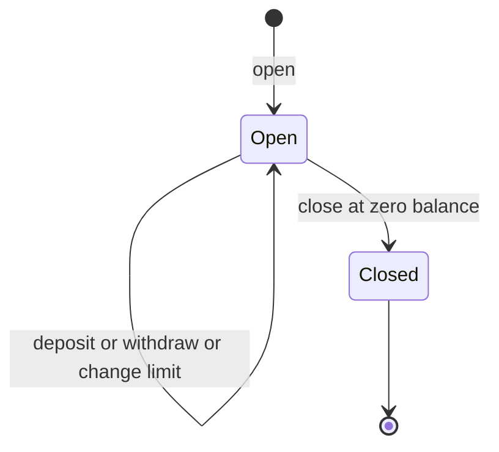
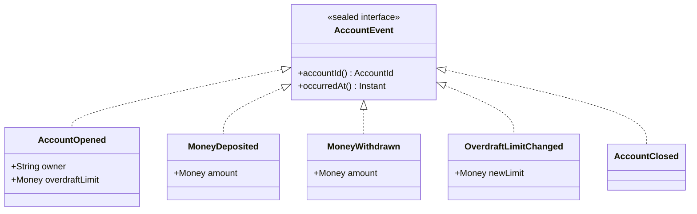
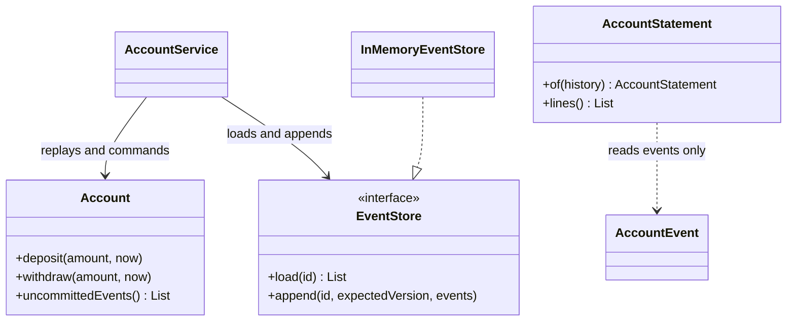
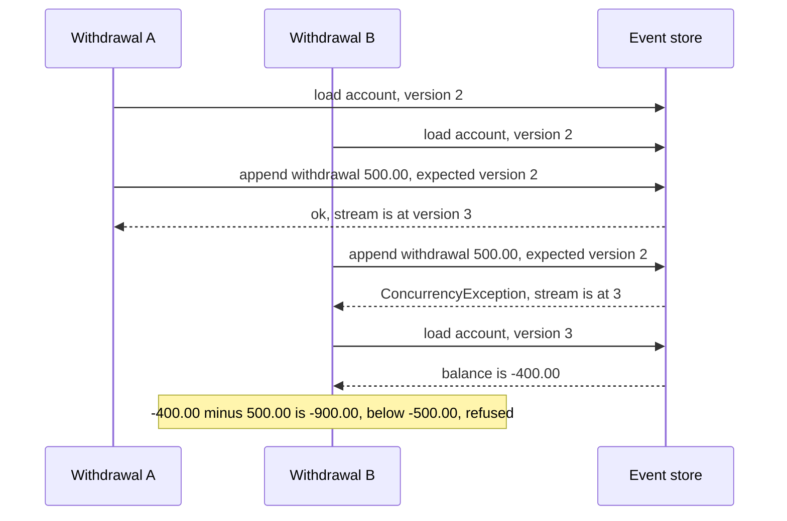

# Task 29 · An event-sourced bank account

| Difficulty | Topics | Time box |
|---|---|---|
| 🔴 Hard | Event sourcing: commands vs. events, rebuilding state by replay, `apply` never validates · Optimistic concurrency with expected versions and retry · An event store port with an in-memory adapter · Read models (projections) built from the same events · Sealed event hierarchy with exhaustive `switch` | 4 h |

> **Background reading:** Martin Fowler, "Event Sourcing" (martinfowler.com, 2005) · Greg Young, "CQRS Documents" (2010) · Vaughn Vernon, *Implementing Domain-Driven Design*, Appendix A "Aggregates and Event Sourcing" · Microsoft Azure Architecture Center, "Event Sourcing pattern" · *Effective Java*, Item 17 "Minimize mutability" · [Task 08](08-order-aggregate.md) (recording domain events) and [Task 10](10-library-lending-hexagonal.md) (ports and adapters)

---

## The situation

Our neobank keeps every account as a row with a `balance` column. Every service that touches money updates that column. That design has three problems:

* **Auditors cannot reconstruct how a balance came about.** The row only shows the current number. The history of how it got there is gone.
* **Support cannot answer "why was I overdrawn on the 3rd?"** The answer is in the transactions, but the balance was changed by several services, and nothing ties the two together.
* **Two parallel withdrawals took an account €400 below its overdraft limit.** Both services read the balance of €100.00, both checked "€100.00 minus €500.00 is above the limit", and both wrote €-400.00. The real balance should have been €-900.00. This is a **lost update**: the second write silently overwrote the first.

We move accounts to **event sourcing**. The events become the source of truth. The balance is no longer stored. It is *derived* by replaying the events. Concurrent writers are detected with **expected versions**, so the second withdrawal is checked against the state that really exists.

## The domain

| Term | Meaning |
|---|---|
| **Event** | A fact about an account that already happened, in the past tense: `MoneyWithdrawn`. Events are never changed or deleted. |
| **Command** | A request to do something, in the imperative: `withdraw`. A command can be refused. |
| **Stream** | The ordered list of events of one account. The stream is the account's history. |
| **Version** | The number of events in a stream. Version 0 is an empty stream. |
| **Expected version** | The version a writer saw when it loaded the stream. The store accepts an append only if the stream still has that version. |
| **Replay** | Rebuilding the state by applying every event of the stream in order. |
| **Balance** | Not stored anywhere. It is the sum of the deposits minus the withdrawals, computed by replay. |
| **Overdraft limit** | How far below zero the balance may go. A balance of €-500.00 is allowed with a limit of €500.00. |
| **Projection** | A read model built from events, for a specific question, such as the statement on screen. |

### Commands versus events

| | Command | Event |
|---|---|---|
| Name | Imperative: `withdraw` | Past tense: `MoneyWithdrawn` |
| Can it fail? | Yes. It is checked against the current state and may be refused | No. It already happened |
| Checked? | Yes. Arguments and business rules | Never. `apply` only applies it |
| Meaning | A request | A fact |
| Who creates it | The caller asks for it | The aggregate records it when the command passes |
| Example | `withdraw(500.00 EUR)` | `MoneyWithdrawn(500.00 EUR, on 2026-03-03)` |

### The life cycle of an account



Only `Open` accepts money. In `Closed`, every command is refused with `AccountClosedException`. The transition to `Closed` needs a zero balance, so no money is lost by closing.

### The events



The set is closed: these five events are the only ones. Because the interface is sealed, a `switch` over it must handle all five. If someone adds a sixth event, every `switch` stops compiling until it is handled. That is the safety net you want.

### Ports and adapters



The domain is `Account`, the events and `Money`. It knows nothing about storage. `EventStore` is a port, an interface that the application layer needs, and `AccountService` is the use case that talks to it. `InMemoryEventStore` is an adapter that implements the port. `AccountStatement` is a projection on the read side. It depends on the events, not on `Account`. So a change to the aggregate's methods never forces a change in the statement, and a new statement column never touches the aggregate.

### Why expected versions stop the lost update



Walk through it with the numbers from the situation. The balance is €100.00 and the limit is €500.00.

| Step | What happens | Stream |
|---|---|---|
| 1 | A loads the history: opening and a deposit of €100.00. Balance €100.00 | version 2 |
| 2 | B loads the same history. Balance €100.00 | version 2 |
| 3 | A checks €100.00 minus €500.00 = €-400.00. That is above €-500.00, so it is valid | |
| 4 | A appends `MoneyWithdrawn` 500.00 with expected version 2 | Accepted, now version 3 |
| 5 | B checks €100.00 minus €500.00 on its stale copy. Also valid, but on the wrong state | |
| 6 | B appends with expected version 2 | Refused, stream is at 3 |
| 7 | B reloads. Three events, balance €-400.00 | version 3 |
| 8 | B checks €-400.00 minus €500.00 = €-900.00. That is below €-500.00 | Refused with `InsufficientFundsException` |

The balance stays at €-400.00. Nothing was lost, and the second withdrawal was judged against the real state. Note that step 6 does not fail because the money is wrong. It fails because the writer is out of date. Retrying is the right answer there. Step 8 is a business refusal. Retrying it would never succeed, which is why the service does not retry it.

## What I want from you

Implement the aggregate, the service, the in-memory store and the statement projection. The given types (`Money`, the events, the exceptions, `EventStore`, `ConcurrencyException`, `StatementLine`) are complete. Read them first, and do not change them.

1. **[`Account.open(id, owner, overdraftLimit, now)`](../src/main/java/io/github/chris013/practice/task29/domain/Account.java)** records an `AccountOpened`. The owner must not be blank and the overdraft limit must not be negative. Both are `IllegalArgumentException`.
2. **`Account.replay(history)`** rebuilds the account. The history must not be empty, must start with `AccountOpened`, must contain only events of this account, and must not contain a second `AccountOpened`. Each violation is an `IllegalArgumentException`. Afterwards there are no uncommitted events, and `version()` equals the size of the history.
3. **`deposit(amount, now)`** requires an amount greater than zero. Otherwise it is an `IllegalArgumentException`.
4. **`withdraw(amount, now)`** requires an amount greater than zero. The new balance must not be below minus the overdraft limit. The limit itself is allowed. One cent beyond it throws `InsufficientFundsException`. Its message contains the attempted amount and the available amount, which is the balance plus the limit.
5. **`changeOverdraftLimit(newLimit, now)`** requires a limit that is not negative (`IllegalArgumentException`). A limit below the current debt is an `IllegalStateException`. A limit exactly equal to the debt is allowed.
6. **`close(now)`** requires a balance of exactly zero. Otherwise it is an `IllegalStateException`.
7. **Closed accounts.** Every command on a closed account throws `AccountClosedException`. This includes closing a closed account. Argument checks come first, then the closed check, then the business rules.
8. **Failed commands record nothing.** After a refused command, `uncommittedEvents()` and `version()` are unchanged.
9. **`apply(event)`** is one `switch` over the sealed `AccountEvent` with no `default` branch. It never throws for a business reason, and it never checks a rule.
10. **Queries.** `id()`, `owner()`, `balance()`, `overdraftLimit()`, `isClosed()`, `version()` (committed and uncommitted events together), `uncommittedEvents()` (an unmodifiable copy) and `markCommitted()`, which clears the uncommitted list.
11. **Time.** Every event carries the `now` that the caller passed in. The aggregate never reads a clock.
12. **[`InMemoryEventStore`](../src/main/java/io/github/chris013/practice/task29/adapter/inmemory/InMemoryEventStore.java)**. `load` returns the full history, oldest first, and an empty list for an unknown stream. The returned list cannot be changed. `append` succeeds only if the stream currently has exactly `expectedVersion` events, and otherwise throws `ConcurrencyException`. Appending to a new stream needs expected version 0. The version check and the write are one atomic step, so the store is safe for concurrent writers.
13. **[`AccountService`](../src/main/java/io/github/chris013/practice/task29/application/AccountService.java)** `open(owner, overdraftLimit)` takes the next id from the supplier and returns it. It appends the opening event with expected version 0.
14. **Every other command** (`deposit`, `withdraw`, `changeOverdraftLimit`, `close`) runs this cycle: load the history, throw `IllegalArgumentException("unknown account " + id)` if it is empty, replay it, run the command, append the uncommitted events with the version it loaded, then call `markCommitted()`.
15. **Retries.** If the append throws `ConcurrencyException`, the service runs the whole cycle again: reload, replay, and re-run the command, which re-checks the rules against the new state. It makes at most 3 attempts in total. After the third failure it rethrows the last `ConcurrencyException`. Business exceptions are never retried.
16. **`balanceOf(id)`** replays the account and returns its balance. An unknown id is an `IllegalArgumentException`.
17. **[`AccountStatement`](../src/main/java/io/github/chris013/practice/task29/projection/AccountStatement.java)** `of(history)` returns one `StatementLine` per event, in order. The date is the UTC date of the event. The descriptions are `Account opened`, `Deposit`, `Withdrawal`, `Overdraft limit set to 500.00 EUR` (the new limit), and `Account closed`. Amounts are `0.00` for the opening, the limit change and the closing, `+amount` for a deposit and `-amount` for a withdrawal. `balance` is the running balance after the line. The projection has its own exhaustive `switch`. It does not call `Account`.

## Constraints & non-goals

* **Plain Java 25.** No event store library, no JSON, no database. The store is in memory.
* **Single currency.** Everything is EUR, as `Money` already says.
* **No clock reads in the aggregate or in the projection.** Time comes in as a parameter, or from the injected `Clock` in the service.
* **No mocks.** Use hand-written fakes such as `MutableClock` and the racing store in `AccountServiceTest`.
* **No snapshots, no event upcasting, no persistence of events.** These are stretch goals.
* **Do not put the balance in an event.** The balance is derived. An event that carries a balance is a second source of truth that can disagree with the others.

## How I'd approach it

* **Start with `Account`.** Write the fields, `apply` and `replay` first. Once replay works and the state is right, the commands are small. Each one is "check, then `record` the event".
* **Keep `apply` dumb.** It copies data from the event into the state, and nothing else. The most common mistake is that a command changes the state directly and then `apply` changes it again. The balance is then counted twice. Make `record` the only place that calls `apply`, and make commands call `record` only.
* **Why `apply` must not validate.** Suppose in 2027 the rule changes and the overdraft limit may no longer exceed €300. A 2026 history can contain a withdrawal that was valid under the old rule. If `apply` checked the current rule, `Account.replay` would throw for an account that is perfectly fine, and support could not open it. The events are facts. Rules are checked on the way in, when a new event is about to be recorded. They are not re-checked on the way out, when old events are read back. The test `applies_an_old_withdrawal_that_today_would_refuse` checks exactly this.
* **Replay checks shape, not rules.** The history must be one account, opened once and first. Those are structural facts about the data, so a broken history is a bug worth reporting loudly.
* **Order of checks in a command.** Argument checks first, because a `null` or a zero amount is a programming error. Then the closed check, then the business rules. Keeping the order the same everywhere makes the behaviour predictable. If you are unsure, the tests tell you the order.
* **The retry loop reloads everything.** Do not reuse the `Account` object from the failed attempt. It holds the state from before the conflict. The retry must load the stream again and replay it, so the rules are checked against the state that exists now.
* **Read the clock once per attempt.** Take `clock.instant()` inside the lambda that runs the command. Every event of that attempt then has the same, correct time of attempt.
* **The store's version check must be atomic.** A `get` for the version, a comparison, and then a `put` is a race. Two threads can both see version 2 and both write. `ConcurrentHashMap.compute` runs your function while it holds the lock for that key. Throwing inside it leaves the old mapping in place. This is the same idea as task 18.
* **Why the projection is separate.** Read models change for their own reasons. The statement may gain a column, or a monthly report may appear. If the statement used `Account`, every change to the statement would touch the aggregate, and every change to the aggregate could break the statement. The statement reads the same events, with its own switch and its own running balance. This is the idea behind CQRS: write side and read side can evolve on their own.
* **Event versioning, a teaser.** Events live for years, so their shape must change carefully. If you rename a field, you do not rewrite old events. You write an *upcaster* that turns the old shape into the new one when it is read. Stretch goal 2 asks you to do this for a renamed event.
* **Snapshots, a teaser.** A stream with 10 000 events takes time to replay. A snapshot stores the state at version 100, so the replay can start there. It is an optimisation. Do not add it before you have a measured reason. Stretch goal 1 asks for it.

## Tests

Run: `mvn test -Dtest='**/task29/**'`

* [`AccountTest`](../src/test/java/io/github/chris013/practice/task29/AccountTest.java) covers the aggregate: the rules, the boundaries, the closed state, and replay.
* [`InMemoryEventStoreTest`](../src/test/java/io/github/chris013/practice/task29/InMemoryEventStoreTest.java) covers the store, including 100 virtual threads that all try to append with the same expected version.
* [`AccountServiceTest`](../src/test/java/io/github/chris013/practice/task29/AccountServiceTest.java) covers the service. A test-only store decorator sneaks a second writer in before the first append. That is how the retry and the €400 bug are tested.
* [`AccountStatementTest`](../src/test/java/io/github/chris013/practice/task29/AccountStatementTest.java) covers the projection with a scripted history.

<details>
<summary>Show the tests</summary>

<!-- embed: src/test/java/io/github/chris013/practice/task29/AccountTest.java -->
**[`AccountTest.java`](../src/test/java/io/github/chris013/practice/task29/AccountTest.java)**

```java
package io.github.chris013.practice.task29;

import static org.assertj.core.api.Assertions.assertThat;
import static org.assertj.core.api.Assertions.assertThatThrownBy;

import io.github.chris013.practice.task29.domain.Account;
import io.github.chris013.practice.task29.domain.AccountClosed;
import io.github.chris013.practice.task29.domain.AccountClosedException;
import io.github.chris013.practice.task29.domain.AccountEvent;
import io.github.chris013.practice.task29.domain.AccountId;
import io.github.chris013.practice.task29.domain.AccountOpened;
import io.github.chris013.practice.task29.domain.InsufficientFundsException;
import io.github.chris013.practice.task29.domain.Money;
import io.github.chris013.practice.task29.domain.MoneyDeposited;
import io.github.chris013.practice.task29.domain.MoneyWithdrawn;
import io.github.chris013.practice.task29.domain.OverdraftLimitChanged;
import java.time.Instant;
import java.util.List;
import org.junit.jupiter.api.Nested;
import org.junit.jupiter.api.Test;
import org.junit.jupiter.params.ParameterizedTest;
import org.junit.jupiter.params.provider.CsvSource;

class AccountTest {

    private static final AccountId ID = new AccountId("acc-1");
    private static final AccountId OTHER_ID = new AccountId("acc-2");
    private static final Instant T0 = Instant.parse("2026-03-01T09:00:00Z");
    private static final Instant T1 = Instant.parse("2026-03-02T09:00:00Z");
    private static final Instant T2 = Instant.parse("2026-03-03T09:00:00Z");
    private static final Money LIMIT_500 = Money.euros("500.00");

    /** An account that has been opened and whose opening is already committed, like one loaded from a store. */
    private static Account committedAccount(Money limit) {
        Account account = Account.open(ID, "Anna", limit, T0);
        account.markCommitted();
        return account;
    }

    @Nested
    class Opening {

        @Test
        void starts_with_a_zero_balance_and_the_given_limit() {
            Account account = Account.open(ID, "Anna", LIMIT_500, T0);

            assertThat(account.id()).isEqualTo(ID);
            assertThat(account.owner()).isEqualTo("Anna");
            assertThat(account.balance()).isEqualTo(Money.zero());
            assertThat(account.overdraftLimit()).isEqualTo(LIMIT_500);
            assertThat(account.isClosed()).isFalse();
        }

        @Test
        void records_one_opened_event() {
            Account account = Account.open(ID, "Anna", LIMIT_500, T0);

            assertThat(account.uncommittedEvents()).containsExactly(new AccountOpened(ID, T0, "Anna", LIMIT_500));
            assertThat(account.version()).isEqualTo(1);
        }

        @Test
        void rejects_a_blank_owner() {
            assertThatThrownBy(() -> Account.open(ID, " ", LIMIT_500, T0))
                    .isInstanceOf(IllegalArgumentException.class);
        }

        @Test
        void rejects_a_negative_overdraft_limit_but_accepts_zero() {
            assertThatThrownBy(() -> Account.open(ID, "Anna", Money.euros("-0.01"), T0))
                    .isInstanceOf(IllegalArgumentException.class);
            assertThat(Account.open(ID, "Anna", Money.zero(), T0).overdraftLimit()).isEqualTo(Money.zero());
        }
    }

    @Nested
    class Deposits {

        @Test
        void increases_the_balance_and_records_the_event() {
            Account account = committedAccount(LIMIT_500);

            account.deposit(Money.euros("100.00"), T1);

            assertThat(account.balance()).isEqualTo(Money.euros("100.00"));
            assertThat(account.uncommittedEvents())
                    .containsExactly(new MoneyDeposited(ID, T1, Money.euros("100.00")));
            assertThat(account.version()).isEqualTo(2);
        }

        @ParameterizedTest
        @CsvSource({"0.00", "-1.00", "-0.01"})
        void rejects_an_amount_that_is_not_positive_and_records_nothing(String amount) {
            Account account = committedAccount(LIMIT_500);

            assertThatThrownBy(() -> account.deposit(Money.euros(amount), T1))
                    .isInstanceOf(IllegalArgumentException.class);
            assertThat(account.uncommittedEvents()).isEmpty();
            assertThat(account.version()).isEqualTo(1);
        }
    }

    @Nested
    class Withdrawals {

        @Test
        void reduces_the_balance_within_what_is_there() {
            Account account = committedAccount(LIMIT_500);
            account.deposit(Money.euros("100.00"), T1);

            account.withdraw(Money.euros("40.00"), T2);

            assertThat(account.balance()).isEqualTo(Money.euros("60.00"));
        }

        @Test
        void allows_the_balance_to_reach_exactly_minus_the_limit() {
            Account account = committedAccount(LIMIT_500);

            account.withdraw(Money.euros("500.00"), T1);

            assertThat(account.balance()).isEqualTo(Money.euros("-500.00"));
            assertThat(account.balance().isNegative()).isTrue();
        }

        @Test
        void refuses_one_cent_beyond_the_overdraft_limit() {
            Account account = committedAccount(LIMIT_500);

            assertThatThrownBy(() -> account.withdraw(Money.euros("500.01"), T1))
                    .isInstanceOf(InsufficientFundsException.class)
                    .hasMessageContaining("500.01 EUR")
                    .hasMessageContaining("500.00 EUR");
            assertThat(account.balance()).isEqualTo(Money.zero());
        }

        @Test
        void counts_the_money_already_in_the_account_as_available() {
            Account account = committedAccount(LIMIT_500);
            account.deposit(Money.euros("100.00"), T1);
            account.markCommitted();

            assertThatThrownBy(() -> account.withdraw(Money.euros("601.00"), T2))
                    .isInstanceOf(InsufficientFundsException.class)
                    .hasMessageContaining("600.00 EUR");
            account.withdraw(Money.euros("600.00"), T2);
            assertThat(account.balance()).isEqualTo(Money.euros("-500.00"));
        }

        @ParameterizedTest
        @CsvSource({"0.00", "-5.00"})
        void rejects_an_amount_that_is_not_positive(String amount) {
            Account account = committedAccount(LIMIT_500);

            assertThatThrownBy(() -> account.withdraw(Money.euros(amount), T1))
                    .isInstanceOf(IllegalArgumentException.class);
            assertThat(account.uncommittedEvents()).isEmpty();
        }

        @Test
        void a_refused_withdrawal_records_nothing() {
            Account account = committedAccount(Money.zero());

            assertThatThrownBy(() -> account.withdraw(Money.euros("0.01"), T1))
                    .isInstanceOf(InsufficientFundsException.class);
            assertThat(account.uncommittedEvents()).isEmpty();
            assertThat(account.version()).isEqualTo(1);
        }
    }

    @Nested
    class ChangingTheOverdraftLimit {

        @Test
        void sets_the_new_limit_and_records_the_event() {
            Account account = committedAccount(LIMIT_500);

            account.changeOverdraftLimit(Money.euros("800.00"), T1);

            assertThat(account.overdraftLimit()).isEqualTo(Money.euros("800.00"));
            assertThat(account.uncommittedEvents())
                    .containsExactly(new OverdraftLimitChanged(ID, T1, Money.euros("800.00")));
        }

        @Test
        void allows_a_limit_of_exactly_the_current_debt() {
            Account account = committedAccount(LIMIT_500);
            account.withdraw(Money.euros("300.00"), T1);

            account.changeOverdraftLimit(Money.euros("300.00"), T2);

            assertThat(account.overdraftLimit()).isEqualTo(Money.euros("300.00"));
        }

        @Test
        void refuses_a_limit_one_cent_below_the_current_debt() {
            Account account = committedAccount(LIMIT_500);
            account.withdraw(Money.euros("300.00"), T1);
            account.markCommitted();

            assertThatThrownBy(() -> account.changeOverdraftLimit(Money.euros("299.99"), T2))
                    .isInstanceOf(IllegalStateException.class);
            assertThat(account.overdraftLimit()).isEqualTo(LIMIT_500);
            assertThat(account.uncommittedEvents()).isEmpty();
        }

        @Test
        void rejects_a_negative_limit() {
            Account account = committedAccount(LIMIT_500);

            assertThatThrownBy(() -> account.changeOverdraftLimit(Money.euros("-1.00"), T1))
                    .isInstanceOf(IllegalArgumentException.class);
            assertThat(account.uncommittedEvents()).isEmpty();
        }
    }

    @Nested
    class Closing {

        @Test
        void closes_an_account_with_a_zero_balance() {
            Account account = committedAccount(LIMIT_500);

            account.close(T1);

            assertThat(account.isClosed()).isTrue();
            assertThat(account.uncommittedEvents()).containsExactly(new AccountClosed(ID, T1));
        }

        @Test
        void refuses_to_close_while_money_is_in_the_account() {
            Account account = committedAccount(LIMIT_500);
            account.deposit(Money.euros("0.01"), T1);

            assertThatThrownBy(() -> account.close(T2)).isInstanceOf(IllegalStateException.class);
            assertThat(account.isClosed()).isFalse();
        }

        @Test
        void refuses_to_close_while_the_account_is_overdrawn() {
            Account account = committedAccount(LIMIT_500);
            account.withdraw(Money.euros("50.00"), T1);

            assertThatThrownBy(() -> account.close(T2)).isInstanceOf(IllegalStateException.class);
        }

        @Test
        void closing_twice_is_refused_as_a_closed_account() {
            Account account = committedAccount(LIMIT_500);
            account.close(T1);

            assertThatThrownBy(() -> account.close(T2)).isInstanceOf(AccountClosedException.class);
        }
    }

    @Nested
    class ClosedAccounts {

        @Test
        void reject_every_command() {
            Account account = committedAccount(LIMIT_500);
            account.close(T1);
            account.markCommitted();

            assertThatThrownBy(() -> account.deposit(Money.euros("1.00"), T2))
                    .isInstanceOf(AccountClosedException.class);
            assertThatThrownBy(() -> account.withdraw(Money.euros("1.00"), T2))
                    .isInstanceOf(AccountClosedException.class);
            assertThatThrownBy(() -> account.changeOverdraftLimit(Money.euros("10.00"), T2))
                    .isInstanceOf(AccountClosedException.class);
            assertThat(account.uncommittedEvents()).isEmpty();
            assertThat(account.version()).isEqualTo(2);
        }

        @Test
        void checks_the_arguments_before_the_closed_state() {
            Account account = committedAccount(LIMIT_500);
            account.close(T1);

            assertThatThrownBy(() -> account.deposit(Money.zero(), T2)).isInstanceOf(IllegalArgumentException.class);
        }
    }

    @Nested
    class Replay {

        private final List<AccountEvent> history = List.of(
                new AccountOpened(ID, T0, "Anna", LIMIT_500),
                new MoneyDeposited(ID, T1, Money.euros("200.00")),
                new MoneyWithdrawn(ID, T2, Money.euros("350.00")),
                new OverdraftLimitChanged(ID, T2, Money.euros("800.00")));

        @Test
        void reproduces_the_balance_limit_and_version() {
            Account account = Account.replay(history);

            assertThat(account.id()).isEqualTo(ID);
            assertThat(account.owner()).isEqualTo("Anna");
            assertThat(account.balance()).isEqualTo(Money.euros("-150.00"));
            assertThat(account.overdraftLimit()).isEqualTo(Money.euros("800.00"));
            assertThat(account.version()).isEqualTo(4);
        }

        @Test
        void leaves_no_uncommitted_events() {
            Account account = Account.replay(history);

            assertThat(account.uncommittedEvents()).isEmpty();
        }

        @Test
        void applies_an_old_withdrawal_that_today_would_refuse() {
            // Opened in 2026 with a limit of 500.00. A limit capped at 300.00 from 2027 would refuse this,
            // replay must not.
            List<AccountEvent> oldHistory = List.of(
                    new AccountOpened(ID, T0, "Anna", LIMIT_500),
                    new MoneyWithdrawn(ID, T1, Money.euros("450.00")));

            assertThat(Account.replay(oldHistory).balance()).isEqualTo(Money.euros("-450.00"));
        }

        @Test
        void restores_a_closed_account() {
            List<AccountEvent> closedHistory = List.of(
                    new AccountOpened(ID, T0, "Anna", LIMIT_500),
                    new AccountClosed(ID, T1));

            assertThat(Account.replay(closedHistory).isClosed()).isTrue();
        }

        @Test
        void rejects_an_empty_history() {
            assertThatThrownBy(() -> Account.replay(List.of())).isInstanceOf(IllegalArgumentException.class);
        }

        @Test
        void rejects_a_history_that_does_not_start_with_the_opening() {
            assertThatThrownBy(() -> Account.replay(List.of(new MoneyDeposited(ID, T1, Money.euros("1.00")))))
                    .isInstanceOf(IllegalArgumentException.class);
        }

        @Test
        void rejects_events_of_another_account() {
            List<AccountEvent> mixed = List.of(
                    new AccountOpened(ID, T0, "Anna", LIMIT_500),
                    new MoneyDeposited(OTHER_ID, T1, Money.euros("1.00")));

            assertThatThrownBy(() -> Account.replay(mixed)).isInstanceOf(IllegalArgumentException.class);
        }

        @Test
        void rejects_a_second_opening() {
            List<AccountEvent> twice = List.of(
                    new AccountOpened(ID, T0, "Anna", LIMIT_500),
                    new AccountOpened(ID, T1, "Anna", Money.zero()));

            assertThatThrownBy(() -> Account.replay(twice)).isInstanceOf(IllegalArgumentException.class);
        }
    }

    @Nested
    class Events {

        @Test
        void every_event_carries_the_instant_the_command_was_given() {
            Account account = Account.open(ID, "Anna", LIMIT_500, T0);
            account.deposit(Money.euros("10.00"), T1);

            assertThat(account.uncommittedEvents()).extracting(AccountEvent::occurredAt).containsExactly(T0, T1);
        }

        @Test
        void mark_committed_clears_the_uncommitted_events_but_keeps_the_version() {
            Account account = Account.open(ID, "Anna", LIMIT_500, T0);

            account.markCommitted();

            assertThat(account.uncommittedEvents()).isEmpty();
            assertThat(account.version()).isEqualTo(1);
        }

        @Test
        void uncommitted_events_cannot_be_changed_from_outside() {
            Account account = Account.open(ID, "Anna", LIMIT_500, T0);

            assertThatThrownBy(() -> account.uncommittedEvents().clear())
                    .isInstanceOf(UnsupportedOperationException.class);
        }
    }
}
```
<!-- /embed -->

<!-- embed: src/test/java/io/github/chris013/practice/task29/InMemoryEventStoreTest.java -->
**[`InMemoryEventStoreTest.java`](../src/test/java/io/github/chris013/practice/task29/InMemoryEventStoreTest.java)**

```java
package io.github.chris013.practice.task29;

import static org.assertj.core.api.Assertions.assertThat;
import static org.assertj.core.api.Assertions.assertThatThrownBy;

import io.github.chris013.practice.task29.adapter.inmemory.InMemoryEventStore;
import io.github.chris013.practice.task29.application.ConcurrencyException;
import io.github.chris013.practice.task29.domain.AccountEvent;
import io.github.chris013.practice.task29.domain.AccountId;
import io.github.chris013.practice.task29.domain.AccountOpened;
import io.github.chris013.practice.task29.domain.Money;
import io.github.chris013.practice.task29.domain.MoneyDeposited;
import java.time.Instant;
import java.util.List;
import java.util.concurrent.CountDownLatch;
import java.util.concurrent.ExecutorService;
import java.util.concurrent.Executors;
import java.util.concurrent.atomic.AtomicInteger;
import org.junit.jupiter.api.Nested;
import org.junit.jupiter.api.Test;

class InMemoryEventStoreTest {

    private static final AccountId ID = new AccountId("acc-1");
    private static final Instant T0 = Instant.parse("2026-03-01T09:00:00Z");
    private static final AccountOpened OPENED = new AccountOpened(ID, T0, "Anna", Money.zero());
    private static final MoneyDeposited DEPOSIT = new MoneyDeposited(ID, T0, Money.euros("10.00"));

    @Nested
    class AppendAndLoad {

        private final InMemoryEventStore store = new InMemoryEventStore();

        @Test
        void loads_what_was_appended_in_order() {
            store.append(ID, 0, List.of(OPENED));
            store.append(ID, 1, List.of(DEPOSIT));

            assertThat(store.load(ID)).containsExactly(OPENED, DEPOSIT);
        }

        @Test
        void an_unknown_stream_loads_as_empty() {
            assertThat(store.load(new AccountId("nobody"))).isEmpty();
        }

        @Test
        void a_new_stream_must_be_appended_at_version_zero() {
            assertThatThrownBy(() -> store.append(ID, 1, List.of(OPENED)))
                    .isInstanceOf(ConcurrencyException.class);
            assertThat(store.load(ID)).isEmpty();
        }

        @Test
        void a_wrong_expected_version_is_refused_and_writes_nothing() {
            store.append(ID, 0, List.of(OPENED));

            assertThatThrownBy(() -> store.append(ID, 0, List.of(DEPOSIT)))
                    .isInstanceOf(ConcurrencyException.class)
                    .hasMessageContaining("expected version 0")
                    .hasMessageContaining("at 1");
            assertThat(store.load(ID)).containsExactly(OPENED);
        }

        @Test
        void the_returned_history_cannot_be_changed() {
            store.append(ID, 0, List.of(OPENED));

            assertThatThrownBy(() -> store.load(ID).add(DEPOSIT)).isInstanceOf(UnsupportedOperationException.class);
        }

        @Test
        void streams_are_independent() {
            AccountId other = new AccountId("acc-2");
            store.append(ID, 0, List.of(OPENED));
            store.append(other, 0, List.of(new AccountOpened(other, T0, "Ben", Money.zero())));

            assertThat(store.load(ID)).hasSize(1);
            assertThat(store.load(other)).hasSize(1);
        }
    }

    @Nested
    class Concurrency {

        @Test
        void of_many_writers_with_the_same_expected_version_exactly_one_succeeds() throws InterruptedException {
            InMemoryEventStore store = new InMemoryEventStore();
            store.append(ID, 0, List.of(OPENED));
            int writers = 100;
            AtomicInteger succeeded = new AtomicInteger();
            AtomicInteger refused = new AtomicInteger();
            CountDownLatch startTogether = new CountDownLatch(1);

            try (ExecutorService pool = Executors.newVirtualThreadPerTaskExecutor()) {
                for (int i = 0; i < writers; i++) {
                    pool.submit(() -> {
                        startTogether.await();
                        try {
                            store.append(ID, 1, List.of(DEPOSIT));
                            succeeded.incrementAndGet();
                        } catch (ConcurrencyException expected) {
                            refused.incrementAndGet();
                        }
                        return null;
                    });
                }
                startTogether.countDown();
            }

            assertThat(succeeded.get()).isEqualTo(1);
            assertThat(refused.get()).isEqualTo(writers - 1);
            List<AccountEvent> history = store.load(ID);
            assertThat(history).hasSize(2);
        }
    }
}
```
<!-- /embed -->

<!-- embed: src/test/java/io/github/chris013/practice/task29/AccountServiceTest.java -->
**[`AccountServiceTest.java`](../src/test/java/io/github/chris013/practice/task29/AccountServiceTest.java)**

```java
package io.github.chris013.practice.task29;

import static org.assertj.core.api.Assertions.assertThat;
import static org.assertj.core.api.Assertions.assertThatThrownBy;

import io.github.chris013.practice.task29.adapter.inmemory.InMemoryEventStore;
import io.github.chris013.practice.task29.application.AccountService;
import io.github.chris013.practice.task29.application.ConcurrencyException;
import io.github.chris013.practice.task29.application.EventStore;
import io.github.chris013.practice.task29.domain.AccountClosedException;
import io.github.chris013.practice.task29.domain.AccountEvent;
import io.github.chris013.practice.task29.domain.AccountId;
import io.github.chris013.practice.task29.domain.AccountOpened;
import io.github.chris013.practice.task29.domain.InsufficientFundsException;
import io.github.chris013.practice.task29.domain.Money;
import io.github.chris013.practice.task29.domain.MoneyDeposited;
import io.github.chris013.practice.task29.domain.MoneyWithdrawn;
import java.time.Duration;
import java.time.Instant;
import java.util.List;
import java.util.function.Consumer;
import org.junit.jupiter.api.Nested;
import org.junit.jupiter.api.Test;

class AccountServiceTest {

    private static final AccountId ID = new AccountId("acc-1");
    private static final Instant T0 = Instant.parse("2026-03-01T09:00:00Z");

    private final MutableClock clock = new MutableClock(T0);
    private final InMemoryEventStore store = new InMemoryEventStore();
    private final AccountService service = new AccountService(store, clock, () -> ID);

    /** Adds an event to the stream behind the back of the service, as a second writer would. */
    private static void writeConcurrently(EventStore store, AccountEvent event) {
        store.append(event.accountId(), store.load(event.accountId()).size(), List.of(event));
    }

    /**
     * Lets another writer sneak in before the first {@code races} appends, then forwards the append. This is the
     * lost-update scenario in code: the service decided on a state that another writer has already changed.
     */
    private static final class RacingEventStore implements EventStore {

        private final EventStore delegate;
        private final Consumer<EventStore> otherWriter;
        private int racesLeft;
        private int appendCalls;
        private int loadCalls;

        RacingEventStore(EventStore delegate, int races, Consumer<EventStore> otherWriter) {
            this.delegate = delegate;
            this.racesLeft = races;
            this.otherWriter = otherWriter;
        }

        @Override
        public List<AccountEvent> load(AccountId id) {
            loadCalls++;
            return delegate.load(id);
        }

        @Override
        public void append(AccountId id, long expectedVersion, List<AccountEvent> events) {
            appendCalls++;
            if (racesLeft > 0) {
                racesLeft--;
                otherWriter.accept(delegate);
            }
            delegate.append(id, expectedVersion, events);
        }

        int appendCalls() {
            return appendCalls;
        }

        int loadCalls() {
            return loadCalls;
        }
    }

    @Nested
    class HappyPath {

        @Test
        void open_stores_the_opening_event_and_returns_the_id() {
            AccountId opened = service.open("Anna", Money.euros("500.00"));

            assertThat(opened).isEqualTo(ID);
            assertThat(store.load(ID))
                    .containsExactly(new AccountOpened(ID, T0, "Anna", Money.euros("500.00")));
        }

        @Test
        void each_command_is_replayed_from_the_store_and_persisted() {
            service.open("Anna", Money.euros("500.00"));
            service.deposit(ID, Money.euros("100.00"));
            service.withdraw(ID, Money.euros("40.00"));

            assertThat(service.balanceOf(ID)).isEqualTo(Money.euros("60.00"));
            assertThat(store.load(ID)).hasSize(3);
        }

        @Test
        void events_carry_the_time_of_the_command() {
            service.open("Anna", Money.euros("500.00"));
            clock.advanceBy(Duration.ofHours(1));

            service.deposit(ID, Money.euros("10.00"));

            assertThat(store.load(ID).getLast())
                    .isEqualTo(new MoneyDeposited(ID, T0.plus(Duration.ofHours(1)), Money.euros("10.00")));
        }

        @Test
        void limit_changes_and_closing_go_through_the_store() {
            service.open("Anna", Money.euros("500.00"));

            service.changeOverdraftLimit(ID, Money.euros("800.00"));
            service.close(ID);

            assertThat(service.balanceOf(ID)).isEqualTo(Money.zero());
            assertThat(store.load(ID)).hasSize(3);
            assertThatThrownBy(() -> service.deposit(ID, Money.euros("1.00")))
                    .isInstanceOf(AccountClosedException.class);
        }
    }

    @Nested
    class UnknownAccount {

        @Test
        void a_command_on_an_unknown_account_is_rejected() {
            assertThatThrownBy(() -> service.deposit(ID, Money.euros("1.00")))
                    .isInstanceOf(IllegalArgumentException.class)
                    .hasMessage("unknown account acc-1");
        }

        @Test
        void asking_the_balance_of_an_unknown_account_is_rejected() {
            assertThatThrownBy(() -> service.balanceOf(ID)).isInstanceOf(IllegalArgumentException.class);
        }
    }

    @Nested
    class OptimisticConcurrency {

        @Test
        void retries_after_a_concurrent_deposit_and_keeps_both_writes() {
            service.open("Anna", Money.euros("500.00"));
            service.deposit(ID, Money.euros("100.00"));
            RacingEventStore racing = new RacingEventStore(store, 1,
                    writer -> writeConcurrently(writer, new MoneyDeposited(ID, T0, Money.euros("50.00"))));
            AccountService racingService = new AccountService(racing, clock, () -> ID);

            racingService.withdraw(ID, Money.euros("80.00"));

            assertThat(service.balanceOf(ID)).isEqualTo(Money.euros("70.00"));
            assertThat(racing.appendCalls()).isEqualTo(2);
            assertThat(store.load(ID)).hasSize(4);
        }

        @Test
        void revalidates_a_withdrawal_that_was_fine_on_the_stale_balance() {
            // Balance 100.00, limit 500.00. Both writers see 100.00 and withdraw 500.00 (-400.00, fine).
            // The other one lands first, so the retry sees -400.00, and -400.00 - 500.00 = -900.00 is past
            // -500.00: refused.
            service.open("Anna", Money.euros("500.00"));
            service.deposit(ID, Money.euros("100.00"));
            RacingEventStore racing = new RacingEventStore(store, 1,
                    writer -> writeConcurrently(writer, new MoneyWithdrawn(ID, T0, Money.euros("500.00"))));
            AccountService racingService = new AccountService(racing, clock, () -> ID);

            assertThatThrownBy(() -> racingService.withdraw(ID, Money.euros("500.00")))
                    .isInstanceOf(InsufficientFundsException.class);

            assertThat(service.balanceOf(ID)).isEqualTo(Money.euros("-400.00"));
            assertThat(racing.appendCalls()).isEqualTo(1);
            assertThat(racing.loadCalls()).isEqualTo(2);
            assertThat(store.load(ID)).hasSize(3);
        }

        @Test
        void gives_up_after_three_attempts_and_rethrows_the_conflict() {
            service.open("Anna", Money.euros("500.00"));
            RacingEventStore racing = new RacingEventStore(store, Integer.MAX_VALUE,
                    writer -> writeConcurrently(writer, new MoneyDeposited(ID, T0, Money.euros("1.00"))));
            AccountService racingService = new AccountService(racing, clock, () -> ID);

            assertThatThrownBy(() -> racingService.deposit(ID, Money.euros("10.00")))
                    .isInstanceOf(ConcurrencyException.class);

            assertThat(racing.appendCalls()).isEqualTo(3);
            assertThat(store.load(ID)).hasSize(4);
        }

        @Test
        void a_business_failure_is_never_retried() {
            service.open("Anna", Money.zero());
            RacingEventStore racing = new RacingEventStore(store, Integer.MAX_VALUE,
                    writer -> writeConcurrently(writer, new MoneyDeposited(ID, T0, Money.euros("1.00"))));
            AccountService racingService = new AccountService(racing, clock, () -> ID);

            assertThatThrownBy(() -> racingService.withdraw(ID, Money.euros("5.00")))
                    .isInstanceOf(InsufficientFundsException.class);

            assertThat(racing.loadCalls()).isEqualTo(1);
            assertThat(racing.appendCalls()).isZero();
        }
    }
}
```
<!-- /embed -->

<!-- embed: src/test/java/io/github/chris013/practice/task29/AccountStatementTest.java -->
**[`AccountStatementTest.java`](../src/test/java/io/github/chris013/practice/task29/AccountStatementTest.java)**

```java
package io.github.chris013.practice.task29;

import static org.assertj.core.api.Assertions.assertThat;

import io.github.chris013.practice.task29.domain.AccountClosed;
import io.github.chris013.practice.task29.domain.AccountEvent;
import io.github.chris013.practice.task29.domain.AccountId;
import io.github.chris013.practice.task29.domain.AccountOpened;
import io.github.chris013.practice.task29.domain.Money;
import io.github.chris013.practice.task29.domain.MoneyDeposited;
import io.github.chris013.practice.task29.domain.MoneyWithdrawn;
import io.github.chris013.practice.task29.domain.OverdraftLimitChanged;
import io.github.chris013.practice.task29.projection.AccountStatement;
import io.github.chris013.practice.task29.projection.StatementLine;
import java.time.Instant;
import java.time.LocalDate;
import java.util.List;
import org.junit.jupiter.api.Test;

class AccountStatementTest {

    private static final AccountId ID = new AccountId("acc-1");

    @Test
    void turns_a_scripted_history_into_exact_statement_lines() {
        List<AccountEvent> history = List.of(
                new AccountOpened(ID, Instant.parse("2026-03-01T09:00:00Z"), "Anna", Money.euros("500.00")),
                new MoneyDeposited(ID, Instant.parse("2026-03-02T10:00:00Z"), Money.euros("200.00")),
                new MoneyWithdrawn(ID, Instant.parse("2026-03-03T23:30:00Z"), Money.euros("350.00")),
                new OverdraftLimitChanged(ID, Instant.parse("2026-03-04T08:00:00Z"), Money.euros("800.00")),
                new MoneyDeposited(ID, Instant.parse("2026-03-05T12:00:00Z"), Money.euros("150.00")),
                new AccountClosed(ID, Instant.parse("2026-03-05T12:05:00Z")));

        List<StatementLine> lines = AccountStatement.of(history).lines();

        assertThat(lines).containsExactly(
                line("2026-03-01", "Account opened", "0.00", "0.00"),
                line("2026-03-02", "Deposit", "200.00", "200.00"),
                line("2026-03-03", "Withdrawal", "-350.00", "-150.00"),
                line("2026-03-04", "Overdraft limit set to 800.00 EUR", "0.00", "-150.00"),
                line("2026-03-05", "Deposit", "150.00", "0.00"),
                line("2026-03-05", "Account closed", "0.00", "0.00"));
    }

    @Test
    void takes_the_date_in_utc() {
        // 23:30 UTC on 31 March is already 1 April in Berlin. The statement must say 31 March for everyone.
        List<AccountEvent> history = List.of(
                new AccountOpened(ID, Instant.parse("2026-03-31T23:30:00Z"), "Anna", Money.zero()));

        assertThat(AccountStatement.of(history).lines()).extracting(StatementLine::date)
                .containsExactly(LocalDate.of(2026, 3, 31));
    }

    @Test
    void an_empty_history_has_no_lines() {
        assertThat(AccountStatement.of(List.of()).lines()).isEmpty();
    }

    private static StatementLine line(String date, String description, String amount, String balance) {
        return new StatementLine(
                LocalDate.parse(date), description, Money.euros(amount), Money.euros(balance));
    }
}
```
<!-- /embed -->

</details>

## Definition of done

- [ ] `mvn test -Dtest='**/task29/**'` is green.
- [ ] `Account.apply` is the only place where state changes, and it has no `default` branch.
- [ ] No command changes the state directly. Each one calls `record`.
- [ ] A withdrawal of exactly the limit is accepted, and one cent more is refused.
- [ ] A refused command leaves `uncommittedEvents()` and `version()` unchanged.
- [ ] `AccountService` retries `ConcurrencyException` at most three times and never retries a business exception.
- [ ] `InMemoryEventStore.append` checks the version and writes in one atomic step.
- [ ] `AccountStatement` has its own `switch` and does not use `Account`.
- [ ] No compiler warnings with `mvn -B clean test-compile`.

## Stretch goals

1. **Snapshots every 100 events.** Store the state at versions 100, 200, and so on. `replay` starts from the latest snapshot and applies only the newer events. Test that a snapshot plus the tail gives the same balance as a full replay.
2. **An upcaster for a renamed event.** Rename `MoneyWithdrawn` to `CashWithdrawn` in the sealed hierarchy. Old histories must still replay. Write the upcaster so that the old name is read as the new record, and test both shapes.
3. **A second projection: monthly interest.** Build a read model that adds interest to the negative balance at the end of each month, from the same events. Show that it does not touch `Account`.
4. **Persist the events as JSON in a file.** Write them as the store would, read them back, and check that the replayed account is the same as before the round trip. Use the JSON writer from [Task 30](30-json-writer.md) to write each event as one line.
5. **Make the retry count configurable.** Pass the attempt limit to the service. Test that one attempt means no retry at all.

---

## Reference solution

<details>
<summary>Spoiler: open only after you have made a serious attempt</summary>

### Key decisions

1. **Events are separate records in a sealed interface.** Each event is its own type, and the sealed interface lists the closed set. The alternative was one `AccountEvent` class with a type field and nullable data fields. That allows states that make no sense, and the compiler cannot help with it.
2. **`record` is `apply` plus adding to the uncommitted list.** Commands never touch the state directly. The alternative of changing the state in the command and also in `apply` counts every change twice.
3. **`apply` never validates.** It has no `default` branch either, so a new event type is a compile error until it is handled. The alternative of checking rules in `apply` breaks every old history the day a rule changes.
4. **Replay checks the shape of the history, not the rules.** Opened once, first, one account. The alternative of re-running the business rules during replay is the same trap as in decision 3.
5. **The expected version is the event count.** The stream is the history, so its length is the natural version. The alternative is a separate `version` column that you increment in a second statement. That is a second write, and it can disagree with the events.
6. **The store does the check and the write in one `compute`.** `ConcurrentHashMap.compute` holds the lock for the key while the function runs. The alternative of a `get`, a comparison and a `put` is a check-then-act race. A `synchronized` method would also work, but it serialises all streams, not just the one being written.
7. **The retry lives in the service.** The store only answers "no, the version has moved on". Only the service knows the use case, so only the service can reload, replay and re-run the command. The alternative of retrying inside the store cannot work, because the store does not know the command. Business exceptions bypass the loop entirely.
8. **The statement is a separate read model.** It has its own switch and its own running balance. The alternative of asking `Account` for lines would couple the read side to the write side, and every change to one would touch the other.

### Code

<!-- embed: solutions/src/main/java/io/github/chris013/practice/task29/domain/Account.java -->
**[`Account.java`](../solutions/src/main/java/io/github/chris013/practice/task29/domain/Account.java)**

```java
package io.github.chris013.practice.task29.domain;

import java.time.Instant;
import java.util.ArrayList;
import java.util.List;
import java.util.Objects;

/**
 * The account aggregate. Its balance is never stored: it is what you get when you replay the events.
 *
 * <p>Two kinds of methods, and the difference matters:
 * <ul>
 *   <li>Commands ({@link #deposit}, {@link #withdraw}, ...) check the rules against the current state. If the rules
 *       pass, they record a new event. If not, they throw and record nothing.</li>
 *   <li>{@link #apply} changes the state from an event. It never checks rules and never throws for business reasons,
 *       because an event is a fact that already happened. Replaying old events must always work, even after a rule
 *       has changed.</li>
 * </ul>
 *
 * <p>Task 29: read {@code tasks/29-event-sourced-account.md} first.
 */
public final class Account {

    private AccountId id;
    private String owner;
    private Money overdraftLimit;
    private Money balance = Money.zero();
    private boolean closed;
    private long version;
    private final List<AccountEvent> uncommitted = new ArrayList<>();

    private Account() {
    }

    /** Opens a new account and records {@link AccountOpened}. The caller passes the clock reading as {@code now}. */
    public static Account open(AccountId id, String owner, Money overdraftLimit, Instant now) {
        Objects.requireNonNull(id, "id");
        Objects.requireNonNull(owner, "owner");
        Objects.requireNonNull(overdraftLimit, "overdraftLimit");
        Objects.requireNonNull(now, "now");
        if (owner.isBlank()) {
            throw new IllegalArgumentException("owner must not be blank");
        }
        requireNonNegative(overdraftLimit, "overdraft limit");

        Account account = new Account();
        account.record(new AccountOpened(id, now, owner, overdraftLimit));
        return account;
    }

    /**
     * Rebuilds an account from its history. Nothing is uncommitted afterwards, and {@link #version()} equals the
     * number of events. The history is checked for shape only (one account, opened once, first), not for business
     * rules: an old history must load even if today's rules would refuse it.
     */
    public static Account replay(List<AccountEvent> history) {
        Objects.requireNonNull(history, "history");
        if (history.isEmpty()) {
            throw new IllegalArgumentException("history must not be empty");
        }
        AccountEvent first = history.getFirst();
        if (!(first instanceof AccountOpened)) {
            throw new IllegalArgumentException(
                    "history must start with AccountOpened, but starts with " + first.getClass().getSimpleName());
        }
        Account account = new Account();
        for (AccountEvent event : history) {
            if (!event.accountId().equals(first.accountId())) {
                throw new IllegalArgumentException("event for account " + event.accountId().value()
                        + " is in the history of account " + first.accountId().value());
            }
            if (event instanceof AccountOpened && account.version > 0) {
                throw new IllegalArgumentException("history contains a second AccountOpened");
            }
            account.apply(event);
        }
        return account;
    }

    public void deposit(Money amount, Instant now) {
        Objects.requireNonNull(amount, "amount");
        Objects.requireNonNull(now, "now");
        requirePositive(amount, "deposit amount");
        requireOpen();
        record(new MoneyDeposited(id, now, amount));
    }

    /**
     * The balance may go down to minus the overdraft limit, and no further. The limit itself is allowed; one cent
     * beyond it is refused.
     */
    public void withdraw(Money amount, Instant now) {
        Objects.requireNonNull(amount, "amount");
        Objects.requireNonNull(now, "now");
        requirePositive(amount, "withdrawal amount");
        requireOpen();
        Money lowestAllowed = overdraftLimit.negate();
        if (balance.minus(amount).isLessThan(lowestAllowed)) {
            throw new InsufficientFundsException(amount, balance.plus(overdraftLimit));
        }
        record(new MoneyWithdrawn(id, now, amount));
    }

    /** The new limit may not be below the current debt, or the account would be overdrawn beyond its own limit. */
    public void changeOverdraftLimit(Money newLimit, Instant now) {
        Objects.requireNonNull(newLimit, "newLimit");
        Objects.requireNonNull(now, "now");
        requireNonNegative(newLimit, "overdraft limit");
        requireOpen();
        Money debt = balance.isNegative() ? balance.negate() : Money.zero();
        if (newLimit.isLessThan(debt)) {
            throw new IllegalStateException(
                    "overdraft limit " + newLimit + " is below the current debt of " + debt);
        }
        record(new OverdraftLimitChanged(id, now, newLimit));
    }

    /** Only a settled account can be closed: the balance must be exactly zero. */
    public void close(Instant now) {
        Objects.requireNonNull(now, "now");
        requireOpen();
        if (balance.compareTo(Money.zero()) != 0) {
            throw new IllegalStateException(
                    "cannot close account " + id.value() + " while its balance is " + balance);
        }
        record(new AccountClosed(id, now));
    }

    public AccountId id() {
        return id;
    }

    public String owner() {
        return owner;
    }

    public Money balance() {
        return balance;
    }

    public Money overdraftLimit() {
        return overdraftLimit;
    }

    public boolean isClosed() {
        return closed;
    }

    /** The number of events applied so far, committed and uncommitted together. Used as the expected version. */
    public long version() {
        return version;
    }

    /** The events recorded since the last {@link #markCommitted()}, as an unmodifiable copy. */
    public List<AccountEvent> uncommittedEvents() {
        return List.copyOf(uncommitted);
    }

    /** Call after the events have been stored. Clears the list so the next save writes only new events. */
    public void markCommitted() {
        uncommitted.clear();
    }

    /** Records the event as a new fact: applies it to the state and adds it to the uncommitted list. */
    private void record(AccountEvent event) {
        apply(event);
        uncommitted.add(event);
    }

    /**
     * Changes the state to match the event. No validation here, on purpose: this runs for new events and for every
     * event in every old history. Adding a {@code default} branch would hide a new event type that nobody handled.
     */
    private void apply(AccountEvent event) {
        switch (event) {
            case AccountOpened opened -> {
                id = opened.accountId();
                owner = opened.owner();
                overdraftLimit = opened.overdraftLimit();
            }
            case MoneyDeposited deposited -> balance = balance.plus(deposited.amount());
            case MoneyWithdrawn withdrawn -> balance = balance.minus(withdrawn.amount());
            case OverdraftLimitChanged changed -> overdraftLimit = changed.newLimit();
            case AccountClosed _ -> closed = true;
        }
        version++;
    }

    private void requireOpen() {
        if (closed) {
            throw new AccountClosedException(id);
        }
    }

    private static void requirePositive(Money amount, String what) {
        if (amount.compareTo(Money.zero()) <= 0) {
            throw new IllegalArgumentException(what + " must be positive, was " + amount);
        }
    }

    private static void requireNonNegative(Money amount, String what) {
        if (amount.isNegative()) {
            throw new IllegalArgumentException(what + " must not be negative, was " + amount);
        }
    }
}
```
<!-- /embed -->

<!-- embed: solutions/src/main/java/io/github/chris013/practice/task29/application/AccountService.java -->
**[`AccountService.java`](../solutions/src/main/java/io/github/chris013/practice/task29/application/AccountService.java)**

```java
package io.github.chris013.practice.task29.application;

import io.github.chris013.practice.task29.domain.Account;
import io.github.chris013.practice.task29.domain.AccountEvent;
import io.github.chris013.practice.task29.domain.AccountId;
import io.github.chris013.practice.task29.domain.Money;
import java.time.Clock;
import java.util.List;
import java.util.Objects;
import java.util.function.Consumer;
import java.util.function.Supplier;

/**
 * Application service: the use cases for accounts. Each command loads the history, replays it, runs the command
 * against that state, and appends the new events with the version it loaded. If another writer got in between,
 * the store says so with a {@link ConcurrencyException}, and the whole cycle runs again on the newer state.
 *
 * <p>Task 29: read {@code tasks/29-event-sourced-account.md} first.
 */
public final class AccountService {

    /** Total attempts for one command, including the first one. */
    static final int MAX_ATTEMPTS = 3;

    private final EventStore store;
    private final Clock clock;
    private final Supplier<AccountId> ids;

    public AccountService(EventStore store, Clock clock, Supplier<AccountId> ids) {
        this.store = Objects.requireNonNull(store, "store");
        this.clock = Objects.requireNonNull(clock, "clock");
        this.ids = Objects.requireNonNull(ids, "ids");
    }

    /** Opens a new account. A new stream must be created at version 0, so this never retries. */
    public AccountId open(String owner, Money overdraftLimit) {
        AccountId id = ids.get();
        Objects.requireNonNull(id, "id");
        Account account = Account.open(id, owner, overdraftLimit, clock.instant());
        store.append(id, 0, account.uncommittedEvents());
        account.markCommitted();
        return id;
    }

    public void deposit(AccountId id, Money amount) {
        Objects.requireNonNull(amount, "amount");
        execute(id, account -> account.deposit(amount, clock.instant()));
    }

    public void withdraw(AccountId id, Money amount) {
        Objects.requireNonNull(amount, "amount");
        execute(id, account -> account.withdraw(amount, clock.instant()));
    }

    public void changeOverdraftLimit(AccountId id, Money newLimit) {
        Objects.requireNonNull(newLimit, "newLimit");
        execute(id, account -> account.changeOverdraftLimit(newLimit, clock.instant()));
    }

    public void close(AccountId id) {
        execute(id, account -> account.close(clock.instant()));
    }

    public Money balanceOf(AccountId id) {
        return load(id).balance();
    }

    /**
     * Runs one command with optimistic concurrency. A business exception (insufficient funds, closed account, ...)
     * leaves this method at once and is never retried: retrying cannot make a refused withdrawal valid.
     */
    private void execute(AccountId id, Consumer<Account> command) {
        ConcurrencyException lastConflict = null;
        for (int attempt = 1; attempt <= MAX_ATTEMPTS; attempt++) {
            Account account = load(id);
            long versionLoaded = account.version();
            command.accept(account);
            try {
                store.append(id, versionLoaded, account.uncommittedEvents());
                account.markCommitted();
                return;
            } catch (ConcurrencyException conflict) {
                lastConflict = conflict;
            }
        }
        throw lastConflict;
    }

    private Account load(AccountId id) {
        Objects.requireNonNull(id, "id");
        List<AccountEvent> history = store.load(id);
        if (history.isEmpty()) {
            throw new IllegalArgumentException("unknown account " + id.value());
        }
        return Account.replay(history);
    }
}
```
<!-- /embed -->

<!-- embed: solutions/src/main/java/io/github/chris013/practice/task29/adapter/inmemory/InMemoryEventStore.java -->
**[`InMemoryEventStore.java`](../solutions/src/main/java/io/github/chris013/practice/task29/adapter/inmemory/InMemoryEventStore.java)**

```java
package io.github.chris013.practice.task29.adapter.inmemory;

import io.github.chris013.practice.task29.application.ConcurrencyException;
import io.github.chris013.practice.task29.application.EventStore;
import io.github.chris013.practice.task29.domain.AccountEvent;
import io.github.chris013.practice.task29.domain.AccountId;
import java.util.ArrayList;
import java.util.List;
import java.util.Map;
import java.util.Objects;
import java.util.concurrent.ConcurrentHashMap;

/**
 * Keeps every stream in a map, for tests and demos. The version check and the write for one stream happen inside
 * {@link Map#compute}, which holds that stream's bin lock. So two writers with the same expected version cannot both
 * pass the check. Stored lists are never modified; each append stores a new immutable list.
 */
public final class InMemoryEventStore implements EventStore {

    private final Map<AccountId, List<AccountEvent>> streams = new ConcurrentHashMap<>();

    @Override
    public List<AccountEvent> load(AccountId id) {
        Objects.requireNonNull(id, "id");
        return streams.getOrDefault(id, List.of());
    }

    @Override
    public void append(AccountId id, long expectedVersion, List<AccountEvent> events) {
        Objects.requireNonNull(id, "id");
        List<AccountEvent> toAppend = List.copyOf(Objects.requireNonNull(events, "events"));
        streams.compute(id, (key, existing) -> {
            List<AccountEvent> current = existing == null ? List.of() : existing;
            if (current.size() != expectedVersion) {
                throw new ConcurrencyException(id, expectedVersion, current.size());
            }
            List<AccountEvent> next = new ArrayList<>(current.size() + toAppend.size());
            next.addAll(current);
            next.addAll(toAppend);
            return List.copyOf(next);
        });
    }
}
```
<!-- /embed -->

<!-- embed: solutions/src/main/java/io/github/chris013/practice/task29/projection/AccountStatement.java -->
**[`AccountStatement.java`](../solutions/src/main/java/io/github/chris013/practice/task29/projection/AccountStatement.java)**

```java
package io.github.chris013.practice.task29.projection;

import io.github.chris013.practice.task29.domain.AccountClosed;
import io.github.chris013.practice.task29.domain.AccountEvent;
import io.github.chris013.practice.task29.domain.AccountOpened;
import io.github.chris013.practice.task29.domain.Money;
import io.github.chris013.practice.task29.domain.MoneyDeposited;
import io.github.chris013.practice.task29.domain.MoneyWithdrawn;
import io.github.chris013.practice.task29.domain.OverdraftLimitChanged;
import java.time.LocalDate;
import java.time.ZoneOffset;
import java.util.ArrayList;
import java.util.List;
import java.util.Objects;

/**
 * A read model: the account statement, one line per event. It is built from the same events as {@code Account}
 * but has its own switch and its own running balance. It does not call into the aggregate. Read models change for
 * reasons of their own (a new column, a new report), and they should not force a change in the write side.
 *
 * <p>Dates are taken in UTC so that the same history gives the same statement on every machine.
 */
public final class AccountStatement {

    private final List<StatementLine> lines;

    private AccountStatement(List<StatementLine> lines) {
        this.lines = lines;
    }

    public static AccountStatement of(List<AccountEvent> history) {
        Objects.requireNonNull(history, "history");
        List<StatementLine> lines = new ArrayList<>(history.size());
        Money balance = Money.zero();
        for (AccountEvent event : history) {
            LocalDate date = LocalDate.ofInstant(event.occurredAt(), ZoneOffset.UTC);
            switch (event) {
                case AccountOpened _ ->
                        lines.add(new StatementLine(date, "Account opened", Money.zero(), balance));
                case MoneyDeposited deposited -> {
                    balance = balance.plus(deposited.amount());
                    lines.add(new StatementLine(date, "Deposit", deposited.amount(), balance));
                }
                case MoneyWithdrawn withdrawn -> {
                    balance = balance.minus(withdrawn.amount());
                    lines.add(new StatementLine(date, "Withdrawal", withdrawn.amount().negate(), balance));
                }
                case OverdraftLimitChanged changed ->
                        lines.add(new StatementLine(
                                date, "Overdraft limit set to " + changed.newLimit(), Money.zero(), balance));
                case AccountClosed _ ->
                        lines.add(new StatementLine(date, "Account closed", Money.zero(), balance));
            }
        }
        return new AccountStatement(List.copyOf(lines));
    }

    public List<StatementLine> lines() {
        return lines;
    }
}
```
<!-- /embed -->

### What I typically flag in first attempts

| Finding | Why it matters |
|---|---|
| `apply` throws when a rule is broken | Facts cannot be refused. Once a rule changes, old histories stop loading and the account is lost to support |
| The state changes in the command and again in `apply` | The balance is counted twice. A deposit of €100.00 shows as €200.00 |
| The balance is stored in the events | The balance becomes a second source of truth that can disagree with the events. Derive it, do not store it |
| Business exceptions are retried | A refused withdrawal never becomes valid by retrying. The retry loop only hides the real answer and wastes attempts |
| The version check and the write are two steps in the store | Two writers both pass the check, and the lost update is back. The check and the write must be one atomic step |
| The projection calls `Account` | The read model changes with every change to the write side, and the two cannot evolve independently |
| An event holds a mutable field, such as a `List` | Someone can change a recorded fact later, and the history is rewritten without anyone noticing |
| `Instant.now()` inside the aggregate | The tests cannot control the time, boundary cases become flaky, and the same command gives different events on each run |

</details>
