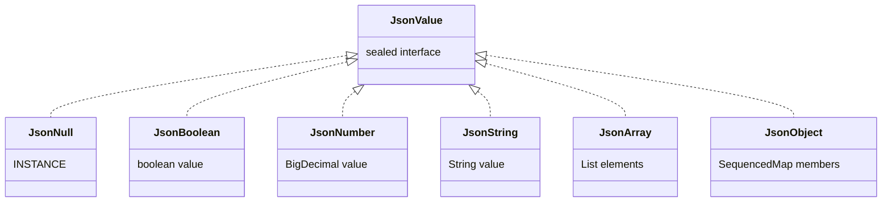
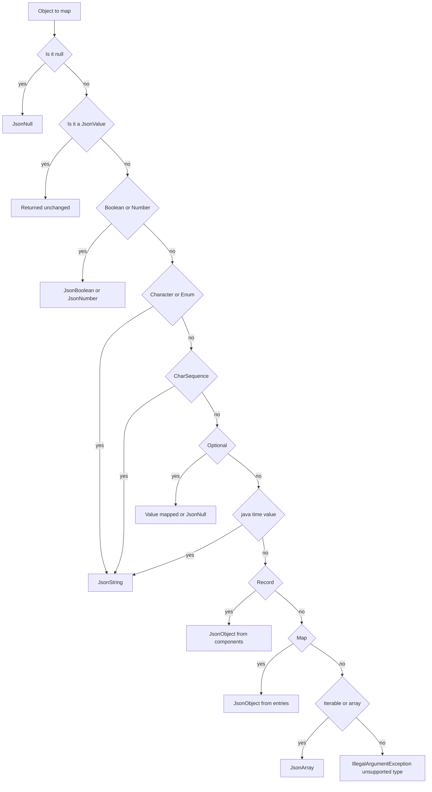

# Task 30 · A tiny JSON writer: sealed values, records and reflection

| Difficulty | Topics | Time box |
|---|---|---|
| 🟡 Medium | Modelling a format as a sealed hierarchy (an enum can implement a sealed interface) · Exhaustive `switch` for printing · Escaping per the specification (RFC 8259) · Reflection on records (`getRecordComponents`, accessors, annotations) · Custom runtime annotations · Cycle detection with an identity set · Recursion | 3 h |

> **Background reading:** RFC 8259 "The JavaScript Object Notation (JSON) Data Interchange Format", §2, §6 and §7 · JEP 395 (Records) · JEP 409 (Sealed Classes) · Javadoc of `java.lang.Class#getRecordComponents` and `java.lang.reflect.RecordComponent` · *Effective Java* Item 39 ("Prefer annotations to naming patterns") and Item 65 ("Prefer interfaces to reflection")

---

## The situation

Our audit service writes every event as one JSON line into a log archive. We wanted to add Jackson for this, but the security team rejected the new dependency until the dependency review backlog is cleared. So for now we have to write JSON ourselves.

The current code builds it by string concatenation: `"{\"id\":\"" + id + "\"}"`. It worked until a customer name contained a double quote. The result was invalid JSON, and the archive's loader rejected the whole batch for that day.

We need a small writer that is **correct**. It has three parts:

1. a **value model**: a small set of types that describe JSON;
2. a **printer** that turns the model into text and escapes strings exactly as the RFC says;
3. a **mapper** that turns our Java records into that model.

Each part is easy to test on its own. The printer does not know about records, and the mapper does not know about escaping.

## The domain

| Term | Meaning |
|---|---|
| **JSON value** | One of: null, boolean, number, string, array, object. The model is [`JsonValue`](../src/main/java/io/github/chris013/practice/task30/JsonValue.java). |
| **Member** | A key/value pair inside a JSON object. Keys are always strings. |
| **Compact output** | No whitespace at all. This is what goes into the log archive. |
| **Pretty output** | Indented, one member per line. This is for humans reading a file. |
| **Record component** | One of the parts of a record, for example `name` in `record Customer(String name)`. |

The value model is a closed set of cases, so it is a sealed interface. The printer handles every case in one exhaustive `switch`:



The mapper decides which `JsonValue` a Java object becomes. Many Java types match more than one rule (a record can implement `Iterable`, an enum can implement `CharSequence`), so the order of the checks is part of the design:



### What the output looks like

This is the event we write for a refund. Note the escaped quotes in the customer name, the renamed `customer_id`, and the omitted `note` of the first payment.

```java
record Customer(@JsonName("customer_id") String id, String name) {}
record Payment(BigDecimal amount, String currency, Optional<String> note) {}
record AuditEvent(String type, LocalDate day, Customer customer, List<Payment> payments) {}

var event = new AuditEvent("refund", LocalDate.of(2024, 3, 1),
        new Customer("c-42", "Ada \"the\" Coder"),
        List.of(new Payment(new BigDecimal("12.50"), "EUR", Optional.empty()),
                new Payment(new BigDecimal("3"), "EUR", Optional.of("goodwill"))));

Json.write(JsonMapper.toJson(event));
```

Compact output, one line in the archive:

```json
{"type":"refund","day":"2024-03-01","customer":{"customer_id":"c-42","name":"Ada \"the\" Coder"},"payments":[{"amount":12.50,"currency":"EUR"},{"amount":3,"currency":"EUR","note":"goodwill"}]}
```

Pretty output, `Json.writePretty(JsonMapper.toJson(event))`:

```json
{
  "type": "refund",
  "day": "2024-03-01",
  "customer": {
    "customer_id": "c-42",
    "name": "Ada \"the\" Coder"
  },
  "payments": [
    {
      "amount": 12.50,
      "currency": "EUR"
    },
    {
      "amount": 3,
      "currency": "EUR",
      "note": "goodwill"
    }
  ]
}
```

## What I want from you

Implement [`Json`](../src/main/java/io/github/chris013/practice/task30/Json.java) and [`JsonMapper`](../src/main/java/io/github/chris013/practice/task30/JsonMapper.java). The value model is given and must not change.

**The printer (`Json`)**

1. `Json.write(value)` prints compact JSON with no whitespace, for example `{"a":1,"b":[true,null]}`. Object members keep their insertion order.
2. `Json.writePretty(value)` uses two spaces per level, prints `"key": value`, puts each array element and each member on its own line, prints empty containers as `[]` and `{}`, and adds no trailing newline.
3. Strings are escaped as RFC 8259 requires, and no more:
   * `"` becomes `\"` and `\` becomes `\\`;
   * `\b`, `\f`, `\n`, `\r` and `\t` use their short forms;
   * every other character from U+0000 to U+001F becomes `\u00XX` with lowercase hex, for example `\u001f`;
   * `/`, U+007F and all non-ASCII characters are written as they are.
4. Numbers are printed with `BigDecimal.toPlainString()`: `1E+3` prints `1000`, `1.50` prints `1.50`.

**The mapper (`JsonMapper.toJson(Object)`)**

5. `null` becomes `JsonNull`. A `JsonValue` is returned as it is.
6. `Boolean` becomes `JsonBoolean`. `Integer`, `Long`, `Short`, `Byte`, `BigInteger` and `BigDecimal` become an exact `JsonNumber`.
7. `Double` and `Float` become a number with their decimal text. A `Float` uses `Float.toString`, so `0.1f` prints as `0.1` and not as `0.10000000149011612`. `NaN` and infinite values throw `IllegalArgumentException`, because JSON has no such numbers.
8. A `CharSequence` becomes a `JsonString`. A `Character` becomes a one-character string. An enum becomes its `name()`.
9. A `java.time` value (for example `LocalDate` or `Instant`) becomes its `toString()` text.
10. `Optional` maps its value. An empty `Optional` becomes `JsonNull`. The same rule applies at the top level and in lists.
11. A record becomes a `JsonObject` with its components in declaration order. The member name is the value of [`@JsonName`](../src/main/java/io/github/chris013/practice/task30/JsonName.java) if the component has it, and the component name otherwise.
12. A record component that holds `Optional.empty()` is **left out** of the object. A `null` component is written as `null`. Two components with the same JSON name throw `IllegalArgumentException`.
13. Arrays (including primitive arrays such as `int[]`) and `Iterable`s become a `JsonArray`. Inside a list, an empty `Optional` is `null` and is not left out.
14. A `Map` becomes a `JsonObject` in iteration order. Every key must be a `String`; otherwise throw `IllegalArgumentException` and name the key's class.
15. Anything else throws `IllegalArgumentException` with the message `unsupported type: <class name>`.
16. **Cycles.** A container that contains itself, directly or through other containers, throws `IllegalArgumentException("cycle detected")`. Use identity, not equality, to decide whether a container is the same one. Two equal lists that are different objects are not a cycle. The same list in two places side by side is not a cycle either.
17. If a record accessor throws, the mapper throws `IllegalStateException` and passes the accessor's exception as the cause.

## Constraints & non-goals

* No Jackson, Gson or other library. The whole point is that we have no dependency.
* No `getDeclaredFields()`. Use `getRecordComponents()`: it keeps declaration order and it is the record's own description.
* Do not reflect on private members with `setAccessible`. The accessors of a record are public.
* No pretty-printing options beyond the one indentation style in the contract.
* No parsing. We only write.

## How I'd approach it

* Write the printer first and test it with values you build by hand. It is pure and boring, and it is where the escaping bugs are.
* For the escaping, go through the RFC rules one by one, not through a `replace` chain. A chain of `replace("\"", "\\\"")` calls usually misses the control characters, and a chain that also escapes `/` or non-ASCII characters "to be safe" produces output the RFC does not require.
* The pretty printer and the compact printer share one method. Pass a flag or a small "layout" value and let one helper write a newline plus indentation only when pretty output is on. Two separate printers drift apart over time.
* The `switch` in the printer needs no `default`. Read the compiler's error when a case is missing. That error is what the sealed hierarchy is for.
* In the mapper, decide the order of the checks before you write the `switch`. The flowchart above is one reasonable answer. Think about what happens to a record that implements `Iterable`, and why you would rather write it as an object.
* For cycle detection, keep a set of containers that are **on the current path**. Add before you descend, remove when you come back. If you never remove, two equal sibling lists look like a cycle. Use `Collections.newSetFromMap(new IdentityHashMap<>())`. A `HashSet` uses `equals` and `hashCode`, so it would treat two equal lists as the same container. Hashing a list that contains itself also recurses forever.
* Reading a record: `Class#getRecordComponents()` returns the components in declaration order. Each `RecordComponent` gives you `getName()`, `getAccessor()` and `getAnnotation(...)`. Use the accessor for the value.
* An exception from an accessor arrives wrapped in `InvocationTargetException`. Unwrap it with `getCause()` before you rethrow, so the stack trace points at the real problem.
* The tests use [`JsonFixtures`](../src/test/java/io/github/chris013/practice/task30/JsonFixtures.java), small helpers that build the expected values. Read them first; they make the other tests short.

## Tests

Run: `mvn test -Dtest='**/task30/**'`

* [`JsonWriteTest`](../src/test/java/io/github/chris013/practice/task30/JsonWriteTest.java): each kind of value, nesting, numbers, and a table of escapes.
* [`JsonPrettyTest`](../src/test/java/io/github/chris013/practice/task30/JsonPrettyTest.java): exact layout of pretty output, empty containers, arrays of objects.
* [`JsonMapperTest`](../src/test/java/io/github/chris013/practice/task30/JsonMapperTest.java): one nested group per kind of input, plus records, `Optional` rules, cycles and exceptions.
* [`JsonValueModelTest`](../src/test/java/io/github/chris013/practice/task30/JsonValueModelTest.java) tests the given value model. It passes on the starter, because the model is complete. It documents the guarantees your mapper relies on.

Many tests fail on the starter, because `Json` and `JsonMapper` still throw `UnsupportedOperationException`. That is expected. Make them pass one group at a time.

<details>
<summary>Show the tests</summary>

<!-- embed: src/test/java/io/github/chris013/practice/task30/JsonWriteTest.java -->
<!-- /embed -->

<!-- embed: src/test/java/io/github/chris013/practice/task30/JsonPrettyTest.java -->
<!-- /embed -->

<!-- embed: src/test/java/io/github/chris013/practice/task30/JsonMapperTest.java -->
<!-- /embed -->

</details>

## Definition of done

- [ ] `Json.write` and `Json.writePretty` produce exactly the output in the example above.
- [ ] Every escaping rule of the contract has a test, including the boundary characters U+001F and U+007F.
- [ ] The printer has no `default` branch in its `switch`.
- [ ] A container that is in two places side by side is printed twice, and a container that contains itself is rejected.
- [ ] `mvn -B clean test-compile` prints no warnings, and the task test run takes well under 5 seconds.
- [ ] You can explain why `getDeclaredFields()` would be wrong here, in one sentence.

## Stretch goals

1. **A parser.** Write `Json.parse(String)` that returns a `JsonValue`. On a syntax error, throw an exception that says the character position where parsing failed.
2. **Deserialize into records.** Read a `JsonObject` into a record by calling its canonical constructor, using the same `@JsonName` rule as the mapper.
3. **Cache the record metadata.** Look up the components and their names once per class, with a `ClassValue`, instead of on every call.
4. **Stream the output.** Write to a `java.io.Writer` instead of building a `String`, so that a large array does not need a large buffer.
5. **Reject unpaired surrogates.** The RFC allows only well-formed Unicode text. Make the printer throw `IllegalArgumentException` for an unpaired surrogate, and test it.

---

## Reference solution

<details>
<summary>Spoiler: open only after you have made a serious attempt</summary>

### Key decisions

1. **A sealed value model, and one exhaustive `switch` for printing.**
   The printer has no `default`. If someone adds a new kind of value, the printer does not compile until it handles it. The alternative was a `Map<Class, Printer>` or an `instanceof` chain, which fails silently at runtime when a case is forgotten.
2. **One printer with a `pretty` flag.**
   Newlines and indentation are written by one helper that does nothing in compact mode. The rejected alternative was two printers, which had to agree on every detail of escaping and member order.
3. **Escaping written per the RFC, character by character.**
   The printer looks at each `char` once. Only the characters the RFC names are escaped. The rejected alternative was a chain of `String.replace` calls, which misses control characters and does not handle the order of replacements well.
4. **Ordered `switch` in the mapper, not a visitor.**
   The mapper must accept types we do not own (`BigDecimal`, `Optional`, arrays). A visitor works only for types we control. The cost is that the order of the cases matters, and the Javadoc says so.
5. **Identity set for the current path.**
   `IdentityHashMap` answers "is this the same object". Removing the container when its conversion finishes keeps sibling reuse legal. The rejected alternative was a `HashSet` with `equals`, which treats two equal lists as a cycle.
6. **Records are read through `getRecordComponents()`, and an accessor failure keeps its cause.**
   The component order is the declaration order, and `@JsonName` is read from the component itself. A failing accessor is wrapped in an `IllegalStateException` whose cause is the original exception, so nothing is lost.

### Code

<!-- embed: solutions/src/main/java/io/github/chris013/practice/task30/Json.java -->
<!-- /embed -->

<!-- embed: solutions/src/main/java/io/github/chris013/practice/task30/JsonMapper.java -->
<!-- /embed -->

<!-- embed: solutions/src/main/java/io/github/chris013/practice/task30/JsonObject.java -->
<!-- /embed -->

### What I typically flag in first attempts

| Finding | Why it matters |
|---|---|
| String concatenation or `String.format` for the whole object | This is how we got the broken archive in the first place. Every new field is another chance to forget an escape. |
| A `replace` chain for escaping | Misses U+0000 to U+001F unless each one is listed, and `replace` order can double-escape. |
| Escaping `/` or non-ASCII "to be safe" | The RFC does not require it, and the output becomes harder to read in the logs. |
| `Double.toString` or `String.valueOf(double)` for numbers | Prints `1.0E10`, which is valid JSON but not what a reader expects. `BigDecimal` with `toPlainString` avoids this. |
| `getDeclaredFields()` instead of record components | Field order is not guaranteed, and fields miss the `@JsonName` annotation that is on the component. |
| A `HashSet` for cycle detection | Equal containers look like the same container, so two equal sibling lists are rejected. |
| Cycle set not cleaned up on the way back | The same list in two places side by side is reported as a cycle. |
| Printing `NaN` or `Infinity` as text | Neither is a JSON number. Reject them with an exception, as the contract says. |

</details>
