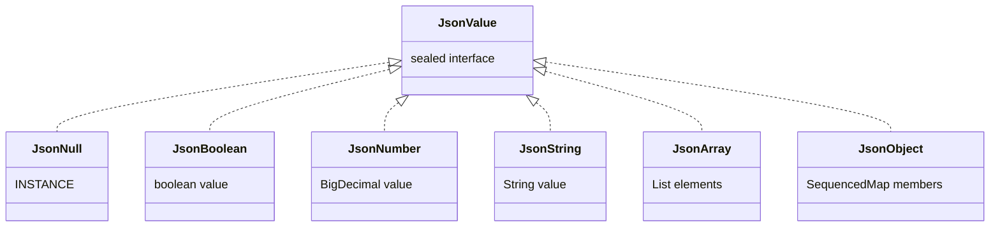
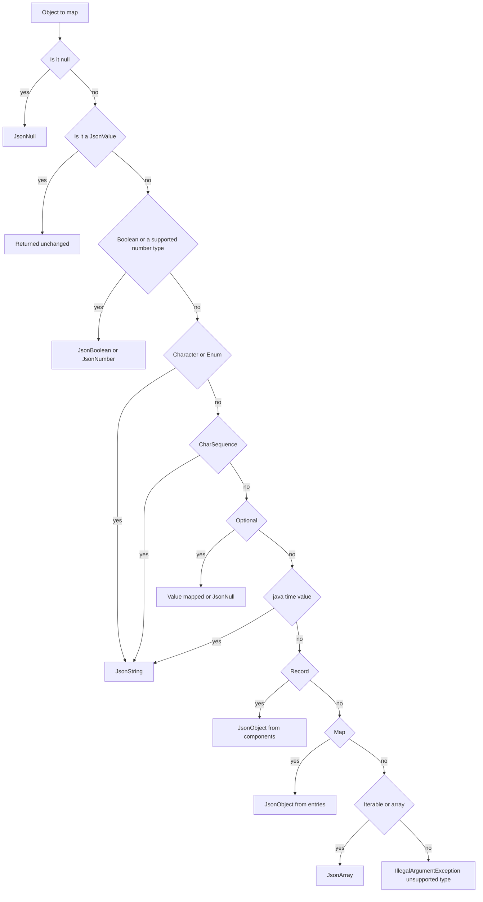

# Task 30 · A tiny JSON writer: sealed values, records and reflection

| Difficulty | Topics | Time box |
|---|---|---|
| 🟡 Medium | Modelling a format as a sealed hierarchy (an enum can implement a sealed interface) · Exhaustive `switch` for printing · Escaping per the specification (RFC 8259) · Reflection on records (`getRecordComponents`, accessors, annotations) · Custom runtime annotations · Cycle detection with an identity set · Recursion | 3 h |

> **Background reading:** RFC 8259 "The JavaScript Object Notation (JSON) Data Interchange Format", §2, §6 and §7 · JEP 395 (Records) · JEP 409 (Sealed Classes) · Javadoc of `java.lang.Class#getRecordComponents` and `java.lang.reflect.RecordComponent` · *Effective Java* Item 39 ("Prefer annotations to naming patterns") and Item 65 ("Prefer interfaces to reflection")

---

## The situation

Our audit service writes every event as one JSON line into a log archive. We wanted to add Jackson for this, but the security team rejected the new dependency until the dependency review backlog is cleared. So for now we have to write JSON ourselves.

The current code builds it by string concatenation: `"{\"id\":\"" + id + "\"}"`. It worked until a customer name contained a double quote. The result was invalid JSON, and the archive's loader rejected the whole batch for that day.

We need a small writer that is **correct**. It has three parts:

1. a **value model**: a small set of types that describe JSON;
2. a **printer** that turns the model into text and escapes strings exactly as the RFC says;
3. a **mapper** that turns our Java records into that model.

Each part is easy to test on its own. The printer does not know about records, and the mapper does not know about escaping.

## The domain

| Term | Meaning |
|---|---|
| **JSON value** | One of: null, boolean, number, string, array, object. The model is [`JsonValue`](../src/main/java/io/github/chris013/practice/task30/JsonValue.java). |
| **Member** | A key/value pair inside a JSON object. Keys are always strings. |
| **Compact output** | No whitespace at all. This is what goes into the log archive. |
| **Pretty output** | Indented, one member per line. This is for humans reading a file. |
| **Record component** | One of the parts of a record, for example `name` in `record Customer(String name)`. |

The value model is a closed set of cases, so it is a sealed interface. The printer handles every case in one exhaustive `switch`:



The mapper decides which `JsonValue` a Java object becomes. Many Java types match more than one rule (a record can implement `Iterable`, an enum can implement `CharSequence`), so the order of the checks is part of the design:



### What the output looks like

This is the event we write for a refund. Note the escaped quotes in the customer name, the renamed `customer_id`, and the omitted `note` of the first payment.

```java
record ExampleCustomer(@JsonName("customer_id") String id, String name) {}
record ExamplePayment(BigDecimal amount, String currency, Optional<String> note) {}
record ExampleAuditEvent(String type, LocalDate day, ExampleCustomer customer, List<ExamplePayment> payments) {}

var event = new ExampleAuditEvent("refund", LocalDate.of(2024, 3, 1),
        new ExampleCustomer("c-42", "Ada \"the\" Coder"),
        List.of(new ExamplePayment(new BigDecimal("12.50"), "EUR", Optional.empty()),
                new ExamplePayment(new BigDecimal("3"), "EUR", Optional.of("goodwill"))));

Json.write(JsonMapper.toJson(event));
```

Compact output, one line in the archive:

```json
{"type":"refund","day":"2024-03-01","customer":{"customer_id":"c-42","name":"Ada \"the\" Coder"},"payments":[{"amount":12.50,"currency":"EUR"},{"amount":3,"currency":"EUR","note":"goodwill"}]}
```

Pretty output, `Json.writePretty(JsonMapper.toJson(event))`:

```json
{
  "type": "refund",
  "day": "2024-03-01",
  "customer": {
    "customer_id": "c-42",
    "name": "Ada \"the\" Coder"
  },
  "payments": [
    {
      "amount": 12.50,
      "currency": "EUR"
    },
    {
      "amount": 3,
      "currency": "EUR",
      "note": "goodwill"
    }
  ]
}
```

## What I want from you

Implement [`Json`](../src/main/java/io/github/chris013/practice/task30/Json.java) and [`JsonMapper`](../src/main/java/io/github/chris013/practice/task30/JsonMapper.java). The value model is given and must not change.

**The printer (`Json`)**

1. `Json.write(value)` prints compact JSON with no whitespace, for example `{"a":1,"b":[true,null]}`. Object members keep their insertion order.
2. `Json.writePretty(value)` uses two spaces per level, prints `"key": value`, puts each array element and each member on its own line, prints empty containers as `[]` and `{}`, and adds no trailing newline.
3. Strings are escaped as RFC 8259 requires, and no more:
   * `"` becomes `\"` and `\` becomes `\\`;
   * `\b`, `\f`, `\n`, `\r` and `\t` use their short forms;
   * every other character from U+0000 to U+001F becomes `\u00XX` with lowercase hex, for example `\u001f`;
   * `/`, U+007F and all non-ASCII characters are written as they are.
4. Numbers are printed with `BigDecimal.toPlainString()`: `1E+3` prints `1000`, `1.50` prints `1.50`.

**The mapper (`JsonMapper.toJson(Object)`)**

5. `null` becomes `JsonNull`. A `JsonValue` is returned as it is.
6. `Boolean` becomes `JsonBoolean`. `Integer`, `Long`, `Short`, `Byte`, `BigInteger` and `BigDecimal` become an exact `JsonNumber`. Other `Number` subclasses, such as `AtomicInteger`, are unsupported.
7. `Double` and `Float` become a number with their decimal text. A `Float` uses `Float.toString`, so `0.1f` prints as `0.1` and not as `0.10000000149011612`. `NaN` and infinite values throw `IllegalArgumentException`, because JSON has no such numbers.
8. A `CharSequence` becomes a `JsonString`. A `Character` becomes a one-character string. An enum becomes its `name()`, even if the enum also implements `CharSequence`.
9. A `java.time` value (for example `LocalDate` or `Instant`) becomes its `toString()` text.
10. `Optional` maps its value. An empty `Optional` becomes `JsonNull`. The same rule applies at the top level and in lists.
11. A record becomes a `JsonObject` with its components in declaration order, even if the record also implements `Iterable` or `Map`. The member name is the value of [`@JsonName`](../src/main/java/io/github/chris013/practice/task30/JsonName.java) if the component has it, and the component name otherwise.
12. A record component that holds `Optional.empty()` is **left out** of the object. A `null` component is written as `null`. Two components with the same JSON name throw `IllegalArgumentException`.
13. Arrays (including primitive arrays such as `int[]`) and `Iterable`s become a `JsonArray`. Inside a list, an empty `Optional` is `null` and is not left out.
14. A `Map` becomes a `JsonObject` in iteration order. Every key must be a `String`; otherwise throw `IllegalArgumentException` and name the key's class.
15. Anything else throws `IllegalArgumentException` with the message `unsupported type: <class name>`.
16. **Cycles.** A container that contains itself, directly or through other containers, throws `IllegalArgumentException("cycle detected")`. Use identity, not equality, to decide whether a container is the same one. Two equal lists that are different objects are not a cycle. A container that is only equal to one of its ancestors is not a cycle either. The same list in two places side by side is not a cycle either.
17. If a record accessor throws, the mapper throws `IllegalStateException` and passes the accessor's exception as the cause.

## Constraints & non-goals

* No Jackson, Gson or other library. The whole point is that we have no dependency.
* No `getDeclaredFields()`. Use `getRecordComponents()`: it keeps declaration order and it is the record's own description.
* Do not reflect on private members with `setAccessible`. The accessors of a record are public.
* No pretty-printing options beyond the one indentation style in the contract.
* No parsing. We only write.

## How I'd approach it

* Write the printer first and test it with values you build by hand. It is pure and boring, and it is where the escaping bugs are.
* For the escaping, go through the RFC rules one by one, not through a `replace` chain. A chain of `replace("\"", "\\\"")` calls usually misses the control characters, and a chain that also escapes `/` or non-ASCII characters "to be safe" produces output the RFC does not require.
* The pretty printer and the compact printer share one method. Pass a flag or a small "layout" value and let one helper write a newline plus indentation only when pretty output is on. Two separate printers drift apart over time.
* The `switch` in the printer needs no `default`. Read the compiler's error when a case is missing. That error is what the sealed hierarchy is for.
* In the mapper, decide the order of the checks before you write the `switch`. The flowchart above is one reasonable answer. Think about what happens to a record that implements `Iterable`, and why you would rather write it as an object.
* For cycle detection, keep a set of containers that are **on the current path**. Add before you descend, remove when you come back. If you never remove, the same list in two places side by side looks like a cycle. Use `Collections.newSetFromMap(new IdentityHashMap<>())`. The rejected alternative is a `HashSet`. It calls `hashCode`, which never returns for a list that contains itself (`StackOverflowError` instead of our exception), and it treats a container that is merely equal to one of its ancestors as a cycle.
* Reading a record: `Class#getRecordComponents()` returns the components in declaration order. Each `RecordComponent` gives you `getName()`, `getAccessor()` and `getAnnotation(...)`. Use the accessor for the value.
* An exception from an accessor arrives wrapped in `InvocationTargetException`. Unwrap it with `getCause()` before you rethrow, so the stack trace points at the real problem.
* The tests use [`JsonFixtures`](../src/test/java/io/github/chris013/practice/task30/JsonFixtures.java), small helpers that build the expected values. Read them first; they make the other tests short.

## Tests

Run: `mvn test -Dtest='**/task30/**'`

* [`JsonWriteTest`](../src/test/java/io/github/chris013/practice/task30/JsonWriteTest.java): each kind of value, nesting, numbers, and a table of escapes.
* [`JsonPrettyTest`](../src/test/java/io/github/chris013/practice/task30/JsonPrettyTest.java): exact layout of pretty output, empty containers, arrays of objects.
* [`JsonMapperTest`](../src/test/java/io/github/chris013/practice/task30/JsonMapperTest.java): one nested group per kind of input, plus records, `Optional` rules, cycles and exceptions.
* [`JsonValueModelTest`](../src/test/java/io/github/chris013/practice/task30/JsonValueModelTest.java) tests the given value model. It passes on the starter, because the model is complete. It documents the guarantees your mapper relies on.

Many tests fail on the starter, because `Json` and `JsonMapper` still throw `UnsupportedOperationException`. That is expected. Make them pass one group at a time.

<details>
<summary>Show the tests</summary>

<!-- embed: src/test/java/io/github/chris013/practice/task30/JsonWriteTest.java -->
**[`JsonWriteTest.java`](../src/test/java/io/github/chris013/practice/task30/JsonWriteTest.java)**

```java
package io.github.chris013.practice.task30;

import static io.github.chris013.practice.task30.JsonFixtures.array;
import static io.github.chris013.practice.task30.JsonFixtures.num;
import static io.github.chris013.practice.task30.JsonFixtures.object;
import static io.github.chris013.practice.task30.JsonFixtures.str;
import static org.assertj.core.api.Assertions.assertThat;

import java.util.stream.Stream;
import org.junit.jupiter.api.Nested;
import org.junit.jupiter.api.Test;
import org.junit.jupiter.params.ParameterizedTest;
import org.junit.jupiter.params.provider.Arguments;
import org.junit.jupiter.params.provider.CsvSource;
import org.junit.jupiter.params.provider.MethodSource;

class JsonWriteTest {

    /**
     * Each row is {@code input, expected JSON text}. The JSON text includes the surrounding quotes. Each
     * Java literal is written out in full, so the table shows exactly what goes in and what comes out.
     */
    static Stream<Arguments> escapes() {
        return Stream.of(
                Arguments.of("a\"b", "\"a\\\"b\""),
                Arguments.of("a\\b", "\"a\\\\b\""),
                Arguments.of("\b", "\"\\b\""),
                Arguments.of("\f", "\"\\f\""),
                Arguments.of("\n", "\"\\n\""),
                Arguments.of("\r", "\"\\r\""),
                Arguments.of("\t", "\"\\t\""),
                Arguments.of("\u0000", "\"\\u0000\""),
                Arguments.of("\u001f", "\"\\u001f\""),
                Arguments.of("\u007f", "\"\u007f\""),
                Arguments.of("a/b", "\"a/b\""),
                Arguments.of("é", "\"é\""),
                Arguments.of("€", "\"€\""));
    }

    @Nested
    class Scalars {

        @Test
        void writes_null() {
            assertThat(Json.write(JsonNull.INSTANCE)).isEqualTo("null");
        }

        @Test
        void writes_true_and_false() {
            assertThat(Json.write(JsonBoolean.TRUE)).isEqualTo("true");
            assertThat(Json.write(JsonBoolean.FALSE)).isEqualTo("false");
        }

        @ParameterizedTest
        @CsvSource({
            "0, 0",
            "1, 1",
            "-2.50, -2.50",
            "0.10, 0.10",
            "1E+3, 1000",
            "1E-7, 0.0000001",
            "12345678901234567890.5, 12345678901234567890.5",
        })
        void writes_numbers_as_plain_strings(String input, String expected) {
            assertThat(Json.write(num(input))).isEqualTo(expected);
        }
    }

    @Nested
    class Composites {

        @Test
        void writes_an_empty_array_and_an_empty_object() {
            assertThat(Json.write(array())).isEqualTo("[]");
            assertThat(Json.write(object())).isEqualTo("{}");
        }

        @Test
        void writes_nested_values_without_any_whitespace() {
            var value = object("a", num("1"), "b", array(JsonBoolean.TRUE, JsonNull.INSTANCE));

            assertThat(Json.write(value)).isEqualTo("{\"a\":1,\"b\":[true,null]}");
        }

        @Test
        void keeps_the_members_in_insertion_order() {
            var value = object("zeta", num("1"), "alpha", num("2"));

            assertThat(Json.write(value)).isEqualTo("{\"zeta\":1,\"alpha\":2}");
        }
    }

    @Nested
    class Strings {

        @ParameterizedTest
        @MethodSource("io.github.chris013.practice.task30.JsonWriteTest#escapes")
        void escapes_a_string_as_rfc_8259_requires(String input, String expected) {
            assertThat(Json.write(str(input))).isEqualTo(expected);
        }

        @Test
        void no_control_character_survives_unescaped() {
            for (char c = 0; c <= 0x1F; c++) {
                String written = Json.write(str(String.valueOf(c)));

                assertThat(written.chars().filter(ch -> ch < 0x20)).as("control char %d", (int) c).isEmpty();
            }
        }

        @Test
        void escapes_keys_as_well_as_values() {
            var value = object("say \"hi\"", str("ok"));

            assertThat(Json.write(value)).isEqualTo("{\"say \\\"hi\\\"\":\"ok\"}");
        }
    }
}
```
<!-- /embed -->

<!-- embed: src/test/java/io/github/chris013/practice/task30/JsonPrettyTest.java -->
**[`JsonPrettyTest.java`](../src/test/java/io/github/chris013/practice/task30/JsonPrettyTest.java)**

```java
package io.github.chris013.practice.task30;

import static io.github.chris013.practice.task30.JsonFixtures.array;
import static io.github.chris013.practice.task30.JsonFixtures.num;
import static io.github.chris013.practice.task30.JsonFixtures.object;
import static io.github.chris013.practice.task30.JsonFixtures.str;
import static org.assertj.core.api.Assertions.assertThat;

import org.junit.jupiter.api.Nested;
import org.junit.jupiter.api.Test;

class JsonPrettyTest {

    @Nested
    class Layout {

        @Test
        void indents_by_two_spaces_and_puts_each_member_on_its_own_line() {
            var value = object("name", str("Ada"), "tags", array(str("x"), str("y")), "age", num("36"));

            assertThat(Json.writePretty(value)).isEqualTo("""
                    {
                      "name": "Ada",
                      "tags": [
                        "x",
                        "y"
                      ],
                      "age": 36
                    }""");
        }

        @Test
        void writes_empty_containers_on_one_line() {
            var value = object("empty", array(), "nothing", object());

            assertThat(Json.writePretty(value)).isEqualTo("""
                    {
                      "empty": [],
                      "nothing": {}
                    }""");
        }

        @Test
        void writes_a_scalar_as_is_and_has_no_trailing_newline() {
            assertThat(Json.writePretty(str("x"))).isEqualTo("\"x\"");
            assertThat(Json.writePretty(JsonNull.INSTANCE)).isEqualTo("null");
            assertThat(Json.writePretty(array())).isEqualTo("[]");
        }
    }

    @Nested
    class NestedContainers {

        @Test
        void writes_an_array_of_objects_with_each_object_indented_one_level() {
            var value = array(object("id", num("1")), object("id", num("2")));

            assertThat(Json.writePretty(value)).isEqualTo("""
                    [
                      {
                        "id": 1
                      },
                      {
                        "id": 2
                      }
                    ]""");
        }

        @Test
        void writes_an_empty_array_inside_an_array() {
            assertThat(Json.writePretty(array(array()))).isEqualTo("""
                    [
                      []
                    ]""");
        }

        @Test
        void pretty_and_compact_output_contain_the_same_tokens() {
            var value = object("a", array(JsonBoolean.TRUE, JsonNull.INSTANCE), "b", object("c", str("d")));

            String compactWithoutSpace = Json.write(value);
            String prettyWithoutSpace = Json.writePretty(value).replaceAll("\\s+", "");

            assertThat(prettyWithoutSpace).isEqualTo(compactWithoutSpace);
        }
    }
}
```
<!-- /embed -->

<!-- embed: src/test/java/io/github/chris013/practice/task30/JsonMapperTest.java -->
**[`JsonMapperTest.java`](../src/test/java/io/github/chris013/practice/task30/JsonMapperTest.java)**

```java
package io.github.chris013.practice.task30;

import static io.github.chris013.practice.task30.JsonFixtures.array;
import static io.github.chris013.practice.task30.JsonFixtures.num;
import static io.github.chris013.practice.task30.JsonFixtures.object;
import static io.github.chris013.practice.task30.JsonFixtures.str;
import static org.assertj.core.api.Assertions.assertThat;
import static org.assertj.core.api.Assertions.assertThatThrownBy;

import java.math.BigDecimal;
import java.math.BigInteger;
import java.time.Instant;
import java.time.LocalDate;
import java.util.ArrayList;
import java.util.Iterator;
import java.util.LinkedHashMap;
import java.util.List;
import java.util.Map;
import java.util.Optional;
import java.util.concurrent.atomic.AtomicInteger;
import org.junit.jupiter.api.Nested;
import org.junit.jupiter.api.Test;
import org.junit.jupiter.params.ParameterizedTest;
import org.junit.jupiter.params.provider.CsvSource;

class JsonMapperTest {

    record Customer(String name, int age) {}

    record Renamed(@JsonName("customer_id") String id, @JsonName("is_active") boolean active) {}

    record Line(String sku, int quantity) {}

    record Order(String id, List<Line> lines, Map<String, Integer> counts) {}

    record Maybe(String name, Optional<String> nickname) {}

    record Pair(List<String> first, List<String> second) {}

    record Nullable(String value) {}

    record Duplicate(@JsonName("same") String a, @JsonName("same") String b) {}

    record Fragile(String name) {
        @Override
        public String name() {
            throw new ArithmeticException("boom");
        }
    }

    record Node(List<Object> children) {}

    enum Colour { RED, GREEN }

    // Equality ignores the children, so a child can be equal to its parent without being the same object.
    record Tag(String name, List<Object> children) {
        @Override
        public boolean equals(Object o) {
            return o instanceof Tag t && t.name.equals(name);
        }

        @Override
        public int hashCode() {
            return name.hashCode();
        }
    }

    record Tags(String owner) implements Iterable<String> {
        @Override
        public Iterator<String> iterator() {
            return List.of("x").iterator();
        }
    }

    enum Shade implements CharSequence {
        DARK;

        @Override
        public int length() {
            return 4;
        }

        @Override
        public char charAt(int index) {
            return "dark".charAt(index);
        }

        @Override
        public CharSequence subSequence(int start, int end) {
            return "dark".subSequence(start, end);
        }

        @Override
        public String toString() {
            return "Dark shade";
        }
    }

    @Nested
    class Scalars {

        @Test
        void maps_null_to_json_null() {
            assertThat(JsonMapper.toJson(null)).isEqualTo(JsonNull.INSTANCE);
        }

        @Test
        void returns_a_json_value_unchanged() {
            var value = num("7");

            assertThat(JsonMapper.toJson(value)).isSameAs(value);
        }

        @Test
        void maps_booleans() {
            assertThat(JsonMapper.toJson(true)).isEqualTo(JsonBoolean.TRUE);
            assertThat(JsonMapper.toJson(false)).isEqualTo(JsonBoolean.FALSE);
        }

        @Test
        void maps_integral_numbers_exactly() {
            assertThat(JsonMapper.toJson(42)).isEqualTo(num("42"));
            assertThat(JsonMapper.toJson(Long.MIN_VALUE)).isEqualTo(num("-9223372036854775808"));
            assertThat(JsonMapper.toJson((short) -3)).isEqualTo(num("-3"));
            assertThat(JsonMapper.toJson((byte) 7)).isEqualTo(num("7"));
            assertThat(JsonMapper.toJson(new BigInteger("12345678901234567890"))).isEqualTo(num("12345678901234567890"));
        }

        @Test
        void maps_big_decimal_as_it_is() {
            assertThat(Json.write(JsonMapper.toJson(new BigDecimal("1.50")))).isEqualTo("1.50");
        }

        @ParameterizedTest
        @CsvSource({"0.1, 0.1", "2.5, 2.5", "1.0E10, 10000000000"})
        void maps_doubles_through_their_decimal_text(double input, String expected) {
            // BigDecimal.valueOf(double) goes through Double.toString, so 0.1 stays 0.1.
            assertThat(Json.write(JsonMapper.toJson(input))).isEqualTo(expected);
        }

        @Test
        void maps_a_float_through_its_shortest_text() {
            assertThat(Json.write(JsonMapper.toJson(0.1f))).isEqualTo("0.1");
        }

        @Test
        void rejects_nan_and_infinity_because_json_has_no_such_numbers() {
            assertThatThrownBy(() -> JsonMapper.toJson(Double.NaN)).isInstanceOf(IllegalArgumentException.class);
            assertThatThrownBy(() -> JsonMapper.toJson(Double.POSITIVE_INFINITY))
                    .isInstanceOf(IllegalArgumentException.class);
            assertThatThrownBy(() -> JsonMapper.toJson(Float.NaN)).isInstanceOf(IllegalArgumentException.class);
        }

        @Test
        void maps_strings_characters_and_char_sequences() {
            assertThat(JsonMapper.toJson("ada")).isEqualTo(str("ada"));
            assertThat(JsonMapper.toJson('x')).isEqualTo(str("x"));
            assertThat(JsonMapper.toJson(new StringBuilder("sb"))).isEqualTo(str("sb"));
        }

        @Test
        void maps_an_enum_to_its_name() {
            assertThat(JsonMapper.toJson(Colour.GREEN)).isEqualTo(str("GREEN"));
        }

        @Test
        void writes_an_enum_that_is_also_a_char_sequence_as_its_name() {
            assertThat(Shade.DARK.toString()).isEqualTo("Dark shade");
            assertThat(JsonMapper.toJson(Shade.DARK)).isEqualTo(str("DARK"));
        }

        @Test
        void maps_java_time_values_to_their_to_string_text() {
            assertThat(JsonMapper.toJson(LocalDate.of(2024, 3, 1))).isEqualTo(str("2024-03-01"));
            assertThat(JsonMapper.toJson(Instant.parse("2024-03-01T10:15:30Z")))
                    .isEqualTo(str("2024-03-01T10:15:30Z"));
        }

        @Test
        void maps_an_optional_to_its_value_and_an_empty_one_to_null() {
            assertThat(JsonMapper.toJson(Optional.of("x"))).isEqualTo(str("x"));
            assertThat(JsonMapper.toJson(Optional.empty())).isEqualTo(JsonNull.INSTANCE);
        }

        @Test
        void rejects_a_type_it_does_not_know_and_names_it() {
            assertThatThrownBy(() -> JsonMapper.toJson(new Object()))
                    .isInstanceOf(IllegalArgumentException.class)
                    .hasMessage("unsupported type: java.lang.Object");
            assertThatThrownBy(() -> JsonMapper.toJson(Thread.currentThread()))
                    .isInstanceOf(IllegalArgumentException.class)
                    .hasMessage("unsupported type: java.lang.Thread");
        }

        @Test
        void rejects_other_number_subclasses_such_as_atomic_integer() {
            assertThatThrownBy(() -> JsonMapper.toJson(new AtomicInteger(1)))
                    .isInstanceOf(IllegalArgumentException.class)
                    .hasMessage("unsupported type: java.util.concurrent.atomic.AtomicInteger");
        }
    }

    @Nested
    class Containers {

        @Test
        void maps_a_list_to_an_array_in_order() {
            assertThat(JsonMapper.toJson(List.of("a", "b"))).isEqualTo(array(str("a"), str("b")));
        }

        @Test
        void maps_a_list_element_that_is_an_empty_optional_to_null() {
            var list = new ArrayList<Object>();
            list.add(Optional.empty());

            assertThat(JsonMapper.toJson(list)).isEqualTo(array(JsonNull.INSTANCE));
        }

        @Test
        void maps_a_map_keeping_its_iteration_order() {
            var map = new LinkedHashMap<String, Integer>();
            map.put("zeta", 1);
            map.put("alpha", 2);

            assertThat(Json.write(JsonMapper.toJson(map))).isEqualTo("{\"zeta\":1,\"alpha\":2}");
        }

        @Test
        void rejects_a_map_with_a_non_string_key_and_names_the_key_type() {
            assertThatThrownBy(() -> JsonMapper.toJson(Map.of(1, "one")))
                    .isInstanceOf(IllegalArgumentException.class)
                    .hasMessage("map keys must be String, not java.lang.Integer");
        }

        @Test
        void maps_primitive_int_arrays() {
            assertThat(JsonMapper.toJson(new int[] {1, 2})).isEqualTo(array(num("1"), num("2")));
        }

        @Test
        void maps_string_arrays_and_empty_arrays() {
            assertThat(JsonMapper.toJson(new String[] {"a"})).isEqualTo(array(str("a")));
            assertThat(JsonMapper.toJson(new int[0])).isEqualTo(array());
        }
    }

    @Nested
    class Records {

        @Test
        void maps_components_in_declaration_order_with_their_names() {
            var value = JsonMapper.toJson(new Customer("Ada", 36));

            assertThat(value).isEqualTo(object("name", str("Ada"), "age", num("36")));
            assertThat(Json.write(value)).isEqualTo("{\"name\":\"Ada\",\"age\":36}");
        }

        @Test
        void uses_json_name_when_it_is_present() {
            var value = JsonMapper.toJson(new Renamed("c-1", true));

            assertThat(Json.write(value)).isEqualTo("{\"customer_id\":\"c-1\",\"is_active\":true}");
        }

        @Test
        void maps_nested_records_with_lists_and_maps() {
            var order = new Order("o-1", List.of(new Line("tea", 2)), Map.of("tea", 2));

            assertThat(Json.write(JsonMapper.toJson(order)))
                    .isEqualTo("{\"id\":\"o-1\",\"lines\":[{\"sku\":\"tea\",\"quantity\":2}],\"counts\":{\"tea\":2}}");
        }

        @Test
        void leaves_out_an_empty_optional_component() {
            var value = JsonMapper.toJson(new Maybe("Ada", Optional.empty()));

            assertThat(value).isEqualTo(object("name", str("Ada")));
        }

        @Test
        void includes_a_present_optional_component_as_its_value() {
            var value = JsonMapper.toJson(new Maybe("Ada", Optional.of("Countess")));

            assertThat(value).isEqualTo(object("name", str("Ada"), "nickname", str("Countess")));
        }

        @Test
        void maps_a_null_component_to_json_null_instead_of_omitting_it() {
            assertThat(JsonMapper.toJson(new Nullable(null))).isEqualTo(object("value", JsonNull.INSTANCE));
        }

        @Test
        void rejects_two_components_with_the_same_json_name() {
            assertThatThrownBy(() -> JsonMapper.toJson(new Duplicate("x", "y")))
                    .isInstanceOf(IllegalArgumentException.class)
                    .hasMessage("duplicate JSON name: same");
        }

        @Test
        void surfaces_an_accessor_failure_with_the_original_exception_as_cause() {
            assertThatThrownBy(() -> JsonMapper.toJson(new Fragile("x")))
                    .isInstanceOf(IllegalStateException.class)
                    .hasCauseInstanceOf(ArithmeticException.class);
        }

        @Test
        void the_same_list_in_two_components_is_not_a_cycle() {
            var shared = List.of("a");

            assertThat(JsonMapper.toJson(new Pair(shared, shared)))
                    .isEqualTo(object("first", array(str("a")), "second", array(str("a"))));
        }

        @Test
        void writes_a_record_that_is_also_iterable_as_an_object() {
            assertThat(JsonMapper.toJson(new Tags("ada"))).isEqualTo(object("owner", str("ada")));
        }
    }

    @Nested
    class Cycles {

        @Test
        void rejects_a_list_that_contains_itself() {
            var list = new ArrayList<Object>();
            list.add(list);

            assertThatThrownBy(() -> JsonMapper.toJson(list))
                    .isInstanceOf(IllegalArgumentException.class)
                    .hasMessage("cycle detected");
        }

        @Test
        void rejects_a_cycle_that_goes_through_a_record() {
            var children = new ArrayList<Object>();
            var node = new Node(children);
            children.add(node);

            assertThatThrownBy(() -> JsonMapper.toJson(node))
                    .isInstanceOf(IllegalArgumentException.class)
                    .hasMessage("cycle detected");
        }

        @Test
        void rejects_a_map_that_contains_itself() {
            var map = new LinkedHashMap<String, Object>();
            map.put("self", map);

            assertThatThrownBy(() -> JsonMapper.toJson(map))
                    .isInstanceOf(IllegalArgumentException.class)
                    .hasMessage("cycle detected");
        }

        @Test
        void two_equal_sibling_lists_are_both_written() {
            var outer = List.of(List.of("x"), List.of("x"));

            assertThat(JsonMapper.toJson(outer)).isEqualTo(array(array(str("x")), array(str("x"))));
        }

        @Test
        void a_nested_container_equal_to_its_parent_is_not_a_cycle() {
            var value = JsonMapper.toJson(new Tag("a", List.of(new Tag("a", List.of()))));

            assertThat(Json.write(value))
                    .isEqualTo("{\"name\":\"a\",\"children\":[{\"name\":\"a\",\"children\":[]}]}");
        }
    }

    @Nested
    class TaskExample {

        record ExampleCustomer(@JsonName("customer_id") String id, String name) {}

        record ExamplePayment(BigDecimal amount, String currency, Optional<String> note) {}

        record ExampleAuditEvent(
                String type, LocalDate day, ExampleCustomer customer, List<ExamplePayment> payments) {}

        private ExampleAuditEvent event() {
            return new ExampleAuditEvent("refund", LocalDate.of(2024, 3, 1),
                    new ExampleCustomer("c-42", "Ada \"the\" Coder"),
                    List.of(new ExamplePayment(new BigDecimal("12.50"), "EUR", Optional.empty()),
                            new ExamplePayment(new BigDecimal("3"), "EUR", Optional.of("goodwill"))));
        }

        @Test
        void compact_output_is_one_line() {
            assertThat(Json.write(JsonMapper.toJson(event()))).isEqualTo("""
                    {"type":"refund","day":"2024-03-01","customer":{"customer_id":"c-42","name":"Ada \\\"the\\\" Coder"},"payments":[{"amount":12.50,"currency":"EUR"},{"amount":3,"currency":"EUR","note":"goodwill"}]}""");
        }

        @Test
        void pretty_output_matches_the_task_example() {
            assertThat(Json.writePretty(JsonMapper.toJson(event()))).isEqualTo("""
                    {
                      "type": "refund",
                      "day": "2024-03-01",
                      "customer": {
                        "customer_id": "c-42",
                        "name": "Ada \\\"the\\\" Coder"
                      },
                      "payments": [
                        {
                          "amount": 12.50,
                          "currency": "EUR"
                        },
                        {
                          "amount": 3,
                          "currency": "EUR",
                          "note": "goodwill"
                        }
                      ]
                    }""");
        }
    }
}
```
<!-- /embed -->

</details>

## Definition of done

- [ ] `Json.write` and `Json.writePretty` produce exactly the output in the example above.
- [ ] Every escaping rule of the contract has a test, including the boundary characters U+001F and U+007F.
- [ ] The printer has no `default` branch in its `switch`.
- [ ] A container that is in two places side by side is printed twice, and a container that contains itself is rejected.
- [ ] `mvn -B clean test-compile` prints no warnings, and the task test run takes well under 5 seconds.
- [ ] You can explain why `getDeclaredFields()` would be wrong here, in one sentence.

## Stretch goals

1. **A parser.** Write `Json.parse(String)` that returns a `JsonValue`. On a syntax error, throw an exception that says the character position where parsing failed.
2. **Deserialize into records.** Read a `JsonObject` into a record by calling its canonical constructor, using the same `@JsonName` rule as the mapper.
3. **Cache the record metadata.** Look up the components and their names once per class, with a `ClassValue`, instead of on every call.
4. **Stream the output.** Write to a `java.io.Writer` instead of building a `String`, so that a large array does not need a large buffer.
5. **Reject unpaired surrogates.** The RFC allows only well-formed Unicode text. Make the printer throw `IllegalArgumentException` for an unpaired surrogate, and test it.

---

## Reference solution

<details>
<summary>Spoiler: open only after you have made a serious attempt</summary>

### Key decisions

1. **A sealed value model, and one exhaustive `switch` for printing.**
   The printer has no `default`. If someone adds a new kind of value, the printer does not compile until it handles it. The alternative was a `Map<Class, Printer>` or an `instanceof` chain, which fails silently at runtime when a case is forgotten.
2. **One printer with a `pretty` flag.**
   Newlines and indentation are written by one helper that does nothing in compact mode. The rejected alternative was two printers, which had to agree on every detail of escaping and member order.
3. **Escaping written per the RFC, character by character.**
   The printer looks at each `char` once. Only the characters the RFC names are escaped. The rejected alternative was a chain of `String.replace` calls, which misses control characters and does not handle the order of replacements well.
4. **Ordered `switch` in the mapper, not a visitor.**
   The mapper must accept types we do not own (`BigDecimal`, `Optional`, arrays). A visitor works only for types we control. The cost is that the order of the cases matters, and the Javadoc says so.
5. **Identity set for the current path.**
   `IdentityHashMap` answers "is this the same object". Removing the container when its conversion finishes keeps sibling reuse legal. The rejected alternative was a `HashSet`. It calls `hashCode`, which never returns for a list that contains itself (`StackOverflowError` instead of our exception), and it treats a container that is merely equal to one of its ancestors as a cycle.
6. **Records are read through `getRecordComponents()`, and an accessor failure keeps its cause.**
   The component order is the declaration order, and `@JsonName` is read from the component itself. A failing accessor is wrapped in an `IllegalStateException` whose cause is the original exception, so nothing is lost.

### Code

<!-- embed: solutions/src/main/java/io/github/chris013/practice/task30/Json.java -->
**[`Json.java`](../solutions/src/main/java/io/github/chris013/practice/task30/Json.java)**

```java
package io.github.chris013.practice.task30;

import java.math.BigDecimal;
import java.util.List;
import java.util.Map;
import java.util.Objects;

/**
 * Prints a {@link JsonValue} as JSON text as RFC 8259 describes it.
 *
 * <p>Escaping is exactly what the RFC requires and nothing more: {@code "}, {@code \} and the control
 * characters U+0000 to U+001F are escaped; {@code /}, U+007F and all non-ASCII characters are written as they
 * are. The output is meant to be written as UTF-8. A string holding an unpaired surrogate is copied unchanged,
 * so the text may then not be valid UTF-8. A stricter writer would reject such a string instead.
 */
public final class Json {

    private static final String HEX_DIGITS = "0123456789abcdef";
    private static final String INDENT = "  ";

    private Json() {}

    /** Compact output with no whitespace, for log lines. */
    public static String write(JsonValue value) {
        var out = new StringBuilder();
        append(Objects.requireNonNull(value, "value"), out, false, 0);
        return out.toString();
    }

    /** Two-space indentation, one array element or object member per line, no trailing newline. */
    public static String writePretty(JsonValue value) {
        var out = new StringBuilder();
        append(Objects.requireNonNull(value, "value"), out, true, 0);
        return out.toString();
    }

    // The exhaustive switch is the reason JsonValue is sealed: no default branch, and the compiler
    // complains when a new case is added and not handled here.
    private static void append(JsonValue value, StringBuilder out, boolean pretty, int depth) {
        switch (value) {
            case JsonNull _ -> out.append("null");
            case JsonBoolean bool -> out.append(bool.value());
            case JsonNumber number -> out.append(number.value().toPlainString());
            case JsonString string -> appendString(string.value(), out);
            case JsonArray array -> appendArray(array.elements(), out, pretty, depth);
            case JsonObject object -> appendObject(object.members(), out, pretty, depth);
        }
    }

    private static void appendArray(List<JsonValue> elements, StringBuilder out, boolean pretty, int depth) {
        if (elements.isEmpty()) {
            out.append("[]");
            return;
        }
        out.append('[');
        for (int i = 0; i < elements.size(); i++) {
            if (i > 0) {
                out.append(',');
            }
            newline(out, pretty, depth + 1);
            append(elements.get(i), out, pretty, depth + 1);
        }
        newline(out, pretty, depth);
        out.append(']');
    }

    private static void appendObject(Map<String, JsonValue> members, StringBuilder out, boolean pretty, int depth) {
        if (members.isEmpty()) {
            out.append("{}");
            return;
        }
        out.append('{');
        boolean first = true;
        for (Map.Entry<String, JsonValue> member : members.entrySet()) {
            if (!first) {
                out.append(',');
            }
            first = false;
            newline(out, pretty, depth + 1);
            appendString(member.getKey(), out);
            out.append(pretty ? ": " : ":");
            append(member.getValue(), out, pretty, depth + 1);
        }
        newline(out, pretty, depth);
        out.append('}');
    }

    private static void newline(StringBuilder out, boolean pretty, int depth) {
        if (pretty) {
            out.append('\n').append(INDENT.repeat(depth));
        }
    }

    private static void appendString(String text, StringBuilder out) {
        out.append('"');
        for (int i = 0; i < text.length(); i++) {
            char c = text.charAt(i);
            switch (c) {
                case '"' -> out.append("\\\"");
                case '\\' -> out.append("\\\\");
                case '\b' -> out.append("\\b");
                case '\f' -> out.append("\\f");
                case '\n' -> out.append("\\n");
                case '\r' -> out.append("\\r");
                case '\t' -> out.append("\\t");
                default -> {
                    if (c < 0x20) {
                        // Every other control character becomes a six-character escape with four lowercase hex digits.
                        out.append("\\u00").append(HEX_DIGITS.charAt(c >> 4)).append(HEX_DIGITS.charAt(c & 0xF));
                    } else {
                        out.append(c);
                    }
                }
            }
        }
        out.append('"');
    }
}
```
<!-- /embed -->

<!-- embed: solutions/src/main/java/io/github/chris013/practice/task30/JsonMapper.java -->
**[`JsonMapper.java`](../solutions/src/main/java/io/github/chris013/practice/task30/JsonMapper.java)**

```java
package io.github.chris013.practice.task30;

import java.lang.reflect.Array;
import java.lang.reflect.InvocationTargetException;
import java.lang.reflect.RecordComponent;
import java.math.BigDecimal;
import java.math.BigInteger;
import java.time.temporal.TemporalAccessor;
import java.util.ArrayList;
import java.util.Collections;
import java.util.IdentityHashMap;
import java.util.LinkedHashMap;
import java.util.Map;
import java.util.Optional;
import java.util.Set;

/**
 * Turns plain Java objects into a {@link JsonValue} tree, so that {@link Json} can print them.
 *
 * <p>The order of the checks in {@link #convert} matters. The first case that matches wins:
 * {@code JsonValue} before everything, enums before {@code CharSequence}, records before {@code Iterable} and
 * {@code Map}. A record that happens to implement {@code Iterable} is therefore written as an object of its
 * components, which is what a reader of the record expects.
 *
 * <p>Reflection is used only for records and arrays. Records give us their components through
 * {@link Class#getRecordComponents()}, which keeps declaration order and needs no naming convention.
 */
public final class JsonMapper {

    private JsonMapper() {}

    /**
     * Maps {@code value} to JSON.
     *
     * <p>A top-level {@code null} or {@link Optional#empty()} becomes {@link JsonNull}. Inside a record, an
     * {@code Optional.empty()} component is left out of the object, so it can be absent from the JSON.
     * Inside a list or array, the same value becomes {@code null}, because a list element cannot be left out.
     *
     * @throws IllegalArgumentException for NaN or infinite numbers, for maps with non-String keys, for
     *     unsupported types (the message names the class), and for a container that contains itself
     *     (identity, not equality, decides this: two equal lists are not a cycle)
     * @throws IllegalStateException if a record accessor throws; the exception is the cause
     */
    public static JsonValue toJson(Object value) {
        return convert(value, Collections.newSetFromMap(new IdentityHashMap<>()));
    }

    /**
     * @param path the containers on the current path from the root. It is an identity set, and an entry is
     *     removed again when its conversion finishes, so that the same list may appear twice side by side.
     */
    private static JsonValue convert(Object value, Set<Object> path) {
        return switch (value) {
            case null -> JsonNull.INSTANCE;
            case JsonValue json -> json;
            case Boolean bool -> bool ? JsonBoolean.TRUE : JsonBoolean.FALSE;
            case Integer integer -> new JsonNumber(BigDecimal.valueOf(integer));
            case Long lng -> new JsonNumber(BigDecimal.valueOf(lng));
            case Short shrt -> new JsonNumber(BigDecimal.valueOf(shrt));
            case Byte byt -> new JsonNumber(BigDecimal.valueOf(byt));
            case BigInteger big -> new JsonNumber(new BigDecimal(big));
            case BigDecimal decimal -> new JsonNumber(decimal);
            case Double dbl -> {
                checkFinite(dbl);
                yield new JsonNumber(BigDecimal.valueOf(dbl));
            }
            case Float flt -> {
                checkFinite(flt);
                // Float.toString gives the shortest text that reads back as this float (0.1f -> "0.1").
                // Widening to double first would print 0.10000000149011612.
                yield new JsonNumber(new BigDecimal(flt.toString()));
            }
            case Character character -> new JsonString(String.valueOf(character));
            case Enum<?> constant -> new JsonString(constant.name());
            case CharSequence text -> new JsonString(text.toString());
            case Optional<?> optional -> optional.isPresent() ? convert(optional.get(), path) : JsonNull.INSTANCE;
            case TemporalAccessor time when isJavaTime(time) -> new JsonString(time.toString());
            case Record record -> fromRecord(record, path);
            case Map<?, ?> map -> fromMap(map, path);
            case Iterable<?> items -> fromIterable(items, path);
            default -> fromArrayOrReject(value, path);
        };
    }

    private static void checkFinite(double number) {
        if (Double.isNaN(number) || Double.isInfinite(number)) {
            throw new IllegalArgumentException("JSON has no number for " + number);
        }
    }

    private static boolean isJavaTime(TemporalAccessor value) {
        String packageName = value.getClass().getPackageName();
        return packageName.equals("java.time") || packageName.startsWith("java.time.");
    }

    private static JsonValue fromRecord(Record record, Set<Object> path) {
        enter(record, path);
        try {
            var members = new LinkedHashMap<String, JsonValue>();
            for (RecordComponent component : record.getClass().getRecordComponents()) {
                Object componentValue = readComponent(record, component);
                if (componentValue instanceof Optional<?> optional && optional.isEmpty()) {
                    continue;
                }
                String name = jsonName(component);
                if (members.put(name, convert(componentValue, path)) != null) {
                    throw new IllegalArgumentException("duplicate JSON name: " + name);
                }
            }
            return new JsonObject(members);
        } finally {
            path.remove(record);
        }
    }

    /**
     * Reads a component through its public accessor. A failing accessor is reported as an
     * {@link IllegalStateException} whose cause is the exception the accessor threw, so the original stack
     * trace is kept.
     */
    private static Object readComponent(Record record, RecordComponent component) {
        try {
            return component.getAccessor().invoke(record);
        } catch (IllegalAccessException e) {
            throw new IllegalStateException("cannot read " + component.getName() + " of " + typeName(record), e);
        } catch (InvocationTargetException e) {
            throw new IllegalStateException(
                    "accessor " + component.getName() + " of " + typeName(record) + " threw", e.getCause());
        }
    }

    private static String jsonName(RecordComponent component) {
        JsonName annotation = component.getAnnotation(JsonName.class);
        return annotation == null ? component.getName() : annotation.value();
    }

    private static JsonValue fromMap(Map<?, ?> map, Set<Object> path) {
        enter(map, path);
        try {
            var members = new LinkedHashMap<String, JsonValue>();
            for (Map.Entry<?, ?> entry : map.entrySet()) {
                if (!(entry.getKey() instanceof String key)) {
                    throw new IllegalArgumentException("map keys must be String, not " + typeName(entry.getKey()));
                }
                members.put(key, convert(entry.getValue(), path));
            }
            return new JsonObject(members);
        } finally {
            path.remove(map);
        }
    }

    private static JsonValue fromIterable(Iterable<?> items, Set<Object> path) {
        enter(items, path);
        try {
            var elements = new ArrayList<JsonValue>();
            for (Object item : items) {
                elements.add(convert(item, path));
            }
            return new JsonArray(elements);
        } finally {
            path.remove(items);
        }
    }

    private static JsonValue fromArrayOrReject(Object value, Set<Object> path) {
        if (!value.getClass().isArray()) {
            throw new IllegalArgumentException("unsupported type: " + value.getClass().getName());
        }
        // java.lang.reflect.Array works for int[] and friends as well as for Object[]; it boxes primitives.
        enter(value, path);
        try {
            int length = Array.getLength(value);
            var elements = new ArrayList<JsonValue>(length);
            for (int i = 0; i < length; i++) {
                elements.add(convert(Array.get(value, i), path));
            }
            return new JsonArray(elements);
        } finally {
            path.remove(value);
        }
    }

    private static void enter(Object container, Set<Object> path) {
        if (!path.add(container)) {
            throw new IllegalArgumentException("cycle detected");
        }
    }

    private static String typeName(Object value) {
        return value == null ? "null" : value.getClass().getName();
    }
}
```
<!-- /embed -->

<!-- embed: solutions/src/main/java/io/github/chris013/practice/task30/JsonObject.java -->
**[`JsonObject.java`](../solutions/src/main/java/io/github/chris013/practice/task30/JsonObject.java)**

```java
package io.github.chris013.practice.task30;

import java.util.Collections;
import java.util.LinkedHashMap;
import java.util.Objects;
import java.util.SequencedMap;

/**
 * A JSON object. Members keep their insertion order, because a reader of a log line expects the fields
 * in the order the code wrote them. JSON itself does not promise an order, but stable output is easier to diff.
 */
public record JsonObject(SequencedMap<String, JsonValue> members) implements JsonValue {

    public JsonObject {
        Objects.requireNonNull(members, "members");
        var copy = new LinkedHashMap<String, JsonValue>();
        members.forEach((key, value) -> copy.put(
                Objects.requireNonNull(key, "key"), Objects.requireNonNull(value, "value")));
        members = Collections.unmodifiableSequencedMap(copy);
    }
}
```
<!-- /embed -->

### What I typically flag in first attempts

| Finding | Why it matters |
|---|---|
| String concatenation or `String.format` for the whole object | This is how we got the broken archive in the first place. Every new field is another chance to forget an escape. |
| A `replace` chain for escaping | Misses U+0000 to U+001F unless each one is listed, and `replace` order can double-escape. |
| Escaping `/` or non-ASCII "to be safe" | The RFC does not require it, and the output becomes harder to read in the logs. |
| `Double.toString` or `String.valueOf(double)` for numbers | Prints `1.0E10`, which is valid JSON but not what a reader expects. `BigDecimal` with `toPlainString` avoids this. |
| `getDeclaredFields()` instead of record components | Field order is not guaranteed, and fields miss the `@JsonName` annotation that is on the component. |
| A `HashSet` for cycle detection | It calls `hashCode`, which never returns for a list that contains itself, and it treats a container that is merely equal to one of its ancestors as a cycle. |
| Cycle set not cleaned up on the way back | The same list in two places side by side is reported as a cycle. |
| Printing `NaN` or `Infinity` as text | Neither is a JSON number. Reject them with an exception, as the contract says. |

</details>
