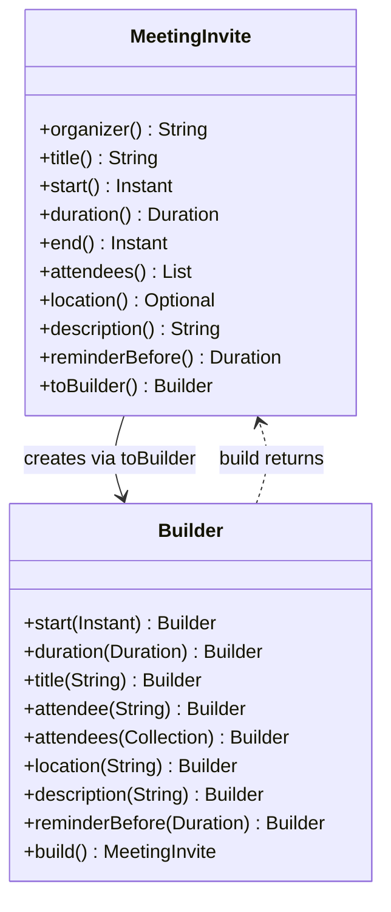
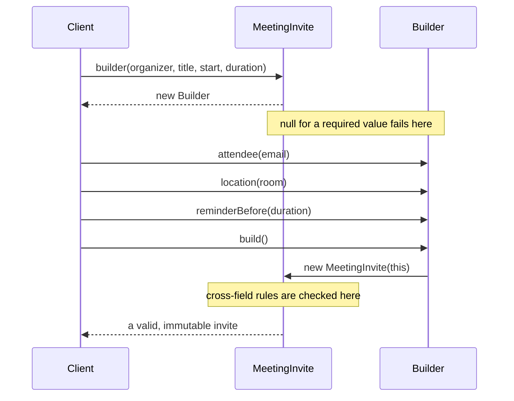

# Task 31 · A meeting invite with a proper Builder

| Difficulty | Topics | Time box |
|---|---|---|
| 🟢 Easy | Builder pattern · Static factories · Immutability · Validating in `build()` · `toBuilder()` | 1–1.5 h |

> **Background reading:** *Effective Java* 3rd ed., Item 1 ("Consider static factory methods instead of constructors"), Item 2 ("Consider a builder when faced with many constructor parameters"), Item 17 ("Minimize mutability"), Item 49 ("Check parameters for validity"), Item 50 ("Make defensive copies when needed") · GoF *Design Patterns*, "Builder" (and how Bloch's builder differs from the GoF one)

---

## The situation

The calendar service creates meeting invites through one constructor with nine parameters. Five of them are optional:

```java
// Before: the telescoping constructor
new MeetingInvite("anna@x.de", "Planning", start, Duration.ofMinutes(30), null, null, 15, "", attendees)
```

Nobody can read that line without looking up the signature. Last month that caused two bugs:

1. Someone swapped `location` and `description`. Both are `String`, so the compiler said nothing, and the invite showed the room name as the agenda.
2. Someone passed `0` for the reminder, meaning "use the default". `0` is a legal value for us: it means "no reminder". The invite silently had no reminder.

The fix is not "add a comment to the constructor". The fix is to stop asking callers to pass nine positional values. The **Builder** pattern from *Effective Java* Item 2 gives us named steps, and it lets each part of the invite have its own rule.

### Why not the other two classic answers

The usual first reaction to a long constructor is **telescoping**: one constructor with the four required values, one with five, one with six, and so on. It hides the nine-argument call for the common cases, but every rarer combination still ends at a long positional list, and two neighbouring `String` parameters can still be swapped without a compiler error.

The second reaction is the **JavaBeans pattern**: a no-argument constructor plus `setTitle`, `setLocation` and so on. Each call is now readable, but the object exists in a half-built state between the calls, any code that sees it then sees an invalid invite, and it can never be immutable, because the setters stay there forever. *Effective Java* Item 2 rejects both for exactly these reasons.

A **Builder** keeps the readable named steps of JavaBeans, but the steps change a separate, throw-away object. The real invite is created in one go by `build()`, already valid, and never changes again.

Bloch's builder is not quite the GoF Builder. The GoF pattern has a *Director* that drives an abstract *Builder* step by step, so that the same construction process can produce different representations (for example an RTF and a plain-text document). Bloch's builder is a nested class that makes exactly one product type, with a fluent API and a validating `build()`. When Java developers say "builder" today, they almost always mean Bloch's.

I want you to build the `MeetingInvite` and its builder. I also want you to understand *which* checks belong to which step, because that decides whether the API is pleasant or dangerous.

## The domain

| Term | Meaning |
|---|---|
| **Organizer** | The person who creates the invite. Required. Stored as a normalized email address. |
| **Attendee** | Someone who is invited. Optional, up to 50. Never the organizer. |
| **Duration** | How long the meeting lasts: 5 minutes to 8 hours, inclusive. |
| **End** | Derived, never stored: `start + duration`. |
| **Reminder** | How long before the start the reminder is sent: 0 (no reminder) to 24 hours. Default 15 minutes. |
| **Location** | Optional. A blank location means "no location". |



`Builder` is a nested class of `MeetingInvite`. The dependency goes both ways: the builder makes the invite, and the invite can make a builder for a copy. The invite does not keep a reference to the builder that made it.

### How a client uses it



The null check happens at the line that passes the wrong value. The other rules run inside `build()`, because they need more than one value at a time.

## What I want from you

Create `MeetingInvite` in package `io.github.chris013.practice.task31`. It is a `final` class with a private constructor that takes the builder. Every rule below is checked by a test.

1. **Factory and builder.** [`MeetingInvite.builder(organizer, title, start, duration)`](../src/main/java/io/github/chris013/practice/task31/MeetingInvite.java) takes the four required values. The optional values are set with named setters on the nested [`MeetingInvite.Builder`](../src/main/java/io/github/chris013/practice/task31/MeetingInvite.java). Every setter returns `this`, so calls can be chained.
2. **Null is rejected at the setter.** Every argument that is `null` throws `NullPointerException` with the parameter name as the message: `Objects.requireNonNull(x, "x")`. For `attendee(email)` the name is `email`, for `attendees(emails)` it is `emails`, and a `null` element inside that collection is `email` again.
3. **Title.** Trimmed. Blank → `IllegalArgumentException` with `title` in the message. More than 100 characters after trimming → `IllegalArgumentException` with `title`.
4. **Duration.** From 5 minutes to 8 hours inclusive. Anything else (including zero and negative values) → `IllegalArgumentException` with `duration`.
5. **Email addresses.** The organizer and every attendee are trimmed and lower-cased. Each must contain exactly one `@`, with at least one character before and after it. Otherwise → `IllegalArgumentException` whose message contains `email` and the bad value.
6. **Attendees.**
   * `attendee(email)` adds one, `attendees(emails)` adds all of them, in order. Both can be called many times.
   * Duplicates, after normalization, are dropped silently. The first position is kept.
   * The organizer must not be an attendee (after normalization). Otherwise → `IllegalArgumentException` with `organizer`.
   * At most 50 attendees after de-duplication. A 51st → `IllegalArgumentException` with `attendees`.
7. **Reminder.** From 0 (no reminder) to 24 hours inclusive. Default: 15 minutes. Anything else → `IllegalArgumentException` with `reminder`.
8. **Location.** Trimmed. A blank location means no location: `location()` returns `Optional.empty()`.
9. **Description.** Kept as given. Default: `""`.
10. **Validation happens in `build()`.** The rules in points 3 to 7 are checked there, never in a setter. That is why the order of the setter calls never matters.
11. **Accessors.** `organizer()`, `title()`, `start()`, `duration()`, `end()` (= start + duration), `attendees()` (unmodifiable, in insertion order), `location()` (`Optional<String>`), `description()`, `reminderBefore()`.
12. **Immutability.** The list returned by `attendees()` cannot be changed. A change to the builder after `build()` never changes an invite that was already built, so `build()` copies the attendee list. Calling `build()` twice gives two invites that are equal, but not the same object.
13. **`toBuilder()`** returns a builder with all the values of this invite. It is the way to reschedule: `invite.toBuilder().start(later).build()`.
14. **`equals`, `hashCode`** cover all fields. **`toString()`** looks like `MeetingInvite[Planning, 2026-03-02T09:00:00Z, 30 min, 2 attendees]`.

The starter has all signatures. Every body throws `UnsupportedOperationException("TODO: Task 31")`, so the new tests fail until you implement the behaviour.

## Constraints & non-goals

* Plain Java 25. No Lombok, no libraries. Lombok's `@Builder` would generate most of this code, but we want to see the design, not hide it behind an annotation processor.
* **No `Optional` parameters or `Optional` fields.** `location()` returns an `Optional`, which is fine. Store the value however you like inside the class.
* **No boolean or `null` that means "the default".** A reminder of `0` means "no reminder", and it must not be confused with "not set". Use the default value in the builder's field initializer.
* No `Thread.sleep`, no `Instant.now()`. The tests pass fixed instants.
* No recurrence rules, no time zones, no persistence in this task. Those are stretch goals.

## How I'd approach it

* **Start with the tests.** Read [`MeetingInviteTest`](../src/test/java/io/github/chris013/practice/task31/MeetingInviteTest.java) and find which rule each nested group checks. Some boundary values look odd (the 8-hour duration plus one minute). They are on purpose.
* **Decide where each check belongs before you write it.** Ask yourself: "Can this rule be checked with one argument alone?" If yes, check it in the setter. If it needs two or more fields (the organizer and the attendee list, for example), check it in `build()`.
* **Normalize before you compare.** `Bob@X.de` and `bob@x.de` are the same person. Trim and lower-case first, then de-duplicate. If you de-duplicate first, the 50-attendee limit counts typos as people.
* **Keep the attendee order.** A `Set` that does not keep insertion order is the wrong collection. Think about which Java collection keeps both uniqueness and order.
* **Defensive copies.** The builder keeps a mutable list while you build. The invite must not share that list. Think about when the copy happens: in the setter, in `build()`, or in the accessor, and what each choice costs.
* **The builder is reusable.** After `build()`, the builder still holds the values. Nothing in `build()` may clear it or change it.
* **Equality.** `equals` and `hashCode` must use the same fields. Remember that `Optional` is not a good field type, but you can compare the value inside it.

## Tests

Run the tests for this task:

```bash
mvn test -Dtest='**/task31/**'
```

The tests are in [`MeetingInviteTest`](../src/test/java/io/github/chris013/practice/task31/MeetingInviteTest.java). They use nested groups for each part of the contract. The table tests use `@ValueSource` with the boundary values written in ISO-8601 (`PT5M` is 5 minutes, `PT8H1M` is 8 hours and 1 minute).

<details>
<summary>Show the tests</summary>

<!-- embed: src/test/java/io/github/chris013/practice/task31/MeetingInviteTest.java -->
**[`MeetingInviteTest.java`](../src/test/java/io/github/chris013/practice/task31/MeetingInviteTest.java)**

```java
package io.github.chris013.practice.task31;

import static org.assertj.core.api.Assertions.assertThat;
import static org.assertj.core.api.Assertions.assertThatNullPointerException;
import static org.assertj.core.api.Assertions.assertThatThrownBy;

import java.time.Duration;
import java.time.Instant;
import java.util.ArrayList;
import java.util.Arrays;
import java.util.List;
import java.util.stream.IntStream;
import org.junit.jupiter.api.Nested;
import org.junit.jupiter.api.Test;
import org.junit.jupiter.params.ParameterizedTest;
import org.junit.jupiter.params.provider.ValueSource;

class MeetingInviteTest {

    private static final String ORGANIZER = "anna@x.de";
    private static final String TITLE = "Planning";
    private static final Instant START = Instant.parse("2026-03-02T09:00:00Z");
    private static final Duration THIRTY_MINUTES = Duration.ofMinutes(30);

    private static MeetingInvite.Builder validBuilder() {
        return MeetingInvite.builder(ORGANIZER, TITLE, START, THIRTY_MINUTES);
    }

    private static MeetingInvite validInvite() {
        return validBuilder().build();
    }

    private static MeetingInvite fullInvite() {
        return validBuilder()
                .attendee("bob@x.de")
                .attendee("carla@x.de")
                .location("Room 4")
                .description("Q3 numbers")
                .reminderBefore(Duration.ofMinutes(10))
                .build();
    }

    private static List<String> guests(int count) {
        return IntStream.rangeClosed(1, count).mapToObj(i -> "guest" + i + "@x.de").toList();
    }

    @Nested
    class Defaults {

        @Test
        void an_invite_needs_only_the_required_values() {
            MeetingInvite invite = validInvite();

            assertThat(invite.organizer()).isEqualTo(ORGANIZER);
            assertThat(invite.title()).isEqualTo(TITLE);
            assertThat(invite.start()).isEqualTo(START);
            assertThat(invite.duration()).isEqualTo(THIRTY_MINUTES);
            assertThat(invite.end()).isEqualTo(Instant.parse("2026-03-02T09:30:00Z"));
            assertThat(invite.attendees()).isEmpty();
            assertThat(invite.location()).isEmpty();
            assertThat(invite.description()).isEmpty();
            assertThat(invite.reminderBefore()).isEqualTo(Duration.ofMinutes(15));
        }

        @Test
        void the_location_is_trimmed() {
            assertThat(validBuilder().location("  Room 4 ").build().location()).contains("Room 4");
        }

        @ParameterizedTest
        @ValueSource(strings = {"", "   "})
        void a_blank_location_means_no_location(String location) {
            assertThat(validBuilder().location(location).build().location()).isEmpty();
        }

        @Test
        void the_description_is_kept_as_given() {
            assertThat(validBuilder().description("Bring the Q3 numbers").build().description())
                    .isEqualTo("Bring the Q3 numbers");
        }
    }

    @Nested
    class Required {

        @Test
        void the_organizer_must_not_be_null() {
            assertThatNullPointerException()
                    .isThrownBy(() -> MeetingInvite.builder(null, TITLE, START, THIRTY_MINUTES))
                    .withMessage("organizer");
        }

        @Test
        void the_title_must_not_be_null() {
            assertThatNullPointerException()
                    .isThrownBy(() -> MeetingInvite.builder(ORGANIZER, null, START, THIRTY_MINUTES))
                    .withMessage("title");
        }

        @Test
        void the_start_must_not_be_null() {
            assertThatNullPointerException()
                    .isThrownBy(() -> MeetingInvite.builder(ORGANIZER, TITLE, null, THIRTY_MINUTES))
                    .withMessage("start");
        }

        @Test
        void the_duration_must_not_be_null() {
            assertThatNullPointerException()
                    .isThrownBy(() -> MeetingInvite.builder(ORGANIZER, TITLE, START, null))
                    .withMessage("duration");
        }

        @Test
        void a_setter_rejects_null_at_the_line_that_passes_it() {
            MeetingInvite.Builder builder = validBuilder();

            assertThatNullPointerException().isThrownBy(() -> builder.start(null)).withMessage("start");
            assertThatNullPointerException().isThrownBy(() -> builder.duration(null)).withMessage("duration");
            assertThatNullPointerException().isThrownBy(() -> builder.title(null)).withMessage("title");
            assertThatNullPointerException().isThrownBy(() -> builder.attendee(null)).withMessage("email");
            assertThatNullPointerException().isThrownBy(() -> builder.location(null)).withMessage("location");
            assertThatNullPointerException().isThrownBy(() -> builder.description(null)).withMessage("description");
            assertThatNullPointerException()
                    .isThrownBy(() -> builder.reminderBefore(null))
                    .withMessage("reminderBefore");
        }

        @Test
        void the_attendee_collection_and_its_elements_must_not_be_null() {
            MeetingInvite.Builder builder = validBuilder();

            assertThatNullPointerException().isThrownBy(() -> builder.attendees(null)).withMessage("emails");
            assertThatNullPointerException()
                    .isThrownBy(() -> builder.attendees(Arrays.asList("bob@x.de", null)))
                    .withMessage("email");
            assertThat(builder.build().attendees()).isEmpty();
        }

        @Test
        void trims_and_lower_cases_the_organizer() {
            MeetingInvite invite = MeetingInvite.builder("  Anna@X.DE ", TITLE, START, THIRTY_MINUTES).build();

            assertThat(invite.organizer()).isEqualTo("anna@x.de");
        }
    }

    @Nested
    class Validation {

        @ParameterizedTest
        @ValueSource(strings = {"PT4M", "PT8H1M", "PT0S", "PT-1M"})
        void rejects_durations_outside_5_minutes_to_8_hours(Duration duration) {
            assertThatThrownBy(() -> validBuilder().duration(duration).build())
                    .isInstanceOf(IllegalArgumentException.class)
                    .hasMessageContaining("duration");
        }

        @ParameterizedTest
        @ValueSource(strings = {"PT5M", "PT8H"})
        void accepts_durations_at_the_limits(Duration duration) {
            assertThat(validBuilder().duration(duration).build().duration()).isEqualTo(duration);
        }

        @Test
        void accepts_a_title_of_exactly_100_characters() {
            String title = "x".repeat(100);

            assertThat(validBuilder().title(title).build().title()).isEqualTo(title);
        }

        @Test
        void rejects_a_title_of_101_characters() {
            assertThatThrownBy(() -> validBuilder().title("x".repeat(101)).build())
                    .isInstanceOf(IllegalArgumentException.class)
                    .hasMessageContaining("title");
        }

        @Test
        void measures_the_title_after_trimming_it() {
            String title = "x".repeat(100);

            assertThat(validBuilder().title("  " + title + "  ").build().title()).isEqualTo(title);
        }

        @ParameterizedTest
        @ValueSource(strings = {"", "   "})
        void rejects_a_blank_title(String title) {
            assertThatThrownBy(() -> validBuilder().title(title).build())
                    .isInstanceOf(IllegalArgumentException.class)
                    .hasMessageContaining("title");
        }

        @ParameterizedTest
        @ValueSource(strings = {"PT-1M", "PT24H1M"})
        void rejects_reminders_outside_0_to_24_hours(Duration reminder) {
            assertThatThrownBy(() -> validBuilder().reminderBefore(reminder).build())
                    .isInstanceOf(IllegalArgumentException.class)
                    .hasMessageContaining("reminder");
        }

        @ParameterizedTest
        @ValueSource(strings = {"PT0S", "PT24H"})
        void accepts_reminders_at_the_limits(Duration reminder) {
            assertThat(validBuilder().reminderBefore(reminder).build().reminderBefore()).isEqualTo(reminder);
        }

        @ParameterizedTest
        @ValueSource(strings = {"anna", "@x.de", "anna@", "a@b@c", "   "})
        void rejects_an_organizer_that_is_not_an_email_address(String email) {
            assertThatThrownBy(() -> MeetingInvite.builder(email, TITLE, START, THIRTY_MINUTES).build())
                    .isInstanceOf(IllegalArgumentException.class)
                    .hasMessageContaining("email");
        }

        @ParameterizedTest
        @ValueSource(strings = {"anna", "@x.de", "anna@", "a@b@c", "   "})
        void rejects_an_attendee_that_is_not_an_email_address(String email) {
            assertThatThrownBy(() -> validBuilder().attendee(email).build())
                    .isInstanceOf(IllegalArgumentException.class)
                    .hasMessageContaining("email");
        }

        @Test
        void the_bad_email_appears_in_the_message() {
            assertThatThrownBy(() -> validBuilder().attendee("@x.de").build())
                    .isInstanceOf(IllegalArgumentException.class)
                    .hasMessageContaining("@x.de");
        }
    }

    @Nested
    class Attendees {

        @Test
        void trims_and_lower_cases_every_address() {
            assertThat(validBuilder().attendee("  Bob@X.DE ").build().attendees()).containsExactly("bob@x.de");
        }

        @Test
        void drops_duplicates_after_normalization_and_keeps_the_first_position() {
            MeetingInvite invite = validBuilder()
                    .attendee("bob@x.de")
                    .attendee("carla@x.de")
                    .attendee(" BOB@x.de ")
                    .build();

            assertThat(invite.attendees()).containsExactly("bob@x.de", "carla@x.de");
        }

        @Test
        void keeps_the_insertion_order_of_single_and_bulk_additions() {
            MeetingInvite invite = validBuilder()
                    .attendee("carla@x.de")
                    .attendees(List.of("bob@x.de", "dora@x.de"))
                    .attendee("ed@x.de")
                    .build();

            assertThat(invite.attendees()).containsExactly("carla@x.de", "bob@x.de", "dora@x.de", "ed@x.de");
        }

        @Test
        void rejects_the_organizer_as_an_attendee_ignoring_case_and_spaces() {
            assertThatThrownBy(() -> validBuilder().attendee(" ANNA@x.de ").build())
                    .isInstanceOf(IllegalArgumentException.class)
                    .hasMessageContaining("organizer");
        }

        @Test
        void accepts_fifty_attendees() {
            assertThat(validBuilder().attendees(guests(50)).build().attendees()).hasSize(50);
        }

        @Test
        void rejects_fifty_one_attendees() {
            assertThatThrownBy(() -> validBuilder().attendees(guests(51)).build())
                    .isInstanceOf(IllegalArgumentException.class)
                    .hasMessageContaining("attendees");
        }

        @Test
        void the_limit_counts_distinct_attendees_only() {
            List<String> withRepeats = new ArrayList<>(guests(50));
            withRepeats.add("GUEST1@x.de");
            withRepeats.add("guest2@x.de");

            assertThat(validBuilder().attendees(withRepeats).build().attendees()).hasSize(50);
        }
    }

    @Nested
    class Immutability {

        @Test
        void the_attendee_list_cannot_be_changed() {
            List<String> attendees = validBuilder().attendee("bob@x.de").build().attendees();

            assertThatThrownBy(() -> attendees.add("eve@x.de")).isInstanceOf(UnsupportedOperationException.class);
        }

        @Test
        void changing_the_builder_after_build_does_not_change_the_invite() {
            MeetingInvite.Builder builder = validBuilder().attendee("bob@x.de");
            MeetingInvite invite = builder.build();

            builder.attendee("carla@x.de").title("Other").location("Room 9");

            assertThat(invite.attendees()).containsExactly("bob@x.de");
            assertThat(invite.title()).isEqualTo(TITLE);
            assertThat(invite.location()).isEmpty();
        }

        @Test
        void building_twice_gives_equal_but_independent_invites() {
            MeetingInvite.Builder builder = validBuilder().attendee("bob@x.de");
            MeetingInvite first = builder.build();

            MeetingInvite second = builder.build();
            builder.attendee("carla@x.de");

            assertThat(second).isEqualTo(first).isNotSameAs(first);
            assertThat(first.attendees()).containsExactly("bob@x.de");
            assertThat(second.attendees()).containsExactly("bob@x.de");
        }
    }

    @Nested
    class ToBuilder {

        @Test
        void a_round_trip_gives_an_equal_invite() {
            MeetingInvite invite = fullInvite();

            MeetingInvite copy = invite.toBuilder().build();

            assertThat(copy).isEqualTo(invite).isNotSameAs(invite);
        }

        @Test
        void rescheduling_changes_only_the_start_and_the_end() {
            MeetingInvite invite = fullInvite();
            Instant tomorrow = START.plus(Duration.ofDays(1));

            MeetingInvite moved = invite.toBuilder().start(tomorrow).build();

            assertThat(moved.start()).isEqualTo(tomorrow);
            assertThat(moved.end()).isEqualTo(tomorrow.plus(THIRTY_MINUTES));
            assertThat(moved.organizer()).isEqualTo(invite.organizer());
            assertThat(moved.title()).isEqualTo(invite.title());
            assertThat(moved.duration()).isEqualTo(invite.duration());
            assertThat(moved.attendees()).isEqualTo(invite.attendees());
            assertThat(moved.location()).isEqualTo(invite.location());
            assertThat(moved.description()).isEqualTo(invite.description());
            assertThat(moved.reminderBefore()).isEqualTo(invite.reminderBefore());
        }

        @Test
        void the_copied_builder_does_not_change_the_original_invite() {
            MeetingInvite invite = fullInvite();

            invite.toBuilder().attendee("dora@x.de").build();

            assertThat(invite.attendees()).containsExactly("bob@x.de", "carla@x.de");
        }
    }

    @Nested
    class Equality {

        @Test
        void invites_with_the_same_values_are_equal_and_have_the_same_hash_code() {
            MeetingInvite first = fullInvite();
            MeetingInvite second = fullInvite();

            assertThat(second).isEqualTo(first);
            assertThat(second).hasSameHashCodeAs(first);
        }

        @Test
        void a_different_description_makes_the_invites_different() {
            MeetingInvite plain = validInvite();
            MeetingInvite described = validBuilder().description("Bring coffee").build();

            assertThat(described).isNotEqualTo(plain);
        }

        @Test
        void to_string_summarises_the_invite() {
            MeetingInvite invite = validBuilder().attendee("bob@x.de").attendee("carla@x.de").build();

            assertThat(invite).hasToString("MeetingInvite[Planning, 2026-03-02T09:00:00Z, 30 min, 2 attendees]");
        }
    }

    @Nested
    class SetterOrder {

        @Test
        void a_value_can_be_corrected_by_a_later_setter() {
            MeetingInvite invite = validBuilder().duration(Duration.ofMinutes(2)).duration(THIRTY_MINUTES).build();

            assertThat(invite.duration()).isEqualTo(THIRTY_MINUTES);
        }

        @Test
        void the_order_of_the_setters_does_not_change_the_invite() {
            MeetingInvite first = validBuilder()
                    .location("Room 4")
                    .reminderBefore(Duration.ofMinutes(10))
                    .attendee("bob@x.de")
                    .description("Q3 numbers")
                    .build();
            MeetingInvite second = validBuilder()
                    .attendee("bob@x.de")
                    .description("Q3 numbers")
                    .reminderBefore(Duration.ofMinutes(10))
                    .location("Room 4")
                    .build();

            assertThat(second).isEqualTo(first);
        }

        @Test
        void a_cross_field_rule_is_checked_by_build_not_by_the_setter() {
            MeetingInvite.Builder builder = validBuilder();

            builder.attendee(ORGANIZER);

            assertThatThrownBy(builder::build)
                    .isInstanceOf(IllegalArgumentException.class)
                    .hasMessageContaining("organizer");
        }
    }
}
```
<!-- /embed -->

</details>

## Definition of done

- [ ] `MeetingInvite.builder(...)` checks the four required values with `Objects.requireNonNull`.
- [ ] Every setter rejects `null` with the parameter name as the message.
- [ ] `build()` checks title, duration, reminder and the emails, and it never stores a value that failed.
- [ ] The attendees are normalized, de-duplicated (first position kept), checked against the organizer, and limited to 50.
- [ ] `attendees()` is unmodifiable, and the built invite does not share the builder's list.
- [ ] Building twice gives two equal, independent invites. Changing the builder afterwards changes nothing.
- [ ] `toBuilder()` round-trips, and rescheduling changes only the start and the end.
- [ ] `equals`, `hashCode` and `toString` match the contract above.
- [ ] `mvn -B -o clean test-compile` shows no warnings, and all tests in `**/task31/**` pass.

## Stretch goals

1. **A staged builder.** Make the required values impossible to forget at compile time: `MeetingInvite.organizer(...)` returns a step that offers only `title(...)`, then only `start(...)`, and so on, before the optional setters are available. Think about what the compiler error looks like for the caller.
2. **A recurrence rule.** Add `weekly(int count)` to the builder with its own validation (for example, at most 52 occurrences). Decide whether each occurrence is a new `MeetingInvite` or whether the invite holds the rule.
3. **A `withStart(Instant)` wither.** Write `withStart` as a method on `MeetingInvite` that returns a new invite, without going through a builder. Compare the two designs: which one is clearer, and which one has more code that can drift out of date?
4. **Time zones.** Store the start as a `ZonedDateTime` or add an explicit `ZoneId`. Decide whether `equals` should compare the zone, and write a test that proves your choice.

---

<details>
<summary>Spoiler: open only after you have made a serious attempt</summary>

### Key decisions

**1. Required values go into the factory, optional values go into setters.**
The four required values are parameters of `builder(...)`, so a caller cannot build an invite without them, and the compiler checks the count. The optional values are setters, so the call site names each one. The alternative was a builder with an empty constructor and a `build()` that checks for missing values at runtime. That moves a compile-time error into a runtime error for no benefit.

**2. Null is checked at the setter, validity is checked in `build()`.**
A `null` is always a programming error at the line that passes it, so the setter fails there and the stack trace points to the right line. The other rules (the title length, the duration range, the organizer in the attendee list) need several values together, or at least the final value. A setter cannot know that a later `start(...)` will fix an earlier bad `duration(...)`. Checking in `build()` lets the caller set the values in any order.

**3. The invite's constructor is the only place where the rules run.**
`build()` calls `new MeetingInvite(this)`, and the constructor checks everything. The alternative was a static `validate` method called from `build()` and a constructor that trusts its arguments. That is two places that must agree. Because the constructor is private and only reachable from `build()`, there is exactly one path in.

**4. Normalize, then de-duplicate, then count.**
A `LinkedHashSet` removes duplicates and keeps the first position. Normalizing before the set is the important part: `Bob@X.de` and `bob@x.de` must collide. The organizer check and the size limit both use the set after de-duplication.

**5. Defensive copies at both ends.**
The builder collects the raw addresses in its own `ArrayList`. The invite never keeps that list: it stores `List.copyOf(...)` of the normalized set, which is unmodifiable and shares nothing with the builder. The alternative, copying only in `attendees()`, would still let a caller who holds the builder change the invite's state.

**6. `location` is nullable inside, `Optional` outside.**
`Optional` is good as a return type, and bad as a field or parameter: it adds an object per value and says nothing new to the reader. The builder's default is `null`, the constructor turns a blank location into `null`, and the accessor wraps it in `Optional.ofNullable`.

**7. The reminder default is a value, not a flag.**
The builder starts with `DEFAULT_REMINDER` (15 minutes). `0` means "no reminder", and it is a valid value. Nothing in the class uses a `null` or a boolean to say "use the default", so `0` can never be confused with "not set".

**8. `toBuilder()` is the "wither" for a value class with many fields.**
`toBuilder()` copies every field into a new builder. Rescheduling is then one line: `invite.toBuilder().start(later).build()`, and the new invite goes through all the checks again. The alternative, one `withX` method per field, is shorter per field, but it is N methods that each have to know about the others. With `toBuilder()`, the only code that knows all the fields is the builder.

**9. Records do not fix this.**
A record with nine components still has a canonical constructor with nine positional parameters. Two `String` components can still be swapped. A compact constructor can check values, but it cannot give a parameter a default, and it cannot make the caller name the value. A record is a good choice for a value with two or three fields. For nine fields with defaults, a builder is still better.

### Code

#### The invite and its builder

<!-- embed: solutions/src/main/java/io/github/chris013/practice/task31/MeetingInvite.java -->
**[`MeetingInvite.java`](../solutions/src/main/java/io/github/chris013/practice/task31/MeetingInvite.java)**

```java
package io.github.chris013.practice.task31;

import java.time.Duration;
import java.time.Instant;
import java.util.ArrayList;
import java.util.Collection;
import java.util.LinkedHashSet;
import java.util.List;
import java.util.Locale;
import java.util.Objects;
import java.util.Optional;
import java.util.Set;

/**
 * A meeting invitation. Once it exists, it is valid and it never changes.
 *
 * <p>Create one with {@link #builder(String, String, Instant, Duration)}. To reschedule an existing invite,
 * use {@link #toBuilder()}. The rules that involve several fields are checked in {@link Builder#build()},
 * so the order of the setter calls never matters.
 */
public final class MeetingInvite {

    private static final Duration MIN_DURATION = Duration.ofMinutes(5);
    private static final Duration MAX_DURATION = Duration.ofHours(8);
    private static final Duration DEFAULT_REMINDER = Duration.ofMinutes(15);
    private static final Duration MAX_REMINDER = Duration.ofHours(24);
    private static final int MAX_TITLE_LENGTH = 100;
    private static final int MAX_ATTENDEES = 50;

    private final String organizer;
    private final String title;
    private final Instant start;
    private final Duration duration;
    private final List<String> attendees;
    private final String location; // null means "no location"; exposed as Optional
    private final String description;
    private final Duration reminderBefore;

    /**
     * Only reachable through {@link Builder#build()}. All checks run here, on the builder's
     * values. The attendee list is copied, so later changes to the builder cannot reach this invite.
     */
    private MeetingInvite(Builder builder) {
        this.organizer = normalizeEmail(builder.organizer);
        this.title = validTitle(builder.title);
        this.start = builder.start;
        this.duration = validDuration(builder.duration);
        this.attendees = normalizeAttendees(organizer, builder.attendees);
        this.location = normalizeLocation(builder.location);
        this.description = builder.description;
        this.reminderBefore = validReminder(builder.reminderBefore);
    }

    /**
     * Required values are parameters, so a caller cannot forget them. Optional values are setters
     * because a long parameter list is where swapped arguments come from.
     */
    public static Builder builder(String organizer, String title, Instant start, Duration duration) {
        return new Builder(organizer, title, start, duration);
    }

    public String organizer() {
        return organizer;
    }

    public String title() {
        return title;
    }

    public Instant start() {
        return start;
    }

    public Duration duration() {
        return duration;
    }

    /** {@code start() + duration()}. Derived, so it is never stored and can never disagree with the others. */
    public Instant end() {
        return start.plus(duration);
    }

    public List<String> attendees() {
        return attendees;
    }

    public Optional<String> location() {
        return Optional.ofNullable(location);
    }

    public String description() {
        return description;
    }

    public Duration reminderBefore() {
        return reminderBefore;
    }

    public Builder toBuilder() {
        Builder copy = new Builder(organizer, title, start, duration);
        copy.attendees.addAll(attendees);
        copy.location = location;
        copy.description = description;
        copy.reminderBefore = reminderBefore;
        return copy;
    }

    @Override
    public boolean equals(Object other) {
        if (this == other) {
            return true;
        }
        if (!(other instanceof MeetingInvite that)) {
            return false;
        }
        return organizer.equals(that.organizer)
                && title.equals(that.title)
                && start.equals(that.start)
                && duration.equals(that.duration)
                && attendees.equals(that.attendees)
                && Objects.equals(location, that.location)
                && description.equals(that.description)
                && reminderBefore.equals(that.reminderBefore);
    }

    @Override
    public int hashCode() {
        return Objects.hash(organizer, title, start, duration, attendees, location, description, reminderBefore);
    }

    @Override
    public String toString() {
        return "MeetingInvite[%s, %s, %d min, %d attendees]"
                .formatted(title, start, duration.toMinutes(), attendees.size());
    }

    private static String validTitle(String raw) {
        String title = raw.strip();
        if (title.isEmpty()) {
            throw new IllegalArgumentException("title must not be blank");
        }
        if (title.length() > MAX_TITLE_LENGTH) {
            throw new IllegalArgumentException(
                    "title must be at most %d characters, was %d".formatted(MAX_TITLE_LENGTH, title.length()));
        }
        return title;
    }

    private static Duration validDuration(Duration duration) {
        if (duration.compareTo(MIN_DURATION) < 0 || duration.compareTo(MAX_DURATION) > 0) {
            throw new IllegalArgumentException(
                    "duration must be between %s and %s, was %s".formatted(MIN_DURATION, MAX_DURATION, duration));
        }
        return duration;
    }

    private static Duration validReminder(Duration reminder) {
        if (reminder.isNegative() || reminder.compareTo(MAX_REMINDER) > 0) {
            throw new IllegalArgumentException(
                    "reminder must be between 0 and %s, was %s".formatted(MAX_REMINDER, reminder));
        }
        return reminder;
    }

    /**
     * Trims and lower-cases the address, then checks that it has exactly one {@code @} with text on
     * both sides. This is not full RFC 5322 validation, it only catches the typos that happen in practice.
     * We normalize before comparing, so {@code Bob@X.de} and {@code bob@x.de} are the same person.
     */
    private static String normalizeEmail(String raw) {
        String email = raw.strip().toLowerCase(Locale.ROOT);
        int at = email.indexOf('@');
        boolean valid = at > 0 && at < email.length() - 1 && email.indexOf('@', at + 1) < 0;
        if (!valid) {
            throw new IllegalArgumentException("email is not an address: '" + raw + "'");
        }
        return email;
    }

    /**
     * Normalizes and de-duplicates before counting, so the 50-attendee limit applies to people and
     * not to typed-in duplicates. A {@link LinkedHashSet} keeps the first position of each address.
     */
    private static List<String> normalizeAttendees(String organizer, List<String> raw) {
        Set<String> distinct = new LinkedHashSet<>();
        for (String email : raw) {
            distinct.add(normalizeEmail(email));
        }
        if (distinct.contains(organizer)) {
            throw new IllegalArgumentException("organizer " + organizer + " cannot also be an attendee");
        }
        if (distinct.size() > MAX_ATTENDEES) {
            throw new IllegalArgumentException(
                    "attendees must be at most %d after removing duplicates, was %d"
                            .formatted(MAX_ATTENDEES, distinct.size()));
        }
        // List.copyOf makes an unmodifiable copy, so no one can reach the set we just built.
        return List.copyOf(distinct);
    }

    /** A blank location means "no location". Nothing is ever stored as an empty string. */
    private static String normalizeLocation(String raw) {
        if (raw == null) {
            return null;
        }
        String location = raw.strip();
        return location.isEmpty() ? null : location;
    }

    /**
     * The mutable state of an invite under construction. Every setter validates only its own
     * argument (null). The rules that need several fields are checked in {@link #build()}.
     */
    public static final class Builder {

        private final String organizer;
        private String title;
        private Instant start;
        private Duration duration;
        private final List<String> attendees = new ArrayList<>(); // raw, not yet normalized
        private String location;
        private String description = "";
        private Duration reminderBefore = DEFAULT_REMINDER;

        /**
         * Null checks run now, on the line that passes the wrong value, not later in {@link #build()}.
         */
        private Builder(String organizer, String title, Instant start, Duration duration) {
            this.organizer = Objects.requireNonNull(organizer, "organizer");
            this.title = Objects.requireNonNull(title, "title");
            this.start = Objects.requireNonNull(start, "start");
            this.duration = Objects.requireNonNull(duration, "duration");
        }

        public Builder start(Instant start) {
            this.start = Objects.requireNonNull(start, "start");
            return this;
        }

        public Builder duration(Duration duration) {
            this.duration = Objects.requireNonNull(duration, "duration");
            return this;
        }

        public Builder title(String title) {
            this.title = Objects.requireNonNull(title, "title");
            return this;
        }

        public Builder attendee(String email) {
            attendees.add(Objects.requireNonNull(email, "email"));
            return this;
        }

        public Builder attendees(Collection<String> emails) {
            List<String> checked = new ArrayList<>(Objects.requireNonNull(emails, "emails"));
            checked.forEach(email -> Objects.requireNonNull(email, "email"));
            attendees.addAll(checked); // all or nothing: a null element leaves the builder unchanged
            return this;
        }

        public Builder location(String location) {
            this.location = Objects.requireNonNull(location, "location");
            return this;
        }

        public Builder description(String description) {
            this.description = Objects.requireNonNull(description, "description");
            return this;
        }

        public Builder reminderBefore(Duration reminderBefore) {
            this.reminderBefore = Objects.requireNonNull(reminderBefore, "reminderBefore");
            return this;
        }

        /**
         * Returns a new, independent invite each time. The builder is not modified, so it can
         * be used again.
         */
        public MeetingInvite build() {
            return new MeetingInvite(this);
        }
    }
}
```
<!-- /embed -->

### What I typically flag in first attempts

| Finding | Why it matters |
|---|---|
| A setter that checks a cross-field rule (for example, "the organizer is not an attendee") | The order of the calls now matters. `attendee(organizer)` before `organizer(...)` is not caught, and a later correction is rejected. Check in `build()`. |
| `build()` that passes the builder's `List` straight into the invite | Later calls to `attendee(...)` change an invite that is already built. Copy the list. |
| `Optional` as a field, or as a parameter of a setter | It adds an object per value and gives callers a second way to say "absent" (`null` or `Optional.empty()`). Use `null` inside, `Optional` as the return type. |
| `0` or `false` or `null` meaning "use the default" | `0` is a valid reminder (no reminder). Give the builder a real default value instead. |
| Public mutable fields on the builder, or a builder that returns a field instead of `this` | Callers can change state the builder is supposed to protect, and chaining breaks. Keep the fields private and return `this`. |
| De-duplicating before normalizing | `Bob@X.de` and `bob@x.de` stay as two attendees, and the 50-attendee limit counts typos. |
| Using `HashSet` for the attendees | The order that the caller gave is lost, so `attendees()` cannot promise insertion order. |

</details>
