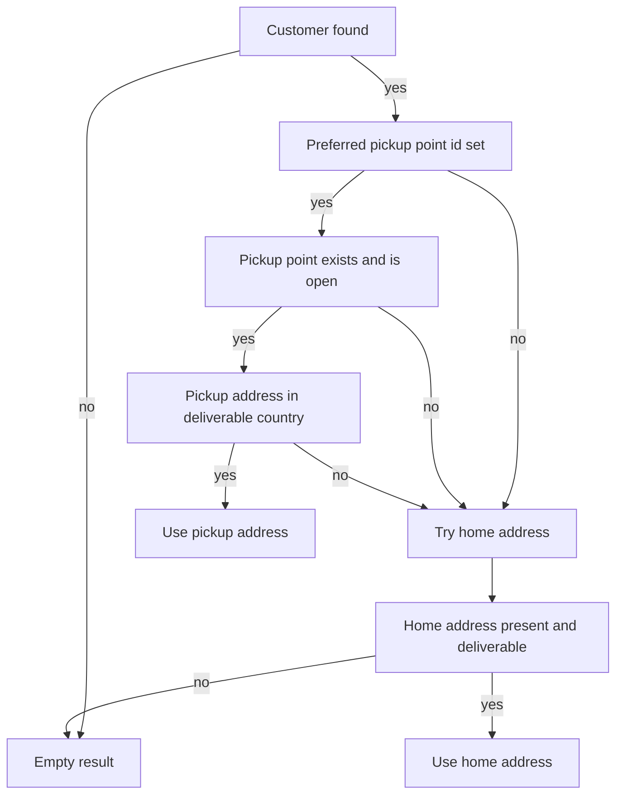
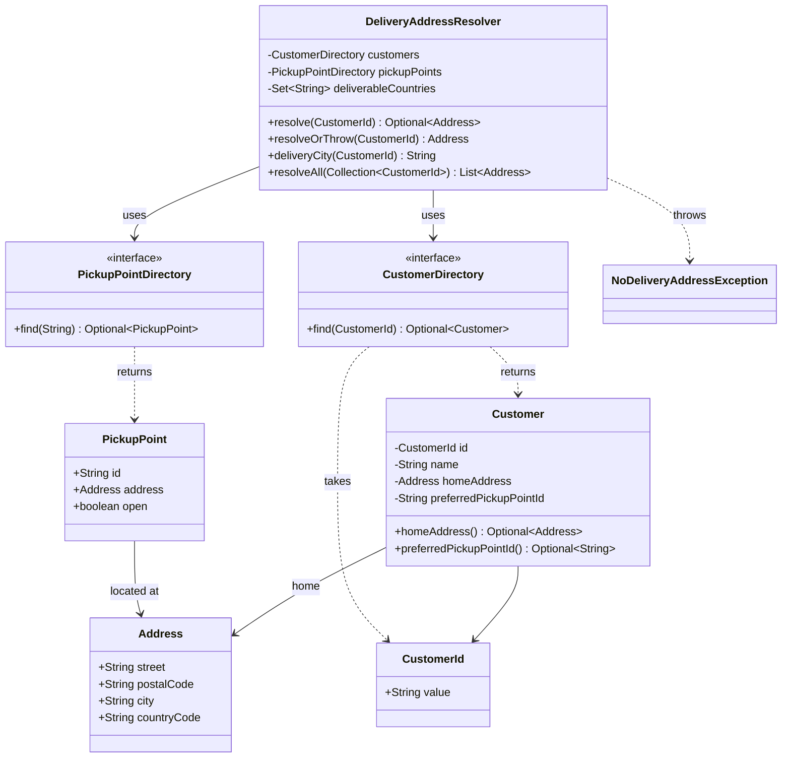

# Task 32 · Where does the parcel go? Optional done right

| Difficulty | Topics | Time box |
|---|---|---|
| 🟢 Easy | `Optional` as a return type · `map`, `flatMap`, `filter`, `or`, `orElseGet`, `orElseThrow` · `Optional.stream()` · where NOT to use `Optional` · laziness | 1 h |

> **Background reading:** *Modern Java in Action* ch. 11 ("Using Optional as a better alternative to null") · *Effective Java* 3rd ed. Item 55 ("Return optionals judiciously") and Item 54 ("Return empty collections or arrays, not nulls") · Tony Hoare, "Null References: The Billion Dollar Mistake", QCon 2009 · Javadoc of `java.util.Optional`, especially the API note on its intended use

---

## The situation

The parcel service decides where to deliver each order. A customer can pick a parcel shop or a locker as the preferred place. If that place is closed, or it is in a country we do not deliver to, the parcel goes to the customer's home address instead. If neither works, the order cannot be shipped.

The legacy code for this is a 40-line method full of nested `if (x != null)` checks. It has thrown `NullPointerException` in production twice. Both times the cause was the same: a field that was usually set was null for one customer, and nobody noticed the path that dereferenced it. The shortened version looks like this:

```java
Address resolve(String customerId) {
    Customer c = customers.get(customerId);
    if (c != null) {
        if (c.getPreferredPickupPointId() != null) {
            PickupPoint p = pickupPoints.get(c.getPreferredPickupPointId());
            if (p != null && p.isOpen()) {
                if (p.getAddress() != null && DELIVERABLE.contains(p.getAddress().getCountryCode())) {
                    return p.getAddress();
                }
            }
        }
        if (c.getHomeAddress() != null && DELIVERABLE.contains(c.getHomeAddress().getCountryCode())) {
            return c.getHomeAddress();
        }
    }
    return null;
}
```

Every caller has to remember to check for `null`, and the compiler cannot help. We want the rule to be visible in the types. That is what `Optional` is for, used with care.

Your job is to write the resolver with `Optional` in the right places and nowhere else.

## The domain

| Term | Meaning |
|---|---|
| **Customer** | An account with an id, a name, an optional home address and an optional preferred pickup point id. |
| **Pickup point** | A parcel shop or locker. It has an id, an address and an `open` flag. |
| **Deliverable country** | A country code from our configured set, for example `DE` or `AT`. |
| **Resolved address** | The address the parcel goes to, after the rules below have been applied. |

### Where the parcel goes



### The types and the resolver



Two rules shape the code. The **directories** return `Optional` because "not found" is a normal answer. The **`Customer` fields** are plain nullable fields, because a customer with no home address is ordinary data, not a question that every caller must ask.

## What Optional is for

`Optional<T>` is a **return type** that says "there may be no value here, and you must decide what to do about it". Its job is to make the caller think about absence at compile time. Compare the two signatures:

```java
Address home(CustomerId id);            // can this return null? You have to read the code to know.
Optional<Address> home(CustomerId id);  // it may be empty. The type tells you so.
```

It does not make a value exist, and it does not replace all null checks. Use it for the result of a lookup or a computation that can legitimately have no answer. Do not use it as a general null container, as explained further down.

## What I want from you

Implement [`DeliveryAddressResolver`](../src/main/java/io/github/chris013/practice/task32/DeliveryAddressResolver.java) and its constructor. The given types are complete: [`CustomerId`](../src/main/java/io/github/chris013/practice/task32/CustomerId.java), [`Address`](../src/main/java/io/github/chris013/practice/task32/Address.java), [`Customer`](../src/main/java/io/github/chris013/practice/task32/Customer.java), [`PickupPoint`](../src/main/java/io/github/chris013/practice/task32/PickupPoint.java), the two directory interfaces and [`NoDeliveryAddressException`](../src/main/java/io/github/chris013/practice/task32/NoDeliveryAddressException.java).

1. **Constructor** `DeliveryAddressResolver(CustomerDirectory customers, PickupPointDirectory pickupPoints, Set<String> deliverableCountries)`.
   * Any `null` argument throws `NullPointerException` naming the parameter.
   * Copy the set. Later changes to the caller's set must not change the resolver.
2. **`Optional<Address> resolve(CustomerId id)`**
   * An unknown customer gives an empty result.
   * Otherwise, if the customer has a preferred pickup point id, the pickup point exists in the directory, it is `open`, and its address country is deliverable, the result is the pickup point's address.
   * Otherwise the result is the home address, if the customer has one and its country is deliverable.
   * Otherwise the result is empty.
   * A `null` id throws `NullPointerException`.
3. **`Address resolveOrThrow(CustomerId id)`** returns the resolved address, or throws `NoDeliveryAddressException` when `resolve` is empty. The exception message is `no delivery address for customer <id>`.
4. **`String deliveryCity(CustomerId id)`** returns the city of the resolved address, or `"unknown"` when nothing resolves.
5. **`List<Address> resolveAll(Collection<CustomerId> ids)`** returns the resolved addresses in the same order as the input. Customers without an address are skipped. The returned list is unmodifiable.
6. **Laziness.** Each public method looks up the customer exactly once. The pickup point directory is not called when the customer has no preferred pickup point id.
7. **Style.** In `resolve`, do not use `isPresent()` followed by `get()`. Do not use `Optional` as a parameter or a field, and do not return `null`. Express the rule as one pipeline with `flatMap`, `filter` and `or(...)`.

## Constraints & non-goals

* No `null` checks in the resolver's own logic. Where the value can be absent, use `Optional`.
* No changes to the given types. If you think one of them is wrong, say so in your notes, but leave it as it is for this task.
* No external libraries, no logging framework (stretch goal 2 is about logging).
* No caching of customer lookups. Each public call must hit the directory once, as described above.

## How I'd approach it

* **Start with the customer lookup.** `customers.find(id)` returns an `Optional<Customer>`. Your next step should be a `flatMap` on that result, not a `map`. Why? You will see in a moment.
* **`map` vs `flatMap`.** `map(f)` wraps the result of `f` in an `Optional`. If `f` already returns an `Optional`, you get `Optional<Optional<T>>`. That is almost never what you want. `flatMap(f)` expects `f` to return an `Optional` and gives you back one level. The pickup id is an `Optional<String>`, and the directory's `find` returns an `Optional<PickupPoint>`. Which of the two keeps the result one level deep?
* **`filter` for the business rules.** `filter(PickupPoint::open)` keeps the value only when the predicate holds, and turns it into an empty `Optional` otherwise. A rule like "open and deliverable" reads as a chain of `filter` calls.
* **`or` is for the fallback.** `a.or(() -> b)` returns `a` when it has a value and otherwise the `Optional` supplied by `b`. Java 9 added it. The supplier is only called when it is needed. That is the whole point of the fallback: the home address is only looked at when the pickup point did not work out.
* **`orElse` versus `orElseGet`.** `orElse(x)` evaluates `x` **before** the call, even when the `Optional` has a value. If `x` is a method call with cost or side effects, it runs anyway. `orElseGet(() -> x)` runs the supplier only when the value is missing. Use `orElse` for constants, like `"unknown"`, and `orElseGet` or `orElseThrow` with a supplier for anything else.
* **`orElseThrow(Supplier)`** is the standard way to turn "no value" into an exception. Pass a supplier, so the exception object is only created when it is thrown.
* **`Optional.stream()`** (Java 9) turns an `Optional` into a stream of zero or one elements. In `resolveAll`, `flatMap(Optional::stream)` gives you the present values in order and drops the empty ones, with no `if`.
* **Laziness is part of the contract.** If you write `pickupPoints.find(...)` before you know the customer has a pickup point id, the test `does_not_touch_the_pickup_directory_without_a_pickup_point_id` fails. Keep the lookup inside the `flatMap` lambda.
* **Do not call the customer lookup twice.** A common mistake is `resolveOrThrow` that first calls `resolve`, then calls `customers.find` again to build the message. The message only needs the id you already have.
* **Watch the exception message.** It should be built from the id you were given. Do not build it from a fetched customer, because the customer may be missing.

## Where not to use Optional

This is the part people get wrong most often. The Javadoc of `Optional` says it is intended for "method return types where there is a clear need to represent 'no result'". Everything else is a misuse:

* **Fields.** An `Optional` field costs an extra object per instance, is not `Serializable`, and makes the class harder to read than a nullable field with a getter that wraps it. That is why `Customer` stores plain fields.
* **Parameters.** A method `void send(Optional<Address> address)` forces every caller to wrap the value. Use an overload or a separate method instead.
* **Collections of Optionals.** A `List<Optional<Address>>` is almost always a sign that you want `List<Address>` with the absent ones left out. `resolveAll` does exactly that.
* **`Optional<List<...>>`.** An empty list already means "no results". Wrapping it in an `Optional` gives callers two ways to say the same thing. Return the empty list, as *Effective Java* Item 54 says.
* **Primitives.** `Optional<Integer>` boxes the value. If you have a number that can be missing and you care about allocation, use `OptionalInt`, `OptionalLong` or `OptionalDouble`.
* **`Optional.get()`.** Calling `get()` without a check is the same bug as dereferencing `null`, with a different exception. If you feel the need to call `get()`, look for a `map`, `orElseThrow` or `orElse` that says what you mean.

## Tests

Run: `mvn test -Dtest='**/task32/**'`

[`DeliveryAddressResolverTest`](../src/test/java/io/github/chris013/practice/task32/DeliveryAddressResolverTest.java) covers each rule of the resolver with two hand-written fakes that count their calls, [`FakeCustomerDirectory`](../src/test/java/io/github/chris013/practice/task32/FakeCustomerDirectory.java) and [`FakePickupPointDirectory`](../src/test/java/io/github/chris013/practice/task32/FakePickupPointDirectory.java). [`DomainValuesTest`](../src/test/java/io/github/chris013/practice/task32/DomainValuesTest.java) checks the validation in the given types. Those tests already pass, and they are there so you can see what the types promise.

<details>
<summary>Show the tests</summary>

<!-- embed: src/test/java/io/github/chris013/practice/task32/DeliveryAddressResolverTest.java -->
**[`DeliveryAddressResolverTest.java`](../src/test/java/io/github/chris013/practice/task32/DeliveryAddressResolverTest.java)**

```java
package io.github.chris013.practice.task32;

import static org.assertj.core.api.Assertions.assertThat;
import static org.assertj.core.api.Assertions.assertThatThrownBy;

import java.util.HashSet;
import java.util.List;
import java.util.Set;
import org.junit.jupiter.api.Nested;
import org.junit.jupiter.api.Test;
import org.junit.jupiter.params.ParameterizedTest;
import org.junit.jupiter.params.provider.CsvSource;

class DeliveryAddressResolverTest {

    private static final Set<String> DELIVERABLE = Set.of("DE", "AT");
    private static final Address HOME = new Address("Hauptstrasse 1", "10115", "Berlin", "DE");
    private static final Address PICKUP = new Address("Kantstrasse 9", "10623", "Berlin", "DE");
    private static final Address PICKUP_IN_VIENNA = new Address("Ringstrasse 3", "1010", "Vienna", "AT");
    private static final Address FOREIGN_HOME = new Address("Rue de Rivoli 2", "75001", "Paris", "FR");
    private static final CustomerId ANNA = new CustomerId("anna");
    private static final CustomerId BEN = new CustomerId("ben");
    private static final CustomerId NOBODY = new CustomerId("nobody");

    private final FakeCustomerDirectory customers = new FakeCustomerDirectory();
    private final FakePickupPointDirectory pickupPoints = new FakePickupPointDirectory();

    private DeliveryAddressResolver resolver() {
        return new DeliveryAddressResolver(customers, pickupPoints, DELIVERABLE);
    }

    private static Customer customer(CustomerId id, Address home, String pickupId) {
        return new Customer(id, "Test customer", home, pickupId);
    }

    @Nested
    class Construction {

        @Test
        void rejects_null_collaborators() {
            assertThatThrownBy(() -> new DeliveryAddressResolver(null, pickupPoints, DELIVERABLE))
                    .isInstanceOf(NullPointerException.class)
                    .hasMessage("customers");
            assertThatThrownBy(() -> new DeliveryAddressResolver(customers, null, DELIVERABLE))
                    .isInstanceOf(NullPointerException.class)
                    .hasMessage("pickupPoints");
            assertThatThrownBy(() -> new DeliveryAddressResolver(customers, pickupPoints, null))
                    .isInstanceOf(NullPointerException.class)
                    .hasMessage("deliverableCountries");
        }

        @Test
        void copies_the_deliverable_countries() {
            Set<String> countries = new HashSet<>(Set.of("DE"));
            customers.with(customer(BEN, FOREIGN_HOME, null));
            DeliveryAddressResolver resolver = new DeliveryAddressResolver(customers, pickupPoints, countries);

            countries.add("FR");

            assertThat(resolver.resolve(BEN)).isEmpty();
        }

        @Test
        void rejects_a_null_customer_id() {
            assertThatThrownBy(() -> resolver().resolve(null)).isInstanceOf(NullPointerException.class);
        }
    }

    @Nested
    class PickupPointPreferred {

        @Test
        void uses_the_preferred_pickup_point_when_it_is_open_and_deliverable() {
            customers.with(customer(ANNA, HOME, "PP-1"));
            pickupPoints.with(new PickupPoint("PP-1", PICKUP, true));

            assertThat(resolver().resolve(ANNA)).contains(PICKUP);
        }

        @Test
        void accepts_a_pickup_point_in_another_deliverable_country() {
            customers.with(customer(ANNA, FOREIGN_HOME, "PP-AT"));
            pickupPoints.with(new PickupPoint("PP-AT", PICKUP_IN_VIENNA, true));

            assertThat(resolver().resolve(ANNA)).contains(PICKUP_IN_VIENNA);
        }
    }

    @Nested
    class FallsBackToHome {

        @ParameterizedTest(name = "{0}")
        @CsvSource({
            "pickup id unknown to the directory, false, true, DE",
            "pickup point is closed, true, false, DE",
            "pickup point is in a country we do not deliver to, true, true, FR"
        })
        void falls_back_to_the_home_address(String scenario, boolean stored, boolean open, String country) {
            customers.with(customer(ANNA, HOME, "PP-1"));
            if (stored) {
                Address pickupAddress = new Address("Somewhere 1", "00001", "Elsewhere", country);
                pickupPoints.with(new PickupPoint("PP-1", pickupAddress, open));
            }

            assertThat(resolver().resolve(ANNA)).contains(HOME);
        }

        @Test
        void uses_the_home_address_when_the_customer_has_no_pickup_point() {
            customers.with(customer(BEN, HOME, null));

            assertThat(resolver().resolve(BEN)).contains(HOME);
        }
    }

    @Nested
    class NoAddress {

        @Test
        void is_empty_for_an_unknown_customer() {
            assertThat(resolver().resolve(NOBODY)).isEmpty();
        }

        @Test
        void is_empty_when_there_is_no_home_address_and_no_pickup_point() {
            customers.with(customer(BEN, null, null));

            assertThat(resolver().resolve(BEN)).isEmpty();
        }

        @Test
        void is_empty_when_the_home_address_is_not_deliverable() {
            customers.with(customer(BEN, FOREIGN_HOME, null));

            assertThat(resolver().resolve(BEN)).isEmpty();
        }
    }

    @Nested
    class ResolveOrThrow {

        @Test
        void returns_the_resolved_address() {
            customers.with(customer(BEN, HOME, null));

            assertThat(resolver().resolveOrThrow(BEN)).isEqualTo(HOME);
        }

        @Test
        void throws_with_the_customer_id_in_the_message() {
            assertThatThrownBy(() -> resolver().resolveOrThrow(NOBODY))
                    .isInstanceOf(NoDeliveryAddressException.class)
                    .hasMessage("no delivery address for customer nobody");
        }
    }

    @Nested
    class DeliveryCity {

        @Test
        void is_the_city_of_the_resolved_address() {
            customers.with(customer(ANNA, FOREIGN_HOME, null)).with(customer(BEN, HOME, null));

            assertThat(resolver().deliveryCity(BEN)).isEqualTo("Berlin");
        }

        @Test
        void is_unknown_when_nothing_resolves() {
            customers.with(customer(ANNA, FOREIGN_HOME, null));

            assertThat(resolver().deliveryCity(ANNA)).isEqualTo("unknown");
            assertThat(resolver().deliveryCity(NOBODY)).isEqualTo("unknown");
        }
    }

    @Nested
    class ResolveAll {

        @Test
        void returns_the_addresses_in_input_order() {
            customers.with(customer(ANNA, HOME, null)).with(customer(BEN, PICKUP_IN_VIENNA, null));

            assertThat(resolver().resolveAll(List.of(BEN, ANNA))).containsExactly(PICKUP_IN_VIENNA, HOME);
            assertThat(resolver().resolveAll(List.of(ANNA, BEN))).containsExactly(HOME, PICKUP_IN_VIENNA);
        }

        @Test
        void skips_customers_without_an_address() {
            customers.with(customer(ANNA, HOME, null)).with(customer(BEN, FOREIGN_HOME, null));

            assertThat(resolver().resolveAll(List.of(ANNA, BEN, NOBODY))).containsExactly(HOME);
        }

        @Test
        void returns_an_empty_list_for_no_ids() {
            assertThat(resolver().resolveAll(List.of())).isEmpty();
        }

        @Test
        void returns_an_unmodifiable_list() {
            customers.with(customer(ANNA, HOME, null));
            List<Address> addresses = resolver().resolveAll(List.of(ANNA));

            assertThatThrownBy(() -> addresses.add(PICKUP)).isInstanceOf(UnsupportedOperationException.class);
        }
    }

    @Nested
    class Laziness {

        @Test
        void resolve_looks_up_the_customer_exactly_once() {
            customers.with(customer(ANNA, HOME, "PP-1"));
            pickupPoints.with(new PickupPoint("PP-1", PICKUP, true));

            resolver().resolve(ANNA);

            assertThat(customers.lookups()).isEqualTo(1);
        }

        @Test
        void resolve_or_throw_looks_up_the_customer_exactly_once() {
            customers.with(customer(BEN, HOME, null));

            resolver().resolveOrThrow(BEN);

            assertThat(customers.lookups()).isEqualTo(1);
        }

        @Test
        void resolve_or_throw_looks_up_the_customer_exactly_once_when_nothing_resolves() {
            customers.with(customer(BEN, FOREIGN_HOME, null));

            assertThatThrownBy(() -> resolver().resolveOrThrow(BEN))
                    .isInstanceOf(NoDeliveryAddressException.class);

            assertThat(customers.lookups()).isEqualTo(1);
        }

        @Test
        void delivery_city_looks_up_the_customer_exactly_once_when_nothing_resolves() {
            customers.with(customer(BEN, FOREIGN_HOME, null));

            assertThat(resolver().deliveryCity(BEN)).isEqualTo("unknown");

            assertThat(customers.lookups()).isEqualTo(1);
        }

        @Test
        void delivery_city_looks_up_the_customer_exactly_once() {
            customers.with(customer(BEN, HOME, null));

            resolver().deliveryCity(BEN);

            assertThat(customers.lookups()).isEqualTo(1);
        }

        @Test
        void resolve_all_looks_up_each_customer_exactly_once() {
            customers.with(customer(ANNA, HOME, null)).with(customer(BEN, HOME, null));

            resolver().resolveAll(List.of(ANNA, BEN));

            assertThat(customers.lookups()).isEqualTo(2);
        }

        @Test
        void does_not_touch_the_pickup_directory_without_a_pickup_point_id() {
            customers.with(customer(BEN, HOME, null));

            resolver().resolve(BEN);

            assertThat(pickupPoints.lookups()).isZero();
        }

        @Test
        void does_not_touch_the_pickup_directory_for_an_unknown_customer() {
            resolver().resolve(NOBODY);

            assertThat(pickupPoints.lookups()).isZero();
        }
    }
}
```
<!-- /embed -->

<!-- embed: src/test/java/io/github/chris013/practice/task32/FakeCustomerDirectory.java -->
**[`FakeCustomerDirectory.java`](../src/test/java/io/github/chris013/practice/task32/FakeCustomerDirectory.java)**

```java
package io.github.chris013.practice.task32;

import java.util.HashMap;
import java.util.Map;
import java.util.Optional;

/** An in-memory directory that counts how often it was asked. */
final class FakeCustomerDirectory implements CustomerDirectory {

    private final Map<CustomerId, Customer> customers = new HashMap<>();
    private int lookups;

    FakeCustomerDirectory with(Customer customer) {
        customers.put(customer.id(), customer);
        return this;
    }

    int lookups() {
        return lookups;
    }

    @Override
    public Optional<Customer> find(CustomerId id) {
        lookups++;
        return Optional.ofNullable(customers.get(id));
    }
}
```
<!-- /embed -->

<!-- embed: src/test/java/io/github/chris013/practice/task32/FakePickupPointDirectory.java -->
**[`FakePickupPointDirectory.java`](../src/test/java/io/github/chris013/practice/task32/FakePickupPointDirectory.java)**

```java
package io.github.chris013.practice.task32;

import java.util.HashMap;
import java.util.Map;
import java.util.Optional;

/** An in-memory directory that counts how often it was asked. */
final class FakePickupPointDirectory implements PickupPointDirectory {

    private final Map<String, PickupPoint> pickupPoints = new HashMap<>();
    private int lookups;

    FakePickupPointDirectory with(PickupPoint pickupPoint) {
        pickupPoints.put(pickupPoint.id(), pickupPoint);
        return this;
    }

    int lookups() {
        return lookups;
    }

    @Override
    public Optional<PickupPoint> find(String id) {
        lookups++;
        return Optional.ofNullable(pickupPoints.get(id));
    }
}
```
<!-- /embed -->

</details>

## Definition of done

- [ ] All tests green, and the test run takes well under a second.
- [ ] `resolve` is one pipeline: `flatMap`, `filter` and `or`, with no `isPresent()` and no `get()`.
- [ ] The pickup point directory is only called when there is a pickup point id.
- [ ] Each public method calls the customer directory exactly once per customer.
- [ ] No `Optional` field, no `Optional` parameter, and no `null` returned from a method that returns `Optional`.
- [ ] You can explain in one sentence why `orElse` is the wrong choice for the exception in `resolveOrThrow`.

## Stretch goals

1. Replace the bare `Address` result with a sealed `DeliveryTarget` that has two records, `Pickup` and `Home`. Callers then know which of the two rules applied. What does `Optional<DeliveryTarget>` look like with your `or` chain?
2. Log why the fallback happened, for example "pickup point PP-1 is closed". Where in the pipeline can you attach the reason without making the code harder to read? Use `Optional.or` and think about what you would have to change to keep the lazy lookups.
3. A parcel locker has numbered slots, and the slot number may be unknown. Model it with `OptionalInt`. Why is `OptionalInt` better here than `Optional<Integer>`?
4. The directories return `Optional` on every call. Think about a directory that is a database table. What would you change if a lookup could also fail with a timeout? Should that be an empty `Optional` or an exception?

---

## Reference solution

<details>
<summary>Spoiler: open only after you have made a serious attempt</summary>

### Key decisions

**1. The customer lookup starts with `flatMap`.** `customers.find(id)` already returns an `Optional<Customer>`, and the rest of the rule also returns an `Optional<Address>`. Using `flatMap` keeps the result one level deep. Using `map` would give `Optional<Optional<Address>>`, which every caller would then have to unwrap.

**2. The pickup lookup sits inside the `flatMap` lambda.** The pickup id is an `Optional<String>`, so `flatMap(pickupPoints::find)` only calls the directory when the id is present. The laziness rule is then a property of the code's shape, not something the reader has to check.

**3. `or` for the fallback, not `orElse`.** `preferredPickupAddress(customer).or(() -> home)` evaluates the home-address rule only when the pickup rule has no answer. The rejected alternative computes both candidates up front and then picks one; then the home rule runs every time, even when the pickup point was perfect. Here the home rule is cheap, but the shape matters: as soon as a fallback costs something (a second directory, a remote call), the eager version pays for it on every call. `or` takes a supplier, so the fallback only runs when it is needed.

**4. Nullable fields in `Customer`, `Optional` only at the accessor.** The alternative was `Optional` fields. Rejected: each customer would carry two extra wrapper objects, `Optional` is not `Serializable` (so an `Optional` field would block serializing `Customer` later), and nothing gets safer. Wrapping at the accessor gives callers the same type-level promise, and the class stays simple.

**5. `resolveAll` uses `flatMap(Optional::stream)`.** This keeps the input order, skips the empty results and needs no `if`. `toList()` returns an unmodifiable list, which is what the caller should get.

**6. `Set.copyOf` in the constructor.** The resolver must not change when the caller changes the set it passed in. `Set.copyOf` also rejects null elements, which is the behaviour we want for a country list.

**7. `resolveOrThrow` is `orElseThrow` with a supplier.** The supplier creates the exception only when it is needed, and the message is built from the id the caller gave us. This also means the customer is looked up only once.

### Code

<!-- embed: solutions/src/main/java/io/github/chris013/practice/task32/DeliveryAddressResolver.java -->
**[`DeliveryAddressResolver.java`](../solutions/src/main/java/io/github/chris013/practice/task32/DeliveryAddressResolver.java)**

```java
package io.github.chris013.practice.task32;

import java.util.Collection;
import java.util.List;
import java.util.Objects;
import java.util.Optional;
import java.util.Set;

/**
 * Decides where a parcel goes: the preferred pickup point if it is usable, otherwise the home address.
 *
 * <p>Task 32: read {@code tasks/32-optional-delivery-address.md} first.
 */
public final class DeliveryAddressResolver {

    private static final String UNKNOWN_CITY = "unknown";

    private final CustomerDirectory customers;
    private final PickupPointDirectory pickupPoints;
    private final Set<String> deliverableCountries;

    public DeliveryAddressResolver(
            CustomerDirectory customers, PickupPointDirectory pickupPoints, Set<String> deliverableCountries) {
        this.customers = Objects.requireNonNull(customers, "customers");
        this.pickupPoints = Objects.requireNonNull(pickupPoints, "pickupPoints");
        this.deliverableCountries = Set.copyOf(Objects.requireNonNull(deliverableCountries, "deliverableCountries"));
    }

    /** Empty when the customer is unknown or no address of theirs can receive a parcel. */
    public Optional<Address> resolve(CustomerId id) {
        Objects.requireNonNull(id, "id");
        return customers.find(id)
                .flatMap(customer -> preferredPickupAddress(customer)
                        .or(() -> customer.homeAddress().filter(this::isDeliverable)));
    }

    /**
     * @throws NoDeliveryAddressException when {@link #resolve(CustomerId)} is empty
     */
    public Address resolveOrThrow(CustomerId id) {
        return resolve(id).orElseThrow(() -> new NoDeliveryAddressException(id));
    }

    /** The city of the resolved address, or {@code "unknown"} when nothing resolves. */
    public String deliveryCity(CustomerId id) {
        return resolve(id).map(Address::city).orElse(UNKNOWN_CITY);
    }

    /** The resolved addresses in input order. Customers without an address are skipped. */
    public List<Address> resolveAll(Collection<CustomerId> ids) {
        Objects.requireNonNull(ids, "ids");
        return ids.stream()
                .map(this::resolve)
                .flatMap(Optional::stream)
                .toList();
    }

    /** Only a pickup point that exists, is open and is in a deliverable country counts. */
    private Optional<Address> preferredPickupAddress(Customer customer) {
        return customer.preferredPickupPointId()
                .flatMap(pickupPoints::find)
                .filter(PickupPoint::open)
                .map(PickupPoint::address)
                .filter(this::isDeliverable);
    }

    private boolean isDeliverable(Address address) {
        return deliverableCountries.contains(address.countryCode());
    }
}
```
<!-- /embed -->

### What I typically flag in first attempts

| Finding | Why it matters |
|---|---|
| `isPresent()` followed by `get()` | It is the null check again, with more lines. Use `map`, `flatMap`, `orElse` or `orElseThrow`. |
| `orElse(expensiveCall())` or `orElse(log(...))` | The argument is evaluated even when the value is present. Use `orElseGet` with a lambda. |
| `Optional` fields or parameters | Extra objects, awkward callers, and no extra safety. Keep the `Optional` at the return type. |
| Returning `null` from a method declared to return `Optional` | The caller gets a `NullPointerException` from an API that promised to never return null. Return `Optional.empty()`. |
| `map` that returns an `Optional`, giving `Optional<Optional<T>>` | Callers have to unwrap twice. Use `flatMap`. |
| `Optional<List<...>>` instead of an empty list | Two ways to say "nothing here". Return the empty list. |

</details>
