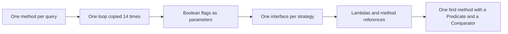
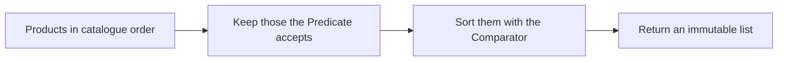

# Task 33 · Filtering the warehouse catalogue: behaviour parameterization

| Difficulty | Topics | Time box |
|---|---|---|
| 🟢 Easy | Behaviour parameterization · lambdas and method references · `Predicate` composition (`and`, `or`, `negate`, `Predicate.not`) · `Comparator` factories · the functional interfaces of `java.util.function` · PECS in a method signature | 1 h |

> **Background reading:** *Modern Java in Action* ch. 2 ("Passing code with behavior parameterization") and ch. 3 ("Lambda expressions", the sections on method references and composing lambdas) · *Effective Java* 3rd ed., Item 42 ("Prefer lambdas to anonymous classes"), Item 43 ("Prefer method references to lambdas"), Item 44 ("Favor the use of standard functional interfaces"), Item 31 ("Use bounded wildcards to increase API flexibility")

---

## The situation

The warehouse UI has a product search screen. Its backend, `ProductSearch`, has grown one method per question the screen asks:

```java
List<Product> findByCategoryAndInStock(Category category) {
    List<Product> result = new ArrayList<>();
    for (Product p : products) {
        if (p.category() == category && p.stock() > 0) {
            result.add(p);
        }
    }
    return result;
}

List<Product> findByCategoryAndPriceBelow(Category category, BigDecimal max) {
    List<Product> result = new ArrayList<>();
    for (Product p : products) {
        if (p.category() == category && p.price().compareTo(max) <= 0) {
            result.add(p);
        }
    }
    return result;
}
```

There are fourteen of these. Each one is a copy of the same loop with a different `if`. A new combination of filters means a new method, and every bug in the loop has to be fixed fourteen times. The sorting is copied too, in a different way each time.

We are going to replace all of them with one `find` method that takes the filter and the order as arguments. The filters and orders become small, reusable values. *Modern Java in Action* ch. 2 walks the same path that we walk here: first values, then flags, then strategy objects, and finally lambdas. Each step removes some repetition, and the last one removes the strategy interfaces entirely.

## The domain

| Term | Meaning |
|---|---|
| **Product** | A record: SKU, name, category, price (`BigDecimal`), stock count, weight in grams. |
| **Filter** | A `Predicate<Product>`: a yes or no question about one product. |
| **Order** | A `Comparator<Product>`: how the results are sorted. |
| **Projection** | Taking one value out of each matching product, such as its name. |
| **Catalogue** | The read-only set of products that all queries run against. |

The evolution, from one method per query to one method with a predicate:



What `find` does with its two arguments:



### The standard functional interfaces

We do not invent our own `ProductMatcher` or `ProductSorter`. The JDK already has the shapes we need in `java.util.function` and `java.util`:

| Interface | Abstract method | Shape | What we use it for |
|---|---|---|---|
| `Predicate<T>` | `boolean test(T)` | T to boolean | Filters. Composed with `and`, `or`, `negate` and `Predicate.not`. |
| `Comparator<T>` | `int compare(T, T)` | two T to int | Sort orders. Built with `comparing`, `thenComparing` and `reversed`. |
| `Function<T, R>` | `R apply(T)` | T to R | Projections, such as `Product::name`. Also used by `Collectors.groupingBy`. |
| `Supplier<T>` | `T get()` | nothing to T | A factory, such as `() -> new ArrayList<Product>()`. |
| `UnaryOperator<T>` | `T apply(T)` | T to T | Not used in this task. It fits a step like "apply a 10% discount to a price". |

## What I want from you

Implement the three utility classes and the `Catalogue`. The given records and enum are complete. Do not change them.

1. [`Category`](../src/main/java/io/github/chris013/practice/task33/Category.java) and [`Product`](../src/main/java/io/github/chris013/practice/task33/Product.java) are given. `Product` validates its fields: `null` gives `NullPointerException`, a blank SKU or name, a negative price or stock, or a weight that is not positive gives `IllegalArgumentException`.

2. [`ProductFilters`](../src/main/java/io/github/chris013/practice/task33/ProductFilters.java) is a `final` utility class. Its constructor is private and throws `AssertionError`. Each static factory returns a `Predicate<Product>`:
   * `inCategory(Category)` matches products in that category.
   * `priceBetween(min, max)` matches prices where `min <= price <= max`, with both ends included. If `min > max`, throw `IllegalArgumentException`. Compare with `compareTo`, so that `15` and `15.00` are the same bound.
   * `inStock()` matches products with stock greater than zero.
   * `nameContains(text)` matches names that contain `text`, ignoring case. Use `Locale.ROOT`.
   * `heavierThan(grams)` matches products that are strictly heavier than `grams`.
   * `allOf(predicates)` matches when every predicate matches. An empty list matches everything.
   * `anyOf(predicates)` matches when at least one predicate matches. An empty list matches nothing.
   * No argument and no list element may be `null`. A `null` gives `NullPointerException`.

3. [`ProductOrder`](../src/main/java/io/github/chris013/practice/task33/ProductOrder.java) is a `final` utility class with a private constructor. Each static method returns a `Comparator<Product>`:
   * `byPrice()` sorts by price, cheapest first.
   * `byStockDescending()` sorts by stock, the most items first.
   * `byCategoryThenName()` sorts by category in enum order, then by name, ignoring case.
   * `cheapestThenLightest()` sorts by price, then by weight ascending, then by SKU. The SKU makes the order total when two products have the same price and weight.

4. [`Catalogue`](../src/main/java/io/github/chris013/practice/task33/Catalogue.java) holds the products. Its constructor takes a `Collection<Product>` and copies it. Later changes to the caller's collection must not affect the catalogue.
   * `List<Product> find(Predicate, Comparator)` returns the matches, sorted, in a new immutable list.
   * `Optional<Product> findFirst(Predicate, Comparator)` returns the first match in the given order, or an empty `Optional`. On a tie, the product that comes first in the catalogue wins.
   * `<R> List<R> project(Predicate, Function)` returns the mapped values of the matches, in catalogue (insertion) order, as an immutable list. The order is not sorted.
   * `Map<Category, Long> countBy(Predicate)` counts the matches per category. Only categories with at least one match are keys. The map is unmodifiable.
   * `null` arguments give `NullPointerException`.

## Constraints & non-goals

* Use the standard functional interfaces. Do not declare a new functional interface for this task.
* No anonymous classes. A lambda or a method reference is the answer everywhere.
* No `boolean` flags in any signature, such as `find(category, inStock, sortByPrice)`.
* No mutable state in `Catalogue`. Every query is a pure function of the products.
* Do not change `Product` or `Category`.
* No caching. Sorted views are a stretch goal.

## How I'd approach it

**Behaviour parameterization.** You pass a piece of behaviour into a method as an argument, instead of writing one method for each variant of that behaviour. The `if` inside each of the fourteen loops is the behaviour. Once it is an argument, the loop is written once. Everything else in this task is the JDK's way of writing that idea down.

**Start with `ProductFilters`.** Write `inCategory` first, then `priceBetween`. Then check each factory against the table in the tests before you go on. Each factory is a method that returns a lambda capturing its arguments. You will find that a lambda is enough: no class, no field, no `this`.

**Lambdas, not anonymous classes** (*Effective Java* Item 42). An anonymous class is a new class per use: it has a `this` that means something different inside than outside, and it needs an `@Override` and a method body. A lambda is shorter, and `this` inside it is the enclosing instance. An anonymous class is only needed when you need state, several methods, or a type that is not a functional interface. A functional interface has exactly one abstract method, so a lambda can stand in for it.

**Method references** (*Effective Java* Item 43) come in four kinds. Use the one that says the most:
* static: `Integer::parseInt`, `Objects::nonNull`;
* bound instance: `Product.class::isInstance`, `System.out::println`;
* unbound instance: `Product::price`, `String::length`;
* constructor: `ArrayList::new`.

A constructor call with a fixed argument, such as `new StringBuilder("SKU-")`, cannot be a constructor reference, because the functional interface does not supply that argument. Use a lambda.

`Product::price` reads better than `p -> p.price()`. If the lambda just calls one method with the argument, use the reference.

**Why standard interfaces** (*Effective Java* Item 44). A `ProductMatcher` interface would need its own `and`, `or` and `negate` before it could compose. `Predicate` already has them. Every library method that takes a `Predicate` also accepts your filter with no adapter. Use a custom interface only when the standard ones really cannot express the idea, and name it for the domain.

**Why `? super Product` in `find`** (*Effective Java* Item 31, PECS: producer extends, consumer super). A `Predicate<Object>` can test any object, a product included. So a predicate that is wider than `Product` is also a valid filter for a catalogue of products. Writing `Predicate<? super Product>` in the signature lets the caller pass it. The test `accepts_a_predicate_and_comparator_written_for_a_supertype` shows this.

**Why `? extends` in `allOf` and `anyOf`.** The list produces predicates that we only read, so the element type can be `? extends Predicate<? super Product>`. The predicates consume products, so each of them takes `? super Product`. Read the signature out loud and you have the rule.

**Why `allOf(empty)` is true and `anyOf(empty)` is false.** These are identity elements. `a and b` gives the same result as `true and a and b`, so an empty conjunction is `true`. `a or b` equals `false or a or b`, so an empty disjunction is `false`.

**Comparators: the pitfalls.** The `reversed()` method is the trap:

* `comparing(Product::price).reversed()` reverses the price order. Good.
* `comparing(Product::price).thenComparing(Product::sku).reversed()` reverses the whole chain, so the SKUs come out in descending order too. That is almost never what you want.
* `comparing(Product::price, Comparator.reverseOrder()).thenComparing(Product::sku)` reverses only the price. The tie-breaker stays ascending.
* `comparing(p -> p.price()).reversed()` does not compile. In that position, the compiler cannot yet infer that `p` is a `Product`. A method reference works, because it names the type.

**Money.** `BigDecimal.equals` compares the scale too: `new BigDecimal("5.0").equals(new BigDecimal("5.00"))` is `false`. Use `compareTo` in every price filter and every price comparator.

**Locale.** `toLowerCase()` without a locale depends on the machine. Use `toLowerCase(Locale.ROOT)` for both sides of a search.

**The catalogue.** Four methods run the same first step: filter the products. Keep that step in one place. On a tie, `findFirst` must return the product that comes first in the catalogue; a test pins that down.

## Tests

Run: `mvn test -Dtest='**/task33/**'`

Four test classes use one fixed catalogue of eight products in [`SampleProducts`](../src/test/java/io/github/chris013/practice/task33/SampleProducts.java). The catalogue is built so that boundaries and ties are easy to see: two toys cost exactly 15.00, one food product weighs exactly 1000 grams, and two products are out of stock (a tool and a toy).

* [`ProductTest`](../src/test/java/io/github/chris013/practice/task33/ProductTest.java): the validation in the given `Product` record. These tests pass on the starter, because the record is given.
* [`ProductFiltersTest`](../src/test/java/io/github/chris013/practice/task33/ProductFiltersTest.java): each factory, its boundaries, `allOf` and `anyOf`, and the composition with `and`, `or`, `negate` and `Predicate.not`.
* [`ProductOrderTest`](../src/test/java/io/github/chris013/practice/task33/ProductOrderTest.java): each comparator and its tie-breakers.
* [`CatalogueTest`](../src/test/java/io/github/chris013/practice/task33/CatalogueTest.java): `find`, `findFirst`, `project` and `countBy`, the immutability of their results, the defensive copy of the input, and the `null` checks.

<details>
<summary>Show the tests</summary>

<!-- embed: src/test/java/io/github/chris013/practice/task33/SampleProducts.java -->
<!-- /embed -->

<!-- embed: src/test/java/io/github/chris013/practice/task33/ProductTest.java -->
<!-- /embed -->

<!-- embed: src/test/java/io/github/chris013/practice/task33/ProductFiltersTest.java -->
<!-- /embed -->

<!-- embed: src/test/java/io/github/chris013/practice/task33/ProductOrderTest.java -->
<!-- /embed -->

<!-- embed: src/test/java/io/github/chris013/practice/task33/CatalogueTest.java -->
<!-- /embed -->

</details>

## Definition of done

- [ ] All 76 tests are green, and the whole task runs in well under a second.
- [ ] `find`, `findFirst`, `project` and `countBy` take `? super Product` in their signatures, and a `Predicate<Object>` works with them.
- [ ] The `priceBetween` boundary tests pass with bounds written at a different scale, such as `15.000` and `15.0` for a price of `15.00`.
- [ ] No anonymous classes and no `boolean` flags in any signature.
- [ ] Every result list is immutable, and the catalogue copies its input.
- [ ] You can explain, without looking, why `allOf(List.of())` is true and what `reversed()` does to a chain.

## Stretch goals

1. Write a tiny query language: `category=TOOLS price<=20 stock>0`. Parse each token into one of the factories and combine them with `allOf`. Where does the error handling for an unknown token belong?
2. In DDD, the *Specification* pattern (Evans, *Domain-Driven Design*, ch. 9) is a named business rule that can be combined and tested on its own. Is a `Predicate<Product>` a specification? What does a named class add that a lambda does not?
3. The catalogue is immutable, so it could cache sorted views per comparator. Write the cache. Why is it safe here but not in a catalogue that can change?
4. Add `byPriceDescending()`. Write two tests that prove the difference between `comparing(price).reversed()` and `comparing(price, reverseOrder())` when a `thenComparing` follows.

---

## Reference solution

<details>
<summary>Spoiler: open only after you have made a serious attempt</summary>

### Key decisions

**1. Factories return lambdas, not a matcher class.** Each `ProductFilters` method is a few lines that capture their arguments. The alternative was a `ProductMatcher` interface with its own composition methods. That would duplicate `Predicate` and would not work with the JDK methods that already take a `Predicate`.

**2. `find` takes `? super Product`.** A filter written for a supertype works without a cast. This costs nothing at run time, and the signature says what the method needs: it only reads products from the filter.

**3. `allOf` and `anyOf` copy the list and use `allMatch` and `anyMatch`.** The copy means that a later change to the caller's list does not change the filter. The short-circuit of `allMatch` stops at the first failing predicate. The empty cases follow from the identity elements.

**4. Comparators are built from key extractors, and `reversed()` is only applied to a single key.** `byStockDescending` reverses one key comparator. The tie-breakers in `cheapestThenLightest` are never reversed, because we never reverse a chain. `cheapestThenLightest` ends with the SKU, so its order is total. `byPrice` does not, and that is fine for a sort screen: products with equal prices keep their catalogue order.

**5. `Catalogue` has one private helper for the filter step.** Four methods start the same way. The helper does the `null` check and the stream, so the null check cannot be forgotten in one method. The result types are immutable: `Stream.toList()` for lists and `Collections.unmodifiableMap` for the count.

**6. The utility classes have a private constructor that throws.** `ProductFilters` and `ProductOrder` cannot be instantiated by normal code. The private constructor throws `AssertionError`, as *Effective Java* Item 4 recommends.

### Code

<!-- embed: solutions/src/main/java/io/github/chris013/practice/task33/ProductFilters.java -->
<!-- /embed -->

<!-- embed: solutions/src/main/java/io/github/chris013/practice/task33/ProductOrder.java -->
<!-- /embed -->

<!-- embed: solutions/src/main/java/io/github/chris013/practice/task33/Catalogue.java -->
<!-- /embed -->

### What I typically flag in first attempts

| Finding | Why it matters |
|---|---|
| One method per query combination, such as `findByCategoryAndInStock` | The fourteen methods come back, one per new screen question. Compose predicates instead. |
| `reversed()` applied to the whole chain by accident | The tie-breakers reverse too, and the order is not the one the screen shows. |
| `BigDecimal.equals` in a price filter | `5.0` and `5.00` are the same price, but `equals` says they are not. Use `compareTo`. |
| A custom functional interface where a standard one fits | You lose `and`, `or` and `negate`, and every method that takes a `Predicate` needs an adapter. |
| Boolean flag parameters, such as `find(category, inStock, sortByPrice)` | Every new flag doubles the number of cases. A `Predicate` and a `Comparator` do not grow that way. |
| Returning a list the catalogue still owns | The caller can change the catalogue. Return a new immutable list. |
| `toLowerCase()` without a locale | The search result depends on the machine's locale. Use `Locale.ROOT`. |
| `Comparator.comparing(p -> p.price()).reversed()` | This does not compile. A method reference, `Product::price`, does. |

</details>
