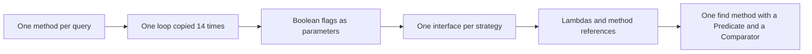
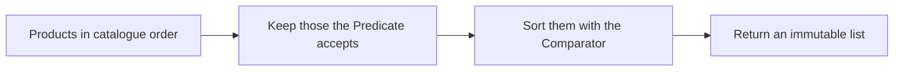

# Task 33 · Filtering the warehouse catalogue: behaviour parameterization

| Difficulty | Topics | Time box |
|---|---|---|
| 🟢 Easy | Behaviour parameterization · lambdas and method references · `Predicate` composition (`and`, `or`, `negate`, `Predicate.not`) · `Comparator` factories · the functional interfaces of `java.util.function` · PECS in a method signature | 1 h |

> **Background reading:** *Modern Java in Action* ch. 2 ("Passing code with behavior parameterization") and ch. 3 ("Lambda expressions", the sections on method references and composing lambdas) · *Effective Java* 3rd ed., Item 42 ("Prefer lambdas to anonymous classes"), Item 43 ("Prefer method references to lambdas"), Item 44 ("Favor the use of standard functional interfaces"), Item 31 ("Use bounded wildcards to increase API flexibility")

---

## The situation

The warehouse UI has a product search screen. Its backend, `ProductSearch`, has grown one method per question the screen asks:

```java
List<Product> findByCategoryAndInStock(Category category) {
    List<Product> result = new ArrayList<>();
    for (Product p : products) {
        if (p.category() == category && p.stock() > 0) {
            result.add(p);
        }
    }
    return result;
}

List<Product> findByCategoryAndPriceBelow(Category category, BigDecimal max) {
    List<Product> result = new ArrayList<>();
    for (Product p : products) {
        if (p.category() == category && p.price().compareTo(max) <= 0) {
            result.add(p);
        }
    }
    return result;
}
```

There are fourteen of these. Each one is a copy of the same loop with a different `if`. A new combination of filters means a new method, and every bug in the loop has to be fixed fourteen times. The sorting is copied too, in a different way each time.

We are going to replace all of them with one `find` method that takes the filter and the order as arguments. The filters and orders become small, reusable values. *Modern Java in Action* ch. 2 walks the same path that we walk here: first values, then flags, then strategy objects, and finally lambdas. Each step removes some repetition, and the last one removes the strategy interfaces entirely.

## The domain

| Term | Meaning |
|---|---|
| **Product** | A record: SKU, name, category, price (`BigDecimal`), stock count, weight in grams. |
| **Filter** | A `Predicate<Product>`: a yes or no question about one product. |
| **Order** | A `Comparator<Product>`: how the results are sorted. |
| **Projection** | Taking one value out of each matching product, such as its name. |
| **Catalogue** | The read-only set of products that all queries run against. |

The evolution, from one method per query to one method with a predicate:



What `find` does with its two arguments:



### The standard functional interfaces

We do not invent our own `ProductMatcher` or `ProductSorter`. The JDK already has the shapes we need in `java.util.function` and `java.util`:

| Interface | Abstract method | Shape | What we use it for |
|---|---|---|---|
| `Predicate<T>` | `boolean test(T)` | T to boolean | Filters. Composed with `and`, `or`, `negate` and `Predicate.not`. |
| `Comparator<T>` | `int compare(T, T)` | two T to int | Sort orders. Built with `comparing`, `thenComparing` and `reversed`. |
| `Function<T, R>` | `R apply(T)` | T to R | Projections, such as `Product::name`. Also used by `Collectors.groupingBy`. |
| `Supplier<T>` | `T get()` | nothing to T | A factory, such as `() -> new ArrayList<Product>()`. |
| `UnaryOperator<T>` | `T apply(T)` | T to T | Not used in this task. It fits a step like "apply a 10% discount to a price". |

## What I want from you

Implement the three utility classes and the `Catalogue`. The given records and enum are complete. Do not change them.

1. [`Category`](../src/main/java/io/github/chris013/practice/task33/Category.java) and [`Product`](../src/main/java/io/github/chris013/practice/task33/Product.java) are given. `Product` validates its fields: `null` gives `NullPointerException`, a blank SKU or name, a negative price or stock, or a weight that is not positive gives `IllegalArgumentException`.

2. [`ProductFilters`](../src/main/java/io/github/chris013/practice/task33/ProductFilters.java) is a `final` utility class. Its constructor is private and throws `AssertionError`. Each static factory returns a `Predicate<Product>`:
   * `inCategory(Category)` matches products in that category.
   * `priceBetween(min, max)` matches prices where `min <= price <= max`, with both ends included. If `min > max`, throw `IllegalArgumentException`. Compare with `compareTo`, so that `15` and `15.00` are the same bound.
   * `inStock()` matches products with stock greater than zero.
   * `nameContains(text)` matches names that contain `text`, ignoring case. Use `Locale.ROOT`.
   * `heavierThan(grams)` matches products that are strictly heavier than `grams`.
   * `allOf(predicates)` matches when every predicate matches. An empty list matches everything.
   * `anyOf(predicates)` matches when at least one predicate matches. An empty list matches nothing.
   * No argument and no list element may be `null`. A `null` gives `NullPointerException`.

3. [`ProductOrder`](../src/main/java/io/github/chris013/practice/task33/ProductOrder.java) is a `final` utility class with a private constructor. Each static method returns a `Comparator<Product>`:
   * `byPrice()` sorts by price, cheapest first.
   * `byStockDescending()` sorts by stock, the most items first.
   * `byCategoryThenName()` sorts by category in enum order, then by name, ignoring case.
   * `cheapestThenLightest()` sorts by price, then by weight ascending, then by SKU. The SKU makes the order total when two products have the same price and weight.

4. [`Catalogue`](../src/main/java/io/github/chris013/practice/task33/Catalogue.java) holds the products. Its constructor takes a `Collection<Product>` and copies it. Later changes to the caller's collection must not affect the catalogue.
   * `List<Product> find(Predicate, Comparator)` returns the matches, sorted, in a new immutable list.
   * `Optional<Product> findFirst(Predicate, Comparator)` returns the first match in the given order, or an empty `Optional`. On a tie, the product that comes first in the catalogue wins.
   * `<R> List<R> project(Predicate, Function)` returns the mapped values of the matches, in catalogue (insertion) order, as an immutable list. The order is not sorted.
   * `Map<Category, Long> countBy(Predicate)` counts the matches per category. Only categories with at least one match are keys. The map is unmodifiable.
   * `null` arguments give `NullPointerException`.

## Constraints & non-goals

* Use the standard functional interfaces. Do not declare a new functional interface for this task.
* No anonymous classes. A lambda or a method reference is the answer everywhere.
* No `boolean` flags in any signature, such as `find(category, inStock, sortByPrice)`.
* No mutable state in `Catalogue`. Every query is a pure function of the products.
* Do not change `Product` or `Category`.
* No caching. Sorted views are a stretch goal.

## How I'd approach it

**Behaviour parameterization.** You pass a piece of behaviour into a method as an argument, instead of writing one method for each variant of that behaviour. The `if` inside each of the fourteen loops is the behaviour. Once it is an argument, the loop is written once. Everything else in this task is the JDK's way of writing that idea down.

**Start with `ProductFilters`.** Write `inCategory` first, then `priceBetween`. Then check each factory against the table in the tests before you go on. Each factory is a method that returns a lambda capturing its arguments. You will find that a lambda is enough: no class, no field, no `this`.

**Lambdas, not anonymous classes** (*Effective Java* Item 42). An anonymous class is a new class per use: it has a `this` that means something different inside than outside, and it needs an `@Override` and a method body. A lambda is shorter, and `this` inside it is the enclosing instance. An anonymous class is only needed when you need state, several methods, or a type that is not a functional interface. A functional interface has exactly one abstract method, so a lambda can stand in for it.

**Method references** (*Effective Java* Item 43) come in four kinds. Use the one that says the most:
* static: `Integer::parseInt`, `Objects::nonNull`;
* bound instance: `Product.class::isInstance`, `System.out::println`;
* unbound instance: `Product::price`, `String::length`;
* constructor: `ArrayList::new`.

A constructor call with a fixed argument, such as `new StringBuilder("SKU-")`, cannot be a constructor reference, because the functional interface does not supply that argument. Use a lambda.

`Product::price` reads better than `p -> p.price()`. If the lambda just calls one method with the argument, use the reference.

**Why standard interfaces** (*Effective Java* Item 44). A `ProductMatcher` interface would need its own `and`, `or` and `negate` before it could compose. `Predicate` already has them. Every library method that takes a `Predicate` also accepts your filter with no adapter. Use a custom interface only when the standard ones really cannot express the idea, and name it for the domain.

**Why `? super Product` in `find`** (*Effective Java* Item 31, PECS: producer extends, consumer super). A `Predicate<Object>` can test any object, a product included. So a predicate that is wider than `Product` is also a valid filter for a catalogue of products. Writing `Predicate<? super Product>` in the signature lets the caller pass it. The test `accepts_a_predicate_and_comparator_written_for_a_supertype` shows this.

**Why `? extends` in `allOf` and `anyOf`.** The list produces predicates that we only read, so the element type can be `? extends Predicate<? super Product>`. The predicates consume products, so each of them takes `? super Product`. Read the signature out loud and you have the rule.

**Why `allOf(empty)` is true and `anyOf(empty)` is false.** These are identity elements. `a and b` gives the same result as `true and a and b`, so an empty conjunction is `true`. `a or b` equals `false or a or b`, so an empty disjunction is `false`.

**Comparators: the pitfalls.** The `reversed()` method is the trap:

* `comparing(Product::price).reversed()` reverses the price order. Good.
* `comparing(Product::price).thenComparing(Product::sku).reversed()` reverses the whole chain, so the SKUs come out in descending order too. That is almost never what you want.
* `comparing(Product::price, Comparator.reverseOrder()).thenComparing(Product::sku)` reverses only the price. The tie-breaker stays ascending.
* `comparing(p -> p.price()).reversed()` does not compile. In that position, the compiler cannot yet infer that `p` is a `Product`. A method reference works, because it names the type.

**Money.** `BigDecimal.equals` compares the scale too: `new BigDecimal("5.0").equals(new BigDecimal("5.00"))` is `false`. Use `compareTo` in every price filter and every price comparator.

**Locale.** `toLowerCase()` without a locale depends on the machine. Use `toLowerCase(Locale.ROOT)` for both sides of a search.

**The catalogue.** Four methods run the same first step: filter the products. Keep that step in one place. On a tie, `findFirst` must return the product that comes first in the catalogue; a test pins that down.

## Tests

Run: `mvn test -Dtest='**/task33/**'`

Four test classes use one fixed catalogue of eight products in [`SampleProducts`](../src/test/java/io/github/chris013/practice/task33/SampleProducts.java). The catalogue is built so that boundaries and ties are easy to see: two toys cost exactly 15.00, one food product weighs exactly 1000 grams, and two products are out of stock (a tool and a toy).

* [`ProductTest`](../src/test/java/io/github/chris013/practice/task33/ProductTest.java): the validation in the given `Product` record. These tests pass on the starter, because the record is given.
* [`ProductFiltersTest`](../src/test/java/io/github/chris013/practice/task33/ProductFiltersTest.java): each factory, its boundaries, `allOf` and `anyOf`, and the composition with `and`, `or`, `negate` and `Predicate.not`.
* [`ProductOrderTest`](../src/test/java/io/github/chris013/practice/task33/ProductOrderTest.java): each comparator and its tie-breakers.
* [`CatalogueTest`](../src/test/java/io/github/chris013/practice/task33/CatalogueTest.java): `find`, `findFirst`, `project` and `countBy`, the immutability of their results, the defensive copy of the input, and the `null` checks.

<details>
<summary>Show the tests</summary>

<!-- embed: src/test/java/io/github/chris013/practice/task33/SampleProducts.java -->
**[`SampleProducts.java`](../src/test/java/io/github/chris013/practice/task33/SampleProducts.java)**

```java
package io.github.chris013.practice.task33;

import java.math.BigDecimal;
import java.util.List;

/**
 * A fixed catalogue of eight products, used by all tests. The list order in {@link #all()} is the
 * catalogue (insertion) order. The values are chosen so that boundaries and ties are easy to see.
 */
final class SampleProducts {

    static final Product CLAW_HAMMER = product("T-100", "Claw hammer", Category.TOOLS, "12.50", 4, 600);
    static final Product CORDLESS_DRILL = product("T-200", "Cordless drill", Category.TOOLS, "89.00", 0, 1800);
    static final Product ROLLED_OATS = product("F-010", "Rolled oats 1kg", Category.FOOD, "2.49", 30, 1000);
    static final Product OLIVE_OIL = product("F-020", "Olive oil", Category.FOOD, "7.90", 12, 750);
    static final Product PLUSH_BEAR = product("Y-001", "Plush bear", Category.TOYS, "15.00", 8, 300);
    static final Product WOODEN_TRAIN = product("Y-002", "Wooden train set", Category.TOYS, "15.00", 0, 1200);
    static final Product HAMMER_HANDBOOK = product("B-001", "Hammer handbook", Category.BOOKS, "19.99", 2, 450);
    static final Product GARDENING_BOOK = product("B-002", "Gardening for beginners", Category.BOOKS, "5.00", 6, 400);

    private SampleProducts() {
    }

    static List<Product> all() {
        return List.of(CLAW_HAMMER, CORDLESS_DRILL, ROLLED_OATS, OLIVE_OIL,
                PLUSH_BEAR, WOODEN_TRAIN, HAMMER_HANDBOOK, GARDENING_BOOK);
    }

    static Product product(String sku, String name, Category category, String price, int stock, int weightGrams) {
        return new Product(sku, name, category, new BigDecimal(price), stock, weightGrams);
    }
}
```
<!-- /embed -->

<!-- embed: src/test/java/io/github/chris013/practice/task33/ProductTest.java -->
**[`ProductTest.java`](../src/test/java/io/github/chris013/practice/task33/ProductTest.java)**

```java
package io.github.chris013.practice.task33;

import static org.assertj.core.api.Assertions.assertThatCode;
import static org.assertj.core.api.Assertions.assertThatThrownBy;

import java.math.BigDecimal;
import org.junit.jupiter.api.Nested;
import org.junit.jupiter.api.Test;
import org.junit.jupiter.params.ParameterizedTest;
import org.junit.jupiter.params.provider.CsvSource;

/**
 * Tests for the given record. They pass on the starter too: they pin down the validation that the rest of the
 * task relies on.
 */
class ProductTest {

    @Nested
    class Validation {

        @Test
        void accepts_a_free_product_with_no_stock() {
            assertThatCode(() -> SampleProducts.product("X-1", "Free sample", Category.FOOD, "0", 0, 1))
                    .doesNotThrowAnyException();
        }

        @Test
        void rejects_a_null_sku_name_category_or_price() {
            BigDecimal price = BigDecimal.ONE;

            assertThatThrownBy(() -> new Product(null, "n", Category.FOOD, price, 1, 1))
                    .isInstanceOf(NullPointerException.class);
            assertThatThrownBy(() -> new Product("s", null, Category.FOOD, price, 1, 1))
                    .isInstanceOf(NullPointerException.class);
            assertThatThrownBy(() -> new Product("s", "n", null, price, 1, 1))
                    .isInstanceOf(NullPointerException.class);
            assertThatThrownBy(() -> new Product("s", "n", Category.FOOD, null, 1, 1))
                    .isInstanceOf(NullPointerException.class);
        }

        @ParameterizedTest
        @CsvSource({
            "' ', n",
            "'', n",
            "s, ' '"
        })
        void rejects_a_blank_sku_or_name(String sku, String name) {
            assertThatThrownBy(() -> new Product(sku, name, Category.FOOD, BigDecimal.ONE, 1, 1))
                    .isInstanceOf(IllegalArgumentException.class);
        }

        @Test
        void rejects_a_negative_price() {
            assertThatThrownBy(() -> SampleProducts.product("s", "n", Category.FOOD, "-0.01", 1, 1))
                    .isInstanceOf(IllegalArgumentException.class);
        }

        @Test
        void rejects_negative_stock() {
            assertThatThrownBy(() -> new Product("s", "n", Category.FOOD, BigDecimal.ONE, -1, 1))
                    .isInstanceOf(IllegalArgumentException.class);
        }

        @ParameterizedTest
        @CsvSource({"0", "-5"})
        void rejects_a_weight_that_is_not_positive(int weightGrams) {
            assertThatThrownBy(() -> new Product("s", "n", Category.FOOD, BigDecimal.ONE, 1, weightGrams))
                    .isInstanceOf(IllegalArgumentException.class);
        }
    }
}
```
<!-- /embed -->

<!-- embed: src/test/java/io/github/chris013/practice/task33/ProductFiltersTest.java -->
**[`ProductFiltersTest.java`](../src/test/java/io/github/chris013/practice/task33/ProductFiltersTest.java)**

```java
package io.github.chris013.practice.task33;

import static io.github.chris013.practice.task33.ProductFilters.allOf;
import static io.github.chris013.practice.task33.ProductFilters.anyOf;
import static io.github.chris013.practice.task33.ProductFilters.heavierThan;
import static io.github.chris013.practice.task33.ProductFilters.inCategory;
import static io.github.chris013.practice.task33.ProductFilters.inStock;
import static io.github.chris013.practice.task33.ProductFilters.nameContains;
import static io.github.chris013.practice.task33.ProductFilters.priceBetween;
import static io.github.chris013.practice.task33.SampleProducts.CLAW_HAMMER;
import static io.github.chris013.practice.task33.SampleProducts.CORDLESS_DRILL;
import static io.github.chris013.practice.task33.SampleProducts.GARDENING_BOOK;
import static io.github.chris013.practice.task33.SampleProducts.HAMMER_HANDBOOK;
import static io.github.chris013.practice.task33.SampleProducts.OLIVE_OIL;
import static io.github.chris013.practice.task33.SampleProducts.PLUSH_BEAR;
import static io.github.chris013.practice.task33.SampleProducts.ROLLED_OATS;
import static io.github.chris013.practice.task33.SampleProducts.WOODEN_TRAIN;
import static org.assertj.core.api.Assertions.assertThat;
import static org.assertj.core.api.Assertions.assertThatThrownBy;

import java.math.BigDecimal;
import java.util.ArrayList;
import java.util.Arrays;
import java.util.List;
import java.util.function.Predicate;
import org.junit.jupiter.api.Nested;
import org.junit.jupiter.api.Test;
import org.junit.jupiter.params.ParameterizedTest;
import org.junit.jupiter.params.provider.CsvSource;

class ProductFiltersTest {

    private static List<Product> matching(Predicate<Product> predicate) {
        return SampleProducts.all().stream().filter(predicate).toList();
    }

    @Nested
    class InCategory {

        @Test
        void matches_only_products_of_that_category() {
            assertThat(matching(inCategory(Category.TOOLS))).containsExactly(CLAW_HAMMER, CORDLESS_DRILL);
        }

        @Test
        void rejects_a_null_category() {
            assertThatThrownBy(() -> inCategory(null)).isInstanceOf(NullPointerException.class);
        }
    }

    @Nested
    class PriceBetween {

        @Test
        void includes_both_bounds_when_prices_are_exactly_on_them() {
            assertThat(matching(priceBetween(new BigDecimal("5.00"), new BigDecimal("15.00"))))
                    .containsExactly(CLAW_HAMMER, OLIVE_OIL, PLUSH_BEAR, WOODEN_TRAIN, GARDENING_BOOK);
        }

        // The min and max are compared by value, so the scale of the BigDecimal does not matter.
        @ParameterizedTest
        @CsvSource({
            "15, 15, 2",
            "15.000, 15.0, 2",
            "15.01, 19.99, 1",
            "5.00, 5.00, 1",
            "5.01, 7.89, 0"
        })
        void counts_matches_for_each_boundary_case(String min, String max, int expectedCount) {
            assertThat(matching(priceBetween(new BigDecimal(min), new BigDecimal(max)))).hasSize(expectedCount);
        }

        @Test
        void rejects_a_minimum_above_the_maximum() {
            assertThatThrownBy(() -> priceBetween(new BigDecimal("16"), new BigDecimal("15")))
                    .isInstanceOf(IllegalArgumentException.class);
        }

        @Test
        void rejects_null_bounds() {
            assertThatThrownBy(() -> priceBetween(null, BigDecimal.TEN)).isInstanceOf(NullPointerException.class);
            assertThatThrownBy(() -> priceBetween(BigDecimal.ONE, null)).isInstanceOf(NullPointerException.class);
        }
    }

    @Nested
    class InStock {

        @Test
        void excludes_products_with_zero_stock() {
            assertThat(matching(inStock())).containsExactly(
                    CLAW_HAMMER, ROLLED_OATS, OLIVE_OIL, PLUSH_BEAR, HAMMER_HANDBOOK, GARDENING_BOOK);
        }
    }

    @Nested
    class NameContains {

        @ParameterizedTest
        @CsvSource({
            "hammer, 2",
            "HAMMER, 2",
            "HaMmEr, 2",
            "oil, 1",
            "xyz, 0",
            "'', 8"
        })
        void matches_case_insensitively_anywhere_in_the_name(String text, int expectedCount) {
            assertThat(matching(nameContains(text))).hasSize(expectedCount);
        }

        @Test
        void returns_the_matching_products_in_catalogue_order() {
            assertThat(matching(nameContains("hammer"))).containsExactly(CLAW_HAMMER, HAMMER_HANDBOOK);
        }

        @Test
        void rejects_null_text() {
            assertThatThrownBy(() -> nameContains(null)).isInstanceOf(NullPointerException.class);
        }
    }

    @Nested
    class HeavierThan {

        @Test
        void is_strict_so_a_product_of_exactly_that_weight_is_excluded() {
            assertThat(matching(heavierThan(1000))).containsExactly(CORDLESS_DRILL, WOODEN_TRAIN);
        }

        @ParameterizedTest
        @CsvSource({
            "999, 3",
            "1000, 2",
            "1199, 2",
            "1200, 1",
            "1800, 0"
        })
        void counts_matches_around_each_weight(int grams, int expectedCount) {
            assertThat(matching(heavierThan(grams))).hasSize(expectedCount);
        }
    }

    @Nested
    class AllOf {

        @Test
        void an_empty_list_matches_everything() {
            assertThat(matching(allOf(List.of()))).hasSize(8);
        }

        @Test
        void matches_only_when_every_predicate_matches() {
            assertThat(matching(allOf(List.of(inCategory(Category.TOOLS), inStock())))).containsExactly(CLAW_HAMMER);
        }

        @Test
        void copies_the_list_so_later_changes_do_not_affect_the_filter() {
            List<Predicate<Product>> conditions = new ArrayList<>(List.of(inStock()));
            Predicate<Product> filter = allOf(conditions);

            conditions.add(inCategory(Category.TOYS));

            assertThat(matching(filter)).hasSize(6);
        }

        @Test
        void rejects_a_null_list_or_a_null_element() {
            assertThatThrownBy(() -> allOf(null)).isInstanceOf(NullPointerException.class);
            assertThatThrownBy(() -> allOf(Arrays.asList(inStock(), null)))
                    .isInstanceOf(NullPointerException.class);
        }
    }

    @Nested
    class AnyOf {

        @Test
        void an_empty_list_matches_nothing() {
            assertThat(matching(anyOf(List.of()))).isEmpty();
        }

        @Test
        void matches_when_at_least_one_predicate_matches() {
            Predicate<Product> books = inCategory(Category.BOOKS);
            Predicate<Product> cheap = priceBetween(BigDecimal.ZERO, BigDecimal.valueOf(3));

            assertThat(matching(anyOf(List.of(books, cheap))))
                    .containsExactly(ROLLED_OATS, HAMMER_HANDBOOK, GARDENING_BOOK);
        }

        @Test
        void rejects_a_null_list_or_a_null_element() {
            assertThatThrownBy(() -> anyOf(null)).isInstanceOf(NullPointerException.class);
            assertThatThrownBy(() -> anyOf(Arrays.asList(inStock(), null)))
                    .isInstanceOf(NullPointerException.class);
        }
    }

    @Nested
    class Composition {

        @Test
        void and_combines_two_filters() {
            assertThat(matching(inCategory(Category.TOYS).and(inStock()))).containsExactly(PLUSH_BEAR);
        }

        @Test
        void or_combines_two_filters() {
            assertThat(matching(inCategory(Category.BOOKS).or(heavierThan(1500))))
                    .containsExactly(CORDLESS_DRILL, HAMMER_HANDBOOK, GARDENING_BOOK);
        }

        @Test
        void negate_inverts_a_filter() {
            assertThat(matching(inStock().negate())).containsExactly(CORDLESS_DRILL, WOODEN_TRAIN);
        }

        @Test
        void predicate_not_is_the_same_as_negate() {
            assertThat(matching(Predicate.not(inStock()))).containsExactly(CORDLESS_DRILL, WOODEN_TRAIN);
        }
    }
}
```
<!-- /embed -->

<!-- embed: src/test/java/io/github/chris013/practice/task33/ProductOrderTest.java -->
**[`ProductOrderTest.java`](../src/test/java/io/github/chris013/practice/task33/ProductOrderTest.java)**

```java
package io.github.chris013.practice.task33;

import static io.github.chris013.practice.task33.SampleProducts.product;
import static org.assertj.core.api.Assertions.assertThat;

import java.util.Comparator;
import java.util.List;
import org.junit.jupiter.api.Nested;
import org.junit.jupiter.api.Test;

class ProductOrderTest {

    private static List<String> skusSortedBy(Comparator<Product> order) {
        return SampleProducts.all().stream().sorted(order).map(Product::sku).toList();
    }

    @Nested
    class ByPrice {

        @Test
        void sorts_the_cheapest_first() {
            assertThat(skusSortedBy(ProductOrder.byPrice()))
                    .containsExactly("F-010", "B-002", "F-020", "T-100", "Y-001", "Y-002", "B-001", "T-200");
        }

        @Test
        void compares_prices_by_value_not_by_scale() {
            Comparator<Product> order = ProductOrder.byPrice();

            assertThat(order.compare(product("A", "a", Category.FOOD, "5.0", 1, 1),
                    product("B", "b", Category.FOOD, "5.00", 1, 1))).isZero();
        }

        @Test
        void keeps_the_catalogue_order_for_equal_prices() {
            assertThat(skusSortedBy(ProductOrder.byPrice())).containsSubsequence("Y-001", "Y-002");
        }
    }

    @Nested
    class ByStockDescending {

        @Test
        void sorts_the_most_items_first() {
            assertThat(skusSortedBy(ProductOrder.byStockDescending()))
                    .containsExactly("F-010", "F-020", "Y-001", "B-002", "T-100", "B-001", "T-200", "Y-002");
        }

        @Test
        void treats_equal_stock_as_a_tie_and_keeps_the_catalogue_order() {
            Comparator<Product> order = ProductOrder.byStockDescending();

            assertThat(order.compare(SampleProducts.CORDLESS_DRILL, SampleProducts.WOODEN_TRAIN)).isZero();
            assertThat(skusSortedBy(order)).containsSubsequence("T-200", "Y-002");
        }
    }

    @Nested
    class ByCategoryThenName {

        @Test
        void groups_by_category_in_enum_order_then_sorts_by_name() {
            assertThat(skusSortedBy(ProductOrder.byCategoryThenName()))
                    .containsExactly("F-020", "F-010", "T-100", "T-200", "Y-001", "Y-002", "B-002", "B-001");
        }

        @Test
        void compares_names_ignoring_case() {
            Comparator<Product> order = ProductOrder.byCategoryThenName();
            Product banana = product("1", "Banana", Category.FOOD, "1", 1, 1);
            Product apple = product("2", "apple", Category.FOOD, "1", 1, 1);

            // Case-sensitive order would put "Banana" first, because 'B' comes before 'a'.
            assertThat(order.compare(apple, banana)).isNegative();
        }

        @Test
        void an_earlier_category_wins_even_when_its_name_is_later() {
            Comparator<Product> order = ProductOrder.byCategoryThenName();
            Product zebraFood = product("1", "Zebra", Category.FOOD, "1", 1, 1);
            Product aardvarkBook = product("2", "Aardvark", Category.BOOKS, "1", 1, 1);

            assertThat(order.compare(zebraFood, aardvarkBook)).isNegative();
        }
    }

    @Nested
    class CheapestThenLightest {

        @Test
        void sorts_by_price_and_then_by_weight() {
            assertThat(skusSortedBy(ProductOrder.cheapestThenLightest()))
                    .containsExactly("F-010", "B-002", "F-020", "T-100", "Y-001", "Y-002", "B-001", "T-200");
        }

        @Test
        void a_lighter_product_wins_a_price_tie() {
            Comparator<Product> order = ProductOrder.cheapestThenLightest();
            Product heavy = product("Y-9", "Heavy", Category.TOYS, "15.00", 1, 1200);
            Product light = product("Y-1", "Light", Category.TOYS, "15.00", 1, 300);

            assertThat(order.compare(light, heavy)).isNegative();
        }

        @Test
        void the_sku_decides_when_price_and_weight_are_equal() {
            Comparator<Product> order = ProductOrder.cheapestThenLightest();
            Product b2 = product("B-2", "Same", Category.BOOKS, "3.00", 1, 100);
            Product b1 = product("B-1", "Same", Category.BOOKS, "3.00", 1, 100);

            assertThat(order.compare(b1, b2)).isNegative();
            assertThat(order.compare(b2, b1)).isPositive();
        }
    }
}
```
<!-- /embed -->

<!-- embed: src/test/java/io/github/chris013/practice/task33/CatalogueTest.java -->
**[`CatalogueTest.java`](../src/test/java/io/github/chris013/practice/task33/CatalogueTest.java)**

```java
package io.github.chris013.practice.task33;

import static io.github.chris013.practice.task33.ProductFilters.heavierThan;
import static io.github.chris013.practice.task33.ProductFilters.inCategory;
import static io.github.chris013.practice.task33.ProductFilters.inStock;
import static io.github.chris013.practice.task33.ProductOrder.byPrice;
import static io.github.chris013.practice.task33.ProductOrder.byStockDescending;
import static io.github.chris013.practice.task33.SampleProducts.CLAW_HAMMER;
import static io.github.chris013.practice.task33.SampleProducts.CORDLESS_DRILL;
import static org.assertj.core.api.Assertions.assertThat;
import static org.assertj.core.api.Assertions.assertThatThrownBy;

import java.util.ArrayList;
import java.util.Arrays;
import java.util.Comparator;
import java.util.List;
import java.util.Map;
import java.util.Optional;
import java.util.function.Function;
import java.util.function.Predicate;
import org.junit.jupiter.api.Nested;
import org.junit.jupiter.api.Test;

class CatalogueTest {

    private final Catalogue catalogue = new Catalogue(SampleProducts.all());

    @Nested
    class Find {

        @Test
        void returns_the_matches_sorted_by_the_given_order() {
            assertThat(catalogue.find(inStock(), byPrice()))
                    .extracting(Product::sku)
                    .containsExactly("F-010", "B-002", "F-020", "T-100", "Y-001", "B-001");
        }

        @Test
        void returns_an_empty_list_when_nothing_matches() {
            assertThat(catalogue.find(inCategory(Category.TOYS).and(heavierThan(5000)), byPrice())).isEmpty();
        }

        @Test
        void returns_an_immutable_list() {
            List<Product> result = catalogue.find(inStock(), byPrice());

            assertThatThrownBy(() -> result.add(CLAW_HAMMER)).isInstanceOf(UnsupportedOperationException.class);
            assertThatThrownBy(result::clear).isInstanceOf(UnsupportedOperationException.class);
        }

        @Test
        void rejects_null_arguments() {
            assertThatThrownBy(() -> catalogue.find(null, byPrice())).isInstanceOf(NullPointerException.class);
            assertThatThrownBy(() -> catalogue.find(inStock(), null)).isInstanceOf(NullPointerException.class);
        }

        @Test
        void accepts_a_predicate_and_comparator_written_for_a_supertype() {
            Predicate<Object> isProduct = Product.class::isInstance;
            Comparator<Object> byText = Comparator.comparing(Object::toString);

            List<Product> result = catalogue.find(isProduct, byText);

            assertThat(result).hasSize(8);
            assertThat(result.get(0).sku()).isEqualTo("B-001");
        }

        @Test
        void the_other_queries_also_accept_functions_written_for_a_supertype() {
            Predicate<Object> any = o -> true;
            Comparator<Object> byText = Comparator.comparing(Object::toString);
            Function<Object, String> text = Object::toString;

            assertThat(catalogue.findFirst(any, byText)).isPresent();
            assertThat(catalogue.project(any, text)).hasSize(8);
            assertThat(catalogue.countBy(any)).containsEntry(Category.FOOD, 2L);
        }
    }

    @Nested
    class FindFirst {

        @Test
        void returns_the_first_match_in_the_given_order() {
            assertThat(catalogue.findFirst(inCategory(Category.TOOLS), byPrice()))
                    .contains(CLAW_HAMMER);
        }

        @Test
        void returns_empty_when_nothing_matches() {
            assertThat(catalogue.findFirst(heavierThan(5000), byPrice())).isEqualTo(Optional.empty());
        }

        @Test
        void on_a_tie_returns_the_product_that_comes_first_in_the_catalogue() {
            // Both are out of stock, so the comparator sees a tie.
            Predicate<Product> outOfStock = inStock().negate();

            assertThat(catalogue.findFirst(outOfStock, byStockDescending())).contains(CORDLESS_DRILL);
        }

        @Test
        void rejects_null_arguments() {
            assertThatThrownBy(() -> catalogue.findFirst(null, byPrice())).isInstanceOf(NullPointerException.class);
            assertThatThrownBy(() -> catalogue.findFirst(inStock(), null)).isInstanceOf(NullPointerException.class);
        }
    }

    @Nested
    class Project {

        @Test
        void maps_the_matches_in_catalogue_order_not_sorted_order() {
            assertThat(catalogue.project(inCategory(Category.BOOKS), Product::name))
                    .containsExactly("Hammer handbook", "Gardening for beginners");
        }

        @Test
        void can_map_to_any_type() {
            assertThat(catalogue.project(inCategory(Category.TOYS), Product::weightGrams))
                    .containsExactly(300, 1200);
        }

        @Test
        void returns_an_empty_immutable_list_when_nothing_matches() {
            List<String> names = catalogue.project(heavierThan(5000), Product::name);

            assertThat(names).isEmpty();
            assertThatThrownBy(() -> names.add("x")).isInstanceOf(UnsupportedOperationException.class);
        }

        @Test
        void rejects_null_arguments() {
            assertThatThrownBy(() -> catalogue.project(null, Product::name))
                    .isInstanceOf(NullPointerException.class);
            assertThatThrownBy(() -> catalogue.project(inStock(), null))
                    .isInstanceOf(NullPointerException.class);
        }
    }

    @Nested
    class CountBy {

        @Test
        void counts_the_matches_per_category() {
            assertThat(catalogue.countBy(inStock()))
                    .isEqualTo(Map.of(Category.FOOD, 2L, Category.TOOLS, 1L, Category.TOYS, 1L, Category.BOOKS, 2L));
        }

        @Test
        void leaves_out_categories_without_a_match() {
            assertThat(catalogue.countBy(heavierThan(1000)))
                    .isEqualTo(Map.of(Category.TOOLS, 1L, Category.TOYS, 1L))
                    .doesNotContainKeys(Category.FOOD, Category.BOOKS);
        }

        @Test
        void returns_an_empty_map_when_nothing_matches() {
            assertThat(catalogue.countBy(heavierThan(5000))).isEmpty();
        }

        @Test
        void returns_an_unmodifiable_map() {
            Map<Category, Long> counts = catalogue.countBy(inStock());

            assertThatThrownBy(() -> counts.put(Category.TOYS, 9L)).isInstanceOf(UnsupportedOperationException.class);
        }

        @Test
        void rejects_a_null_filter() {
            assertThatThrownBy(() -> catalogue.countBy(null)).isInstanceOf(NullPointerException.class);
        }
    }

    @Nested
    class Construction {

        @Test
        void copies_the_input_so_later_changes_do_not_leak_in() {
            List<Product> source = new ArrayList<>(SampleProducts.all());
            Catalogue copy = new Catalogue(source);

            source.clear();

            assertThat(copy.find(product -> true, byPrice())).hasSize(8);
        }

        @Test
        void rejects_null_input_and_null_products() {
            assertThatThrownBy(() -> new Catalogue(null)).isInstanceOf(NullPointerException.class);
            assertThatThrownBy(() -> new Catalogue(Arrays.asList(CLAW_HAMMER, null)))
                    .isInstanceOf(NullPointerException.class);
        }
    }
}
```
<!-- /embed -->

</details>

## Definition of done

- [ ] All 77 tests are green, and the whole task runs in well under a second.
- [ ] `find`, `findFirst`, `project` and `countBy` take `? super Product` in their signatures, and a `Predicate<Object>` works with them.
- [ ] The `priceBetween` boundary tests pass with bounds written at a different scale, such as `15.000` and `15.0` for a price of `15.00`.
- [ ] No anonymous classes and no `boolean` flags in any signature.
- [ ] Every result list is immutable, and the catalogue copies its input.
- [ ] You can explain, without looking, why `allOf(List.of())` is true and what `reversed()` does to a chain.

## Stretch goals

1. Write a tiny query language: `category=TOOLS price<=20 stock>0`. Parse each token into one of the factories and combine them with `allOf`. Where does the error handling for an unknown token belong?
2. In DDD, the *Specification* pattern (Evans, *Domain-Driven Design*, ch. 9) is a named business rule that can be combined and tested on its own. Is a `Predicate<Product>` a specification? What does a named class add that a lambda does not?
3. The catalogue is immutable, so it could cache sorted views per comparator. Write the cache. Why is it safe here but not in a catalogue that can change?
4. Add `byPriceDescending()`. Write two tests that prove the difference between `comparing(price).reversed()` and `comparing(price, reverseOrder())` when a `thenComparing` follows.

---

## Reference solution

<details>
<summary>Spoiler: open only after you have made a serious attempt</summary>

### Key decisions

**1. Factories return lambdas, not a matcher class.** Each `ProductFilters` method is a few lines that capture their arguments. The alternative was a `ProductMatcher` interface with its own composition methods. That would duplicate `Predicate` and would not work with the JDK methods that already take a `Predicate`.

**2. `find` takes `? super Product`.** A filter written for a supertype works without a cast. This costs nothing at run time, and the signature says what the method needs: it only reads products from the filter.

**3. `allOf` and `anyOf` copy the list and use `allMatch` and `anyMatch`.** The copy means that a later change to the caller's list does not change the filter. The short-circuit of `allMatch` stops at the first failing predicate. The empty cases follow from the identity elements.

**4. Comparators are built from key extractors, and `reversed()` is only applied to a single key.** `byStockDescending` reverses one key comparator. The tie-breakers in `cheapestThenLightest` are never reversed, because we never reverse a chain. `cheapestThenLightest` ends with the SKU, so its order is total. `byPrice` does not, and that is fine for a sort screen: products with equal prices keep their catalogue order.

**5. `Catalogue` has one private helper for the filter step.** Four methods start the same way. The helper does the `null` check and the stream, so the null check cannot be forgotten in one method. The result types are immutable: `Stream.toList()` for lists and `Collections.unmodifiableMap` for the count.

**6. The utility classes have a private constructor that throws.** `ProductFilters` and `ProductOrder` cannot be instantiated by normal code. The private constructor throws `AssertionError`, as *Effective Java* Item 4 recommends.

### Code

<!-- embed: solutions/src/main/java/io/github/chris013/practice/task33/ProductFilters.java -->
**[`ProductFilters.java`](../solutions/src/main/java/io/github/chris013/practice/task33/ProductFilters.java)**

```java
package io.github.chris013.practice.task33;

import java.math.BigDecimal;
import java.util.List;
import java.util.Locale;
import java.util.Objects;
import java.util.function.Predicate;

/**
 * Reusable predicates for the catalogue search screen. Each factory returns a lambda that captures its arguments.
 * Combine them with {@link Predicate#and}, {@link Predicate#or}, {@link Predicate#negate}, {@link Predicate#not},
 * or with {@link #allOf} and {@link #anyOf} when the list of conditions comes from the user.
 */
public final class ProductFilters {

    private ProductFilters() {
        throw new AssertionError("no instances");
    }

    public static Predicate<Product> inCategory(Category category) {
        Objects.requireNonNull(category, "category");
        return product -> product.category() == category;
    }

    /**
     * Both bounds are inclusive. The comparison uses {@code compareTo}, so {@code 15} and {@code 15.00}
     * are the same bound.
     */
    public static Predicate<Product> priceBetween(BigDecimal minInclusive, BigDecimal maxInclusive) {
        Objects.requireNonNull(minInclusive, "minInclusive");
        Objects.requireNonNull(maxInclusive, "maxInclusive");
        if (minInclusive.compareTo(maxInclusive) > 0) {
            throw new IllegalArgumentException("min %s is above max %s".formatted(minInclusive, maxInclusive));
        }
        return product -> product.price().compareTo(minInclusive) >= 0
                && product.price().compareTo(maxInclusive) <= 0;
    }

    public static Predicate<Product> inStock() {
        return product -> product.stock() > 0;
    }

    /**
     * The text is lower-cased with {@link Locale#ROOT}, not the default locale. In Turkish, the default
     * locale maps {@code I} to a dotless letter, and a search for "ITEM" would silently fail.
     */
    public static Predicate<Product> nameContains(String text) {
        Objects.requireNonNull(text, "text");
        String needle = text.toLowerCase(Locale.ROOT);
        return product -> product.name().toLowerCase(Locale.ROOT).contains(needle);
    }

    public static Predicate<Product> heavierThan(int grams) {
        return product -> product.weightGrams() > grams;
    }

    /**
     * The list is copied, so the caller can change its own list later without changing this filter.
     * An empty list gives an empty conjunction, which is true for every product.
     */
    public static Predicate<Product> allOf(List<? extends Predicate<? super Product>> predicates) {
        List<Predicate<? super Product>> copy = List.copyOf(Objects.requireNonNull(predicates, "predicates"));
        return product -> copy.stream().allMatch(predicate -> predicate.test(product));
    }

    /** An empty list gives an empty disjunction, which is false for every product. */
    public static Predicate<Product> anyOf(List<? extends Predicate<? super Product>> predicates) {
        List<Predicate<? super Product>> copy = List.copyOf(Objects.requireNonNull(predicates, "predicates"));
        return product -> copy.stream().anyMatch(predicate -> predicate.test(product));
    }
}
```
<!-- /embed -->

<!-- embed: solutions/src/main/java/io/github/chris013/practice/task33/ProductOrder.java -->
**[`ProductOrder.java`](../solutions/src/main/java/io/github/chris013/practice/task33/ProductOrder.java)**

```java
package io.github.chris013.practice.task33;

import java.util.Comparator;

/**
 * Reusable comparators for the catalogue search screen. Each one is a single-purpose comparator, and the
 * combined ones are built from small pieces with {@code thenComparing}.
 */
public final class ProductOrder {

    private ProductOrder() {
        throw new AssertionError("no instances");
    }

    public static Comparator<Product> byPrice() {
        return Comparator.comparing(Product::price);
    }

    /**
     * {@code reversed()} is applied to the single key comparator here. Applied to a whole chain, it would
     * also reverse the tie-breakers (see the Key decisions in the task).
     */
    public static Comparator<Product> byStockDescending() {
        return Comparator.comparingInt(Product::stock).reversed();
    }

    public static Comparator<Product> byCategoryThenName() {
        return Comparator.comparing(Product::category)
                .thenComparing(Product::name, String.CASE_INSENSITIVE_ORDER);
    }

    /**
     * Ends with the SKU, so two different products never compare as equal. A sort by this comparator gives
     * the same result every time, whatever order the products came in.
     */
    public static Comparator<Product> cheapestThenLightest() {
        return Comparator.comparing(Product::price)
                .thenComparingInt(Product::weightGrams)
                .thenComparing(Product::sku);
    }
}
```
<!-- /embed -->

<!-- embed: solutions/src/main/java/io/github/chris013/practice/task33/Catalogue.java -->
**[`Catalogue.java`](../solutions/src/main/java/io/github/chris013/practice/task33/Catalogue.java)**

```java
package io.github.chris013.practice.task33;

import java.util.Collection;
import java.util.Collections;
import java.util.Comparator;
import java.util.EnumMap;
import java.util.List;
import java.util.Map;
import java.util.Objects;
import java.util.Optional;
import java.util.function.Function;
import java.util.function.Predicate;
import java.util.stream.Collectors;
import java.util.stream.Stream;

/**
 * An in-memory, read-only view over a set of products. One generic {@code find} replaces one method per query.
 */
public final class Catalogue {

    private final List<Product> products;

    /** Copies the collection. Later changes to the caller's collection do not show up here. */
    public Catalogue(Collection<Product> products) {
        this.products = List.copyOf(Objects.requireNonNull(products, "products"));
    }

    public List<Product> find(Predicate<? super Product> filter, Comparator<? super Product> order) {
        Objects.requireNonNull(order, "order");
        return matching(filter).sorted(order).toList();
    }

    /**
     * {@code Stream.min} keeps the earlier element when two are equal, so on a tie the product that comes
     * first in the catalogue wins.
     */
    public Optional<Product> findFirst(Predicate<? super Product> filter, Comparator<? super Product> order) {
        Objects.requireNonNull(order, "order");
        return matching(filter).min(order);
    }

    public <R> List<R> project(Predicate<? super Product> filter, Function<? super Product, ? extends R> mapper) {
        Objects.requireNonNull(mapper, "mapper");
        return matching(filter).<R>map(mapper).toList();
    }

    /**
     * Only categories with at least one match appear as keys. The map is in enum order and is unmodifiable.
     */
    public Map<Category, Long> countBy(Predicate<? super Product> filter) {
        Map<Category, Long> counts = matching(filter)
                .collect(Collectors.groupingBy(Product::category,
                        () -> new EnumMap<>(Category.class),
                        Collectors.counting()));
        return Collections.unmodifiableMap(counts);
    }

    private Stream<Product> matching(Predicate<? super Product> filter) {
        Objects.requireNonNull(filter, "filter");
        return products.stream().filter(filter);
    }
}
```
<!-- /embed -->

### What I typically flag in first attempts

| Finding | Why it matters |
|---|---|
| One method per query combination, such as `findByCategoryAndInStock` | The fourteen methods come back, one per new screen question. Compose predicates instead. |
| `reversed()` applied to the whole chain by accident | The tie-breakers reverse too, and the order is not the one the screen shows. |
| `BigDecimal.equals` in a price filter | `5.0` and `5.00` are the same price, but `equals` says they are not. Use `compareTo`. |
| A custom functional interface where a standard one fits | You lose `and`, `or` and `negate`, and every method that takes a `Predicate` needs an adapter. |
| Boolean flag parameters, such as `find(category, inStock, sortByPrice)` | Every new flag doubles the number of cases. A `Predicate` and a `Comparator` do not grow that way. |
| Returning a list the catalogue still owns | The caller can change the catalogue. Return a new immutable list. |
| `toLowerCase()` without a locale | The search result depends on the machine's locale. Use `Locale.ROOT`. |
| `Comparator.comparing(p -> p.price()).reversed()` | This does not compile. A method reference, `Product::price`, does. |

</details>
